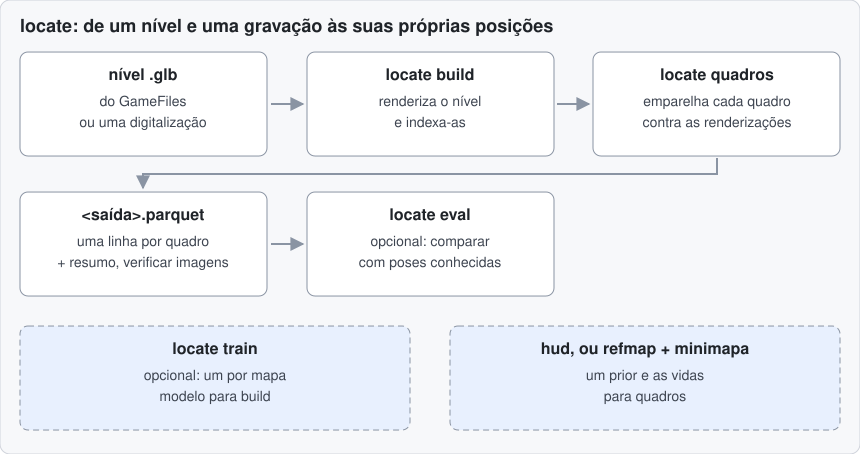

# Localizar quadros num nível {#locating-frames-in-a-level}

`locate` descobre onde foi tirado cada quadro de uma gravação de jogo - a posição 3D da câmara e a direção do
olhar - comparando a imagem com renderizações da própria geometria do nível. Serve para jogos que não guardam registo
de onde estava o jogador: sem demo, sem ficheiro de replay, sem telemetria. Battlefield 6 é o primeiro.

> **Experimental.** Em gravações reais, localiza só uma pequena parte dos quadros, por agora; ver
> [Quadros reais: experimental](#real-frames-experimental).

```bash
# Once per level: render it from every place a player can stand, and index the renders.
.venv\Scripts\python -m heat3d_capture locate build level.glb -o level.db

# Per recording: where was each frame taken?
.venv\Scripts\python -m heat3d_capture locate frames "<recording>.mp4" --db level.db -o out/match
```

A posição vem **da imagem**, contra o nível inteiro, sem qualquer prior. O trajeto no minimapa do
[leitor de HUD](hud-video.md) é só uma alternativa para os quadros que a imagem não consegue situar, e cada linha
indica de qual das duas veio.




## O que faz e o que não toca {#what-it-does-and-does-not-touch}

- Lê a **gravação própria** do jogador e um ficheiro de nível que o jogador exportou da **sua própria cópia** do
  jogo. Nunca toca no jogo, na sua memória, nos seus ficheiros enquanto corre, nem na sua rede, e corre depois da partida. Ver [As regras](rules.md).
- Localiza **apenas a câmara do próprio jogador**: o quadro é a vista do próprio jogador.
- O nível, a base de dados construída a partir dele e tudo o que é renderizado a partir dele pertencem à editora do
  jogo. Mantenha-os locais.

## Requisitos {#requirements}

- O que `requirements.txt` lista, PyTorch (do pytorch.org, para a GPU), e `requirements-locate.txt`:

```bash
.venv\Scripts\python -m pip install -r requirements-locate.txt
```

- Uma GPU com OpenGL 3,3 (4,3 é mais rápido) para as renderizações, e de preferência CUDA para os modelos. Na CPU
  funciona, mas devagar.
- Os modelos são obtidos no primeiro uso (cerca de 450 MB): DINOv2 do Hugging Face, ALIKED e LightGlue através
  do kornia. Todos têm licença para utilização comercial; ver [Licenças](#licences).
- O **nível** como `.glb` (ou `.gltf`) no referencial do visualizador, Y para cima, **com as suas texturas de cor
  base**, tal como os exportadores do 3DHeat o escrevem (partes `ground:` / `structure:`; os nomes das partes não são
  necessários). Uma unidade é um metro, a não ser que o `extras.unit_metres` do nível de topo do ficheiro diga outra
  coisa. Uma digitalização do GameCapture (`reconstruct`, a janela de digitalização) é escrito em **centímetros** e traz
  `extras.unit_metres: 0.01`, por isso é lido no seu tamanho real. Um nível sem texturas funciona muito pior; ver
  [Limites](#limits).

## Comandos {#commands}

### `locate build <level> -o <db>` {#locate-build---o-}

Renderiza o nível a partir de cada lugar onde um jogador poderia estar e guarda, por renderização, a sua pose e um
descritor global.

| Opção | Padrão | Significado |
|---|---|---|
| `level` | | O `.glb` / `.gltf` do nível. |
| `-o`, `--out` | | A pasta da base de dados a escrever. |
| `--game` | `bf6` | O perfil do jogo: alturas dos olhos, campo de visão, caixas do HUD, velocidade (abaixo). `generic` para qualquer jogo em primeira pessoa. |
| `--eye` | a do perfil | Alturas dos olhos acima do chão em metros, a de pé primeiro. Uma vista da base de dados por altura. |
| `--fov` / `--vfov` | a do perfil | O campo de visão horizontal da gravação, ou o vertical (o controlo deslizante do Battlefield) para uma gravação 16:9. |
| `--spacing` | 2.5 | Metros entre os lugares de onde as vistas são tiradas. |
| `--yaw-step` | 30 | Graus entre as direções das vistas. |
| `--pitch` | 0 | Inclinações a renderizar, em graus para cima. |
| `--positions` | nenhum | Uma tabela (Parquet ou CSV com `x`, `y`, `z` nos pés, no referencial do nível) de onde tirar os lugares em vez de cada chão: por exemplo, a saída de uma execução anterior. |
| `--shadows` | desligado | Projeta as sombras do sol nas renderizações (o sol do próprio nível, quando o ficheiro o indica em `extras.sun`). |
| `--untextured` | desligado | Renderiza só forma e luz. |
| `--box X0 Z0 X1 Z1` | o ficheiro inteiro | Só lugares dentro desta caixa (unidades do nível): a área de jogo. |
| `--places` | `auto` | De onde se tiram as vistas: `nav` - jogadores à altura dos olhos sobre a malha de navegação do nível (partes `nav:`: exatamente onde o jogo deixa andar), câmaras de veículo à sua altura sobre as partes `ground:` (terreno e estradas) a 50 m dele; `ground` - ambos sobre `ground:`; `floors` - sobre cada face virada para cima (telhados e caixotes incluídos); `auto` - `nav` quando o nível tem malha de navegação, senão `floors`. |
| `--head` | nenhum | Uma cabeça por mapa de `locate train` para os descritores. |

Escreve `<db>/db.json` (com o que foi construído e como) e `<db>/views.npz` (poses, descritores).

### `locate frames <recording> --db <db>` {#locate-frames----db-}

| Opção | Padrão | Significado |
|---|---|---|
| `source` | | Um vídeo, uma imagem, ou uma pasta de imagens (lidas em ordem de nome, com `--fps` de intervalo). |
| `--db` | | A base de dados que `build` escreveu. O seu ficheiro de nível precisa continuar no lugar (ou `--level`). |
| `-o`, `--out` | `<source>.locate` | Caminho de saída sem extensão. |
| `--fps` | 2 | Quadros localizados por segundo de vídeo. |
| `--start`, `--seconds` | tudo | A parte do vídeo a ler. |
| `--width` | 1280 | A largura a que os quadros são comparados. |
| `--shortlist` | 8 | Vistas da base de dados tentadas por quadro perto de um prior ou de uma fixação. |
| `--search-shortlist` | 16 | Sem prior: vistas da base de dados tentadas por quadro ([pesquisados em conjunto](#with-no-prior-frames-searched-together)). |
| `--no-search` | desligado | Sem prior: pesquisa cada quadro por si e acredita na sua fixação sem os vizinhos. |
| `--accept-depth` | 0 (desligado) | Sem prior: acredita numa fixação só se a distância mais longa das suas correspondências for esta vez a mais curta. |
| `--accept-support` | 2 | Sem prior: vizinhos concordantes ao longo da vida que uma fixação precisa para ser acreditada. |
| `--checkpoint` | nenhum | Guarda aqui o estado da execução e continua a partir dele se lá estiver. |
| `--stop-file`, `--stop-process` | nenhum | Para sozinho, com o estado guardado, código de saída 75, quando este ficheiro existe ou quando corre um processo cujo nome começa por este (verificado antes de cada quadro; pode ser repetido), para que uma execução longa liberte a máquina para um jogo. O mesmo comando continua depois. |
| `--normalise` | nenhum | Normalização leve da luz antes da comparação: `clahe`, `gray`. |
| `--minimap` | nenhum | A tabela do verbo `hud`: a **alternativa** para os quadros que a imagem não consegue situar. |
| `--prior-radius` | nenhum | **Aceleração opcional**, desligada por padrão: pesquisa só as vistas da base de dados a este número de metros da posição do minimapa (precisa de `--minimap`). |
| `--minimap-anchor` | nenhum | Um ficheiro JSON que liga o minimapa ao nível ([o minimapa como prior de pesquisa](#the-minimap-as-a-search-prior)): o minimapa corta a pesquisa desde o primeiro quadro; as fixações assim encontradas são `visual+minimap-prior`. |
| `--no-level-search` | desligado | Com um prior: quando nada perto dele encaixa, não pesquisar também o nível inteiro (mais rápido). |
| `--lives` | a tabela de `--minimap` | A tabela do verbo `hud` cujas mortes, implantações e reanimações dizem quando o jogador estava em jogo: as posições só saltam através de uma morte ([vidas a partir da filmagem](#lives-from-the-footage)). |
| `--no-sequence` | desligado | Decide cada quadro por si, não ao longo da execução (abaixo). |
| `--fit-fov` | desligado | Depois da execução, ajusta o campo de visão às fixações mais fortes, por vista, e o indica. |
| `--check-every` | 0 | Também a cada N quadros, situados ou não, uma imagem em `<out>.check`. |
| `--no-checks` | desligado | Não escreve as imagens de verificação das fixações visuais (abaixo). |
| `--no-zoomed` | desligado | Não resolve as vistas com zoom a partir das fixações dos vizinhos (abaixo). |
| `--no-grow` | desligado | Não volta a pesquisar perto de cada fixação os quadros à volta dela que ainda não têm uma. |
| `--game`, `--eye`, `--fov`, `--vfov`, `--mask`, `--no-hud-mask`, `--max-speed` | os do perfil | Como acima; `--mask x,y,w,h` acrescenta uma caixa de ecrã (num ecrã 1920x1080) que não é o nível. |
| `--vehicle-vfov` | o do perfil | O campo de visão vertical das câmaras de veículo (o controlo deslizante de veículo do Battlefield). |
| `--settings` | o ficheiro de definições mais recente | `bf6`: o ficheiro de definições do jogo do qual se leem os campos de visão (só leitura) quando não é dado `--fov`/`--vfov`; por padrão, o `PROFSAVE*_profile` mais recente em `Documents/Battlefield 6/settings`. Tem as definições como estão agora, o que pode não ser como uma gravação antiga foi feita. |

### `locate refmap <level> <deploy screen> -o <refmap>` {#locate-refmap----o-}

Coloca o próprio mapa do jogo sobre o nível: a referência contra a qual o minimapa é lido
([o minimapa, lido contra o nível](#the-minimap-read-against-the-level)). `<deploy screen>` é uma imagem do ecrã de
implantação que mostra o mapa inteiro, ou uma gravação com `--at <seconds>` num momento desses; a caixa do mapa do
perfil é recortada dela (`--whole-picture` mantém tudo). Escreve `<refmap>.png` (o mapa reamostrado no próprio
referencial do nível, `--mpp` metros por pixel, padrão 0.5), `<refmap>.valid.png` (onde é mesmo o mapa, e não
um marcador ou uma legenda) e `<refmap>.json` (o referencial e a calibração, com a distância que os azulejos do mapa
ficaram dele). `--topdown <prefix>` guarda o nível renderizado de cima para a execução seguinte (`--topdown-mpp`,
padrão 0,656 m; `--box` limita).

### `locate minimap <recording> --refmap <refmap> -o <table>.parquet` {#locate-minimap----refmap---o-parquet}

Lê o minimapa da gravação contra o mapa de referência, quadro a quadro (`--fps`, padrão 2): posição,
rumo e zoom de cada minimapa que encaixa, no referencial do nível, escritos como uma tabela de minimapa com uma
âncora ao lado (`<table>.anchor.json`) que `locate frames` aceita como
`--minimap <table>.parquet --minimap-anchor <table>.anchor.json`. Com a tabela do verbo `hud` (`--hud`), as suas
vidas são transportadas; com uma âncora para essa tabela também (`--hud-anchor`), a primeira pesquisa é à volta de
onde ela põe o jogador, e onde nenhum minimapa encaixa, o trajeto do HUD preenche os buracos, deslocado para as
fixações mais próximas do mapa de referência (`--hud-fill`, segundos, padrão 120; 0 desliga). A `source` da
tabela diz qual (`refmap`, `hud`).

### `locate eval <out>.parquet --truth <poses>` {#locate-eval-parquet---truth-}

Compara um resultado com poses de câmara conhecidas: uma tabela com `time`, `x`, `y`, `z` (os olhos), `yaw`, `pitch`
no referencial do nível. `--offset` é o desvio do relógio (tempo da verdade = tempo do vídeo + offset); sem ele, o
desvio é procurado. `--unit-metres` converte os erros em metros.

## Perfis de jogo {#game-profiles}

| | `bf6` | `generic` |
|---|---|---|
| Alturas dos olhos | 1,6 m de pé, 1,05 m agachado (ainda não medido no jogo) | 1,65, 1,1 m |
| Campo de visão | 55 graus na vertical, cerca de 86 na horizontal a 16:9: **passe o do jogador** com `--vfov` | 90 na horizontal |
| HUD mascarado | minimapa e lista de esquadrão, feed de abates, bússola, munições, a arma do jogador, os popups, a mira | a mira |
| Mais rápido a pé | 8 m/s | 8 m/s |
| Vistas distinguidas | a pé, veículo, com zoom (abaixo) | cada quadro a pé |
| Câmaras de veículo | o controlo deslizante do veículo (do ficheiro de definições), o veículo mascarado, a câmara até 8 m acima do chão, 30 m/s | - |

O campo de visão é o que mais pesa: um quadro resolvido com o campo errado é resolvido com a distância focal
errada, e a sua posição desliza ao longo da vista.

## Saídas {#outputs}

### `<out>.parquet` {#parquet}

Uma linha por quadro localizado, no **referencial do nível** (Y para cima, unidades do nível), com as instruções de
leitura do visualizador no rodapé (`kind: heat3d-locate`). O rodapé nomeia como extra cada coluna que não tem um papel
próprio, para que o visualizador as mantenha todas (o seu cartão de inspeção as mostra).

| Coluna | Significado |
|---|---|
| `time` | Segundos desde o início do vídeo. |
| `event` | `start` na primeira linha de uma vida, `position` nas restantes. |
| `x`, `y`, `z` | Os olhos, suavizados dentro da vida. Vazio onde nenhuma das fontes situou o quadro. |
| `yaw`, `pitch` | Graus: guinada em torno do eixo vertical (0 ao longo de +X, crescendo para -Z, que é a guinada do próprio jogo no referencial do visualizador), arfagem para cima a partir da horizontal. `pitch` fica vazio nas linhas de minimapa. |
| `dir_x`, `dir_y`, `dir_z` | A direção do olhar. |
| `player`, `team`, `session` | `me`, `own` e `<video>#NN`, uma por vida. |
| `life` | A vida em que a filmagem mostra o quadro (a partir das mortes do HUD; 1 = a primeira). Vazio quando está fora de jogo (morto, abatido, em implantação) ou quando as vidas não foram lidas. `session` é a vida do trajeto, que também se pode dividir num salto. |
| `source` | `visual` (da imagem), `visual+minimap-prior` (da imagem, a pesquisa cortada para o prior do minimapa), `minimap` (a alternativa), `minimap+nav-floor` (dentro de edifícios: o minimapa e o chão da malha de navegação) ou `none`. |
| `view` | `foot`, `vehicle`, `zoomed` ou `screen` (abaixo). |
| `cam_x`, `cam_y`, `cam_z` | A câmara que viu o quadro. A pé e através de uma mira é o olho, e `x`, `y`, `z` são os mesmos; na vista de terceira pessoa de um veículo, `x`, `y`, `z` são o veículo (o modelo de deslocamento abaixo) e a câmara vai atrás e acima dele. |
| `hfov`, `zoom` | O campo de visão horizontal com que o quadro foi resolvido, e, numa vista com zoom, o seu zoom em relação à vista normal. |
| `confidence` | 0..1: quanto confiar na linha (abaixo). |
| `uncertainty` | O erro típico da linha, em unidades do nível: para uma fixação visual, a partir dos seus inliers e dos vizinhos; para uma linha de minimapa, a partir do ajuste (abaixo). |
| `inliers`, `rmse` | Os inliers PnP e o erro de reprojeção da resolução visual (pixels à largura de trabalho). |
| `x_raw` ... `pitch_raw` | A resolução visual antes da suavização (também para os valores atípicos que foram votados fora). |
| `kept` | A fixação visual sobreviveu à votação dos valores atípicos. |
| `note` | Porque um quadro não foi situado, ou foi votado fora. |

### `<out>.summary.json` {#summaryjson}

Quadros, fixações visuais, valores atípicos, vidas, linhas por fonte, o ajuste do minimapa (pares, inliers,
resíduo), tempo por quadro.

## Método {#method}

### A base de dados {#the-database}

Os lugares são pontos em cada triângulo virado para cima do nível, espalhados de forma uniforme (um por `--spacing`
numa grade 3D, para que os pisos de um edifício tenham cada um o seu). Cada um é verificado a partir do seu olho com
seis pequenas renderizações de profundidade: uma câmara dentro da geometria vê sobretudo faces traseiras, um espaço
rastejante tem algo sólido sobre o olho; ambos são descartados. De cada lugar, o nível é renderizado a cada altura de
olhos, a cada `--yaw-step` e a cada `--pitch`, e cada renderização é descrita pelo **DINOv2** (os seus tokens de
remendo agrupados por média generalizada, juntos com o token de classe).

As características locais e os pontos 3D contra os quais um quadro é finalmente resolvido **não são guardados**:
são refeitos quando necessários, renderizando as poucas vistas que a recuperação escolheu, o que leva milissegundos. Isso
mantém uma base de dados em poucas centenas de megabytes, e não em dezenas de gigabytes, e é o que permite o
refinamento abaixo. O custo é que `frames` precisa do ficheiro do nível e de uma GPU, não só da base de dados.

### Um quadro {#one-frame}

1. **Máscara** do que não é o nível: as caixas do HUD do perfil e a mira, mais qualquer `--mask`.
2. **Recuperação** sobre o **nível inteiro**: o descritor do quadro contra cada vista da base de dados; as
   algumas dezenas mais semelhantes, desbastadas para terem lugares e direções diferentes, são a lista curta.
3. **Correspondência**: cada vista da lista curta é renderizada de novo no tamanho e campo de visão do quadro, com
   a sua profundidade. Os pontos-chave ALIKED do quadro e da renderização são comparados com o LightGlue. Um pixel
   da renderização com a sua profundidade é um ponto 3D do nível, por isso cada correspondência é uma correspondência
   2D-3D; os pontos-chave numa aresta de profundidade (cuja profundidade pode pertencer ao que está atrás deles) são
   descartados.
4. **Pose**: PnP com RANSAC (SQPnP), depois um refinamento robusto que mantém a câmara nivelada - uma vista em
   primeira pessoa não rola - e minimiza o erro de reprojeção dos inliers.
5. **É possível?** Uma pose precisa estar à altura dos olhos de um jogador sobre um chão e fora da geometria (uma
   renderização de profundidade diretamente para baixo). Uma textura parecida noutro lugar - um chão ladrilhado
   comparado com uma parede do mesmo material - pode dar centenas de inliers numa pose que nenhum jogador poderia ter;
   essas são postas de lado, por muitos inliers que tenham.
6. **Renderizar e comparar**: o nível é renderizado na pose resolvida e comparado de novo, o que substitui uma vista da
   base de dados a até alguns metros e dezenas de graus de distância por uma que quase coincide com o quadro.
   Repete-se enquanto ganha inliers (no máximo duas vezes).
7. **Escolha**: os três lugares mais fortes (a mais de cerca de 3 m uns dos outros) são refinados um a um antes de
   escolher um. Um parecido pode liderar antes do refinamento; o lugar certo ganha muito mais com ele.
8. **Veredicto**: `confidence` combina o número de inliers, o melhor outro lugar (`runner_up`) e o erro de
   reprojeção. Uma fixação é `ok` com pelo menos 25 inliers, nenhum outro lugar com mais de 80% dos seus inliers, e uma
   confiança de pelo menos 0,85 - o limiar que as medições abaixo colocam entre 97,5 e 99% de acerto.

### Vistas {#views}

Um quadro nem sempre são os olhos do jogador. O detetor do perfil lê no HUD qual é a vista, e o quadro é resolvido
em conformidade:

- **A pé**: o campo de visão de infantaria e as alturas dos olhos.
- **Veículo** (Battlefield 6: as indicações de teclas do diagrama do assento, `C CAMERA` e `E EXIT`, no centro inferior):
  o campo de visão do veículo, o próprio veículo mascarado (o meio inferior do ecrã na sua vista de terceira pessoa), e
  uma câmara permitida até 8 m acima do chão. A fixação é a da câmara.
- **Ecrã** (bordas escuras com um meio escuro: o mapa de implantação, um menu, a tabela de pontuação): não é uma vista
  do nível; saltada.
- **Com zoom** (uma mira, a mira de um artilheiro, a vista de primeira pessoa de um veículo: uma borda do ecrã preta,
  ambas escuras, à volta de uma imagem brilhante): não é pesquisada sobre o nível - a fatia de nível vista por uma mira
  não se parece com nenhuma das vistas largas da base de dados - mas é resolvida depois da execução, a partir da
  fixação mais próxima a até 6 s, abaixo. Desligado com `--no-zoomed`.

### Vistas com zoom {#zoomed-views}

Uma vista estreita fixa mal a posição: um passo atrás com um pouco mais de zoom parece quase o mesmo. Por isso um
quadro com zoom começa de onde o seu vizinho diz que a mira está - a pé, o olho dessa fixação; num veículo, 2,5 m
acima do chão, sob o meio do veículo (a mira de uma torre) - e de quanto pode ter se movido desde então: 2 m, mais 4 m
por segundo a pé ou 8 num veículo, no máximo 12 m (`reach`).

1. **Direção e zoom, a posição mantida.** Para cada zoom de 1, 1,2 (a vista própria de um veículo, mais estreita do
   que a pé), 1,5, 2, 3, 4, 6 e 8, o nível é renderizado no assento em direções a menos de 30 graus das do vizinho (e,
   a partir de 3x, algumas inclinações). Os pontos-chave do quadro comparados com uma renderização, com os pontos do
   nível sob eles, são raios a partir do assento; uma rotação é ajustada a eles dois a dois (RANSAC) para distâncias
   focais de 0,75 a 1,3 vezes a desse zoom, com um ponto a concordar dentro de um ângulo que admite o assento estar
   `reach` fora à sua distância. Vence o zoom, a direção e a distância focal com que mais pontos concordam.
2. **Assentado.** Esses pontos ajustam então posição, direção e distância focal em conjunto, pelo seu erro de
   reprojeção, a posição mantida no assento por um custo de dois pixels por cada `reach` deslocado; renderizado mais uma
   vez na resposta e ajustado de novo. Os inliers e o erro são contados em pixels, e a fixação é `ok` pela mesma
   confiança de qualquer outra.

O zoom escrito (`zoom`) é em relação ao campo de visão da execução a pé; `hfov` é o resolvido. Num veículo, a posição
escrita é a do veículo, 2,5 m abaixo da mira, como na sua vista de terceira pessoa.

### Veículos: a câmara e o veículo {#vehicles-the-camera-and-the-vehicle}

Na vista de terceira pessoa de um veículo, a pose resolvida é a da câmara de perseguição, que vai atrás e acima do
veículo e gira em torno dele à medida que o jogador olha à volta. A posição escrita (`x`, `y`, `z`) é a do veículo - o
chão sob o seu meio: a câmara mais o `vehicle_offset` do perfil, tantos metros à frente ao longo da direção horizontal
do olhar da câmara e tantos para baixo. A câmara fica em `cam_x`, `cam_y`, `cam_z`. A conversão é feita antes da
sequência e do trajeto, para que uma câmara que gira em torno de um veículo parado não seja tomada por movimento. O
rodapé da tabela leva o deslocamento usado e se foi medido (`vehicleOffset`). A pé e através de uma mira não há
deslocamento.

Como foi medido o deslocamento do Battlefield 6: em fixações certas de quadros reais de terceira pessoa de um tanque,
o meio do tanque foi marcado a olho no quadro, e o nível renderizado na fixação deu o chão nesse pixel. O perfil
toma a mediana: cerca de 10 m à frente da câmara e cerca de 4 m abaixo dela. A marcação é boa a um metro ou algo assim, e é
um tipo de veículo só; um carro ou um helicóptero monta a sua câmara de outra forma.

### Sem prior: quadros pesquisados em conjunto {#with-no-prior-frames-searched-together}

O descritor global de um quadro contra um nível inteiro é um sinal fraco, e os inliers de um quadro não distinguem
um lugar certo de um parecido. Por isso, sem prior, os quadros de uma gravação são primeiro descritos e pesquisados em
conjunto (`search.py`), e uma fixação só é acreditada com os quadros à volta dela:

- **Lista curta.** As semelhanças de cada vista são medidas contra a sua própria média e dispersão ao longo da gravação,
  para que uma vista parecida com todos os quadros deixe de ganhar em todo o lado. Cada quadro pontua as células
  de uma grade de 24 m pela ordem da sua melhor vista; o melhor caminho pelas células ao longo de cada vida, dentro do
  que o jogador consegue cobrir entre quadros, dá uma crença por célula, e a melhor vista de cada célula, a mais
  acreditada primeiro, é uma lista só. A recuperação simples é a outra, e as duas são usadas por turnos: medir vistas
  contra a gravação penaliza um lugar que o jogador quase não deixa, que é onde a recuperação simples se dá bem.
- **Acreditar.** Um candidato só conta se os seus inliers cobrirem pelo menos 12% de uma grade 8 x 8 sobre o
  quadro: um parecido é um objeto repetido, uma pilha de contentores, com centenas de inliers em poucas células do
  quadro. Uma fixação é acreditada quando fica no melhor caminho pelos candidatos que contam (abaixo), com pelo menos
  dois vizinhos a menos de 6 s que concordam com ela. Um quadro fora de jogo não é pesquisado de todo.
- **Crescer.** Só se cresce a partir do que é acreditado, e uma fixação crescida precisa cobrir o quadro da mesma forma.

### Ao longo da execução {#along-the-run}

Cada quadro guarda cada pose fisicamente possível que encontrou, uma por lugar (`candidates`), e não só a mais forte.
A execução escolhe depois uma por quadro - ou nenhuma - de modo que as poses escolhidas formem um caminho que um
jogador poderia ter andado ou conduzido, e que o maior número possível de inliers fique sobre ele: um modelo oculto de
Markov, decodificado de uma vez (Viterbi). Um parecido que ganha um quadro sozinho perde para o lugar com que os
vizinhos concordam; um candidato fraco por onde o caminho passa, com pelo menos dois vizinhos a concordar, torna-se uma
fixação (`note`: chosen along the sequence - escolhido ao longo da sequência); uma fixação confiante que todos os
vizinhos contradizem deixa do ser. Um vizinho só conta como concordante a menos de 6 s: mais afastado, a distância que
um jogador - e ainda mais um veículo - poderia ter percorrido é tão grande que concordar não diz nada. Desligado com
`--no-sequence`.

### Tempos dos quadros {#frame-times}

O `time` de uma linha é o carimbo temporal do próprio quadro na gravação, e não a sua contagem sobre a taxa de
quadros nominal. As gravações derivam da sua taxa nominal (por algumas décimas de segundo dentro de um clip, nas que
foram medidas), e tudo o que lê um quadro de volta pelo seu tempo - as imagens de verificação, a passagem com zoom,
`locate train --real`, o minimapa do verbo `hud` - procura pelo carimbo temporal. Contar quadros poria a imagem de
verificação, até essa distância, longe do quadro localizado.

### O campo de visão, a partir dos quadros {#the-field-of-view-from-the-frames}

`--fit-fov` guarda as fixações mais fortes de uma execução (por vista) e refina a pose e a distância focal de cada uma,
em conjunto, sobre os seus inliers; a mediana delas é o campo de visão com que a gravação foi feita, indicada no resumo
(`hfov_fitted`) para o `--fov` da execução seguinte. Os pontos próximos e distantes movem-se de forma diferente com uma
mudança de distância focal do que com uma mudança de posição, e é isso que o fixa; precisa de fixações com profundidade,
não de uma parede plana.

### Um modelo por mapa {#a-per-map-model}

`locate train` treina uma pequena cabeça sobre o DINOv2 para um nível, com renderizações dele, para que o descritor
global encontre as vistas certas de quadros reais e não só das renderizações:

- **Cabeça**: cada token de remendo passa por uma projeção de duas camadas, agrupado por média generalizada sobre os
  remendos que mostram o nível, junto com o token de classe projetado. O DINOv2 fica congelado. Tudo isto está escrito
  aqui (MIT).
- **Pares**: um lugar no chão por onde se pode andar e uma direção, renderizados duas vezes a partir de poses a um ou dois
  metros e uma dúzia de graus de distância, com campos de visão até 10 graus de distância, sob luz diferente (sol, sombras,
  luz ambiente), cada um através de um aspeto de jogo: gradação, névoa por profundidade, brilho, vinheta, fumo, pessoas
  no caminho, o veículo do próprio jogador nas vistas de veículo, desfoque de movimento, ruído, JPEG (`augment.py`).
  Mascarados como um quadro. Lugares a poucos metros que olham para o mesmo lado não contam como negativos.
- **Quadros reais**: quadros com uma pose que o próprio pipeline encontrou (pseudo-rótulos: fixações escolhidas ao
  longo de uma sequência) podem entrar como pares - o quadro e uma renderização na sua pose - numa segunda ronda.
- **Perda**: contrastiva (InfoNCE) sobre o lote.

`locate build --head <head.pt>` constrói a base de dados com ele; `frames` usa-o depois para os quadros.

| Opção de `locate train` | Padrão | Significado |
|---|---|---|
| `-o`, `--out` | obrigatório | O ficheiro da cabeça a escrever (`.pt`). |
| `--steps` | 600 | Passos de treino. |
| `--real TABLE VIDEO` | nenhum | Uma tabela de `locate frames` e a sua gravação: as suas fixações confiantes entram como pares reais. Repetível. |
| `--real-confidence` | 0.85 | A confiança que uma fixação precisa para entrar como par real. |
| `--spacing`, `--box`, `--places`, e as opções do perfil | como `build` | Onde estão os lugares de treino, e o perfil do jogo. |

### Verificar a olho {#checking-by-eye}

Cada fixação visual recebe uma imagem em `<out>.check` - `<time>s_<view>_visual.jpg`: o quadro, e ao lado dele o
nível renderizado na câmara da fixação, com as bordas do quadro desenhadas por cima da renderização. Onde coincidem,
a fixação está certa. Escrito depois da sequência e o trajeto terem decidido, por isso as imagens são exatamente as
linhas que a tabela chama visuais. Desligado com `--no-checks`.

### O minimapa, lido contra o nível {#the-minimap-read-against-the-level}

Um minimapa costurado num só mosaico (o do verbo `hud`) não é plano: a sua escala deriva com o zoom a que cada minimapa
foi registado, um lugar visto duas vezes pode ser desenhado duas vezes, e o mosaico de cada clip é o seu próprio. Uma
semelhança ajustada a algumas fixações fica então certa perto delas e a dezenas de metros de distância longe delas. Por
isso o minimapa é colocado pelo próprio nível, em dois passos, e nada é costurado:

- **O mapa de referência** (`locate refmap`). O ecrã de implantação desenha o mapa inteiro virado a norte, plano, numa
  só escala. O nível renderizado de cima mostra as mesmas coisas de pé sobre o chão (tanques, edifícios, muros): no
  nível, a sua altura sobre o chão num raio de 15 m; no mapa, o que está desenhado mais claro do que o chão à volta. O
  mapa é posto sobre o nível pela correlação cruzada normalizada dos dois, sobre escala e uma pequena rotação, refinada
  comparando azulejos do mapa um a um, e por fim com todo o mapa de uma vez à volta dessa resposta (algumas dezenas de
  azulejos deixam a escala solta de uma percentagem, metros nas pontas do mapa). O resultado é uma só semelhança, do
  pixel do mapa para o nível.
- **O minimapa, quadro a quadro** (`locate minimap`). Cada minimapa amostrado - o recorte do leitor do HUD e a sua
  máscara de sobreposição - é comparado (SIFT) com o mapa de referência à volta de onde o jogador estava por último, ou em
  qualquer ponto quando não se sabe onde, e é ajustada uma semelhança (rotação, zoom, deslocamento). O ponto do jogador
  levado através dela é a posição, o topo do minimapa (o cone de visão) é o rumo, e a sua escala é o zoom - medido, não
  assumido.
- **Onde não encaixa.** O ecrã de implantação não desenha nada fora da área de jogo; um minimapa que mostra sobretudo o
  que fica fora dela - um jogador no limite do mapa - não tem nada para encaixar. Aí o próprio trajeto do HUD faz de
  substituto, deslocado pelo desvio medido pelas fixações do mapa de referência mais próximas (`--hud-fill`); é tão bom
  quanto o mosaico é perto dessas fixações.

No nível de teste, o minimapa lido assim ficou a alguns metros (mediana) das fixações confiantes da imagem, tão bom fora
da área onde o mapa de referência foi ajustado como dentro dela.

### O minimapa como prior de pesquisa {#the-minimap-as-a-search-prior}

O trajeto do minimapa do verbo `hud` diz, para a maioria dos quadros em jogo, mais ou menos onde está o jogador e
para que lado olha - nas suas próprias unidades (pixels do minimapa, norte para cima). Ligado ao nível uma vez, corta a
pesquisa a uma pequena parte dele; a pose em si continua a vir da imagem, pelas mesmas regras.

- **A âncora** (`--minimap-anchor <anchor.json>`): uma semelhança por mapa, do minimapa para o nível - escala, rotação
  (com o espelho entre os pixels com norte para cima e os eixos do nível), deslocamento - ajustada às fixações visuais
  confiantes (confiança 0,7 e acima) de vários clips. O minimapa de cada clip é um mosaico que o leitor do HUD costurou
  sozinho, por isso cada um fica noutro lugar em unidades do minimapa; dois mosaicos de um mesmo mapa diferem só por um
  deslocamento, encontrado por correspondência de pontos-chave entre eles (o deslocamento em que mais correspondências
  concordam), e cada mosaico fica ligado a uma referência através de todos os pares que concordam bem. O ficheiro da
  âncora leva a semelhança do mapa, o deslocamento do clip (`clip_shift`), e o erro que a âncora mostrou contra as
  fixações de clips deixados de fora do seu ajuste (`median`, `p90`, metros).
- **Onde e para que lado.** O rumo do minimapa é a guinada da câmara: nos clips medidos concordou com a guinada
  resolvida a 2-5 graus. Assim, um quadro é primeiro comparado com renderizações feitas onde o minimapa põe a câmara -
  a pé um olho sobre o chão ali, num veículo a câmara de perseguição atrás e acima dele (o deslocamento do veículo) -
  olhando ao longo do rumo: o ponto e 4 m para cada lado, a duas inclinações (`seeds`). Só quando nenhuma dessas dá uma
  fixação é que se tentam as vistas próprias da base de dados dentro do disco (30 m mais o erro do percentil 90 da
  âncora).
- **Corrigido à medida que a execução avança.** Cada fixação confiante perto do prior diz quão longe a âncora está ali; a
  mediana das que estão a menos de 2 minutos corrige o prior, e a sua dispersão (pelo menos 5 m) substitui o erro da
  âncora no raio do disco - até 10 m: fixações que discordam mais dizem que o minimapa está errado no lugar, e não que
  algo a 50 m serve. Sem nenhuma fixação a menos de 2 minutos, o prior não é corrigido de todo (o erro noutro lugar do
  clip não diz nada sobre este).
- **Âncoras com grade.** Uma âncora pode também trazer `grid`: o x e o z do nível numa grade regular sobre as unidades
  do minimapa do clip, lidos bilinearmente; dentro dela a grade põe o ponto, fora dela a semelhança. A âncora de uma
  tabela de `locate minimap` é a identidade (a sua tabela já está no referencial do nível).
- **Ajustes fracos.** Com um prior, um ajuste fraco (25 inliers ou mais, mas sem confiança suficiente por si) que cai
  dentro do disco é mantido - com a sua confiança mais baixa - para a sequência e o trajeto o julgarem, não é descartado:
  fumo, entulho e paredes destruídas deixam os quadros reais com menos correspondências.
- **Fontes.** `visual` - a imagem situou-o, sem prior; `visual+minimap-prior` - a imagem situou-o, a pesquisa cortada para
  o prior; `minimap` - a imagem não o situou, o minimapa faz de substituto; `minimap+nav-floor` - dentro de edifícios, abaixo.
- **Dentro de edifícios** o minimapa lidera. Um quadro que a imagem não situou, a pé, onde um olho na posição do
  minimapa vê o nível de perto em todas as direções (distância mediana abaixo de 8 m em quatro direções) e nenhum céu,
  está dentro de um edifício: recebe o x e o z do minimapa e a altura do chão da malha de navegação ali - de vários pisos,
  o mais próximo da última fixação - com `source = minimap+nav-floor`, para que fique claro que a imagem não o fixou.

### Vidas a partir da filmagem {#lives-from-the-footage}

Uma posição só pode saltar onde o jogador morreu. As vidas não são adivinhadas a partir das posições - uma única fixação
errada abriria uma vida nova - mas lidas a partir da filmagem: a tabela do leitor do HUD regista as mortes que os ecrãs
de abatido e de implantação mostraram (`death`), as quedas que um colega reanimou (`downed`, `revived`), as
implantações (`spawn`) e onde o jogo começou e parou (`start`, `end`); `lives.py` transforma-as em vidas. Uma morte
fecha uma vida, e o primeiro quadro em jogo depois do ecrã de implantação abre a seguinte; uma reanimação não corta a
vida (o jogador está onde caiu), e os quadros enquanto abatido não são situados; um trecho de menus ou carregamento
mais longo do que 10 s também a corta. Os quadros fora de jogo (mortos, em implantação, abatidos) nunca são situados.

Dentro de uma vida, a continuidade é uma regra rígida: cada passo no máximo a velocidade vezes o tempo decorrido, mais
1,5 m. A velocidade é a do quadro: a pé, a do perfil; num veículo, a velocidade que a leitura do próprio veículo
mostrou nos 3 s anteriores (um terço a mais, e 2 m/s, para acelerar) ou, onde não mostra nenhuma, o limite da sua
classe. Ao longo da execução (Viterbi), um passo através de uma morte é livre a qualquer distância, todos os outros
limitados; um quadro que precisaria de um salto é deixado de fora - o lado mais fraco de uma contradição perde (menos
inliers, menos apoio) - e a vida nunca é partida por causa dele. Quando o lado deixado de fora é ele próprio forte
(confiança 0,9 e acima, duas ou mais fixações a concordar entre si), a execução não adivinha: os dois lados são
mantidos e marcados `jump without detected death` (uma morte não detetada, ou um teletransporte verdadeiro), e listados
no resumo. O recurso ao minimapa segue as mesmas vidas.

Battlefield 6: a vista de primeira pessoa dos tanques mostra a velocidade (`<n> KPH`, à direita da mira; lida com o OCR
do leitor do HUD); a vista de terceira pessoa não. As leituras dos clips de teste foram lentas, por isso os veículos
terrestres têm permitidos 15 m/s onde nada é lido. Barcos, helicópteros e jatos têm limites generosos (20, 90 e 280 m/s)
que não são medidos: nenhum clip mostra um deles a ser conduzido ou pilotado, e o classificador de vista não distingue
ar de terra - um trecho mais rápido do que um veículo terrestre aparece como salto, assinalado, e não é confiável.

### Destruição {#destruction}

Os ficheiros do nível são o nível intacto; numa partida, paredes, casas e rochas são destruídas a tiro, entulho e fumo
ficam no ar, e vai ficando pior à medida que a partida avança.

- **A comparação confia no nível estático.** Uma parte que o exportador marca como destrutível (o nome começa por
  `destructible:`, ou `extras.destructible` no seu nó, malha ou primitiva) é desenhada na máscara `destructible` da
  renderização. As correspondências cujo ponto do nível cai nela são descartadas quando restam 40 ou mais correspondências
  em partes estáticas - o terreno, as estradas, as grandes estruturas carregam a solução.
- **O treino vê-as desaparecidas.** As renderizações de treino (`locate train`) substituem remendos das partes
  destrutíveis por ruído da cor do entulho, e acrescentam poeira baixa sobre o chão, por cima do fumo e do resto do
  aspeto do jogo (`augment.py`), para que o modelo aprenda a não se apoiar nelas.
- **Geometria em falta não é um lugar errado**: com um prior, ajustes fracos dentro do seu disco são mantidos (acima).

Até os exportadores trazerem as marcas, nada fica marcado como destrutível, e estas não fazem nada.

### O trajeto {#the-track}

- **Valores atípicos**: uma fixação é comparada com as fixações dos 3 s antes dela e, separadamente, com as dos 3 s
  depois; coerente significa não mais afastada do que o perfil permite à velocidade, mais 1,5 m. Uma fixação que discorda
  da maioria dos seus vizinhos **dos dois** lados é votada fora (guarda nas colunas `_raw`, `kept` falso). Exigir os dois
  lados preserva a primeira fixação depois de um nascimento.
- **Vidas**: com as vidas da filmagem (acima), o trajeto segue-as, e dentro de uma vida descarta o lado mais fraco de um
  passo que quebra a velocidade. Sem elas, corta-se onde duas fixações consecutivas mantidas estão mais afastadas do que a
  velocidade permite, onde há um intervalo de mais de 8 s, e onde a tabela do minimapa começa uma vida nova.
- **Suavização**: dentro de uma vida, cada fixação é fundida com uma reta que passa pelas fixações à volta dela (um ajuste
  linear local ponderado, sigma 0,5 s), cada uma ponderada pela sua incerteza: uma fixação forte - certa a centímetros -
  fica onde está, uma fraca é puxada para os seus vizinhos fortes. Uma reta e não uma média, porque uma média arrasta um
  jogador a correr para trás: a média foi tentada primeiro e transformou um trajeto de 3 mm num de 0,3 m a 2 quadros por
  segundo. Os ângulos de vista não são suavizados; uma volta da vista é real, e rápida.

### O recurso ao minimapa {#the-minimap-fallback}

A tabela do minimapa está no seu próprio referencial de mosaico (pixels, x para leste, y para norte). É ligada ao nível
por uma só semelhança - rotação, escala, deslocamento, e um espelho se encaixar melhor - ajustada de forma robusta aos
quadros onde ambos têm uma posição. Onde a imagem não deu nada, ou a sua fixação foi votada fora, a posição do
minimapa faz de substituto com `source = minimap`, uma confiança de no máximo 0,5 e uma incerteza de duas vezes o resíduo
do ajuste mais 1,5 m. O minimapa não tem altura: é transportada da fixação visual mais próxima. Uma execução só com
minimapa (sem fixações visuais) não pode ser ligada ao nível e não coloca nada.

`--prior-radius` usa o mesmo ajuste ao contrário: quando oito fixações visuais ligaram o minimapa ao nível, a recuperação
só olha para as vistas da base de dados dentro desse raio à volta da posição do minimapa, e recorre ao nível inteiro quando
isso não encontra nada. É mais rápido; é também só tão certo quanto o minimapa, por isso vem desligado por padrão.

## Precisão {#accuracy}

Medida num **conjunto de teste** onde a verdade é exata: um nível de teste exportado com as suas texturas, e quadros renderizados a
partir de poses de câmara conhecidas *para parecer um jogo, não a base de dados* - o sol e as sombras do próprio nível,
um contraste mais duro, uma gradação de cor aleatória, vinheta e brilho, formas do tamanho de jogadores e fumo no
caminho, o HUD desenhado nas caixas mascaradas, desfoque, ruído e JPEG. Cada quadro é localizado contra o **nível
inteiro, sem qualquer prior**. Certo significa a menos de 1 m e 5 graus. Nada do banco (níveis, renderizações) faz parte
deste repositório.

| Quadros sem prior | Resultado |
|---|---|
| colocados certos | cerca de 4 em 5 |
| das fixações `ok` (confiança 0,85 e acima), certas | cerca de 97-99% |
| erro das fixações certas | milímetros a um centímetro; algumas centésimas de grau |
| tempo por quadro | cerca de 1 s numa GPU de desktop |

A confiança é uma medida utilizável de confiança: quase todas as fixações de 0,9 e acima estavam certas, enquanto as
abaixo de 0,85 estavam muitas vezes erradas - daí o limiar de 0,85 para `ok`. Onde falha: nenhuma vista correspondente
é encontrada, correspondências insuficientes (uma parede a um passo, sobretudo céu, sobretudo um oclusor), ou dois
lugares parecem iguais.

**Um trajeto.** Um caminho de câmara de teste renderizado como acima num vídeo de 30 fps, com uma tabela de minimapa feita
a partir do mesmo caminho (com o seu próprio referencial girado, escalado e espelhado, com ruído), passado por
`locate frames` a 2 quadros por segundo e avaliado com `locate eval`, que também teve de encontrar o desvio do relógio:
todos os quadros em jogo foram situados, quase todos pela imagem; o desvio do relógio foi encontrado com centésimas de
segundo; as linhas da imagem ficaram a poucos centímetros, as linhas do minimapa a cerca de um metro.

**O que faz diferença:**

- **As texturas** são o que a comparação usa. Sem elas, só uma pequena parte dos quadros é situada; um chão reduzido a
  uma cor lisa custa cerca de um terço das fixações confiantes.
- **O campo de visão certo.** 3 graus fora, o erro das fixações certas passa de milímetros a dezenas de centímetros e a
  maioria das fixações deixa de ser `ok`. Use o FOV real.
- **As sombras** nas renderizações da base de dados (`--shadows`): um pequeno ganho.
- **Uma lista curta mais longa**: um pequeno ganho, várias vezes mais lento. Uma mais curta: menos fixações, maior precisão.
- A normalização leve da luz (CLAHE) não deu ganho e não é o padrão.

Os lugares parecidos são a principal fonte de erros confiantes: uma pose exatamente um módulo de edifício ao lado, ao
longo de uma parede de módulos repetidos, resolvida da mesma forma ao longo de vários quadros de um jogador parado.
Refinar os três lugares mais fortes antes de escolher, e pôr de lado as poses impossíveis, removeu a maioria dos outros.

### Quadros reais: experimental {#real-frames-experimental}

Em gravações reais, o `locate` **ainda não funciona bem**: coloca só uma pequena parte dos quadros a partir da imagem,
sobretudo quadros de veículo (a câmara de terceira pessoa vê mais do nível de mais alto), e quase nenhum a pé (o
jogador olha para paredes e para o chão de perto). O que se aprendeu nas gravações de teste:

- **Encontrar a vista certa é o que falha.** A luz do jogo, os efeitos e as texturas grosseiras do exportador afastam um
  quadro real das renderizações mais do que a imitação do banco, por isso a vista certa fica perto, mas fora, da lista
  curta.
- **Um modelo por mapa ajuda** (`locate train`): classifica a vista certa muito mais acima, e os quadros reais
  acrescentados como pares de treino ajudam mais nos quadros à volta deles.
- **Quadros próximos uns dos outros se ajudam**: a 2 quadros por segundo, um trecho num veículo teve cerca de um terço
  dos quadros situados; a um quadro a cada 5 s, quase nenhum.
- **Os quadros reais mostram 2-3 pixels de erro de reprojeção** contra 1 nas renderizações; o perfil toma 3 como
  normal (`pixel_noise`).
- **O campo de visão** ajustado a partir dos quadros (`--fit-fov`) pode diferir das definições guardadas: a definição
  pode ter mudado desde a gravação.
- **Fixações fracas tornadas `ok` só por vizinhos distantes** foram as erradas; os vizinhos agora só contam a menos de 6 s,
  e cada fixação de confiança 0,7 e acima esteve certa.
- **O ficheiro do nível importa**: o chão sem textura e a folhagem desenhada como cartões pretos prejudicam. O renderizador
  respeita os recortes (`alphaMode: MASK`): um texel abaixo do `alphaCutoff` do material (0,5 quando não é dado) é
  descartado, e o fundo aparece (`render.py`).

O que falta: muitos mais pseudo-rótulos reais de muitos clips para treinar e para calibrar a confiança
(`locate train --real <table> <video>`), níveis com chão texturizado, e uma forma de tratar vistas com zoom.

## Renderizações contra quadros {#renders-against-frames}

As renderizações de que a base de dados é feita não são os quadros do jogo. Na base de dados, a diferença foi imitada (luz,
sombras, gradação, jogadores, fumo, HUD) e custa cerca de 10 pontos de fixações certas (91% para 80-89%); as fixações
certas ficam nos milímetros. O que ajudou: o sol e as sombras do próprio mapa nas renderizações contra as quais se compara
(pequeno), uma lista curta mais longa (pequeno, lento). O que não ajudou: a normalização de luz CLAHE.

O que o banco não consegue imitar é o resto de um quadro real: luz cozida e refletida, oclusão ambiente, nevoeiro,
partículas, folhagem que se mexe, o pós-processamento próprio do jogo. Para o medir, grave a reprodução de algo cujas
poses de câmara sejam exatas - a demo ou o replay de um jogo - e compare com `locate eval`; ele encontra sozinho o desvio
do relógio entre a gravação e as poses, ou recebe-o com `--offset`.

## Limites {#limits}

- **Os quadros reais quase não são situados ainda.** Com o DINOv2 sozinho, quase nenhum quadro real é situado sem um
  prior; com um modelo por mapa, uma percentagem baixa é, e está certo quando é observado (ver
  [Quadros reais: experimental](#real-frames-experimental)). Cada número de precisão acima é sobre renderizações do
  nível, feitas para parecer o jogo (o seu sol, sombras, gradação, brilho, ruído, jogadores, HUD), contra renderizações do
  mesmo nível. Um quadro real difere de formas que uma renderização não consegue imitar: luz cozida e refletida, oclusão
  ambiente, nevoeiro, partículas, decalques que mudam, folhagem animada. Quanto isso custa é a questão em aberto; ver
  [Renderizações contra quadros](#renders-against-frames) para saber como medir.
- **O nível precisa ser o que foi jogado**, na mesma versão, com as suas texturas, incluindo as do chão: ver
  [O que o ficheiro do nível precisa trazer](#accuracy).
- **Lugares parecidos.** Os níveis reutilizam edifícios, adereços e materiais ladrilhados. Dois lugares que parecem iguais
  dão duas boas soluções; a segunda é reportada (`runner_up`), a fixação não é `ok`, e o trajeto ou o minimapa têm de
  decidir. Uma fixação que está certa mas marcada como ambígua se perde, não fica errada.
- **Quadros com pouco nível neles**: uma parede a um passo, o céu, uma granada de fumo, a moldura negra de uma mira, um
  ecrã de morte ou de menu. Não dão fixação e diz-se que não dão.
- **Zoom.** Mirar pelas miras e pelas óticas estreita o campo de visão. Os quadros com zoom só são resolvidos a partir de
  uma fixação vizinha (acima); um longo trecho através de uma mira sem fixação à volta não é.
- **Veículos e câmaras de terceira pessoa.** A câmara não fica então à altura dos olhos nem onde está o veículo; o
  deslocamento entre elas (acima) foi medido para um tipo de veículo, um tanque de batalha principal. Outros veículos
  montam a sua câmara de outra forma, e as suas posições ficam desviadas pela diferença - uns metros. O próprio veículo é
  mascarado (o `vehicle_hud` do perfil).
- **O que o nível não tem**: destruição, veículos, jogadores, portas que se mexeram. Mascarado onde é o HUD; caso contrário, o
  RANSAC precisa ver para além disso.
- **Velocidade.** Um quadro custa cerca de 0,5-1,5 s numa GPU de desktop (mais enquanto outro trabalho partilha a
  GPU): as renderizações de uma lista curta, a correspondência e o renderizar-e-comparar. Dois quadros por segundo de uma
  partida de 20 minutos são 2400 quadros, 20 minutos a uma hora. A base de dados é construído uma vez por nível: cerca de
  20-30 minutos para um nível do tamanho de um mapa de tiro competitivo a 2,5 m de espaçamento; uma área de jogo do tamanho
  de Battlefield precisa de `--box` e de um espaçamento mais grosso, ou de várias caixas.
- **Níveis grandes.** Um ficheiro de nível pode ter quilómetros de cenário de fundo: `--box` limita os lugares à área de
  jogo. As sombras (`--shadows`) são projetadas a partir de um só mapa de sombras sobre o ficheiro inteiro, o que fica
  grosseiro em níveis muito grandes.

## Licenças {#licences}

| Componente | Licença |
|---|---|
| Pesos DINOv2 ViT-B/14 (`facebook/dinov2-base`) | Apache-2.0 |
| ALIKED (`aliked-n16`) | BSD-3-Clause |
| LightGlue, variante ALIKED | Apache-2.0 |
| kornia, kornia-rs | Apache-2.0 |
| moderngl, glcontext | MIT |
| transformers, huggingface_hub, safetensors | Apache-2.0 |

Todas permitem utilização comercial. Duas alternativas comuns ficaram de fora porque os seus termos passariam a cada resultado:
os pesos do SuperPoint (não comerciais) e o código de regressão de coordenadas de cena sob licenças não comerciais. Ver
[Modelos e licenças](models-and-licences.md).

## Executar no Battlefield 6 {#running-it-on-battlefield-6}

O que é preciso, em ordem:

1. **O nível, com texturas**, da cópia instalada do próprio jogador, como `.glb` em metros, Y para cima, no referencial que
   as tabelas do leitor do HUD e do visualizador usam. `extras.unit_metres` (1 para metros; uma digitalização do GameCapture
   escreve 0,01, porque está em centímetros) e, se for conhecido, `extras.sun` (a direção para o sol) no `extras` de topo do
   ficheiro. Um nível sem texturas carrega e renderiza, mas ver [Limites](#limits).
2. **A área de jogo** como caixa (`--box X0 Z0 X1 Z1`, metros): os ficheiros de nível do Battlefield trazem o cenário de
   fundo durante quilómetros à volta, e uma base de dados de tudo isso é sobretudo vistas que ninguém vê.
3. **O FOV do jogador**: o controlo deslizante do Battlefield é vertical; passe-o como `--vfov` (os 55 graus do perfil são um
   valor provisório). Gravações a 16:9.
4. **As alturas dos olhos** (`--eye`, de pé e depois agachado) - os 1,6 e 1,05 m do perfil não estão medidos. Meça-os na
   primeira boa execução: o `y` das fixações de um jogador parado num chão plano, menos a altura do chão ali.
5. **As caixas do HUD** foram verificadas em gravações 4K com o layout padrão (minimapa, lista de esquadrão, feed de
   abates, bússola e bússola de mira, barra de pontuação e bandeiras de objetivo, chat, munições, indicações, a arma). Um HUD
   movido ou escalado precisa de `--mask`.
6. Construa, depois localize com a tabela do leitor do HUD como alternativa, e veja uma amostra das fixações:

```bash
.venv\Scripts\python -m heat3d_capture locate build level.glb -o level.db --game bf6 --box X0 Z0 X1 Z1 --shadows
.venv\Scripts\python -m heat3d_capture hud "<recording>.mp4" --game bf6 -o out/match
.venv\Scripts\python -m heat3d_capture locate frames "<recording>.mp4" --db level.db --game bf6 --vfov <yours> --minimap out/match.parquet -o out/match.locate --check-every 20
```

Cada fixação visual recebe uma imagem de verificação (`<out>.check`; `--check-every 20` acrescenta uma a cada 20 quadros,
situados ou não): o quadro ao lado do nível renderizado na sua fixação, com as bordas do quadro desenhadas por cima da
renderização. Onde coincidem, a fixação está certa. Não há verdade contra a qual comparar no Battlefield, por isso essa
imagem, a parte dos quadros situados a partir da imagem (`summary.json`), e o quão bem o ajuste do minimapa concorda com
as fixações visuais (o seu `residual`) são as verificações.
