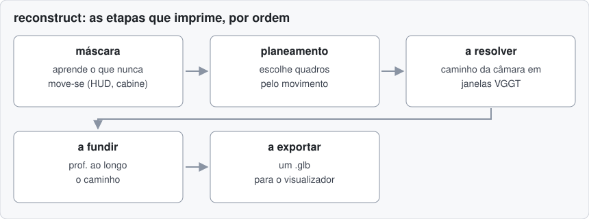

# Reconstrução offline {#offline-reconstruction}

```bash
python -m heat3d_capture reconstruct lap.mp4 -o lap.glb [--solve-budget 260] [--fuse-interval 0.4]
```

Código: [`scan/offline.py`](https://github.com/Holdi601/3DHeat-GameCapture/blob/main/heat3d_capture/scan/offline.py),
[`pose/feedforward.py`](https://github.com/Holdi601/3DHeat-GameCapture/blob/main/heat3d_capture/pose/feedforward.py),
[`pose/vggt_model.py`](https://github.com/Holdi601/3DHeat-GameCapture/blob/main/heat3d_capture/pose/vggt_model.py),
[`pose/feedforward_source.py`](https://github.com/Holdi601/3DHeat-GameCapture/blob/main/heat3d_capture/pose/feedforward_source.py),
[`pose/solveprep.py`](https://github.com/Holdi601/3DHeat-GameCapture/blob/main/heat3d_capture/pose/solveprep.py).
Opções: [Referência de comandos](commands.md#reconstruct).

## Por que um segundo caminho {#why-a-second-path}

O seguimento incremental é ao vivo e barato e funciona onde há estrutura a que se agarrar: um interior, uma rua, um mapa com cobertura. Uma **pista de corrida é o pior caso dele**: a estrada é uma faixa lisa com pouca textura, o horizonte mal se move, e quando algumas poses derivam nada depois as puxa de volta. Uma volta sai como uma curva que vagueia em vez de fechar.

O caminho offline entrega **janelas de quadros** a um modelo que prevê todas as suas câmaras juntas, então cada quadro restringe os outros diretamente, em vez de por uma cadeia. Ele precisa da gravação inteira antes de responder, então não é ao vivo, e é lento: minutos por janela numa GPU de desktop. Tudo depois das poses - fusão, cobertura, cor, exportação - é o mesmo código da digitalização ao vivo: a trajetória resolvida é entregue ao reconstrutor como uma fonte de poses, exatamente onde entra a telemetria do Forza.

## Requisitos {#requirements}

- **PyTorch** compatível com a sua GPU (não fixado por este projeto; instale-o antes do `requirements.txt`, veja [Execução](runtime.md)).
- **`vggt`** - o código do modelo VGGT (`from vggt.models.vggt import VGGT`), do repositório GitHub da Meta; não está no índice de pacotes.
- **`transformers`**, porque o caminho offline executa a profundidade pelo `DepthEstimator` do PyTorch (Depth Anything V2 Small), não pelo ficheiro ONNX.
- Uma GPU CUDA na prática; os dois modelos caem para a CPU, o que não é prático.

Nenhum destes está no `requirements.txt`, porque o digitalizador não precisa deles. Eles estão em **`requirements-offline.txt`**, com as dependências próprias do VGGT (`einops`, `safetensors`, `huggingface_hub`, `Pillow`):

```bash
.venv\Scripts\python -m pip install -r requirements-offline.txt
.venv\Scripts\python -m pip install --no-deps "vggt @ git+https://github.com/facebookresearch/vggt.git"
```

O VGGT entra com `--no-deps` porque os metadados do pacote fixam `numpy<2`, que o pip respeitaria rebaixando o numpy de que o scipy precisa aqui. `reconstruct` verifica todos estes pacotes logo depois de imprimir a linha de licença (a lista `OFFLINE` em [`runtime/preflight.py`](https://github.com/Holdi601/3DHeat-GameCapture/blob/main/heat3d_capture/runtime/preflight.py)), lista o que falta com os tamanhos, e só instala com confirmação - o VGGT com `--no-deps`, como acima. Recusar, ou não ter um terminal para perguntar, sai com o código 1.

## O modelo e a sua licença {#the-model-and-its-licence}

**VGGT**, `facebook/VGGT-1B`: **CC-BY-NC-4.0, somente não comercial, e uma reconstrução feita com ele herda isso.** O comando imprime isso antes de começar (`describe_licence`). Existe um `facebook/VGGT-1B-Commercial` com licença separada, mas é um repositório restrito concedido por conta pela Meta, então não pode ser o padrão. `--model vggt-1b-commercial` resolve com ele (e imprime a sua própria linha de licença); sem o acesso concedido, a transferência falha. O *código* do `vggt` está sob a "VGGT License" da própria Meta, um acordo de materiais de pesquisa com uma política de uso aceitável (lido do `LICENSE.txt` do pacote). Veja [Modelos e licenças](models-and-licences.md).

## A execução, etapa por etapa {#the-run-stage-by-stage}

Os nomes das etapas são os que o comando imprime.



### masking (mascaramento) {#masking}

Um `FlowMask` é aprendido a partir de **4 execuções de 90 quadros consecutivos**, centradas em 1/8, 3/8, 5/8 e 7/8 do vídeo, em 960 x 540 em cinza (veja [FlowMask](reconstruction-capture.md#flowmask-what-never-travels)). A sua nota é impressa e guardada no resumo. Um vídeo com menos de 90 quadros não recebe máscara.

#### A máscara da câmara é aprendida, não aplicada {#the-camera-mask-is-learned-not-applied}

A máscara **não** é aplicada aos quadros dados ao solver. Mascarar a cabine parecia certo pelas estatísticas de características (a maioria dos cantos detetados fica em pixels presos à câmara) - mas isso é uma afirmação sobre um detetor de características, e o solver é uma rede treinada. Medido pelo quanto o caminho recuperado vira entre passos consecutivos (um carro vira alguns graus; um passeio aleatório, noventa), quadros brutos deram a menor curva, quadros com contraste realçado um pouco mais, quadros mascarados claramente mais, e os dois juntos a maior. Então o solver recebe quadros brutos. A máscara ainda é usada para planear o espaçamento dos quadros abaixo, e o seguidor incremental a usa na digitalização ao vivo. (`solveprep.enhance`, que mascara e realça o contraste local com CLAHE, existe mas não é usado por este comando.)

### planning (planeamento): quadros espaçados pelo movimento {#planning-frames-spaced-by-motion}

`plan_by_motion` escolhe os quadros do solver pelo **quanto a imagem se moveu**, não pelo relógio: um intervalo fixo dá a trechos lentos quadros que não precisam, e deixa faltando nos rápidos, onde quadros consecutivos deixam de se sobrepor o bastante para se relacionarem.

- Deslocamento alvo: **5% de uma largura de 960 pixels** (48 px) de deslocamento mediano de características ORB entre quadros escolhidos consecutivos, medido em quadros de 960 x 540 em cinza com contraste CLAHE, características só na máscara.
- Começa com um intervalo de 0,3 s; depois de cada passo o próximo intervalo vira `intervalo x (0,5 + 0,5 x alvo / medido)`, limitado a **0,15-2,0 s**, para que uma medição ruidosa não balance o plano.
- Quando nada casou, o intervalo encolhe para 0,6 de si mesmo (estar longe demais é a falha que se evita).
- Para no fim do vídeo ou em `--solve-budget` quadros (padrão 260).

Menos de 4 quadros planeados é um erro.

### solving (solução): janelas e costura {#solving-windows-and-stitching}

Os quadros planeados são decodificados em 960 px de largura e resolvidos em **janelas sobrepostas de 16 quadros, 6 partilhados** com a seguinte (`plan_windows`; a última janela é puxada para trás para terminar no quadro final, então o fim de uma captura tem tantos vizinhos quanto o meio). Mais de **400** quadros numa única execução são recusados.

Cada janela: os quadros são redimensionados para que o lado longo seja **518** e os dois lados sejam múltiplos de **14** (proporção mantida - espremer distorceria o campo de visão), escalados para 0..1, e passados pelo VGGT sob autocast bfloat16 (float16 fica sem expoente nas coordenadas do mundo distantes). Os extrínsecos da câmara são convertidos em rotações mundo-da-câmara e centros de câmara. Mapas de pontos não são guardados por padrão.

Cada janela volta **no seu próprio quadro arbitrário e na sua própria escala arbitrária**, então as janelas são **costuradas** no quadro da primeira por uma transformação de similaridade (rotação, translação, uma escala) ajustada às câmaras que elas partilham com o que já está posicionado:

- **Rotação a partir das orientações das câmaras**, não das posições: as câmaras partilhadas ficam ao longo do caminho e são quase colineares numa reta, o que deixa um ajuste só de posições incapaz de ver a rotação - cada janela curva e o resultado costurado sai reto. A rotação é a média de `target_R x source_R^T` projetada de volta numa rotação verdadeira (com uma guarda contra reflexão).
- **Escala e deslocamento a partir das posições**, ao longo da fonte já rotacionada.
- São exigidas pelo menos **4** câmaras partilhadas; menos que isso é um erro.
- A sobreposição é um terço da janela, para que a escala fique bem determinada; o erro de escala acumulado de janela em janela é o que faz uma volta virar espiral.

Para cada junção, regista-se o pior desacordo das câmaras partilhadas depois do ajuste, em unidades do espaçamento médio entre elas (`seam_error`).

### fusing (fusão) {#fusing}

Quadros a cada `--fuse-interval` segundos (padrão 0,4) são decodificados em 960 px de largura, recebem profundidade do Depth Anything V2 Small (PyTorch) e são fundidos com uma pose **interpolada** da trajetória resolvida no instante deles (posição linear, rotação esférica; `FeedForwardPoses`). Quadros fora do intervalo de tempo resolvido são saltados em vez de extrapolados. A câmara usa um campo de visão horizontal de **65 graus**. As poses do tipo feed-forward têm confiança 0,85 na fusão e na cobertura.

### exporting (exportação) {#exporting}

A malha é escrita como numa digitalização ao vivo ([A saída .glb](glb-output.md)), com o nome do vídeo.

## O resumo {#the-summary}

```text
140 cameras solved over 182s
closure error 3.1% of path length
worst seam 0.42 frame spacings
<mask note>
wrote lap.glb
```

| Linha | Significado |
|---|---|
| closure error | distância da primeira à última câmara dividida pelo comprimento do caminho. Para uma volta só, é a medida honesta da deriva. Acima de 10%: "The lap does not close ... Treat the shape as unreliable." |
| worst seam | o maior desacordo de costura. Acima de 1,0: "Windows disagreed by up to N frame spacings at a seam, so part of the path is stitched on weak evidence." |
| no file | "Fusion produced no surface, so nothing was written." O código de saída é então 1. |

## Escala {#scale}

O caminho costurado está nas unidades arbitrárias da primeira janela. A profundidade é ancorada por triangulação entre as poses interpoladas (como na telemetria), então a geometria é consistente com o caminho - mas **o resultado não está em metros**, a menos que o caminho esteja. Nada neste comando fixa a escala global; a calibração pelo chão não é aplicada quando as poses vêm de uma fonte de poses.

## Estado deste caminho {#state-of-this-path}

Com quadros em intervalo fixo, as janelas se resolvem numa trajetória coerente em alguns trechos de uma volta e num rabisco em outros; as falhas são as curvas fechadas, onde a visão gira com força entre quadros, e amostrar essas curvas mais densamente as recupera. Nenhuma estatística de imagem testada (brilho, detalhe, contagem de características, razão de inliers, deslocamento) previu de antemão quais trechos falhariam. Então o espaçamento não pode ser planeado por completo a partir das imagens de antemão: ele precisa ser escolhido resolvendo, medindo o resultado e resolvendo de novo, mais denso onde o caminho não é um que um carro poderia ter percorrido. O planeamento por movimento está construído; **o recálculo adaptativo não está**.
