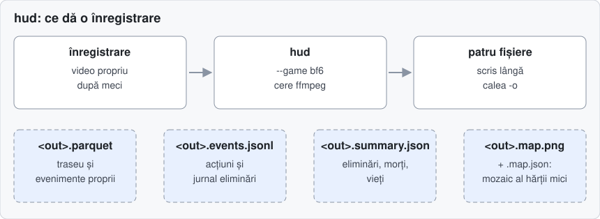

# Citirea HUD-ului dintr-o înregistrare {#reading-the-hud-from-a-recording}

`hud` citește HUD-ul de pe ecran al jocului din **propria înregistrare** a jucătorului, după meci: acțiunile
**proprii** ale jucătorului din fereastra de puncte pe care jocul o arată sub reticul (eliminări,
asistențe, reanimări, reaprovizionări, capturi...), morțile lui din ecranele de cădere și de desfășurare,
**propriul** traseu de pe harta minimă, și lista de eliminări de lângă ele, ca evenimente cu oră - scrise
ca un tabel 3DHeat, cu mozaicul hărții minime ca imagine de hartă ce poate fi pusă sub ele.

Pe scurt: urmărește videoclipul meciului și notează eliminările, morțile și pe unde a mers jucătorul.

```bash
.venv\Scripts\python -m heat3d_capture hud "<recording>.mp4" --game bf6 --player <name> -o out/match
```

Battlefield 6 este primul profil de joc.



## Ce face și ce nu atinge {#what-it-does-and-does-not-touch}

- Citește un **fișier video**: un clip ShadowPlay / Instant Replay, o înregistrare OBS, orice decodează
  ffmpeg. Nu atinge niciodată jocul, memoria, fișierele sau rețeaua lui, și rulează după ce meciul s-a
  terminat. Vezi [Regulile](rules.md).
- Derivă **doar poziția proprie a jucătorului**, din harta lui minimă. Markerele celorlalți jucători de pe
  harta minimă sunt mascate și nu sunt citite niciodată. Lista de eliminări este păstrată integral, dar
  doar ca ceea ce scrie pe ecran (cine, pe cine, cu ce, când); nicio poziție nu este atașată cuiva în afară
  de jucător.
- OCR-ul rulează local (RapidOCR cu modelele PaddleOCR prin ONNX Runtime). Niciun cadru și niciun decupaj nu
  părăsește calculatorul.
- O înregistrare arată numele altor jucători, iar mozaicul este o imagine a nivelului. Rezultatele sunt pentru
  uzul propriu al jucătorului; păstrează-le local.

## Cerințe {#requirements}

- **ffmpeg și ffprobe** în `PATH`. Un card NVIDIA este folosit pentru decodare când există unul
  (`-hwaccel cuda`); altfel decodează procesorul, de câteva ori mai lent.
- Pachetele din `requirements.txt`, iar OCR-ul fără propriile dependențe (cere `onnxruntime` pentru
  procesor, care se bate cu cel DirectML folosit de proiect):

```bash
.venv\Scripts\python -m pip install -r requirements.txt
.venv\Scripts\python -m pip install --no-deps rapidocr_onnxruntime==1.2.3
```

`rapidocr_onnxruntime` este cititorul de text (OCR) care citește de pe ecran nume și cuvinte.
`--no-deps` împiedică înlocuirea `onnxruntime` DirectML al proiectului.

Pentru a instala ffmpeg pe Windows: `winget install Gyan.FFmpeg`, apoi deschide un terminal nou și verifică
cu `ffmpeg -version`. Ești nou în linia de comandă? Citește [Înainte de a începe](before-you-start.md).

- O înregistrare **16:9**, la orice rezoluție (1080p, 1440p, 4K). Alte rapoarte de aspect sunt refuzate,
  pentru că casetele profilului ar cădea pe alte părți ale ecranului.
- **Aspectul implicit al HUD-ului** din joc. Un element de HUD mutat sau scalat este citit în locul greșit.

## Opțiuni {#options}

| Opțiune | Implicit | Înseamnă |
|---|---|---|
| `video` | | Înregistrarea. |
| `-o`, `--out` | numele videoclipului, în folderul curent | Calea de ieșire **fără** extensie; fișierele sunt `<out>.parquet`, `.events.jsonl`, `.summary.json`, `.map.png`, `.map.json`. |
| `--game` | `bf6` | al cărui HUD se citește. `bf6` (Battlefield 6) este singurul profil de până acum. |
| `--player` | niciunul | Numele jucătorului așa cum îl arată lista de eliminări. Comparat aproximativ (OCR-ul confundă `l`/`I`/`1`, `O`/`0`, `rn`/`m`). Fără el, numele este ghicit (mai jos). |
| `--fps` | 5 | Eșantioane de hartă minimă pe secundă. Lista de eliminări se eșantionează la jumătate din această valoare, fereastra de puncte și ecranele de moarte la fel (un sfert cât timp nu e afișată nicio fereastră), busola la fiecare 3 s, lista de echipă la fiecare 15 s. |
| `--start` | 0 | Secunde în videoclip de la care să înceapă. |
| `--seconds` | tot | Cât din videoclip să se citească. |
| `--metres-per-pixel` | niciunul | Scara hărții minime, dacă este cunoscută: metri pe pixel al hărții minime la zoomul obișnuit (harta minimă are 296 de pixeli lățime pe un ecran 1080p). Fără ea, pozițiile sunt în acei pixeli; vezi [Unități](#north-and-units). |
| `--cpu` | oprit | Decodează pe procesor chiar când există un card NVIDIA. |

Progresul se afișează la fiecare cinci secunde; la final, jucătorul, eliminările, morțile, viețile și fișierele
scrise.

## Rezultate {#outputs}

### `<out>.parquet` - traseul și evenimentele jucătorului {#parquet---the-players-track-and-events}

Un rând pentru fiecare eșantion în care jucătorul era în joc și harta minimă putea fi plasată, plus unul pentru
fiecare eveniment al lui. Subsolul conține instrucțiunile de citire ale vizualizatorului (cheia `heat3d`, `kind:
heat3d-hud`), ca vizualizatorul să mapeze fiecare coloană fără să întrebe.

| Coloană | Înseamnă |
|---|---|
| `time` | Secunde de la începutul videoclipului. |
| `event` | `position`; `start` (videoclipul a început în mijlocul vieții), `spawn` (din nou în joc după o moarte sau o pauză lungă), `death`, `downed` și `revived` (din ecranele de moarte, mai jos), `end` (o viață s-a încheiat fără un motiv precizat); acțiunile proprii ale jucătorului din fereastra de puncte (`kill`, `assist`, `reviving`, `resupply`, `capture`... - [tabelul evenimentelor](#event-table)); și rândurile listei de eliminări despre jucător ca `kill_feed`, `death_feed`, `teamkill_feed`, `suicide_feed`, `squadwipe_feed`. |
| `source` | De unde vine evenimentul rândului: `points` (fereastra), `screen` (ecranele de cădere și de desfășurare), `feed` (lista de eliminări); gol la rândurile de poziție. |
| `text` | La rândurile `points`: eticheta așa cum e tipărită (`KILL`, `SQUAD DAMAGE ASSIST`...), sau titlul (`DOUBLE KILL`, numele unei panglici), sau, pentru o etichetă necunoscută, ce s-a citit. |
| `points` | La rândurile `points`: cu cât a crescut totalul ferestrei în acel moment. Când mai multe acțiuni au venit în același eșantion (o eliminare și vehiculul în care era) este suma lor, dată pe fiecare, iar `shared` spune câte au împărțit-o. Gol când totalul nu a fost citit de două ori, pe ambele părți ale momentului. |
| `subject`, `subject_side` | La rândurile `points`: numele arătat în fereastră împreună cu acțiunea - victima unei eliminări, coechipierul reanimat sau reaprovizionat - și culoarea lui (`enemy`, `friendly`, `squad`). |
| `confirmed` | `feed` când lista de eliminări avea un rând pentru aceeași eliminare sau moarte (în 3 s, aceeași victimă). |
| `x`, `y`, `z` | Poziția pe mozaic: `x` est, `y` nord, `z` 0 (subsolul spune că `z` este sus). Nordul este nordul real când busola l-a permis (vezi `north_up` în rezumat). |
| `player` | Mereu `me`. Doar rândurile jucătorului au poziții. |
| `team` | `own`. |
| `session` | `<numele videoclipului>#NN`, câte una pentru fiecare viață. Traseele de căldură pe linii nu trec niciodată peste o sesiune. |
| `heading` | Grade în sensul acelor de ceasornic de la nord (de la sus al mozaicului când nordul e necunoscut): încotro era îndreptată privirea. |
| `dir_x`, `dir_y`, `dir_z` | Același lucru, ca vector de direcție, pentru direcția de privire a vizualizatorului. |
| `zoom` | Cât era micșorată harta minimă față de zoomul ei obișnuit (peste 1 în vehicule). |
| `killer`, `victim`, `weapon`, `headshot`, `marker` | La rândurile de eliminare și de moarte care au un rând în lista de eliminări: rândul respectiv (mai jos). O eliminare din fereastră fără rând în listă are numele din fereastră ca `victim`; o eliminare din fereastră afișată ca HEADSHOT are `headshot` true. |

Fiecare rând de eveniment ia poziția jucătorului la ora evenimentului (pentru o moarte sau o cădere, ultima
poziție dinaintea ei; pentru o reanimare, prima de după). Rândurile se potrivesc direct cu [harta de căldură pe
linii](https://holdi601.github.io/3DHeat/line-heat.html) a vizualizatorului: sugestia lui alege `event`, pornește
de la `start`, `spawn` și `revived`, se încheie la `death`, `downed` și `end`, iar rândurile `position` stau de-a
lungul traseului. Celelalte evenimente sunt denumite astfel încât sugestia să nu le ia drept început sau sfârșit:
a da o reanimare este `reviving` (nu `revive`), a ține un punct `defense`, un coechipier care apare lângă jucător
`teammate_arrived`, rândurile listei `kill_feed` și așa mai departe; `kill` nu este un sfârșit.

Un videoclip cu două runde pe două hărți dă două mozaicuri care nu pot fi puse în relație. Cel mai mare este
`<out>.parquet`; fiecare celălalt cu cel puțin 30 s de traseu este scris lângă el ca `<out>.map2.parquet`,
`<out>.map2.map.png` și așa mai departe.

### `<out>.events.jsonl` - evenimentele jucătorului și lista de eliminări {#eventsjsonl---the-players-events-and-the-kill-feed}

Un obiect JSON pe linie, în ordinea timpului, fiecare cu un `source`:

- `points`: unul pentru fiecare acțiune a jucătorului: `time`, `event`, `text`, `points`, `shared`,
  `subject`, `subject_side` (ca în tabel), `popup` (din care fereastră a venit, numerotată pe toată rularea),
  `seen` (câte citiri au arătat-o), `confirmed`, și `x`, `y` unde era jucătorul.
- `screen`: unul pentru fiecare cădere și fiecare reanimare: `event` (`death`, `downed` sau `revived`), `time`
  (când jucătorul a căzut; pentru `revived`, când au dispărut ecranele), `until` (ultima oară când au fost văzute
  ecranele), `screens` (`down` și/sau `card`), `outcome` (`death`, `revived` sau `unknown` când înregistrarea se
  termină mai întâi), `killer` (din rândul listei, când există), `x`, `y`.
- `feed`: fiecare rând pe care l-a arătat lista, al tuturor:

| Câmp | Înseamnă |
|---|---|
| `time`, `last` | Primul și ultimul eșantion în care a fost citit rândul (secunde de la începutul videoclipului). `time` este când a apărut eliminarea, cu o precizie de un eșantion al listei (0,4 s la rata implicită). |
| `kind` | Din partea jucătorului: `kill`, `death`, `teamkill`, `suicide`, `squadwipe`; pentru rândurile altor jucători `kill`, `squadwipe` sau `death` pentru un rând fără ucigaș. |
| `killer`, `victim` | Numele, ca cea mai frecventă citire din toate eșantioanele care arată rândul (o citire mai lungă câștigă când cea comună este începutul ei: un nume parțial ascuns). `killer` este gol pentru un rând care arăta doar o pictogramă și o victimă - o moarte cauzată de lume, sau un rând al cărui ucigaș dispăruse deja. |
| `killer_side`, `victim_side` | Din culoarea numelui: `friendly` (echipa jucătorului, albastru), `enemy` (portocaliu), `squad` (verdele palid pe care îl folosește jocul pentru jucător și echipa lui), `neutral` (niciuna dintre acestea). |
| `weapon` | Clasa pictogramei de armă în cadrul acestei rulări: `icon01`, `icon02`... Rândurile cu pictograme asemănătoare au aceeași clasă. Pictogramele nu au nume; nu există o listă din care să fie numite. |
| `marker` | Pictograma mică dintre armă și victimă: `skull`, `arrow`, `chevrons`, `crosses` sau gol. |
| `headshot` | `marker == "skull"` - o presupunere, vezi [Limite](#limits). |
| `seen` | Câte eșantioane ale listei au arătat rândul. |
| `me` | `killer`, `victim` sau null. |
| `matched` | Pentru rândurile proprii ale jucătorului: dacă s-a găsit pentru ele o acțiune din fereastră sau un ecran de moarte. |
| `x`, `y` (, `map`) | Pentru rândurile proprii ale jucătorului: unde era. |

### `<out>.summary.json` {#summaryjson}

Jucătorul (și cum a fost găsit), de unde au venit evenimentele lui (`own_events_from`: fereastra și ecranele,
sau lista de eliminări singură când nici una nu a fost citită), eliminări, morți, K/D, lovituri în cap,
asistențe, reanimări date (`revives`) și primite (`revived`), căderi, capturi, neutralizări, reaprovizionări,
vindecări, reparații, vehicule distruse, scorul (totalurile ferestrelor adunate), fiecare tip de acțiune cu
numărul lui (`actions`), numărul de ferestre, morțile pe care le-a arătat doar lista, numărătoarea listei
pentru eliminări și morți și câte dintre eliminările ei au fost potrivite cu o eliminare din fereastră,
eliminările între coechipieri, sinuciderile, distrugerile de echipă, vieți, secunde în joc, distanța parcursă
(în unitățile tabelului), rândurile listei, pe fiecare hartă dacă nordul este sus și câte citiri ale busolei
au fost de acord, numărătorile traseului (eșantioane, în joc, plasate, neplasate, insule), ipotezele făcute și
cronometrajul.

### `<out>.map.png` și `<out>.map.json` - harta de sub traseu {#mappng-and-mapjson---the-map-under-the-track}

Mozaicul fiecărei hărți minime din rulare, mediat, cu suprapunerile scoase, întors și scalat exact ca tabelul.
Fișierul JSON alăturat conține cele două ancore pe care le cere plasarea **Imagine de hartă** a vizualizatorului
([Imagini de hartă](https://holdi601.github.io/3DHeat/map-images.html) în documentația vizualizatorului): încarcă
PNG-ul cu **Imagine de hartă...**, lasă activată opțiunea **Inversează nord/sud**, și scrie ancora 1 și ancora 2
(`px`, `py`, `worldX`, `worldZ`) din fișierul alăturat. Imaginea stă apoi exact sub traseu.

În imagine sunt doar părțile nivelului pe care le-a arătat harta minimă a jucătorului.

## Metoda {#method}

### Decodarea {#decoding}

ffmpeg decodează pe GPU, scade la rata de eșantionare cât timp cadrele sunt încă pe card, taie din fiecare
cadru regiunile profilului (harta minimă, lista de eliminări, două benzi de busolă, lista de echipă, fereastra de
puncte, cuvintele ecranului de cădere, colțul din dreapta jos), scalează fiecare la o dimensiune fixă și le
așază într-o singură imagine mică pentru fiecare eșantion. Doar această imagine trece prin conductă în Python.
Decodarea fiecărui cadru al fluxului H.264 este minimul de timp de rulare.

Două fire de lucru preiau eșantioanele: unul înregistrează hărțile minime (OpenCV), unul citește textul (ONNX
Runtime).

### În joc sau nu {#in-play-or-not}

Pătratul cu indicația tastei de pe harta minimă (pătratul deschis cu cheia hărții în el, jos în stânga hărții
minime) este desenat oricând este și harta minimă, și nu la ecranele de moarte, de cameră a morții, de
desfășurare, de meniu sau de tabelul de scor. Prezența lui - un pătrat deschis, fără culoare, cu o literă
întunecată în mijloc, clar mai deschis decât ce îl înconjoară - căutată câțiva pixeli în jurul locului lui,
este testul de joc. Un eșantion singur care nu se potrivește cu ambii vecini este ignorat.

O pauză în joc este o moarte sau o schimbare de rundă (următoarea porțiune începe cu `spawn`) când durează cel
puțin 6 s sau când o moarte (din ecrane, sau un rând al listei care numește jucătorul drept victimă) a venit cu
cel mult 40 s înainte; o pauză mai scurtă fără moarte (harta mare deschisă) continuă viața. Harta minimă rămâne
afișată cât timp jucătorul este la pământ, deci un jucător la pământ este în joc.

### Traseul {#the-track}

Harta minimă se întoarce odată cu privirea și ține jucătorul într-un punct fix (măsurat: la mijloc, 49,7% în jos).
Pentru fiecare eșantion:

1. **Mască** tot ce nu este nivelul: pixelii puternic colorați sau aproape albi (markerele obiectivelor, pictogramele
   echipei și ale vehiculelor, semnalele, limita zonei de joc, liniile de traseu, textul), galbenul-verde șters al
   conului de vizualizare, un disc în jurul markerului jucătorului, clinul conului de deasupra lui, pătratul cu
   indicația tastei și o margine subțire.
2. **Caracteristici**: punctele-cheie SIFT pe harta minimă gri, cu contrast egalizat, în interiorul măștii.
3. **Înregistrare pe mozaic**, nu pe eșantionul precedent: punctele-cheie sunt potrivite cu caracteristicile
   stocate până acum, în coordonatele mozaicului, aproape de locul unde era jucătorul ultima oară; o similaritate
   (rotire, zoom, deplasare) este ajustată cu RANSAC. O potrivire are nevoie de suficiente puncte interioare, de un
   zoom de cel mult o treime față de ultimul și de o deplasare de mai puțin de o treime din harta minimă pe
   eșantion; o potrivire căutată oriunde pe mozaic (după o moarte) are nevoie de de două ori mai multe puncte
   interioare.
4. **Creșterea mozaicului**: caracteristicile pe care mozaicul nu le are încă sunt adăugate (cel mult la câteva
   zecimi de secundă de mișcare), iar harta minimă mascată este mediată în imagine.
5. Punctul jucătorului, dus prin potrivire, este **poziția**; sus-ul hărții minime, dus prin ea, este **direcția**
   pe mozaic.

După aceea, un punct care sare cu mai mult de 10 pixeli față de ambele eșantioane dinainte și față de ambele de
după (care sunt de acord între ele) este eliminat: o hartă minimă se potrivește uneori la un zoom greșit pentru un
singur eșantion. Rezumatul le numără (`dropped_as_jumps`).

Înregistrarea pe mozaic este ceea ce împiedică erorile să se adune: întoarcerea într-un loc se potrivește cu
caracteristicile stocate prima dată. O apariție într-un loc nevăzut încă pornește o **insulă** separată; fiecare al
zecelea eșantion plasat este încercat față de celelalte insule, iar prima potrivire bună le unește (cea mai mică
se mută în cea mai mare, cu traseul ei). Insulele care nu se unesc niciodată (altă hartă, sau teren niciodată
împărtășit) sunt scrise separat, cum s-a arătat mai sus.

### Nord și unități {#north-and-units}

Banda busolei este citită la fiecare 3 s: etichetele ei sunt găsite după cerneala lor (luminoasă, fără culoare,
grupată peste goluri mici, cu liniuțele eliminate), fiecare este citită separat, iar două sau mai multe etichete
fixează atât scara benzii, cât și direcția de sub marcajul central - o singură etichetă nu fixează nimic. Fiecare
citire a busolei este asociată cu direcția mozaicului din același eșantion; mediana circulară a diferențelor, pe
citirile aflate la 10 grade de ea, este rotirea care pune nordul mozaicului sus. Se aplică când cel puțin trei
citiri și jumătate din toate sunt de acord.

<a id="units"></a>Scara terenului hărții minime nu este tipărită nicăieri pe ecran, deci pozițiile sunt în **pixeli
ai hărții minime la zoomul obișnuit**: zoomul mediu al rulării este adus la o unitate de tabel pe pixel al unei hărți
minime de 296 de pixeli (dimensiunea ei pe un ecran 1080p). Micșorarea din vehicule este scoasă de înregistrare, deci
o unitate este aceeași pe jos și în vehicul. `--metres-per-pixel` înmulțește totul în metri când scara este
cunoscută (dintr-o distanță cunoscută pe hartă, măsurată o dată).

### Lista de eliminări {#the-kill-feed}

Lista este citită cu 2,5 eșantioane pe secundă, dar doar când pixelii ei colorați s-au schimbat vizibil sau au trecut
2 s. Liniile de text sunt găsite de detectorul OCR; o linie a cărei imagine se potrivește cu una citită în eșantionul
precedent (rândurile derulează, deci s-ar putea fi mutat) ia textul acela în loc să fie citită din nou. Liniile prea
mici pentru un nume, sau cu o bară oblică (un contor de cadre pe secundă în colțul acela), sunt eliminate.

Liniile sunt grupate pe rânduri după înălțime; într-un rând, cel mai din stânga nume este ucigașul, iar cel mai din
dreapta victima. Bucățile vecine de aceeași culoare se unesc (un nume cu spațiu). O singură linie care a trecut peste
pictogramă de la un nume la altul este tăiată la cel mai larg spațiu când cele două jumătăți diferă ca
culoare, iar fiecare jumătate este citită din nou. Un singur nume în coloana victimelor, cu o pictogramă chiar în
stânga lui, este o linie fără ucigaș. Două bucăți de aceeași culoare fără pictogramă între ele sunt un nume al cărui
ucigaș a dispărut, nu o eliminare.

**Părțile** vin din culoare. Numele sunt desenate cu o oarecare transparență, deci testul se face după cât de departe
este textul de propriul fond: semnul lui roșu minus albastru din această diferență este portocaliu (inamic) sau
albastru (prieten) pe orice fond; niciuna, cu verdele peste celelalte două, este culoarea echipei.

**Pictogramele**: între nume, pixelii în culoarea ucigașului fac silueta armei; o pictogramă mică separată chiar înainte
de victimă este marcajul, numit după forma lui (o pată cu găuri de ochi este o crănie; un mic triunghi este o săgeată;
mai multe bucăți sunt cruci).

**Evenimentele**: un rând citit din nou, cu ambele nume la fel (asemănare 0,7 după corectarea greșelilor obișnuite ale
OCR-ului, una dintre ele 0,8; o citire tăiată scurt se potrivește cu începutul numelui complet), este același eveniment,
atâta timp cât evenimentul a fost citit ultima oară cu mai puțin de 5 s înainte și are mai puțin de 14 s - niciun rând nu
stă mai mult, deci aceeași pereche mai târziu este o eliminare nouă. Un rând fără ucigaș se potrivește doar după
victimă. Ora unui eveniment este prima lui apariție; numele, părțile și marcajul lui sunt majoritatea dintre apariții;
rândurile citite o singură dată sunt eliminate.

**Jucătorul**: `--player`, altfel rândul evidențiat (cel mai luminos) al listei de echipă, când există cel puțin trei
citiri și 60% dintre ele sunt de acord, altfel numele pe care lista l-a desenat cel mai des în culoarea echipei. Altfel
rezumatul spune că jucătorul este necunoscut, iar niciun rând din listă nu i se atribuie. (Fereastra și ecranele de
moarte sunt ale jucătorului indiferent de nume; nu au nevoie de un nume.)

### Fereastra de puncte {#the-points-popup}

Tot ce obține jucătorul, Battlefield 6 arată într-o fereastră chiar în stânga și sub reticul - în același loc pe jos, în
vehicul și printr-o lunetă:

```
            [ RIBBON ] (icon)          a title, now and then: a ribbon or a multi-kill
      (icon)(icon)(icon)  300          one icon per action; the popup's running total
                Some_Name              who it was about, for a moment: orange an enemy, blue a teammate
    [ KILL x2 ] [ VEHICLE DESTROYED ]  one boxed tag per kind of action, with a count
```

Fereastra crește cât timp jucătorul continuă să obțină puncte: o eliminare nouă transformă `KILL` în `KILL x2`, adaugă o
pictogramă și ridică totalul; un tip nou de acțiune adaugă o etichetă. Rândul de etichete arată ultimele câteva tipuri
(una mai veche iese din câmp și continuă să numere când revine). Cam la trei secunde după ultima acțiune, fereastra se
strânge într-o singură linie (`[KILL x2] 300`) și dispare. Textul este gri deschis, etichetele sunt în casete subțiri,
totalul este în cifre mari care încep la x 760 pe un ecran de 1920x1080, iar etichetele sunt aliniate la dreapta, la x 750.

Este citită de 2,5 ori pe secundă: detectorul OCR găsește liniile de text, se citesc doar liniile de pe unul dintre rândurile
ferestrei (etichetele proprii ale vizorului de tanc din aceeași zonă nu), iar o linie a cărei imagine se potrivește cu una
citită în eșantionul precedent ia textul acela. O linie care a trecut dintr-o pictogramă, un nume sau o etichetă strânsă în
total (`Name10`, `REVIVE185`) este tăiată acolo unde începe totalul (x 755), iar ambele jumătăți sunt citite din nou. Cât
timp nu e afișată nicio fereastră, fiecare al doilea eșantion este păstrat necitit; când următorul arată o fereastră, cel
păstrat este citit întâi, deci începutul unei ferestre este găsit până la eșantion.

**Etichetele** sunt potrivite cu [tabelul evenimentelor](#event-table) după corectarea greșelilor obișnuite ale
recunoașterii (Q citit ca O, o cifră între litere, I în loc de L, o literă pierdută la margine): o citire este o etichetă
când este cel puțin 80% asemănătoare cu una (85% pentru etichetele de cel mult cinci litere) și clar mai aproape de ea decât
de oricare alta. Etichetele pe care recunoașterea le-a lipit (`CAPTUREDORDERCOMPLETED`) sunt separate prin scoaterea pe
rând a etichetelor cunoscute din față. Un număr este `x2`, `X3`, un semn ocazional și o cifră, sau o cifră chiar după
etichetă. O linie gri-deschis, cu litere mari, din rândul etichetelor care nu se potrivește cu nimic este păstrată ca
acțiune `points` cu textul ei; o linie care este o bucată dintr-o etichetă cunoscută din aceeași fereastră (`DESTROYED`
lângă `VEHICLE DESTROYED`) nu este. Titlurile de deasupra totalului (casete deschise, text întunecat) sunt `multi_kills`
(`DOUBLE KILL` ...) sau `ribbon`. Numele este linia colorată dintre total și etichete; partea lui vine din culoare, ca în
listă.

**Ferestre și acțiuni**: citirile cu mai puțin de 0,9 s de liniște între ele fac o singură fereastră. O fereastră care pare
să se termine și revine înainte să se fi putut strânge (în 3,2 s de la ultima creștere), cu fiecare etichetă la numărul ei
sau peste și un total nu mai mic, este aceeași fereastră pierdută o clipă (estompare, fond luminos) - nimic din ea nu se
numără de două ori. Într-o fereastră, numărul final al unei etichete este cel mai mare număr citit de cel puțin două ori; a
k-a ei acțiune este datată la prima citire care arată un număr de k sau mai mult. Un număr citit într-un singur eșantion nu
este o acțiune - cu excepția unei eliminări pe care lista o confirmă (o linie a jucătorului în 3 s pe care nicio altă
eliminare n-a luat-o): eticheta scurtă KILL este cea pe care recunoașterea o citește cel mai des o singură dată. Un titlu
se numără o dată pe fereastră, când este citit de două ori. `points` este cât a crescut totalul - numărând doar totalurile
citite de două ori la rând - de la eșantionul dinaintea acțiunii la cel de după.

O linie necunoscută se numără ca etichetă doar pe rândul etichetelor cunoscute din aceeași citire (sau, fără etichetă
cunoscută, când nu există nici un nume), astfel încât un nume desenat într-o culoare pe care testul de parte nu o poate
distinge nu este luat drept etichetă.

### Morțile și reanimările {#deaths-and-revives}

Când jucătorul cade, jocul o spune sub centrul ecranului (MAN DOWN, REQUEST REVIVE, SKIP (HOLD), NEARBY MEDICS; odată ce
s-a cerut o reanimare, REVIVE REQUESTED, CANCEL REQUEST), iar un cartonaș din dreapta jos numește cine a făcut-o, cu DAMAGE
LOG sau PLAYER CARD dedesubt și o linie "YOU n - n FOE" deasupra. Ucis direct (o lovitură fatală în cap), doar cartonașul
apare. Apoi fie un coechipier îl reanimă - ecranele dispar și jocul continuă - fie jucătorul sângerează sau renunță, iar
urmează ecranul de desfășurare, cu DEPLOY în dreapta jos.

Aceste cuvinte sunt citite împreună cu fereastra, în aceeași trecere a OCR-ului (fereastra, banda ecranului de cădere și
colțul din dreapta jos, puse una peste alta într-o imagine): de 2,5 ori pe secundă cât timp e afișată o fereastră, de 1,25
ori altfel. Colțul este inclus doar când jucătorul este scos din joc sau a fost văzut căzut în ultimele 3 s; în joc conține
doar numărul de muniție.
Apariții la mai puțin de 4 s distanță fac un singur episod (cel puțin două apariții). Un episod este o **moarte** când ecranul
de desfășurare apare la cel mult 12 s de sfârșitul lui, sau când jucătorul este scos din joc la 3 s după el și rămâne așa cel
puțin 6 s; este o **reanimare** (`downed`, apoi `revived`) când jucătorul este încă în joc la 3 s după ce ecranele au dispărut;
`unknown` (scris ca `downed` singur) când înregistrarea se termină mai întâi. Ora morții este momentul în care jucătorul a
căzut: rândul listei care îl numește victimă, când există unul cu cel mult 3 s înainte de episod, altfel prima apariție a
episodului minus o jumătate de interval de citire. Pozițiile de după o moarte sunt lăsate afară din traseu până la ecranul de
desfășurare.

O moarte din listă pe care niciun episod nu o explică (ecranele au fost ratate) este tot `death`, cu `source` `feed`, și
judecată ca înainte: dacă jucătorul rămâne în joc mai mult de 40 s după ea, a fost reanimat.

### Tabelul evenimentelor {#event-table}

Ce devine fiecare etichetă, titlu și ecran. Mai multe etichete pot fi un singur eveniment; `text` păstrează care.

| Eveniment | Din | Înseamnă |
|---|---|---|
| `kill` | KILL; HEADSHOT | Jucătorul a eliminat pe cineva (numele este victima). O eliminare cu lovitură în cap arată HEADSHOT acolo unde ar fi KILL: `text` spune care, iar `headshot` este true. |
| `assist` | ASSIST, KILL ASSIST, DAMAGE ASSIST, SQUAD DAMAGE ASSIST | Daune asupra cuiva pe care un coechipier l-a eliminat. |
| `kill_assist` | ASSIST COUNTS AS KILL | O asistență pe care jocul o numără drept eliminare. |
| `suppression`, `suppression_assist` | ENEMY SUPPRESSION; SUPPRESSION ASSIST | Foc de suprimare asupra unui inamic; asupra unuia pe care un coechipier l-a eliminat apoi. |
| `smoke_assist` | SMOKE ASSIST, SQUAD SMOKE ASSIST | Fum care a acoperit un coechipier. |
| `spot`, `spot_assist` | SPOT, SPOTTED, ENEMY DESIGNATION; SPOT ASSIST, SPOT BONUS | Observarea unui inamic; o eliminare asupra unuia pe care jucătorul l-a observat. |
| `driver_assist` | DRIVER ASSIST | O eliminare de către artileristul vehiculului jucătorului. |
| `reviving`, `reviving_bonus` | REVIVE, SQUAD REVIVE; CONCEALED REVIVE | Jucătorul a reanimat un coechipier; bonusul pentru că a făcut-o sub acoperire. |
| `heal` | HEAL, SQUAD HEAL | Jucătorul a vindecat un coechipier. |
| `resupply` | SUPPLY, RESUPPLY, SQUAD SUPPLY | Un coechipier a luat muniție de la jucător. |
| `repair` | REPAIR, VEHICLE REPAIR, SQUAD REPAIR | Jucătorul a reparat un vehicul. |
| `capturing`, `capture` | CAPTURING, RECAPTURING; CAPTURED, OBJECTIVE CAPTURED | Un tic de captură; obiectivul luat. |
| `neutralizing`, `neutralize` | NEUTRALIZING; NEUTRALIZED, OBJECTIVE NEUTRALIZED | Același lucru pentru luarea unui obiectiv inamic până la neutru. |
| `defense` | DEFENDING, OBJECTIVE DEFENDED | Ținerea unui obiectiv. |
| `offensive`, `defensive` | OFFENSIVE; DEFENSIVE | Bonusul pentru o acțiune lângă un obiectiv atacat; apărat. |
| `order` | ORDER COMPLETED | Un ordin de echipă dus la îndeplinire. |
| `vehicle_damage`, `vehicle_disabled`, `vehicle_destroyed`, `vehicle_destroyed_assist` | VEHICLE DAMAGE; VEHICLE DISABLED; VEHICLE DESTROYED; VEHICLE DESTROYED SUPPORT | Daune asupra unui vehicul inamic, până la distrugerea lui, sau ajutorul la ea. |
| `equipment_destroyed` | EQUIPMENT DESTROYED | Un dispozitiv inamic distrus. |
| `forced_bail` | FORCED BAIL | Un inamic scos din vehiculul lui. |
| `squad_wipe` | SQUAD WIPE | Ultimul din echipa inamică eliminat. |
| `savior`, `avenger` | SAVIOR; AVENGER | O eliminare asupra unui inamic care rănea un coechipier; asupra cuiva care tocmai eliminase pe unul. |
| `teammate_arrived` | SPAWNED ON, SPAWN ASSIST, VEHICLE SPAWN, SQUAD VEHICLE SPAWN | Un coechipier a apărut lângă jucător sau în vehiculul lui. |
| `transport` | TEAM TRANSPORT | Transportul coechipierilor într-un vehicul. |
| `fortify` | DEFENSE DEPLOYED | O apărare construită de jucător. |
| `points` | orice altceva din rândul etichetelor | O acțiune pe care tabelul nu o cunoaște: `text` este ce s-a citit. |
| `multi_kills` | DOUBLE KILL, TRIPLE KILL, QUAD KILL, MULTI KILL (titlu) | Eliminări în succesiune rapidă. |
| `ribbon` | orice alt titlu | O panglică, după numele ei (BALLISTIC, TANK BUSTER, ENGINEER EXPERT, SPEARHEAD...). |
| `downed` | ecranul de cădere, apoi joc | Jucătorul a căzut și a fost reanimat. |
| `revived` | dispariția ecranelor, jocul continuă | Jucătorul a fost reanimat de un coechipier. |
| `death` | ecranul de cădere sau cartonașul, apoi desfășurare sau scos din joc | Jucătorul a murit. |

Textele din tabel au fost văzute în înregistrările de test, cu excepția acestora, care sunt numele obișnuite ale seriei de
jocuri și sunt în tabel ca să fie numite și nu păstrate ca `points`: HEADSHOT KILL, ASSIST, KILL ASSIST, ASSIST COUNTS AS
KILL, SPOT, SPOTTED, SPOT ASSIST, SPOT BONUS, SQUAD REVIVE, HEAL, SQUAD HEAL, RESUPPLY, SQUAD SUPPLY, REPAIR, VEHICLE REPAIR,
SQUAD REPAIR, VEHICLE DISABLED, SQUAD WIPE, AVENGER, formele OBJECTIVE ... și titlurile TRIPLE KILL, QUADRUPLE KILL și MULTI
KILL. Jocul într-o altă limbă tipărește alte cuvinte: etichetele lui ies ca `points` cu ce s-a citit - nu sunt confundate cu o
acțiune cunoscută - cu totalurile și numele lor; iar cum ecranele de moarte sunt recunoscute după cuvintele lor în engleză,
morțile vin atunci doar din lista de eliminări, ca rânduri `death` cu `source` `feed`.

## Ce este verificat {#what-is-verified}

Verificat cu ochiul pe înregistrările de test (ale jucătorului, nu fac parte din depozit), desenând eșantioane la întâmplare
și comparând fiecare cu cadrele din jur:

- **Evenimentele proprii ale jucătorului.** Fiecare acțiune din fereastră eșantionată a fost o acțiune reală de acel tip,
  găsită în cel mult o citire (0,4 s) de ora ei; majoritatea valorilor și numelor au fost corecte (numele în unele scrieri,
  cum este chirilica, pot ieși stricate). Fiecare ecran de moarte eșantionat a fost găsit.
- **Lista de eliminări.** Marea majoritate a rândurilor listei au fost găsite cu ambele nume corecte; mici greșeli ale OCR-ului
  (un I mare citit ca l mic) sunt admise. Numele desenate cu glife pe care jocul însuși le arată ca pătrate pot fi ratate.
  Părțile (culorile) sunt greșite pentru câteva procente din nume.
- **În joc.** Testul pătratului cu indicația tastei a fost de acord cu cadrul în fiecare moment eșantionat.
- **Traseul.** Nu există adevăr de referință pentru unde era jucătorul, așa că traseul este verificat pe înregistrarea
  însăși: două hărți minime sunt înregistrate **direct una pe alta**, iar decalajul lor este comparat cu decalajul dintre
  cele două poziții din tabel. Dezacordul median este de vreo 1-3 pixeli ai hărții minime (sub 1% din lățimea ei), mai mult
  pe o hartă aglomerată și micșorată.
  Citirile busolei sunt de acord cu mozaicul în 10 grade aproape întotdeauna.
- **Timpul de rulare.** Decodarea, cam de 5 ori mai rapidă decât timpul real, este cea mai mare parte, pe un GPU de desktop;
  citirea ferestrei de puncte adaugă cam o cincime până la jumătate.

Privit cu ochiul: fiecare mozaic are drumuri și clădiri continue peste viețile care l-au construit, iar traseele diferitelor
vieți pe același drum stau unul peste altul. O porțiune în care zoomul hărții minime se schimbă poate ieși prea lungă - vezi
[Limite](#limits).

Testele (`tests/test_hud_*.py`) desenează tot ce citesc: un nivel inventat de drumuri, clădiri și curbe de nivel, hărți minime
ale unor plimbări prin el cu suprapunerile pe care le are una reală, benzi de busolă, rânduri de listă de eliminare cu nume
inventate. Verifică că o buclă este urmărită la două pixeli și se închide, că un jucător stând pe loc rămâne pe loc cât timp
privirea se întoarce, că schimbările de zoom sunt urmărite, că o apariție în alt loc se unește înapoi când drumurile se
întâlnesc, că rotirea spre nord și inversarea lui y pun traseul acolo unde a mers cu adevărat, că ancorele imaginii de hartă o
aliniază sub traseu, și analiza, culorile, markerele și eliminarea duplicatelor din listă. Pentru evenimentele proprii ale
jucătorului desenează ferestre de puncte cu nume și etichete inventate și verifică tabelul de etichete și toleranța lui la
greșelile recunoașterii, etichetele lipite, rândurile ferestrei, totalul tăiat dintr-un nume, numărarea pe măsură ce fereastra
crește, continuarea după un moment necitit, o etichetă care iese și revine, sau încheierea; că un număr citit o dată este
păstrat separat; morțile, reanimările și rezultatele din cuvintele ecranelor; și, pe un meci inventat, că acțiunile, morțile și
reanimările ajung în tabel unde era jucătorul, rândurile listei alături de ele sub numele lor, iar traseul se termină la moarte
și nu la reanimare.

## Limite {#limits}

- **Unitățile sunt pixeli ai hărții minime**, nu metri, dacă nu este dat `--metres-per-pixel`. Nimic de pe ecranul jocului nu
  spune scara terenului hărții minime.
- **Este cartografiat doar ce a arătat harta minimă.** Mozaicul acoperă terenul aflat la cel mult o jumătate de hartă minimă
  de locul unde a mers jucătorul; două mozaicuri care nu au împărtășit niciodată teren (două runde pe două hărți, sau două
  vieți în colțuri foarte depărtate ale unei hărți mari) rămân fișiere separate, cu coordonate fără legătură.
- **Traseul este cel al hărții minime, la 5 eșantioane pe secundă**, netezit de nimic. O hartă minimă micșorată foarte mult (un
  elicopter din înregistrările de test o micșora de 2,3 ori) arată mai puține detalii pe pixel, iar în afara zonei de joc arată
  aproape nimic, deci înregistrarea acolo este mai grosieră. Avioanele cu reacție și jucătorul ca pasager nu erau în înregistrările
  de test.
- **Erorile de înregistrare sunt locale și nu se adună**, dar un mozaic construit explorând teren nou poate avea o mică îndoitură,
  reparată abia când terenul este văzut din nou. Acolo unde zoomul hărții minime se schimbă continuu (un vehicul care prinde viteză),
  zoomul ajustat poate derapa, și o asemenea porțiune a fost văzută cu distanța de aproximativ două ori mai mare decât cea reală.
  Un mozaic construit dintr-o hartă minimă de infanterie aglomerată și micșorată este cel mai puțin exact (erori de cam 3 pixeli
  tipic, până la 18).
- **Nicio optimizare a grafului de poziții.** O buclă se închide prin potrivirea caracteristicilor stocate, nu prin
  distribuirea corecției de-a lungul buclei.
- **Clasele de arme nu funcționează încă.** Silueta pictogramei este luată dintr-o pictogramă translucidă peste un fond în
  mișcare, și variază prea mult de la un eșantion la altul: înregistrările de test au ieșit cu 220 până la 340 de clase pentru
  550 până la 670 de linii, când o potrivire are câteva zeci de arme. Tratează `weapon` ca experimental. Clasele sunt oricum pe
  rulare și nu sunt nume.
- **Semnificațiile markerelor nu sunt toate cunoscute.** Săgeata (`▸`) este desenată înaintea numelui propriu al jucătorului,
  în liniile despre el; nu este un fel de eliminare. Craniul este luat drept lovitură în cap; aceasta este o presupunere, nu
  ceva ce spune jocul. `chevrons` și `crosses` (distrugeri de echipă) sunt raportate ca văzute.
- **Numele în alte scrieri decât cea latină** (chirilică, de exemplu) ies ca cele mai apropiate litere latine asemănătoare:
  recunoașterea citește latină și chineză. Același jucător se citește la fel de fiecare dată, deci tot se potrivesc între ele,
  dar textul nu este numele lui.
- **Suprapunerile din colțul listei de eliminări** (un contor de cadre pe secundă) pot ascunde finalul victimei de pe rândul de
  sus. Textul contorului este recunoscut și eliminat, iar un nume tăiat scurt este potrivit cu citirile lui complete, dar un nume
  văzut mereu tăiat rămâne tăiat.
- **O moarte pe care nici ecranele, nici lista nu au arătat-o** încheie totuși traseul, ca `end`, când jucătorul iese din joc
  cel puțin 6 s.
- **Reanimările primite** vin din ecranele de cădere. Doar pentru o moarte din listă pe care ecranele au ratat-o sunt încă deduse
  (în joc mai mult de 40 s după ea), iar o reanimare rapidă nu se distinge atunci.
- **Acțiunile din fereastră sunt datate după o citire**: în 0,4 s de la prima apariție a etichetei; o etichetă care se animează
  la apariție poate fi citită cu un eșantion mai târziu sau mai devreme.
- **Numele de pe rândurile ferestrei** sunt citite ca cele din listă: scrierile altele decât cea latină ies stricate, iar din când
  în când eticheta numelui unui coechip, plutind în lume lângă fereastră, este citită drept numele acțiunii. Acțiunile fără nume
  (un tic de captură, un ordin) nu au niciunul.
- **`points`** lipsește acolo unde totalul nu a fost citit de două ori pe ambele părți ale unei acțiuni, și este împărțit între
  acțiunile care au venit în același eșantion. `score` din rezumat adună totalurile finale ale ferestrelor, deci o fereastră al
  cărei total nu a fost citit niciodată de două ori nu este inclusă.
- **Rândul de etichete este o fereastră**: cu patru sau mai multe tipuri într-o fereastră, cea mai veche etichetă alunecă spre
  stânga, peste marginea zonei citite. A fost numărată cât timp a fost în cadru; un număr pe care îl câștigă când e pe jumătate
  în afara ecranului poate fi ratat.
- **O fereastră pierdută mai mult decât ar fi putut dura** (peste vreo 4 s de eșantioane nelizibile cât timp ea încă creștea) este
  luată drept două, iar o etichetă cu un număr peste unu este numărată din nou. Nu s-a văzut în verificările de mai jos.
- **Alte limbi ale interfeței**: etichetele ies ca `points` cu textul lor, iar morțile vin doar din listă (ecranele de moarte sunt
  recunoscute după cuvintele lor în engleză).
- **Evenimente pe o insulă scurtă**: o viață a cărei traiectorie a fost prea scurtă ca să fie scrisă ca hartă (sub 30 s) își păstrează
  evenimentele în `.events.jsonl` fără `x`, `y`, și nu în niciun tabel.
- **Aspectul HUD-ului este cel implicit al BF6 la 16:9.** O scară schimbată a HUD-ului, o paletă pentru daltonism sau o altă
  dimensiune a hărții minime ar cere un profil propriu.
