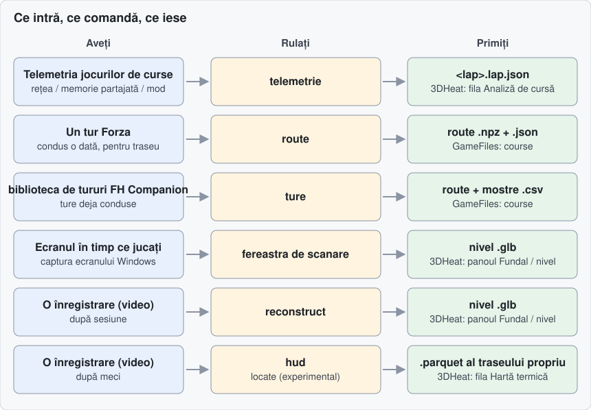

# 3DHeat GameCapture {#dheat-gamecapture}

**Ce este?** Un instrument care notează ce îi spune un joc de curse despre conducerea dumneavoastră, câte un
fișier pentru fiecare tur. Poate reconstrui și un model 3D aproximativ al unui nivel dintr-un video în care jucați.

**De ce l-aș folosi?** Ca să vedeți turele în [vizualizatorul 3DHeat](https://holdi601.github.io/3DHeat/):
unde ați frânat, unde ați fost lent, cum diferă două ture. Și ca să aveți nivelul sub harta termică
atunci când nimeni nu are un model 3D al lui.

**Exemplu:** porniți Data Out al Forza, rulați o comandă, conduceți două ture. Apar două fișiere de tur în
`laps\`. Trageți-le în fila Analiză de cursă a vizualizatorului.


Nu ați mai lucrat în linia de comandă? Citiți mai întâi [Înainte de a începe](before-you-start.md).

## Cele trei sarcini {#the-three-jobs}

1. **Telemetria turelor.** Înregistrează fiecare canal pe care îl publică un joc de curse - Data Out al Forza,
   memoria partajată a jocurilor Assetto Corsa, fluxurile de rețea ale jocurilor de raliu, un mod BeamNG,
   un plugin Trackmania - și scrie un fișier `heat3d-lap` pentru fiecare tur sau etapă, pentru fila Analiză de cursă
   a vizualizatorului. iRacing nu are nevoie de înregistrator: vizualizatorul citește propriile sale fișiere `.ibt`.
2. **Nivele din joc.** Transformă ce arătau ecranul în timp ce mergeați sau conduceați printr-un nivel
   într-un model 3D `.glb`, pe care vizualizatorul îl așază sub harta termică.
3. **Propriul meci, după el.** `hud` citește HUD-ul propriei înregistrări - acțiunile dumneavoastră, morțile,
   traseul de pe harta mică și jurnalul eliminărilor. `locate` (experimental: până acum plasează puține
   cadre reale) află unde a fost luat fiecare cadru, pe modelul 3D al unui nivel.

Toate trei urmează o regulă: **nimic nu este injectat într-un joc și nimic nu este interceptat**. Cadrele
vin din API-ul public de captură a ecranului, iar telemetria din interfețele pe care jocurile le publică
pentru acest scop. Vezi [Regulile](../rules.md).



Codul este în Python (pachetul `heat3d_capture`), cu licență MIT. Modelele de adâncime și de poziție pe care
le poate rula au propriile licențe - vezi [Modele și licențe](../models-and-licences.md).

## Pornire rapidă {#quick-start}

### Înregistrați turele {#record-laps}

Aveți nevoie de Python 3.10 sau mai nou ([Înainte de a începe](before-you-start.md)). În PowerShell:

```powershell
git clone https://github.com/Holdi601/3DHeat-GameCapture
cd 3DHeat-GameCapture
python -m venv .venv
.venv\Scripts\python -m pip install -r requirements.txt

# Forza: Settings -> HUD and Gameplay -> Data Out = ON, IP 127.0.0.1, port 5300
.venv\Scripts\python -m heat3d_capture telemetry -o laps
```

**Ar trebui să vedeți** `listening on port 5300. Laps go to laps. Ctrl+C to stop.`, apoi câte o linie pentru
fiecare tur pe măsură ce treceți linia de sosire, ca în imaginea de mai sus. Apăsați Ctrl+C ca să opriți.
Trageți fișierele din `laps\` în fila Analiză de cursă a vizualizatorului. Fiecare alt joc este la o opțiune `--game` distanță:

```powershell
.venv\Scripts\python -m heat3d_capture telemetry --game acc -o laps
.venv\Scripts\python -m heat3d_capture telemetry --game dirtrally2 -o laps
```

Vezi [Înregistratoarele de telemetrie](../telemetry.md) pentru fiecare joc și fiecare opțiune.

### Scanați un nivel {#scan-a-level}

Dați dublu clic pe **`scan.bat`** în dosarul instrumentului. Găsește Python (și vă oferă să-l instalați cu
winget dacă nu există), face un `.venv` privat și deschide fereastra de scanare. Fereastra spune ce lipsește,
la ce folosește fiecare pachet și cât de mare este descărcarea, și nu instalează nimic fără un da.
Vezi [Rulare și dependențe](../runtime.md) și [Fereastra de scanare](../reconstruction-scan-ui.md).

Manual: `.venv\Scripts\python -m heat3d_capture.ui`.

Ca să reconstruiți o înregistrare offline, cu traseul camerei rezolvat dintr-o dată (are nevoie de PyTorch,
pachetul `vggt` și de o placă grafică - vezi [Reconstrucția offline](../reconstruction-offline.md)):

```powershell
.venv\Scripts\python -m heat3d_capture reconstruct lap.mp4 -o lap.glb
```

## Harta documentației {#map-of-the-documentation}

| Pagina | Ce acoperă |
|---|---|
| [Înainte de a începe](before-you-start.md) | Python, un terminal, prima comandă, erori frecvente |
| [Regulile](../rules.md) | Fără injectare, doar interfețe publicate, și ce costă asta |
| [Înregistratoarele de telemetrie](../telemetry.md) | Comanda `telemetry` și o privire de ansamblu asupra fiecărui joc |
| [Forza](../telemetry-forza.md) | Data Out, detectarea aspectului, releul FH Companion și `.tele.gz` al acestuia |
| [Jocurile Assetto Corsa](../telemetry-assetto-corsa.md) | AC, ACC, AC EVO, AC Rally din memoria partajată |
| [Jocurile de raliu](../telemetry-rally.md) | EA SPORTS WRC, DiRT Rally 2.0 / 1 / DiRT 4, Richard Burns Rally |
| [BeamNG.drive](../telemetry-beamng.md) | Modul de protocol `heat3d` |
| [Trackmania](../telemetry-trackmania.md) | Pluginul Openplanet `Heat3dRecorder` |
| [iRacing](../telemetry-iracing.md) | Citirea fișierelor `.ibt` în vizualizator |
| [Împărțirea în ture și etape](../lap-splitting.md) | `LapSplitter`, `CounterSplitter`, `LineSplitter`, `StageSplitter` |
| [Derapaj, drift și canale derivate](../slip-and-drift.md) | Cum este scalat derapajul și ce derivă vizualizatorul |
| [Fișierul heat3d-lap](../lap-format.md) | Formatul fișierului de tur, canalele, unitățile, `meta` |
| [Jocuri](../games.md) | Pentru fiecare joc: cum se înregistrează, ce se trimite, ce circuite pot fi exportate |
| [Comenzi](../commands.md) | `route`, `telemetry`, `laps`, `reconstruct`, `hud`, `locate`, pas cu pas |
| [Referința comenzilor](../cli-reference.md) | fiecare opțiune, generată din `--help` |
| [Citirea HUD-ului dintr-o înregistrare](../hud-video.md) | `hud`: acțiunile proprii, morțile, traseul de pe harta mică și jurnalul eliminărilor dintr-o înregistrare |
| [Localizarea cadrelor într-un nivel](../locate.md) | `locate`: unde a fost luat fiecare cadru, față de geometria nivelului |
| [Reconstrucția nivelului](../reconstruction.md) | Pipeline-ul de la cadre la un `.glb` |
| [Fereastra de scanare](../reconstruction-scan-ui.md) | Fiecare control, tastă rapidă și element de suprapunere |
| [Captura, măștile și calitatea cadrelor](../reconstruction-capture.md) | Windows Graphics Capture, cadre-cheie, măști HUD, sfaturi de calitate |
| [Adâncimea](../reconstruction-depth.md) | Depth Anything V2, ONNX Runtime, construirea modelului |
| [Poziția camerei și scara](../reconstruction-pose.md) | Odometrie, relocalizare, poziții din telemetrie, scara solului, ajustare de pachet |
| [Fuziunea, acoperirea și culoarea](../reconstruction-fusion-and-texture.md) | Volumul de ocupare, grila de acoperire, punctele slabe, culoarea vârfurilor |
| [Ieșirea `.glb`](../glb-output.md) | Fișierul pe care îl încarcă vizualizatorul |
| [Reconstrucția offline](../reconstruction-offline.md) | `reconstruct`, ferestrele VGGT și asamblarea |
| [Modele și licențe](../models-and-licences.md) | Dimensiunile Depth Anything V2, VGGT, pachetele |
| [Rulare și dependențe](../runtime.md) | Verificarea prealabilă, backend-urile, nivelurile de performanță |
| [Limite și verificare](../limits.md) | Ce nu este făcut și ce nu a fost verificat |
| [Actualizări](../updates.md) | Verificarea versiunii și `python -m heat3d_update` |
| [Dezvoltare](../development.md) | Teste, mediul virtual, structura depozitului |
| [Întreținerea acestor documente](../maintaining.md) | Lista de verificare pentru lansarea codului și a documentației |

## Parte din 3DHeat {#part-of-3dheat}

Fișierele pe care le scrie acest instrument sunt încărcate de **vizualizatorul 3DHeat** -
[sursa](https://github.com/Holdi601/3DHeat), [documentația](https://holdi601.github.io/3DHeat/).
Fișierele de tur merg în fila sa Analiză de cursă, nivelurile `.glb` în panoul său Nivel, tabelele `hud` și `locate` în
fila sa Hartă termică; modul în care vizualizatorul citește tabelele și fișierele de meci este descris în
[Un fișier pe meci (.3dheat)](https://holdi601.github.io/3DHeat/container.html) și în
[Introducerea datelor](https://holdi601.github.io/3DHeat/getting-data-in.html).

| Instrument | Ce face | Documentație |
|---|---|---|
| [Vizualizatorul 3DHeat](https://github.com/Holdi601/3DHeat) | arată hărțile termice, cursele și meciurile în 3D, în browser | [documentație](https://holdi601.github.io/3DHeat/) |
| [GameFiles](https://github.com/Holdi601/3DHeat-GameFiles) | circuite și nivele din fișierele livrate de jocuri, ca modele 3D | [documentație](https://holdi601.github.io/3DHeat-GameFiles/) |
| [GameCapture](https://github.com/Holdi601/3DHeat-GameCapture) | telemetria turelor din jocurile de curse; nivele reconstruite din videoclipuri de joc | [documentație](https://holdi601.github.io/3DHeat-GameCapture/) |
| [Unreal Exporter](https://github.com/Holdi601/3DHeat-UnrealExporter) | un plugin pentru Unreal Editor care exportă un nivel ca model 3D | [documentație](https://holdi601.github.io/3DHeat-UnrealExporter/) |
| [CS2](https://github.com/Holdi601/3DHeat-CS2) | demo-uri Counter-Strike 2 în fișiere de meci; hărți în modele 3D | [documentație](https://holdi601.github.io/3DHeat-CS2/) |
| [Watcher](https://github.com/Holdi601/3DHeat-Watcher) | înregistrează jocul dumneavoastră în fundal, din ce publică jocurile | [documentație](https://holdi601.github.io/3DHeat-Watcher/) |
| [Ext-WarThunder](https://github.com/Holdi601/3DHeat-Ext-WarThunder) | replay-uri War Thunder în fișiere de meci | [documentație](https://holdi601.github.io/3DHeat-Ext-WarThunder/) |
| [Ext-WoT](https://github.com/Holdi601/3DHeat-Ext-WoT) | replay-uri World of Tanks în fișiere de meci | [documentație](https://holdi601.github.io/3DHeat-Ext-WoT/) |
| [Ext-WoWs](https://github.com/Holdi601/3DHeat-Ext-WoWs) | replay-uri World of Warships în fișiere de meci | [documentație](https://holdi601.github.io/3DHeat-Ext-WoWs/) |
| [Ext-Squad](https://github.com/Holdi601/3DHeat-Ext-Squad) | demo-uri de server Squad în fișiere de meci | [documentație](https://holdi601.github.io/3DHeat-Ext-Squad/) |
| [Ext-DCS](https://github.com/Holdi601/3DHeat-Ext-DCS) | hărțile DCS World în modele 3D | [documentație](https://holdi601.github.io/3DHeat-Ext-DCS/) |
| [Ext-IL2](https://github.com/Holdi601/3DHeat-Ext-IL2) | hărțile IL-2 Sturmovik în modele 3D | [documentație](https://holdi601.github.io/3DHeat-Ext-IL2/) |

Un dezvoltator care are proiectul jocului deschis ar trebui să folosească exportatorul Unreal, care citește
geometria reală și este exact. Acolo unde arhivele unui joc pot fi citite, GameFiles extrage circuitul exact.
Reconstrucția din joc este pentru cazul în care este disponibil doar ecranul.
