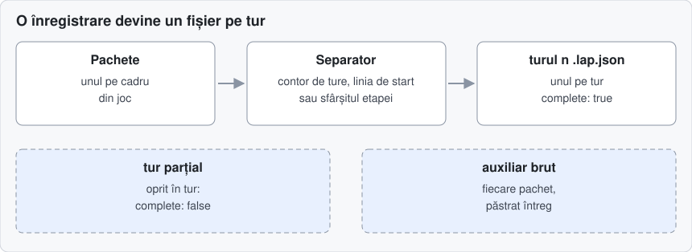

# Cum se împart turele și etapele {#how-laps-and-stages-are-split}

Un înregistrator vede un flux continuu de eșantioane. Transformarea lui în ture se face de unul dintre cele patru împărțitoare, alese după ce spune jocul despre ture. Toate urmează aceeași idee: se folosește numărătoarea jocului acolo unde există una, iar altfel turul se găsește din poziții; nu se scrie niciodată un fragment prea scurt ca să poată fi comparat.

| Împărțitor | Cod | Folosit de |
|---|---|---|
| `LapSplitter` | [`fulllap.py`](https://github.com/Holdi601/3DHeat-GameCapture/blob/main/heat3d_capture/telemetry/fulllap.py) | Forza |
| `CounterSplitter` | [`kunos.py`](https://github.com/Holdi601/3DHeat-GameCapture/blob/main/heat3d_capture/telemetry/kunos.py) | Assetto Corsa, ACC |
| `LineSplitter` | [`kunos.py`](https://github.com/Holdi601/3DHeat-GameCapture/blob/main/heat3d_capture/telemetry/kunos.py) | AC EVO, AC Rally, BeamNG |
| `StageSplitter` | [`rally.py`](https://github.com/Holdi601/3DHeat-GameCapture/blob/main/heat3d_capture/telemetry/rally.py) | EA SPORTS WRC, DiRT Rally 2.0, DiRT Rally, DiRT 4, Richard Burns Rally |

Trackmania împarte rulările în interiorul pluginului său ([Trackmania](telemetry-trackmania.md)), iar fișierele iRacing sunt împărțite de vizualizator după contorul de ture al simulatorului ([iRacing](telemetry-iracing.md)).

La **Ctrl+C** fiecare înregistrator apelează `flush()` al împărțitorului său, astfel încât o tură sau o etapă deschisă este scrisă dacă trece aceleași minime ca mai jos.

## LapSplitter (Forza) {#lapsplitter-forza}

Parametri: `minimum_metres = 400`, `gap_seconds = 2.0`.

Pentru fiecare pachet decodat:

1. Dacă `timestampMs` al jocului a sărit înainte cu mai mult de 2 secunde față de ultimul pachet, sau a mers înapoi, tura deschisă este mai întâi închisă (flush).
2. Dacă `isRaceOn` este 0 (jocul nu este într-o cursă), tura deschisă este închisă și pachetul este aruncat.
3. Dacă nu este deschisă nicio tură, se deschide una cu `lapNumber` al pachetului.
4. Dacă `lapNumber` diferă de cel al turei deschise, tura deschisă este **închisă ca fiind completă**; `seconds` ei este `lastLap` al jocului, dacă este pozitiv. O tură închisă așa este scrisă indiferent de lungime. Se deschide o tură nouă.
5. Pachetul este adăugat.

Înregistratorul mai închide tura când nu a sosit niciun pachet timp de 2 secunde de ceas real (jocul e pus pe pauză sau s-a închis în timpul unei ture).

**Închiderea** păstrează tura deschisă doar dacă are cel puțin 2 eșantioane și cel puțin 400 m de `distanceTravelled`; este scrisă ca neterminată (o `run`). O cursă punct-la-punct nu numără niciodată a doua tură, deci se termină întotdeauna așa.

## CounterSplitter (AC, ACC) {#countersplitter-ac-acc}

Parametru: `minimum_metres = 300`. Primește pentru fiecare eșantion `completedLaps` din pagina grafică și timpul ultimei ture.

- Primul eșantion deschide o tură numerotată cu `completedLaps` curent.
- Când `completedLaps` se schimbă, tura deschisă se închide. Este **completă**, cu `seconds = timpul ultimei ture în ms / 1000` (dacă este pozitiv), numai dacă numărătorul a crescut exact cu 1 - o revenire la 0 (o repornire a sesiunii) sau o creștere cu mai multe unități o închide ca neterminată.
- O tură închisă este scrisă numai dacă are eșantioane și cel puțin 300 m de traseu parcurs.
- Închiderea păstrează tura deschisă dacă are mai mult de un eșantion și cel puțin 300 m.

## LineSplitter (AC EVO, AC Rally, BeamNG) {#linesplitter-ac-evo-ac-rally-beamng}

Parametri: `radius = 15 m`, `minimum_metres = 300`, `stop_seconds = 8`.

Aceste jocuri fie nu au un contor de ture pe o pagină pe care o citește înregistratorul, fie conduc etape. **Linia este locul unde a început înregistrarea**:

1. Poziția orizontală (`x`, `z`) a primului eșantion devine linia.
2. Odată ce mașina a parcurs mai mult de 5 m, direcția de la linie către mașină devine direcția turei.
3. **Oprirea** încheie o rulare: când `speed` rămâne sub 1 m/s timp de 8 secunde, tura deschisă este închisă (așa se termină o etapă de raliu: mașina se oprește la sosire).
4. **Trecerea liniei**: după mai mult de 300 m parcurși, se colectează eșantioanele aflate la cel mult 15 m de linie. Când mașina iese din nou din această rază, eșantionul colectat cel mai apropiat este trecerea. Dacă mașina mergea acolo în același sens cu direcția turei (produsul scalar dintre orientarea locală și direcție este pozitiv), tura se închide la acel eșantion; altfel trecerea este ignorată (mașina a trecut linia de start în sens invers).
5. `seconds` unei ture închise este timpul de la primul ei eșantion până la trecere. Este **completă numai dacă primul ei eșantion a avut peste 5 m/s**: o tură care a început din repaus este o pornire, nu o tură de comparat. Prima tură a unei înregistrări pornite de pe grilă este deci întotdeauna neterminată; înregistrarea pornită în timpul unei ture lansate dă o primă tură completă la următoarea trecere.
6. Tura următoare începe la eșantionul de trecere (aparține ambelor ture).

Turele mai scurte de 300 m sunt aruncate. Închiderea (o oprire sau Ctrl+C) păstrează tura deschisă dacă are cel puțin 2 eșantioane și 300 m, ca neterminată. BeamNG închide la fel când vehiculul este resetat (ceasul lui revine înapoi), înainte de a porni un nou împărțitor, astfel încât rularea de dinaintea resetării să fie păstrată.

Distanțele sunt orizontale (`x`, `z`) pentru contorul de parcurs și pentru testul liniei, și 3D complete pentru testul de lungime de 300 m.

## StageSplitter (jocuri de raliu) {#stagesplitter-rally-games}

Parametru: `minimum_metres = 300`. Primește pentru fiecare eșantion ceasul de etapă al jocului, dacă jocul spune că mașina a terminat, și, opțional, timpul propriu al jocului pentru ea.

1. Dacă ceasul este 0 sau mai mic, sau a mers înapoi cu mai mult de 0,5 s, etapa deschisă este **abandonată**: păstrată ca etapă parțială dacă nu este completă, are peste 10 eșantioane și cel puțin 300 m. Un ceas de 0 sau mai mic aruncă și eșantionul (mașina este la start).
2. Dacă nu este deschisă nicio etapă, se deschide una nouă (numerotată 1, 2, ... pentru înregistrare).
3. Odată ce o etapă este completă, eșantioanele următoare sunt ignorate până când ceasul revine înapoi.
4. Fiecare eșantion este salvat cu `time` egal cu ceasul de etapă.
5. Când jocul spune că s-a terminat, etapa este completă; `seconds` este timpul jocului când este dat și pozitiv, altfel ceasul. Este scrisă dacă a acoperit cel puțin 300 m.

Ce înseamnă „terminat" pe fiecare joc:

| Joc | Terminat când |
|---|---|
| EA SPORTS WRC | lungimea etapei > 0 și distanța parcursă în etapă >= lungime - 0,5 m |
| Jocurile DiRT | numărul de ture terminate a crescut peste numărul de la începutul etapei, sau (eveniment cu o singură tură) distanța de tur >= 99,9% din lungimea traseului |
| Richard Burns Rally | ceasul de cursă > 0 și distanța până la capăt <= 0 |

Pentru RBR, axa „sus" și viteza se fixează când se scrie o etapă (vezi [Jocuri de raliu](telemetry-rally.md#richard-burns-rally-rsf--ngp)).

## Timpul și distanța în fișierul de tură {#time-and-distance-in-the-lap-file}

Pentru fiecare înregistrator, cu excepția Forza, `time` este reașezat astfel încât primul eșantion al turei să fie 0, iar `distance` este distanța 3D cumulată între poziții consecutive. Forza folosește cronometrul propriu al jocului și contorul propriu de distanță, reașezate în același fel.
