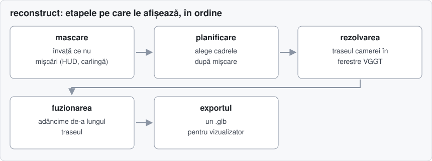

# Reconstrucție offline {#offline-reconstruction}

```bash
python -m heat3d_capture reconstruct lap.mp4 -o lap.glb [--solve-budget 260] [--fuse-interval 0.4]
```

Cod: [`scan/offline.py`](https://github.com/Holdi601/3DHeat-GameCapture/blob/main/heat3d_capture/scan/offline.py),
[`pose/feedforward.py`](https://github.com/Holdi601/3DHeat-GameCapture/blob/main/heat3d_capture/pose/feedforward.py),
[`pose/vggt_model.py`](https://github.com/Holdi601/3DHeat-GameCapture/blob/main/heat3d_capture/pose/vggt_model.py),
[`pose/feedforward_source.py`](https://github.com/Holdi601/3DHeat-GameCapture/blob/main/heat3d_capture/pose/feedforward_source.py),
[`pose/solveprep.py`](https://github.com/Holdi601/3DHeat-GameCapture/blob/main/heat3d_capture/pose/solveprep.py).
Opțiuni: [Referința comenzilor](commands.md#reconstruct).

## De ce o a doua cale {#why-a-second-path}

Urmărirea incrementală este în direct și ieftină și funcționează acolo unde există structură de care să te agăți: un interior, o stradă, o hartă cu acoperiș. Un **circuit de curse este cazul ei cel mai rău**: drumul este o panglică netedă, cu puțină textură, orizontul abia se mișcă, iar odată ce câteva poziții derivează, nimic mai târziu nu le mai trage înapoi. O tură iese ca o curbă care rătăcește în loc să se închidă.

Calea offline dă **ferestre de cadre** unui model care prezice toate camerele lor împreună, astfel încât fiecare cadru constrânge direct pe fiecare altul, nu printr-un lanț. Are nevoie de toată înregistrarea înainte să poată răspunde, deci nu este în direct, și este lentă: minute per fereastră pe un GPU de desktop. Tot ce vine după poziții - fuziunea, acoperirea, culoarea, exportul - este același cod ca la scanarea în direct: traseul rezolvat este dat reconstructorului ca sursă de poziții, exact acolo unde ajunge telemetria Forza.

## Cerințe {#requirements}

- **PyTorch** potrivit cu GPU-ul vostru (nu este fixat de acest proiect; instalați-l înainte de `requirements.txt`, vezi [Rulare](runtime.md)).
- **`vggt`** - codul modelului VGGT (`from vggt.models.vggt import VGGT`), din depozitul GitHub al Meta; nu este în indexul de pachete.
- **`transformers`**, pentru că calea offline rulează adâncimea prin `DepthEstimator` PyTorch (Depth Anything V2 Small), nu prin fișierul ONNX.
- În practică un GPU CUDA; ambele modele revin la CPU, ceea ce nu este practic.

Niciuna dintre acestea nu este în `requirements.txt`, pentru că scanerul nu are nevoie de ele. Sunt în **`requirements-offline.txt`**, împreună cu dependențele proprii ale VGGT (`einops`, `safetensors`, `huggingface_hub`, `Pillow`):

```bash
.venv\Scripts\python -m pip install -r requirements-offline.txt
.venv\Scripts\python -m pip install --no-deps "vggt @ git+https://github.com/facebookresearch/vggt.git"
```

VGGT se instalează cu `--no-deps` pentru că metadatele pachetului său fixează `numpy<2`, pe care pip l-ar respecta coborând numpy-ul de care are nevoie scipy aici. `reconstruct` verifică toate acestea imediat după ce afișează linia de licență (lista `OFFLINE` din [`runtime/preflight.py`](https://github.com/Holdi601/3DHeat-GameCapture/blob/main/heat3d_capture/runtime/preflight.py)), arată ce lipsește și cu dimensiunile lor, și instalează doar la un da - VGGT cu `--no-deps`, ca mai sus. Refuzul sau lipsa unui terminal la care să se întrebe înseamnă ieșire cu codul 1.

## Modelul și licența lui {#the-model-and-its-licence}

**VGGT**, `facebook/VGGT-1B`: **CC-BY-NC-4.0, doar necomercial, iar o reconstrucție făcută cu el moștenește asta.** Comanda afișează aceasta înainte să pornească (`describe_licence`). Există un `facebook/VGGT-1B-Commercial` cu licență separată, dar este un depozit cu acces restricționat, acordat per cont de Meta, deci nu poate fi implicit. `--model vggt-1b-commercial` rezolvă cu el (și afișează în schimb linia lui de licență); fără acces acordat, descărcarea eșuează. *Codul* `vggt` este sub „VGGT License" a Meta, un acord de materiale de cercetare cu o politică de utilizare acceptabilă (citit din `LICENSE.txt` al pachetului). Vezi [Modele și licențe](models-and-licences.md).

## Rularea, etapă cu etapă {#the-run-stage-by-stage}

Numele etapelor sunt cele pe care le afișează comanda.



### masking {#masking}

Un `FlowMask` este învățat din **4 rulări de câte 90 de cadre consecutive**, centrate la 1/8, 3/8, 5/8 și 7/8 din video, la 960 x 540 gri (vezi [FlowMask](reconstruction-capture.md#flowmask-what-never-travels)). Nota sa este afișată și păstrată în rezumat. Un video mai scurt de 90 de cadre nu primește mască.

#### Masca camerei este învățată, nu aplicată {#the-camera-mask-is-learned-not-applied}

Masca **nu** se aplică cadrelor date solverului. Mascarea cabinei arăta corect după statisticile trăsăturilor (cei mai mulți colțuri detectați stau pe pixeli fixați de cameră) - dar asta este o afirmație despre un detector de trăsături, iar solverul este o rețea antrenată. Măsurat după cât de mult se întoarce traseul recuperat între pași consecutivi (o mașină se întoarce câteva grade; o plimbare aleatorie, nouăzeci), cadrele brute au dat cea mai mică întoarcere, cadrele cu contrast ridicat puțin mai mult, cele mascate clar mai mult, iar ambele împreună cel mai mult. Deci solverul primește cadre brute. Masca este totuși folosită pentru a planifica distanța dintre cadre, mai jos, iar urmăritorul incremental o folosește în scanarea în direct. (`solveprep.enhance`, care maschează și ridică contrastul local cu CLAHE, există, dar nu este folosit de această comandă.)

### planning: cadre distanțate după mișcare {#planning-frames-spaced-by-motion}

`plan_by_motion` alege cadrele solverului după **cât de mult s-a mișcat imaginea**, nu după ceas: un interval fix dă secțiunilor lente cadre care nu le trebuie și înfometează pe cele rapide, unde cadrele consecutive încetează să se suprapună suficient ca să fie legate.

- Deplasare țintă: **5% dintr-o lățime de 960 de pixeli** (48 px) deplasarea mediană a trăsăturilor ORB între cadrele alese consecutiv, măsurată pe cadre gri de 960 x 540 cu contrast CLAHE, trăsăturile doar pe mască.
- Se începe cu un interval de 0,3 s; după fiecare pas, următorul interval devine `gap x (0.5 + 0.5 x target / measured)`, limitat la **0,15-2,0 s**, ca o măsurătoare zgomotoasă să nu clatine planul.
- Când nimic nu s-a potrivit, intervalul se micșorează la 0,6 din el însuși (prea departe unul de altul este eșecul care se evită).
- Se oprește la sfârșitul videoului sau la `--solve-budget` cadre (implicit 260).

Mai puțin de 4 cadre planificate este eroare.

### solving: ferestre și cusături {#solving-windows-and-stitching}

Cadrele planificate sunt decodate la 960 px lățime și rezolvate în **ferestre suprapuse de 16 cadre, cu 6 comune** cu următoarea (`plan_windows`; ultima fereastră este trasă înapoi ca să se termine pe ultimul cadru, astfel încât sfârșitul unei capturi să aibă la fel de mulți vecini ca mijlocul). Mai mult de **400** de cadre într-o singură rulare este refuzat.

Fiecare fereastră: cadrele sunt redimensionate astfel încât latura lungă să fie **518** și ambele laturi să fie multipli de **14** (raportul de aspect păstrat - turtirea ar denatura câmpul vizual), aduse la 0..1, și rulate prin VGGT sub autocast bfloat16 (float16 rămâne fără exponent la coordonatele lumii îndepărtate). Extrinsecele camerei sunt convertite în rotații lume-din-cameră și centre de cameră. Hărțile de puncte nu sunt păstrate implicit.

Fiecare fereastră vine în **propriul său cadru arbitrar și propria sa scară arbitrară**, deci ferestrele sunt **cusute** în cadrul primei prin o transformare de similaritate (rotație, translație, o scară), potrivită pe camerele pe care le au în comun cu ce este deja plasat:

- **Rotația din orientările camerelor**, nu din pozițiile lor: camerele comune stau de-a lungul traseului și sunt aproape coliniare pe o linie dreaptă, ceea ce lasă o potrivire doar pe poziție incapabilă să vadă rotația - fiecare fereastră se curbează, iar rezultatul cusut iese drept. Rotația este media lui `target_R x source_R^T` proiectată înapoi pe o rotație adevărată (cu o gardă de reflexie).
- **Scara și decalajul din poziții**, de-a lungul sursei rotite.
- Sunt necesare cel puțin **4** camere comune; mai puține este eroare.

Suprapunerea este o treime din fereastră, ca scara să fie bine determinată; eroarea de scară care se compune de la o fereastră la alta este ceea ce face o tură să se înfășoare în spirală.

Pentru fiecare joncțiune se înregistrează cel mai mare dezacord al camerelor comune după potrivire, în unități ale distanței medii dintre ele (`seam_error`).

### fusing {#fusing}

Cadrele la fiecare `--fuse-interval` secunde (implicit 0,4) sunt decodate la 960 px lățime, primesc adâncime de la Depth Anything V2 Small (PyTorch) și sunt fuzionate cu o poziție **interpolată** din traseul rezolvat la marca lor de timp (poziție liniară, rotație sferică; `FeedForwardPoses`). Cadrele din afara intervalului de timp rezolvat sunt sărite, nu extrapolate. Camera folosește un câmp vizual orizontal de **65 de grade**. Pozițiile feed-forward au încrederea 0,85 în fuziune și în acoperire.

### exporting {#exporting}

Mesh-ul este scris ca pentru o scanare în direct ([Ieșirea .glb](glb-output.md)), numit după video.

## Rezumatul {#the-summary}

```text
140 cameras solved over 182s
closure error 3.1% of path length
worst seam 0.42 frame spacings
<mask note>
wrote lap.glb
```

| Linie | Înțeles |
|---|---|
| closure error | distanța de la prima la ultima cameră împărțită la lungimea traseului. Pentru o singură tură, cea mai onestă măsură a derivei. Peste 10%: „The lap does not close ... Treat the shape as unreliable." |
| worst seam | cel mai mare dezacord al cusăturii. Peste 1,0: „Windows disagreed by up to N frame spacings at a seam, so part of the path is stitched on weak evidence." |
| no file | „Fusion produced no surface, so nothing was written." Codul de ieșire este atunci 1. |

## Scara {#scale}

Traseul cusut este în unitățile arbitrare ale primei ferestre. Adâncimea este ancorată prin triangulare între pozițiile interpolate (ca la telemetrie), deci geometria este consecventă cu traseul - dar **rezultatul nu este în metri**, decât dacă și traseul este. Nimic din această comandă nu fixează scara globală; calibrarea la sol nu se aplică când pozițiile vin dintr-o sursă de poziții.

## Starea acestei căi {#state-of-this-path}

Cu cadre la interval fix, ferestrele se rezolvă într-un traseu coerent pe unele secțiuni ale unei ture și într-o zgârietură pe altele; eșecurile sunt la curbele strânse, unde privirea se întoarce brusc între cadre, iar eșantionarea mai densă a acelor curbe le recuperează. Niciun indicator de imagine încercat (luminozitate, detaliu, numărul de trăsături, raportul de inliere, deplasare) nu a prezis dinainte care secțiuni vor eșua. Deci distanța dintre cadre nu poate fi planificată complet din imagini în avans: trebuie aleasă rezolvând, măsurând rezultatul și rezolvând din nou mai dens acolo unde traseul nu este unul pe care l-ar fi putut conduce o mașină. Planificarea după mișcare este construită; **re-rezolvarea adaptivă nu este**.
