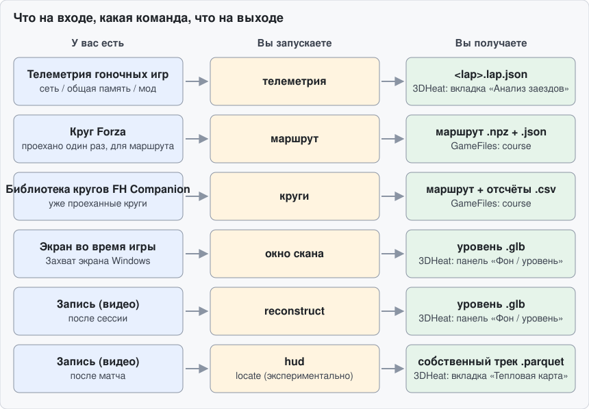

# 3DHeat GameCapture {#dheat-gamecapture}

**Что это?** Инструмент, который записывает то, что гоночная игра сообщает о вашей езде, по одному
файлу на круг. Он также может восстановить грубую 3D-модель уровня по видео, на котором вы играете.

**Зачем это нужно?** Чтобы видеть свои круги в [просмотрщике 3DHeat](https://holdi601.github.io/3DHeat/):
где вы тормозили, где были медленными, чем отличаются два круга. А также чтобы иметь уровень под
тепловой картой, когда ни у кого нет его 3D-модели.

**Пример:** включите Data Out в Forza, выполните одну команду и проедьте два круга. В папке `laps\`
появятся два файла круга. Перетащите их на вкладку «Анализ заездов» просмотрщика.


Впервые в командной строке? Сначала прочитайте [С чего начать](before-you-start.md).

## Три задачи {#the-three-jobs}

1. **Телеметрия круга.** Инструмент записывает каждый канал, который публикует гоночная игра: Data Out
   у Forza, общую память игр Assetto Corsa, сетевые потоки ралли-игр, мод BeamNG, плагин Trackmania,
   — и пишет один файл `heat3d-lap` на круг или этап для вкладки «Анализ заездов» просмотрщика.
   iRacing не требует записывающего: просмотрщик читает его собственные файлы `.ibt`.
2. **Уровни из игрового процесса.** Он превращает то, что показывал экран, пока вы шли или ехали по
   уровню, в 3D-модель `.glb`, которую просмотрщик кладёт под тепловую карту.
3. **Ваш матч, после него.** `hud` читает HUD вашей собственной записи: ваши действия, смерти,
   след на миникарте и ленту убийств. `locate` (экспериментальный: пока размещает мало настоящих
   кадров) определяет, где был снят каждый кадр, на 3D-модели уровня.

Все три задачи следуют одному правилу: **ничего не внедряется в игру и ничего не перехватывается**.
Кадры берутся из публичного API захвата экрана, телеметрия — из интерфейсов, которые игры публикуют
для этого. См. [Правила](../rules.md).



Код написан на Python (пакет `heat3d_capture`), лицензия MIT. У моделей глубины и позы, которые он
умеет запускать, свои лицензии — см. [Модели и лицензии](../models-and-licences.md).

## Быстрый старт {#quick-start}

### Записать круги {#record-laps}

Нужен Python 3.10 или новее ([С чего начать](before-you-start.md)). В PowerShell:

```powershell
git clone https://github.com/Holdi601/3DHeat-GameCapture
cd 3DHeat-GameCapture
python -m venv .venv
.venv\Scripts\python -m pip install -r requirements.txt

# Forza: Settings -> HUD and Gameplay -> Data Out = ON, IP 127.0.0.1, port 5300
.venv\Scripts\python -m heat3d_capture telemetry -o laps
```

**Вы должны увидеть** `listening on port 5300. Laps go to laps. Ctrl+C to stop.`, затем строку на
каждый круг, когда вы пересекаете линию, как на картинке выше. Нажмите Ctrl+C, чтобы остановить.
Перетащите файлы из `laps\` на вкладку «Анализ заездов» просмотрщика.
Для каждой другой игры нужен один параметр `--game`:

```powershell
.venv\Scripts\python -m heat3d_capture telemetry --game acc -o laps
.venv\Scripts\python -m heat3d_capture telemetry --game dirtrally2 -o laps
```

Все игры и параметры: [Записывающие телеметрии](../telemetry.md).

### Сканировать уровень {#scan-a-level}

Дважды щёлкните **`scan.bat`** в папке инструмента. Он находит Python (и предлагает установить его
через winget, если Python нет), создаёт собственную `.venv` и открывает окно сканирования. В окне
написано, чего не хватает, для чего нужен каждый пакет и насколько велика загрузка; без вашего «да»
ничего не устанавливается. См. [Среда выполнения и зависимости](../runtime.md) и
[Окно сканирования](../reconstruction-scan-ui.md).

Вручную: `.venv\Scripts\python -m heat3d_capture.ui`.

Чтобы восстановить запись без сети, с путём камеры, решённым сразу целиком (нужны PyTorch, пакет
`vggt` и GPU — см. [Офлайн-реконструкция](../reconstruction-offline.md)):

```powershell
.venv\Scripts\python -m heat3d_capture reconstruct lap.mp4 -o lap.glb
```

## Карта документации {#map-of-the-documentation}

| Страница | Что в ней |
|---|---|
| [С чего начать](before-you-start.md) | Python, терминал, первая команда, частые ошибки |
| [Правила](../rules.md) | Никакого внедрения, только опубликованные интерфейсы и что это стоит |
| [Записывающие телеметрии](../telemetry.md) | команда `telemetry` и обзор каждой игры |
| [Forza](../telemetry-forza.md) | Data Out, определение раскладки, ретранслятор FH Companion и его `.tele.gz` |
| [Игры Assetto Corsa](../telemetry-assetto-corsa.md) | AC, ACC, AC EVO, AC Rally из общей памяти |
| [Ралли-игры](../telemetry-rally.md) | EA SPORTS WRC, DiRT Rally 2.0 / 1 / DiRT 4, Richard Burns Rally |
| [BeamNG.drive](../telemetry-beamng.md) | мод протокола `heat3d` |
| [Trackmania](../telemetry-trackmania.md) | плагин Openplanet `Heat3dRecorder` |
| [iRacing](../telemetry-iracing.md) | чтение файлов `.ibt` в просмотрщике |
| [Разбиение на круги и этапы](../lap-splitting.md) | `LapSplitter`, `CounterSplitter`, `LineSplitter`, `StageSplitter` |
| [Занос, дрифт и производные каналы](../slip-and-drift.md) | как масштабируется проскальзывание и что выводит просмотрщик |
| [Файл heat3d-lap](../lap-format.md) | формат файла круга, каналы, единицы, `meta` |
| [Игры](../games.md) | для каждой игры: как записывать, что отправляется, какие трассы можно экспортировать |
| [Команды](../commands.md) | `route`, `telemetry`, `laps`, `reconstruct`, `hud`, `locate`, пошагово |
| [Справка по командам](../cli-reference.md) | каждый параметр, создано из `--help` |
| [Чтение HUD из записи](../hud-video.md) | `hud`: собственные действия, смерти, след на миникарте и лента убийств из записи |
| [Поиск кадров на уровне](../locate.md) | `locate`: где был снят каждый кадр, по геометрии уровня |
| [Реконструкция уровня](../reconstruction.md) | конвейер от кадров до `.glb` |
| [Окно сканирования](../reconstruction-scan-ui.md) | каждый элемент управления, горячая клавиша и наложение |
| [Захват, маски и качество кадров](../reconstruction-capture.md) | Windows Graphics Capture, ключевые кадры, маски HUD, советы по качеству |
| [Глубина](../reconstruction-depth.md) | Depth Anything V2, ONNX Runtime, построение модели |
| [Поза камеры и масштаб](../reconstruction-pose.md) | одометрия, relocalisation, позы из телеметрии, масштаб земли, bundle adjustment |
| [Слияние, покрытие и цвет](../reconstruction-fusion-and-texture.md) | объём занятости, сетка покрытия, слабые места, цвет вершин |
| [Вывод .glb](../glb-output.md) | файл, который загружает просмотрщик |
| [Офлайн-реконструкция](../reconstruction-offline.md) | `reconstruct`, окна VGGT и сшивание |
| [Модели и лицензии](../models-and-licences.md) | размеры Depth Anything V2, VGGT, пакеты |
| [Среда выполнения и зависимости](../runtime.md) | предварительная проверка, бэкенды, уровни производительности |
| [Ограничения и проверка](../limits.md) | что не сделано и что не проверено |
| [Обновления](../updates.md) | проверка релиза и `python -m heat3d_update` |
| [Разработка](../development.md) | тесты, виртуальное окружение, структура репозитория |
| [Сопровождение документации](../maintaining.md) | контрольный список выпуска для кода и документации |

## Часть 3DHeat {#part-of-3dheat}

Файлы, которые это записывает, загружает **просмотрщик 3DHeat** —
[исходный код](https://github.com/Holdi601/3DHeat), [документация](https://holdi601.github.io/3DHeat/).
Файлы кругов идут на вкладку «Анализ заездов», уровни `.glb` — на панель «Фон / уровень», таблицы `hud`
и `locate` — на вкладку «Тепловая карта». Как просмотрщик читает таблицы и файлы матчей, описано в
[Один файл на матч (.3dheat)](https://holdi601.github.io/3DHeat/container.html) и
[Загрузка данных](https://holdi601.github.io/3DHeat/getting-data-in.html).

| Инструмент | Что делает | Документация |
|---|---|---|
| [Просмотрщик 3DHeat](https://github.com/Holdi601/3DHeat) | показывает тепловые карты, заезды и матчи в 3D, в браузере | [docs](https://holdi601.github.io/3DHeat/) |
| [GameFiles](https://github.com/Holdi601/3DHeat-GameFiles) | трассы и уровни из файлов, которые поставляют игры, как 3D-модели | [docs](https://holdi601.github.io/3DHeat-GameFiles/) |
| [GameCapture](https://github.com/Holdi601/3DHeat-GameCapture) | телеметрия кругов из гоночных игр; уровни, восстановленные по видео игры | [docs](https://holdi601.github.io/3DHeat-GameCapture/) |
| [Unreal Exporter](https://github.com/Holdi601/3DHeat-UnrealExporter) | плагин редактора Unreal, который экспортирует уровень как 3D-модель | [docs](https://holdi601.github.io/3DHeat-UnrealExporter/) |
| [CS2](https://github.com/Holdi601/3DHeat-CS2) | демо Counter-Strike 2 в файлы матчей; карты в 3D-модели | [docs](https://holdi601.github.io/3DHeat-CS2/) |
| [Watcher](https://github.com/Holdi601/3DHeat-Watcher) | записывает вашу игру в фоне из того, что игры публикуют | [docs](https://holdi601.github.io/3DHeat-Watcher/) |
| [Ext-WarThunder](https://github.com/Holdi601/3DHeat-Ext-WarThunder) | реплеи War Thunder в таблицы и документы матчей | [docs](https://holdi601.github.io/3DHeat-Ext-WarThunder/) |
| [Ext-WoT](https://github.com/Holdi601/3DHeat-Ext-WoT) | реплеи World of Tanks в таблицы и документы матчей | [docs](https://holdi601.github.io/3DHeat-Ext-WoT/) |
| [Ext-WoWs](https://github.com/Holdi601/3DHeat-Ext-WoWs) | реплеи World of Warships в таблицы и документы матчей | [docs](https://holdi601.github.io/3DHeat-Ext-WoWs/) |
| [Ext-Squad](https://github.com/Holdi601/3DHeat-Ext-Squad) | демо серверов Squad в таблицы и документы матчей | [docs](https://holdi601.github.io/3DHeat-Ext-Squad/) |
| [Ext-DCS](https://github.com/Holdi601/3DHeat-Ext-DCS) | карты DCS World в 3D-модели | [docs](https://holdi601.github.io/3DHeat-Ext-DCS/) |
| [Ext-IL2](https://github.com/Holdi601/3DHeat-Ext-IL2) | карты IL-2 Sturmovik в 3D-модели | [docs](https://holdi601.github.io/3DHeat-Ext-IL2/) |

Разработчику с открытым проектом игры стоит использовать Unreal exporter: он читает настоящую
геометрию и даёт точный результат. Там, где архивы игры можно прочитать, GameFiles извлекает точную
трассу. Реконструкция по игровому процессу нужна только тогда, когда доступен лишь экран.
