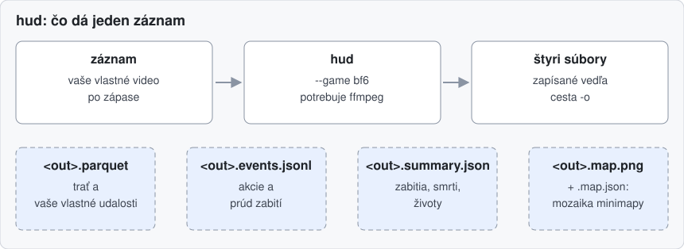

# Čítanie HUD z nahrávky {#reading-the-hud-from-a-recording}

`hud` číta HUD hry, teda ovládací prvok na obrazovke, z **vlastnej nahrávky hráča**, až po zápase. Číta **vlastné** akcie hráča z vyskakovacieho okna bodov, ktoré hra ukazuje pod zameriavačom (zabitia, asistencie, oživenia, dopĺňanie munície, dobytie...), jeho smrti z obrazoviek pádu a nasadenia, jeho **vlastnú** stopu z minimapy a prúd zabití vedľa nej ako časované udalosti. Výsledok je tabuľka 3DHeat s mozaikou minimapy ako obrázkom mapy, ktorý sa položí pod ňu.

Stručne: prejde video vášho zápasu a zapíše si vaše zabitia, smrti a kade ste chodili.

```bash
.venv\Scripts\python -m heat3d_capture hud "<recording>.mp4" --game bf6 --player <name> -o out/match
```

Prvým profilom hry je Battlefield 6.



## Čo robí a čoho sa nedotýka {#what-it-does-and-does-not-touch}

- Číta **video súbor**: klip z ShadowPlay / Instant Replay, nahrávku z OBS, čokoľvek, čo dekóduje ffmpeg. Nikdy sa nedotýka hry, jej pamäte, jej súborov ani jej siete a beží až po skončení zápasu. Pozrite [Pravidlá](rules.md).
- Odvodzuje **len vlastnú pozíciu hráča**, z jeho vlastnej minimapy. Značky ostatných hráčov na minimape sa zakryjú a nikdy sa nečítajú. Prúd zabití sa zachová celý, ale len tak, ako ho zobrazuje na obrazovke (kto, koho, čím, kedy). Pozícia sa nepripisuje nikomu okrem hráča.
- OCR beží lokálne (RapidOCR s modelmi PaddleOCR cez ONNX Runtime). Žiadny snímok ani výrez neopustí počítač.
- Nahrávka ukazuje mená ostatných hráčov a mozaika je obrazom úrovne. Výstupy slúžia na vlastné použitie hráča; uchovávajte ich lokálne.

## Požiadavky {#requirements}

- **ffmpeg a ffprobe** v `PATH`. Ak je k dispozícii karta NVIDIA, dekóduje sa na nej (`-hwaccel cuda`); inak dekóduje CPU, niekoľkonásobne pomalšie.
- Balíky z `requirements.txt` a OCR bez vlastných závislostí (žiada CPU verziu `onnxruntime`, ktorá sa kosí s verziou DirectML, ktorú projekt používa):

```bash
.venv\Scripts\python -m pip install -r requirements.txt
.venv\Scripts\python -m pip install --no-deps rapidocr_onnxruntime==1.2.3
```

`rapidocr_onnxruntime` je čítačka textu (OCR), ktorá číta mená a slová z obrazovky. `--no-deps` zabráni tomu, aby nahradila DirectML `onnxruntime` projektu.

Na Windows nainštalujete ffmpeg príkazom `winget install Gyan.FFmpeg`, potom otvorte nový terminál a overte ho príkazom `ffmpeg -version`. Ak ste s príkazovým riadkom ešte nepracovali, prečítajte si [Ako začať](before-you-start.md).

- Nahrávka **16:9** v ľubovoľnom rozlíšení (1080p, 1440p, 4K). Iné pomery strán sa odmietnu, lebo rámčeky profilu by pristáli na nesprávnych častiach obrazovky.
- **Predvolené rozloženie HUD** hry. Prvok HUD, ktorý bol presunutý alebo zmenený, sa číta na zlom mieste.

## Možnosti {#options}

| Možnosť | Predvolené | Význam |
|---|---|---|
| `video` | | Nahrávka. |
| `-o`, `--out` | názov videa, v aktuálnom priečinku | Cesta výstupu **bez** prípony; súbory sú `<out>.parquet`, `.events.jsonl`, `.summary.json`, `.map.png`, `.map.json`. |
| `--game` | `bf6` | Čie HUD sa číta. `bf6` (Battlefield 6) je zatiaľ jediný profil. |
| `--player` | žiadne | Meno hráča tak, ako ho zobrazuje prúd zabití. Porovnáva sa približne (OCR si mieša `l`/`I`/`1`, `O`/`0`, `rn`/`m`). Bez neho sa meno odhadne (nižšie). |
| `--fps` | 5 | Vzorky minimapy za sekundu. Prúd zabití sa vzorkuje polovicu tejto hodnoty, vyskakovacie okno bodov a obrazovky smrti tiež polovicu (štvrtinu, keď nie je zobrazené žiadne vyskakovacie okno), kompas každé 3 s, zoznam squadu každých 15 s. |
| `--start` | 0 | Sekundy od začiatku videa, od ktorých sa začína. |
| `--seconds` | všetko | Koľko videa sa prečíta. |
| `--metres-per-pixel` | žiadne | Mierka minimapy, ak je známa: metre na pixel minimapy pri bežnom priblížení (minimapa je na obrazovke 1080p široká 296 pixelov). Bez nej sú pozície v týchto pixloch; pozrite [Jednotky](#north-and-units). |
| `--cpu` | vypnuté | Dekódovať na CPU, aj keď je karta NVIDIA. |

Priebeh sa vypisuje každých päť sekúnd. Na konci sa vypíše hráč, zabitia, smrti, životy a zapísané súbory.

## Výstupy {#outputs}

### `<out>.parquet`: stopa a udalosti hráča {#parquet---the-players-track-and-events}

Jeden riadok na každú vzorku, v ktorej bol hráč v hre a dal sa umiestniť na minimapu, plus jeden riadok na každú jeho udalosť. Pätička obsahuje pokyny na čítanie pre prehliadač (kľúč `heat3d`, `kind: heat3d-hud`), takže prehliadač namapuje každý stĺpec bez otázok.

| Stĺpec | Význam |
|---|---|
| `time` | Sekundy od začiatku videa. |
| `event` | `position`; `start` (video začalo uprostred života), `spawn` (späť v hre po smrti alebo dlhej medzere), `death`, `downed` a `revived` (z obrazoviek pádu, nižšie), `end` (život skončil bez vysvetlenia); vlastné akcie hráča z vyskakovacieho okna bodov (`kill`, `assist`, `reviving`, `resupply`, `capture`... pozrite [tabuľku udalostí](#event-table)); a riadky prúdu zabití o hráčovi ako `kill_feed`, `death_feed`, `teamkill_feed`, `suicide_feed`, `squadwipe_feed`. |
| `source` | Odkiaľ udalosť riadka pochádza: `points` (vyskakovacie okno), `screen` (obrazovky pádu a nasadenia), `feed` (prúd zabití); prázdne pri riadkoch pozície. |
| `text` | Pri riadkoch `points`: označenie tak, ako je vytlačené (`KILL`, `SQUAD DAMAGE ASSIST`...), alebo nadpis (`DOUBLE KILL`, názov stuhy), alebo pri neznámom označení to, čo sa prečítalo. |
| `points` | Pri riadkoch `points`: o koľko sa súčet vyskakovacieho okna zvýšil v tom okamihu. Keď sa v tej istej vzorke objavilo viac akcií (zabitie a vozidlo, v ktorom bolo), je to ich súčet, uvedený pri každej, a `shared` hovorí, koľko ho zdieľalo. Prázdne, keď sa súčet nebol prečítaný dvakrát pred a dvakrát po tom okamihu. |
| `subject`, `subject_side` | Pri riadkoch `points`: meno, ktoré vyskakovacie okno zobrazilo s akciou (obeť zabitia, spoluhráč, ktorého oživil alebo zásobil), a jeho farba (`enemy`, `friendly`, `squad`). |
| `confirmed` | `feed`, keď mal prúd zabití riadok pre to isté zabitie alebo smrť (do 3 s, tá istá obeť). |
| `x`, `y`, `z` | Pozícia na mozaike: `x` na východ, `y` na sever, `z` 0 (pätička hovorí, že `z` je nahor). Sever je skutočný sever, keď to kompas dovolil (pozrite `north_up` v súhrne). |
| `player` | Vždy `me`. Len riadky hráča majú pozície. |
| `team` | `own`. |
| `session` | `<video name>#NN`, jedna na každý život. Trasy čiarového tepla nikdy neprechádzajú cez reláciu. |
| `heading` | Stupne v smere hodinových ručičiek od severu (od hornej strany mozaiky, keď sever nie je známy): kam smeroval pohľad. |
| `dir_x`, `dir_y`, `dir_z` | Rovnaké ako vektor smeru, pre smer pohľadu prehliadača. |
| `zoom` | Koľko bola minimapa oddialená oproti svojmu bežnému priblíženiu (nad 1 vo vozidlách). |
| `killer`, `victim`, `weapon`, `headshot`, `marker` | Pri riadkoch zabití a smrtí, ku ktorým existuje riadok prúdu: tento riadok (nižšie). Zabitie z vyskakovacieho okna bez riadku prúdu má meno z okna ako `victim`; zabitie z vyskakovacieho okna zobrazené ako HEADSHOT má `headshot` true. |

Každý riadok udalosti dostane pozíciu hráča v čase udalosti (pri smrti alebo páde posledná pozícia pred ňou, pri oživení prvá po nej). Riadky sa hodia priamo na [čiarové teplo](https://holdi601.github.io/3DHeat/line-heat.html) prehliadača: jeho návrh vyberie `event`, začína na `start`, `spawn` a `revived`, končí na `death`, `downed` a `end`, a riadky `position` ležia pozdĺž trasy. Ostatné udalosti sú pomenované tak, aby návrh žiadnu z nich nebral ako začiatok alebo koniec: dať oživenie je `reviving` (nie `revive`), držanie bodu `defense`, spawn spoluhráča na hráčovi `teammate_arrived`, riadky prúdu `kill_feed` a podobne. `kill` nie je koniec.

Nahrávka s dvoma kolami na dvoch mapách dá dve mozaiky, ktoré sa nedajú zosúladiť. Najväčšia je `<out>.parquet`. Každá ďalšia s aspoň 30 s stopy sa zapíše vedľa nej ako `<out>.map2.parquet`, `<out>.map2.map.png` a tak ďalej.

### `<out>.events.jsonl`: udalosti hráča a prúd zabití {#eventsjsonl---the-players-events-and-the-kill-feed}

Jeden JSON objekt na riadok, v poradí času, každý s `source`:

- `points`: jeden na každú akciu hráča: `time`, `event`, `text`, `points`, `shared`, `subject`, `subject_side` (ako v tabuľke), `popup` (z ktorého vyskakovacieho okna, číslované počas celého behu), `seen` (koľko čítaní ju ukázalo), `confirmed`, a `x`, `y`, kde bol hráč.
- `screen`: jeden na každý pád a každé oživenie: `event` (`death`, `downed` alebo `revived`), `time` (kedy hráč padol; pri `revived` kedy zmizli obrazovky), `until` (posledné zachytenie obrazoviek), `screens` (`down` a/alebo `card`), `outcome` (`death`, `revived` alebo `unknown`, keď záznam skončí skôr), `killer` (z riadku prúdu, ak existuje), `x`, `y`.
- `feed`: každý riadok, ktorý prúd ukázal, od všetkých:

| Pole | Význam |
|---|---|
| `time`, `last` | Prvá a posledná vzorka, v ktorej sa riadok čítal (sekundy od začiatku videa). `time` je, kedy sa zabitie objavilo, s presnosťou na jednu vzorku prúdu (0,4 s pri štandardnej rýchlosti). |
| `kind` | Z pohľadu hráča: `kill`, `death`, `teamkill`, `suicide`, `squadwipe`; pri riadkoch iných hráčov `kill`, `squadwipe` alebo `death` pre riadok bez vraha. |
| `killer`, `victim` | Mená, ako ich najčastejšie čítanie vo všetkých vzorkách, ktoré riadok ukazovali (dlhšie čítanie vyhráva, keď je to začiatok toho bežného: meno čiastočne skryté). `killer` je prázdne pri riadku, ktorý ukázal len ikonu a obeť: smrť voči svetu, alebo riadok, ktorého vrah už zmizol. |
| `killer_side`, `victim_side` | Z farby mena: `friendly` (tím hráča, modrá), `enemy` (oranžová), `squad` (bledozelená, ktorú hra používa pre hráča a jeho squad), `neutral` (žiadna z nich). |
| `weapon` | Trieda ikony zbrane v rámci tohto behu: `icon01`, `icon02`... Riadky s podobnými ikonami zdieľajú triedu. Ikony nemajú meno; neexistuje zoznam, z ktorého by sa dali pomenovať. |
| `marker` | Malá ikona medzi zbraňou a obeťou: `skull`, `arrow`, `chevrons`, `crosses` alebo prázdne. |
| `headshot` | `marker == "skull"`, predpoklad; pozrite [Obmedzenia](#limits). |
| `seen` | Koľko vzoriek prúdu ukázalo riadok. |
| `me` | `killer`, `victim` alebo null. |
| `matched` | Pri vlastných riadkoch hráča: či sa pre ne našla akcia vyskakovacieho okna alebo obrazovka smrti. |
| `x`, `y` (, `map`) | Pri vlastných riadkoch hráča: kde bol. |

### `<out>.summary.json` {#summaryjson}

Hráč (a ako sa našiel), odkiaľ pochádzali jeho udalosti (`own_events_from`: vyskakovacie okno a obrazovky, alebo samotný prúd zabití, keď sa neprečítalo nič z nich), zabitia, smrti, K/D, headshoty, asistencie, dané oživenia (`revives`) a prijaté (`revived`), pády, dobytia, neutralizácie, dopĺňania munície, liečenia, opravy, zničené vozidlá, skóre (súčet konečných súčtov vyskakovacích okien), každý typ akcie s počtom (`actions`), počet vyskakovacích okien, smrti, ktoré ukázal len prúd, vlastný počet zabití a smrtí prúdu a koľko jeho zabití sa zhodovalo s akciou vo vyskakovacom okne, zabitia spoluhráčov, samovraždy, vyčistenia squadu, životy, sekundy v hre, prejdenú vzdialenosť (v jednotkách tabuľky), riadky prúdu, pre každú mapu či je sever hore a koľko čítaní kompasu súhlasilo, počty stopy (vzorky, v hre, umiestnené, neumiestnené, ostrovy), predpoklady a časovanie.

### `<out>.map.png` a `<out>.map.json`: mapa pod stopou {#mappng-and-mapjson---the-map-under-the-track}

Mozaika všetkých minimáp behu, spriemerovaná, bez prekrytí, otočená a zmenšená presne ako tabuľka. Pomocný JSON súbor obsahuje dve kotvy, ktoré si žiada umiestnenie **Map image** v prehliadači (dokumentácia prehliadača: [Obrázky mapy](https://holdi601.github.io/3DHeat/map-images.html)): načítajte PNG tlačidlom **Obrázok mapy…**, nechajte zapnuté **Prevrátiť sever/juh** a zadajte kotvu 1 a kotvu 2 (`px`, `py`, `worldX`, `worldZ`) z pomocného súboru. Obrázok potom leží presne pod stopou.

Do obrázku sa dostanú len tie časti úrovne, ktoré minimapa hráča ukázala.

## Postup {#method}

### Dekódovanie {#decoding}

ffmpeg dekóduje na GPU, zníži vzorkovanie na rýchlosť čítania, kým sú snímky ešte na karte, vystrihne oblasti profilu (minimapu, prúd zabití, dva pásy kompasu, zoznam squadu, vyskakovacie okno bodov, slová obrazovky pádu, pravý dolný roh), každú zmení na pevnú veľkosť a zložia sa do jedného malého obrázka na vzorku. Do Pythonu prejde len tento obrázok. Dekódovanie každého snímku H.264 streamu je spodná hranica času behu.

Dve pracovné vlákna preberajú vzorky: jedno registruje minimapy (OpenCV), druhé číta text (ONNX Runtime).

### V hre, alebo nie {#in-play-or-not}

Kľúčový štvorček minimapy (svetlý štvorec s kľúčom mapy vnútri, dole vľavo na minimape) sa kreslí vždy, keď je minimapa, a nie na obrazovkách smrti, záberu zabitia, nasadenia, menu alebo tabuli výsledkov. Jeho prítomnosť je test hry: svetlý, bezfarebný štvorec s tmavým písmenom v strede, zreteľne svetlejší ako okolie, hľadaný pár pixelov okolo svojho miesta. Jedna vzorka, ktorá nesúhlasí s oboma susedmi, sa ignoruje.

Medzera v hre je smrť alebo zmena kola (ďalší úsek začína `spawn`), keď trvá aspoň 6 s, alebo keď smrť (z obrazoviek alebo riadku prúdu, ktorý označuje hráča ako obeť) prišla do 40 s pred ňou. Kratšia medzera bez smrti (otvorená veľká mapa) pokračuje v tom istom živote. Minimapa zostáva zobrazená, kým je hráč na zemi, takže padnutý hráč je v hre.

### Stopa {#the-track}

Minimapa sa otáča s pohľadom a drží hráča na pevnom mieste (zmerané: uprostred, 49,7 % zhora nadol). Každá vzorka:

1. **Maskovanie** toho, čo nie je úroveň: silne sfarbené alebo takmer biele pixely (značky cieľov, ikony squadu a vozidiel, ping, hranica hracej oblasti, čiary trasy, text), slabá žltozelená kužeľa pohľadu, kruh okolo hráčovho značky, klin kužeľa nad ním, štvorček kľúča a tenký okraj.
2. **Znaky**: body SIFT na sivej minimape s vyrovnaným kontrastom, vnútri masky.
3. **Registrácia na mozaiku**, nie na predchádzajúcu vzorku: body sa porovnajú s doteraz uloženými znakmi, v súradniciach mozaiky, blízko miesta, kde bol hráč naposledy. Podobnosť (otočenie, priblíženie, posun) sa prispôsobí pomocou RANSAC. Zhoda potrebuje dosť inlierov, priblíženie v rozmedzí tretiny toho posledného a posun menej ako tretinu minimapy na vzorku. Zhoda hľadaná kdekoľvek na mozaike (po smrti) potrebuje dvojnásobok inlierov.
4. **Rast mozaiky**: pridajú sa znaky, ktoré mozaika ešte nemá (najviac každých pár desatín sekundy pohybu), a zamaskovaná minimapa sa spriemeruje do obrazu.
5. Bod hráča prenesený cez prispôsobenie je jeho **pozícia**; hore na minimape prenesené cez to isté je jeho **smer** na mozaike.

Potom sa bod, ktorý skočí viac ako 10 pixelov od oboch predchádzajúcich a oboch nasledujúcich vzoriek (ktoré sa navzájom zhodujú), zahodí: minimapa sa niekedy na jednu vzorku zhodne pri zlom priblížení. Súhrn to počíta ako `dropped_as_jumps`.

Registrácia na mozaiku je to, čo bráni tomu, aby sa chyby sčítavali: návrat na miesto sa zhoduje s znakmi uloženými pri prvej návšteve. Spawn niekde, čo ešte nebolo videné, založí samostatný **ostrov**; každá desiata umiestnená vzorka sa skúsi voči ostatným ostrovom a prvá dobrá zhoda ich spojí (menší sa presunie do väčšieho, aj so svojou stopou). Ostrovy, ktoré sa nikdy nespojili (iná mapa alebo zem, ktorú nikdy nezdieľali), sa zapíšu osobitne, ako vyššie.

### Sever a jednotky {#north-and-units}

Pás kompasu sa číta každé 3 s: jeho označenia sa nájdu podľa ich tlače (jasné, bezfarebné, zoskupené cez malé medzery, značky bez písmen), každé sa číta samostatne a dve alebo viac označení určia mierku pásu aj smer pod stredovou značkou. Jedno označenie nič neurčí. Každé čítanie kompasu sa spáruje so smerom mozaiky tej istej vzorky; kruhový medián rozdielov, z čítaní do 10 stupňov od neho, je otočenie, ktoré postaví sever mozaiky hore. Použije sa, keď sa zhodujú aspoň tri čítania a polovica zo všetkých.

<a id="units"></a>Pozemská mierka minimapy nikde na obrazovke nie je vytlačená, preto sú pozície v **pixloch minimapy pri bežnom priblížení**: medián priblíženia behu sa prepočíta na jednu jednotku tabuľky na pixel 296-pixelovej minimapy (taká je jej veľkosť na obrazovke 1080p). Priblíženie vo vozidle registrácia odčíta, takže jednotka je rovnaká pešo aj vo vozidle. `--metres-per-pixel` všetko vynásobí na metre, keď je mierka známa (z jednej známej vzdialenosti na mape, zmeranej raz).

### Prúd zabití {#the-kill-feed}

Prúd sa číta 2,5-krát za sekundu, ale len keď sa jeho farebné pixely výrazne zmenia alebo uplynú 2 s. Textové riadky nájde detektor OCR; riadok, ktorého obraz zodpovedá tomu, ktorý sa čítal v predchádzajúcej vzorke (riadky sa posúvajú, takže sa mohol pohnúť), prevezme tento text a nečíta sa znova. Riadky príliš malé na meno alebo s lomkou (počítadlo fps v tom rohu) sa zahodia.

Riadky sa zoskupujú do radov podľa výšky; v rade je najľavejšie meno vrah a najpravejšie obeť. Susedné kúsky tej istej farby sa spoja (meno s medzerou). Jeden riadok, ktorý prebehol cez ikonu z jedného mena do druhého, sa rozreže pri najširšej medzere, keď sa polovice farbou líšia, a každá polovica sa prečíta znova. Jedno meno v stĺpci obetí s ikonou tesne naľavo je riadok bez vraha. Dva kúsky v jednej farbe bez ikony medzi nimi sú jedno meno, ktorého vrah zmizol, nie zabitie.

**Strany** pochádzajú z farby. Mená sú nakreslené s určitou priehľadnosťou, takže test je na tom, aký ďaleko je text od svojho pozadia: znamienko červenej mínus modrej v tomto rozdiele je oranžová (nepriateľ) alebo modrá (priateľ) na akomkoľvek pozadí; ani jedno, so zelenou nad oboma ostatnými, je farba squadu.

**Ikony**: medzi menami pixely v farbe vraha tvoria siluetu zbrane; malá oddelená ikona tesne pred obeťou je značka, pomenovaná podľa tvaru (blob s dierami na oči je lebka; malý trojuholník šípka; niekoľko kúskov krížiky).

**Udalosti**: riadok, ktorý sa čítal znova s oboma menami rovnakými (podobnosť 0,7 po zjednotení obvyklých chýb OCR, jedna 0,8; prerušené čítanie sa zhoduje so začiatkom úplného mena), je tá istá udalosť, pokiaľ sa udalosť naposledy čítala menej ako 5 s pred tým a je mladšia ako 14 s. Žiadny riadok nezostane viditeľný dlhšie, takže ten istý pár neskôr je nové zabitie. Riadok bez vraha sa zhoduje len podľa obete. Čas udalosti je jej prvé zachytenie; jej mená, strany a značka sú väčšinou zo všetkých zachytení; riadky prečítané iba raz sa zahodia.

**Hráč**: `--player`, inak zvýraznený (najjasnejší) riadok zoznamu squadu, keď sú aspoň tri čítania a 60 % z nich sa zhoduje, inak meno, ktoré prúd najčastejšie nakreslil v farbe squadu. Inak súhrn uvedie, že hráč je neznámy, a žiadny riadok prúdu sa mu nepripíše. (Vyskakovacie okno a obrazovky smrti sú vlastné hráčove bez ohľadu na jeho meno; meno nepotrebujú.)

### Vyskakovacie okno bodov {#the-points-popup}

Všetko, čo hráč získa, Battlefield 6 ukáže v jednom vyskakovacom okne tesne naľavo a pod zameriavačom, na rovnakom mieste pešo, vo vozidle aj cez mieridlo:

```
            [ RIBBON ] (icon)          a title, now and then: a ribbon or a multi-kill
      (icon)(icon)(icon)  300          one icon per action; the popup's running total
                Some_Name              who it was about, for a moment: orange an enemy, blue a teammate
    [ KILL x2 ] [ VEHICLE DESTROYED ]  one boxed tag per kind of action, with a count
```

Okno sa zväčšuje, kým hráč ďalej získava body: nové zabitie zmení `KILL` na `KILL x2`, pridá ikonu a zvýši súčet; nový druh akcie pridá značku. Riadok značiek ukazuje posledných pár druhov (starší sa posunie von a pri návrate sa počíta ďalej). Asi tri sekundy po poslednej akcii sa okno zloží do jedného riadku (`[KILL x2] 300`) a zmizne. Text je svetlosivý, značky sú v tenkých rámčekoch, súčet je veľkými číslicami začínajúcimi na x 760 obrazovky 1920x1080, značky sú zarovnané doprava na x 750.

Číta sa 2,5-krát za sekundu: detektor OCR nájde riadky textu, čítajú sa len riadky na jednom z radov okna (štítky tanku v tej istej oblasti sa nečítajú) a riadok, ktorého obraz zodpovedá tomu, ktorý sa čítal vzorku predtým, prevezme tento text. Riadok, ktorý prebehol z ikony, mena alebo zloženej značky do súčtu (`Name10`, `REVIVE185`), sa rozreže tam, kde súčet začína (x 755), a obe polovice sa čítajú znova. Kým nie je vyskakovacie okno zobrazené, každá druhá vzorka sa nečíta; keď ďalšia ukáže okno, držaná sa prečíta ako prvá, takže začiatok okna sa nájde až po vzorku.

**Značky** sa priraďujú k [tabuľke udalostí](#event-table) po zjednotení obvyklých prehmatov rozpoznávača (Q čítané ako O, číslica medzi písmenami, I namiesto L, písmeno stratené na okraji): čítanie je značka, keď sa zhoduje aspoň na 80 % s niektorou (85 % pre značky s piatimi písmenami alebo menej) a je jasne bližšie k nej ako k akejkoľvek inej. Značky, ktoré rozpoznávač zlial dokopy (`CAPTUREDORDERCOMPLETED`), sa oddelia odlupovaním známych značiek zo začiatku. Počet je `x2`, `X3`, náhodné znamienko a číslica, alebo číslica tesne za značkou. Svetlosivý riadok veľkými písmenami v riadku značiek, ktorý sa nezhoduje so žiadnou, sa zachová ako akcia `points` s textom; riadok, ktorý je časťou známej značky v tom istom okne (`DESTROYED` vedľa `VEHICLE DESTROYED`), sa nezapíše. Nadpisy nad súčtom (svetlé rámčeky, tmavý text) sú `multi_kills` (`DOUBLE KILL` ...) alebo `ribbon`. Meno je farebný riadok medzi súčtom a značkami; jeho strana pochádza z farby ako v prúde.

**Okná a akcie**: čítania s menej ako 0,9 s prázdna medzi nimi tvoria jedno okno. Okno, ktoré sa zdá skončiť a vráti sa skôr, ako sa mohlo zložiť (do 3,2 s od posledného rastu), so všetkými značkami na ich počte alebo viac a súčtom nie menším, je to isté okno, ktoré sa na chvíľu stratilo (rozmazanie, svetlé pozadie). Nič v ňom sa nepočíta dvakrát. V okne je konečný počet značky najvyšší počet prečítaný aspoň dvakrát; jej k-ta akcia sa časuje podľa prvého čítania, ktoré ukazuje počet k alebo viac. Počet prečítaný len v jednej vzorke nie je akcia, okrem zabitia, ktoré ho prúd potvrdzuje (riadok hráča do 3 s, ktorý žiadne iné zabitie neprevzalo): krátka značka KILL je tá, ktorú rozpoznávač najčastejšie prečíta len raz. Nadpis sa počíta raz v okne, keď sa prečíta dvakrát. `points` je o koľko súčet vzrástol medzi vzorkou pred akciou a vzorkou po nej. Počítajú sa len súčty prečítané dvakrát za sebou.

Neznámy riadok sa počíta ako značka len na rade známych značiek v tom istom čítaní (alebo, keď žiadna známa značka nie je, keď nie je ani meno), takže meno nakreslené v farbe, ktorú test strán nerozozná, sa nebude brať za značku.

### Smrti a oživenia {#deaths-and-revives}

Keď hráč padne, hra to ukáže pod stredom obrazovky (MAN DOWN, REQUEST REVIVE, SKIP (HOLD), NEARBY MEDICS; keď je oživenie vyžiadané, REVIVE REQUESTED, CANCEL REQUEST), a karta vpravo dole pomenuje, kto to urobil, s DAMAGE LOG alebo PLAYER CARD pod ním a riadkom "YOU n - n FOE" nad ním. Keď je hráč zabitý na mieste (smrteľný headshot), ukáže sa len karta. Potom ho buď spoluhráč oživí (obrazovky zmiznú a hra pokračuje), alebo hráč vykrváca či sa vzdá a nasleduje obrazovka nasadenia s DEPLOY vpravo dole.

Tieto slová sa čítajú spolu s vyskakovacím oknom, v tom istom prechode OCR (okno, pás obrazovky pádu a pravý dolný roh naskladané do jedného obrázka): 2,5-krát za sekundu, keď je vyskakovacie okno zobrazené, inak 1,25-krát. Roh je zahrnutý len vtedy, keď je hráč mimo hry alebo ho naposledy videli padnutého do 3 s; v hre obsahuje len počet munície.

Zachytenia s odstupom menej ako 4 s tvoria jednu epizódu (aspoň dve zachytenia). Epizóda je **smrť**, keď obrazovka nasadenia ukáže do 12 s od jej konca, alebo keď je hráč 3 s po nej mimo hry a zostane tam aspoň 6 s; je **oživenie** (`downed`, potom `revived`), keď je hráč 3 s po zmiznutí obrazoviek stále v hre; `unknown` (zapísané ako samotné `downed`), keď záznam skončí skôr. Čas smrti je, kedy hráč padol: riadok prúdu, ktorý ho označuje ako obeť, keď existuje do 3 s pred epizódou, inak prvé zachytenie epizódy zníži o polovicu intervalu čítania. Pozície po smrti sa z trasy vynechajú až po obrazovku nasadenia.

Smrť z prúdu, ktorú žiadna epizóda nevysvetľuje (obrazovky sa minuli), je stále `death` so `source` `feed`, a posudzuje sa rovnako: ak hráč zostane v hre viac ako 40 s po nej, bol oživený.

### Tabuľka udalostí {#event-table}

Čím sa stane každá značka, nadpis a obrazovka. Viacero značiek môže byť jedna udalosť; `text` zachová, ktorá to bola.

| Udalosť | Z | Význam |
|---|---|---|
| `kill` | KILL; HEADSHOT | Hráč zabil niekoho (meno je obeť). Zabitie headshotom ukáže HEADSHOT tam, kde by bolo KILL: `text` hovorí, ktoré, a `headshot` je true. |
| `assist` | ASSIST, KILL ASSIST, DAMAGE ASSIST, SQUAD DAMAGE ASSIST | Poškodenie niekoho, koho zabil spoluhráč. |
| `kill_assist` | ASSIST COUNTS AS KILL | Asistencia, ktorú hra počíta ako zabitie. |
| `suppression`, `suppression_assist` | ENEMY SUPPRESSION; SUPPRESSION ASSIST | Potláčacia paľba na nepriateľa; na toho, koho potom zabil spoluhráč. |
| `smoke_assist` | SMOKE ASSIST, SQUAD SMOKE ASSIST | Dym, ktorý kryl spoluhráča. |
| `spot`, `spot_assist` | SPOT, SPOTTED, ENEMY DESIGNATION; SPOT ASSIST, SPOT BONUS | Odhalenie nepriateľa; zabitie toho, koho hráč odhalil. |
| `driver_assist` | DRIVER ASSIST | Zabitie strelcom hráčovho vozidla. |
| `reviving`, `reviving_bonus` | REVIVE, SQUAD REVIVE; CONCEALED REVIVE | Hráč oživil spoluhráča; bonus za to, že to urobil z krytu. |
| `heal` | HEAL, SQUAD HEAL | Hráč vyliečil spoluhráča. |
| `resupply` | SUPPLY, RESUPPLY, SQUAD SUPPLY | Spoluhráč si vzal muníciu od hráča. |
| `repair` | REPAIR, VEHICLE REPAIR, SQUAD REPAIR | Hráč opravil vozidlo. |
| `capturing`, `capture` | CAPTURING, RECAPTURING; CAPTURED, OBJECTIVE CAPTURED | Tik dobytia; dobytý cieľ. |
| `neutralizing`, `neutralize` | NEUTRALIZING; NEUTRALIZED, OBJECTIVE NEUTRALIZED | To isté pri znižovaní nepriateľského cieľa na neutrálny. |
| `defense` | DEFENDING, OBJECTIVE DEFENDED | Držanie cieľa. |
| `offensive`, `defensive` | OFFENSIVE; DEFENSIVE | Bonus za akciu pri cieli, ktorý je napadnutý; ubránený. |
| `order` | ORDER COMPLETED | Rozkaz squadu splnený. |
| `vehicle_damage`, `vehicle_disabled`, `vehicle_destroyed`, `vehicle_destroyed_assist` | VEHICLE DAMAGE; VEHICLE DISABLED; VEHICLE DESTROYED; VEHICLE DESTROYED SUPPORT | Poškodenie nepriateľského vozidla, až po jeho zničenie, alebo pomoc pri ňom. |
| `equipment_destroyed` | EQUIPMENT DESTROYED | Zničený nepriateľský gadget. |
| `forced_bail` | FORCED BAIL | Nepriateľ vytlačený z vozidla. |
| `squad_wipe` | SQUAD WIPE | Posledný z nepriateľského squadu zabitý. |
| `savior`, `avenger` | SAVIOR; AVENGER | Zabitie nepriateľa, ktorý ubližoval spoluhráčovi; ten, kto práve zabil spoluhráča. |
| `teammate_arrived` | SPAWNED ON, SPAWN ASSIST, VEHICLE SPAWN, SQUAD VEHICLE SPAWN | Spoluhráč sa spawnol na hráčovi alebo v jeho vozidle. |
| `transport` | TEAM TRANSPORT | Preprava spoluhráčov vo vozidle. |
| `fortify` | DEFENSE DEPLOYED | Obrana, ktorú hráč postavil. |
| `points` | čokoľvek iné v riadku značiek | Akcia, ktorú tabuľka nepozná: `text` je to, čo sa prečítalo. |
| `multi_kills` | DOUBLE KILL, TRIPLE KILL, QUAD KILL, MULTI KILL (nadpis) | Zabitia za sebou v rýchlom slede. |
| `ribbon` | ktorýkoľvek iný nadpis | Stuha podľa svojho názvu (BALLISTIC, TANK BUSTER, ENGINEER EXPERT, SPEARHEAD...). |
| `downed` | obrazovka pádu, potom hra | Hráč padol a bol oživený. |
| `revived` | zmiznutie obrazoviek, hra pokračuje | Hráča oživil spoluhráč. |
| `death` | obrazovka pádu alebo karty, potom nasadenie alebo mimo hry | Hráč zomrel. |

Texty v tabuľke boli videné v testovacích nahrávkach, okrem týchto, ktoré sú bežnými názvami tejto série hier a sú v tabuľke, aby boli pomenované a nie uložené ako `points`: HEADSHOT KILL, ASSIST, KILL ASSIST, ASSIST COUNTS AS KILL, SPOT, SPOTTED, SPOT ASSIST, SPOT BONUS, SQUAD REVIVE, HEAL, SQUAD HEAL, RESUPPLY, SQUAD SUPPLY, REPAIR, VEHICLE REPAIR, SQUAD REPAIR, VEHICLE DISABLED, SQUAD WIPE, AVENGER, tvary OBJECTIVE ..., a nadpisy TRIPLE KILL, QUADRUPLE KILL a MULTI KILL. Hra v inom jazyku vypisuje iné slová: jej značky sa zapíšu ako `points` s tým, čo sa prečítalo, nie ako omylom rozpoznané známe akcie, s ich súčtami a menami. Keďže obrazovky smrti sa poznajú podľa ich anglických slov, smrti potom pochádzajú len z prúdu zabití, ako riadky `death` so `source` `feed`.

## Čo je overené {#what-is-verified}

Overené okom na testovacích nahrávkách (hráčových vlastných, nie súčasť repozitára), tak, že sa náhodne kreslili vzorky a každá sa porovnala s okolitými snímkami:

- **Vlastné udalosti hráča.** Každá vzorkovaná akcia z vyskakovacieho okna bola skutočná akcia daného druhu, nájdená do jedného čítania (0,4 s) od svojho času; väčšina hodnôt a mien bola správna (mená v niektorých písmach, napríklad v cyriliky, môžu vyjsť pokazené). Každá vzorkovaná obrazovka smrti bola nájdená.
- **Prúd zabití.** Veľká väčšina riadkov prúdu bola nájdená so správnymi oboma menami; drobné chyby OCR (veľké I čítané ako malé l) sú prípustné. Mená nakreslené glyfmi, ktoré hra sama zobrazuje ako štvorce, sa môžu minúť. Strany (farby) sú nesprávne pri niekoľkých percentách mien.
- **V hre.** Test kľúča sa zhodoval s obrazom pri každom vzorkovanom okamihu.
- **Stopa.** Neexistuje pravda o tom, kde hráč bol, takže sa stopa kontroluje voči samotnej nahrávke: dve minimapy sa registrujú **priamo na seba** a ten posun sa porovná s posunom medzi dvoma pozíciami v tabuľke. Medián nesúladu je asi 1-3 pixle minimapy (menej ako 1 % šírky minimapy), viac na preplnenej, oddialenej minimape. Čítania kompasu sa so mozaikou zhodujú takmer vždy do 10 stupňov.
- **Čas behu.** Dekódovanie asi päťnásobne rýchlejšie ako reálny čas je jeho väčšina na desktopovom GPU; čítanie vyskakovacieho okna pridá asi pätinu až polovicu.

Pozerané okom: každá mozaika má súvislé cesty a budovy naprieč životmi, ktoré ich vytvorili, a trasy rôznych životov po tej istej ceste ležia jedna na druhej. Úsek, v ktorom sa priblíženie minimapy mení, môže vyjsť príliš dlhý; pozrite [Obmedzenia](#limits).

Testy (`tests/test_hud_*.py`) kreslia všetko, čo čítajú: vymyslenú úroveň ciest, budov a vrstevníc, minimapy prechádzok cez ňu s prekrytiami, aké má skutočná, pásy kompasu, riadky prúdu zabití s vymyslenými menami. Kontrolujú, že slučka sa sleduje do dvoch pixlov a uzavrie sa, že stojaci hráč zostane na mieste, keď sa pohľad otáča, že zmeny priblíženia sa sledujú, že spawn inde sa pripojí späť, keď sa cesty stretnú, že severné otočenie a prevrátenie osi y dajú stopu tam, kde skutočne išla, že kotvy obrazu mapy ju zarovnajú pod stopou a že parsovanie prúdu, strany, značky a odstraňovanie duplicít sú správne. Pre vlastné udalosti hráča kreslia vyskakovacie okná s vymyslenými menami a značkami a kontrolujú tabuľku značiek a jej toleranciu voči prehmatom rozpoznávača, značky zlepené dokopy, riadky okna, súčet odrezaný od mena, počítanie, keď okno rastie, pokračovanie po chvíli bez čítania, posúvanie značky von a späť alebo ukončenie; že počet prečítaný raz sa drží oddelene; smrti, oživenia a výsledky z; a na vymyslenom zápase, že akcie, smrti a oživenia pristanú v tabuľke tam, kde bol hráč, riadky prúdu vedľa nich pod svojimi menami a trasa končí pri smrti, nie pri oživení.

## Obmedzenia {#limits}

- **Jednotky sú pixle minimapy**, nie metre, pokiaľ nie je zadané `--metres-per-pixel`. Nič na obrazovke hry neuvádza pozemskú mierku minimapy.
- **Mapuje sa len to, čo minimapa ukázala.** Mozaika pokrýva zem do pol minimapy od miesta, kam hráč išiel; dve mozaiky, ktoré nikdy nezdieľali zem (dve kolá na dvoch mapách alebo dva životy v ďaleko od seba ležiacich rohoch veľkej mapy), zostanú samostatnými súbormi s nesúvisiacimi súradnicami.
- **Stopa je z minimapy, 5 vzoriek za sekundu**, nevyhladená ničím. Minimapa veľmi oddialená (vrtuľník bol v testovacích nahrávkach oddialený na 2,3-násobok) ukazuje na pixel menej detailov a mimo hracej oblasti takmer žiadne, takže registrácia tam je hrubšia. Prúdové lietadlá a hráč ako pasažier neboli v testovacích nahrávkach.
- **Chyby registrácie sú lokálne a nesčítavajú sa**, ale mozaika vytvorená pri prieskume nového terénu môže niesť malý ohyb, ktorý sa opraví až vtedy, keď sa terén znova uvidí. Keď sa priblíženie minimapy mení plynule (vozidlo zrýchľuje), prispôsobené priblíženie môže driftovať a jeden taký úsek sa videl s dĺžkou asi dvojnásobnou oproti skutočnej. Mozaika z preplnenej, oddialenej minimapy pešiaka je najmenej presná (chyby okolo 3 pixlov typicky, až 18).
- **Žiadna optimalizácia grafu pózy.** Slučka sa uzavrie zhodou uložených znakov, nie rozložením opravy po slučke.
- **Triedy zbraní zatiaľ nefungujú.** Silueta ikony sa berie z priesvitnej ikony nad pohybujúcim sa pozadím a od vzorky k vzorke sa mení príliš: testovacie nahrávky vyšli s 220 až 340 triedami na 550 až 670 riadkov, kde zhoda má niekoľko desiatok zbraní. S `weapon` zaobchádzajte ako s experimentálnym. Triedy sú v každom prípade na jeden beh a nie sú to mená.
- **Významy značiek nie sú všetky známe.** Šípka (`▸`) sa kreslí pred hráčovým vlastným menom v riadkoch o ňom; nie je to druh zabitia. Lebka sa berie ako headshot; to je predpoklad, nie niečo, čo hra hovorí. `chevrons` a `crosses` (vyčistenia squadu) sa uvádzajú tak, ako boli videné.
- **Mená v iných než latinských písmach** (napríklad v cyriliky) vychádzajú ako najbližšie latinské podobné písmená: rozpoznávač číta latinku a čínštinu. Ten istý hráč sa číta vždy rovnako, takže sa stále zhodujú, ale text nie je jeho meno.
- **Prekrytia v rohu prúdu zabití** (počítadlo fps) môžu skryť koniec obete v hornom riadku. Text počítadla sa rozpozná a zahodí a meno odrezané na kraji sa zhoduje s jeho úplnými čítaniami, ale meno, ktoré sa nikdy nevidelo celé, zostane odrezané.
- **Smrť, ktorú neukázali ani obrazovky, ani prúd**, stále ukončí trasu ako `end`, keď hráč opustí hru aspoň na 6 s.
- **Prijaté oživenia** pochádzajú z obrazoviek pádu. Len pri smrti z prúdu, ktorú obrazovky minuli, sa stále odvodzujú (v hre viac ako 40 s po nej), a rýchle oživenie sa vtedy nedá odlíšiť.
- **Akcie vo vyskakovacom okne sú časované podľa čítania**: do 0,4 s od prvého zobrazenia značky; značka, ktorá sa animuje dnu, sa môže prečítať o vzorku skoro alebo neskoro.
- **Mená na riadkoch okna** sa čítajú ako mená v prúde: jazyky iné než latinka vychádzajú pokazené a niekedy sa menovka spoluhráča plávajúca vo svete pri okne prečíta ako meno akcie. Akcie bez mena (tik dobytia, rozkaz) žiadne nenesú.
- **`points`** chýba, kde sa súčet nebol prečítaný dvakrát na oboch stranách akcie, a je zdieľaný medzi akciami, ktoré prišli v tej istej vzorke. `score` v súhrne sčíta konečné súčty okien, takže okno, ktorého súčet sa nikdy neprečítal dvakrát, v ňom nie je.
- **Rad značiek je okno**: pri štyroch alebo viacerých druhoch v jednom okne sa najstaršia značka posunie doľava, mimo okraja prečítanej oblasti. Počítala sa, kým bola v zábere; počet, ktorý získa, keď je napoly mimo obrazovky, sa môže minúť.
- **Okno stratené na dlhší čas, než mohlo trvať** (viac ako asi 4 s nečitateľných vzoriek, kým ešte rástlo), sa považuje za dve okná a značka s počtom nad jedna sa potom počíta znova. Nevidelo sa to v kontrolách nižšie.
- **Iné jazyky rozhrania**: značky vychádzajú ako `points` s ich textom a smrti pochádzajú len z prúdu (obrazovky smrti sa hľadajú podľa ich anglických slov).
- **Udalosti na krátkom ostrove**: život, ktorého stopa bola príliš krátka na zápis ako mapa (pod 30 s), si svoje udalosti ponechá v `.events.jsonl` bez `x`, `y` a v žiadnej tabuľke.
- **Rozloženie HUD je predvolené rozloženie BF6 pri 16:9.** Zmenená mierka HUD, paleta pre farboslepých alebo iná veľkosť minimapy by potrebovali vlastný profil.
