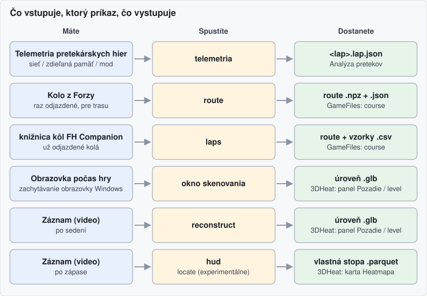

# 3DHeat GameCapture {#dheat-gamecapture}

**Čo to je?** Nástroj, ktorý zapisuje, čo vám hra o vašej jazde hovorí, jeden súbor
na kolo. Dokáže tiež zrekonštruovať hrubý 3D model úrovne z videa, na ktorom hráte.

**Prečo by som ho použil?** Aby ste videli svoje kolá v [prehliadači 3DHeat](https://holdi601.github.io/3DHeat/):
kde ste brzdili, kde ste boli pomalí, ako sa dve kolá líšia. A aby ste mali úroveň pod svojou
heatmapou, keď nikto nemá jej 3D model.

**Príklad:** zapnite Data Out vo Forze, spustite jeden príkaz a odjazdite dve kolá. Dva súbory kôl sa objavia v
`laps\`. Pustite ich na kartu Analýza pretekov prehliadača.


Nikdy ste nepracovali s príkazovým riadkom? Najprv si prečítajte [Ako začať](before-you-start.md).

## Tri úlohy {#the-three-jobs}

1. **Telemetria kôl.** Zaznamenáva každý kanál, ktorý pretekárska hra zverejňuje – Data Out vo Forze, zdieľanú pamäť hier Assetto Corsa, sieťové kanály rallye hier, mod BeamNG, plugin Trackmania – a zapíše jeden súbor `heat3d-lap` na každé kolo alebo etapu pre kartu Analýza pretekov prehliadača. iRacing nepotrebuje nahrávač: prehliadač číta jeho vlastné súbory `.ibt`.
2. **Úrovne z hrania.** Premieňa to, čo obrazovka ukázala, kým ste prechádzali alebo jazdili
   úrovňou, na 3D model `.glb`, ktorý prehliadač položí pod heatmapu.
3. **Váš vlastný zápas, po ňom.** `hud` číta HUD vášho vlastného záznamu – vaše akcie, smrti,
   stopu na minimape a prúd zabití. `locate` (experimentálne: zatiaľ umiestni len málo skutočných
   snímok) zistí, kde bola každá snímka nasnímaná, na 3D modeli úrovne.

Všetky tri sa riadia jedným pravidlom: **do hry sa nič nevkladá a nič sa nezachytáva hákom**. Snímky
pochádzajú z verejného API na snímanie obrazovky, telemetria z rozhraní, ktoré hry zverejňujú
pre ňu. Pozri [Pravidlá](../rules.md).



Kód je v Pythone (balík `heat3d_capture`), licencia MIT. Modely hĺbky a pozície, ktoré môže
spúšťať, majú vlastné licencie – pozri [Modely a licencie](../models-and-licences.md).

## Rýchly štart {#quick-start}

### Nahrávanie kôl {#record-laps}

Potrebujete Python 3.10 alebo novší ([Ako začať](before-you-start.md)). V PowerShell:

```powershell
git clone https://github.com/Holdi601/3DHeat-GameCapture
cd 3DHeat-GameCapture
python -m venv .venv
.venv\Scripts\python -m pip install -r requirements.txt

# Forza: Settings -> HUD and Gameplay -> Data Out = ON, IP 127.0.0.1, port 5300
.venv\Scripts\python -m heat3d_capture telemetry -o laps
```

**Mali by ste vidieť** `listening on port 5300. Laps go to laps. Ctrl+C to stop.`, potom riadok na každé kolo, keď prejdete cieľovú čiaru, ako na
obrázku vyššie. Stlačte Ctrl+C na zastavenie. Pustite súbory z `laps\` na kartu Analýza pretekov prehliadača.
Každá ďalšia hra je jeden `--game` ďaleko:

```powershell
.venv\Scripts\python -m heat3d_capture telemetry --game acc -o laps
.venv\Scripts\python -m heat3d_capture telemetry --game dirtrally2 -o laps
```

Každú hru a možnosť nájdete na stránke [Nahrávače telemetrie](../telemetry.md).

### Skenovanie úrovne {#scan-a-level}

Dvakrát kliknite na **`scan.bat`** v priečinku nástroja. Nájde Python (a ak ho nemá, ponúkne
inštaláciu cez winget), vytvorí súkromné `.venv` a otvorí okno skenovania. Okno povie,
čo chýba, na čo slúži každý balík a aká veľká je jeho stiahnutá časť, a bez vášho súhlasu
nič nenainštaluje. Pozri [Runtime a závislosti](../runtime.md) a
[Okno skenovania](../reconstruction-scan-ui.md).

Ručne: `.venv\Scripts\python -m heat3d_capture.ui`.

Na prestavbu záznamu offline, s dráhou kamery vyriešenou naraz (vyžaduje PyTorch, balík
`vggt` a GPU – pozri [Offline rekonštrukcia](../reconstruction-offline.md)):

```powershell
.venv\Scripts\python -m heat3d_capture reconstruct lap.mp4 -o lap.glb
```

## Prehľad dokumentácie {#map-of-the-documentation}

| Stránka | Čo obsahuje |
|---|---|
| [Ako začať](before-you-start.md) | Python, terminál, prvý príkaz, bežné chyby |
| [Pravidlá](../rules.md) | žiadne vkladanie, len zverejnené rozhrania, a čo to stojí |
| [Nahrávače telemetrie](../telemetry.md) | príkaz `telemetry` a prehľad každej hry |
| [Forza](../telemetry-forza.md) | Data Out, zisťovanie rozloženia, relé FH Companion a jeho `.tele.gz` |
| [Hry Assetto Corsa](../telemetry-assetto-corsa.md) | AC, ACC, AC EVO, AC Rally zo zdieľanej pamäte |
| [Rallye hry](../telemetry-rally.md) | EA SPORTS WRC, DiRT Rally 2.0 / 1 / DiRT 4, Richard Burns Rally |
| [BeamNG.drive](../telemetry-beamng.md) | mod protokolu `heat3d` |
| [Trackmania](../telemetry-trackmania.md) | plugin Openplanet `Heat3dRecorder` |
| [iRacing](../telemetry-iracing.md) | čítanie súborov `.ibt` v prehliadači |
| [Delenie kôl a etáp](../lap-splitting.md) | `LapSplitter`, `CounterSplitter`, `LineSplitter`, `StageSplitter` |
| [Pokĺzanie, driftovanie a odvodené kanály](../slip-and-drift.md) | ako sa škáluje pokĺzanie a čo prehliadač odvodzuje |
| [Súbor heat3d-lap](../lap-format.md) | formát súboru kola, kanály, jednotky, `meta` |
| [Hry](../games.md) | pre každú hru: ako nahrávať, čo sa posiela, ktoré trate sa dajú exportovať |
| [Príkazy](../commands.md) | `route`, `telemetry`, `laps`, `reconstruct`, `hud`, `locate`, krok za krokom |
| [Referencia príkazov](../cli-reference.md) | každá možnosť, generované z `--help` |
| [Čítanie HUD zo záznamu](../hud-video.md) | `hud`: vlastné akcie, smrti, stopa minimapy a prúd zabití zo záznamu |
| [Lokalizácia snímok v úrovni](../locate.md) | `locate`: kde bola každá snímka nasnímaná, voči geometrii úrovne |
| [Rekonštrukcia úrovne](../reconstruction.md) | postup od snímok k `.glb` |
| [Okno skenovania](../reconstruction-scan-ui.md) | každé ovládanie, klávesová skratka a prvok prekrytia |
| [Zachytávanie, masky a kvalita snímok](../reconstruction-capture.md) | Windows Graphics Capture, kľúčové snímky, masky HUD, rady ku kvalite |
| [Hĺbka](../reconstruction-depth.md) | Depth Anything V2, ONNX Runtime, zostavenie modelu |
| [Póza kamery a mierka](../reconstruction-pose.md) | odometria, relokalizácia, pózy z telemetrie, mierka zeme, bundle adjustment |
| [Spájanie, pokrytie a farba](../reconstruction-fusion-and-texture.md) | objem obsadenosti, mriežka pokrytia, slabé miesta, farba vrcholov |
| [Výstup .glb](../glb-output.md) | súbor, ktorý prehliadač načítava |
| [Offline rekonštrukcia](../reconstruction-offline.md) | `reconstruct`, okná VGGT a zlepovanie |
| [Modely a licencie](../models-and-licences.md) | veľkosti Depth Anything V2, VGGT, balíky |
| [Runtime a závislosti](../runtime.md) | predletová kontrola, backendy, výkonnostné stupne |
| [Obmedzenia a overenie](../limits.md) | čo sa nerobí a čo sa neoverilo |
| [Aktualizácie](../updates.md) | kontrola vydania a `python -m heat3d_update` |
| [Vývoj](../development.md) | testy, virtuálne prostredie, rozloženie repozitára |
| [Údržba týchto dokumentov](../maintaining.md) | kontrolný zoznam vydania pre kód a dokumentáciu |

## Súčasť 3DHeat {#part-of-3dheat}

Súbory, ktoré tento nástroj zapisuje, načítava **prehliadač 3DHeat** –
[zdroj](https://github.com/Holdi601/3DHeat), [dokumentácia](https://holdi601.github.io/3DHeat/).
Súbory kôl idú na jeho kartu Analýza pretekov, úrovne `.glb` na jeho panel Pozadie / level, tabuľky `hud` a `locate` na
jeho kartu Heatmapa; ako prehliadač číta tabuľky a súbory zápasov, je opísané na stránkach
[Jeden súbor na zápas (.3dheat)](https://holdi601.github.io/3DHeat/container.html) a
[Načítanie dát](https://holdi601.github.io/3DHeat/getting-data-in.html).

| Nástroj | Čo robí | Dokumentácia |
|---|---|---|
| [prehliadač 3DHeat](https://github.com/Holdi601/3DHeat) | zobrazuje heatmapy, preteky a zápasy v 3D, v prehliadači | [dokumentácia](https://holdi601.github.io/3DHeat/) |
| [GameFiles](https://github.com/Holdi601/3DHeat-GameFiles) | trate a úrovne zo súborov, ktoré hry dodávajú, ako 3D modely | [dokumentácia](https://holdi601.github.io/3DHeat-GameFiles/) |
| [GameCapture](https://github.com/Holdi601/3DHeat-GameCapture) | telemetria kôl z pretekárskych hier; úrovne zrekonštruované z videa hry | [dokumentácia](https://holdi601.github.io/3DHeat-GameCapture/) |
| [Unreal Exporter](https://github.com/Holdi601/3DHeat-UnrealExporter) | plugin pre Unreal Editor, ktorý exportuje úroveň ako 3D model | [dokumentácia](https://holdi601.github.io/3DHeat-UnrealExporter/) |
| [CS2](https://github.com/Holdi601/3DHeat-CS2) | dema Counter-Strike 2 do súborov zápasov; mapy do 3D modelov | [dokumentácia](https://holdi601.github.io/3DHeat-CS2/) |
| [Watcher](https://github.com/Holdi601/3DHeat-Watcher) | zaznamenáva vašu hru na pozadí z toho, čo hry zverejňujú | [dokumentácia](https://holdi601.github.io/3DHeat-Watcher/) |
| [Ext-WarThunder](https://github.com/Holdi601/3DHeat-Ext-WarThunder) | replaye War Thunder do súborov zápasov | [dokumentácia](https://holdi601.github.io/3DHeat-Ext-WarThunder/) |
| [Ext-WoT](https://github.com/Holdi601/3DHeat-Ext-WoT) | replaye World of Tanks do súborov zápasov | [dokumentácia](https://holdi601.github.io/3DHeat-Ext-WoT/) |
| [Ext-WoWs](https://github.com/Holdi601/3DHeat-Ext-WoWs) | replaye World of Warships do súborov zápasov | [dokumentácia](https://holdi601.github.io/3DHeat-Ext-WoWs/) |
| [Ext-Squad](https://github.com/Holdi601/3DHeat-Ext-Squad) | dema zo serverov Squad do súborov zápasov | [dokumentácia](https://holdi601.github.io/3DHeat-Ext-Squad/) |
| [Ext-DCS](https://github.com/Holdi601/3DHeat-Ext-DCS) | mapy DCS World do 3D modelov | [dokumentácia](https://holdi601.github.io/3DHeat-Ext-DCS/) |
| [Ext-IL2](https://github.com/Holdi601/3DHeat-Ext-IL2) | mapy IL-2 Sturmovik do 3D modelov | [dokumentácia](https://holdi601.github.io/3DHeat-Ext-IL2/) |

Vývojár s otvoreným projektom hry by mal použiť exportér Unreal, ktorý číta skutočnú geometriu a je presný. Tam, kde sa dajú čítať vlastné archívy hry, GameFiles extrahuje presnú trať. Rekonštrukcia z hrania je pre prípad, keď je dostupná len obrazovka.
