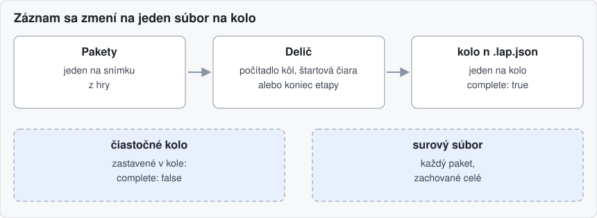

# Ako sa delia kolá a etapy {#how-laps-and-stages-are-split}

Nahrávač vidí jeden súvislý prúd vzoriek. Premieňa ho na kolá jeden z
štyroch deličov, vybraných podľa toho, čo hra hovorí o kolách. Všetky
nasledujú rovnakú myšlienku: použiť počítadlo kôl hry, ak nejaké je, inak nájsť
kolo z polôh; nikdy nezapísať úsek príliš krátky na porovnanie.

| Delič | Kód | Používa |
|---|---|---|
| `LapSplitter` | [`fulllap.py`](https://github.com/Holdi601/3DHeat-GameCapture/blob/main/heat3d_capture/telemetry/fulllap.py) | Forza |
| `CounterSplitter` | [`kunos.py`](https://github.com/Holdi601/3DHeat-GameCapture/blob/main/heat3d_capture/telemetry/kunos.py) | Assetto Corsa, ACC |
| `LineSplitter` | [`kunos.py`](https://github.com/Holdi601/3DHeat-GameCapture/blob/main/heat3d_capture/telemetry/kunos.py) | AC EVO, AC Rally, BeamNG |
| `StageSplitter` | [`rally.py`](https://github.com/Holdi601/3DHeat-GameCapture/blob/main/heat3d_capture/telemetry/rally.py) | EA SPORTS WRC, DiRT Rally 2.0, DiRT Rally, DiRT 4, Richard Burns Rally |

Trackmania delí jazdy vnútri svojho pluginu ([Trackmania](telemetry-trackmania.md)),
a súbory iRacing delí prehliadač podľa počítadla kôl simulátora ([iRacing](telemetry-iracing.md)).

Pri **Ctrl+C** každý nahrávač zavolá `flush()` svojho deliča, takže otvorené
kolo alebo etapa sa zapíše, ak prejde rovnakými minimami ako nižšie.

## LapSplitter (Forza) {#lapsplitter-forza}

Parametre: `minimum_metres = 400`, `gap_seconds = 2.0`.

Pre každý dekódovaný paket:

1. Ak `timestampMs` hry skočil dopredu o viac ako 2 sekundy od posledného paketu,
   alebo išiel dozadu, najprv sa uzavrie otvorené kolo.
2. Ak je `isRaceOn` 0 (hra nie je v pretekoch), otvorené kolo sa uzavrie a paket
   sa zahodí.
3. Ak nie je otvorené žiadne kolo, otvorí sa jedno s `lapNumber` paketu.
4. Ak sa `lapNumber` líši od otvoreného kola, otvorené kolo sa **uzavrie ako
   dokončené**; jeho `seconds` je `lastLap` hry, ak je kladné. Kolo uzavreté
   takto sa zapíše bez ohľadu na dĺžku. Otvorí sa nové kolo.
5. Paket sa pripojí.

Nahrávač uzavrie kolo aj vtedy, keď neprišiel žiadny paket 2 sekundy reálneho
času (hra je pozastavená alebo bola zatvorená uprostred kola).

**Uzavretie** ponechá otvorené kolo len vtedy, ak má aspoň 2 vzorky a aspoň
400 m `distanceTravelled`; zapíše sa ako nedokončené (`run`). Pretek z bodu A
do bodu B nikdy nezapočíta druhé kolo, takže vždy skončí takto.

## CounterSplitter (AC, ACC) {#countersplitter-ac-acc}

Parameter: `minimum_metres = 300`. Každá vzorka sa dodáva so stránkou grafiky
`completedLaps` a časom posledného kola.

- Prvá vzorka otvorí kolo očíslované aktuálnym `completedLaps`.
- Keď sa `completedLaps` zmení, otvorené kolo sa uzavrie. Je **dokončené**, s
  `seconds = čas posledného kola v ms / 1000` (ak je kladný), len ak počítadlo
  vzrástlo presne o 1 – skok späť na 0 (reštart relácie) alebo o viac kôl ho
  uzavrie ako nedokončené.
- Uzavreté kolo sa zapíše len vtedy, ak má vzorky a aspoň 300 m jazdnej dráhy.
- Uzavretie ponechá otvorené kolo, ak má viac ako jednu vzorku a aspoň 300 m.

## LineSplitter (AC EVO, AC Rally, BeamNG) {#linesplitter-ac-evo-ac-rally-beamng}

Parametre: `radius = 15 m`, `minimum_metres = 300`, `stop_seconds = 8`.

Tieto hry buď nemajú počítadlo kôl na stránke, ktorú nahrávač číta, alebo
jazdia etapy. **Čiara je tam, kde nahrávanie začalo**:

1. Vodorovná poloha prvej vzorky (`x`, `z`) sa stáva čiarou.
2. Keď auto prejde viac ako 5 m, smer od čiary k autu sa stane smerom kola.
3. **Zastavenie** ukončí jazdu: ak `speed` zostane pod 1 m/s 8 sekúnd, otvorené
   kolo sa uzavrie (takto končí rally etapa: auto zastaví v cieli).
4. **Prechod čiarou**: po viac ako 300 m jazdy sa zbierajú vzorky do 15 m od
   čiary. Keď auto opustí tento polomer, najbližšia zozbieraná vzorka je
   prechod. Ak išlo auto tým smerom ako smer kola (skalárny súčin lokálneho
   smeru s týmto smerom je kladný), kolo sa uzavrie na tejto vzorke; inak sa
   prejazd ignoruje (auto prešlo štart opačným smerom).
5. `seconds` uzavretého kola je čas od jeho prvej vzorky po prechod. Je
   **dokončené len vtedy, ak jeho prvá vzorka bola rýchlejšia ako 5 m/s**: kolo,
   ktoré sa začalo zo stoja, je rozbeh, nie kolo na porovnanie. Prvé kolo
   nahrávania začaté z roštu je preto vždy nedokončené; nahrávanie začaté pri
   jazde bez zastavenia dá dokončené prvé kolo pri ďalšom prechode.
6. Ďalšie kolo sa začne vzorkou prechodu (patrí do oboch kôl).

Kolá kratšie ako 300 m sa zahodia. Uzavretie (zastavenie alebo Ctrl+C) ponechá
otvorené kolo, ak má aspoň 2 vzorky a 300 m, ako nedokončené. BeamNG sa
uzavrie rovnako, keď sa vozidlo resetuje (jeho hodiny sa vrátia späť), pred
spustením nového deliča, takže jazda pred resetom sa zachová.

Vzdialenosti sú vodorovné (`x`, `z`) pre počítadlo prejazdu a test čiary a
plné 3D pre test dĺžky 300 m.

## StageSplitter (rally hry) {#stagesplitter-rally-games}

Parameter: `minimum_metres = 300`. Každá vzorka sa dodáva so stopkami etapy
hry, s informáciou, či hra hovorí, že auto dokončilo, a voliteľne s časom hry
pre ňu.

1. Ak je hodiny 0 alebo menej, alebo sa vrátili o viac ako 0,5 s, otvorená
   etapa sa **opustí**: zachová sa ako čiastočná etapa, ak nie je dokončená, má
   viac ako 10 vzoriek a aspoň 300 m. Hodiny na 0 alebo menej tiež zahodia
   vzorku (auto je na štarte).
2. Ak nie je otvorená žiadna etapa, otvorí sa nová (číslovaná 1, 2, ... pre
   nahrávanie).
3. Keď je etapa dokončená, ďalšie vzorky sa ignorujú, kým hodiny nejdú späť.
4. Každá vzorka sa uloží s `time` nastaveným na hodiny etapy.
5. Keď hra hovorí, že je dokončené, etapa je dokončená; jej `seconds` je čas
   hry, ak je daný a kladný, inak hodiny. Zapíše sa, ak pokryla aspoň 300 m.

Čo znamená „dokončené“ pre jednotlivé hry:

| Hra | Dokončené, keď |
|---|---|
| EA SPORTS WRC | dĺžka etapy > 0 a vzdialenosť v etape >= dĺžka - 0,5 m |
| hry DiRT | počet dokončených kôl vzrástol nad počet na začiatku etapy, alebo (jednokolová udalosť) vzdialenosť po kole >= 99,9 % dĺžky trate |
| Richard Burns Rally | čas pretekov > 0 a vzdialenosť do cieľa <= 0 |

Pri RBR sa os hore a rýchlosť určia, keď sa etapa zapisuje (pozrite
[Rally hry](telemetry-rally.md#richard-burns-rally-rsf--ngp)).

## Čas a vzdialenosť v súbore kola {#time-and-distance-in-the-lap-file}

Pre každý nahrávač okrem Forzy sa `time` prepočíta tak, aby prvá vzorka kola
bola 0, a `distance` je kumulatívna 3D vzdialenosť medzi po sebe idúcimi
polohami. Forza používa vlastný časovač kola a počítadlo vzdialenosti hry,
prepočítané rovnako.
