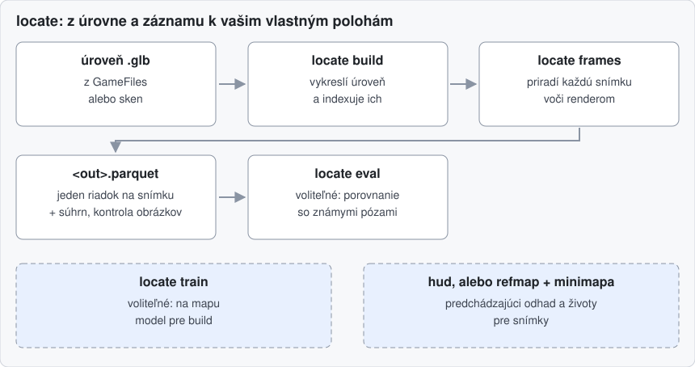

# Lokalizácia snímok v úrovni {#locating-frames-in-a-level}

`locate` zistí, kde bol každý snímok nahrávky z hrania: 3D pozíciu kamery a smer pohľadu. Robí to tak, že porovná obraz s vykresleniami geometrie úrovne. Je určený pre hry, ktoré si nevedú záznam o tom, kde bol hráč: žiadne demo, žiadny súbor reprízy, žiadna telemetria. Prvou je Battlefield 6.

> **Experimentálne.** Na skutočných nahrávkach zatiaľ umiestni len malú časť snímok; pozrite [Reálne snímky: experimentálne](#real-frames-experimental).

```bash
# Once per level: render it from every place a player can stand, and index the renders.
.venv\Scripts\python -m heat3d_capture locate build level.glb -o level.db

# Per recording: where was each frame taken?
.venv\Scripts\python -m heat3d_capture locate frames "<recording>.mp4" --db level.db -o out/match
```

Pozícia pochádza **z obrazu**, voči celej úrovni, bez predchádzajúceho odhadu. Stopa minimapy z [čítača HUD](hud-video.md) je len záložný zdroj pre snímky, ktoré obraz nedokáže umiestniť, a každý riadok hovorí, z ktorého z oboch pochádza.




## Čo to robí a čoho sa to nedotýka {#what-it-does-and-does-not-touch}

- Číta **vlastnú nahrávku** hráča a súbor úrovne, ktorý hráč exportoval zo **svojej vlastnej kópie** hry. Nikdy sa nedotýka hry, jej pamäte, jej súborov počas behu ani jej siete, a beží až po zápase. Pozrite [Pravidlá](rules.md).
- Umiestňuje **len kameru hráča**: snímok je pohľad hráča.
- Úroveň, databáza z nej postavená a všetko, čo sa z nej vykreslilo, patria vydavateľovi hry. Uchovávajte ich lokálne.

## Požiadavky {#requirements}

- Všetko z `requirements.txt`, PyTorch (z pytorch.org, kvôli GPU) a `requirements-locate.txt`:

```bash
.venv\Scripts\python -m pip install -r requirements-locate.txt
```

- GPU s OpenGL 3.3 (4.3 je rýchlejšie) na vykreslenia, a ideálne CUDA pre modely. Na CPU to funguje, len pomaly.
- Modely sa stiahnu pri prvom použití (asi 450 MB): DINOv2 z Hugging Face, ALIKED a LightGlue cez kornia. Všetky sú licencované na komerčné použitie; pozrite [Licencie](#licences).
- **Úroveň** ako `.glb` (alebo `.gltf`) vo vzťažnej sústave prehliadača, Y nahor, **so svojimi textúrami základnej farby**, tak, ako ju zapisujú exportéry 3DHeat (časti `ground:` / `structure:`; názvy častí nie sú potrebné). Jedna jednotka je jeden meter, pokiaľ hlavný `extras.unit_metres` v súbore nehovorí inak. Skenovanie GameCapture (`reconstruct`, okno skenovania) sa zapisuje v **centimetroch** a nesie `extras.unit_metres: 0.01`, takže sa načíta v pravej veľkosti. Úroveň bez textúr funguje oveľa horšie; pozrite [Obmedzenia](#limits).

## Príkazy {#commands}

### `locate build <level> -o <db>` {#locate-build---o-}

Vykreslí úroveň zo všetkých miest, kde by hráč mohol stáť, a uloží ku každému vykresleniu jeho pózu a jeden globálny deskriptor.

| Možnosť | Predvolené | Význam |
|---|---|---|
| `level` | | `.glb` / `.gltf` úrovne. |
| `-o`, `--out` | | Priečinok databázy, ktorý sa zapíše. |
| `--game` | `bf6` | Profil hry: výšky očí, zorné pole, oblasti HUD, rýchlosť (nižšie). `generic` pre ľubovoľnú hru z pohľadu prvej osoby. |
| `--eye` | podľa profilu | Výšky očí nad podlahou v metroch, najprv stojaca. Jeden pohľad databázy na každú výšku. |
| `--fov` / `--vfov` | podľa profilu | Vodorovné zorné pole nahrávky, alebo zvislé (posuvník Battlefieldu) pre nahrávku 16:9. |
| `--spacing` | 2,5 | Metre medzi miestami, z ktorých sa berú pohľady. |
| `--yaw-step` | 30 | Stupne medzi smermi pohľadov. |
| `--pitch` | 0 | Sklony, pri ktorých sa vykresľuje, stupne nahor. |
| `--positions` | žiadne | Tabuľka (Parquet alebo CSV so `x`, `y`, `z` pri chodidlách, vo vzťažnej sústave úrovne), z ktorej sa berú miesta namiesto každej podlahy; napríklad výstup predchádzajúceho behu. |
| `--shadows` | vypnuté | Vykresliť tiene slnka vo vykresleniach (slnko úrovne, keď ho jej súbor uvádza v `extras.sun`). |
| `--untextured` | vypnuté | Vykresliť len tvar a svetlo. |
| `--box X0 Z0 X1 Z1` | celý súbor | Len miesta vnútri tohto obdĺžnika (jednotky úrovne): hracia oblasť. |
| `--places` | `auto` | Odkiaľ sa berú pohľady: `nav` – hráči vo výške očí nad navigačnou sieťou úrovne (časti `nav:`, presne tam, kde hra dovolí chodiť), kamery vozidiel vo svojej výške nad časťami `ground:` (terén a cesty) do 50 m od neho; `ground` – obe nad `ground:`; `floors` – nad každou smerom nahor obrátenou plochou (aj strechy a debny); `auto` – `nav`, keď úroveň má navigačnú sieť, inak `floors`. |
| `--head` | žiadne | Hlava pre jednu mapu z `locate train` pre deskriptory. |

Zapíše `<db>/db.json` (z čoho a čím bola postavená) a `<db>/views.npz` (pózy, deskriptory).

### `locate frames <recording> --db <db>` {#locate-frames----db-}

| Možnosť | Predvolené | Význam |
|---|---|---|
| `source` | | Video, obrázok alebo priečinok obrázkov (berú sa v poradí názvov, každých `--fps`). |
| `--db` | | Databáza, ktorú zapísal `build`. Jej súbor úrovne musí byť stále tam, kde bol (alebo `--level`). |
| `-o`, `--out` | `<source>.locate` | Cesta výstupu bez prípony. |
| `--fps` | 2 | Lokalizované snímky za sekundu videa. |
| `--start`, `--seconds` | všetko | Časť videa, ktorá sa číta. |
| `--width` | 1280 | Šírka, pri ktorej sa snímky porovnávajú. |
| `--shortlist` | 8 | Pohľady databázy vyskúšané pre snímok pri predchádzajúcom odhade alebo oprave. |
| `--search-shortlist` | 16 | Bez predchádzajúceho odhadu: pohľady databázy vyskúšané pre snímok ([hľadané spoločne](#with-no-prior-frames-searched-together)). |
| `--no-search` | vypnuté | Bez predchádzajúceho odhadu: hľadať každý snímok samostatne a veriť jeho oprave bez jeho susedov. |
| `--accept-depth` | 0 (vypnuté) | Bez predchádzajúceho odhadu: veriť oprave, len ak jej vzdialený dosah zhôd je toľkonásobkom ich blízkeho dosahu. |
| `--accept-support` | 2 | Bez predchádzajúceho odhadu: koľko susedov pozdĺž života súhlasí, aby sa oprave verilo. |
| `--checkpoint` | žiadne | Uchová stav behu tu a pokračuje z neho, ak tu je. |
| `--stop-file`, `--stop-process` | žiadne | Zastaví sa sám, stav uložený, s kódom ukončenia 75, keď existuje tento súbor alebo beží proces, ktorého názov začína týmto (kontroluje sa pred každým snímkom; môže sa opakovať), aby dlhý beh uvoľnil počítač pre hru. Ten istý príkaz pokračuje ďalej. |
| `--normalise` | žiadne | Svetelná normalizácia pred porovnávaním: `clahe`, `gray`. |
| `--minimap` | žiadne | Tabuľka príkazu `hud`: **záložný zdroj** pre snímky, ktoré obraz nedokáže umiestniť. |
| `--prior-radius` | žiadne | **Voliteľné zrýchlenie**, predvolene vypnuté: hľadať len pohľady databázy do tohto počtu metrov od pozície na minimape (vyžaduje `--minimap`). |
| `--minimap-anchor` | žiadne | Súbor JSON, ktorý spája minimapu s úrovňou ([minimapa ako predchádzajúci odhad pre hľadanie](#the-minimap-as-a-search-prior)): minimapa zúži hľadanie od prvého snímku; takto nájdené opravy sú `visual+minimap-prior`. |
| `--no-level-search` | vypnuté | S predchádzajúcim odhadom: keď nič okolo neseda, neprehľadávať celú úroveň (rýchlejšie). |
| `--lives` | tabuľka `--minimap` | Tabuľka príkazu `hud`, z ktorej smrti, nasadenia a oživenia hovoria, kedy bol hráč v hre: pozície skáču len cez smrť ([životy z nahrávky](#lives-from-the-footage)). |
| `--no-sequence` | vypnuté | Rozhodnúť každý snímok samostatne, nie pozdĺž behu (nižšie). |
| `--fit-fov` | vypnuté | Po behu prispôsobiť zorné pole najsilnejším opravám, pre každý pohľad, a nahlásiť ho. |
| `--check-every` | 0 | Aj každých N snímok, umiestnených alebo nie, obrázok do `<out>.check`. |
| `--no-checks` | vypnuté | Nezapisovať kontrolné obrázky vizuálnych opráv (nižšie). |
| `--no-zoomed` | vypnuté | Neriešiť priblížené pohľady z opráv susedov (nižšie). |
| `--no-grow` | vypnuté | Nehľadať znova pri každej oprave okolo nej snímky, ktoré okolo nej ešte nemajú opravu. |
| `--game`, `--eye`, `--fov`, `--vfov`, `--mask`, `--no-hud-mask`, `--max-speed` | podľa profilu | Ako vyššie; `--mask x,y,w,h` pridá box na obrazovke (na obrazovke 1920x1080), ktorý nie je úroveň. |
| `--vehicle-vfov` | podľa profilu | Zvislé zorné pole kamier vozidiel (posuvník vozidiel Battlefieldu). |
| `--settings` | najnovší súbor nastavení | `bf6`: súbor nastavení hry, z ktorého sa čítajú zorné polia (len na čítanie), keď nie je zadané `--fov`/`--vfov`; štandardne najnovšie `PROFSAVE*_profile` pod `Documents/Battlefield 6/settings`. Obsahuje nastavenia tak, ako sú teraz, čo nemusí byť spôsob, akým bola staršia nahrávka urobená. |

### `locate refmap <level> <deploy screen> -o <refmap>` {#locate-refmap----o-}

Umiestni vlastnú mapu hry na úroveň: referenciu, voči ktorej sa číta minimapa ([minimapa čítaná voči úrovni](#the-minimap-read-against-the-level)). `<deploy screen>` je obrázok obrazovky nasadenia, ktorý ukazuje celú mapu, alebo nahrávka s `--at <seconds>` v takom okamihu. Vystrihne sa z neho box mapy profilu (`--whole-picture` ponechá všetko). Zapíše `<refmap>.png` (mapa prevzorkovaná na vlastnú sústavu úrovne, `--mpp` metrov na pixel, predvolene 0,5), `<refmap>.valid.png` (kde je to mapa, nie značka alebo popisok) a `<refmap>.json` (sústava a kalibrácia, so vzdialenosťou dlaždíc mapy od nej). `--topdown <prefix>` ponechá úroveň vykreslenú zvrchu pre ďalší beh (`--topdown-mpp`, predvolene 0,656 m; `--box` ju obmedzí).

### `locate minimap <recording> --refmap <refmap> -o <table>.parquet` {#locate-minimap----refmap---o-parquet}

Prečíta minimapu nahrávky voči referenčnej mape, snímok po snímku (`--fps`, predvolene 2): pozíciu, smer a priblíženie každej minimapy, ktorá sa zhodne, vo vzťažnej sústave úrovne, zapísané ako tabuľka minimapy s kotvou vedľa (`<table>.anchor.json`), ktorú `locate frames` berie ako `--minimap <table>.parquet --minimap-anchor <table>.anchor.json`. S tabuľkou príkazu `hud` (`--hud`) sa jej životy prenesú; s kotvou pre túto tabuľku aj (`--hud-anchor`) je prvé hľadanie okolo miesta, kam ju HUD položí hráča, a kde sa žiadna minimapa nezhoduje, doplní sa stopa HUD, presunutá na najbližšie opravy referenčnej mapy (`--hud-fill`, sekundy, predvolene 120; 0 to vypne). `source` tabuľky hovorí, ktoré (`refmap`, `hud`).

### `locate eval <out>.parquet --truth <poses>` {#locate-eval-parquet---truth-}

Porovná výsledok so známymi pózami kamery: tabuľka `time`, `x`, `y`, `z` (oko), `yaw`, `pitch` vo vzťažnej sústave úrovne. `--offset` je posun hodín (čas pravdy = čas videa + offset); bez neho sa posun hľadá. `--unit-metres` prepočíta chyby na metre.

## Profily hier {#game-profiles}

| | `bf6` | `generic` |
|---|---|---|
| Výšky očí | 1,6 m stojaco, 1,05 m drepom (zatiaľ nezmerané v hre) | 1,65, 1,1 m |
| Zorné pole | 55 stupňov zvisle, asi 86 vodorovne pri 16:9: **zadajte hráčovo vlastné** pomocou `--vfov` | 90 vodorovne |
| Skryté HUD | minimapa a zoznam squadu, prúd zabití, kompas, muníciu, zbraň hráča, vyskakovacie okná, zameriavač | zameriavač |
| Najrýchlejšie pešo | 8 m/s | 8 m/s |
| Odlíšené pohľady | pešo, vozidlo, priblížený (nižšie) | každý snímok pešo |
| Kamery vozidiel | posuvník vozidla (zo súboru nastavení), vozidlo skryté, kamera až 8 m nad podlahou, 30 m/s | - |

Zorné pole záleží najviac: snímok vyriešený zlým zorným poľom sa rieši so zlou ohniskovou vzdialenosťou a jeho pozícia sa posúva pozdĺž pohľadu.

## Výstupy {#outputs}

### `<out>.parquet` {#parquet}

Jeden riadok na každý lokalizovaný snímok, vo **sústave úrovne** (Y nahor, jednotky úrovne), s pokynmi na čítanie prehliadača v pätičke (`kind: heat3d-locate`). Pätička označí každý stĺpec, ktorý nemá vlastnú úlohu, ako prídavný, takže ich prehliadač zachová všetky (jeho karta podrobností ich zobrazí).

| Stĺpec | Význam |
|---|---|
| `time` | Sekundy od začiatku videa. |
| `event` | `start` na prvom riadku života, `position` na ostatných. |
| `x`, `y`, `z` | Oko, vyhladené v rámci života. Prázdne, keď snímok nedokázal umiestniť ani jeden zdroj. |
| `yaw`, `pitch` | Stupne: yaw okolo osi nahor (0 pozdĺž +X, rastie smerom k -Z, čo je yaw hry vo sústave prehliadača), pitch nahor od vodorovnej roviny. `pitch` je prázdne pri riadkoch minimapy. |
| `dir_x`, `dir_y`, `dir_z` | Vektor smeru pohľadu. |
| `player`, `team`, `session` | `me`, `own` a `<video>#NN`, jeden na každý život. |
| `life` | Život, v ktorom nahrávka ukázala snímok (z HUD smrtí; 1 = prvý). Prázdne, keď je hráč mimo hry (mŕtvy, na zemi, nasadzuje sa) alebo keď životy neboli prečítané. `session` je život stopy, ktorý sa môže rozdeliť aj pri skoku. |
| `source` | `visual` (z obrazu), `visual+minimap-prior` (z obrazu, hľadanie zúžené predchádzajúcim odhadom z minimapy), `minimap` (záložný zdroj), `minimap+nav-floor` (v budove: minimapa a podlaha navigačnej siete) alebo `none`. |
| `view` | `foot`, `vehicle`, `zoomed` alebo `screen` (nižšie). |
| `cam_x`, `cam_y`, `cam_z` | Kamera, ktorá snímok videla. Pešo a cez mieridlo je to oko, a `x`, `y`, `z` sú rovnaké; v pohľade z tretej osoby vo vozidle sú `x`, `y`, `z` vozidlo (model posunu nižšie) a kamera je za a nad ním. |
| `hfov`, `zoom` | Vodorovné zorné pole, ktorým bol snímok vyriešený, a pre priblížený pohľad jeho priblíženie oproti bežnému pohľadu. |
| `confidence` | 0..1: ako veľmi dôverovať riadku (nižšie). |
| `uncertainty` | Typická chyba riadku v jednotkách úrovne: pri vizuálnej oprave z jej inlierov a susedov, pri riadku minimapy z prispôsobenia (nižšie). |
| `inliers`, `rmse` | Inliery PnP vizuálneho riešenia a chyba reprojekcie (pixle pri pracovnej šírke). |
| `x_raw` ... `pitch_raw` | Vizuálne riešenie pred vyhladením (aj pre odľahlé hodnoty, ktoré hlasovanie vyradilo). |
| `kept` | Vizuálna oprava prežila hlasovanie o odľahlých hodnotách. |
| `note` | Prečo snímok nebol umiestnený, alebo bol vyradený hlasovaním. |

### `<out>.summary.json` {#summaryjson}

Snímky, vizuálne opravy, odľahlé hodnoty, životy, riadky podľa zdroja, prispôsobenie minimapy (páry, inliery, zvyšková chyba), čas na snímok.

## Postup {#method}

### Databáza {#the-database}

Miesta sú body na každej smerom nahor obrátenej ploche úrovne, rovnomerne rozložené (jeden na každý `--spacing` v 3D mriežke, takže každé poschodie budovy dostane svoje). Každé sa overí z oka pomocou šiestich malých hĺbkových vykreslení: kamera vnútri geometrie vidí hlavne zadné steny, plazivý priestor má nad okom niečo pevné; obe sa vyradia. Z každého miesta sa úroveň vykreslí vo všetkých výškach očí, každých `--yaw-step` a každom `--pitch`, a každé vykreslenie opíše **DINOv2** (jeho tokeny záplat sa spoja zovšeobecneným priemerom spolu s tokenom triedy).

Lokálne znaky a 3D body, voči ktorým sa snímok nakoniec rieši, sa **neukladajú**: vytvoria sa znova, keď sú potrebné, vykreslením niekoľkých pohľadov, ktoré vybralo vyhľadávanie; trvá to milisekundy. Vďaka tomu zostáva databáza na niekoľkých stovkách megabajtov, nie na desiatkach gigabajtov, a práve to umožňuje spresnenie nižšie. Cena je, že `frames` potrebuje súbor úrovne a GPU, nie len databázu.

### Jeden snímok {#one-frame}

1. **Maskovanie** toho, čo nie je úroveň: oblasti HUD profilu a zameriavač, plus akýkoľvek `--mask`.
2. **Vyhľadávanie** cez **celú úroveň**: globálny deskriptor snímku oproti každému pohľadu databázy; najpodobnejších pár desiatok, preredených tak, aby mali rôzne miesta a smery, tvorí užší zoznam.
3. **Porovnanie**: každý pohľad z užšieho zoznamu sa znova vykreslí pri veľkosti a zornom poli snímku, s hĺbkou. Body ALIKED snímku a vykreslenia sa párujú cez LightGlue. Bod vykreslenia plus jeho hĺbka je 3D bod úrovne, takže každá zhoda je korešpondencia 2D-3D; body na hrane hĺbky (ktorej hĺbka môže patriť k tomu, čo je za nimi) sa zahodia.
4. **Póza**: PnP s RANSAC (SQPnP), potom robustné spresnenie, ktoré udrží kameru vodorovne – pohľad prvej osoby sa nenakláňa – a minimalizuje chybu reprojekcie inlierov.
5. **Je to možné?** Póza musí byť vo výške očí hráča nad podlahou a mimo geometrie (hĺbkové vykreslenie rovno dole). Podobná textúra na inom mieste – dláždená podlaha zhodná so stenou z toho istého materiálu – môže dať stovky inlierov v póze, ktorú žiadny hráč nemohol zaujať; tie sa odložia, bez ohľadu na počet inlierov.
6. **Vykreslenie a porovnanie**: úroveň sa vykreslí v riešenej póze a znova sa porovná, čo nahradí pohľad z databázy vzdialený až niekoľko metrov a desiatky stupňov pohľadom, ktorý sa takmer zhoduje so snímkom. Opakuje sa, kým pribúdajú inliery (najviac dvakrát).
7. **Výber**: najsilnejšie tri miesta (viac ako asi 3 m od seba) sa každé spresnia, potom sa jedno vyberie. Podobné miesto môže viesť pred spresnením; správne miesto z toho získa oveľa viac.
8. **Verdikt**: `confidence` kombinuje počet inlierov, najlepšie iné miesto (`runner_up`) a chybu reprojekcie. Oprava je `ok` s aspoň 25 inliermi, bez iného miesta do 80 % jej inlierov a s dôverou aspoň 0,85 – prah, ktorý merania nižšie kladú na 97,5-99 % správnych.

### Pohľady {#views}

Snímok nie je vždy oči hráča. Detektor profilu z HUD zistí, ktorý pohľad je, a snímok sa podľa toho rieši:

- **Pešo**: zorné pole pešiakov a výšky očí.
- **Vozidlo** (Battlefield 6: schéma sedadla s klávesovými výzvami `C CAMERA` a `E EXIT` dole v strede): zorné pole vozidla, samotné vozidlo maskované (stred dole na obrazovke v jeho pohľade z tretej osoby) a kamera až 8 m nad podlahou. Oprava patrí kamere.
- **Obrazovka** (tmavé okraje okolo tmavého stredu: mapa nasadenia, menu, tabuľa výsledkov): nie je to pohľad na úroveň; preskočí sa.
- **Priblížený** (mieridlo, zameriavač strelca, prvoosobový pohľad vo vozidle: jeden okraj obrazovky čierny, obidva tmavé, okolo svetlého obrazu): nehľadá sa po úrovni – úzky výsek úrovne cez mieridlo sa nepodobá na žiadny široký pohľad databázy – ale rieši sa po behu z najbližšej opravy do 6 s, nižšie. Vypne sa s `--no-zoomed`.

### Priblížené pohľady {#zoomed-views}

Úzky pohľad zle určuje pozíciu: krok späť s trochu väčším priblížením vyzerá takmer rovnako. Preto priblížený snímok začína tam, kde ho jeho sused umiestňuje – pešo oko tej opravy, vo vozidle 2,5 m nad zemou pod stredom vozidla (zameriavač veže) – a koľko sa mohol od toho posunúť: 2 m, plus 4 m za sekundu pešo alebo 8 vo vozidle, najviac 12 m (`reach`).

1. **Smer a priblíženie, pozícia držaná.** Pre každé priblíženie 1, 1,2 (vlastný pohľad vozidla, užší ako pešo), 1,5, 2, 3, 4, 6 a 8 sa úroveň vykreslí zo sedadla v smeroch do 30 stupňov od suseda (a od 3x aj v niekoľkých sklonoch). Body snímku spárované s vykreslením, s bodmi úrovne pod nimi, sú lúče zo sedadla; rotácia sa prispôsobí dvoma naraz (RANSAC) pre ohniskové vzdialenosti od 0,75 do 1,3-násobku priblíženia tej ktorej výšky, pričom bod súhlasí v uhle, ktorý dovoľuje, že sedadlo je o `reach` mimo vo svojej vzdialenosti. Vyhrá priblíženie, smer a ohnisková vzdialenosť, s ktorými najviac bodov súhlasí.
2. **Usadené.** Tieto body potom spoločne prispôsobia pozíciu, smer a ohniskovú vzdialenosť podľa chyby reprojekcie, pozícia je držaná na sedadle a každý pohnutý `reach` stojí dva pixle; ešte raz sa vykreslí v odpovedi a prispôsobí sa znova. Inliery a chyba sa počítajú v pixloch a oprava je `ok` podľa rovnakej dôvery ako ktorákoľvek iná.

Zapísané priblíženie (`zoom`) je voči zornému poľu behu pešo; `hfov` je vyriešené. Vo vozidle je zapísaná pozícia vozidla, 2,5 m pod zameriavačom, ako pri jeho pohľade z tretej osoby.

### Vozidlá: kamera a vozidlo {#vehicles-the-camera-and-the-vehicle}

V pohľade z tretej osoby vo vozidle je vyriešená póza kamery chase, ktorá je za a nad vozidlom a obieha ho, keď sa hráč obzerá. Zapísaná pozícia (`x`, `y`, `z`) je vozidla – zem pod jeho stredom: kamera plus `vehicle_offset` profilu, mnoho metrov vpred pozdĺž vodorovného smeru pohľadu kamery a toľko dole. Kamera zostáva v `cam_x`, `cam_y`, `cam_z`. Prevod sa robí pred sekvenciou a stopou, takže kamera obiehajúca stojace vozidlo sa nepočíta ako pohyb. Pätička tabuľky nesie použitý posun a to, či bol zmeraný (`vehicleOffset`). Pešo a cez mieridlo posun nie je.

Ako sa zmeral posun pre Battlefield 6: na správnych opravách skutočných snímok tretej osoby tanku sa stred tanku označil okom na snímku a úroveň vykreslená v tej oprave dala zem pri tom pixle. Profil berie medián: asi 10 m vpredu pred kamerou a asi 4 m pod ňou. Označenie je presné zhruba na meter a platí pre jeden typ vozidla: auto alebo vrtuľník jazdí s kamerou inak.

### Bez predchádzajúceho odhadu: snímky hľadané spoločne {#with-no-prior-frames-searched-together}

Globálny deskriptor jedného snímku voči celej úrovni je slabý signál a inliery jedného snímku nerozlíšia správne miesto od podobného. Preto sa pri hľadaní bez predchádzajúceho odhadu snímky nahrávky najprv opíšu a hľadajú sa spoločne (`search.py`), a oprava sa dôveruje len spolu so snímkami okolo nej:

- **Užší zoznam.** Podobnosti každého pohľadu sa merajú voči jeho vlastnému priemeru a rozptylu cez nahrávku, takže pohľad podobný každému snímku prestane všade vyhrávať. Každý snímok ohodnotí bunky mriežky 24 m podľa poradia ich najlepšieho pohľadu; najlepšia cesta cez bunky pozdĺž každého života, v rámci toho, čo hráč medzi snímkami pokryje, dá dôveru každej bunke, a najlepší pohľad každej bunky, najdôveryhodnejší ako prvý, je jeden zoznam. Obyčajné vyhľadávanie je druhé a obe sa striedajú: meranie pohľadov voči nahrávke trestá miesto, ktoré hráč takmer neopúšťa, a tam si obyčajné vyhľadávanie vedie dobre.
- **Dôverovanie.** Kandidát sa počíta len vtedy, keď jeho inliery pokryjú aspoň 12 % mriežky 8 x 8 cez snímok: podobný objekt je opakovaný predmet, zásobník kontajnerov, s stovkami inlierov na pár bunkách snímku. Oprava sa dôveruje, keď leží na najlepšej ceste cez počítajúcich kandidátov (nižšie) s aspoň dvoma susedmi do 6 s, ktorí s ňou súhlasia. Snímok mimo hry sa nehľadá vôbec.
- **Rast.** Rastie sa len z toho, čomu sa verí, a narastená oprava musí pokryť snímok rovnakým spôsobom.

### Pozdĺž behu {#along-the-run}

Každý snímok si ponechá každú fyzicky možnú pózu, ktorú našiel, jednu na každé miesto (`candidates`), nie len najsilnejšiu. Beh potom vyberie jednu pre každý snímok – alebo žiadnu – tak, aby vybrané pózy tvorili cestu, po ktorej mohol hráč ísť pešo alebo jazdiť, a aby na nej ležalo čo najviac inlierov: skrytý Markovov model, dekódovaný naraz (Viterbi). Podobné miesto, ktoré vyhrá jeden snímok sám, prehrá s miestom, s ktorým súhlasia jeho susedia; slabý kandidát, po ktorom cesta prechádza, s aspoň dvoma súhlasiacimi susedmi, sa stane opravou (`note`: zvolené pozdĺž sekvencie); istá oprava, ktorej všetci susedia odporujú, prestane byť opravou. Sused sa počíta ako súhlasiaci len do 6 s: ďalej od seba je vzdialenosť, ktorú by hráč – nieto vozidlo – mohol prejsť, taká veľká, že súhlasenie nič nehovorí. Vypne sa s `--no-sequence`.

### Časy snímok {#frame-times}

`time` riadku je vlastný časový údaj snímku v nahrávke, nie jeho poradie pri menovitej snímkovej frekvencii. Nahrávky sa odchyľujú od svojej menovitej frekvencie (o niekoľko desatín sekundy v rámci klipu, pri tých, ktoré sa merali), a všetko, čo číta snímok späť podľa jeho času – kontrolné obrázky, priblížený prechod, `locate train --real`, minimapa z príkazu `hud` – hľadá podľa časovej značky. Počítané snímky by postavili kontrolný obrázok o tú vzdialenosť ďaleko od snímku, ktorý sa lokalizoval.

### Zorné pole z výsledkov {#the-field-of-view-from-the-frames}

`--fit-fov` ponechá najsilnejšie opravy behu (pre každý pohľad) a spresní pozíciu, smer a ohniskovú vzdialenosť každej spoločne na jej inlieroch; medián cez ne je zorné pole, s ktorým bola nahrávka urobená, a v súhrne sa nahlási (`hfov_fitted`) pre `--fov` ďalšieho behu. Blízke a vzdialené body sa pri zmene ohniskovej vzdialenosti hýbu inak než pri zmene pozície, a práve to ju určí; treba opravy s hĺbkou, nie plochú stenu.

### Model pre jednu mapu {#a-per-map-model}

`locate train` natrénuje malú hlavu nad DINOv2 pre jednu úroveň, na jej vykresleniach, aby globálny deskriptor našiel správne pohľady na skutočné snímky, a nie len na samotné vykreslenia:

- **Hlava**: každý token záplaty cez dvojvrstvový projekčný blok, zovšeobecneným priemerom spojený nad záplatami, ktoré ukazujú úroveň, spojený s premietnutým tokenom triedy. DINOv2 zostáva zmrazený. Všetko je tu popísané (MIT).
- **Páry**: miesto na choditeľnej zemi a smer, vykreslené dvakrát z pózy vzdialenej do metra alebo dvoch a asi desať stupňov od seba, so zornými poľami do 10 stupňov od seba, pri rôznom svetle (slnko, tiene, okolie), každé cez herný vzhľad: gradácia, opar podľa hĺbky, žiara, vinetácia, dym, ľudia v ceste, vlastné vozidlo hráča vo vozidlových pohľadoch, rozmazanie pohybom, šum, JPEG (`augment.py`). Zamaskované ako snímok. Miesta do pár metrov, obrátené tým istým smerom, sa nepočítajú ako negatívy.
- **Skutočné snímky**: snímky s pózou, ktorú našiel sám prístup (pseudoznačky: opravy vybrané pozdĺž sekvencie), sa môžu pridať ako páry – snímok a vykreslenie v jeho póze – v druhom kole.
- **Strata**: kontrastívna (InfoNCE) cez dávku.

`locate build --head <head.pt>` postaví databázu s ňou; `frames` ju potom použije pre snímky.

| Možnosť `locate train` | Predvolené | Význam |
|---|---|---|
| `-o`, `--out` | povinné | Súbor hlavy na zápis (`.pt`). |
| `--steps` | 600 | Tréningové kroky. |
| `--real TABLE VIDEO` | žiadne | Tabuľka `locate frames` a jej nahrávka: jej dôveryhodné opravy sa pridajú ako skutočné páry. Dá sa opakovať. |
| `--real-confidence` | 0,85 | Dôvera, ktorú oprava musí mať, aby sa pridala ako skutočný pár. |
| `--spacing`, `--box`, `--places`, a voľby profilu | ako `build` | Kde sú tréningové miesta a profil hry. |

### Kontrola okom {#checking-by-eye}

Každá vizuálna oprava dostane obrázok v `<out>.check` – `<time>s_<view>_visual.jpg`: snímok a vedľa neho úroveň vykreslená z kamery opravy, s okrajmi snímku nakreslenými cez vykreslenie. Kde sa zhodujú, oprava je správna. Zapisuje sa až po tom, čo rozhodli sekvencia a stopa, takže obrázky sú presne riadky, ktoré tabuľka nazýva visual. Vypne sa s `--no-checks`.

### Minimapa čítaná voči úrovni {#the-minimap-read-against-the-level}

Minimapa zložená do jednej mozaiky (z príkazu `hud`) nie je plochá: jej mierka sa mení s priblížením, pri ktorom bola každá minimapa zaregistrovaná, miesto videné dvakrát sa môže nakresliť dvakrát a mozaika každého klipu je vlastná. Podobnosť prispôsobená niekoľkým opravám potom drží pri nich a desiatky metrov od nich je mimo. Preto minimapu umiestni samotná úroveň, v dvoch krokoch, a nič sa neskladá:

- **Referenčná mapa** (`locate refmap`). Obrazovka nasadenia kreslí celú mapu orientovanú na sever, plocho, v jednej mierke. Úroveň vykreslená zvrchu ukazuje tie isté veci vystupujúce zo zeme (tanky, budovy, steny): na úrovni ich výšku nad zemou v okruhu 15 m; na mape to, čo je nakreslené svetlejšie ako okolitá zem. Mapa sa položí na úroveň normalizovanou krížovou koreláciou oboch cez mierku a malé otočenie, spresnená porovnaním dlaždíc mapy jednu po druhej, a nakoniec celou mapou naraz okolo tej odpovede (niekoľko desiatok dlaždíc nechá mierku voľnú o percento, metre na koncoch mapy). Výsledok je jedna podobnosť: pixel mapy na úroveň.
- **Minimapa, snímok po snímku** (`locate minimap`). Každá vzorkovaná minimapa – výrez čítača HUD a jeho maska prekrytia – sa porovná (SIFT) s referenčnou mapou okolo miesta, kde bol hráč naposledy, alebo všade, keď nie je známe nič, a prispôsobí sa podobnosť (otočenie, priblíženie, posun). Bod hráča prenesený cez ňu je pozícia, hore minimapy (kužeľ pohľadu) je smer, jej mierka priblíženie – zmerané, nie predpokladané.
- **Kde sa to nezhoduje.** Obrazovka nasadenia nekreslí nič mimo hracej oblasti; minimapa, ktorá ukazuje hlavne to, čo leží mimo nej – hráč na okraji mapy – nemá čo porovnať. Tam nastúpi stopa HUD sama, posunutá o odchýlku, ktorú namerali najbližšie opravy referenčnej mapy (`--hud-fill`); je taká dobrá, ako dobrá je mozaika pri týchto opravách.

Na testovacej úrovni bola minimapa čítaná takto od pozrených pravdivých vizuálnych opráv vzdialená niekoľko metrov (medián), rovnako dobrá mimo oblasti, na ktorú bola referenčná mapa prispôsobená, ako vnútri nej.

### Minimapa ako predchádzajúci odhad pre hľadanie {#the-minimap-as-a-search-prior}

Stopa minimapy z príkazu `hud` hovorí pre väčšinu snímok v hre, zhruba kde je hráč a ktorým smerom sa pozerá – v jej vlastných jednotkách (pixle minimapy, sever hore). Raz spojená s úrovňou zúži hľadanie na malú časť nej; póza sama stále pochádza z obrazu, podľa tých istých pravidiel.

- **Kotva** (`--minimap-anchor <anchor.json>`): jedna podobnosť na mapu, minimapa na úroveň – mierka, otočenie (so zrkadlením medzi severom hore v pixloch a osami úrovne), posun – prispôsobená na vizuálnych opravách s dôverou 0,7 a vyššou z niekoľkých klipov. Minimapa každého klipu je mozaika, ktorú HUD zložil sám, takže každá leží niekde inde v jednotkách minimapy; dve mozaiky tej istej mapy sa líšia len posunom, ktorý sa nájde párovaním bodov medzi nimi (posun, s ktorým sa zhoduje najviac zhôd), a každá mozaika je spojená s jednou referenciou cez všetky páry, ktoré dobre súhlasia. Súbor kotvy nesie podobnosť mapy, posun klipu (`clip_shift`) a chybu, akú kotva ukázala voči opravám klipov vynechaných z jej prispôsobenia (`median`, `p90`, metre).
- **Kde a ktorým smerom.** Smer minimapy je yaw kamery: na meraných klipoch súhlasil s vyriešeným yaw do 2-5 stupňov. Preto sa snímok najprv porovná s vykresleniami, urobenými tam, kam minimapa umiestni kameru – pešo oko nad zemou tam, vo vozidle kamera chase za a nad ním (posun vozidla) – smerom podľa smeru: bod a 4 m na každú stranu, v dvoch sklonoch (`seeds`). Až keď ani jedno nedá opravu, vyskúšajú sa vlastné pohľady databázy v kruhu (30 m plus 90. percentil chyby kotvy).
- **Korigované za behu.** Každá istá oprava pri predchádzajúcom odhade hovorí, koľko je kotva tam mimo; medián tých do 2 minút koriguje predchádzajúci odhad a ich rozptyl (aspoň 5 m) nahrádza chybu kotvy v polomere kruhu – až do 10 m: opravy, ktoré sa odchyľujú viac, hovoria, že minimapa je mimo miesta, nie že kdekoľvek 50 m ďalej bude dobré. Bez opravy do 2 minút sa predchádzajúci odhad vôbec nekoriguje (chyba inde v klipe nič nehovorí o tu).
- **Kotvy s mriežkou.** Kotva môže niesť aj `grid`: súradnice x a z úrovne na pravidelnej mriežke cez jednotky minimapy klipu, čítané bilineárne; vnútri nej mriežka umiestni bod, vonku podobnosť. Kotva tabuľky `locate minimap` je identita (jej tabuľka je už vo sústave úrovne).
- **Slabé zhody.** S predchádzajúcim odhadom sa zhoda, ktorá je slabá (25 inlierov alebo viac, ale nie dosť istá sama), a leží v kruhu, ponechá – s nižšou dôverou – pre sekvenciu a stopu, aby o nej rozhodli, namiesto zahodenia: dym, sutina a zničené steny nechajú skutočné snímky s menej zhodami.
- **Zdroje.** `visual` – obraz ju umiestnil, bez predchádzajúceho odhadu; `visual+minimap-prior` – obraz ju umiestnil, hľadanie zúžené na predchádzajúci odhad; `minimap` – obraz ju neumiestnil, minimapa zastupuje; `minimap+nav-floor` – v budove, nižšie.
- **V budovách** vedie minimapa. Snímok, ktorý obraz neumiestnil, pešo, tam, kde oko na mieste minimapy vidí úroveň zblízka zo všetkých strán (medián vzdialenosti pod 8 m štyrmi smermi) a žiadnu oblohu, je v budove: dostane x a z minimapy a výšku podlahy navigačnej siete tam – z viacerých poschodí to, ktoré je najbližšie k poslednej oprave – so `source = minimap+nav-floor`, aby bolo jasné, že obraz ho neurčil.

### Životy z nahrávky {#lives-from-the-footage}

Pozícia môže skočiť len tam, kde hráč zomrel. Životy sa neodhadujú z pozícií – jedna zlá oprava by otvorila nový život – ale čítajú sa z nahrávky: tabuľka čítača HUD zapisuje smrti, ktoré ukázali obrazovky pádu a nasadenia (`death`), pády, ktoré spoluhráč oživil (`downed`, `revived`), nasadenia (`spawn`) a kde hra začala a skončila (`start`, `end`); `lives.py` z nich spraví životy. Smrť uzavrie život, prvý snímok hry po obrazovke nasadenia otvorí ďalší; oživenie život neprerušuje (hráč je tam, kde padol), a snímky, kým je na zemi, sa neumiestňujú; úsek menu alebo načítavania dlhší ako 10 s ho tiež preruší. Snímky mimo hry (mŕtvy, nasadzovaný, na zemi) sa nikdy neumiestňujú.

V rámci života je kontinuita pevné pravidlo: každý krok najviac rýchlosť krát čas medzi tým plus 1,5 m. Rýchlosť je rýchlosť snímku: pešo rýchlosť profilu, vo vozidle rýchlosť, ktorú ukazoval vlastný údaj vozidla do 3 s (o tretinu viac, a 2 m/s, keď zrýchľuje), alebo tam, kde žiadny neukazuje, limit jeho triedy. Pri behu (Viterbi) je krok cez smrť voľný v akejkoľvek vzdialenosti, každý ostatný krok ohraničený; snímok, ktorý by potreboval skok, sa vynechá – slabšia strana rozporu prehrá (menej inlierov, menej podpory) – a život sa na ňom nikdy nerozdelí. Tam, kde je vynechaná strana sama silná (dôvera 0,9 a vyššia, dve alebo viac opráv navzájom súhlasiacich), beh neháda: obe strany zostanú a sú označené `jump without detected death` (chýbajúca smrť, alebo skutočný teleport) a uvedú sa v súhrne. Záložný zdroj minimapy sa riadi tými istými životmi.

Battlefield 6: pohľad z prvej osoby na tanky ukazuje rýchlosť (`<n> KPH`, vpravo od zameriavača; čítaná OCR čítačom HUD); pohľad z tretej osoby nie. Čítania na testovacích klipoch boli pomalé, preto pozemné vozidlá sú povolené rýchlosťou 15 m/s tam, kde sa nič nečíta. Lode, vrtuľníky a prúdové lietadlá dostávajú veľkorysé limity (20, 90 a 280 m/s), ktoré nie sú merané: žiadny klip neukazuje, že by niekto nimi jazdil alebo lietal, a klasifikátor pohľadov nerozlišuje vzduch a zem – úsek rýchlejší ako pozemné vozidlo sa ukáže ako skok, označený, a nedôveruje sa mu.

### Deštrukcia {#destruction}

Súbory úrovne sú nepoškodená úroveň; v zápase sa steny, domy a skaly strieľajú na kusy, sutina a dym visia okolo a horšie to je, ako zápas postupuje.

- **Maskovanie sa spolieha na statickú úroveň.** Časť, ktorú export označí ako ničiteľnú (jej názov začína `destructible:`, alebo `extras.destructible` na jej uzle, sieti alebo primitíve), sa vykreslí do masky `destructible` vykreslenia. Zhody, ktorých bod úrovne leží na nej, sa zahodia, keď zostane 40 alebo viac zhôd na statických častiach – terén, cesty a veľké stavby nesú riešenie.
- **Tréning vidí, že to zmizlo.** Tréningové vykreslenia (`locate train`) nahradia záplaty ničiteľných častí šumom farby sutiny a pridajú prach nízko nad zemou, navrch k dymu a zvyšku herného vzhľadu (`augment.py`), aby sa model pre mapu naučil nespoliehať na ne.
- **Chýbajúca geometria nie je zlé miesto**: pri predchádzajúcom odhade sa slabé zhody v jeho kruhu ponechajú (vyššie).

Kým exporty nenesú značky, nič sa neoznačuje ako ničiteľné a tieto nič nerobia.

### Stopa {#the-track}

- **Odľahlé hodnoty**: opravu porovnáme s opravami v 3 s pred ňou a zvlášť s opravami v 3 s po nej; konzistentné znamená nie ďalej od seba, než dovolí rýchlosť profilu, plus 1,5 m. Oprava, ktorá nesúhlasí s väčšinou svojich susedov na **oboch** stranách, sa vyradí hlasovaním (zostane v stĺpcoch `_raw`, `kept` false). Vyžadovanie oboch strán zachová prvú opravu po respawne.
- **Životy**: s životmi z nahrávky stopa ich nasleduje a v rámci života zahodí slabšiu stranu kroku, ktorý poruší rýchlosť. Bez nich sa láme tam, kde sú dve za sebou ponechané opravy ďalej od seba, než dovolí rýchlosť, kde je medzera dlhšia ako 8 s, a kde tabuľka minimapy začína nový život.
- **Vyhladzovanie**: v rámci života sa každá oprava spojí s priamkou cez opravy okolo nej (vážená lokálna lineárna zhoda, sigma 0,5 s), každá vážená svojou neistotou: silná oprava – dobrá na centimetre – zostane tam, kde je, slabá sa stiahne k svojim silným susedom. Priamka namiesto priemeru, lebo priemer ťahá bežiaceho hráča za sebou: priemer sa skúšal ako prvý a z 3 mm stopy spravil pri 2 snímkoch za sekundu 0,3 m stopu. Uhly pohľadu sa nevyhladzujú; otočenie pohľadu je skutočné a rýchle.

### Záložný zdroj minimapy {#the-minimap-fallback}

Tabuľka minimapy je v jej vlastnej mozaikovej sústave (pixle, x na východ, y na sever). Spojí sa s úrovňou jednou podobnosťou – otočenie, mierka, posun a zrkadlo, ak to sedí lepšie – prispôsobenou robustne na snímkoch, kde majú obe pozíciu. Tam, kde obraz nedal nič alebo jeho oprava bola vyradená hlasovaním, pozícia minimapy zastupuje s `source = minimap`, dôverou najviac 0,5 a neistotou dvojnásobku zvyškovej chyby prispôsobenia plus 1,5 m. Minimapa nemá výšku: prenesie sa z najbližšej vizuálnej opravy. Beh len z minimapy (bez vizuálnych opráv) sa nedá spojiť s úrovňou a nič neumiestni.

`--prior-radius` používa to isté prispôsobenie opačne: keď osem vizuálnych opráv spojí minimapu s úrovňou, vyhľadávanie sa pozerá len na pohľady databázy v tom polomere od pozície minimapy a vráti sa k celej úrovni, keď tam nič nenájde. Je to rýchlejšie; je to však len toľko presné, ako je minimapa, preto je predvolene vypnuté.

## Presnosť {#accuracy}

Merané na **lavici**, kde je pravda presná: testovacia úroveň exportovaná s textúrami a snímky vykreslené zo známych póz kamery, **aby vyzerali ako hra, nie ako databáza** – slnko a tiene úrovne, tvrdší kontrast, náhodná gradácia farieb, vinetácia a žiara, tvarované figúry hráčov a dym v ceste, HUD nakreslené do maskovaných boxov, rozmazanie, šum a JPEG. Každý snímok sa lokalizuje voči **celej úrovni, bez predchádzajúceho odhadu**. Správne znamená do 1 m a 5 stupňov. Nič z lavice (úrovne, vykreslenia) nie je súčasťou tohto repozitára.

| Snímky bez predchádzajúceho odhadu | Výsledok |
|---|---|
| umiestnené správne | asi 4 z 5 |
| z `ok` opráv (dôvera 0,85 a vyššia), správne | asi 97-99 % |
| chyba správnych opráv | milimetre po centimeter; pár stotín stupňa |
| čas na snímok | asi 1 s na desktopovom GPU |

Dôvera je použiteľná miera dôvery: takmer každá oprava 0,9 a vyššia bola správna, kým opravy pod 0,85 boli často zlé – preto prah 0,85 pre `ok`. Zlyhá, keď sa nenájde žiadny zodpovedajúci pohľad, je príliš málo zhôd (stena o krok ďalej, prevažne obloha, prevažne prekážka) alebo sú dve miesta rovnaké.

**Stopa.** Testovacia cesta kamery vykreslená ako vyššie do videa 30 fps, s tabuľkou minimapy z tej istej cesty (vo svojej vlastnej otočenej, zmenšenej, zrkadlenej sústave, so šumom), spustená cez `locate frames` pri 2 snímkoch za sekundu a ohodnotená `locate eval`, ktorý tiež musel nájsť posun hodín: každý snímok v hre bol umiestnený, takmer všetky z obrazu; posun hodín sa našiel na stotiny sekundy; riadky obrazu boli do niekoľkých centimetrov, riadky minimapy do asi metra.

**Čo robí rozdiel:**

- **Textúry** sú to, na čom stojí porovnávanie. Bez nich sa umiestni len malá časť snímok; podlaha zredukovaná na jednu plochú farbu stojí asi tretinu istých opráv.
- **Správne zorné pole.** 3 stupne mimo, chyba správnych opráv rastie z milimetrov na desiatky centimetrov a väčšina opráv už nie je `ok`. Zadajte skutočné zorné pole.
- **Tiene** vo vykresleniach databázy (`--shadows`): malý zisk.
- **Dlhší užší zoznam**: malý zisk, niekoľkonásobne pomalší. Kratší: menej opráv, vyššia presnosť.
- Svetelná normalizácia (CLAHE) nepriniesla zisk a nie je predvolená.

Hlavným zdrojom istých chýb sú podobné miesta: póza presne o jeden modul budovy vedľa, pozdĺž steny opakovaných modulov, riešená rovnako cez niekoľko snímok hráča stojaceho na mieste. Spresnenie troch najsilnejších miest pred výberom a odloženie nemožných póz odstránilo väčšinu ostatných.

### Reálne snímky: experimentálne {#real-frames-experimental}

Na skutočných nahrávkach `locate` **zatiaľ nefunguje dobre**: z obrazu umiestni len malú časť snímok, hlavne snímky vozidiel (kamera z tretej osoby vidí z výšky viac úrovne), a takmer žiadne pešo (hráč sa pozerá na steny a zem zblízka). Čo sa naučilo na testovacích nahrávkach:

- **Zlyháva nájdenie správneho pohľadu.** Svetlo hry, efekty a hrubé exportované textúry posúvajú skutočný snímok od vykreslení ďalej, než to urobila imitácia na lavici, takže správny pohľad sa zoradí blízko, ale mimo užšieho zoznamu.
- **Model pre jednu mapu pomáha** (`locate train`): zoradí správny pohľad oveľa vyššie, a skutočné snímky pridané ako tréningové páry pomáhajú ešte viac na snímkoch okolo nich.
- **Snímky blízko seba si navzájom pomáhajú**: pri 2 snímkoch za sekundu bola asi tretina snímok úseku vo vozidle umiestnená; pri jednom snímku každých 5 s takmer žiadny.
- **Skutočné snímky ukazujú 2-3 pixle chyby reprojekcie** oproti 1 na vykresleniach; profil berie 3 ako normálne (`pixel_noise`).
- **Zorné pole** prispôsobené zo snímok (`--fit-fov`) sa môže líšiť od uložených nastavení: nastavenie sa mohlo od nahrávky zmeniť.
- **Slabé opravy, ktoré sú `ok` len vďaka vzdialeným susedom**, boli zlé; susedia sa teraz počítajú len do 6 s, a každá oprava s dôverou 0,7 a vyššou bola správna.
- **Súbor úrovne má význam**: podlahy bez textúr a lístie nakreslené ako čierne karty škodia. Vykresľovač rešpektuje výrezy (`alphaMode: MASK`): texel pod `alphaCutoff` materiálu (0,5, keď nie je zadaný) sa zahodí, takže sa ukáže pozadie (`render.py`).

Čo bude treba ďalej: oveľa viac skutočných pseudoznačiek z mnohých klipov na trénovanie a kalibráciu dôvery (`locate train --real <table> <video>`), úrovne s texturovanou zemou a spôsob, ako zvládnuť priblížené pohľady.

## Vykreslenia oproti snímkam {#renders-against-frames}

Vykreslenia, z ktorých je databáza postavená, nie sú snímky hry. Na lavici sa medzera imitovala (svetlo, tiene, gradácia, figúry, dym, HUD) a stojí asi 10 bodov správnych opráv (91 % oproti 80-89 %); správne opravy zostávajú na milimetroch. Pomohlo: slnko a tiene mapy vo vykresleniach, voči ktorým sa porovnáva (malé), dlhší užší zoznam (malé, pomalé). Nepomohla: normalizácia svetla CLAHE.

Čo lavica nedokáže napodobniť, je zvyšok skutočného snímku: zapečené a odrazené svetlo, ambientná okluzia, hmla, častice, lístie, ktoré sa hýbe, vlastné post-spracovanie hry. Na zmeranie to nahrajte prehrávanie niečoho, čo má presné pózy kamery – demo alebo repríza hry – a porovnajte s `locate eval`; nájde posun hodín medzi nahrávkou a pózami sám, alebo sa mu dá zadať `--offset`.

## Obmedzenia {#limits}

- **Reálne snímky sa zatiaľ sotva umiestňujú.** S samotným DINOv2 sa bez predchádzajúceho odhadu takmer žiaden skutočný snímok neumiestni; s modelom pre jednu mapu sa umiestni pár percent, správne, keď sa na ne pozrieme (pozrite [Reálne snímky: experimentálne](#real-frames-experimental)). Každé číslo presnosti vyššie je na vykresleniach úrovne, urobených tak, aby vyzerali ako hra (jej slnko, tiene, gradácia, žiara, šum, figúry, HUD), voči vykresleniam tej istej úrovne. Skutočný snímok sa líši spôsobmi, ktoré vykreslenie nedokáže napodobniť: zapečené a odrazené svetlo, ambientná okluzia, hmla, častice, meniace sa dekály, animované lístie. Koľko to stojí, je otvorená otázka; pozrite [Vykreslenia oproti snímkam](#renders-against-frames), ako to zmerať.
- **Úroveň musí byť tá, ktorá sa hrala**, v tej istej verzii, s jej textúrami, vrátane podlahy: pozrite [Čo musí niesť súbor úrovne](#accuracy).
- **Podobné miesta.** Úrovne opakujú budovy, rekvizity a dlaždicové materiály. Dve miesta, ktoré vyzerajú rovnako, dajú dve dobré riešenia; druhé sa nahlási (`runner_up`), oprava nie je `ok` a rozhodnúť musí stopa alebo minimapa. Oprava, ktorá je správna, ale označená ako nejednoznačná, sa stratí, nie je zlá.
- **Snímky s malým obsahom úrovne**: stena o krok ďalej, obloha, dymová granáta, čierne okolie mieridla, obrazovka smrti alebo menu. Nedajú opravu a sú nahlásené ako bez nej.
- **Priblíženie.** Mierenie cez mieridlá a zameriavače zužuje zorné pole. Priblížené snímky sa riešia len z opravy suseda (vyššie); dlhý úsek cez zameriavač bez opravy okolo neho sa nerieši.
- **Vozidlá a kamery z tretej osoby.** Kamera vtedy nie je vo výške očí a nie je tam, kde je vozidlo; posun medzi nimi (vyššie) bol zmeraný pre jeden typ vozidla, hlavný bojový tank. Iné vozidlá jazdia s kamerou inak a ich pozície sú mimo o rozdiel – niekoľko metrov. Samotné vozidlo je maskované (`vehicle_hud` profilu).
- **Čo úroveň nemá**: deštrukciu, vozidlá, hráčov, dvere, ktoré sa pohli. Skryté, keď je to HUD; inak RANSAC musí vidieť okolo toho.
- **Rýchlosť.** Snímok stojí asi 0,5-1,5 s na desktopovom GPU (viac, keď GPU zdieľa iná práca): vykreslenia užšieho zoznamu, porovnanie a znovu vykreslenie. Dva snímky za sekundu 20-minútového zápasu je 2 400 snímok, 20 minút až hodina. Databáza sa postaví raz na úroveň: asi 20-30 minút pre úroveň veľkosti súťažnej strieľačkovej mapy pri rozstupe 2,5 m; hracia oblasť veľkosti Battlefieldu potrebuje `--box` a hrubší rozstup, alebo viacero boxov.
- **Veľké úrovne.** Súbor úrovne môže niesť kilometre kulís: `--box` obmedzí miesta na hraciu oblasť. Tiene (`--shadows`) sa vrhajú z jednej mapy tieňov nad celým súborom, ktorá je na veľmi veľkých hrubá.

## Licencie {#licences}

| Komponent | Licencia |
|---|---|
| DINOv2 ViT-B/14 váhy (`facebook/dinov2-base`) | Apache-2.0 |
| ALIKED (`aliked-n16`) | BSD-3-Clause |
| LightGlue, varianta ALIKED | Apache-2.0 |
| kornia, kornia-rs | Apache-2.0 |
| moderngl, glcontext | MIT |
| transformers, huggingface_hub, safetensors | Apache-2.0 |

Všetky povoľujú komerčné použitie. Dve bežné alternatívy sa vynechali, lebo ich podmienky by prešli na každý výsledok: váhy SuperPoint (nekomerčné) a kód scene-coordinate-regression pod nekomerčnými licenciami. Pozrite [Modely a licencie](models-and-licences.md).

## Postup pre Battlefield 6 {#running-it-on-battlefield-6}

Čo je potrebné, v poradí:

1. **Úroveň, s textúrami**, z vlastnej nainštalovanej kópie hráča, ako `.glb` v metroch, Y nahor, vo sústave, ktorú používajú tabuľky čítača HUD a prehliadača. `extras.unit_metres` (1 pre metre; skenovanie GameCapture zapisuje 0,01, lebo je v centimetroch) a, keď je známe, `extras.sun` (smer k slnku) v hlavnom `extras` súboru. Úroveň bez textúr sa načíta a vykreslí, ale pozrite [Obmedzenia](#limits).
2. **Hracia oblasť** ako box (`--box X0 Z0 X1 Z1`, metre): súbory úrovní Battlefieldu nesú kulisy na kilometre okolo nej a databáza všetkého je väčšinou pohľady, ktoré nikto nevidí.
3. **Zorné pole hráča**: posuvník Battlefieldu je zvislý; zadajte ho ako `--vfov` (55 stupňov z profilu je zástupná hodnota). Nahrávky v pomere 16:9.
4. **Výšky očí** (`--eye`, najprv stojaco, potom drepom) – 1,6 a 1,05 m z profilu nie sú merané. Zmerajte ich na prvom dobrom behu: `y` opráv hráča stojaceho na mieste na rovnej zemi, mínus výška podlahy tam.
5. **Boxy HUD** boli kontrolované na 4K nahrávkach so štandardným rozložením (minimapa, zoznam squadu, prúd zabití, kompas a zameriavací kompas, lišta skóre a vlajky cieľov, chat, muníciu, výzvy, zbraň). Posunutý alebo zmenený HUD potrebuje `--mask`.
6. Postavte, potom lokalizujte s tabuľkou čítača HUD ako záložným zdrojom, a pozrite sa na vzorku opráv:

```bash
.venv\Scripts\python -m heat3d_capture locate build level.glb -o level.db --game bf6 --box X0 Z0 X1 Z1 --shadows
.venv\Scripts\python -m heat3d_capture hud "<recording>.mp4" --game bf6 -o out/match
.venv\Scripts\python -m heat3d_capture locate frames "<recording>.mp4" --db level.db --game bf6 --vfov <yours> --minimap out/match.parquet -o out/match.locate --check-every 20
```

Každá vizuálna oprava dostane kontrolný obrázok (`<out>.check`; `--check-every 20` pridá každý 20. snímok, umiestnený alebo nie): snímok vedľa úrovne vykreslenej v jeho oprave, s okrajmi snímku nakreslenými cez vykreslenie. Kde sa zhodujú, oprava je správna. V Battlefielde nie je pravda, s ktorou by sa to dalo porovnať, takže týmito kontrolami sú ten obrázok, podiel snímok umiestnených z obrazu (`summary.json`) a to, ako dobre sa prispôsobenie minimapy zhoduje s vizuálnymi opravami (jej `residual`).
