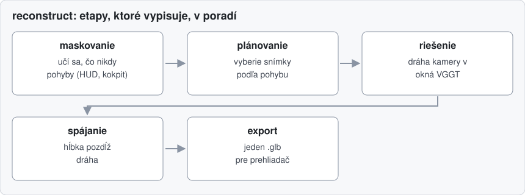

# Offline rekonštrukcia {#offline-reconstruction}

```bash
python -m heat3d_capture reconstruct lap.mp4 -o lap.glb [--solve-budget 260] [--fuse-interval 0.4]
```

Kód: [`scan/offline.py`](https://github.com/Holdi601/3DHeat-GameCapture/blob/main/heat3d_capture/scan/offline.py),
[`pose/feedforward.py`](https://github.com/Holdi601/3DHeat-GameCapture/blob/main/heat3d_capture/pose/feedforward.py),
[`pose/vggt_model.py`](https://github.com/Holdi601/3DHeat-GameCapture/blob/main/heat3d_capture/pose/vggt_model.py),
[`pose/feedforward_source.py`](https://github.com/Holdi601/3DHeat-GameCapture/blob/main/heat3d_capture/pose/feedforward_source.py),
[`pose/solveprep.py`](https://github.com/Holdi601/3DHeat-GameCapture/blob/main/heat3d_capture/pose/solveprep.py).
Voľby: [Prehľad príkazov](commands.md#reconstruct).

## Prečo druhá cesta {#why-a-second-path}

Priebežné sledovanie je živé a lacné a funguje tam, kde je štruktúra, čo sa dá chytiť: interiér,
ulica, mapa s krytom. **Pretekárska trať je jeho najhorší prípad**: cesta je hladká páska s malou
textúrou, horizont sa takmer nehýbe a keď sa niekoľko polôh odchýli, nič neskoršie ich nevráti späť.
Kolo vyjde ako krivka, ktorá sa potuluje namiesto toho, aby sa uzavrela.

Offline cesta dá **okná snímok** modelu, ktorý predpovie všetky ich kamery naraz, takže každá snímka
priamo obmedzuje každú ďalšiu, namiesto toho aby to išlo cez reťaz. Potrebuje celé nahrávanie, kým
dokáže odpovedať, takže nie je živá, a je pomalá: minúty na okno na stolovom GPU. Všetko po polohách –
fúzia, pokrytie, farba, export – je ten istý kód ako pri živom skene: riešená dráha sa odovzdá
rekonštruktoru ako zdroj polôh, presne tam, kde idú telemetrické dáta Forzy.

## Požiadavky {#requirements}

- **PyTorch** zodpovedajúci vašej GPU (tento projekt ho nepripína; nainštalujte ho pred
  `requirements.txt`, pozrite [Runtime](runtime.md)).
- **`vggt`** – kód modelu VGGT (`from vggt.models.vggt import VGGT`), z GitHub repozitára Meta;
  nie je v balíkovom indexe.
- **`transformers`**, lebo offline cesta spúšťa hĺbku cez PyTorch `DepthEstimator` (Depth Anything V2
  Small), nie cez súbor ONNX.
- CUDA GPU v praxi; obidva modely sa vrátia na CPU, čo nie je praktické.

Nič z toho nie je v `requirements.txt`, lebo skener to nepotrebuje. Je to v **`requirements-offline.txt`**,
s vlastnými závislosťami VGGT (`einops`, `safetensors`, `huggingface_hub`, `Pillow`):

```bash
.venv\Scripts\python -m pip install -r requirements-offline.txt
.venv\Scripts\python -m pip install --no-deps "vggt @ git+https://github.com/facebookresearch/vggt.git"
```

VGGT sa inštaluje s `--no-deps`, lebo jeho metadáta pripínajú `numpy<2`: pip by to rešpektoval
a znížil by numpy, od ktorého tu závisí scipy. `reconstruct` všetko toto skontroluje hneď po vypísaní
riadku licencie (zoznam `OFFLINE` v [`runtime/preflight.py`](https://github.com/Holdi601/3DHeat-GameCapture/blob/main/heat3d_capture/runtime/preflight.py)),
vypíše, čo chýba, aj s veľkosťami, a inštaluje len po áno – VGGT s `--no-deps`, ako vyššie.
Odmietnutie, alebo žiadny terminál, kde sa spýtať, skončí s kódom 1.

## Model a jeho licencia {#the-model-and-its-licence}

**VGGT**, `facebook/VGGT-1B`: **CC-BY-NC-4.0, len nekomerčne, a rekonštrukcia urobená ním to dedí.**
Príkaz to vypíše pred štartom (`describe_licence`). Existuje samostatne licencovaný `facebook/VGGT-1B-Commercial`,
ale je to uzavretý repozitár, ktorý Meta udeľuje po jednotlivých účtoch, takže nemôže byť predvolený.
`--model vggt-1b-commercial` rieši s ním (a vypíše jeho riadok licencie); bez udeleného prístupu
zlyhá stiahnutie. *Kód* `vggt` je pod vlastnou licenciou Meta „VGGT License“, dohodou o výskumných
materiáloch s pravidlami prijateľného použitia (čítaná zo súboru `LICENSE.txt` balíka). Pozrite
[Modely a licencie](models-and-licences.md).

## Priebeh po fázach {#the-run-stage-by-stage}

Názvy fáz sú to, čo príkaz vypisuje.



### masking {#masking}

`FlowMask` sa učí zo **4 behov po 90 po sebe idúcich snímkach**, centrovaných na 1/8, 3/8, 5/8 a 7/8
videa, pri 960 x 540 v sivej (pozrite [FlowMask](reconstruction-capture.md#flowmask-what-never-travels)).
Jeho poznámka sa vypíše a ukladá do súhrnu. Video kratšie ako 90 snímok nedostane žiadnu masku.

#### Maska kamery sa učí, neaplikuje sa {#the-camera-mask-is-learned-not-applied}

Maska sa **neaplikuje** na snímky dané riešiteľovi. Maskovanie kokpitu vyzeralo správne podľa štatistík
čŕt (väčšina zistených rohov sedí na pixeloch pripevnených ku kamere) – ale to je tvrdenie o detektore
čŕt, a riešiteľ je natrénovaná sieť. Meralo sa, o koľko sa obnovená dráha otočí medzi po sebe idúcimi
krokmi (auto sa otáča o pár stupňov; náhodná prechádzka o deväťdesiat): surové snímky dali
najmenšie otočenie, snímky s zvýšeným kontrastom o niečo viac, maskované snímky jasne viac a obidve
spolu najviac. Riešiteľ preto dostáva surové snímky. Maska sa stále používa na plánovanie rozstupu
snímok nižšie a priebežný sledovač ju používa v živom skene.
(`solveprep.enhance`, ktorý maskuje a zvyšuje lokálny kontrast pomocou CLAHE, existuje, ale tento
príkaz ho nepoužíva.)

### planning: snímky podľa pohybu {#planning-frames-spaced-by-motion}

`plan_by_motion` vyberá snímky riešiteľa podľa toho, **koľko sa obraz pohol**, nie podľa hodín: pevný
interval dá pomalým úsekom snímky, ktoré nepotrebujú, a hladkým úsekom ich nedá, kde po sebe idúce
snímky prestanú dosť prekrývať, aby sa dali vzťahovať.

- Cieľový posun: **5 % šírky 960 pixelov** (48 px) medián posunu ORB čŕt medzi po sebe idúcimi
  vybranými snímkami, meraný na sivých snímkach 960 x 540 s kontrastom CLAHE, črty len na maske.
- Začína sa s medzerou 0,3 s; po každom kroku sa ďalšia medzera stane
  `gap x (0.5 + 0.5 x target / measured)`, orezaná na **0,15–2,0 s**, aby jedno hlučné meranie
  nehádzalo plánom.
- Keď sa nič nezhodovalo, medzera sa zmenší na 0,6 svojej hodnoty (príliš ďaleko od seba je chyba,
  ktorej sa treba vyhnúť).
- Zastaví sa na konci videa alebo pri `--solve-budget` snímkach (predvolene 260).

Menej ako 4 naplánované snímky je chyba.

### solving: okná a zlepovanie {#solving-windows-and-stitching}

Naplánované snímky sa dekódujú na šírku 960 px a riešia sa v **prekrývajúcich sa oknách po 16 snímkach,
6 spoločných** s ďalším (`plan_windows`; posledné okno sa stiahne tak, aby končilo na poslednej snímke,
takže koniec záznamu má toľko susedov ako stred). Viac ako **400** snímok v jednom behu sa odmietne.

Každé okno: snímky sa zmenia tak, aby dlhá strana bola **518** a obe strany násobky **14** (pomer
strán zachovaný – stlačenie by skreslilo zorné pole), škálujú sa na 0..1 a prebehnú cez VGGT pod
autocastom bfloat16 (float16 by došiel exponent pri vzdialených svetových súradniciach). Vonkajšie
parametre kamier sa prevedú na rotácie svet-z-kamery a stredy kamier. Mapy bodov sa štandardne
neuchovávajú.

Každé okno sa vráti vo **svojom vlastnom ľubovoľnom rámci a vlastnej ľubovoľnej mierke**, takže okná sa
**zlepia** do rámca prvého podobnostnou transformáciou (rotácia, posun, jedna mierka) prifitovanou na
kamerách, ktoré zdieľajú s tým, čo je už umiestnené:

- **Rotácia z orientácií kamier**, nie z polôh: spoločné kamery ležia pozdĺž dráhy a na rovinke sú
  takmer kolineárne, čo nechá fit len podľa polôh nevidieť rotáciu – každé okno sa ohýba a výsledok
  zlepenia vyjde rovný. Rotácia je priemer `target_R x source_R^T` premietnutý späť na skutočnú rotáciu
  (s ochranou pred zrkadlením).
- **Mierka a posun z polôh**, pozdĺž otočeného zdroja.
- Potrebné sú aspoň **4** spoločné kamery; menej je chyba.
- Prekrytie je tretina okna, aby bola mierka dobre určená; chyba mierky, ktorá sa hromadí okno za oknom,
  je to, čo spôsobí, že kolo sa špirálovito rozbieha.

Pre každý spoj sa zaznamená najhoršia nezhoda spoločných kamier po fite, v jednotkách priemerného
rozstupu medzi nimi (`seam_error`).

### fusing {#fusing}

Snímky každých `--fuse-interval` sekúnd (predvolene 0,4) sa dekódujú na šírku 960 px, dostanú hĺbku od
Depth Anything V2 Small (PyTorch) a spoja sa s polohou **interpolovanou** z riešenej dráhy v ich
časovej pečiatke (lineárna poloha, sférická rotácia; `FeedForwardPoses`). Snímky mimo riešeného
časového rozsahu sa preskočia namiesto extrapolácie. Kamera používa **65 stupňov** horizontálneho
zorného poľa. Polohy typu feed-forward majú v fúzii a pokrytí istotu 0,85.

### exporting {#exporting}

Sieť sa zapíše ako pri živom skene ([Výstup .glb](glb-output.md)), pomenovaná podľa videa.

## Súhrn {#the-summary}

```text
140 cameras solved over 182s
closure error 3.1% of path length
worst seam 0.42 frame spacings
<mask note>
wrote lap.glb
```

| Riadok | Význam |
|---|---|
| closure error | vzdialenosť od prvej po poslednú kameru vydelená dĺžkou dráhy. Pre jedno kolo je to čestná miera driftu. Nad 10 %: „The lap does not close ... Treat the shape as unreliable.“ |
| worst seam | najväčšia nezhoda pri zlepení. Nad 1,0: „Windows disagreed by up to N frame spacings at a seam, so part of the path is stitched on weak evidence.“ |
| no file | „Fusion produced no surface, so nothing was written.“ Potom je výstupný kód 1. |

## Mierka {#scale}

Zlepená dráha je v ľubovoľných jednotkách prvého okna. Hĺbka sa zakotví triangulovaním medzi
interpolovanými polohami (ako pri telemetrii), takže geometria je konzistentná s dráhou – ale
**výsledok nie je v metroch**, pokiaľ nie je dráha. Nič v tomto príkaze nepevní globálnu mierku;
kalibrácia zeme sa neaplikuje, keď polohy pochádzajú zo zdroja polôh.

## Stav tejto cesty {#state-of-this-path}

Pri rámcoch v pevnom intervale sa okná riešia do súvislej dráhy na niektorých úsekoch kola a na iných
do čmárania; zlyhania sú v tesných zákrutách, kde sa pohľad medzi snímkami prudko otáča, a
hustejšie vzorkovanie týchto zákrut ich opraví. Žiadna štatistika obrazu (jas, detail, počet čŕt,
pomer vnútorných bodov, posun) nepredpovedala vopred, ktoré úseky zlyhajú. Rozstup preto nemožno
celý naplánovať z obrazov vopred: musí sa zvoliť riešením, zmeraním výsledku a opätovným riešením
hustejšie tam, kde dráha nie je taká, po akej by auto mohlo jazdiť. Plánovanie podľa pohybu je
hotové; **adaptívne opätovné riešenie nie je**.
