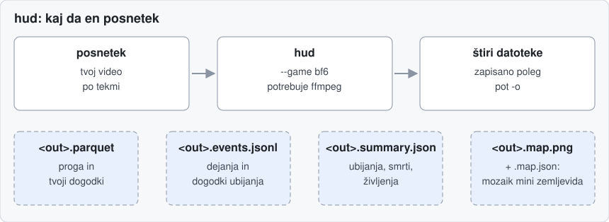

# Branje HUD-a iz posnetka {#reading-the-hud-from-a-recording}

`hud` prebere igrin zaslonski HUD iz **lastnega posnetka** igralca, po tekmi: **lastna** dejanja
igralca iz pojavnega okna točk, ki ga igra prikaže pod tarčo (ubojni, pomoči, oživitve, oskrbe,
zavzetja ...), njegove smrti iz zaslonov padca in namestitve, njegovo **lastno** pot iz minimape ter
seznam ubojev ob njih kot časovne dogodke - zapisano kot tabela 3DHeat, z mozaikom minimape kot
slikom zemljevida, ki gre pod njo.

Na kratko: gleda vaš posnetek tekme in zapiše vaše ubojne, smrti in kam ste hodili.

```bash
.venv\Scripts\python -m heat3d_capture hud "<recording>.mp4" --game bf6 --player <name> -o out/match
```

Battlefield 6 je prvi profil igre.



## Česa se ne dotika in kaj ne spremeni {#what-it-does-and-does-not-touch}

- Bere **datoteko videa**: posnetek ShadowPlay / Instant Replay, posnetek OBS, karkoli, kar ffmpeg
  dekodira. Igre, njenega pomnilnika, datotek ali omrežja se ne dotika, in deluje, ko se tekma že
  konča. Glejte [Pravila](rules.md).
- Izpelje **samo položaj igralca**, iz njegove lastne minimape. Oznake drugih igralcev na minimapi so
  prekrite in se nikoli ne berejo. Seznam ubojev je ohranjen v celoti, vendar samo kot to, kar piše na
  zaslonu (kdo, koga, s čim, kdaj); nobenemu drugemu igralcu se ne pripiše položaj, razen igralcu.
- OCR teče lokalno (RapidOCR s modeli PaddleOCR prek ONNX Runtime). Noben okvir ali izrez ne zapusti
  računalnika.
- Posnetek kaže imena drugih igralcev, mozaik pa je slika nivoja. Izhodi so za igralčevo lastno rabo;
  hrani jih lokalno.

## Zahteve {#requirements}

- **ffmpeg in ffprobe** na `PATH`. Če je na voljo kartica NVIDIA, se za dekodiranje uporabi ta
  (`-hwaccel cuda`); sicer dekodira CPE, kar je večkrat počasneje.
- Paketi iz `requirements.txt` in OCR brez njegovih lastnih odvisnosti (zahteva CPU različico
  `onnxruntime`, ki se spopade z DirectML različico, ki jo projekt uporablja):

```bash
.venv\Scripts\python -m pip install -r requirements.txt
.venv\Scripts\python -m pip install --no-deps rapidocr_onnxruntime==1.2.3
```

`rapidocr_onnxruntime` je bralnik besedila (OCR), ki prebere imena in besede z zaslona.
`--no-deps` preprečuje, da bi zamenjal DirectML `onnxruntime` projekta.

Namestitev ffmpeg v Windows: `winget install Gyan.FFmpeg`, nato odprite nov terminal in preverite z
`ffmpeg -version`. Ukazne vrstice še ne poznate? Preberite [Preden začneš](before-you-start.md).

- Posnetek **16:9** v poljubni ločljivosti (1080p, 1440p, 4K). Druga razmerja stranic so zavrnjena,
  ker bi škatle profila pristale na napačnih delih zaslona.
- **Privzeta postavitev HUD-a** igre. Premaknjen ali spremenjen HUD element bo prebran na napačnem
  mestu.

## Možnosti {#options}

| Možnost | Privzeto | Pomen |
|---|---|---|
| `video` | | Posnetek. |
| `-o`, `--out` | ime videa, v trenutni mapi | Pot izhoda **brez** pripone; datoteke so `<out>.parquet`, `.events.jsonl`, `.summary.json`, `.map.png`, `.map.json`. |
| `--game` | `bf6` | Čigav HUD se bere. `bf6` (Battlefield 6) je zaenkrat edini profil. |
| `--player` | nič | Igralčevo ime, kakor ga prikazuje seznam ubojev. Primerja se ohlapno (OCR zamenjuje `l`/`I`/`1`, `O`/`0`, `rn`/`m`). Brez njega se ime ugane (spodaj). |
| `--fps` | 5 | Vzorci minimape na sekundo. Seznam ubojev se vzorči na polovici te hitrosti, pojavno okno točk in zasloni smrti prav tako na polovici (četrtina, dokler ni nobenega okna), kompas na 3 s, seznam ekipe na 15 s. |
| `--start` | 0 | Sekunde v videu, pri katerih se začne. |
| `--seconds` | vse | Koliko videa se prebere. |
| `--metres-per-pixel` | nič | Merilo minimape, če je znano: metri na piksel minimape pri običajnem zoomu (minimapa je na zaslonu 1080p široka 296 pikslov). Brez tega so položaji v teh pikslih; glejte [Enote](#north-and-units). |
| `--cpu` | izključeno | Dekodiraj na CPE-ju, tudi če je na voljo kartica NVIDIA. |

Napredek se izpisuje na vsakih pet sekund; na koncu igralec, ubojni, smrti, življenja in zapisane
datoteke.

## Izhodi {#outputs}

### `<out>.parquet` - igralčeva pot in dogodki {#parquet---the-players-track-and-events}

Ena vrstica za vsak vzorec, ko je bil igralec v igri in je bilo mogoče postaviti minimapo, plus ena za
vsak njegov dogodek. Noga (footer) nosi bralna navodila pregledovalnika (ključ `heat3d`, `kind: heat3d-hud`),
zato pregledovalnik vsak stolpec preslika brez vprašanja.

| Stolpec | Pomen |
|---|---|
| `time` | Sekunde od začetka videa. |
| `event` | `position`; `start` (video se je začel sredi življenja), `spawn` (spet v igri po smrti ali dolgi odsotnosti), `death`, `downed` in `revived` (iz zaslonov smrti, spodaj), `end` (življenje se je končalo, ne da bi bilo jasno, kako); igralčeva lastna dejanja iz pojavnega okna točk (`kill`, `assist`, `reviving`, `resupply`, `capture` ... - [tabela dogodkov](#event-table)); in vrstice seznama ubojev o igralcu kot `kill_feed`, `death_feed`, `teamkill_feed`, `suicide_feed`, `squadwipe_feed`. |
| `source` | Od kod je prišel dogodek vrstice: `points` (pojavno okno), `screen` (zasloni padca in namestitve), `feed` (seznam ubojev); prazno pri vrsticah položaja. |
| `text` | Pri vrsticah `points`: oznaka, kakor je natisnjena (`KILL`, `SQUAD DAMAGE ASSIST` ...), ali naslov (`DOUBLE KILL`, ime značke), ali pri neznani oznaki, kar je bilo prebrano. |
| `points` | Pri vrsticah `points`: za koliko se je vsota pojavnega okna povečala v tistem trenutku. Če je več dejanj prišlo v istem vzorcu (ubojni in vozilo, v katerem je bil), je njihova vsota, zapisana pri vsakem, in `shared` pove, koliko jih deli. Prazno, če vsota ni bila prebrana dvakrat pred in po trenutku. |
| `subject`, `subject_side` | Pri vrsticah `points`: ime, ki ga je pojavno okno prikazalo ob dejanju - žrtev ubojstva, soigralec, ki je bil oživljen ali oskrbljen - in njegova barva (`enemy`, `friendly`, `squad`). |
| `confirmed` | `feed`, če je seznam ubojev imel vrstico za isti ubojstvo ali smrt (v 3 s, ista žrtev). |
| `x`, `y`, `z` | Položaj na mozaiku: `x` vzhod, `y` sever, `z` 0 (noga pove, da je `z` gor). Sever je pravi sever, kadar ga je kompas dovolil (glejte `north_up` v povzetku). |
| `player` | Vedno `me`. Samo igralčeve vrstice imajo položaje. |
| `team` | `own`. |
| `session` | `<video name>#NN`, po ena za vsako življenje. Vrste linijske toplote nikoli ne prečkajo seje. |
| `heading` | Stopinje v smeri urnega kazalca od severa (od zgornje strani mozaika, kadar sever ni znan): kam je bil obrnjen pogled. |
| `dir_x`, `dir_y`, `dir_z` | Isto kot smerni vektor, za smer pogleda pregledovalnika. |
| `zoom` | Za koliko je bila minimapa odmaknjena glede na običajen zoom (nad 1 v vozilih). |
| `killer`, `victim`, `weapon`, `headshot`, `marker` | Pri vrsticah ubojev in smrti, ki imajo vrstico seznama ubojev: ta vrstica (spodaj). Ubojstvo iz pojavnega okna brez vrstice seznama ima kot `victim` ime iz pojavnega okna; ubojstvo iz pojavnega okna, prikazano kot HEADSHOT, ima `headshot` enako true. |

Vsaka vrstica dogodka vzame igralčev položaj ob času dogodka (pri smrti ali padcu zadnji položaj pred
njima, pri oživitvi prvi po njej). Vrstice se neposredno prilegajo [linijski toploti](https://holdi601.github.io/3DHeat/line-heat.html)
pregledovalnika: njegov predlog izbere `event`, začne pri `start`, `spawn` in `revived`, konča pri
`death`, `downed` in `end`, vrstice `position` pa ležijo vzdolž poti. Drugi dogodki so poimenovani tako,
da predlog nobenega ne vzame za začetek ali konec: dajanje oživitve je `reviving` (ne `revive`), držanje
točke `defense`, soigralec, ki se pojavi ob igralcu, `teammate_arrived`, vrstice seznama ubojev pa
`kill_feed` in tako naprej; `kill` ni konec.

Posnetek z dvema rundama na dveh zemljevidih da dva mozaika, ki se ne dasta povezati. Največji je
`<out>.parquet`; vsak drugi z vsaj 30 s poti se zapiše zraven kot `<out>.map2.parquet`,
`<out>.map2.map.png` in tako naprej.

### `<out>.events.jsonl` - igralčevi dogodki in seznam ubojev {#eventsjsonl---the-players-events-and-the-kill-feed}

En objekt JSON na vrstico, po vrstnem redu časa, vsak z `source`:

- `points`: po ena za vsako igralčevo dejanje: `time`, `event`, `text`, `points`, `shared`,
  `subject`, `subject_side` (kakor v tabeli), `popup` (iz katerega pojavnega okna je prišlo, številčeno
  skozi zagon), `seen` (koliko branj ga je pokazalo), `confirmed`, in `x`, `y`, kjer je bil igralec.
- `screen`: po ena za vsak padec in vsako oživitev: `event` (`death`, `downed` ali `revived`), `time`
  (kdaj je igralec padel; pri `revived` kdaj so zasloni izginili), `until` (zadnje opažanje zaslonov),
  `screens` (`down` in/ali `card`), `outcome` (`death`, `revived` ali `unknown`, kadar se posnetek konča
  prej), `killer` (iz vrstice seznama, kadar obstaja), `x`, `y`.
- `feed`: vsaka vrstica, ki jo je seznam prikazal, vseh igralcev:

| Polje | Pomen |
|---|---|
| `time`, `last` | Prvi in zadnji vzorec, pri katerem je bila vrstica prebrana (sekunde od začetka videa). `time` je, kdaj se je ubojstvo pojavilo, do enega vzorca seznama (0,4 s pri privzeti hitrosti). |
| `kind` | Z igralčeve strani: `kill`, `death`, `teamkill`, `suicide`, `squadwipe`; pri vrsticah drugih igralcev `kill`, `squadwipe` ali `death` za vrstico brez ubijalca. |
| `killer`, `victim` | Imeni, kot ju prebere največkrat čez vse vzorce, ki kažejo vrstico (daljše branje zmaga, kadar je običajno njegov začetek: delno skrito ime). `killer` je prazen za vrstico, ki je kazala samo ikono in žrtev - smrt zaradi sveta ali vrstico, katere ubijalec je že zbledel. |
| `killer_side`, `victim_side` | Iz barve imena: `friendly` (igralčeva ekipa, modra), `enemy` (oranžna), `squad` (bledo zelena, ki jo igra uporablja za igralca in njegov odred), `neutral` (nobena od teh). |
| `weapon` | Razred ikone orožja znotraj tega zagona: `icon01`, `icon02` ... Vrstice, katerih ikone so si podobne, delijo razred. Ikone niso poimenovane; ni seznama, iz katerega bi jih lahko imenovali. |
| `marker` | Majhna ikona med orožjem in žrtvijo: `skull`, `arrow`, `chevrons`, `crosses` ali prazno. |
| `headshot` | `marker == "skull"` - predpostavka, glejte [Omejitve](#limits). |
| `seen` | Koliko vzorcev seznama je pokazalo vrstico. |
| `me` | `killer`, `victim` ali null. |
| `matched` | Za igralčeve lastne vrstice: ali je bilo zanje najdeno dejanje pojavnega okna ali zaslon smrti. |
| `x`, `y` (, `map`) | Za igralčeve lastne vrstice: kje je bil. |

### `<out>.summary.json` {#summaryjson}

Igralec (in kako je bil najden), od kod so prišli igralčevi dogodki (`own_events_from`: pojavno okno
in zasloni ali samo seznam ubojev, če nobeno ni bilo prebrano), ubojni, smrti, K/D, headshoti,
pomoči, dane (`revives`) in prejete (`revived`) oživitve, padci, zavzetja, nevtralizacije, oskrbe,
zdravljenja, popravila, uničena vozila, točke (seštevek vsot pojavnih oken), vsaka vrsta dejanja s
številom (`actions`), število pojavnih oken, smrti, ki jih je pokazal samo seznam, lastno štetje
seznama o ubojih in smrteh in koliko njegovih ubojev se je ujemalo s pojavnim ubojem, sokrivde,
samomore, uničenja odreda, življenja, sekunde v igri, prevožena razdalja (v enotah tabele), vrstice
seznama, za vsak zemljevid, ali je sever zgoraj in koliko branj kompasa se je ujemalo, števila poti
(vzorci, v igri, postavljeni, nepostavljeni, otoki), predpostavke, ki so bile narejene, in časovnica.

### `<out>.map.png` in `<out>.map.json` - zemljevid pod potjo {#mappng-and-mapjson---the-map-under-the-track}

Mozaik vseh minimap zagona, povprečen, z odstranjenimi prekrivi, obrnjen in skaliran natanko kot tabela.
Sidecar JSON hrani dve sidri, ki ju zahteva možnost pregledovalnika **Map image** ([Slike zemljevidov](https://holdi601.github.io/3DHeat/map-images.html) v dokumentaciji pregledovalnika):
naloži PNG z **Map image...**, pusti **Flip north/south** vklopljen in vnesi sidro 1 in sidro 2
(`px`, `py`, `worldX`, `worldZ`) iz sidecarja. Slika nato leži natanko pod potjo.

Na sliki so samo tisti deli nivoja, ki jih je igralčeva minimapa kazala.

## Metoda {#method}

### Dekodiranje {#decoding}

ffmpeg dekodira na GPU-ju, pade na vzorčno hitrost, medtem ko so okvirji še na kartici, izreže
regije profila (minimapa, seznam ubojev, dva pasova kompasa, seznam ekipe, pojavno okno točk, besede na
zaslonu padca, spodnji desni kot), vsako skalira na fiksno velikost in jih zloži v eno majhno sliko na
vzorec. V Python gre skozi cev samo ta slika. Dekodiranje vsakega okvirja H.264 toka je spodnja meja
časa izvajanja.

Dva delovna niza sprejemata vzorce: eden registrira minimape (OpenCV), drugi bere besedilo (ONNX Runtime).

### V igri ali ne {#in-play-or-not}

Kvadrat z namigom za tipke (svetel kvadrat z oznako zemljevida v sredini, spodaj levo na minimapi) je
narisan, kadar je narisana minimapa, in ne na zaslonih smrti, kill-cam, namestitve, menija ali
tabele rezultatov. Njegova prisotnost - svetla, brezbarvna kvadratka s temno črko v sredini, jasno
svetlejša od okolice - iskana nekaj pikslov okoli njegovega mesta, je test za igro. En vzorec, ki se ne
strinja z obema sosedoma, se prezre.

Vrzel v igri je smrt ali menjava runde (naslednji odsek se začne s `spawn`), kadar traja vsaj 6 s ali
je smrt (iz zaslonov ali vrstice seznama, ki igralca navaja kot žrtev) prišla 40 s pred njo; krajša
vrzel brez smrti (odprt velik zemljevid) nadaljuje življenje. Minimapa ostane prikazana, ko je igralec
na tleh, zato je igralec na tleh v igri.

### Pot {#the-track}

Minimapa se obrača z pogledom in drži igralca na fiksni točki (izmerjeno: sredina, 49,7 % navzdol).
Za vsak vzorec:

1. **Maska** prekrije, kar ni nivo: močno obarvane ali skoraj bele piksle (oznake ciljev, ikone odreda
   in vozil, signali, meja igralnega območja, črte poti, besedilo), bledo rumeno-zeleno stožca pogleda,
   disk okoli igralčeve oznake, klin stožca nad njim, namig za tipke in tanek rob.
2. **Značilnosti**: ključne točke SIFT na sivi minimapi z izenačenim kontrastom, znotraj maske.
3. **Registracija na mozaik**, ne na prejšnji vzorec: ključne točke se ujemajo z značilnostmi, shranjenimi
   doslej, v koordinatah mozaika, blizu mesta, kjer je bil igralec nazadnje; podobnost (zasuk, zoom,
   premik) se prilagodi z RANSAC. Prilagoditev potrebuje dovolj notranjih točk, zoom v tretjini
   zadnjega in premik manjši od tretjine minimape na vzorec; prilagoditev, iskana kjerkoli na mozaiku
   (po smrti), potrebuje dvakrat toliko notranjih točk.
4. **Rast mozaika**: značilnosti, ki jih mozaik še nima, se dodajo (največ vsakih nekaj desetin sekunde
   gibanja), maskirana minimapa pa se povpreči v sliko.
5. Igralčeva točka, prenesena skozi prilagoditev, je njegov **položaj**; navzgor obrnjena minimapa, prav
   tako prenesena, je njegova **smer** na mozaiku.

Potem se točka, ki skoči več kot 10 pikslov stran od obeh vzorcev pred njo in obeh po njej (ki se med
seboj ujemajo), izpusti: minimapa se včasih za en vzorec ujame pri napačnem zoomu. Povzetek to šteje
kot `dropped_as_jumps`.

Registracija na mozaik preprečuje, da bi se napake seštevale: vrnitev na mesto se ujame z značilnostmi,
shranjenimi prvič. Pojav na še nevidenem mestu začne ločen **otok**; vsak deseti postavljen vzorec se
preizkusi proti drugim otokom, in prvo dobro ujemanje se jih združi (manjši se prestavi v večjega, s
svojo potjo). Otoki, ki se nikoli ne združijo (drug zemljevid ali zemlja, ki je ni nikoli nihče delil),
se zapišejo posebej, kakor zgoraj.

### Sever in enote {#north-and-units}

Trak kompasa se bere na vsake 3 s: njegove oznake se najdejo po črnilu (svetle, brezbarvne, združene
čez majhne vrzeli, brez oznak), vsaka se prebere posebej, dve ali več oznak pa določita merilo traku in
smer pod središčno oznako - ena sama oznaka ne določa ničesar. Vsako branje kompasa se seznani z
mozaično smerjo istega vzorca; krožna mediana razlik med branji v 10 stopinjah od nje je zasuk, ki
obrne mozaik tako, da sever gleda gor. Uporabi se, kadar se je strinjalo vsaj tri branja in polovica vseh.

<a id="units"></a>Merilo minimape na tleh ni nikjer natisnjeno na zaslonu, zato so položaji v **pikslih
minimape pri običajnem zoomu**: mediana zooma zagona je skalirana na eno enoto tabele na piksel
296-piksle minimape (njena velikost na zaslonu 1080p). Odmik zoomiranja vozila odpravi registracija,
zato je enota enaka peš in v vozilu. `--metres-per-pixel` vse pomnoži v metre, kadar je merilo znano
(iz znane razdalje na zemljevidu, izmerjene enkrat).

### Seznam ubojev {#the-kill-feed}

Seznam se bere s 2,5 vzorca na sekundo, ampak samo, kadar so se njegovi barvni piksli opazno spremenili
ali je minilo 2 s. Vrstice besedila najde detektor OCR; vrstica, katere slika se ujema z eno, prebrano
v prejšnjem vzorcu (vrstice se pomikajo, zato se lahko premaknejo), prevzame to besedilo, namesto da bi
se prebrala znova. Vrstice, ki so premajhne za ime, ali z poševnico (števec fps v tistem kotu), se
izpustijo.

Vrstice se razvrstijo v vrste po višini; v vrsti je ime levo ubijalec in desno žrtev. Sosednji kosi iste
barve se združijo (ime s presledkom). Ena sama vrstica, ki je tekla čez ikono iz enega imena v drugo, se
pri najširšem razmaku prereže, kadar se polovici razlikujeta po barvi, in vsaka polovica se prebere znova.
Posamezno ime v stolpcu žrtev z ikono tik levo od njega je vrstica brez ubijalca. Dva kosa iste barve brez
ikone vmes sta eno ime, katerega ubijalec je zbledel, ne ubojstvo.

**Strani** prihajajo iz barve. Imena so narisana sprosojnostjo, zato je test na tem, kako daleč je
besedilo od lastnega ozadja: predznak rdeče minus modre v tej razliki je oranžna (sovražnik) ali modra
(prijatelj) na poljubnem ozadju; nobena od teh, z zeleno nad drugima dvema, je barva odreda.

**Ikone**: med imeni so piksli v barvi ubijalca oblikovalni obris orožja; majhna ločena ikona tik pred
žrtvijo je oznaka, imenovana po obliki (blob z luknjama za oči je lobanja; majhen trikotnik puščica;
več kosov križci).

**Dogodki**: vrstica, prebrana znova z obema imenoma enakima (podobnost 0,7 po zložitvi običajnih zamenjav
OCR, ena od njih 0,8; prerezano branje se ujema z začetkom polnega imena), je isti dogodek, dokler je bil
dogodek nazadnje prebran manj kot 5 s prej in je star manj kot 14 s - nobena vrstica ne ostane gori
dlje, zato je isti par pozneje nov ubojstvo. Vrstica brez ubijalca se ujema samo po žrtvi. Čas dogodka
je njegovo prvo opažanje; njegova imena, strani in oznaka so večina čez opažanja; vrstice, prebrane samo
enkrat, se izpustijo.

**Igralec**: `--player`, sicer označena (najsvetlejša) vrstica seznama ekipe, kadar sta vsaj tri branja in
60 % jih soglaša, sicer ime, ki ga je seznam najpogosteje narisal v barvi odreda. Sicer povzetek pove, da
je igralec neznan, in nobena vrstica seznama ni pripisana njemu. (Pojavno okno in zasloni smrti so
igralčevi, ne glede na njegovo ime; ne potrebujejo imena.)

### Pojavno okno točk {#the-points-popup}

Vse, kar igralec doseže, Battlefield 6 prikaže v enem pojavnem oknu tik levo in pod tarčo - na istem
mestu peš, v vozilu in skozi tarčo:

```
            [ RIBBON ] (icon)          naslov, včasih: značka ali več ubojev
      (icon)(icon)(icon)  300          ena ikona za dejanje; tekoča vsota okna
                Some_Name              o kom je bilo, za trenutek: oranžna sovražnik, modra soigralec
    [ KILL x2 ] [ VEHICLE DESTROYED ]  ena oznaka v okvirju za vsako vrsto dejanja, s številom
```

Okno raste, ko igralec še naprej dosega točke: novi ubojstvo spremeni `KILL` v `KILL x2`, doda ikono in
dvigne vsoto; nova vrsta dejanja doda oznako. Vrstica oznak kaže zadnjih nekaj vrst (starejša zdrsne ven
in šteje naprej, ko se vrne). Približno tri sekunde po zadnjem dejanju se okno strne v eno vrstico
(`[KILL x2] 300`) in izgine. Besedilo je svetlo sivo, oznake so v tankih okvirjih, vsota pa z velikimi
števkami od x 760 zaslona 1920x1080 naprej, oznake poravnane desno do x 750.

Bere se 2,5-krat na sekundo: detektor OCR najde vrstice besedila, bere se samo vrstice na eni od vrst
okna (oznake nišanja tanka se v istem območju ne preberejo), vrstica, katere slika se ujema z eno,
prebrano prejšnji vzorec, pa prevzame to besedilo. Vrstica, ki teče od ikone, imena ali zložene oznake
v vsoto (`Name10`, `REVIVE185`), se prereže tam, kjer se vsota začne (x 755), in obe polovici se preberesta
znova. Medtem ko ni nobenega okna, se vsak drugi vzorec zadrži neprebran; ko naslednji pokaže okno, se
zadržani najprej prebere, tako da se začetek okna najde do vzorca.

**Oznake** se ujemajo s [tabelo dogodkov](#event-table), potem ko se zložijo običajne napake prepoznavalnika
(Q prebran kot O, številka med črkami, I za L, izgubljena črka na robu): branje je oznaka, kadar je vsaj
80 % podobno eni (85 % za oznake s petimi črkami ali manj) in je očitno bližje njej kot kateri koli
drugi. Oznake, ki jih je prepoznavalnik zlil (`CAPTUREDORDERCOMPLETED`), se razdelijo tako, da se znane
oznake odluščijo s prednje strani. Število je `x2`, `X3`, blodna znaka in števka ali števka tik za oznako.
Svetlo siva, velikimi črkami zapisana vrstica v vrsti oznak, ki se ne ujema z ničemer, se ohrani kot
dejanje `points` s svojim besedilom; vrstica, ki je kos znane oznake v istem oknu (`DESTROYED` ob
`VEHICLE DESTROYED`), ni. Naslovi nad vsoto (svetli okvirji, temno besedilo) so `multi_kills` (`DOUBLE KILL`
...) ali `ribbon`. Ime je barvna vrstica med vsoto in oznakami; njena stran pride iz barve, kakor pri
seznamu.

**Okna in dejanja**: branja z manj kot 0,9 s tišine med njimi so eno okno. Okno, ki se zdi, da se konča, in
se vrne, preden bi lahko zdrsnilo (v 3,2 s od zadnjega rasta), z vsako oznako na njeni številki ali višji in
vsoto ne manjšo, je isto okno, ki je za trenutek izginilo (zamegljenost, svetlo ozadje) - nič v njem se ne
šteje dvakrat. V oknu je končno število oznake najvišje število, prebrano vsaj dvakrat; njegovo k-to dejanje
je časovno določeno pri prvem branju, ki kaže število k ali več. Število, prebrano samo v enem vzorcu, ni
dejanje - razen ubojstva, ki ga potrdi seznam ubojev (igralčeva vrstica v 3 s, ki je ni vzel noben drug
ubojstvo): kratko oznako KILL prepoznavalnik najpogosteje prebere samo enkrat. Značka se šteje enkrat na
okno, ko je prebrana dvakrat. `points` je, za koliko je vsota - štejejo se samo vsote, prebrane dvakrat
zapored - zrasla od pred vzorca dejanja do po njem.

Neznana vrstica šteje kot oznaka samo v vrsti znanih oznak v istem branju (ali, brez znane oznake, kadar
tudi ni imena), tako da ime, narisano v barvi, ki je test strani ne more prepoznati, ni vzeto za eno.

### Smrti in oživitve {#deaths-and-revives}

Ko igralec pade, igra to pove pod središčem zaslona (MAN DOWN, REQUEST REVIVE, SKIP (HOLD), NEARBY MEDICS;
ko je oživitev zahtevana, REVIVE REQUESTED, CANCEL REQUEST), in kartica v spodnjem desnem kotu imenuje, kdo
je to naredil, pod njo DAMAGE LOG ali PLAYER CARD, nad njo pa vrstica "YOU n - n FOE". Ubit na mestu (smrtni
strel v glavo) se prikaže samo kartica. Potem soigralec igralca oživi - zasloni izginejo in igra se nadaljuje -
ali pa igralec izkrvavi ali se preda, in sledi zaslon namestitve, z DEPLOY v spodnjem desnem kotu.

Te besede se preberejo skupaj s pojavnim oknom, v istem prehodu OCR (pojavno okno, pas zaslona padca in
spodnji desni kot zloženi v eno sliko): 2,5-krat na sekundo, medtem ko je pojavno okno, in 1,25-krat sicer.
Kot se vključi samo, kadar je igralec izven igre ali je bil nazadnje viden na tleh v zadnjih 3 s; v igri
vsebuje samo število nabojev.
Opažanja manj kot 4 s narazen tvorijo eno epizodo (vsaj dve opažanji). Epizoda je **smrt**, kadar se pokaže
zaslon namestitve v 12 s po njenem koncu, ali je igralec izven igre 3 s po njej in ostane tako vsaj 6 s; je
**oživitev** (`downed`, nato `revived`), kadar je igralec še vedno v igri 3 s potem, ko so zasloni izginili;
`unknown` (zapisano kot samo `downed`), kadar se posnetek konča prej. Čas smrti je, kdaj je igralec padel:
vrstica seznama, ki ga navaja kot žrtev, če obstaja v 3 s pred epizodo, sicer prvo opažanje epizode minus
pol intervala branja. Položaji po smrti se izpustijo iz poti do zaslona namestitve.

Smrt iz seznama, ki nobena epizoda ne pojasni (zasloni so bili zgrešeni), je vseeno `death`, z `source`
`feed`, in se presodi kot prej: če igralec ostane v igri več kot 40 s po njej, je bil oživljen.

### Tabela dogodkov {#event-table}

Kaj postane vsaka oznaka, značka in zaslon. Več oznak je lahko en dogodek; `text` ohrani, katera je bila.

| Dogodek | Od | Pomen |
|---|---|---|
| `kill` | KILL; HEADSHOT | Igralec je koga ubil (ime je žrtev). Ubojstvo v glavo prikaže HEADSHOT tam, kjer bi bil KILL: `text` pove, katero, in `headshot` je true. |
| `assist` | ASSIST, KILL ASSIST, DAMAGE ASSIST, SQUAD DAMAGE ASSIST | Škoda na nekom, ki ga je ubil soigralec. |
| `kill_assist` | ASSIST COUNTS AS KILL | Pomoč, ki jo igra šteje kot ubojstvo. |
| `suppression`, `suppression_assist` | ENEMY SUPPRESSION; SUPPRESSION ASSIST | Zatiralni ogenj na sovražnika; na tistega, ki ga je nato ubil soigralec. |
| `smoke_assist` | SMOKE ASSIST, SQUAD SMOKE ASSIST | Dim, ki je pokril soigralca. |
| `spot`, `spot_assist` | SPOT, SPOTTED, ENEMY DESIGNATION; SPOT ASSIST, SPOT BONUS | Odkrivanje sovražnika; ubojstvo nekoga, ki ga je igralec odkril. |
| `driver_assist` | DRIVER ASSIST | Ubojstvo s strani strelca vozila igralca. |
| `reviving`, `reviving_bonus` | REVIVE, SQUAD REVIVE; CONCEALED REVIVE | Igralec je oživil soigralca; bonus za to, da je to storil skrit. |
| `heal` | HEAL, SQUAD HEAL | Igralec je zdravil soigralca. |
| `resupply` | SUPPLY, RESUPPLY, SQUAD SUPPLY | Soigralec je vzel strelivo od igralca. |
| `repair` | REPAIR, VEHICLE REPAIR, SQUAD REPAIR | Igralec je popravil vozilo. |
| `capturing`, `capture` | CAPTURING, RECAPTURING; CAPTURED, OBJECTIVE CAPTURED | Tik zavzemanja; zavzet cilj. |
| `neutralizing`, `neutralize` | NEUTRALIZING; NEUTRALIZED, OBJECTIVE NEUTRALIZED | Enako za sovražnikov cilj, ki je spuščen na nevtralno. |
| `defense` | DEFENDING, OBJECTIVE DEFENDED | Obramba cilja. |
| `offensive`, `defensive` | OFFENSIVE; DEFENSIVE | Bonus za dejanje blizu cilja, ki je napaden; ubranjen. |
| `order` | ORDER COMPLETED | Izvedeno naročilo odreda. |
| `vehicle_damage`, `vehicle_disabled`, `vehicle_destroyed`, `vehicle_destroyed_assist` | VEHICLE DAMAGE; VEHICLE DISABLED; VEHICLE DESTROYED; VEHICLE DESTROYED SUPPORT | Škoda na sovražnikovem vozilu, do uničenja ali pomoči pri tem. |
| `equipment_destroyed` | EQUIPMENT DESTROYED | Uničen sovražnikov pripomoček. |
| `forced_bail` | FORCED BAIL | Sovražnik prisiljen izstopiti iz vozila. |
| `squad_wipe` | SQUAD WIPE | Zadnji iz sovražnikovega odreda ubit. |
| `savior`, `avenger` | SAVIOR; AVENGER | Ubojstvo sovražnika, ki je ranil soigralca; ki je pravkar ubil soigralca. |
| `teammate_arrived` | SPAWNED ON, SPAWN ASSIST, VEHICLE SPAWN, SQUAD VEHICLE SPAWN | Soigralec se je pojavil na igralcu ali v njegovem vozilu. |
| `transport` | TEAM TRANSPORT | Prevoz soigralcev v vozilu. |
| `fortify` | DEFENSE DEPLOYED | Obramba, ki jo je zgradil igralec. |
| `points` | karkoli drugega v vrsti oznak | Dejanje, ki tabela ne pozna: `text` je, kar je bilo prebrano. |
| `multi_kills` | DOUBLE KILL, TRIPLE KILL, QUAD KILL, MULTI KILL (naslov) | Ubojstva v hitrem zaporedju. |
| `ribbon` | vsak drug naslov | Značka po imenu (BALLISTIC, TANK BUSTER, ENGINEER EXPERT, SPEARHEAD ...). |
| `downed` | zaslon padca, nato igra | Igralec je padel in bil oživljen. |
| `revived` | zasloni izginejo, igra se nadaljuje | Igralca je oživil soigralec. |
| `death` | zaslon padca ali kartice, nato namestitev ali izven igre | Igralec je umrl. |

Besedila v tabeli so bila videna v preizkusnih posnetkih, razen teh, ki so običajna imena serije iger in so
v tabeli zato, da so poimenovana in ne ohranjena kot `points`: HEADSHOT KILL, ASSIST, KILL ASSIST, ASSIST
COUNTS AS KILL, SPOT, SPOTTED, SPOT ASSIST, SPOT BONUS, SQUAD REVIVE, HEAL, SQUAD HEAL, RESUPPLY, SQUAD
SUPPLY, REPAIR, VEHICLE REPAIR, SQUAD REPAIR, VEHICLE DISABLED, SQUAD WIPE, AVENGER, obliki OBJECTIVE ...,
ter naslovi TRIPLE KILL, QUADRUPLE KILL in MULTI KILL. Igra v drugem jeziku natisne druge besede: njene
oznake pridejo kot `points` z tem, kar je bilo prebrano - ne zamenjane za znano dejanje - z njihovimi
vsotami in imeni; in ker so zasloni smrti znani po angleških besedah, smrti potem pridejo samo iz seznama
ubojev, kot vrstice `death` z `source` `feed`.

## Kaj je preverjeno {#what-is-verified}

Preverjeno z očmi na preizkusnih posnetkih (igralčevih lastnih, ni del repozitorija), z risanjem vzorcev
naključno in primerjavo vsakega z okvirji okoli njega:

- **Igralčeva lastna dogodka.** Vsako vzorčeno dejanje pojavnega okna je bilo pravo dejanje te vrste, najdeno
  v enem branju (0,4 s) njegovega časa; večina vrednosti in imen je bila pravilna (imena v nekaterih pisavah,
  na primer cirilici, lahko pridejo zmešana). Vsak vzorčen zaslon smrti je bil najden.
- **Seznam ubojev.** Velika večina vrstic seznama je bila najdena z obema pravilnima imenoma; majhne
  napake OCR (velik I prebran kot majhen l) so dovoljene. Imena, narisana z glifi, ki jih sama igra kaže kot
  škatle, se lahko zgrešijo. Strani (barve) so narobe pri nekaj odstotkih imen.
- **V igri.** Test kvadrata z namigom se je v vsakem vzorčenem trenutku strinjal z okvirjem.
- **Pot.** Ni osnovne resnice o tem, kje je bil igralec, zato se pot preverja z samim posnetkom: dve minimapi
  se registrirata **neposredno ena na drugo**, in ta odmik se primerja z odmikom med obema položajema v tabeli.
  Mediana neskladja je okoli 1-3 piksle minimape (pod 1 % širine minimape), več na zgneteni, odmaknjeni
  minimapi.
  Branja kompasa se skoraj vedno ujemajo z mozaikom v 10 stopinjah.
- **Čas izvajanja.** Dekodiranje pri približno petkratnem realnem času je večina tega na namiznem GPU-ju;
  branje pojavnega okna točk doda približno petino do polovico.

Z očmi preverjeno: vsak mozaik ima neprekinjene ceste in stavbe čez življenja, ki so ga zgradila, in poti
različnih življenj vzdolž iste ceste ležijo ena na drugi. Odsek, kjer se zoom minimape spreminja, je lahko
predolg - glejte [Omejitve](#limits).

Testi (`tests/test_hud_*.py`) narišejo vse, kar berejo: izmišljeno nivo cest, stavb in višinskih črt,
minimape sprehodov skozi njo z istimi prekrivi, kot jih ima prava, trakove kompasa, vrstice seznama ubojev
z izmišljenimi imeni. Preverjajo, da se zanka sledi na dva piksla natančno in se sklene, da stoječi igralec
ostane na mestu, medtem ko se pogled obrača, da se spremembe zooma sledijo, da se pojav drugje pridruži
nazaj, ko se poti srečata, da severni zasuk in obrat osi y postavita pot tja, kamor je res šla, da sidra
slike zemljevida poravnata njo pod potjo, ter razčlenjevanje, strani, oznake in odstranjevanje dvojnikov
seznama. Za igralčeve lastne dogodke narišejo pojavna okna točk z izmišljenimi imeni in oznakami ter
preverjajo tabelo oznak in toleranco do napak prepoznavalnika, oznake, zlite skupaj, vrstice okna, vsoto
odrezano od imena, štetje, ko okno raste, nadaljevanje po trenutku nebranja, drsenje oznake ven in nazaj ali
konec; da se število, prebrano enkrat, ohrani ločeno; smrti, oživitve in izidi iz besed zaslonov; in na
izmišljeni tekmi, da dejanja, smrti in oživitve pristanejo v tabeli tam, kjer je bil igralec, vrstice seznama
ob njih pod svojimi imeni, in da se pot konča pri smrti in ne pri oživitvi.

## Omejitve {#limits}

- **Enote so piksli minimape**, ne metri, razen če je dan `--metres-per-pixel`. Nič na zaslonu igre ne navaja
  merila minimape na tleh.
- **Preslikano je samo tisto, kar je kazala minimapa.** Mozaik pokriva teren do pol minimape od tam, kjer je šel
  igralec; dva mozaika, ki si nikoli nista delila tal (dve rundi na dveh zemljevidih ali dve življenji na
  daleč oddaljenih koncih velikega zemljevida), ostaneta ločeni datoteki z nepovezanimi koordinatami.
- **Pot je minimapina, pri 5 vzorcih na sekundo**, ničesar ne zgladi. Minimapa, močno odmaknjena (helikopter
  v preizkusnih posnetkih jo je odmaknil na 2,3-kratnik), kaže manj podrobnosti na piksel, zunaj igralnega
  območja pa skoraj nič, zato je tam registracija bolj groba. Reaktivni letala in igralec kot potnik niso bili
  v preizkusnih posnetkih.
- **Napake registracije so lokalne in se ne seštevajo**, toda mozaik, zgrajen med raziskovanjem novega
  terena, lahko nosi majhen ukrivljen del, ki se popravi šele, ko se teren spet vidi. Kjer se zoom minimape
  spreminja zvezno (vozilo, ki pospešuje), se prilagojeni zoom lahko premakne, in en tak odsek je bil viden
  z razdaljo približno dvakrat večjo od prave. Mozaik, zgrajen iz zgnetene, odmaknjene minimape pešaka, je
  najmanj natančen (napake okoli 3 pikslov običajno, do 18).
- **Ni optimizacije grafa poze.** Zanka se sklene z ujemanjem shranjenih značilnosti, ne z razporejanjem
  popravka po zanki.
- **Razredi orožij zaenkrat ne delujejo.** Obris ikone je vzet iz prosojne ikone nad premikajočim se ozadjem
  in preveč niha od vzorca do vzorca: preizkusni posnetki so dali od 220 do 340 razredov za 550 do 670 vrstic,
  medtem ko ima ujemanje nekaj deset orožij. Obravnavajte `weapon` kot eksperimentalno. Razredi so v vsakem
  primeru po zagonu in niso imena.
- **Pomen oznak ni vsem znan.** Puščica (`▸`) je narisana pred igralčevim lastnim imenom, v vrsticah o njih;
  ni vrsta ubojstva. Lobanja se razume kot ubojstvo v glavo; to je predpostavka, ne nekaj, kar igra pove.
  `chevrons` in `crosses` (uničenja odredov) sta prijavljena, kakor sta videna.
- **Imena v pisavah, ki niso latinične** (na primer cirilica), pridejo kot najbližje latinične podobne črke:
  prepoznavalnik bere latinico in kitajščino. Isti igralec se vsakič prebere enako, zato se še vedno ujemajo, a
  besedilo ni njegovo ime.
- **Prekrivi v kotu seznama ubojev** (števec fps) lahko skrijejo konec žrtve v zgornji vrsti. Besedilo števca
  se prepozna in izpusti, ime, prirezano na kratko, pa se ujame s svojimi polnimi branji, vendar ime, ki je bilo
  videno samo prirezano, ostane prirezano.
- **Smrt, ki je ne pokažeta niti zasloni niti seznam**, še vedno konča pot kot `end`, ko igralec zapusti igro za
  6 s ali več.
- **Prejete oživitve** prihajajo iz zaslonov padca. Samo za smrt iz seznama, ki so jo zasloni zgrešili, se še
  sklepajo (v igri več kot 40 s po njej), in hitra oživitev potem ni ločena.
- **Dejanja v pojavnem oknu so časovno določena na branje**: v 0,4 s od prvega prikaza oznake; oznaka, ki se
  animirano pojavi, je lahko prebrana en vzorec prepozno ali prezgodaj.
- **Imena na vrsticah pojavnega okna** se berejo kot tista na seznamu: pisave, ki niso latinične, pridejo zmešane,
  in tu pa tam se ime soigralca, ki lebdi v svetu blizu okna, prebere kot ime dejanja. Dejanja brez imena (tik
  zavzemanja, ukaz) ga nimajo.
- **`points`** manjka, kadar vsota ni bila prebrana dvakrat na obeh straneh dejanja, in je deljena med dejanji,
  ki so prišla v istem vzorcu. `score` v povzetku sešteje končne vsote oken, zato okno, katerega vsota ni bila
  nikoli prebrana dvakrat, ni vanj všteto.
- **Vrstica oznak je okno**: s štirimi ali več vrstami v enem oknu najstarejša oznaka zdrsne levo, čez rob območja,
  ki se bere. Med tem, ko je bila v pogledu, se je štela; število, ki ga pridobi, medtem ko je na pol zunaj
  zaslona, je lahko zamujeno.
- **Okno, izgubljeno dlje, kot bi lahko trajalo** (več kot okoli 4 s nebranih vzorcev, medtem ko je še raslo), se
  vzame za dve, in oznaka s številom nad ena se nato šteje znova. Ni bilo videno v spodnjih preverjanjih.
- **Drugi jeziki vmesnika**: oznake pridejo kot `points` z njihovim besedilom, smrti pa samo iz seznama (zasloni
  smrti se ujemajo po angleških besedah).
- **Dogodki na kratkem otoku**: življenje, katerega pot je bila prekratka, da bi bila zapisana kot zemljevid
  (pod 30 s), obdrži svoje dogodke v `.events.jsonl` brez `x`, `y`, in v nobeni tabeli.
- **Postavitev HUD-a je privzeta za BF6 pri 16:9.** Spremenjeno merilo HUD-a, barvna paleta za barvno slepe ali
  druga velikost minimape bi zahtevala profil zase.
