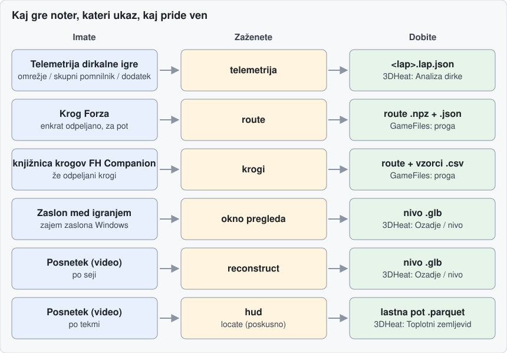

# 3DHeat GameCapture {#dheat-gamecapture}

**Kaj je to?** Orodje, ki zapisuje, kaj vam dirkalna igra pove o vaši vožnji, po ena datoteka na krog.
Iz videoposnetka, na katerem igrate, zna tudi sestaviti grob 3D model nivoja.

**Zakaj bi ga uporabili?** Da svoje kroge vidite v [pregledovalniku 3DHeat](https://holdi601.github.io/3DHeat/):
kje ste zavirali, kje ste bili počasni, kako se dva kroga razlikujeta. In da imate nivo pod svojo toplotno sliko,
kadar nihče nima njegovega 3D modela.

**Primer:** vklopite Forzin Data Out, zaženite en ukaz in odpeljite dva kroga. V mapi `laps\` se pojavita dve
datoteki kroga. Spustite ju na zavihek Analiza dirke v pregledovalniku.


Še niste vajeni ukazne vrstice? Najprej preberite [Preden začnete](before-you-start.md).

## Tri naloge {#the-three-jobs}

1. **Telemetrija kroga.** Zapiše vsak kanal, ki ga dirkalna igra objavi - Forzin Data Out, skupni
   pomnilnik iger Assetto Corsa, omrežne tokove ralijskih iger, dodatek BeamNG, vtičnik Trackmania -
   in za vsak krog ali etapo zapiše eno datoteko `heat3d-lap` za zavihek Analiza dirke v pregledovalniku. iRacing
   ne potrebuje snemalnika: pregledovalnik bere njegove lastne datoteke `.ibt`.
2. **Nivoji iz igranja.** Iz tega, kar je zaslon pokazal, ko ste hodili ali vozili po nivoju, naredi 3D model
   `.glb`, ki ga pregledovalnik položi pod toplotni zemljevid.
3. **Vaša tekma, po njej.** `hud` prebere HUD vašega posnetka - vaša dejanja, smrti, sled na mini zemljevidu
   in dogodke ubijanja. `locate` (poskusno: doslej postavi malo pravih okvirjev) ugotovi, kje je bil vsak okvir
   posnet, na 3D modelu nivoja.

Vse tri sledijo enemu pravilu: **v igro se nič ne vbrizga in nič se ne prestreže**. Okvirji pridejo iz javnega
API-ja za zajem zaslona, telemetrija pa iz vmesnikov, ki jih igre objavijo zanjo. Glejte [Pravila](rules.md).



Koda je v Pythonu (paket `heat3d_capture`), z licenco MIT. Modeli globine in drže, ki jih lahko požene,
imajo svoje licence - glejte [Modeli in licence](models-and-licences.md).

## Hitri začetek {#quick-start}

### Snemajte kroge {#record-laps}

Potrebujete Python 3.10 ali novejši ([Preden začnete](before-you-start.md)). V PowerShellu:

```powershell
git clone https://github.com/Holdi601/3DHeat-GameCapture
cd 3DHeat-GameCapture
python -m venv .venv
.venv\Scripts\python -m pip install -r requirements.txt

# Forza: Settings -> HUD and Gameplay -> Data Out = ON, IP 127.0.0.1, port 5300
.venv\Scripts\python -m heat3d_capture telemetry -o laps
```

**Videti bi morali** `listening on port 5300. Laps go to laps. Ctrl+C to stop.`, nato vrstico na krog, ko
prečkate cilj, kot na sliki zgoraj. Za ustavitev pritisnite Ctrl+C. Datoteke iz `laps\` spustite na zavihek Analiza dirke
v pregledovalniku. Vsaka druga igra gre z možnostjo `--game`:

```powershell
.venv\Scripts\python -m heat3d_capture telemetry --game acc -o laps
.venv\Scripts\python -m heat3d_capture telemetry --game dirtrally2 -o laps
```

Vsako igro in možnost najdete na [Snemalniki telemetrije](telemetry.md).

### Preglejte nivo {#scan-a-level}

Dvokliknite **`scan.bat`** v mapi orodja. Najde Python (če ga ni, ponudi namestitev prek winget),
ustvari zasebni `.venv` in odpre okno za pregled. Okno pove, kaj manjka, za kaj je vsak paket in kako velik je
prenos, ter ne namesti ničesar brez vašega dovoljenja. Glejte [Izvajanje in odvisnosti](runtime.md) in
[Okno za pregled](reconstruction-scan-ui.md).

Ročno: `.venv\Scripts\python -m heat3d_capture.ui`.

Za rekonstrukcijo posnetka brez povezave, z vnaprej rešeno potjo kamere naenkrat (potrebuje PyTorch, paket
`vggt` in GPU - glejte [Rekonstrukcija brez povezave](reconstruction-offline.md)):

```powershell
.venv\Scripts\python -m heat3d_capture reconstruct lap.mp4 -o lap.glb
```

## Zemljevid dokumentacije {#map-of-the-documentation}

| Stran | Kaj obravnava |
|---|---|
| [Preden začnete](before-you-start.md) | Python, terminal, prvi ukaz, pogoste napake |
| [Pravila](rules.md) | brez vbrizgavanja, samo objavljeni vmesniki, in kaj to stane |
| [Snemalniki telemetrije](telemetry.md) | ukaz `telemetry` in pregled vsake igre |
| [Forza](telemetry-forza.md) | Data Out, zaznavanje postavitve, posredovanje FH Companion in njegova datoteka `.tele.gz` |
| [Igre Assetto Corsa](telemetry-assetto-corsa.md) | AC, ACC, AC EVO, AC Rally iz skupnega pomnilnika |
| [Raliji](telemetry-rally.md) | EA SPORTS WRC, DiRT Rally 2.0 / 1 / DiRT 4, Richard Burns Rally |
| [BeamNG.drive](telemetry-beamng.md) | dodatek s protokolom `heat3d` |
| [Trackmania](telemetry-trackmania.md) | vtičnik Openplanet `Heat3dRecorder` |
| [iRacing](telemetry-iracing.md) | branje datotek `.ibt` v pregledovalniku |
| [Razdelitev krogov in etap](lap-splitting.md) | `LapSplitter`, `CounterSplitter`, `LineSplitter`, `StageSplitter` |
| [Zdrs, drift in izpeljani kanali](slip-and-drift.md) | kako se zdrs meri in kaj pregledovalnik izpelje |
| [Datoteka heat3d-lap](lap-format.md) | format datoteke kroga, kanali, enote, `meta` |
| [Igre](games.md) | za vsako igro: kako snemati, kaj se pošilja, katere proge je mogoče izvoziti |
| [Ukazi](commands.md) | `route`, `telemetry`, `laps`, `reconstruct`, `hud`, `locate`, korak za korakom |
| [Priročnik ukazov](../cli-reference.md) | vsaka možnost, ustvarjena iz `--help` |
| [Branje HUD-a iz posnetka](hud-video.md) | `hud`: vaša dejanja, smrti, sled na mini zemljevidu in dogodki ubijanja iz posnetka |
| [Iskanje okvirjev v nivoju](locate.md) | `locate`: kje je bil vsak okvir posnet, glede na geometrijo nivoja |
| [Rekonstrukcija nivoja](reconstruction.md) | cevovod od okvirjev do `.glb` |
| [Okno za pregled](reconstruction-scan-ui.md) | vsak gumb, bližnjica in element prekrivanja |
| [Zajem, maske in kakovost okvirjev](reconstruction-capture.md) | zajem Windows Graphics Capture, ključni okvirji, maske HUD-a, nasveti o kakovosti |
| [Globina](reconstruction-depth.md) | Depth Anything V2, ONNX Runtime, gradnja modela |
| [Položaj kamere in merilo](reconstruction-pose.md) | odometrija, ponovna lokalizacija, drže iz telemetrije, merilo tal, prilagajanje snopa |
| [Zlivanje, pokritost in barva](reconstruction-fusion-and-texture.md) | volumen zasedenosti, mreža pokritosti, šibka mesta, barva oglišč |
| [Izhod .glb](glb-output.md) | datoteka, ki jo pregledovalnik naloži |
| [Rekonstrukcija brez povezave](reconstruction-offline.md) | `reconstruct`, okna VGGT in sestavljanje |
| [Modeli in licence](models-and-licences.md) | velikosti Depth Anything V2, VGGT, paketi |
| [Izvajanje in odvisnosti](runtime.md) | predpreverjanje, zaledja, stopnje zmogljivosti |
| [Omejitve in preverjanje](limits.md) | kaj ni narejeno in kaj ni preverjeno |
| [Posodobitve](updates.md) | preverjanje izdaje in `python -m heat3d_update` |
| [Razvoj](development.md) | testi, virtualno okolje, zgradba repozitorija |
| [Vzdrževanje teh strani](maintaining.md) | kontrolni seznam izdaje za kodo in dokumentacijo |

## Del 3DHeat {#part-of-3dheat}

Datoteke, ki jih to zapiše, naloži **pregledovalnik 3DHeat** -
[izvorna koda](https://github.com/Holdi601/3DHeat), [dokumentacija](https://holdi601.github.io/3DHeat/).
Datoteke krogov gredo na njegov zavihek Analiza dirke, nivoji `.glb` na njegovo ploščo Ozadje / nivo, tabeli `hud` in `locate`
pa na zavihek Toplotni zemljevid; kako pregledovalnik bere tabele in datoteke tekem, je opisano na
[Ena datoteka na tekmo (.3dheat)](https://holdi601.github.io/3DHeat/container.html) in na
[Vnos podatkov](https://holdi601.github.io/3DHeat/getting-data-in.html).

| Orodje | Kaj počne | Dokumentacija |
|---|---|---|
| [3DHeat pregledovalnik](https://github.com/Holdi601/3DHeat) | prikazuje toplotne zemljevide, dirke in tekme v 3D, v brskalniku | [dokumentacija](https://holdi601.github.io/3DHeat/) |
| [GameFiles](https://github.com/Holdi601/3DHeat-GameFiles) | proge in nivoji iz datotek, ki jih igre prinašajo, kot 3D modeli | [dokumentacija](https://holdi601.github.io/3DHeat-GameFiles/) |
| [GameCapture](https://github.com/Holdi601/3DHeat-GameCapture) | telemetrija krogov iz dirkalnih iger; nivoji, obnovljeni iz videoposnetka igre | [dokumentacija](https://holdi601.github.io/3DHeat-GameCapture/) |
| [Unreal Exporter](https://github.com/Holdi601/3DHeat-UnrealExporter) | vtičnik za urejevalnik Unreal, ki izvozi nivo kot 3D model | [dokumentacija](https://holdi601.github.io/3DHeat-UnrealExporter/) |
| [CS2](https://github.com/Holdi601/3DHeat-CS2) | demoji Counter-Strike 2 v datoteke tekem; karte v 3D modele | [dokumentacija](https://holdi601.github.io/3DHeat-CS2/) |
| [Watcher](https://github.com/Holdi601/3DHeat-Watcher) | v ozadju beleži vašo igro iz tega, kar igre objavijo | [dokumentacija](https://holdi601.github.io/3DHeat-Watcher/) |
| [Ext-WarThunder](https://github.com/Holdi601/3DHeat-Ext-WarThunder) | posnetki War Thunder v datoteke tekem | [dokumentacija](https://holdi601.github.io/3DHeat-Ext-WarThunder/) |
| [Ext-WoT](https://github.com/Holdi601/3DHeat-Ext-WoT) | posnetki World of Tanks v datoteke tekem | [dokumentacija](https://holdi601.github.io/3DHeat-Ext-WoT/) |
| [Ext-WoWs](https://github.com/Holdi601/3DHeat-Ext-WoWs) | posnetki World of Warships v datoteke tekem | [dokumentacija](https://holdi601.github.io/3DHeat-Ext-WoWs/) |
| [Ext-Squad](https://github.com/Holdi601/3DHeat-Ext-Squad) | demoji strežnikov Squad v datoteke tekem | [dokumentacija](https://holdi601.github.io/3DHeat-Ext-Squad/) |
| [Ext-DCS](https://github.com/Holdi601/3DHeat-Ext-DCS) | karte DCS World v 3D modele | [dokumentacija](https://holdi601.github.io/3DHeat-Ext-DCS/) |
| [Ext-IL2](https://github.com/Holdi601/3DHeat-Ext-IL2) | karte IL-2 Sturmovik v 3D modele | [dokumentacija](https://holdi601.github.io/3DHeat-Ext-IL2/) |

Razvijalec, ki ima odprt projekt igre, naj uporabi izvoznik Unreal, ki prebere pravo geometrijo in je natančen.
Kjer je mogoče brati lastne arhive igre, GameFiles izlušči natančno progo. Rekonstrukcija iz igranja je za
primer, ko je na voljo samo zaslon.
