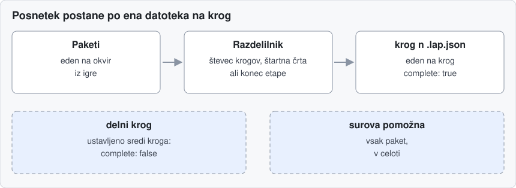

# Kako se krogi in etape razdelijo {#how-laps-and-stages-are-split}

Snemalnik vidi en neprekinjen tok vzorcev. Da ga spremeni v kroge, uporabi enega od štirih razdelilnikov, izbranega glede na to, kaj igra pove o krogih. Vsi sledijo isti zamisli: uporabi igrino lastno štetje, kjer obstaja, sicer poišči krog iz položajev; nikoli ne zapiše odseka, ki je prekratek za primerjavo.

| Razdelilnik | Koda | Uporablja |
|---|---|---|
| `LapSplitter` | [`fulllap.py`](https://github.com/Holdi601/3DHeat-GameCapture/blob/main/heat3d_capture/telemetry/fulllap.py) | Forza |
| `CounterSplitter` | [`kunos.py`](https://github.com/Holdi601/3DHeat-GameCapture/blob/main/heat3d_capture/telemetry/kunos.py) | Assetto Corsa, ACC |
| `LineSplitter` | [`kunos.py`](https://github.com/Holdi601/3DHeat-GameCapture/blob/main/heat3d_capture/telemetry/kunos.py) | AC EVO, AC Rally, BeamNG |
| `StageSplitter` | [`rally.py`](https://github.com/Holdi601/3DHeat-GameCapture/blob/main/heat3d_capture/telemetry/rally.py) | EA SPORTS WRC, DiRT Rally 2.0, DiRT Rally, DiRT 4, Richard Burns Rally |

Trackmania razdeli vožnje znotraj svojega vtičnika ([Trackmania](telemetry-trackmania.md)), datoteke iRacinga pa razdeli pregledovalnik po števcu krogov simulatorja ([iRacing](telemetry-iracing.md)).

Ob **Ctrl+C** vsak snemalnik pokliče `flush()` svojega razdelilnika, tako da se odprt krog ali etapa zapiše, če prestane iste najmanjše zahteve kot spodaj.

## LapSplitter (Forza) {#lapsplitter-forza}

Parametri: `minimum_metres = 400`, `gap_seconds = 2.0`.

Za vsak dekodiran paket:

1. Če se igrin `timestampMs` skoči naprej za več kot 2 sekundi od zadnjega paketa ali gre nazaj, se odprt krog najprej zaključi.
2. Če je `isRaceOn` 0 (igra ni v dirki), se odprt krog zaključi in paket se zavrže.
3. Če ni odprtega kroga, se odpre krog s `lapNumber` iz paketa.
4. Če se `lapNumber` razlikuje od številke odprtega kroga, se odprt krog **zaključi kot končan**; njegov `seconds` je igrin `lastLap`, kadar je pozitiven. Krog, zaključen na ta način, se zapiše ne glede na dolžino. Odpre se nov krog.
5. Paket se doda.

Snemalnik zaključi krog tudi tedaj, ko v 2 sekundah realnega časa ne pride noben paket (igra je v pavzi ali zaprta sredi kroga).

**Zaključevanje** obdrži odprt krog samo, če ima vsaj 2 vzorca in vsaj 400 m `distanceTravelled`; zapiše se kot nedokončan (`run`). Točka-do-točke dirka nikoli ne šteje drugega kroga, zato se vedno konča tako.

## CounterSplitter (AC, ACC) {#countersplitter-ac-acc}

Parameter: `minimum_metres = 300`. Vsak vzorec dobi `completedLaps` iz grafične strani in čas zadnjega kroga.

- Prvi vzorec odpre krog, oštevilčen s trenutnim `completedLaps`.
- Ko se `completedLaps` spremeni, se odprt krog zapre. Krog je **dokončan**, z `seconds = čas zadnjega kroga v ms / 1000` (če je pozitiven), samo če se je števec povečal za točno 1 – skok nazaj na 0 (ponovni zagon seje) ali več zaprtij naenkrat ga zapre kot nedokončanega.
- Zaprt krog se zapiše samo, če ima vzorce in vsaj 300 m prevožene poti.
- Zaključevanje obdrži odprt krog, če ima več kot en vzorec in vsaj 300 m.

## LineSplitter (AC EVO, AC Rally, BeamNG) {#linesplitter-ac-evo-ac-rally-beamng}

Parametri: `radius = 15 m`, `minimum_metres = 300`, `stop_seconds = 8`.

Te igre bodisi nimajo števca krogov na strani, ki jo snemalnik bere, bodisi vozijo etape. **Črta je tam, kjer se je snemanje začelo**:

1. Vodoravni položaj prvega vzorca (`x`, `z`) postane črta.
2. Ko avto prevozi več kot 5 m, smer od črte do avta postane smer kroga.
3. **Ustavitev** konča vožnjo: ko `speed` ostane pod 1 m/s 8 sekund, se odprt krog zaključi (tako se konča relijska etapa: avto se ustavi na cilju).
4. **Prečkanje črte**: po več kot 300 m vožnje se zbirajo vzorci znotraj 15 m od črte. Ko avto znova zapusti ta polmer, je najbližji zbrani vzorec prečkanje. Če je avto tam šel v isto smer kot smer kroga (skalarni produkt lokalne smeri z njo je pozitiven), se krog zapre na tem vzorcu; sicer se prehod ignorira (avto je črto prečkal v nasprotni smeri).
5. `seconds` zaključenega kroga je čas od njegovega prvega vzorca do prečkanja. Krog je **dokončan samo, če je bil njegov prvi vzorec hitrejši od 5 m/s**: krog, ki se je začel iz mirovanja, je start, ne krog, ki ga je vredno primerjati. Prvi krog posnetka, začetega na štartni mreži, je zato vedno nedokončan; snemanje, začeto med vožnjo po krogu, pa ima dokončan prvi krog ob naslednjem prečkanju.
6. Naslednji krog se začne z vzorcem prečkanja (pripada obema krogoma).

Kroge, krajše od 300 m, se zavrže. Zaključevanje (ustavitev ali Ctrl+C) obdrži odprt krog, če ima vsaj 2 vzorca in 300 m, kot nedokončanega. BeamNG se zaključuje enako, kadar se vozilo ponastavi (njegova ura se vrne nazaj), preden se začne nov razdelilnik, tako da se vožnja pred ponastavitvijo ohrani.

Razdalje so vodoravne (`x`, `z`) za števec prevožene poti in preizkus črte, za preizkus dolžine 300 m pa so 3D.

## StageSplitter (relijske igre) {#stagesplitter-rally-games}

Parameter: `minimum_metres = 300`. Vsak vzorec dobi uro etape iz igre, to, ali igra pravi, da je avto končal, in po želji igrin lastni čas zanj.

1. Če je ura 0 ali manj ali je šla nazaj za več kot 0,5 s, se odprta etapa **opusti**: ohrani se kot delna etapa, če ni končana, ima več kot 10 vzorcev in vsaj 300 m. Ura 0 ali manj tudi zavrže vzorec (avto je na startu).
2. Če ni odprte etape, se odpre nova (številčena 1, 2, ... za posnetek).
3. Ko je etapa končana, se naslednji vzorci ignorirajo, dokler ura ne gre nazaj.
4. Vsak vzorec se shrani z `time`, nastavljenim na uro etape.
5. Ko igra pravi, da je konec, je etapa dokončana; njen `seconds` je igrin čas, kadar je dan in pozitiven, sicer ura. Zapiše se, če je pokrila vsaj 300 m.

Kaj pomeni "konec" pri vsaki igri:

| Igra | Konec, ko |
|---|---|
| EA SPORTS WRC | dolžina etape > 0 in razdalja na etapi >= dolžina - 0,5 m |
| Igre DiRT | število odvoženih krogov naraste nad začetno število etape ali (dogodek z enim krogom) razdalja kroga >= 99,9 % dolžine proge |
| Richard Burns Rally | ura dirke > 0 in razdalja do cilja <= 0 |

Pri RBR se navzgor os in hitrost določita, ko se etapa zapiše (glejte [Relijske igre](telemetry-rally.md#richard-burns-rally-rsf--ngp)).

## Čas in razdalja v datoteki kroga {#time-and-distance-in-the-lap-file}

Pri vseh snemalnikih razen Forze je `time` premaknjen tako, da je prvi vzorec kroga 0, `distance` pa je kumulativna 3D razdalja med zaporednima položajema. Forza uporablja igrin lastni časovnik kroga in števec razdalje, premaknjena na enak način.
