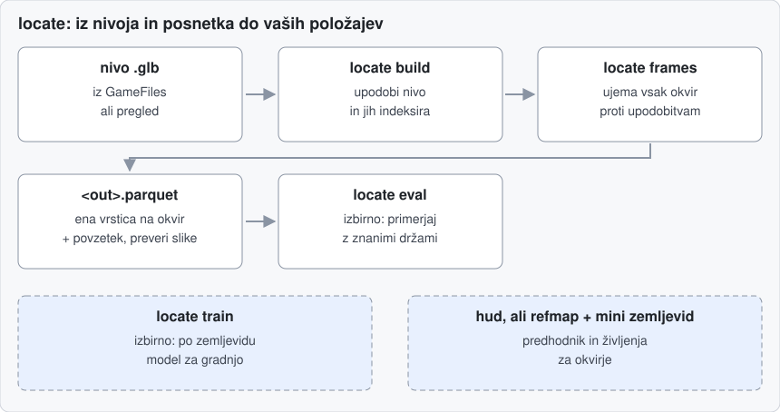

# Iskanje okvirjev v nivoju {#locating-frames-in-a-level}

`locate` ugotovi, kje je bil vsak okvir posnetka igranja - tridimenzionalni položaj kamere in smer pogleda -
tako, da ujema sliko z upodobitvami geometrije nivoja. Namenjen je igram, ki ne hranijo zapisa o tem, kje je
bil igralec: ni demo posnetka, ni datoteke ponovitve, ni telemetrije. Battlefield 6 je prvi.

> **Eksperimentalno.** Na pravih posnetkih zaenkrat postavi samo majhen delež okvirjev; glejte
> [Pravi okvirji: eksperimentalno](#real-frames-experimental).

```bash
# Enkrat na nivo: upodobi jo z vsakega mesta, kjer lahko igralec stoji, in indeksiraj upodobitve.
.venv\Scripts\python -m heat3d_capture locate build level.glb -o level.db

# Za vsak posnetek: kje je bil vzet vsak okvir?
.venv\Scripts\python -m heat3d_capture locate frames "<recording>.mp4" --db level.db -o out/match
```

Položaj pride **iz slike**, glede na celoten nivo, brez predhodnega podatka. Pot minimape iz
[bralnika HUD-a](hud-video.md) je samo rezerva za okvirje, ki jih slika ne more postaviti, in vsaka
vrstica pove, iz katerega od obeh je prišla.




## Česa se ne dotika in kaj ne spremeni {#what-it-does-and-does-not-touch}

- Bere **lastni posnetek igralca** in datoteko nivoja, ki jo je igralec izvozil iz **lastne kopije** igre. Igre,
  njenega pomnilnika, njenih datotek med delovanjem ali njenega omrežja se nikoli ne dotika, in deluje po tekmi.
  Glejte [Pravila](rules.md).
- Postavlja **samo kamero igralca**: okvir je pogled igralca.
- Nivo, baza, zgrajena iz nje, in vse, kar je upodobljeno iz nje, pripadajo založniku igre. Hrani jih lokalno.

## Zahteve {#requirements}

- Kar je navedeno v `requirements.txt`, PyTorch (s pytorch.org, za GPU) in `requirements-locate.txt`:

```bash
.venv\Scripts\python -m pip install -r requirements-locate.txt
```

- GPU z OpenGL 3.3 (4.3 je hitrejši) za upodobitve, in po možnosti CUDA za modele. Na CPE-ju deluje,
  vendar počasi.
- Modeli se pridobijo ob prvi uporabi (približno 450 MB): DINOv2 s Hugging Face, ALIKED in LightGlue prek
  kornia. Vsi so licencirani za komercialno uporabo; glejte [Licence](#licences).
- **Nivo** kot `.glb` (ali `.gltf`) v okvirju pregledovalnika, Y gor, **z njegovimi teksturami osnovne barve**,
  kakor ga zapisujejo izvozniki 3DHeat (deli `ground:` / `structure:`; imena delov niso potrebna). Ena enota je
  en meter, razen če najvišji nivo datoteke `extras.unit_metres` pravi drugače. Skener GameCapture
  (`reconstruct`, okno za pregled) se zapiše v **centimetrih** in nosi `extras.unit_metres: 0.01`, zato se
  prebere v pravi velikosti. Nivo brez tekstur dela veliko slabše; glejte [Omejitve](#limits).

## Ukazi {#commands}

### `locate build <level> -o <db>` {#locate-build---o-}

Upodobi nivo z vsakega mesta, kjer bi lahko igralec stal, in za vsako upodobitev shrani njen položaj in en
globalni deskriptor.

| Možnost | Privzeto | Pomen |
|---|---|---|
| `level` | | `.glb` / `.gltf` nivoja. |
| `-o`, `--out` | | Mapa baze, ki se zapiše. |
| `--game` | `bf6` | Profil igre: višine oči, vidno polje, škatle HUD-a, hitrost (spodaj). `generic` za katerokoli igro iz prve osebe. |
| `--eye` | profilov | Višine oči nad tlemi v metrih, najprej stoje. En pogled baze na vsako višino. |
| `--fov` / `--vfov` | profilov | Vodoravno vidno polje posnetka ali navpično (Battlefieldov drsnik) za posnetek 16:9. |
| `--spacing` | 2,5 | Metri med mesti, s katerih so vzeti pogledi. |
| `--yaw-step` | 30 | Stopinje med smermi pogledov. |
| `--pitch` | 0 | Nagibi, pri katerih se upodablja, v stopinjah navzgor. |
| `--positions` | nič | Tabela (Parquet ali CSV z `x`, `y`, `z` pri stopalih, v okvirju nivoja), iz katere se vzamejo mesta namesto vsakih tal: na primer izhod prejšnjega teka. |
| `--shadows` | izključeno | Upodobi sončne sence v upodobitvah (sonce nivoja, če njegova datoteka to navaja v `extras.sun`). |
| `--untextured` | izključeno | Upodobi samo obliko in svetlobo. |
| `--box X0 Z0 X1 Z1` | cela datoteka | Samo mesta znotraj te škatle (enote nivoja): igralno območje. |
| `--places` | `auto` | Od kod so vzeti pogledi: `nav` - igralci na višini oči nad navigacijsko mrežo nivoja (deli `nav:`: natanko kjer igra dovoli hoditi), kamere vozil na njihovi višini nad deli `ground:` (teren in ceste) znotraj 50 m od nje; `ground` - oboji nad `ground:`; `floors` - nad vsako zgornjo ploskvijo (tudi strehe in zaboji); `auto` - `nav`, če ima nivo navigacijsko mrežo, sicer `floors`. |
| `--head` | nič | Glava za vsak zemljevid iz `locate train` za deskriptorje. |

Zapiše `<db>/db.json` (iz česa in s čim je bila zgrajena) in `<db>/views.npz` (položaji, deskriptorji).

### `locate frames <recording> --db <db>` {#locate-frames----db-}

| Možnost | Privzeto | Pomen |
|---|---|---|
| `source` | | Video, slika ali mapa slik (vzete po imenu, `--fps` narazen). |
| `--db` | | Baza, ki jo je zapisal `build`. Njena datoteka nivoja mora biti še na istem mestu (ali `--level`). |
| `-o`, `--out` | `<source>.locate` | Pot izhoda brez pripone. |
| `--fps` | 2 | Koliko okvirjev na sekundo videa se locira. |
| `--start`, `--seconds` | vse | Del videa, ki se bere. |
| `--width` | 1280 | Širina, pri kateri se okvirji ujemajo. |
| `--shortlist` | 8 | Pogledi baze, preizkušeni na okvir blizu predhodnega podatka ali popravka. |
| `--search-shortlist` | 16 | Brez predhodnega podatka: pogledi baze, preizkušeni na okvir ([iskani skupaj](#with-no-prior-frames-searched-together)). |
| `--no-search` | izključeno | Brez predhodnega podatka: vsak okvir išči sam in verjemi njegovemu popravku brez sosedov. |
| `--accept-depth` | 0 (izklopljeno) | Brez predhodnega podatka: verjemi popravku samo, če je daljna razdalja njegovih ujemanj tolikokratnik njihove bližnje. |
| `--accept-support` | 2 | Brez predhodnega podatka: toliko sosedov vzdolž življenja, ki se strinjajo, da popravku verjamemo. |
| `--checkpoint` | nič | Hrani stanje teka tukaj in nadaljuje od tam, če je tam. |
| `--stop-file`, `--stop-process` | nič | Ustavi se sam, stanje shranjeno, izhodna koda 75, ko ta datoteka obstaja ali teče proces, katerega ime se začne s tem (preveri se pred vsakim okvirjem; lahko se ponovi), da dolg tek sprosti stroj za igro. Isti ukaz nadaljuje. |
| `--normalise` | nič | Lahka normalizacija pred ujemanjem: `clahe`, `gray`. |
| `--minimap` | nič | Tabela ukaza `hud`: **rezerva** za okvirje, ki jih slika ne more postaviti. |
| `--prior-radius` | nič | **Neobvezen pospešek**, privzeto izklopljen: išči samo poglede baze, oddaljene toliko metrov od položaja minimape (potrebuje `--minimap`). |
| `--minimap-anchor` | nič | JSON datoteka, ki veže minimapo na nivo ([minimapa kot predhodni podatek za iskanje](#the-minimap-as-a-search-prior)): minimapa prireže iskanje od prvega okvirja; tako najdeni popravki so `visual+minimap-prior`. |
| `--no-level-search` | izključeno | S predhodnim podatkom: ko nič blizu ne ustreza, ne išči še po celem nivoju (hitreje). |
| `--lives` | tabela `--minimap` | Tabela ukaza `hud`, katere smrti, namestitve in oživitve povedo, kdaj je bil igralec v igri: položaji skočijo samo čez smrt ([življenja iz posnetka](#lives-from-the-footage)). |
| `--no-sequence` | izključeno | Vsak okvir odloči sam, ne vzdolž teka (spodaj). |
| `--fit-fov` | izključeno | Po teku prilagodi vidno polje najmočnejšim popravkom, po pogledu, in ga izpiše. |
| `--check-every` | 0 | Tudi vsakih N okvirjev, postavljenih ali ne, slika v `<out>.check`. |
| `--no-checks` | izključeno | Ne zapiši slik preverjanja vidnih popravkov (spodaj). |
| `--no-zoomed` | izključeno | Ne rešuj povečanih pogledov iz popravkov njihovih sosedov (spodaj). |
| `--no-grow` | izključeno | Ne išči znova blizu vsakega popravka za okvirje okoli njega, ki še nimajo popravka. |
| `--game`, `--eye`, `--fov`, `--vfov`, `--mask`, `--no-hud-mask`, `--max-speed` | profilov | Kakor zgoraj; `--mask x,y,w,h` doda okno zaslona (na zaslonu 1920x1080), ki ni nivo. |
| `--vehicle-vfov` | profilov | Navpično vidno polje kamer vozil (drsnik vozil Battlefielda). |
| `--settings` | najnovejša datoteka nastavitev | `bf6`: datoteka nastavitev igre, iz katere se berejo vidna polja (samo za branje), kadar ni dan `--fov`/`--vfov`; privzeto najnovejši `PROFSAVE*_profile` pod `Documents/Battlefield 6/settings`. Vsebuje nastavitve, kakršne so zdaj, kar morda ni tako, kot je bil narejen starejši posnetek. |

### `locate refmap <level> <deploy screen> -o <refmap>` {#locate-refmap----o-}

Postavi igrin lastni zemljevid na nivo: referenco, glede na katero se prebere minimapa
([minimapa, prebrana glede na nivo](#the-minimap-read-against-the-level)). `<deploy screen>` je
slika zaslona namestitve, ki kaže cel zemljevid, ali posnetek z `--at <seconds>` v takem trenutku; izreže
se škatla zemljevida profila (`--whole-picture` ohrani vse). Zapiše `<refmap>.png` (zemljevid, ponovno vzorčen
na okvir nivoja, `--mpp` metrov na piksel, privzeto 0,5), `<refmap>.valid.png` (kjer je zemljevid, ne oznaka ali
napis) in `<refmap>.json` (okvir in kalibracija, z oddaljenostjo ploščic zemljevida od njega). `--topdown <prefix>`
ohrani nivo, upodobljeno od zgoraj, za naslednji zagon (`--topdown-mpp`, privzeto 0,656 m; `--box` jo omeji).

### `locate minimap <recording> --refmap <refmap> -o <table>.parquet` {#locate-minimap----refmap---o-parquet}

Prebere minimapo posnetka glede na referenčni zemljevid, okvir za okvirjem (`--fps`, privzeto 2): položaj,
smer in zoom vsake minimape, ki se ujema, v okvirju nivoja, zapisano kot tabela minimape s sidrom poleg
(`<table>.anchor.json`), ki ga `locate frames` prevzame kot `--minimap <table>.parquet --minimap-anchor <table>.anchor.json`.
S tabelo ukaza `hud` (`--hud`) se prenesejo njena življenja; s sidrom za to tabelo tudi (`--hud-anchor`) je prvo
iskanje okoli tam, kjer postavi igralca, in kjer se nobena minimapa ne ujema, se zapolni z lastno potjo HUD-a,
premaknjeno na najbližje popravke referenčnega zemljevida (`--hud-fill`, sekunde, privzeto 120; 0 to izklopi).
Vir tabele pove, kateri (`refmap`, `hud`).

### `locate eval <out>.parquet --truth <poses>` {#locate-eval-parquet---truth-}

Primerja rezultat z znanimi pozami kamere: tabela `time`, `x`, `y`, `z` (oko), `yaw`, `pitch` v okvirju nivoja.
`--offset` je zamik ure (čas resnice = čas videa + zamik); brez njega se zamik išče. `--unit-metres` pretvori
napake v metre.

## Profili igre {#game-profiles}

| | `bf6` | `generic` |
|---|---|---|
| Višine oči | 1,6 m stoje, 1,05 m počepnjeno (še ni izmerjeno v igri) | 1,65, 1,1 m |
| Vidno polje | 55 stopinj navpično, okoli 86 vodoravno pri 16:9: **podaj igralčevo lastno** z `--vfov` | 90 vodoravno |
| Skrit HUD | minimapa in seznam ekipe, seznam ubojev, kompas, strelivo, igralčevo orožje, pojavna okna, tarča | tarča |
| Najhitrejši peš | 8 m/s | 8 m/s |
| Pogledi, ločeni med seboj | peš, vozilo, povečano (spodaj) | vsak okvir peš |
| Kamere vozil | drsnik vozil (iz datoteke nastavitev), vozilo skrito, kamera do 8 m nad tlemi, 30 m/s | - |

Vidno polje je najpomembnejše: okvir, rešen z napačnim, je rešen z napačno goriščno razdaljo, in njegov položaj
drsi vzdolž pogleda.

## Izhodi {#outputs}

### `<out>.parquet` {#parquet}

Ena vrstica za vsak lociran okvir, v **okvirju nivoja** (Y gor, enote nivoja), z bralnimi navodili pregledovalnika
v nogi (`kind: heat3d-locate`). Noga našteje vsak stolpec, ki nima lastne vloge, kot dodatek, zato ga
pregledovalnik ohrani (njegova kartica za pregled ga prikaže).

| Stolpec | Pomen |
|---|---|
| `time` | Sekunde od začetka videa. |
| `event` | `start` na prvi vrstici življenja, `position` na ostalih. |
| `x`, `y`, `z` | Oko, zglajeno znotraj življenja. Prazno tam, kjer okvira ni postavil noben vir. |
| `yaw`, `pitch` | Stopinje: yaw okoli osi navzgor (0 vzdolž +X, narašča proti -Z, kar je igrin lastni yaw v okvirju pregledovalnika), pitch navzgor od vodoravne. `pitch` je prazen pri vrsticah minimape. |
| `dir_x`, `dir_y`, `dir_z` | Smer pogleda. |
| `player`, `team`, `session` | `me`, `own` in `<video>#NN`, po ena za vsako življenje. |
| `life` | Življenje, v katerem je posnetek prikazal okvir (iz smrti HUD-a; 1 = prvo). Prazno, kadar je igralec izven igre (mrtev, na tleh, v namestitvi) ali kadar življenja niso bila prebrana. `session` je življenje poti, ki se lahko tudi razdeli pri skoku. |
| `source` | `visual` (iz slike), `visual+minimap-prior` (iz slike, iskanje prirezano na predhodni podatek minimape), `minimap` (rezerva), `minimap+nav-floor` (v zaprtem prostoru: minimapa in tla navigacijske mreže) ali `none`. |
| `view` | `foot`, `vehicle`, `zoomed` ali `screen` (spodaj). |
| `cam_x`, `cam_y`, `cam_z` | Kamera, ki je videla okvir. Peš in skozi tarčo je to oko, in `x`, `y`, `z` sta enaka; v tretjeosebnem pogledu vozila so `x`, `y`, `z` vozilo (model odmika spodaj), kamera pa jezdi zadaj in zgoraj. |
| `hfov`, `zoom` | Vodoravno vidno polje, s katerim je bil okvir rešen, in za povečan pogled njegov zoom glede na običajen pogled. |
| `confidence` | 0..1: kako zaupati vrstici (spodaj). |
| `uncertainty` | Tipična napaka vrstice, enote nivoja: za vizualni popravek iz njegovih notranjih točk in sosedov, za vrstico minimape iz prilagoditve (spodaj). |
| `inliers`, `rmse` | Notranje točke vizualne rešitve PnP in ponovitvena napaka (piksli pri delovni širini). |
| `x_raw` ... `pitch_raw` | Vizualna rešitev pred zglajenjem (tudi za izločene odmetnike, ki so bili izglasovani). |
| `kept` | Vizualni popravek je preživel glasovanje o odmetnikih. |
| `note` | Zakaj okvir ni bil postavljen ali je bil izglasovan. |

### `<out>.summary.json` {#summaryjson}

Okvirji, vizualni popravki, odmetniki, življenja, vrstice na vir, prilagoditev minimape (pari, notranje točke,
ostanek), čas na okvir.

## Metoda {#method}

### Baza {#the-database}

Mesta so točke na vsakem trikotniku, obrnjenem navzgor, enakomerno razporejene (ena na `--spacing` na
3D mreži, tako da vsako nadstropje stavbe dobi svoje). Vsako se iz očesa preveri s šestimi majhnimi
globinskimi upodobitvami: kamera znotraj geometrije vidi večinoma zadnje ploskve, plazilni prostor ima nekaj
trdnega nad očesom; oboji se izpustita. Iz vsakega mesta se nivo upodobi na vsaki višini oči, vsakih
`--yaw-step` in vsakih `--pitch`, in vsako upodobitev opiše **DINOv2** (njeni tokeni zaplat združeni z
generalizirano srednjo vrednostjo, pridruženi razredni token).

Lokalne značilnice in 3D točke, s katerimi se okvir končno reši, se **ne hranijo**: ponovno se ustvarijo, kadar
je treba, z upodobitvijo peščice pogledov, ki jih je izbral iskalnik, kar traja milisekunde. Zato baza ostane
pri nekaj sto megabajtih in ne desetih gigabajtih, kar omogoča spodnjo izboljšavo. Cena je, da `frames`
potrebuje datoteko nivoja in GPU, ne samo baze.

### En okvir {#one-frame}

1. **Maska** prekrije, kar ni nivo: škatle HUD-a profila in tarčo, plus vse `--mask`.
2. **Iskanje** po **celotnem nivoju**: deskriptor okvirja proti vsakemu pogledu baze; najbolj podobnih nekaj deset,
   preredčenih, da hranijo različna mesta in smeri, je krajši seznam.
3. **Ujemanje**: vsak pogled na krajšem seznamu se ponovno upodobi pri velikosti in vidnem polju okvirja, z
   globino. Ključne točke ALIKED okvirja in upodobitve se ujemajo z LightGlue. Upodobljena točka nivoja s
   svojo globino je 3D točka nivoja, zato je vsako ujemanje korespondenca 2D-3D; ključne točke na robu globine
   (katere globina lahko pripada temu, kar je za njimi) se izpustijo.
4. **Poza**: PnP z RANSAC (SQPnP), nato robustno izboljšanje, ki ohrani kamero vodoravno - pogled iz prvega
   očesa se ne zvrne - in zmanjša ponovitveno napako notranjih točk.
5. **Je mogoče?** Poza mora biti na višini oči igralca nad tlemi in zunaj geometrije (globinska upodobitev
   naravnost navzdol). Podobna tekstura drugje - tlakovano tla, ujeta na steno iste snovi - lahko da na
   stotine notranjih točk v pozi, ki je noben igralec ne more zavzeti; te se odložijo, ne glede na to, koliko
   notranjih točk imajo.
6. **Upodobitev in primerjava**: nivo se upodobi v rešeni pozi in ponovno ujame, kar nadomesti pogled baze, oddaljen
   nekaj metrov in desetin stopinj, s takim, ki se skoraj ujema z okvirjem. Ponavlja se, dokler pridobiva notranje
   točke (največ dvakrat).
7. **Izbiranje**: najmočnejša tri mesta (več kot približno 3 m narazen) se vsako posebej izboljša, preden se izbere
   eno. Podobnež lahko vodi pred izboljšavo; pravo mesto pridobi veliko več iz tega.
8. **Odločitev**: `confidence` združi število notranjih točk, najboljše drugo mesto (`runner_up`) in ponovitveno
   napako. Popravek je `ok` z vsaj 25 notranjimi točkami, brez drugega mesta znotraj 80 % njegovih notranjih točk
   in zaupanjem vsaj 0,85 - prag, ki ga meritve spodaj postavijo na 97,5-99 % pravilnosti.

### Pogledi {#views}

Okvir ni vedno igralčevo oko. Prepoznavalnik profila iz HUD-a prebere, kateri pogled je, in okvir se reši ustrezno:

- **Peš**: vidno polje pehote in višine oči.
- **Vozilo** (Battlefield 6: tipke sedežnega diagrama, `C CAMERA` in `E EXIT`, na sredini spodaj): vidno polje
  vozila, samo vozilo skrito (spodnja srednja stran zaslona v tretjeosebnem pogledu) in kamera do 8 m nad tlemi.
  Popravek je kamere.
- **Zaslon** (temni robovi okoli temne sredine: zemljevid namestitve, meni, tabela rezultatov): ni pogled na nivo;
  preskoči se.
- **Povečano** (ogled, strelski nišan, lasten pogled vozila iz prvega očesa: en rob zaslona črn, oba temna, okoli
  svetle slike): ne išče se po nivoju - delček nivoja skozi ogled ne ustreza nobenemu širokemu pogledu baze - ampak
  se po teku reši iz najbližjega popravka v 6 s, spodaj. Izklopi z `--no-zoomed`.

### Povečani pogledi {#zoomed-views}

Ozek pogled slabo pritrdi položaj: korak nazaj z malo več zoomom izgleda skoraj enako. Zato se povečan okvir začne
tam, kjer njegov sosed pravi, da je nišan - peš oko tega popravka, v vozilu 2,5 m nad tlemi pod sredino vozila (nišan
stolpa) - in kako daleč se je morda premaknil od tam: 2 m, plus 4 m na sekundo peš ali 8 v vozilu, največ 12 m (`reach`).

1. **Smer in zoom, položaj zadržan.** Za vsak zoom 1, 1,2 (lasten pogled vozila, ožji kot peš), 1,5, 2, 3, 4, 6 in 8 se
   nivo upodobi na sedežu v smereh znotraj 30 stopinj od soseda (in, od 3x naprej, nekaj nagibov). Ključne točke
   okvirja, ujete na upodobitev, z ravnimi točkami pod njimi, so žarki iz sedeža; rotacija se prilagodi nanje po dva
   naenkrat (RANSAC) za goriščne razdalje od 0,75 do 1,3 krat tiste za ta zoom, točka se sklada v kotu, ki dopušča, da
   je sedež `reach` narazen na svoji razdalji. Zoom, smer in goriščna razdalja, s katerimi se največ točk strinja, zmagajo.
2. **Urejeno.** Te točke nato skupaj prilagodijo položaj, smer in goriščno razdaljo z njihovo ponovitveno napako, položaj
   je držan na sedežu s kaznijo dveh pikslov na `reach` premaknjeno; še enkrat upodobljeno v odgovoru in ponovno prilagojeno.
   Notranje točke in napaka se štejejo v pikslih, popravek je `ok` po istem zaupanju kakor kateri koli drug.

Zapisani zoom (`zoom`) je glede na vidno polje okvirja peš; `hfov` je rešeno. V vozilu je zapisan položaj vozila,
2,5 m pod nišanom, kakor za njegov tretjeosebni pogled.

### Vozila: kamera in vozilo {#vehicles-the-camera-and-the-vehicle}

V tretjeosebnem pogledu vozila je rešena poza kamere z zasledovanjem, ki jezdi zadaj in zgoraj za vozilom in se ob
ogledovanju okoli njega zasuče. Zapisani položaj (`x`, `y`, `z`) je položaj vozila - tla pod njegovo sredino: kamera
plus profilov `vehicle_offset`, toliko metrov naprej vzdolž vodoravne smeri pogleda kamere in toliko navzdol. Kamera
ostane v `cam_x`, `cam_y`, `cam_z`. Pretvorba se izvede pred zaporedjem in potjo, da kamera, ki se vrti okoli stoječega
vozila, ni vzeta za gibanje. Noga tabele nosi uporabljen odmik in to, ali je bil izmerjen (`vehicleOffset`). Peš in
skozi nišan odmika ni.

Kako je bil odmik Battlefield 6 izmerjen: na pravih popravkih tretjeosebnih okvirjev tanka je bila sredina tanka
označena na očesu na okvirju, nivo, upodobljena na popravku, pa je dala tla pri tem pikslu. Profil vzame mediano: približno
10 m naprej od kamere in približno 4 m pod njo. Oznaka je dobra za meter ali tako, in gre za en tip vozila: avto ali
helikopter jezdi s svojo kamero drugače.

### Brez predhodnega podatka: okvirji iskani skupaj {#with-no-prior-frames-searched-together}

Globalni deskriptor enega okvirja proti celemu nivoju je šibek signal, in notranje točke enega okvirja ne razlikujejo
pravega mesta od podobneža. Zato se okvirji posnetka najprej opišejo in iščejo skupaj (`search.py`), popravek pa se verjame
samo z okvirji okoli njega:

- **Krajši seznam.** Podobnosti vsakega pogleda se merijo glede na njegovo lastno srednjo vrednost in razpon čez posnetek, da
  pogled, ki je podoben vsem okvirjem, neha zmagovati povsod. Vsak okvir oceni celice mreže 24 m z rangom njihovega najboljšega
  pogleda; najboljša pot skozi celice vzdolž vsakega življenja, znotraj tega, kar lahko igralec pokrije med okvirji, da
  verjetje vsaki celici, in najboljši pogled vsake celice, najbolj verjetnega najprej, je en seznam. Običajno iskanje je drugi,
  in oba se jemljeta izmenoma: merjenje pogledov glede na posnetek kaznuje mesto, ki ga igralec komaj zapusti, tam pa običajno
  iskanje dobro deluje.
- **Verjetje.** Kandidat šteje samo, če njegove notranje točke pokrivajo vsaj 12 % mreže 8 x 8 čez okvir: podobnež je
  ponavljajoči se predmet, kup zabojnikov, s stotinami notranjih točk na nekaj celicah okvirja. Popravek se verjame, kadar
  leži na najboljši poti skozi štetje kandidatov (spodaj) z vsaj dvema sosedoma v 6 s, ki se z njim strinjata. Okvir izven
  igre se sploh ne išče.
- **Rast.** Raste se samo iz tistega, kar je verjeto, in rasteč popravek mora pokriti okvir na enak način.

### Vzdolž teka {#along-the-run}

Vsak okvir ohrani vsako fizično možno pozo, ki jo najde, po eno na mesto (`candidates`), ne samo najmočnejše. Tek nato
izbere enega na okvir - ali nobenega - tako, da izbrane poze tvorijo pot, po kateri bi igralec lahko hodil ali vozil, in
da na njej leži čim več notranjih točk: skrit Markovov model, dekodiran naenkrat (Viterbi). Podobnež, ki zmaga za en okvir
sam, izgubi proti mestu, s katerim se strinjajo sosedi; šibek kandidat, skozi katerega teče pot, z vsaj dvema sosedoma, ki se
strinjata, postane popravek (`note`: izbrano vzdolž zaporedja); zaupanja vreden popravek, ki mu vsi sosedi nasprotujejo, neha
biti popravek. Sosed se šteje za strinjajočega se samo v 6 s: dlje narazen je razdalja, ki bi jo igralec - kaj šele vozilo -
lahko prevozil, tako velika, da strinjanje ne pove nič. Izklopi z `--no-sequence`.

### Časi okvirjev {#frame-times}

Čas vrstice `time` je lastna časovna oznaka okvirja v posnetku, ne njegovo štetje glede na nominalno hitrost okvirjev. Posnetki
se odmikajo od nominalne hitrosti (za nekaj desetink sekunde znotraj posnetka, na tistih, ki so bili izmerjeni), vse, kar bere okvir
nazaj po njegovem času - slike preverjanja, povečani prehod, `locate train --real`, minimapa iz ukaza `hud` - se pomakne po časovni
oznaki. Šteti okvirji bi slike preverjanja premaknili za toliko stran od okvirja, ki je bil lociran.

### Vidno polje, iz okvirjev {#the-field-of-view-from-the-frames}

`--fit-fov` obdrži najmočnejše popravke teka (po pogledu) in za vsakega skupaj izboljša njegovo pozo in goriščno razdaljo na njegovih
notranjih točkah; mediana čez njih je vidno polje, s katerim je bil posnetek narejen, izpisana v povzetku (`hfov_fitted`) za naslednji
`--fov`. Bližnje in daljne točke se pod spremembo goriščne razdalje premaknejo drugače kot pod spremembo položaja, kar ju določi; potrebuje
popravke z globino, ne ravne stene.

### Model za posamezni zemljevid {#a-per-map-model}

`locate train` nauči majhno glavo na vrhu DINOv2 za en nivo, na upodobitvah tega nivoja, tako da globalni deskriptor najde prave
poglede pravih okvirjev, ne samo upodobitev:

- **Glava**: vsak tokenski zaplat skozi dvoslojno projekcijo, združen z generalizirano srednjo vrednostjo čez zaplate, ki kažejo nivo,
  pridružen projiciranemu razrednemu tokenu. DINOv2 ostane zamrznjen. Vse to je tu zapisano (MIT).
- **Pari**: mesto na hoji po tleh in smer, upodobljena dvakrat iz pozicij do enega ali dveh metrov in dobrih deset stopinj narazen,
  pri vidnih poljih do 10 stopinj narazen, pod različno svetlobo (sonce, sence, ambient), vsaka skozi igri podoben videz: barvna
  stopnja, megla glede na globino, cvetenje, vinjeta, dim, ljudje na poti, lastno vozilo igralca v pogledih vozil, zamegljenost gibanja,
  šum, JPEG (`augment.py`). Maskirano kot okvir. Mesta v nekaj metrih, obrnjena v isto smer, se ne štejejo za negativne.
- **Pravi okvirji**: okvirji s pozo, ki jo je našel sam cevovod (psevdooznake: popravki, izbrani vzdolž zaporedja), se lahko
  pridružijo kot pari - okvir in upodobitev na njegovi pozi - v drugem krogu.
- **Izguba**: kontrastna (InfoNCE) čez serijo.

`locate build --head <head.pt>` zgradi bazo z njo; `frames` jo nato uporabi za okvirje.

| Možnost `locate train` | Privzeto | Pomen |
|---|---|---|
| `-o`, `--out` | obvezno | Datoteka glave, ki se zapiše (`.pt`). |
| `--steps` | 600 | Koraki učenja. |
| `--real TABLE VIDEO` | nič | Tabela `locate frames` in njen posnetek: njeni zaupanja vredni popravki se pridružijo kot pravi pari. Lahko se ponovi. |
| `--real-confidence` | 0,85 | Zaupanje, ki ga popravek potrebuje, da se pridruži kot pravi par. |
| `--spacing`, `--box`, `--places` in možnosti profila | kakor pri `build` | Kje so mesta za učenje, in profil igre. |

### Preverjanje z očmi {#checking-by-eye}

Vsak vizualni popravek dobi sliko v `<out>.check` - `<time>s_<view>_visual.jpg`: okvir, in poleg njega nivo, upodobljen
s kamero popravka, z robovi okvirja narisanimi čez upodobitev. Kjer se poravnajo, je popravek pravilen. Zapiše se po tem, ko sta
zaporedje in pot odločila, zato so slike točno vrstice, ki jih tabela imenuje vizualne. Izklopi z `--no-checks`.

### Minimapa, prebrana glede na nivo {#the-minimap-read-against-the-level}

Minimapa, zlepljena v en mozaik (iz ukaza `hud`), ni ravna: njeno merilo se odmika z zoomom, pri katerem je bila vsaka minimapa
registrirana, mesto, videno dvakrat, je lahko narisano dvakrat, in mozaik vsakega posnetka je svoj. Podobnost, prilagojena nekaj
popravkom, zato drži blizu njih in je na desetine metrov narazen stran od njih. Zato nivo sam postavi minimapo, v dveh korakih,
in nič se ne zlepi:

- **Referenčni zemljevid** (`locate refmap`). Zaslon namestitve riše celoten zemljevid obrnjen na sever, ravno, pri enem merilu.
  Nivo, upodobljen naravnost od zgoraj, kaže iste stvari, ki stojijo pokonci nad tlemi (tanki, stavbe, zidovi): na nivoju njihova
  višina nad tlemi 15 m naokoli; na zemljevidu, kar je narisano svetlejše od okoliških tal. Zemljevid se položi na nivo z normirano
  križno korelacijo obeh čez merilo in majhen zasuk, izboljša z ujemanjem ploščic zemljevida eno za drugo in nazadnje z vsem zemljevidom
  naenkrat okoli tega odgovora (nekaj deset ploščic pusti merilo rahlo, za odstotek, metre na robovih zemljevida). Rezultat je ena
  podobnost, piksel zemljevida v nivo.
- **Minimapa, okvir za okvirjem** (`locate minimap`). Vsaka vzorčena minimapa - izrez bralnika HUD-a in njegova maska prekritja - se
  ujema (SIFT) z referenčnim zemljevidom okoli mesta, kjer je bil igralec nazadnje, ali kjerkoli, če ni znano nikjer, in prilagodi se
  podobnost (zasuk, zoom, premik). Igralčeva točka, prenesena skozi njo, je položaj, navzgor obrnjena minimapa (stožec pogleda) smer,
  njeno merilo zoom - izmerjeno, ne predpostavljeno.
- **Kjer se ne ujema.** Zaslon namestitve ne riše ničesar zunaj igralnega območja; minimapa, ki kaže predvsem tisto, kar leži zunaj
  njega - igralec na robu zemljevida - nima ničesar, s čimer bi se ujemala. Tam nadomesti pot HUD-a, premaknjena za odmik, ki ga izmerijo
  najbližji popravki referenčnega zemljevida (`--hud-fill`); je tako dobra, kot je mozaik blizu teh popravkov.

Na preizkusnem nivoju je bila minimapa, prebrana tako, nekaj metrov (mediana) od zaupanja vrednih vizualnih popravkov, enako dobra zunaj
območja, na katerega je bil prilagojen referenčni zemljevid, kot znotraj njega.

### Minimapa kot predhodni podatek za iskanje {#the-minimap-as-a-search-prior}

Pot minimape iz ukaza `hud` pove za večino okvirjev igre približno, kje je igralec in v katero smer gleda - v svojih enotah (pikslih
minimape, sever gor). Enkrat povezana z nivojem zoži iskanje na majhen del nje; sama poza še vedno pride iz slike, po istih pravilih.

- **Sidro** (`--minimap-anchor <anchor.json>`): ena podobnost na zemljevid, minimapa v nivo - merilo, zasuk (z zrcalom med sever-gor
  pikslmi in osmi nivoja), premik - prilagojena na zaupanja vrednih vizualnih popravkih (zaupanje 0,7 in več) več posnetkov. Minimapa vsakega
  posnetka je mozaik, ki ga je bralnik HUD-a zlepil sam, zato vsak sedi nekje drugje v enotah minimape; dva mozaika istega zemljevida se
  razlikujeta samo za premik, ki ga najdemo z ujemanjem ključnih točk med njima (premik, ki se ga največ ujemov strinja), in vsak mozaik je
  vezan na eno referenco prek vseh parov, ki se dobro ujemajo. Datoteka sidra nosi podobnost zemljevida, premik posnetka (`clip_shift`) in
  napako, ki jo je sidro pokazalo proti popravkom posnetkov, izpuščenih iz njegove prilagoditve (`median`, `p90`, metri).
- **Kje in v katero smer.** Smer minimape je yaw kamere: na izmerjenih posnetkih se je z rešenim yawom ujemala v 2-5 stopinjah. Zato
  se okvir najprej ujema z upodobitvami, narejenimi tam, kjer minimapa postavi kamero - peš oko nad tlemi tam, v vozilu kamera z zasledovanjem
  zadaj in zgoraj (odmik vozila) - ki gleda v smer: točka in 4 m na vsako stran, pri dveh nagibih (`seeds`). Šele kadar nobena od teh ne da
  popravka, se poskusijo lastni pogledi baze znotraj kroga (30 m plus 90-percentilna napaka sidra).
- **Popravljeno med tekom.** Vsak zaupanja vreden popravek blizu predhodnega podatka pove, kako daleč je sidro tam; mediana tistih v 2 minutah
  popravi predhodni podatek, njihov raztros (vsaj 5 m) pa nadomesti napako sidra v polmeru kroga - največ 10 m: popravki, ki se bolj razlikujejo,
  pravijo, da je minimapa zgrešila mesto, ne da bi bilo karkoli 50 m stran dobro. Brez popravka v 2 minutah se predhodni podatek sploh ne popravi
  (napaka drugje v posnetku tukaj ne pove ničesar).
- **Sidra z mrežo.** Sidro lahko nosi tudi `grid`: x in z nivoja na pravilni mreži čez enote minimape posnetka, branje bilinearno; znotraj nje mreža
  postavi točko, zunaj nje podobnost. Sidro tabele `locate minimap` je identiteta (njena tabela je že v okvirju nivoja).
- **Šibka ujemanja.** S predhodnim podatkom se ujemanje, ki je šibko (25 notranjih točk ali več, a ne dovolj zaupanja samo po sebi) in leži
  v krogu, ohrani - z nižjim zaupanjem - za zaporedje in pot, da presodita, ne da bi se zavrglo: dim, ruševine in uničene stene pravim okvirjem
  pustijo manj ujemov.
- **Viri.** `visual` - slika ga je postavila, brez predhodnega podatka; `visual+minimap-prior` - slika ga je postavila, iskanje prirezano na predhodni
  podatek; `minimap` - slika ga ni, minimapa stoji namesto nje; `minimap+nav-floor` - v zaprtem prostoru, spodaj.
- **V zaprtih prostorih** vodi minimapa. Okvir, ki ga slika ni postavila, peš, kjer oko na položaju minimape vidi nivo zelo blizu z vseh strani
  (mediana razdalje pod 8 m v štirih smereh) in brez neba, je v zaprtem prostoru: dobi x in z minimape ter višino tal navigacijske mreže tam -
  od več nadstropij tisto, ki je najbližje zadnjemu popravku - z `source = minimap+nav-floor`, da je jasno, da slika ni popravila položaja.

### Življenja iz posnetka {#lives-from-the-footage}

Položaj lahko skoči samo tam, kjer je igralec umrl. Življenja se ne ugibajo iz položajev - en napačen popravek bi odprl novo -
ampak se berejo iz posnetka: tabela bralnika HUD-a zapiše smrti, ki so jih pokazali zasloni padca in namestitve (`death`), padce, ki jih je
soigralec oživil (`downed`, `revived`), namestitve (`spawn`) in kje sta se igra začela in ustavila (`start`, `end`); `lives.py` iz tega naredi
življenja. Smrt zapre življenje, prvi okvir igre po zaslonu namestitve odpre naslednje; oživitev ga ne prereže (igralec je tam, kjer je padel),
okvirji medtem ko je na tleh pa se ne postavijo; odmor menijev ali nalaganja, daljši od 10 s, ga prav tako prereže. Okvirji izven igre
(mrtev, v namestitvi, na tleh) se nikoli ne postavijo.

Znotraj življenja je zveznost pravilo: vsak korak največ hitrost krat čas med njima plus 1,5 m. Hitrost je hitrost okvirja: peš profilova,
v vozilu hitrost, ki jo je pokazal lastni prikaz vozila v 3 s (tretjina več in 2 m/s za pospeševanje), ali, kjer je ne pokaže, razredna meja.
Vzdolž teka (Viterbi) je korak čez smrt brezplačen na katerikoli razdalji, vsak drug korak omejen; okvir, ki bi zahteval skok, je izpuščen - šibkejša
stran protislovja izgubi (manj notranjih točk, manj podpore) - in življenje se na njem nikoli ne razdeli. Kjer je izpuščena stran sama močna (zaupanje 0,9
in več, dva ali več popravkov se strinja med seboj), teh ne ugiba: obe strani se ohranita in označita `jump without detected death` (zgrešena smrt ali pravi
teleport), in navedeta se v povzetku. Rezervna pot minimape sledi istim življenjem.

Battlefield 6: prvoosebni pogled tankov kaže hitrost (`<n> KPH`, desno od nišana; prebrano z OCR bralnika HUD-a); tretjeosebni pogled ne. Odčitki na
preizkusnih posnetkih so bili počasni, zato so kopenska vozila dovoljena 15 m/s tam, kjer ni nič prebrano. Čolni, helikopterji in letala dobijo velikodušne
meje (20, 90 in 280 m/s), ki niso izmerjene: noben posnetek ne kaže, da bi jih kdo vozil ali letel, in klasifikator pogleda ne loči zraka od tal - odsek,
hitrejši od kopenskega vozila, se pokaže kot skok, označen, ne zaupan.

### Uničevanje {#destruction}

Datoteke nivoja predstavljajo nedotaknjen nivo; v tekmi se stene, hiše in skale razstrelijo, ruševine in dim visijo naokoli, in to se slabša, kako dlje tekma traja.

- **Ujemanje zaupa statičnemu nivoju.** Del, ki ga izvoznik označi kot uničljivega (njegovo ime se začne z `destructible:`, ali `extras.destructible` na
  njegovem vozlišču, mreži ali primitivu), se nariše v masko `destructible` upodobitve. Ujemanja, katerih točka nivoja leži nanjo, se izpustijo, kadar
  ostane 40 ali več ujemanj na statičnih delih - teren, ceste, velike strukture nosijo rešitev.
- **Učenje vidi, da je izginilo.** Učne upodobitve (`locate train`) nadomestijo zaplate uničljivih delov s šumom v barvi ruševin in dodajo prah nizko nad tlemi,
  poleg dima in ostalega videza igre (`augment.py`), tako da se model za posamezni zemljevid nauči ne opirati nanje.
- **Manjkajoča geometrija ni napačno mesto**: s predhodnim podatkom se šibka ujemanja znotraj njegovega kroga ohranijo (zgoraj).

Dokler izvozi ne nosijo oznak, ni ničesar označenega kot uničljivega in to nič ne stori.

### Pot {#the-track}

- **Odmetniki**: popravek se primerja s popravki v 3 s pred njim in, ločeno, v 3 s po njem; skladno pomeni, da nista oddaljena bolj, kot dovoljuje
  hitrost profila, plus 1,5 m. Popravek, ki se ne strinja z večino svojih sosedov na **obeh** straneh, je izglasovan (ohranjen v stolpcih `_raw`,
  `kept` false). Zahteva obe strani ohrani prvi popravek po ponovnem nastanku.
- **Življenja**: s življenji iz posnetka pot sledi njim, znotraj življenja pa odvrže šibkejšo stran koraka, ki krši hitrost. Brez njih se prereže tam,
  kjer sta dva zaporedna ohranjena popravka dlje narazen, kot dovoljuje hitrost, kjer je vrzel daljša od 8 s, in kjer tabela minimape začne novo življenje.
- **Glajenje**: znotraj življenja se vsak popravek združi z ravno črto skozi popravke okoli njega (uteženo lokalno linearno prilagajanje, sigma 0,5 s), vsak
  utežen z njegovo negotovostjo: močan popravek - dober do centimetrov - ostane, kjer je, šibek se potegne proti svojim močnim sosedom. Črta, ne povprečje,
  ker povprečje vleče tekočega igralca zadaj: povprečenje je bilo preizkušeno najprej in je 3 mm pot spremenilo v 0,3 m pri 2 okvirjih na sekundo. Koti
  pogleda se ne gladijo; obrat pogleda je resničen in hiter.

### Rezerva minimape {#the-minimap-fallback}

Tabela minimape je v svojem mozaiku (pikseli, x vzhod, y sever). Z nivojem je povezana z eno podobnostjo - zasuk, merilo, premik in zrcalo, če se bolje
prilega - prilagojeno robustno na okvirjih, kjer imata oba položaj. Kjer slika ni dala ničesar ali je bil njen popravek izglasovan, minimapin položaj stoji
namesto nje z `source = minimap`, zaupanjem največ 0,5 in negotovostjo dvakrat ostanka prilagoditve plus 1,5 m. Minimapa nima višine: prenese se iz najbližjega
vizualnega popravka. Tek samo z minimapo (brez vizualnih popravkov) ne more biti povezan z nivojem in ne postavi ničesar.

`--prior-radius` uporabi isto prilagoditev obratno: ko je osem vizualnih popravkov povezalo minimapo z nivojem, iskanje gleda samo pogled baze znotraj
tega polmera od položaja minimape, in se vrne na celoten nivo, kadar tam ne najde ničesar. Je hitrejše; je pa samo tako pravilno kot minimapa, zato je privzeto izklopljeno.

## Natančnost {#accuracy}

Merjeno na **klopi**, kjer je resnica natančna: preizkusni nivo, izvožen s teksturami, in okvirji, upodobljeni iz znanih
položajev kamere, *da so videti kot igra, ne kot baza* - sončne in senčne značilnosti nivoja, ostrejši kontrast, naključna barvna
stopnja, vinjeta in cvetenje, ljudem podobne oblike in dim na poti, HUD narisan v maskirane škatle, zamegljenost, šum in JPEG.
Vsak okvir se ujema s **celotnim nivojem, brez predhodnega podatka**. Pravilno pomeni znotraj 1 m in 5 stopinj. Nič s klopi (nivoja,
upodobitve) ni del tega repozitorija.

| Okvirji brez predhodnega podatka | Rezultat |
|---|---|
| postavljeni pravilno | okoli 4 od 5 |
| od `ok` popravkov (zaupanje 0,85 in več), pravilnih | okoli 97-99 % |
| napaka pravilnih popravkov | milimetri do centimetra; nekaj stotink stopinje |
| čas na okvir | okoli 1 s na namiznem GPU-ju |

Zaupanje je uporabna mera zaupanja: skoraj vsak popravek 0,9 in več je bil pravilen, popravki pod 0,85 pa so bili pogosto
napačni - od tod prag 0,85 za `ok`. Kjer odpove: ni ujemajočega se pogleda, premalo ujemanj (stena korak stran, večinoma nebo,
večinoma zakrivajoči predmet) ali sta dve mesti videti enako.

**Pot.** Testna pot kamere, upodobljena kakor zgoraj v video s 30 fps, z tabelo minimape, narejeno iz iste poti (njen lasten zasukan,
merjen, zrcaljen okvir, s šumom), je tekla skozi `locate frames` pri 2 okvirjih na sekundo in ocenjena z `locate eval`, ki je moral tudi
najti zamik ure: vsak okvir v igri je bil postavljen, skoraj vsi iz slike; zamik ure je bil najden znotraj stotink sekunde; vrstice slike so bile
znotraj nekaj centimetrov, vrstice minimape znotraj okoli enega metra.

**Kaj naredi razliko:**

- **Teksture** so tisto, na čemer temelji ujemanje. Brez njih se postavi samo majhen delež okvirjev; tla, zmanjšana na eno ravno barvo, stanejo
  okoli tretjino zanesljivih popravkov.
- **Pravo vidno polje.** 3 stopinje narazen, napaka pravilnih popravkov raste od milimetrov do desetin centimetrov, večina popravkov ni več `ok`. Podajte
  pravi FOV.
- **Sence** v upodobitvah baze (`--shadows`): majhen dobiček.
- **Daljši krajši seznam**: majhen dobiček, nekajkrat počasneje. Krajši: manj popravkov, višja natančnost.
- Lahka normalizacija svetlobe (CLAHE) ni dala dobička in ni privzeta.

Podobna mesta so glavni vir zaupanja vrednih napak: poza točno en modul stavbe naprej, vzdolž stene ponavljajočih se modulov, rešena enako
čez več okvirjev igralca, ki stoji pri miru. Izboljšanje najmočnejših treh mest pred izbiro in odlaganje nemogočih poz sta odstranila večino drugih.

### Pravi okvirji: eksperimentalno {#real-frames-experimental}

Na pravih posnetkih `locate` **zaenkrat ne deluje dobro**: iz slike postavi samo majhen delež okvirjev, večinoma okvirje vozil (tretjeosebna kamera
vidi več nivoja z višje), in skoraj nobenega peš (igralec gleda v stene in tla od blizu). Kaj se je naučilo na preizkusnih posnetkih:

- **Iskanje pravega pogleda je tisto, kar odpove.** Igrina svetloba, učinki in grobe teksture izvoza premaknejo pravi okvir dlje od upodobitev, kakor je
  to naredila klopna imitacija, zato pravi pogled pristane blizu, a zunaj krajšega seznama.
- **Model za posamezni zemljevid pomaga** (`locate train`): višje uvrsti pravi pogled, pravi okvirji, dodani kot učni pari, pa pomagajo še bolj pri okvirjih okoli njih.
- **Okvirji blizu skupaj si pomagajo**: pri 2 okvirjih na sekundo je imel odsek v vozilu približno tretjino okvirjev postavljenih; pri enem okvirju na 5 s skoraj
  nobenega.
- **Pravi okvirji kažejo 2-3 piksle ponovitvene napake** proti 1 na upodobitvah; profil vzame 3 kot običajno (`pixel_noise`).
- **Vidno polje**, prilagojeno iz okvirjev (`--fit-fov`), se lahko razlikuje od shranjenih nastavitev: nastavitev se je lahko spremenila od posnetka.
- **Šibki popravki, narejeni z `ok` samo prek oddaljenih sosedov**, so bili napačni; sosedi se zdaj štejejo samo v 6 s, in vsak popravek zaupanja 0,7 in več je bil pravilen.
- **Datoteka nivoja je pomembna**: neteksturirana tla in listje, narisano kot črne kartice, škodita. Upodabljalnik upošteva izreze (`alphaMode: MASK`): teksel pod
  `alphaCutoff` materiala (0,5, če ni dan) je zavržen, zato ozadje prosveti skozi (`render.py`).

Kaj potrebuje naslednje: veliko več pravih psevdooznak iz mnogih posnetkov, na katerih se lahko uči in umeri zaupanje
(`locate train --real <table> <video>`), nivoja s teksturiranimi tlemi in način, kako obravnavati povečane poglede.

## Upodobitve proti okvirjem {#renders-against-frames}

Upodobitve, iz katerih je narejena baza, niso igrini okvirji. Na klopi je bil razkorak posnemán (svetloba, sence, stopnja, igralci, dim, HUD) in stane
okoli 10 točk pravilnih popravkov proti okvirjem, upodobljenim kakor baza (91 % proti 80-89 %); pravilni popravki ostanejo na milimetrih. Pomagalo je:
sončne in senčne značilnosti nivoja v upodobitvah, s katerimi se ujema (majhno), daljši krajši seznam (majhno, počasi). Ni pomagala: normalizacija svetlobe CLAHE.

Česa klop ne more posnemati, je ostalo pravega okvirja: pečena in odbita svetloba, ambientalna okluzija, megla, delci, listje, ki se premika, lastno
naknadno procesiranje igre. Da se to izmeri, posnemite predvajanje nečesa, katerega položaji kamere so natančni - igrin demo ali ponovitev - in primerjajte z
`locate eval`; sam najde zamik ure med posnetkom in pozami, ali ga vzame z `--offset`.

## Omejitve {#limits}

- **Pravi okvirji se zaenkrat komaj postavijo.** Samo z DINOv2 skoraj noben pravi okvir ni postavljen brez predhodnega podatka; s
  modelom za posamezni zemljevid jih nekaj odstotkov, pravilnih, ko se pogledajo (glejte [Pravi okvirji: eksperimentalno](#real-frames-experimental)). Vsaka
  natančnostna številka zgoraj je na upodobitvah nivoja, narejenih, da izgledajo kakor igra (njeno sonce, sence, stopnjevanje, cvetenje, šum, igralci,
  HUD), proti upodobitvam istega nivoja. Pravi okvir se razlikuje na načine, ki jih upodobitev ne more posnemati: pečena in odbita svetloba,
  ambientalna okluzija, megla, delci, spreminjajoči se odtisi, animirano listje. Koliko to stane, je odprto vprašanje; glejte
  [Upodobitve proti okvirjem](#renders-against-frames) za to, kako se meri.
- **Nivo mora biti tisti, ki je bil igran**, v isti različici, s teksturami, vključno s tlemi: glejte [Kaj mora imeti datoteka nivoja](#accuracy).
- **Podobna mesta.** Nivoji ponovno uporabljajo stavbe, rekvizite in tlakovane materiale. Dve mesti, ki izgledata enako, dasta dve dobri rešitvi; druga je
  prijavljena (`runner_up`), popravek ni `ok`, pot ali minimapa mora odločiti. Popravek, ki je pravilen, a označen kot dvoumen, je izgubljen, ne napačen.
- **Okvirji z malo nivoja v njih**: stena korak stran, nebo, dimna granata, črni obroč ogleda, zaslon smrti ali menija. Ne dajo popravka in pravi se, da ga ne dajo.
- **Zoom.** Ciljanje skozi nišan in ogledala zoži vidno polje. Povečani okvirji se rešujejo samo iz sosednjega popravka (zgoraj); dolg odsek skozi ogled brez popravka okoli
  njega se ne.
- **Vozila in tretjeosebne kamere.** Kamera tedaj ni na višini oči in ni tam, kjer je vozilo; odmik med njima (zgoraj) je bil izmerjen za en tip vozila, glavni bojni tank.
  Druga vozila drugače jezdijo s svojo kamero, njihovi položaji pa so zamaknjeni za razliko - nekaj metrov. Vozilo samo je skrito (`vehicle_hud` profila).
- **Kar nivo ne hrani**: uničenje, vozila, igralci, vrata, ki so se premaknila. Skrito, kjer je HUD; sicer mora RANSAC videti čez to.
- **Hitrost.** Okvir stane okoli 0,5-1,5 s na namiznem GPU-ju (več, ko drugo delo deli GPU): upodobitve krajšega seznama, ujemanje in upodobi-in-primerjaj. Dva
  okvirja na sekundo 20-minutne tekme je 2400 okvirjev, 20 minut do ure. Baza se zgradi enkrat na nivo: okoli 20-30 minut za nivo velikosti tekmovalnega strelskega
  zemljevida pri razmiku 2,5 m; velikemu igralnemu območju Battlefielda sta potrebna `--box` in groba razmik ali več škatel.
- **Veliki nivoji.** Datoteka nivoja lahko hrani kilometre ozadja: `--box` omeji mesta na igralno območje. Sence (`--shadows`) se mečejo iz ene senčne karte čez celotno
  datoteko, ki na zelo velikih postane zrnata.

## Licence {#licences}

| Komponenta | Licenca |
|---|---|
| DINOv2 ViT-B/14 uteži (`facebook/dinov2-base`) | Apache-2.0 |
| ALIKED (`aliked-n16`) | BSD-3-Clause |
| LightGlue, različica ALIKED | Apache-2.0 |
| kornia, kornia-rs | Apache-2.0 |
| moderngl, glcontext | MIT |
| transformers, huggingface_hub, safetensors | Apache-2.0 |

Vse dovoljuje komercialno uporabo. Dve pogosti alternativi sta bili izpuščeni, ker bi se njuni pogoji prenesli na vsak rezultat: uteži SuperPoint (nekomercialne) in
kodo za regresijo koordinat scene pod nekomercialnimi licencami. Glejte [Modeli in licence](models-and-licences.md).

## Zagon na Battlefield 6 {#running-it-on-battlefield-6}

Kaj je potrebno, po vrsti:

1. **Nivo, s teksturami**, iz igralčeve lastne nameščene kopije, kot `.glb` v metrih, Y gor, v okvirju, ki ga uporabljajo tabele bralnika HUD-a in
   pregledovalnika. `extras.unit_metres` (1 za metre; skener GameCapture zapiše 0,01, ker je v centimetrih) in, če je znano,
   `extras.sun` (smer proti soncu) v najvišjem nivoju `extras` datoteke. Nivo brez tekstur se naloži in upodobi, vendar glejte [Omejitve](#limits).
2. **Igralno območje** kot škatla (`--box X0 Z0 X1 Z1`, metri): datoteke nivoja Battlefielda nosijo ozadje na kilometre naokoli, baza vsega tega pa je večinoma pogledi,
   ki jih nihče ne vidi.
3. **Igralčevo FOV**: drsnik Battlefielda je navpičen; podaj ga kot `--vfov` (profilnih 55 stopinj je zasilna vrednost). Posnetki pri 16:9.
4. **Višine oči** (`--eye`, najprej stoje, nato počepnjeno) - profilnih 1,6 in 1,05 m nista izmerjena. Izmerite ju pri prvem dobrem teku: `y` popravkov igralca, ki
   stoji pri miru na ravnih tleh, minus višina tal tam.
5. **Škatle HUD-a** so bile preverjene na posnetkih 4K s privzeto postavitvijo (minimapa, seznam ekipe, seznam ubojev, kompas in kompas nišana, vrstica točk in
   zastavice ciljev, klepet, strelivo, pozivi, orožje). Premaknjen ali spremenjen HUD potrebuje `--mask`.
6. Zgradite, nato iščite z tabelo bralnika HUD-a kot rezervo, in poglejte vzorec popravkov:

```bash
.venv\Scripts\python -m heat3d_capture locate build level.glb -o level.db --game bf6 --box X0 Z0 X1 Z1 --shadows
.venv\Scripts\python -m heat3d_capture hud "<recording>.mp4" --game bf6 -o out/match
.venv\Scripts\python -m heat3d_capture locate frames "<recording>.mp4" --db level.db --game bf6 --vfov <yours> --minimap out/match.parquet -o out/match.locate --check-every 20
```

Vsak vizualni popravek dobi sliko preverjanja (`<out>.check`; `--check-every 20` doda vsak 20. okvir, postavljen ali ne): okvir ob nivoju,
upodobljeni na njegovem popravku, z robovi okvirja čez upodobitev. Kjer se poravnajo, je popravek pravilen. Battlefield nima resnice, s katero
bi primerjali, zato so ta slika, delež okvirjev, postavljenih iz slike (`summary.json`), in kako dobro se prilagoditev minimape ujema z vizualnimi
popravki (njen `residual`) preverjanja.
