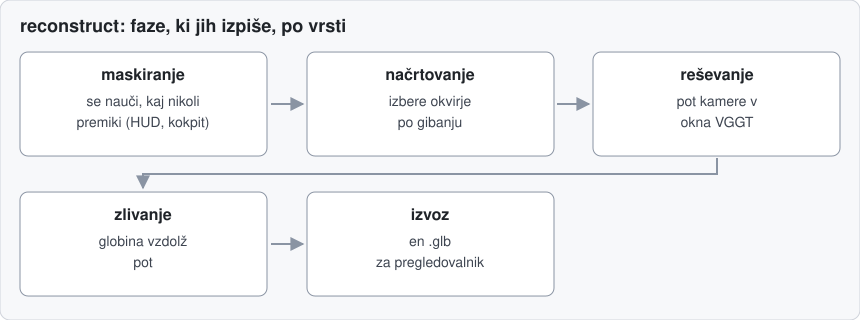

# Rekonstrukcija brez povezave {#offline-reconstruction}

```bash
python -m heat3d_capture reconstruct lap.mp4 -o lap.glb [--solve-budget 260] [--fuse-interval 0.4]
```

Koda: [`scan/offline.py`](https://github.com/Holdi601/3DHeat-GameCapture/blob/main/heat3d_capture/scan/offline.py), [`pose/feedforward.py`](https://github.com/Holdi601/3DHeat-GameCapture/blob/main/heat3d_capture/pose/feedforward.py), [`pose/vggt_model.py`](https://github.com/Holdi601/3DHeat-GameCapture/blob/main/heat3d_capture/pose/vggt_model.py), [`pose/feedforward_source.py`](https://github.com/Holdi601/3DHeat-GameCapture/blob/main/heat3d_capture/pose/feedforward_source.py), [`pose/solveprep.py`](https://github.com/Holdi601/3DHeat-GameCapture/blob/main/heat3d_capture/pose/solveprep.py). Možnosti: [Pregled ukazov](commands.md#reconstruct).

## Zakaj druga pot {#why-a-second-path}

Sledenje med igranjem poteka v živo in je poceni, deluje pa tam, kjer je strukture, na katero se lahko opreš: notranjost, ulica, zemljevid s pokrivom. **Dirkališče je njegov najslabši primer**: cesta je gladek trak z malo teksture, obzorje se komaj premakne, in ko se nekaj položaj zanese, ga kasnejše ne privlečejo nazaj. Krog pride ven kot krivulja, ki se vije, namesto da bi se zaprla.

Offline pot da **okna okvirjev** modelu, ki napove vse njihove kamere skupaj, zato vsak okvir omejuje vse ostale neposredno, ne prek verige. Potrebuje celoten posnetek, preden lahko odgovori, zato ni živa, in je počasna: minute na okno na namiznem GPU. Vse po pozah – zlivanje, pokritost, barva, izvoz – je ista koda kot pri živem skeniranju: rešena proga se preda rekonstruktorju kot vir poz, točno tam, kjer gre telemetrija Forze.

## Zahteve {#requirements}

- **PyTorch**, usklajen z vašo grafično kartico (ta projekt ga ne pripne; namestite ga pred `requirements.txt`, glejte [Izvajanje](runtime.md)).
- **`vggt`** – koda modela VGGT (`from vggt.models.vggt import VGGT`) z Metinega repozitorija na GitHubu; ni na paketnem indeksu.
- **`transformers`**, ker offline pot globino požene prek PyTorch `DepthEstimator` (Depth Anything V2 Small), ne prek datoteke ONNX.
- V praksi CUDA GPU; oba modela padeta na CPU, kar ni praktično.

Nič od tega ni v `requirements.txt`, ker skener tega ne potrebuje. Je v **`requirements-offline.txt`**, z odvisnostmi VGGT (`einops`, `safetensors`, `huggingface_hub`, `Pillow`):

```bash
.venv\Scripts\python -m pip install -r requirements-offline.txt
.venv\Scripts\python -m pip install --no-deps "vggt @ git+https://github.com/facebookresearch/vggt.git"
```

VGGT se namesti z `--no-deps`, ker njegovi metapodatki zahtevajo `numpy<2`, pip pa bi to upošteval s tem, da bi znižal numpy, ki ga potrebuje scipy. `reconstruct` vse to preveri takoj za izpisom licenčne vrstice (seznam `OFFLINE` v [`runtime/preflight.py`](https://github.com/Holdi601/3DHeat-GameCapture/blob/main/heat3d_capture/runtime/preflight.py)), izpiše, kaj manjka, z velikostmi, in namesti samo ob da – VGGT z `--no-deps`, kot zgoraj. Ob zavrnitvi ali brez terminala, kjer bi lahko odgovorili, se konča s kodo 1.

## Model in njegova licenca {#the-model-and-its-licence}

**VGGT**, `facebook/VGGT-1B`: **CC-BY-NC-4.0, samo nekomercialno, in rekonstrukcija, narejena z njim, to podeduje.** Ukaz to izpiše, preden začne (`describe_licence`). Obstaja tudi ločeno licenciran `facebook/VGGT-1B-Commercial`, a je to zaprt repozitorij, ki ga Meta odobri posameznemu računu, zato ne more biti privzeta. `--model vggt-1b-commercial` rešuje z njim (in namesto tega izpiše njegovo licenčno vrstico); brez odobrenega dostopa prenos ne uspe. *Koda* `vggt` je pod Metino lastno "VGGT License", sporazumom o raziskovalnih materialih s politiko sprejemljive uporabe (prebrano iz `LICENSE.txt` paketa). Glejte [Modeli in licence](models-and-licences.md).

## Potek, korak za korakom {#the-run-stage-by-stage}

Imena faz so tista, ki jih ukaz izpiše.



### maskiranje {#masking}

`FlowMask` se nauči iz **4 posnetkov po 90 zaporednih okvirjev**, centriranih pri 1/8, 3/8, 5/8 in 7/8 videa, pri 960 x 540 v sivini (glejte [FlowMask](reconstruction-capture.md#flowmask-what-never-travels)). Njegova opomba se izpiše in shrani v povzetku. Video krajši od 90 okvirjev ne dobi maske.

#### Maska kamere se nauči, ne uporabi {#the-camera-mask-is-learned-not-applied}

Maska se **ne** uporabi na okvirje, ki gredo reševalcu. Maskiranje kokpita se je zdelo prav po statistiki značilnosti (večina zaznanih kotov sedi na pikslih, pritrjenih na kamero) – a to je trditev o detektorju značilnosti, reševalec pa je naučena mreža. Izmerjeno po tem, koliko se obnovljena pot obrne med zaporednimi koraki (avto se obrne za nekaj stopinj; slučajni sprehod za devetdeset), so surovi okvirji dali najmanjši obrat, okvirji z dvignjenim kontrastom malo več, maskirani okvirji jasno več, obe stvari skupaj pa največ. Zato reševalec dobi surove okvirje. Maska se še vedno uporablja za načrtovanje razmika okvirjev spodaj, sledilnik med živim skeniranjem pa jo uporablja.
(`solveprep.enhance`, ki maskira in dvigne lokalni kontrast s CLAHE, obstaja, a ga ta ukaz ne uporablja.)

### načrtovanje: okvirji, razmaknjeni po gibanju {#planning-frames-spaced-by-motion}

`plan_by_motion` izbere okvirje za reševalca po **tem, koliko se je slika premaknila**, ne po uri: fiksen interval da počasnim delom okvirje, ki jih ne potrebujejo, in začne hitre lačne, kjer se zaporedni okvirji ne prekrivajo dovolj, da bi bili povezani.

- Ciljni premik: **5 % širine 960 pikslov** (48 px) mediane premika značilnosti ORB med zaporedno izbranima okvirjema, izmerjeno na okvirjih 960 x 540 v sivini s kontrastom CLAHE, značilnosti samo na maski.
- Začne se z razmikom 0,3 s; po vsakem koraku postane naslednji razmik `gap x (0.5 + 0.5 x target / measured)`, omejen na **0,15–2,0 s**, da ena hrupna meritev ne zamaje načrta.
- Ko se nič ne ujame, se razmik skrči na 0,6 svoje vrednosti (preveč narazen je napaka, ki se ji želi izogniti).
- Ustavi se na koncu videa ali pri `--solve-budget` okvirjih (privzeto 260).

Manj kot 4 načrtovani okvirji je napaka.

### reševanje: okna in lepljenje {#solving-windows-and-stitching}

Načrtovani okvirji se dekodirajo pri širini 960 px in rešijo v **prekrivajočih se oknih po 16 okvirjev, 6 skupnih** z naslednjim (`plan_windows`; zadnje okno se povleče nazaj, da konča na zadnjem okviru, tako da ima konec zajema toliko sosedov kot sredina). Več kot **400** okvirjev v enem zagonu je zavrnjenih.

Vsako okno: okvirji se spremenijo tako, da je daljša stran **518** in sta obe strani večkratnik **14** (razmerje stranic ohranjeno – stiskanje bi napačno povedalo vidno polje), skalirajo na 0..1 in zaženejo skozi VGGT pod avtokasiranjem bfloat16 (float16 zmanjka eksponentnega obsega pri zelo oddaljenih svetovnih koordinatah). Ekstrinzike kamere se pretvorijo v rotacije svet-iz-kamere in središča kamer. Mape točk se privzeto ne ohranijo.

Vsako okno se vrne v **svojem lastnem naključnem koordinatnem sistemu in naključnem merilu**, zato se okna **zlepijo** v koordinatni sistem prvega s podobnostno transformacijo (rotacija, translacija, eno merilo), prilagojeno na kamere, ki si jih delijo z že umeščenim:

- **Rotacija iz orientacij kamer**, ne iz njihovih položajev: skupne kamere ležijo ob poti in so na ravnini skoraj kolinearne, kar pusti prilagajanje samo po položaju slepo za rotacijo – vsako okno se ukrivi in zlepljeni rezultat pride naraven. Rotacija je povprečje `target_R x source_R^T`, projicirano nazaj na pravo rotacijo (z zaščito pred zrcaljenjem).
- **Merilo in odmik iz položajev**, vzdolž zasukanega vira.
- Potrebnih je vsaj **4** skupne kamere; manj je napaka.
- Prekrivanje je tretjina okna, da je merilo dobro določeno; napaka merila, ki se kopiči od okna do okna, je tisto, kar povzroči, da se krog zvije v spiralo.

Za vsak spoj se zabeleži najhujše neskladje skupnih kamer po prilagoditvi, izraženo v enotah povprečnega razmika med njimi (`seam_error`).

### zlivanje {#fusing}

Okvirji na vsakih `--fuse-interval` sekund (privzeto 0,4) se dekodirajo pri širini 960 px, dobijo globino z Depth Anything V2 Small (PyTorch) in se zlijejo s pozo, **interpolirano** iz rešene poti ob njihovem časovnem žigu (linearni položaj, sferična rotacija; `FeedForwardPoses`). Okvirji zunaj rešenega časovnega razpona se preskočijo namesto ekstrapolacije. Kamera uporablja **65-stopinjsko** vodoravno vidno polje. Poze tipa feed-forward imajo pri zlivanju in pokritosti zaupanje 0,85.

### izvoz {#exporting}

Mreža se zapiše kot pri živem skeniranju ([Izhod .glb](glb-output.md)), poimenovana po videu.

## Povzetek {#the-summary}

```text
140 cameras solved over 182s
closure error 3.1% of path length
worst seam 0.42 frame spacings
<mask note>
wrote lap.glb
```

| Vrstica | Pomen |
|---|---|
| closure error | razdalja od prve do zadnje kamere, deljena z dolžino poti. Za en krog je to poštena mera zamika. Nad 10 %: "The lap does not close ... Treat the shape as unreliable." |
| worst seam | največje neskladje lepljenja. Nad 1,0: "Windows disagreed by up to N frame spacings at a seam, so part of the path is stitched on weak evidence." |
| no file | "Fusion produced no surface, so nothing was written." Izhodna koda je potem 1. |

## Merilo {#scale}

Zlepljena pot je v enotah prvega okna, ki so poljubne. Globina je zasidrana s triangulacijo med interpoliranimi pozami (kot pri telemetriji), zato je geometrija skladna s potjo – vendar **rezultat ni v metrih**, razen če je pot v metrih. Ta ukaz ne določi globalnega merila; kalibracija tal se ne uporabi, kadar poze prihajajo iz vira poz.

## Stanje te poti {#state-of-this-path}

Pri fiksnem intervalu okvirjev se okna rešijo v skladno pot na nekaterih odsekih kroga, na drugih pa v čmar; napake so na ostrih zavojih, kjer se pogled med okvirji močno zamaje, in vzorčenje teh zavojev gosteje jih popravi. Nobena slikovna statistika (svetlost, podrobnost, število značilnosti, delež notranjih točk, premik) ni vnaprej napovedala, kateri odseki bodo spodleteli. Zato razmika ni mogoče v celoti načrtovati iz slik vnaprej: izbrati ga je treba z reševanjem, izmeriti rezultat in znova rešiti gosteje tam, kjer pot ni tista, po kateri bi se avto lahko peljal. Načrtovanje po gibanju je zgrajeno; **prilagodljivo ponovno reševanje ni**.
