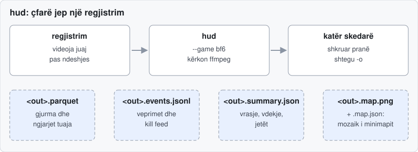

# Leximi i HUD-it nga një regjistrim {#reading-the-hud-from-a-recording}

`hud` lexon HUD-in e një loje në ekran nga **regjistrimi i vetë lojtarit**, pas ndeshjes: **veprimet
e vetë** lojtarit nga dritarja e pikëve që loja shfaq nën shënjestër (vrasje,
asiste, ringjallje, furnizime, pushtime...), vdekjet e tij nga ekranet e rrëzimit dhe të vendosjes, **rrugën e vet**
nga minihartë dhe kill feed-in pranë tyre si ngjarje me kohë - të shkruara
si tabelë 3DHeat me mozaikun e minihartës si imazh harte për ta vendosur poshtë saj.

Shkurt: ai shikon videon e ndeshjes tënde dhe shkruan vrasjet, vdekjet dhe ku ke ecur.

```bash
.venv\Scripts\python -m heat3d_capture hud "<recording>.mp4" --game bf6 --player <name> -o out/match
```

Battlefield 6 është profili i parë i lojës.



## Çfarë prek dhe çfarë nuk prek {#what-it-does-and-does-not-touch}

- Lexon një **skedar video**: një klip ShadowPlay / Instant Replay, një regjistrim OBS, çdo gjë që
  ffmpeg e dekodon. Nuk prek kurrë lojën, memorien, skedarët ose rrjetin e saj, dhe xhiron
  pasi ndeshja ka mbaruar. Shihni [Rregullat](rules.md).
- Nxjerr **vetëm pozicionin e vetë lojtarit**, nga minihartë e vetë lojtarit. Shënuesit e lojtarëve të tjerë
  në minihartë maskohen dhe nuk lexohen kurrë. Kill feed-i mbahet i plotë, por vetëm si
  ajo që thotë në ekran (kush, kë, me çfarë, kur); asnjë pozicion nuk i bashkëngjitet askujt
  përveç lojtarit.
- OCR xhiron lokalisht (RapidOCR me modelet PaddleOCR përmes ONNX Runtime). Asnjë kuadër ose
  prerje nuk del nga makina.
- Një regjistrim shfaq emrat e lojtarëve të tjerë, dhe mozaiku është një pamje e nivelit. Daljet
  janë për përdorimin e vetë lojtarit; mbaji lokale.

## Kërkesat {#requirements}

- **ffmpeg dhe ffprobe** në `PATH`. Një kartë NVIDIA përdoret për dekodim kur ka një
  (`-hwaccel cuda`); përndryshe dekodon CPU, disa herë më ngadalë.
- Paketat në `requirements.txt`, dhe OCR pa varësitë e veta (ai kërkon
  `onnxruntime` për CPU, që përplaset me atë DirectML që përdor projekti):

```bash
.venv\Scripts\python -m pip install -r requirements.txt
.venv\Scripts\python -m pip install --no-deps rapidocr_onnxruntime==1.2.3
```

`rapidocr_onnxruntime` është lexuesi i tekstit (OCR) që lexon emrat dhe fjalët nga ekrani.
`--no-deps` e pengon të zëvendësojë `onnxruntime` DirectML të projektit.

Për të instaluar ffmpeg në Windows: `winget install Gyan.FFmpeg`, pastaj hap një terminal të ri dhe kontrollo
me `ffmpeg -version`. I ri me vijën e komandës? Lexo [Para se të fillosh](before-you-start.md).

- Një regjistrim **16:9** me çdo rezolucion (1080p, 1440p, 4K). Raporte të tjera pamjeje refuzohen,
  sepse kutitë e profilit do të binin në pjesë të gabuara të ekranit.
- **Paraqitja parazgjedhëse e HUD-it** të lojës. Një element HUD i zhvendosur ose i shkallëzuar lexohet në vendin e gabuar.

## Opsionet {#options}

| Opsioni | Parazgjedhja | Kuptimi |
|---|---|---|
| `video` | | Regjistrimi. |
| `-o`, `--out` | emri i videos, në dosjen e tanishme | Rruga e daljes **pa** prapashtesë; skedarët janë `<out>.parquet`, `.events.jsonl`, `.summary.json`, `.map.png`, `.map.json`. |
| `--game` | `bf6` | HUD-in e cilës lojë ta lexojë. `bf6` (Battlefield 6) është i vetmi profil deri tani. |
| `--player` | asnjë | Emri i lojtarit siç e shfaq kill feed-i. Krahasohet lirshëm (OCR ngatërron `l`/`I`/`1`, `O`/`0`, `rn`/`m`). Pa të, emri merret me hamendje (më poshtë). |
| `--fps` | 5 | Mostra të minihartës në sekondë. Kill feed-i mostrohet në gjysmën e kësaj, dritarja e pikëve dhe ekranet e vdekjes gjithashtu në gjysmën e kësaj (një të katërtën kur nuk ka dritare), busulla çdo 3 s, lista e skuadrës çdo 15 s. |
| `--start` | 0 | Sekonda në video ku të fillojë. |
| `--seconds` | të gjitha | Sa nga videoja të lexohet. |
| `--metres-per-pixel` | asnjë | Shkalla e minihartës, nëse dihet: metra për piksel të minihartës në zmadhimin e zakonshëm (miniharta është 296 piksele e gjerë në ekran 1080p). Pa të pozicionet janë në ata piksele; shihni [Njësitë](#north-and-units). |
| `--cpu` | fikur | Dekodon në CPU edhe kur ka një kartë NVIDIA. |

Përparimi printohet çdo pesë sekonda; në fund lojtari, vrasjet, vdekjet, jetët dhe skedarët
e shkruar.

## Daljet {#outputs}

### `<out>.parquet` - gjurma dhe ngjarjet e lojtarit {#parquet---the-players-track-and-events}

Një rresht për çdo mostër kur lojtari ishte në lojë dhe miniharta mund të vendosej, plus një për çdo ngjarje
të tij. Fundi i skedarit mban udhëzimet e leximit të shikuesit (çelësi `heat3d`, `kind: heat3d-hud`), që
shikuesi t'i lidhë të gjitha kolonat pa pyetur.

| Kolona | Kuptimi |
|---|---|
| `time` | Sekonda nga fillimi i videos. |
| `event` | `position`; `start` (videoja nisi në mes të një jete), `spawn` (përsëri në lojë pas një vdekjeje ose një boshllëku të gjatë), `death`, `downed` dhe `revived` (nga ekranet e vdekjes, më poshtë), `end` (një jetë mbaroi pa asgjë që të thotë si); veprimet e vetë lojtarit nga dritarja e pikëve (`kill`, `assist`, `reviving`, `resupply`, `capture`... - [tabela e ngjarjeve](#event-table)); dhe rreshtat e kill feed-it për lojtarin si `kill_feed`, `death_feed`, `teamkill_feed`, `suicide_feed`, `squadwipe_feed`. |
| `source` | Nga erdhi ngjarja e rreshtit: `points` (dritarja e pikëve), `screen` (ekranet e rrëzimit dhe të vendosjes), `feed` (kill feed-i); bosh në rreshtat e pozicionit. |
| `text` | Në rreshtat `points`: etiketa siç printohet (`KILL`, `SQUAD DAMAGE ASSIST`...), ose titulli (`DOUBLE KILL`, emri i një fjongoje), ose për një etiketë të panjohur ajo që u lexua. |
| `points` | Në rreshtat `points`: sa u rrit totali i dritares në atë çast. Kur disa veprime erdhën në të njëjtën mostër (një vrasje dhe mjeti ku ishte) është shuma e tyre, e dhënë në secilin, dhe `shared` tregon sa e ndanë. Bosh kur totali nuk u lexua dy herë nga të dyja anët e çastit. |
| `subject`, `subject_side` | Në rreshtat `points`: emri që dritarja shfaqi me veprimin - viktima e një vrasjeje, shoku i ringjallur ose i furnizuar - dhe ngjyra e tij (`enemy`, `friendly`, `squad`). |
| `confirmed` | `feed` kur kill feed-i kishte një rresht për të njëjtën vrasje ose vdekje (brenda 3 s, e njëjta viktimë). |
| `x`, `y`, `z` | Pozicioni në mozaik: `x` lindje, `y` veri, `z` 0 (fundi i skedarit thotë se `z` është lart). Veriu është veriu i vërtetë kur busulla e lejoi (shihni `north_up` në përmbledhje). |
| `player` | Gjithmonë `me`. Vetëm rreshtat e vetë lojtarit kanë pozicione. |
| `team` | `own`. |
| `session` | `<video name>#NN`, një për jetë. Rrugët e line heat nuk kalojnë kurrë një seancë. |
| `heading` | Gradë në drejtim të akrepave nga veriu (nga pjesa e sipërme e mozaikut kur veriu nuk dihet): ku shikonte pamja. |
| `dir_x`, `dir_y`, `dir_z` | E njëjta si vektor drejtimi, për drejtimin e shikimit të shikuesit. |
| `zoom` | Sa u zmadhua miniharta nga zmadhimi i zakonshëm (mbi 1 në mjete). |
| `killer`, `victim`, `weapon`, `headshot`, `marker` | Në rreshtat e vrasjes dhe vdekjes që kanë një rresht feed-i: rreshti i feed-it (më poshtë). Një vrasje nga dritarja pa rresht feed-i ka emrin e dritares si `victim`; një vrasje e shfaqur si HEADSHOT ka `headshot` true. |

Çdo rresht ngjarjeje merr pozicionin e lojtarit në kohën e ngjarjes (për një vdekje ose një rrëzim, pozicioni i
fundit para saj; për një ringjallje, i pari pas saj). Rreshtat i përshtaten drejtpërdrejt [line heat](https://holdi601.github.io/3DHeat/line-heat.html) të shikuesit: sugjerimi i tij
zgjedh `event`, fillon te `start`, `spawn` dhe `revived`, mbaron te `death`, `downed` dhe
`end`, dhe rreshtat `position` shtrihen përgjatë rrugës. Ngjarjet e tjera emërtohen që
sugjerimi të mos marrë asnjërën për fillim ose fund: dhënia e një ringjalljeje është `reviving` (jo
`revive`), mbajtja e një pike `defense`, një shok që lind te lojtari `teammate_arrived`, rreshtat e
feed-it `kill_feed` e kështu me radhë; `kill` nuk është fund.

Një klip me dy raunde në dy harta jep dy mozaikë që nuk mund të lidhen. Më i madhi është
`<out>.parquet`; secili tjetër me të paktën 30 s gjurmë shkruhet pranë tij si
`<out>.map2.parquet`, `<out>.map2.map.png`, e kështu me radhë.

### `<out>.events.jsonl` - ngjarjet e lojtarit dhe kill feed-i {#eventsjsonl---the-players-events-and-the-kill-feed}

Një objekt JSON për rresht, sipas kohës, secili me një `source`:

- `points`: një për çdo veprim të lojtarit: `time`, `event`, `text`, `points`, `shared`,
  `subject`, `subject_side` (si në tabelë), `popup` (nga cila dritare erdhi, e numëruar gjatë
  ekzekutimit), `seen` (sa lexime e shfaqën), `confirmed`, dhe `x`, `y` ku ishte lojtari.
- `screen`: një për çdo rrëzim dhe çdo ringjallje: `event` (`death`, `downed` ose `revived`), `time` (kur
  lojtari ra; për `revived`, kur ekranet u zhdukën), `until` (shikimi i fundit i
  ekraneve), `screens` (`down` dhe/ose `card`), `outcome` (`death`, `revived` ose `unknown` kur
  regjistrimi mbaron i pari), `killer` (nga rreshti i feed-it, kur ka një), `x`, `y`.
- `feed`: çdo rresht që feed-i shfaqi, i të gjithëve:

| Fusha | Kuptimi |
|---|---|
| `time`, `last` | Mostra e parë dhe e fundit ku rreshti u lexua (sekonda nga fillimi i videos). `time` është kur u shfaq vrasja, brenda një mostre feed-i (0.4 s në ritmin parazgjedhës). |
| `kind` | Nga ana e lojtarit: `kill`, `death`, `teamkill`, `suicide`, `squadwipe`; për rreshtat e lojtarëve të tjerë `kill`, `squadwipe`, ose `death` për një rresht pa vrasës. |
| `killer`, `victim` | Emrat, si leximi më i shpeshtë nga të gjitha mostrat që shfaqin rreshtin (një lexim më i gjatë fiton kur i zakonshmi është fillimi i tij: një emër pjesërisht i fshehur). `killer` është bosh për një rresht që shfaqi vetëm një ikonë dhe një viktimë - vdekje nga bota, ose një rresht ku vrasësi kishte venitur tashmë. |
| `killer_side`, `victim_side` | Nga ngjyra e emrit: `friendly` (ekipi i lojtarit, blu), `enemy` (portokalli), `squad` (jeshilja e zbehtë që loja përdor për lojtarin dhe skuadrën e tij), `neutral` (asnjë nga këto). |
| `weapon` | Klasa e ikonës së armës brenda këtij ekzekutimi: `icon01`, `icon02`... Rreshtat me ikona të ngjashme ndajnë një klasë. Ikonat nuk kanë emra; nuk ka listë për t'i emërtuar. |
| `marker` | Ikona e vogël midis armës dhe viktimës: `skull`, `arrow`, `chevrons`, `crosses` ose bosh. |
| `headshot` | `marker == "skull"` - një supozim, shihni [Kufizimet](#limits). |
| `seen` | Sa mostra feed-i e shfaqën rreshtin. |
| `me` | `killer`, `victim` ose null. |
| `matched` | Për rreshtat e vetë lojtarit: nëse u gjet një veprim i dritares ose një ekran vdekjeje për të. |
| `x`, `y` (, `map`) | Për rreshtat e vetë lojtarit: ku ishte. |

### `<out>.summary.json` {#summaryjson}

Lojtari (dhe si u gjet), nga erdhën ngjarjet e lojtarit (`own_events_from`: dritarja e
pikëve dhe ekranet, ose vetëm kill feed-i kur asnjëra nuk u lexua fare), vrasjet, vdekjet, K/D,
headshot-et, asistet, ringjalljet e dhëna (`revives`) dhe të marra (`revived`), rrëzimet, pushtimet,
neutralizimet, furnizimet, shërimet, riparimet, mjetet e shkatërruara, rezultati (totalet e dritareve
të mbledhura), çdo lloj veprimi me numrin e tij (`actions`), numri i dritareve, vdekjet që i shfaqi vetëm
feed-i, numërimi i vetë feed-it i vrasjeve e vdekjeve dhe sa nga vrasjet e tij u përputhën me një vrasje të dritares,
vrasjet nga shokët, vetëvrasjet, shfarosjet e skuadrës, jetët, sekondat në lojë, distanca e përshkuar (në njësitë e tabelës),
rreshtat e feed-it, për çdo hartë nëse është me veriun lart dhe sa lexime të busullës u pajtuan, numrat e gjurmës
(mostrat, në lojë, të vendosura, të pavendosura, ishujt), supozimet e bëra dhe koha.

### `<out>.map.png` dhe `<out>.map.json` - harta poshtë gjurmës {#mappng-and-mapjson---the-map-under-the-track}

Mozaiku i çdo minihartë të ekzekutimit, i mesatarizuar, me mbivendosjet e hequra, i kthyer dhe i shkallëzuar saktësisht si
tabela. Skedari JSON anësor mban dy spirancat që kërkon vendosja "Imazh harte" e shikuesit
([Imazhet e hartës](https://holdi601.github.io/3DHeat/map-images.html) në dokumentacionin e shikuesit): ngarko PNG-në me
**Imazh harte...**, lëre **Flip north/south** të ndezur, dhe shkruaj spirancën 1 dhe spirancën 2 (`px`, `py`,
`worldX`, `worldZ`) nga skedari anësor. Imazhi pastaj qëndron saktësisht poshtë gjurmës.

Në figurë janë vetëm pjesët e nivelit që miniharta e lojtarit shfaqi.

## Metoda {#method}

### Dekodimi {#decoding}

ffmpeg dekodon në GPU, zbret në ritmin e mostrimit ndërsa kuadrot janë ende në kartë, pret
rajonet e profilit (miniharta, kill feed-i, dy shirita busulle, lista e skuadrës, dritarja e pikëve,
fjalët e ekranit të rrëzimit, këndi poshtë djathtas), e shkallëzon secilin në madhësi fikse dhe i vendos
në një figurë të vogël për mostër. Vetëm ajo figurë kalon nëpër tub
në Python. Dekodimi i çdo kuadri të rrjedhës H.264 është pragu i poshtëm i kohës së ekzekutimit.

Dy thread-e punëtorë marrin mostrat: njëri regjistron minihartat (OpenCV), tjetri lexon tekst (ONNX Runtime).

### Në lojë apo jo {#in-play-or-not}

Katrori i sugjerimit të tastit të minihartës (katrori i çelët me tastin e hartës brenda, poshtë majtas
minihartës) vizatohet sa herë që vizatohet miniharta, dhe jo në ekranet e vdekjes, kill-cam, vendosjes, menysë ose
tabelës së rezultateve. Prania e tij - një katror i çelët pa ngjyrë, me një shkronjë të errët në mes, dukshëm
më i çelët se ajo që e rrethon - e kërkuar disa piksele rreth vendit të vet, është testi i të qenit në lojë. Një
mostër e vetme që nuk pajtohet me të dy fqinjët shpërfillet.

Një boshllëk në lojë është vdekje ose ndryshim raundi (pjesa tjetër fillon me `spawn`) kur zgjat të paktën
6 s ose një vdekje (nga ekranet, ose një rresht feed-i që e emërton lojtarin si viktimë) erdhi brenda
40 s para tij; një boshllëk më i shkurtër pa vdekje (u hap harta e madhe) vazhdon jetën. Miniharta
mbetet ndezur ndërsa lojtari është i rrëzuar, ndaj një lojtar i rrëzuar është në lojë.

### Gjurma {#the-track}

Miniharta kthehet me pamjen dhe e mban lojtarin në një pikë fikse (matur: në mes, 49.7%
poshtë). Çdo mostër:

1. **Maskon** atë që nuk është niveli: pikselët fort të ngjyrosur ose pothuaj të bardhë (shënuesit e objektivave, ikonat e skuadrës
   dhe të mjeteve, ping-et, kufiri i zonës së lojës, vijat e rrugës, teksti), jeshile-verdhën e zbehtë të
   konit të pamjes, një disk rreth shënuesit të lojtarit, pykën e konit mbi të, sugjerimin e tastit dhe një
   buzë të hollë.
2. **Veçoritë**: pika kyç SIFT mbi minihartën gri me kontrast të barazuar, brenda maskës.
3. **Regjistron te mozaiku**, jo te mostra e mëparshme: pikat kyç përputhen me
   veçoritë e ruajtura deri tani, në koordinata mozaiku, pranë vendit ku ishte lojtari së fundi; një ngjashmëri
   (kthim, zmadhim, zhvendosje) përshtatet me RANSAC. Një përshtatje kërkon mjaft inliers, një zmadhim brenda një të tretës së
   të fundit dhe një zhvendosje më të vogël se një e treta e minihartës për mostër; një përshtatje e kërkuar
   kudo në mozaik (pas një vdekjeje) kërkon dyfishin e inliers.
4. **Rrit mozaikun**: veçoritë që mozaiku ende nuk i ka shtohen (më së shumti çdo disa të dhjetat
   e sekondës lëvizje), dhe miniharta e maskuar mesatarizohet në figurë.
5. Pika e lojtarit e çuar nëpër përshtatje është **pozicioni** i tij; pjesa e sipërme e minihartës e çuar
   nëpër të është **drejtimi** i tij në mozaik.

Pas kësaj një pikë që hidhet më shumë se 10 piksele larg dy mostrave para saj dhe
dy pas saj (që pajtohen mes tyre) hiqet: një minihartë herë pas here përputhet me zmadhim të gabuar
për një mostër. Përmbledhja i numëron (`dropped_as_jumps`).

Regjistrimi te mozaiku është ajo që pengon gabimet të mblidhen: kthimi në një vend përputhet me
veçoritë e ruajtura herën e parë. Një lindje diku e pashikuar fillon një **ishull** të veçantë; çdo
mostër e dhjetë e vendosur provohet kundër ishujve të tjerë, dhe përputhja e parë e mirë i bashkon (
më i vogli shkon te më i madhi, me gjurmën e tij). Ishujt që nuk u bashkuan kurrë (hartë tjetër, ose tokë që nuk u ndanë kurrë)
shkruhen veçmas siç u tha më sipër.

### Veriu dhe njësitë {#north-and-units}

Shiriti i busullës lexohet çdo 3 s: etiketat e tij gjenden nga bojë e tyre (e ndritshme, pa ngjyrë,
e grupuar nëpër boshllëqe të vogla, shenjat hiqen), secila lexohet vetë, dhe dy a më shumë etiketa fiksojnë si
shkallën e shiritit ashtu edhe drejtimin nën shenjën e mesit - një etiketë e vetme nuk fikson asgjë. Çdo
lexim i busullës çiftohet me drejtimin e mozaikut të së njëjtës mostër; mediana rrethore e
dallimeve, mbi leximet brenda 10 gradëve prej saj, është kthimi që e vendos mozaikun me veriun lart.
Zbatohet kur pajtohen të paktën tre lexime dhe gjysma e të gjithave.

<a id="units"></a>Shkalla e tokës së minihartës nuk printohet askund në ekran, ndaj pozicionet janë në
**piksele minihartë në zmadhimin e zakonshëm**: zmadhimi mesatar i ekzekutimit shkallëzohet në një njësi tabele për
piksel të një minihartë 296-pikselëshe (madhësia e saj në ekran 1080p). Zmadhimi i mjeteve hiqet nga
regjistrimi, ndaj një njësi është e njëjtë në këmbë dhe në mjet. `--metres-per-pixel` shumëzon
gjithçka në metra kur shkalla dihet (nga një distancë e njohur në hartë, e matur një herë).

### Kill feed-i {#the-kill-feed}

Feed-i lexohet 2.5 mostra në sekondë, por vetëm kur pikselët e tij të ngjyrosur ndryshuan dukshëm ose
kaluan 2 s. Rreshtat e tekstit gjenden nga detektori i OCR; një rresht figura e të cilit përputhet me një të lexuar në
mostrën e mëparshme (rreshtat rrëshqasin, ndaj mund të ketë lëvizur) merr atë tekst në vend që të lexohet sërish.
Rreshtat shumë të vegjël për një emër, ose me vijë të pjerrët (një numërues fps në atë kënd), hidhen poshtë.

Rreshtat grupohen në rreshta sipas lartësisë; në një rresht emri më i majtë është vrasësi dhe më i djathti
viktima. Pjesët fqinje me të njëjtën ngjyrë bashkohen (një emër me hapësirë). Një rresht i vetëm që
kalonte mbi ikonën nga një emër te tjetri pritet te boshllëku i tij më i gjerë kur gjysmat ndryshojnë në
ngjyrë, dhe secila gjysmë lexohet sërish. Një emër i vetëm në kolonën e viktimave me një ikonë menjëherë në të majtë
është një rresht pa vrasës. Dy pjesë në një ngjyrë pa ikonë ndërmjet janë një emër i vetëm ku
vrasësi ka venitur, jo një vrasje.

**Anët** vijnë nga ngjyra. Emrat vizatohen me pak tejdukshmëri, ndaj testi është se sa larg është
teksti nga sfondi i vet: shenja e të kuqes minus blu në atë dallim është portokalli (kundërshtar)
ose blu (shok) mbi çdo sfond; asnjëra, me jeshilen mbi dy të tjerat, është ngjyra e skuadrës.

**Ikonat**: midis emrave, pikselët në ngjyrën e vrasësit formojnë siluetën e armës; një
ikonë e vogël e veçantë pikërisht para viktimës është shënuesi, i emërtuar sipas formës (një njollë me vrima syri
është kafkë; një trekëndësh i vogël shigjetë; disa pjesë kryqe).

**Ngjarjet**: një rresht i lexuar sërish me të dy emrat të njëjtë (ngjashmëri 0.7 pasi palosen
ngatërresat e zakonshme të OCR, një prej tyre 0.8; një lexim i shkurtuar përputhet me fillimin e emrit të plotë) është i njëjti
ngjarje, për sa kohë që ngjarja u lexua së fundi më pak se 5 s më parë dhe është nën 14 s e vjetër - asnjë rresht nuk qëndron
më gjatë, ndaj e njëjta çift më vonë është vrasje e re. Një rresht pa vrasës përputhet vetëm me viktimën.
Koha e një ngjarjeje është shikimi i parë; emrat, anët dhe shënuesi janë shumica nëpër
shikimet; rreshtat e lexuar vetëm një herë hidhen poshtë.

**Lojtari**: `--player`, përndryshe rreshti i veçuar (më i ndritshmi) i listës së skuadrës kur të paktën tre
lexime dhe 60% e tyre pajtohen, përndryshe emri që feed-i vizatoi më shpesh në ngjyrën e skuadrës. Përndryshe
përmbledhja thotë që lojtari është i panjohur, dhe asnjë rresht feed-i nuk i atribuohet. (Dritarja e pikëve dhe
ekranet e vdekjes janë të vetë lojtarit pavarësisht emrit; ato nuk kanë nevojë për emër.)

### Dritarja e pikëve {#the-points-popup}

Gjithçka që fiton lojtari, Battlefield 6 e shfaq në një dritare pikërisht në të majtë dhe poshtë
shënjestrës - në të njëjtin vend në këmbë, në mjet dhe përmes një shënjestre:

```
            [ RIBBON ] (icon)          a title, now and then: a ribbon or a multi-kill
      (icon)(icon)(icon)  300          one icon per action; the popup's running total
                Some_Name              who it was about, for a moment: orange an enemy, blue a teammate
    [ KILL x2 ] [ VEHICLE DESTROYED ]  one boxed tag per kind of action, with a count
```

Dritarja rritet ndërsa lojtari vazhdon të fitojë: një vrasje e re e kthen `KILL` në `KILL x2`, shton një
ikonë dhe ngre totalin; një lloj i ri veprimi shton një etiketë. Rreshti i etiketave shfaq llojet e fundit
(një më e vjetër rrëshqet jashtë dhe numërimi vazhdon kur kthehet). Rreth tre sekonda pas veprimit
të fundit dritarja palosen në një rresht (`[KILL x2] 300`) dhe zhduket. Teksti është gri e çelët, etiketat në
kuti të holla, totali me shifra të mëdha që fillojnë te x 760 të një ekrani 1920x1080, etiketat
të rreshtuara djathtas te x 750.

Lexohet 2.5 herë në sekondë: detektori i OCR gjen rreshtat e tekstit, lexohen vetëm rreshtat në një nga
rreshtat e dritares (etiketat e vetë shënjestrës së tankut në të njëjtën zonë nuk lexohen), dhe një rresht figura e të cilit
përputhet me një të lexuar mostrën para merr atë tekst. Një rresht që kalon nga një ikonë, një
emër ose një etiketë e palosur te totali (`Name10`, `REVIVE185`) pritet aty ku fillon totali
(x 755) dhe të dyja gjysmat lexohen sërish. Ndërsa nuk ka dritare, çdo mostër e dytë mbahet
pa u lexuar; kur tjetra shfaq një dritare, e mbajtura lexohet e para, ndaj fillimi i një dritareje gjendet prapë
me saktësi mostre.

**Etiketat** përputhen me [tabelën e ngjarjeve](#event-table) pasi palosen gabimet e zakonshme të njohësit
(Q i lexuar si O, një shifër midis shkronjash, I për L, një shkronjë e humbur në skaj): një lexim është etiketë
kur është të paktën 80% i ngjashëm me një (85% për etiketa me pesë shkronja ose më pak) dhe qartësisht më afër
asaj se çdo tjetre. Etiketat që njohësi i bashkoi (`CAPTUREDORDERCOMPLETED`) ndahen
duke zhveshur etiketat e njohura nga përpara. Një numërim është `x2`, `X3`, një shenjë e humbur dhe një shifër, ose një shifër
menjëherë pas etiketës. Një rresht gri i çelët me shkronja të mëdha në rreshtin e etiketave që nuk përputhet me asgjë mbahet si
veprimi `points` me tekstin e tij; një rresht që është pjesë e një etikete të njohur në të njëjtën dritare
(`DESTROYED` pranë `VEHICLE DESTROYED`) nuk mbahet. Titujt mbi total (kuti të çelëta, tekst i errët)
janë `multi_kills` (`DOUBLE KILL` ...) ose `ribbon`. Emri është rreshti i ngjyrosur midis totalit
dhe etiketave; ana e tij vjen nga ngjyra si në feed.

**Dritaret dhe veprimet**: leximet me më pak se 0.9 s asgjë mes tyre janë një dritare. Një dritare
që duket se mbaron dhe kthehet para se të kishte mundur të palosej (brenda 3.2 s nga rritja e fundit),
me çdo etiketë në numrin e saj ose më shumë dhe një total jo më të vogël, është e njëjta dritare e humbur për një çast
(turbullim, sfond i ndritshëm) - asgjë në të nuk numërohet dy herë. Në një dritare, numri përfundimtar i një etikete
është numri më i lartë i lexuar të paktën dy herë; veprimi i saj i k-të kohësohet te leximi i parë që shfaq numër
k ose më shumë. Një numër i lexuar në një mostër të vetme nuk është veprim - përveç një vrasjeje që
kill feed-i e garanton (një rresht i lojtarit brenda 3 s që asnjë vrasje tjetër nuk e mori): etiketa e shkurtër KILL
është ajo që njohësi më shpesh e lexon vetëm një herë. Një titull numërohet një herë për dritare, kur lexohet
dy herë. `points` është sa u rrit totali - duke numëruar vetëm totalet e lexuara dy herë radhazi - nga
para mostrës së veprimit deri pas saj.

Një rresht i panjohur numërohet si etiketë vetëm në rreshtin e etiketave të njohura në të njëjtin lexim (ose, pa
etiketë të njohur, kur nuk ka as emër), ndaj një emër i vizatuar në një ngjyrë që testi i anës nuk e dallon
nuk merret për të.

### Vdekjet dhe ringjalljet {#deaths-and-revives}

Kur lojtari rrëzohet, loja e thotë nën qendrën e ekranit (MAN DOWN, REQUEST
REVIVE, SKIP (HOLD), NEARBY MEDICS; pasi kërkohet ringjallja, REVIVE REQUESTED, CANCEL REQUEST),
dhe një kartë poshtë djathtas emërton kush e bëri, me DAMAGE LOG ose PLAYER CARD poshtë saj dhe një
rresht "YOU n - n FOE" sipër. Vrarë menjëherë (një headshot fatal), shfaqet vetëm karta. Pastaj ose një
shok e ringjall lojtarin - ekranet zhduken dhe loja vazhdon - ose lojtari humb gjak deri në vdekje
ose heq dorë, dhe ekrani i vendosjes pason, me DEPLOY poshtë djathtas.

Këto fjalë lexohen së bashku me dritaren, në të njëjtin kalim të OCR (dritarja, shiriti i ekranit të
rrëzimit dhe këndi poshtë djathtas të vendosura në një figurë): 2.5 herë në sekondë ndërsa një
dritare është ndezur, 1.25 herë përndryshe. Këndi përfshihet vetëm kur lojtari është jashtë loje ose
u pa i rrëzuar në 3 s e fundit; në lojë ai mban vetëm numrin e municionit.
Shikimet me më pak se 4 s mes tyre bëjnë një episod (dy shikime të paktën). Një episod është një
**vdekje** kur ekrani i vendosjes shfaqet brenda 12 s nga fundi i tij, ose lojtari është jashtë loje 3 s
pas tij dhe qëndron jashtë 6 s ose më shumë; është **ringjallje** (`downed`, pastaj `revived`) kur
lojtari është ende në lojë 3 s pasi ekranet u zhdukën; `unknown` (shkruar si `downed` vetëm) kur
regjistrimi mbaron i pari. Koha e vdekjes është kur lojtari u rrëzua: rreshti i feed-it që e emërton si
viktimë, kur ka një brenda 3 s para episodit, përndryshe shikimi i parë i episodit minus
gjysmën e një intervali leximi. Pozicionet pas një vdekjeje lihen jashtë rrugës deri te ekrani i
vendosjes.

Një vdekje feed-i që asnjë episod nuk e shpjegon (ekranet u humbën) është prapë `death`, me `source`
`feed`, dhe gjykohet si më parë: nëse lojtari qëndron në lojë mbi 40 s pas saj, ai u ringjall.

### Tabela e ngjarjeve {#event-table}

Në çfarë kthehet çdo etiketë, titull dhe ekran. Disa etiketa mund të jenë një ngjarje; `text` mban cila.

| Ngjarja | Nga | Kuptimi |
|---|---|---|
| `kill` | KILL; HEADSHOT | Lojtari vrau dikë (emri është viktima). Një vrasje headshot shfaq HEADSHOT aty ku do të ishte KILL: `text` thotë cila, dhe `headshot` është true. |
| `assist` | ASSIST, KILL ASSIST, DAMAGE ASSIST, SQUAD DAMAGE ASSIST | Dëmtim te dikush që e vrau një shok. |
| `kill_assist` | ASSIST COUNTS AS KILL | Një asist që loja e numëron si vrasje. |
| `suppression`, `suppression_assist` | ENEMY SUPPRESSION; SUPPRESSION ASSIST | Zjarr shtypës mbi një kundërshtar; mbi një që pastaj e vrau një shok. |
| `smoke_assist` | SMOKE ASSIST, SQUAD SMOKE ASSIST | Tym që mbuloi një shok. |
| `spot`, `spot_assist` | SPOT, SPOTTED, ENEMY DESIGNATION; SPOT ASSIST, SPOT BONUS | Zbulimi i një kundërshtari; një vrasje te një që lojtari e zbuloi. |
| `driver_assist` | DRIVER ASSIST | Një vrasje nga gjuajtësi i mjetit të lojtarit. |
| `reviving`, `reviving_bonus` | REVIVE, SQUAD REVIVE; CONCEALED REVIVE | Lojtari ringjalli një shok; bonusi për ta bërë nën mbulesë. |
| `heal` | HEAL, SQUAD HEAL | Lojtari shëroi një shok. |
| `resupply` | SUPPLY, RESUPPLY, SQUAD SUPPLY | Një shok mori municion nga lojtari. |
| `repair` | REPAIR, VEHICLE REPAIR, SQUAD REPAIR | Lojtari riparoi një mjet. |
| `capturing`, `capture` | CAPTURING, RECAPTURING; CAPTURED, OBJECTIVE CAPTURED | Një tik pushtimi; objektivi i marrë. |
| `neutralizing`, `neutralize` | NEUTRALIZING; NEUTRALIZED, OBJECTIVE NEUTRALIZED | E njëjta për uljen e një objektivi të kundërshtarit në neutral. |
| `defense` | DEFENDING, OBJECTIVE DEFENDED | Mbajtja e një objektivi. |
| `offensive`, `defensive` | OFFENSIVE; DEFENSIVE | Bonusi për një veprim pranë një objektivi që sulmohet; që mbrohet. |
| `order` | ORDER COMPLETED | Një urdhër skuadre i kryer. |
| `vehicle_damage`, `vehicle_disabled`, `vehicle_destroyed`, `vehicle_destroyed_assist` | VEHICLE DAMAGE; VEHICLE DISABLED; VEHICLE DESTROYED; VEHICLE DESTROYED SUPPORT | Dëmtim te një mjet i kundërshtarit, deri në shkatërrimin e tij, ose ndihmë për të. |
| `equipment_destroyed` | EQUIPMENT DESTROYED | Një gadget i kundërshtarit i shkatërruar. |
| `forced_bail` | FORCED BAIL | Një kundërshtar i detyruar të dalë nga mjeti i tij. |
| `squad_wipe` | SQUAD WIPE | I fundit i një skuadre kundërshtare i vrarë. |
| `savior`, `avenger` | SAVIOR; AVENGER | Një vrasje te një kundërshtar që po dëmtonte një shok; që sapo kishte vrarë një. |
| `teammate_arrived` | SPAWNED ON, SPAWN ASSIST, VEHICLE SPAWN, SQUAD VEHICLE SPAWN | Një shok lindi te lojtari ose në mjetin e tij. |
| `transport` | TEAM TRANSPORT | Bartja e shokëve në një mjet. |
| `fortify` | DEFENSE DEPLOYED | Një mbrojtje që ndërtoi lojtari. |
| `points` | çdo gjë tjetër në rreshtin e etiketave | Një veprim që tabela nuk e njeh: `text` është ajo që u lexua. |
| `multi_kills` | DOUBLE KILL, TRIPLE KILL, QUAD KILL, MULTI KILL (titull) | Vrasje me radhë të shpejtë. |
| `ribbon` | çdo titull tjetër | Një fjongo, sipas emrit të saj (BALLISTIC, TANK BUSTER, ENGINEER EXPERT, SPEARHEAD...). |
| `downed` | ekrani i rrëzimit, pastaj loja | Lojtari ra dhe u ringjall. |
| `revived` | ekranet që zhduken, loja që vazhdon | Lojtari u ringjall nga një shok. |
| `death` | ekrani i rrëzimit ose i kartës, pastaj vendosja ose jashtë loje | Lojtari vdiq. |

Tekstet në tabelë u panë në regjistrimet e provës, përveç këtyre, që janë emrat e zakonshëm të serisë
së lojërave dhe janë në tabelë që të emërtohen në vend që të mbahen si `points`:
HEADSHOT KILL, ASSIST, KILL ASSIST, ASSIST COUNTS AS KILL, SPOT, SPOTTED, SPOT ASSIST, SPOT BONUS,
SQUAD REVIVE, HEAL, SQUAD HEAL, RESUPPLY, SQUAD SUPPLY, REPAIR, VEHICLE REPAIR, SQUAD REPAIR,
VEHICLE DISABLED, SQUAD WIPE, AVENGER, format OBJECTIVE ..., dhe titujt TRIPLE KILL,
QUADRUPLE KILL dhe MULTI KILL. Loja në një gjuhë tjetër printon
fjalë të tjera: etiketat e saj dalin si `points` me atë që u lexua - jo të ngatërruara me një veprim të njohur -
me totalet dhe emrat e tyre; dhe meqë ekranet e vdekjes njihen nga fjalët e tyre angleze, vdekjet
vijnë atëherë vetëm nga kill feed-i, si rreshta `death` me `source` `feed`.

## Çfarë është verifikuar {#what-is-verified}

Kontrolluar me sy kundrejt regjistrimeve të provës (të vetë lojtarit, jo pjesë e repozitorit), duke
vizatuar mostra rastësisht dhe duke e krahasuar secilën me kuadrot përreth:

- **Ngjarjet e vetë lojtarit.** Çdo veprim dritareje i mostruar ishte veprim i vërtetë i atij lloji, i gjetur
  brenda një leximi (0.4 s) nga koha e tij; shumica e vlerave dhe emrave ishin të sakta (emrat në disa alfabete,
  si cirilik, mund të dalin të ngatërruar). Çdo ekran vdekjeje i mostruar u gjet.
- **Kill feed-i.** Shumica dërrmuese e rreshtave të feed-it u gjetën me të dy emrat e saktë; gabime të vogla të OCR
  (një I e madhe e lexuar si l e vogël) lejohen. Emrat e vizatuar me simbole që loja vetë
  i shfaq si kuti mund të humbasin. Anët (ngjyrat) janë të gabuara për pak përqind të emrave.
- **Në lojë.** Testi i sugjerimit të tastit u pajtua me kuadrin në çdo çast të mostruar.
- **Gjurma.** Nuk ka të vërtetë bazë për ku ishte lojtari, ndaj gjurma kontrollohet kundrejt
  vetë regjistrimit: dy minihartë regjistrohen **drejtpërdrejt njëra me tjetrën**, dhe ajo zhvendosje
  krahasohet me zhvendosjen midis dy pozicioneve të tabelës. Mospërputhja mediane është rreth
  1-3 piksele minihartë (nën 1% të gjerësisë së minihartës), më shumë në një minihartë të mbushur e të zmadhuar jashtë.
  Leximet e busullës pajtohen me mozaikun brenda 10 gradëve pothuaj gjithmonë.
- **Koha e ekzekutimit.** Dekodimi me rreth 5 herë kohën reale është pjesa më e madhe, në një GPU desktop; leximi i
  dritares së pikëve shton rreth një të pestën deri në gjysmë.

Parë me sy: çdo mozaik ka rrugë dhe ndërtesa të vazhdueshme nëpër jetët që e ndërtuan,
dhe rrugët e jetëve të ndryshme përgjatë së njëjtës rrugë shtrihen njëra mbi tjetrën. Një pjesë ku
zmadhimi i minihartës ndryshon mund të dalë shumë e gjatë - shihni [Kufizimet](#limits).

Testet (`tests/test_hud_*.py`) vizatojnë gjithçka që lexojnë: një nivel i trilluar me rrugë, ndërtesa dhe
kontura, minihartë ecjesh nëpër të me mbivendosjet që ka një e vërtetë, shirita busulle, rreshta kill feed-i
me emra të trilluar. Ato kontrollojnë që një cikël ndiqet brenda dy pikselësh dhe mbyllet, që një
lojtar që qëndron i palëvizur mbetet në vend ndërsa pamja kthehet, që ndryshimet e zmadhimit ndiqen, që një lindje
gjetkë bashkohet kur rrugët takohen, që kthimi i veriut dhe përmbysja e y e vendosin gjurmën
ku shkoi vërtet, që spirancat e imazhit të hartës e rreshtojnë poshtë gjurmës, dhe analizën e feed-it,
anët, shënuesit dhe heqjen e dublikatave. Për ngjarjet e vetë lojtarit vizatojnë dritare pikësh
me emra e etiketa të trilluara dhe kontrollojnë tabelën e etiketave dhe tolerancën e saj ndaj gabimeve të njohësit,
etiketat e bashkuara, rreshtat e dritares, totalin e prerë nga një emër, numërimin ndërsa dritarja rritet, vazhdon
pas një çasti të palexuar, rrëshqet një etiketë jashtë e brenda, ose mbaron; që një numër i lexuar një herë mbahet
veçmas; vdekjet, ringjalljet dhe rezultatet nga fjalët e ekraneve; dhe, në një ndeshje të trilluar, që
veprimet, vdekjet dhe ringjalljet ulen në tabelë ku ishte lojtari, rreshtat e feed-it pranë tyre
nën emrat e tyre, rruga që mbaron te vdekja dhe jo te ringjallja.

## Kufizimet {#limits}

- **Njësitë janë piksele minihartë**, jo metra, përveç kur jepet `--metres-per-pixel`. Asgjë në
  ekranin e lojës nuk e thotë shkallën e tokës së minihartës.
- **Hartohet vetëm ajo që shfaqi miniharta.** Mozaiku mbulon tokën brenda gjysmës së një minihartë
  nga ku shkoi lojtari; dy mozaikë që nuk ndanë kurrë tokë (dy raunde në dy harta, ose dy
  jetë në cepa shumë larg të një harte të madhe) mbeten skedarë të veçantë me koordinata pa lidhje.
- **Gjurma është ajo e minihartës, me 5 mostra në sekondë**, e lëmuar nga asgjë. Një minihartë e zmadhuar shumë
  jashtë (një helikopter në regjistrimet e provës e zmadhoi 2.3 herë) shfaq më pak detaje për piksel,
  dhe jashtë zonës së lojës shfaq pothuaj asnjë, ndaj regjistrimi aty është më i trashë. Avionët dhe
  lojtari si pasagjer nuk ishin në regjistrimet e provës.
- **Gabimet e regjistrimit janë lokale dhe nuk grumbullohen**, por një mozaik i ndërtuar gjatë eksplorimit të
  tokës së re mund të mbajë një përkulje të vogël që rregullohet vetëm kur toka shihet sërish. Aty ku
  zmadhimi i minihartës ndryshon vazhdimisht (një mjet që përshpejton) zmadhimi i përshtatur mund të zhvendoset, dhe një
  pjesë e tillë u pa me distancë rreth dy herë të vërtetën. Një mozaik i ndërtuar nga një minihartë këmbësorie
  e mbushur e e zmadhuar jashtë është më i pasakti (gabime rreth 3 pikselë tipike, deri në 18).
- **Pa optimizim pose-graph.** Një cikël mbyllet duke përputhur veçoritë e ruajtura, jo duke shpërndarë
  korrigjimin mbi ciklin.
- **Klasat e armëve ende nuk funksionojnë.** Silueta e ikonës merret nga një ikonë gjysmë e tejdukshme mbi
  një sfond që lëviz, dhe ndryshon shumë nga mostra në mostër: regjistrimet e provës dolën
  me 220 deri 340 klasa për 550 deri 670 rreshta, ku një ndeshje ka disa dhjetëra armë. Trajtoje
  `weapon` si eksperimentale. Klasat janë për ekzekutim sido që të jetë dhe nuk janë emra.
- **Kuptimet e shënuesve nuk dihen të gjitha.** Shigjeta (`▸`) vizatohet para emrit të vetë lojtarit,
  në rreshtat për të; nuk është lloj vrasjeje. Kafka merret si headshot; kjo
  është supozim, jo diçka që e thotë loja. `chevrons` dhe `crosses` (shfarosje skuadre) janë
  raportuar siç u panë.
- **Emrat në alfabete të ndryshme nga latinishtja** (cirilik, për shembull) dalin si shkronjat latine më të ngjashme:
  njohësi lexon latinisht dhe kinezisht. I njëjti lojtar lexohet njësoj
  çdo herë, ndaj përsëri përputhen, por teksti nuk është emri i tyre.
- **Mbivendosjet në këndin e kill feed-it** (një numërues fps) mund ta fshehin fundin e viktimës
  së rreshtit të sipërm. Teksti i numëruesit njihet dhe hidhet poshtë, dhe një emër i shkurtuar përputhet me leximet e tij të plota,
  por një emër që është parë vetëm i shkurtuar mbetet i shkurtuar.
- **Një vdekje që as ekranet as feed-i nuk e shfaqën** prapë e mbyll rrugën, si `end`, kur
  lojtari del nga loja për 6 s ose më shumë.
- **Ringjalljet e marra** vijnë nga ekranet e rrëzimit. Vetëm për një vdekje feed-i që ekranet e humbën
  ato përsëri nxirren (në lojë mbi 40 s pas saj), dhe një ringjallje e shpejtë nuk dallohet atëherë.
- **Veprimet e dritares kohësohen te një lexim**: brenda 0.4 s nga shfaqja e parë e etiketës; një etiketë që
  hyn me animacion mund të lexohet një mostër vonë ose herët.
- **Emrat në rreshtat e dritares** lexohen si ata të feed-it: alfabetet e ndryshme nga latinishtja dalin të ngatërruara,
  dhe herë pas here emri i një shoku që noton në botë pranë dritares lexohet si emri i veprimit.
  Veprimet pa emër (një tik pushtimi, një urdhër) nuk kanë asnjë.
- **`points`** mungon aty ku totali nuk u lexua dy herë nga të dyja anët e një veprimi, dhe ndahet
  mes veprimeve që erdhën në të njëjtën mostër. `score` i përmbledhjes mbledh totalet përfundimtare të dritareve,
  ndaj një dritare totali i së cilës nuk u lexua kurrë dy herë nuk është në të.
- **Rreshti i etiketave është dritare**: me katër a më shumë lloje në një dritare, etiketa më e vjetër rrëshqet jashtë
  majtas, përtej skajit të rajonit që lexohet. U numërua ndërsa ishte në pamje; një numër
  që fiton ndërsa është gjysmë jashtë ekranit mund të humbasë.
- **Një dritare e humbur më gjatë se sa mund të zgjaste** (mbi 4 s mostra të palexueshme
  ndërsa rritej ende) merret për dy, dhe një etiketë me numër mbi një numërohet sërish.
  Nuk u pa në kontrollet më poshtë.
- **Gjuhë të tjera të ndërfaqes**: etiketat dalin si `points` me tekstin e tyre, dhe vdekjet vijnë vetëm nga
  feed-i (ekranet e vdekjes përputhen nga fjalët e tyre angleze).
- **Ngjarjet në një ishull të shkurtër**: një jetë gjurma e së cilës ishte shumë e shkurtër për t'u shkruar si hartë (nën
  30 s) i mban ngjarjet e saj te `.events.jsonl` pa `x`, `y`, dhe jo në asnjë tabelë.
- **Paraqitja e HUD-it është ajo parazgjedhëse e BF6 në 16:9.** Një shkallë e ndryshuar HUD-i, një paletë për verbërinë e ngjyrave ose një
  madhësi tjetër minihartë do të kërkonte profilin e vet.
