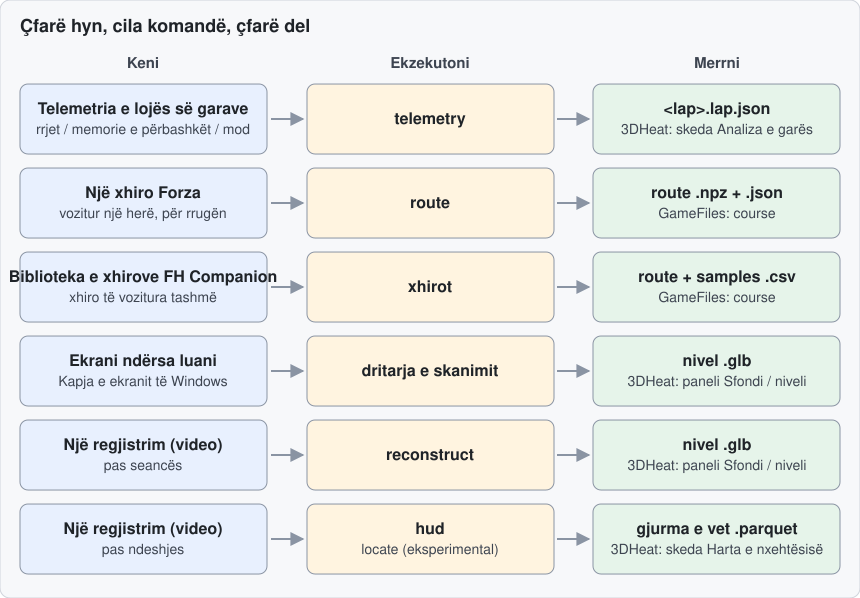

# 3DHeat GameCapture {#dheat-gamecapture}

**Çfarë është?** Një mjet që shënon çfarë i thotë një lojë garash për vozitjen tënde, një skedar
për çdo xhiro. Mund të rindërtojë edhe një model 3D të përafërt të një niveli nga një video e lojës që luan.

**Pse ta përdor?** Për t'i parë xhirot e tua në [shikuesin 3DHeat](https://holdi601.github.io/3DHeat/):
ku frenove, ku ishe i ngadaltë, si ndryshojnë dy xhiro. Dhe për ta pasur nivelin nën
hartën tënde të nxehtësisë kur askush nuk ka një model 3D të tij.

**Shembull:** aktivizo Data Out të Forza, ekzekuto një komandë, vozit dy xhiro. Dy skedarë xhiroje shfaqen në
`laps\`. Hidhi në skedën Analiza e garës të shikuesit.


Je i ri me rreshtin e komandave? Lexo së pari [Para se të fillosh](before-you-start.md).

## Tri punët {#the-three-jobs}

1. **Telemetria e xhirove.** Regjistron çdo kanal që boton një lojë garash - Data Out të Forza,
   memorien e përbashkët të lojërave Assetto Corsa, furnizimet e rrjetit të lojërave të rally-t, një mod të BeamNG, një
   shtojcë të Trackmania - dhe shkruan një skedar `heat3d-lap` për çdo xhiro ose etapë, për skedën Analiza e garës
   të shikuesit. iRacing nuk ka nevojë për regjistrues: shikuesi i lexon vetë skedarët e tij `.ibt`.
2. **Nivele nga loja.** Çfarë tregoi ekrani ndërsa ec ose vozit nëpër një
   nivel e kthen në një model 3D `.glb`, që shikuesi e vendos nën hartën e nxehtësisë.
3. **Ndeshja jote, pas saj.** `hud` lexon HUD-in e regjistrimit tënd - veprimet, vdekjet e tua,
   gjurmën e minimapit dhe kill feed-in. `locate` (eksperimental: deri tani vendos pak kuadro të vërtetë) gjen
   ku u mor çdo kuadër, mbi modelin 3D të një niveli.

Të tria ndjekin një rregull: **asgjë nuk injektohet në lojë dhe asgjë nuk lidhet me grep (hook)**. Kuadrot vijnë
nga API publike e kapjes së ekranit, telemetria nga ndërfaqet që i botojnë lojërat për të. Shih
[Rregullat](../rules.md).



Kodi është Python (paketa `heat3d_capture`), me licencë MIT. Modelet e thellësisë dhe të pozës që mund
t'i ekzekutojë kanë licencat e tyre - shih [Modelet dhe licencat](../models-and-licences.md).

## Fillimi i shpejtë {#quick-start}

### Regjistro xhiro {#record-laps}

Të duhet Python 3.10 ose më i ri ([Para se të fillosh](before-you-start.md)). Në PowerShell:

```powershell
git clone https://github.com/Holdi601/3DHeat-GameCapture
cd 3DHeat-GameCapture
python -m venv .venv
.venv\Scripts\python -m pip install -r requirements.txt

# Forza: Settings -> HUD and Gameplay -> Data Out = ON, IP 127.0.0.1, port 5300
.venv\Scripts\python -m heat3d_capture telemetry -o laps
```

**Duhet të shohësh** `listening on port 5300. Laps go to laps. Ctrl+C to stop.`, pastaj një rresht për çdo xhiro ndërsa kalon vijën, si
në foton më sipër. Shtyp Ctrl+C për të ndalur. Hidh skedarët nga `laps\` në skedën Analiza e garës të shikuesit.
Çdo lojë tjetër është një `--game` larg:

```powershell
.venv\Scripts\python -m heat3d_capture telemetry --game acc -o laps
.venv\Scripts\python -m heat3d_capture telemetry --game dirtrally2 -o laps
```

Shih [Regjistruesit e telemetrisë](../telemetry.md) për çdo lojë dhe opsion.

### Skano një nivel {#scan-a-level}

Kliko dy herë **`scan.bat`** në dosjen e mjetit. Gjen Python (dhe ofron ta instalojë me
winget nëse nuk ka), krijon një `.venv` privat, dhe hap dritaren e skanimit. Dritarja thotë
çfarë mungon, për çfarë shërben çdo paketë dhe sa e madhe është shkarkimi, dhe nuk instalon asgjë
pa një po. Shih [Mjedisi i ekzekutimit dhe varësitë](../runtime.md) dhe
[Dritarja e skanimit](../reconstruction-scan-ui.md).

Me dorë: `.venv\Scripts\python -m heat3d_capture.ui`.

Për të rindërtuar një regjistrim jashtë linje, me rrugën e kamerës të zgjidhur të gjithën njëherësh (kërkon PyTorch,
paketën `vggt` dhe një GPU - shih [Rindërtimi jashtë linje](../reconstruction-offline.md)):

```powershell
.venv\Scripts\python -m heat3d_capture reconstruct lap.mp4 -o lap.glb
```

## Harta e dokumentacionit {#map-of-the-documentation}

| Faqja | Çfarë mbulon |
|---|---|
| [Para se të fillosh](before-you-start.md) | Python, një terminal, komanda e parë, gabimet e zakonshme |
| [Rregullat](../rules.md) | Pa injektim, vetëm ndërfaqe të botuara, dhe çfarë kushton kjo |
| [Regjistruesit e telemetrisë](../telemetry.md) | Komanda `telemetry` dhe një pasqyrë e çdo loje |
| [Forza](../telemetry-forza.md) | Data Out, zbulimi i skemës, rele FH Companion dhe `.tele.gz` i saj |
| [Lojërat Assetto Corsa](../telemetry-assetto-corsa.md) | AC, ACC, AC EVO, AC Rally nga memoria e përbashkët |
| [Lojërat e rally-t](../telemetry-rally.md) | EA SPORTS WRC, DiRT Rally 2.0 / 1 / DiRT 4, Richard Burns Rally |
| [BeamNG.drive](../telemetry-beamng.md) | Modi i protokollit `heat3d` |
| [Trackmania](../telemetry-trackmania.md) | Shtojca Openplanet `Heat3dRecorder` |
| [iRacing](../telemetry-iracing.md) | Leximi i skedarëve `.ibt` në shikues |
| [Ndarja e xhirove dhe etapave](../lap-splitting.md) | `LapSplitter`, `CounterSplitter`, `LineSplitter`, `StageSplitter` |
| [Rrëshqitja, drifti dhe kanalet e derivuara](../slip-and-drift.md) | Si shkallëzohet rrëshqitja, dhe çfarë nxjerr shikuesi |
| [Skedari heat3d-lap](../lap-format.md) | Formati i skedarit të xhiros, kanalet, njësitë, `meta` |
| [Lojërat](../games.md) | Për çdo lojë: si regjistrohet, çfarë dërgohet, cilat piste mund të eksportohen |
| [Komandat](../commands.md) | `route`, `telemetry`, `laps`, `reconstruct`, `hud`, `locate`, hap pas hapi |
| [Referenca e komandave](../cli-reference.md) | çdo opsion, e gjeneruar nga `--help` |
| [Leximi i HUD-it nga një regjistrim](../hud-video.md) | `hud`: veprimet, vdekjet, gjurma e minimapit dhe kill feed nga një regjistrim |
| [Gjetja e kuadrove në një nivel](../locate.md) | `locate`: ku u mor çdo kuadër, kundrejt gjeometrisë së nivelit |
| [Rindërtimi i niveleve](../reconstruction.md) | Rrjedha nga kuadrot te një `.glb` |
| [Dritarja e skanimit](../reconstruction-scan-ui.md) | Çdo kontroll, shkurtore tastiere dhe element mbivendosjeje |
| [Kapja, maskat dhe cilësia e kuadrove](../reconstruction-capture.md) | Windows Graphics Capture, kuadrot kyç, maskat e HUD, këshilla cilësie |
| [Thellësia](../reconstruction-depth.md) | Depth Anything V2, ONNX Runtime, ndërtimi i modelit |
| [Poza e kamerës dhe shkalla](../reconstruction-pose.md) | Odometria, rilokalizimi, pozat e telemetrisë, shkalla e tokës, bundle adjustment |
| [Bashkimi, mbulimi dhe ngjyra](../reconstruction-fusion-and-texture.md) | Vëllimi i zënies, rrjeta e mbulimit, pikat e dobëta, ngjyra e kulmeve |
| [Dalja .glb](../glb-output.md) | Skedari që e ngarkon shikuesi |
| [Rindërtimi jashtë linje](../reconstruction-offline.md) | `reconstruct`, dritaret VGGT dhe qepja |
| [Modelet dhe licencat](../models-and-licences.md) | Madhësitë e Depth Anything V2, VGGT, paketat |
| [Mjedisi i ekzekutimit dhe varësitë](../runtime.md) | Kontrolli paraprak, backend-et, nivelet e performancës |
| [Kufizimet dhe verifikimi](../limits.md) | Çfarë nuk është bërë, dhe çfarë nuk është kontrolluar |
| [Përditësimet](../updates.md) | Kontrolli i botimit dhe `python -m heat3d_update` |
| [Zhvillimi](../development.md) | Testet, mjedisi virtual, struktura e depos |
| [Mirëmbajtja e këtyre dokumenteve](../maintaining.md) | Lista e kontrollit të botimit për kodin dhe dokumentacionin |

## Pjesë e 3DHeat {#part-of-3dheat}

Skedarët që shkruan ky mjet ngarkohen nga **shikuesi 3DHeat** -
[kodi](https://github.com/Holdi601/3DHeat), [dokumentacioni](https://holdi601.github.io/3DHeat/).
Skedarët e xhirove shkojnë te skeda Analiza e garës, nivelet `.glb` te paneli Sfondi / niveli, tabelat `hud` dhe `locate` te
skeda Harta e nxehtësisë; si i lexon shikuesi tabelat dhe skedarët e ndeshjeve është te
[One file a match (.3dheat)](https://holdi601.github.io/3DHeat/container.html) dhe
[Getting data in](https://holdi601.github.io/3DHeat/getting-data-in.html).

| Mjeti | Çfarë bën | Dokumentet |
|---|---|---|
| [Shikuesi 3DHeat](https://github.com/Holdi601/3DHeat) | shfaq harta nxehtësie, gara dhe ndeshje në 3D, në shfletues | [dokumentet](https://holdi601.github.io/3DHeat/) |
| [GameFiles](https://github.com/Holdi601/3DHeat-GameFiles) | piste dhe nivele nga skedarët që dërgojnë lojërat, si modele 3D | [dokumentet](https://holdi601.github.io/3DHeat-GameFiles/) |
| [GameCapture](https://github.com/Holdi601/3DHeat-GameCapture) | telemetri xhirosh nga lojëra garash; nivele të rindërtuara nga video loje | [dokumentet](https://holdi601.github.io/3DHeat-GameCapture/) |
| [Unreal Exporter](https://github.com/Holdi601/3DHeat-UnrealExporter) | një shtojcë e Unreal Editor që eksporton një nivel si model 3D | [dokumentet](https://holdi601.github.io/3DHeat-UnrealExporter/) |
| [CS2](https://github.com/Holdi601/3DHeat-CS2) | demo të Counter-Strike 2 në skedarë ndeshjesh; harta në modele 3D | [dokumentet](https://holdi601.github.io/3DHeat-CS2/) |
| [Watcher](https://github.com/Holdi601/3DHeat-Watcher) | regjistron lojën tënde në sfond nga ajo që botojnë lojërat | [dokumentet](https://holdi601.github.io/3DHeat-Watcher/) |
| [Ext-WarThunder](https://github.com/Holdi601/3DHeat-Ext-WarThunder) | riluajtje të War Thunder në skedarë ndeshjesh | [dokumentet](https://holdi601.github.io/3DHeat-Ext-WarThunder/) |
| [Ext-WoT](https://github.com/Holdi601/3DHeat-Ext-WoT) | riluajtje të World of Tanks në skedarë ndeshjesh | [dokumentet](https://holdi601.github.io/3DHeat-Ext-WoT/) |
| [Ext-WoWs](https://github.com/Holdi601/3DHeat-Ext-WoWs) | riluajtje të World of Warships në skedarë ndeshjesh | [dokumentet](https://holdi601.github.io/3DHeat-Ext-WoWs/) |
| [Ext-Squad](https://github.com/Holdi601/3DHeat-Ext-Squad) | demo serveri të Squad në skedarë ndeshjesh | [dokumentet](https://holdi601.github.io/3DHeat-Ext-Squad/) |
| [Ext-DCS](https://github.com/Holdi601/3DHeat-Ext-DCS) | harta të DCS World në modele 3D | [dokumentet](https://holdi601.github.io/3DHeat-Ext-DCS/) |
| [Ext-IL2](https://github.com/Holdi601/3DHeat-Ext-IL2) | harta të IL-2 Sturmovik në modele 3D | [dokumentet](https://holdi601.github.io/3DHeat-Ext-IL2/) |

Një zhvillues me projektin e lojës të hapur duhet të përdorë eksportuesin Unreal, që lexon gjeometrinë
e vërtetë dhe është i saktë. Aty ku arkivat e vetë lojës mund të lexohen, GameFiles nxjerr pistën e
saktë. Rindërtimi nga loja është për rastin kur ka vetëm ekranin.
