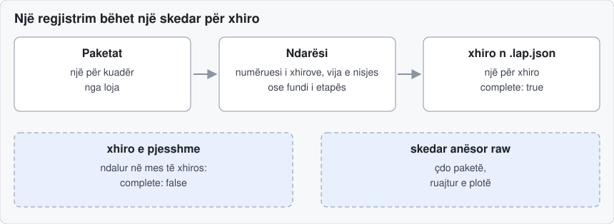

# Si ndahen xhirot dhe etapat {#how-laps-and-stages-are-split}

Një regjistrues sheh një rrjedhë të vazhdueshme kampionesh. Ta kthejë në xhiro e bën një nga katër ndarësit,
i zgjedhur sipas asaj që loja thotë për xhirot. Të gjithë ndjekin të njëjtën ide: përdor numërimin e vetë
lojës aty ku ka një, përndryshe gjej xhironë nga pozicionet; mos shkruaj kurrë një copë shumë të shkurtër
për t'u krahasuar.

| Ndarësi | Kodi | Përdoret nga |
|---|---|---|
| `LapSplitter` | [`fulllap.py`](https://github.com/Holdi601/3DHeat-GameCapture/blob/main/heat3d_capture/telemetry/fulllap.py) | Forza |
| `CounterSplitter` | [`kunos.py`](https://github.com/Holdi601/3DHeat-GameCapture/blob/main/heat3d_capture/telemetry/kunos.py) | Assetto Corsa, ACC |
| `LineSplitter` | [`kunos.py`](https://github.com/Holdi601/3DHeat-GameCapture/blob/main/heat3d_capture/telemetry/kunos.py) | AC EVO, AC Rally, BeamNG |
| `StageSplitter` | [`rally.py`](https://github.com/Holdi601/3DHeat-GameCapture/blob/main/heat3d_capture/telemetry/rally.py) | EA SPORTS WRC, DiRT Rally 2.0, DiRT Rally, DiRT 4, Richard Burns Rally |

Trackmania i ndan vozitjet brenda shtesës së vet ([Trackmania](telemetry-trackmania.md)), dhe skedarët e
iRacing i ndan shikuesi sipas numëruesit të xhirove të simulatorit ([iRacing](telemetry-iracing.md)).

Me **Ctrl+C** çdo regjistrues thërret `flush()` të ndarësit të vet, kështu që një xhiro ose etapë e hapur
shkruhet nëse kalon të njëjtat minimume si më poshtë.

## LapSplitter (Forza) {#lapsplitter-forza}

Parametrat: `minimum_metres = 400`, `gap_seconds = 2.0`.

Për çdo paketë të dekoduar:

1. Nëse `timestampMs` i lojës kërceu përpara me më shumë se 2 sekonda që nga paketa e fundit,
   ose shkoi mbrapa, xhiroja e hapur shkruhet e para.
2. Nëse `isRaceOn` është 0 (loja nuk është në garë), xhiroja e hapur shkruhet dhe paketa
   hidhet tej.
3. Nëse nuk ka xhiro të hapur, hapet një me `lapNumber` të paketës.
4. Nëse `lapNumber` ndryshon nga ai i xhiros së hapur, xhiroja e hapur **mbyllet si e plotë**; `seconds` e saj
   është `lastLap` i lojës kur ai është pozitiv. Një xhiro e mbyllur kështu shkruhet
   sado e gjatë të jetë. Hapet një xhiro e re.
5. Paketa i shtohet.

Regjistruesi shkruan gjithashtu kur nuk ka ardhur paketë për 2 sekonda kohë muri (loja u pezullua,
ose u mbyll në mes të xhiros).

**Shkrimi (flush)** e mban xhironë e hapur vetëm nëse ka të paktën 2 kampionë dhe të paktën 400 m
`distanceTravelled`; shkruhet si e paplotë (një `run`). Një garë nga pika në pikë nuk numëron kurrë
një xhiro të dytë, prandaj gjithmonë përfundon kështu.

## CounterSplitter (AC, ACC) {#countersplitter-ac-acc}

Parametri: `minimum_metres = 300`. Ushqehet me çdo kampion me `completedLaps` të faqes grafike
dhe kohën e xhiros së fundit.

- Kampioni i parë hap një xhiro të numëruar me `completedLaps` aktual.
- Kur `completedLaps` ndryshon, xhiroja e hapur mbyllet. Ajo është **e plotë**, me
  `seconds = last lap ms / 1000` (nëse është pozitive), vetëm nëse numëruesi u rrit saktësisht me 1 - një
  kthim te 0 (rinisje seance) ose një kërcim me disa e mbyll si të paplotë.
- Një xhiro e mbyllur shkruhet vetëm nëse ka kampionë dhe të paktën 300 m rrugë të vozitur.
- Flush e mban xhironë e hapur nëse ka më shumë se një kampion dhe të paktën 300 m.

## LineSplitter (AC EVO, AC Rally, BeamNG) {#linesplitter-ac-evo-ac-rally-beamng}

Parametrat: `radius = 15 m`, `minimum_metres = 300`, `stop_seconds = 8`.

Këto lojëra ose nuk kanë numërues xhirosh në një faqe që lexon regjistruesi, ose vozisin etapa. **Vija
është aty ku filloi regjistrimi**:

1. Pozicioni horizontal i kampionit të parë (`x`, `z`) bëhet vija.
2. Pasi makina ka udhëtuar më shumë se 5 m, drejtimi nga vija te makina bëhet
   drejtimi i xhiros.
3. **Ndalimi** mbyll një vozitje: kur `speed` mbetet nën 1 m/s për 8 sekonda, xhiroja e hapur
   shkruhet (kështu mbaron një etapë rali: makina ndalon në finish).
4. **Kalimi i vijës**: pas më shumë se 300 m udhëtim, mblidhen kampionët brenda 15 m nga vija.
   Kur makina del përsëri nga ai rreze, kampioni i mbledhur më i afërt është
   kalimi. Nëse makina po shkonte në të njëjtin drejtim me drejtimin e xhiros aty (prodhimi
   skalar i drejtimit lokal me drejtimin është pozitiv), xhiroja mbyllet në atë
   kampion; përndryshe kalimi shpërfillet (makina e kaloi startin duke shkuar në drejtimin e kundërt).
5. `seconds` e një xhiroje të mbyllur është koha nga kampioni i parë deri te kalimi. Ajo është
   **e plotë vetëm nëse kampioni i saj i parë ishte më i shpejtë se 5 m/s**: një xhiro që filloi nga
   qëndrimi është një nisje, jo një xhiro për t'u krahasuar. Xhiroja e parë e një regjistrimi të nisur në
   grid është prandaj gjithmonë e paplotë; regjistrimi i nisur në një xhiro të lëvizshme jep një xhiro të parë
   të plotë në kalimin e radhës.
6. Xhiroja tjetër fillon te kampioni i kalimit (i përket të dyjave).

Xhirot më të shkurtra se 300 m hidhen tej. Flush (një ndalim, ose Ctrl+C) e mban xhironë e hapur nëse ka
të paktën 2 kampionë dhe 300 m, si të paplotë. BeamNG shkruan njësoj kur automjeti
rivendoset (ora e tij kthehet mbrapa), para se të nisë një ndarës të ri, kështu që vozitja e bërë para rivendosjes
ruhet.

Largësitë janë horizontale (`x`, `z`) për numëruesin e udhëtimit dhe testin e vijës, dhe 3D e plotë
për testin e gjatësisë 300 m.

## StageSplitter (lojërat e ralit) {#stagesplitter-rally-games}

Parametri: `minimum_metres = 300`. Ushqehet me çdo kampion me orën e etapës së lojës, nëse
loja thotë se makina ka mbaruar, dhe opsionalisht me kohën e vetë lojës për të.

1. Nëse ora është 0 ose më pak, ose ka shkuar mbrapa me më shumë se 0.5 s, etapa e hapur
   **braktiset**: mbahet si etapë e pjesshme nëse nuk është e plotë, ka më shumë se 10 kampionë dhe
   të paktën 300 m. Një orë 0 ose më pak e hedh tej edhe kampionin (makina është në start).
2. Nëse nuk ka etapë të hapur, hapet një e re (e numëruar 1, 2, ... për regjistrimin).
3. Kur një etapë është e plotë, kampionët e mëtejshëm shpërfillen derisa ora të kthehet mbrapa.
4. Çdo kampion ruhet me `time` të vendosur sipas orës së etapës.
5. Kur loja thotë se ka mbaruar, etapa është e plotë; `seconds` e saj është koha e lojës kur
   jepet dhe është pozitive, përndryshe ora. Shkruhet nëse mbuloi të paktën 300 m.

Çfarë do të thotë "mbaroi" për çdo lojë:

| Loja | Mbaroi kur |
|---|---|
| EA SPORTS WRC | gjatësia e etapës > 0 dhe largësia e etapës >= gjatësia - 0.5 m |
| Lojërat DiRT | xhirot e përfunduara u ngritën mbi numrin fillestar të etapës, ose (ngjarje me një xhiro) largësia e xhiros >= 99.9% e gjatësisë së pistës |
| Richard Burns Rally | ora e garës > 0 dhe largësia deri në fund <= 0 |

Për RBR aksi lart dhe shpejtësia fiksohen kur shkruhet një etapë (shih
[Lojërat e ralit](telemetry-rally.md#richard-burns-rally-rsf--ngp)).

## Koha dhe largësia në skedarin e xhiros {#time-and-distance-in-the-lap-file}

Për çdo regjistrues përveç Forza, `time` rivendoset që kampioni i parë i xhiros të jetë 0 dhe
`distance` është largësia 3D kumulative mes pozicioneve të njëpasnjëshme. Forza përdor
kronometrin dhe numëruesin e largësisë të vetë lojës, të rivendosur në të njëjtën mënyrë.
