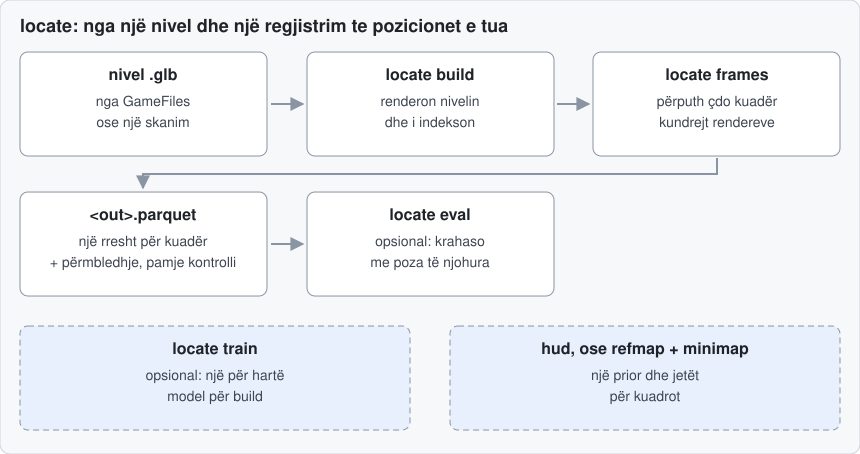
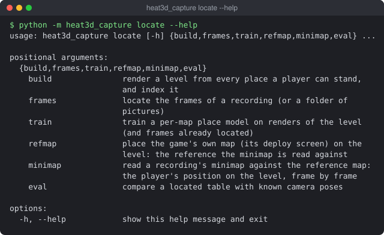

# Gjetja e kuadrove në një nivel {#locating-frames-in-a-level}

`locate` zbulon ku u mor çdo kuadër i një regjistrimi loje - pozicioni 3D i kamerës
dhe drejtimi i shikimit - duke krahasuar pamjen me rendera të gjeometrisë së vetë nivelit. Është
për lojëra që nuk mbajnë asnjë shënim se ku ishte lojtari: pa demo, pa skedar riluajtjeje, pa telemetri.
Battlefield 6 është e para.

> **Eksperimentale.** Në regjistrime reale deri tani vendos vetëm një pjesë të vogël të kuadrove; shihni
> [Kuadro reale: eksperimentale](#real-frames-experimental).

```bash
# Once per level: render it from every place a player can stand, and index the renders.
.venv\Scripts\python -m heat3d_capture locate build level.glb -o level.db

# Per recording: where was each frame taken?
.venv\Scripts\python -m heat3d_capture locate frames "<recording>.mp4" --db level.db -o out/match
```

Pozicioni vjen **nga pamja**, kundrejt gjithë nivelit, pa paraprak. Gjurma e minihartës
e [lexuesit të HUD-it](hud-video.md) është vetëm zgjidhje rezervë për kuadrot që pamja nuk i vendos dot, dhe çdo
rresht thotë nga cila nga të dyja erdhi.





## Çfarë prek dhe çfarë nuk prek {#what-it-does-and-does-not-touch}

- Lexon **regjistrimin e vetë lojtarit** dhe një skedar niveli që lojtari e eksportoi nga **kopja e
  vet** e lojës. Nuk prek kurrë lojën, memorien, skedarët e saj ndërsa xhiron, ose rrjetin e saj, dhe xhiron pas ndeshjes. Shihni [Rregullat](rules.md).
- Vendos **vetëm kamerën e vetë lojtarit**: kuadri është pamja e vetë lojtarit.
- Niveli, baza e të dhënave e ndërtuar prej tij dhe gjithçka e renderuar prej tij i përkasin
  botuesit të lojës. Mbaji lokale.

## Kërkesat {#requirements}

- Ato që liston `requirements.txt`, PyTorch (nga pytorch.org, për GPU) dhe
  `requirements-locate.txt`:

```bash
.venv\Scripts\python -m pip install -r requirements-locate.txt
```

- Një GPU me OpenGL 3.3 (4.3 është më e shpejtë) për renderat, dhe mundësisht CUDA për modelet. Në një
  CPU funksionon, ngadalë.
- Modelet merren në përdorimin e parë (rreth 450 MB): DINOv2 nga Hugging Face, ALIKED dhe
  LightGlue përmes kornia. Të gjitha kanë licencë për përdorim komercial; shihni [Licencat](#licences).
- **Niveli** si `.glb` (ose `.gltf`) në kornizën e shikuesit, Y lart, **me teksturat e ngjyrës bazë**, siç e
  shkruajnë eksportuesit e 3DHeat (pjesët `ground:` / `structure:`; emrat e pjesëve nuk
  nevojiten). Një njësi është një metër, përveç kur `extras.unit_metres` në nivelin e lartë të skedarit
  thotë ndryshe. Një skanim GameCapture (`reconstruct`, dritarja e skanimit) shkruhet në **centimetra** dhe
  mban `extras.unit_metres: 0.01`, ndaj lexohet në madhësinë e vërtetë. Një nivel pa tekstura funksionon
  shumë më keq; shihni [Kufizimet](#limits).

## Komandat {#commands}

### `locate build <level> -o <db>` {#locate-build---o-}

Renderon nivelin nga çdo vend ku mund të qëndronte një lojtar dhe ruan, për çdo render, pozën e tij dhe një
përshkrues global.

| Opsioni | Parazgjedhja | Kuptimi |
|---|---|---|
| `level` | | `.glb` / `.gltf` e nivelit. |
| `-o`, `--out` | | Dosja e bazës së të dhënave që do të shkruhet. |
| `--game` | `bf6` | Profili i lojës: lartësitë e syrit, këndi i shikimit, kutitë e HUD-it, shpejtësia (më poshtë). `generic` për çdo lojë në vetën e parë. |
| `--eye` | e profilit | Lartësitë e syrit mbi dysheme në metra, në këmbë e para. Një pamje e bazës së të dhënave për çdo lartësi. |
| `--fov` / `--vfov` | e profilit | Këndi horizontal i shikimit i regjistrimit, ose ai vertikal (rrëshqitësi i Battlefield) për një regjistrim 16:9. |
| `--spacing` | 2.5 | Metra midis vendeve nga ku merren pamjet. |
| `--yaw-step` | 30 | Gradë midis drejtimeve të pamjeve. |
| `--pitch` | 0 | Pitch-et ku të renderohet, gradë lart. |
| `--positions` | asnjë | Një tabelë (Parquet ose CSV me `x`, `y`, `z` te këmbët, në kornizën e nivelit) nga merren vendet në vend të çdo dyshemeje: dalja e një ekzekutimi të mëparshëm, për shembull. |
| `--shadows` | fikur | Hedh hijet e diellit në rendera (dielli i vetë nivelit kur skedari i tij e emërton në `extras.sun`). |
| `--untextured` | fikur | Renderon vetëm formën dhe dritën. |
| `--box X0 Z0 X1 Z1` | gjithë skedari | Vetëm vendet brenda kësaj kutie (njësi niveli): zona e lojës. |
| `--places` | `auto` | Nga merren pamjet: `nav` - lojtarët në lartësi syri mbi rrjetën e navigimit të nivelit (pjesët `nav:`: saktësisht ku loja i lejon të ecin), kamerat e mjeteve në lartësinë e tyre mbi pjesët `ground:` (terren dhe rrugë) brenda 50 m prej tij; `ground` - të dyja mbi `ground:`; `floors` - mbi çdo faqe që shikon lart (çatitë dhe arkat gjithashtu); `auto` - `nav` kur niveli ka rrjetë navigimi, përndryshe `floors`. |
| `--head` | asnjë | Një kokë për hartë nga `locate train` për përshkruesit. |

Shkruan `<db>/db.json` (nga çfarë dhe me çfarë u ndërtua) dhe `<db>/views.npz` (pozat, përshkruesit).

### `locate frames <recording> --db <db>` {#locate-frames----db-}

| Opsioni | Parazgjedhja | Kuptimi |
|---|---|---|
| `source` | | Një video, një figurë, ose një dosje figurash (merren sipas emrit, `--fps` larg njëra-tjetrës). |
| `--db` | | Baza e të dhënave që shkroi `build`. Skedari i nivelit duhet të jetë ende aty ku ishte (ose `--level`). |
| `-o`, `--out` | `<source>.locate` | Rruga e daljes pa prapashtesë. |
| `--fps` | 2 | Kuadro të gjetura për sekondë video. |
| `--start`, `--seconds` | të gjitha | Pjesa e videos që do të lexohet. |
| `--width` | 1280 | Gjerësia ku përputhen kuadrot. |
| `--shortlist` | 8 | Pamje të bazës së të dhënave të provuara për kuadër pranë një paraprakut ose një fiksimi. |
| `--search-shortlist` | 16 | Pa paraprak: pamje të bazës së të dhënave të provuara për kuadër ([kërkuar së bashku](#with-no-prior-frames-searched-together)). |
| `--no-search` | fikur | Pa paraprak: kërkon çdo kuadër më vete dhe beson fiksimin e tij pa fqinjët. |
| `--accept-depth` | 0 (fikur) | Pa paraprak: beson një fiksim vetëm nëse largësia e tij e largët e përputhjeve është kaq herë më e madhe se e afërta. |
| `--accept-support` | 2 | Pa paraprak: fqinjë që pajtohen përgjatë jetës që i duhen një fiksimi për t'u besuar. |
| `--checkpoint` | asnjë | Mban gjendjen e ekzekutimit këtu dhe vazhdon prej saj nëse është aty. |
| `--stop-file`, `--stop-process` | asnjë | Ndalon vetë, me gjendjen e ruajtur, kodi i daljes 75, kur ekziston ky skedar ose xhiron një proces emri i të cilit fillon me këtë (kontrollohet para çdo kuadri; mund të përsëritet), që një ekzekutim i gjatë t'ia lërë makinën një loje. E njëjta komandë vazhdon. |
| `--normalise` | asnjë | Normalizim i lehtë para përputhjes: `clahe`, `gray`. |
| `--minimap` | asnjë | Tabela e verbit `hud`: **zgjidhja rezervë** për kuadrot që pamja nuk i vendos dot. |
| `--prior-radius` | asnjë | **Përshpejtim opsional**, fikur parazgjedhur: kërkon vetëm pamje të bazës së të dhënave kaq metra nga pozicioni i minihartës (kërkon `--minimap`). |
| `--minimap-anchor` | asnjë | Një skedar JSON që e lidh minihartën me nivelin ([miniharta si paraprak kërkimi](#the-minimap-as-a-search-prior)): miniharta e pret kërkimin që nga kuadri i parë; fiksimet e gjetura kështu janë `visual+minimap-prior`. |
| `--no-level-search` | fikur | Me paraprak: kur asgjë pranë tij nuk përshtatet, mos kërko edhe në gjithë nivelin (më shpejt). |
| `--lives` | tabela `--minimap` | Tabela e verbit `hud` ku vdekjet, vendosjet dhe ringjalljet tregojnë kur lojtari ishte në lojë: pozicionet hidhen vetëm nëpër një vdekje ([jetët nga pamjet](#lives-from-the-footage)). |
| `--no-sequence` | fikur | Vendos çdo kuadër më vete, jo përgjatë ekzekutimit (më poshtë). |
| `--fit-fov` | fikur | Pas ekzekutimit, përshtat këndin e shikimit me fiksimet më të forta, për pamje, dhe e raporton. |
| `--check-every` | 0 | Gjithashtu çdo N kuadro, të vendosur ose jo, një figurë te `<out>.check`. |
| `--no-checks` | fikur | Mos shkruaj figurat e kontrollit të fiksimeve vizuale (më poshtë). |
| `--no-zoomed` | fikur | Mos i zgjidh pamjet e zmadhuara nga fiksimet e fqinjëve të tyre (më poshtë). |
| `--no-grow` | fikur | Mos kërko sërish pranë çdo fiksimi për kuadrot përreth që janë ende pa të. |
| `--game`, `--eye`, `--fov`, `--vfov`, `--mask`, `--no-hud-mask`, `--max-speed` | e profilit | Si më sipër; `--mask x,y,w,h` shton një kuti ekrani (në ekran 1920x1080) që nuk është niveli. |
| `--vehicle-vfov` | e profilit | Këndi vertikal i shikimit i kamerave të mjeteve (rrëshqitësi i mjeteve i Battlefield). |
| `--settings` | skedari më i ri i cilësimeve | `bf6`: skedari i cilësimeve të lojës nga lexohen këndet e shikimit (vetëm lexim) kur nuk jepet `--fov`/`--vfov`; parazgjedhur `PROFSAVE*_profile` më i ri nën `Documents/Battlefield 6/settings`. Ai mban cilësimet siç janë tani, që mund të mos jenë si u bë një regjistrim më i vjetër. |

### `locate refmap <level> <deploy screen> -o <refmap>` {#locate-refmap----o-}

Vendos hartën e vetë lojës mbi nivelin: referenca kundrejt së cilës lexohet miniharta
([miniharta, e lexuar kundrejt nivelit](#the-minimap-read-against-the-level)). `<deploy screen>` është
një figurë e ekranit të vendosjes që shfaq gjithë hartën, ose një regjistrim me `--at <seconds>` në një
çast të tillë; kutia e hartës e profilit pritet prej saj (`--whole-picture` e mban të gjithën). Shkruan
`<refmap>.png` (harta e rimostruar mbi kornizën e vetë nivelit, `--mpp` metra për piksel, parazgjedhur 0.5),
`<refmap>.valid.png` (ku është harta, jo një shënues ose etiketë) dhe `<refmap>.json` (korniza dhe
kalibrimi, me sa larg ishin pllakat e hartës prej tij). `--topdown <prefix>` mban nivelin e
renderuar nga sipër për ekzekutimin tjetër (`--topdown-mpp`, parazgjedhur 0.656 m; `--box` e kufizon).

### `locate minimap <recording> --refmap <refmap> -o <table>.parquet` {#locate-minimap----refmap---o-parquet}

Lexon minihartën e regjistrimit kundrejt hartës referuese, kuadër pas kuadri (`--fps`, parazgjedhur 2):
pozicioni, drejtimi dhe zmadhimi i çdo minihartë që përputhet, në kornizën e nivelit, shkruar si
tabelë minihartë me një spirancë pranë saj (`<table>.anchor.json`) që `locate frames` e merr si
`--minimap <table>.parquet --minimap-anchor <table>.anchor.json`. Me tabelën e verbit `hud`
(`--hud`) jetët e saj barten; me një spirancë edhe për atë tabelë (`--hud-anchor`) kërkimi i parë
është rreth ku e vendos ajo lojtarin, dhe aty ku asnjë minihartë nuk përputhet gjurma e vetë HUD-it plotëson,
e zhvendosur te fiksimet më të afërta të hartës referuese (`--hud-fill`, sekonda, parazgjedhur 120; 0 e fik).
`source` i tabelës thotë cili (`refmap`, `hud`).

### `locate eval <out>.parquet --truth <poses>` {#locate-eval-parquet---truth-}

Krahason një rezultat me poza të njohura të kamerës: një tabelë me `time`, `x`, `y`, `z` (syri), `yaw`,
`pitch` në kornizën e nivelit. `--offset` është zhvendosja e orës (koha e së vërtetës = koha e videos + offset);
pa të zhvendosja kërkohet. `--unit-metres` i kthen gabimet në metra.

## Profilet e lojërave {#game-profiles}

| | `bf6` | `generic` |
|---|---|---|
| Lartësitë e syrit | 1.6 m në këmbë, 1.05 m në gjunjë (ende nuk është matur në lojë) | 1.65, 1.1 m |
| Këndi i shikimit | 55 gradë vertikal, rreth 86 horizontal në 16:9: **jep atë të vetë lojtarit** me `--vfov` | 90 horizontal |
| HUD i maskuar | miniharta dhe lista e skuadrës, kill feed-i, busulla, municioni, arma e lojtarit, dritaret, shënjestra | shënjestra |
| Më i shpejti në këmbë | 8 m/s | 8 m/s |
| Pamjet që dallohen | në këmbë, mjet, i zmadhuar (më poshtë) | çdo kuadër në këmbë |
| Kamerat e mjeteve | rrëshqitësi i mjeteve (nga skedari i cilësimeve), mjeti i maskuar, kamera deri 8 m mbi dysheme, 30 m/s | - |

Këndi i shikimit ka më shumë rëndësi: një kuadër i zgjidhur me të gabuarin zgjidhet me gjatësi
fokale të gabuar, dhe pozicioni i tij rrëshqet përgjatë shikimit.

## Daljet {#outputs}

### `<out>.parquet` {#parquet}

Një rresht për çdo kuadër të gjetur, në **kornizën e nivelit** (Y lart, njësitë e nivelit), me
udhëzimet e leximit të shikuesit në fund (`kind: heat3d-locate`). Fundi emërton çdo kolonë që nuk ka
rol të vetin si ekstra, që shikuesi t'i mbajë të gjitha (karta e tij e inspektimit i shfaq).

| Kolona | Kuptimi |
|---|---|
| `time` | Sekonda nga fillimi i videos. |
| `event` | `start` në rreshtin e parë të një jete, `position` në të tjerët. |
| `x`, `y`, `z` | Syri, i lëmuar brenda jetës. Bosh aty ku asnjë burim nuk e vendosi kuadrin. |
| `yaw`, `pitch` | Gradë: yaw rreth boshtit lart (0 përgjatë +X, rritet drejt -Z, që është yaw i vetë lojës në kornizën e shikuesit), pitch lart nga horizontalja. `pitch` është bosh për rreshtat e minihartës. |
| `dir_x`, `dir_y`, `dir_z` | Drejtimi i shikimit. |
| `player`, `team`, `session` | `me`, `own`, dhe `<video>#NN`, një për jetë. |
| `life` | Jeta ku pamjet e shfaqën kuadrin (nga vdekjet e HUD-it; 1 = e para). Bosh kur jashtë loje (i vdekur, i rrëzuar, duke u vendosur) ose kur jetët nuk u lexuan. `session` është jeta e gjurmës, që mund të ndahet edhe te një kërcim. |
| `source` | `visual` (nga pamja), `visual+minimap-prior` (nga pamja, kërkimi i prerë te paraprakut i minihartës), `minimap` (zgjidhja rezervë), `minimap+nav-floor` (brenda: miniharta dhe dyshemeja e rrjetës së navigimit) ose `none`. |
| `view` | `foot`, `vehicle`, `zoomed` ose `screen` (më poshtë). |
| `cam_x`, `cam_y`, `cam_z` | Kamera që pa kuadrin. Në këmbë dhe përmes një shënjestre është syri, dhe `x`, `y`, `z` janë të njëjtat; në pamjen në vetën e tretë të një mjeti `x`, `y`, `z` janë mjeti (modeli i zhvendosjes më poshtë) dhe kamera ndjek pas dhe sipër tij. |
| `hfov`, `zoom` | Këndi horizontal i shikimit me të cilin u zgjidh kuadri, dhe për një pamje të zmadhuar zmadhimi i saj kundrejt pamjes normale. |
| `confidence` | 0..1: sa duhet besuar rreshti (më poshtë). |
| `uncertainty` | Gabimi tipik i rreshtit, njësi niveli: për një fiksim vizual nga inliers dhe fqinjët e tij, për një rresht minihartë nga përshtatja (më poshtë). |
| `inliers`, `rmse` | Inliers e PnP të zgjidhjes vizuale dhe gabimi i riprojektimit (piksele në gjerësinë e punës). |
| `x_raw` ... `pitch_raw` | Zgjidhja vizuale para lëmimit (edhe për outliers që u votuan jashtë). |
| `kept` | Fiksimi vizual i mbijetoi votës së outliers. |
| `note` | Pse një kuadër nuk u vendos, ose u votua jashtë. |

### `<out>.summary.json` {#summaryjson}

Kuadrot, fiksimet vizuale, outliers, jetët, rreshtat sipas burimit, përshtatja e minihartës (çiftet, inliers, mbetja),
koha për kuadër.

## Metoda {#method}

### Baza e të dhënave {#the-database}

Vendet janë pika në çdo trekëndësh të nivelit që shikon lart, të shpërndara baraz (një për çdo `--spacing`
në një rrjetë 3D, ndaj dyshemetë e një ndërtese marrin secila të vetat). Secila kontrollohet nga syri i saj me gjashtë
rendera të vegjël thellësie: një kamerë brenda gjeometrisë sheh kryesisht faqe të pasme, një hapësirë zvarritjeje ka diçka
të ngurtë mbi sy; të dyja hidhen poshtë. Nga çdo vend niveli renderohet në çdo lartësi syri,
çdo `--yaw-step` dhe çdo `--pitch`, dhe çdo render përshkruhet nga **DINOv2** (token-et e tij të copave
të bashkuara me mesataren e përgjithësuar, të lidhura me tokenin e klasës).

Veçoritë lokale dhe pikat 3D ndaj të cilave zgjidhet përfundimisht një kuadër **nuk ruhen**: ato
bëhen sërish kur duhen duke renderuar pak pamjet që zgjodhi rikthimi, gjë që merr milisekonda. Kjo e mban një bazë të dhënash
në disa qindra megabajte në vend të dhjetëra gigabajteve, dhe është ajo që lejon
rafinimin më poshtë. Kostoja është që `frames` ka nevojë për skedarin e nivelit dhe një GPU, jo vetëm për bazën e të dhënave.

### Një kuadër {#one-frame}

1. **Maskon** atë që nuk është niveli: kutitë e HUD-it të profilit dhe shënjestrën, plus çdo `--mask`.
2. **Rikthimi** mbi **gjithë nivelin**: përshkruesi i kuadrit kundrejt çdo pamjeje të bazës së të dhënave; disa
   dhjetat më të ngjashme, të rralluara që të mbajnë vende e drejtime të ndryshme, janë lista e shkurtër.
3. **Përputhja**: çdo pamje e listës së shkurtër renderohet sërish në madhësinë dhe këndin e shikimit të kuadrit, me
   thellësinë e saj. Pikat kyç ALIKED të kuadrit dhe të renderit përputhen me LightGlue. Një piksel i përputhur i renderit
   plus thellësia e tij është një pikë 3D e nivelit, ndaj çdo përputhje është një korrespondencë 2D-3D;
   pikat kyç në një skaj thellësie (thellësia e të cilave mund t'i takojë asaj që është pas tyre) hidhen poshtë.
4. **Poza**: PnP me RANSAC (SQPnP), pastaj një rafinim i fuqishëm që e mban kamerën drejt - një
   pamje në vetën e parë nuk rrotullohet - dhe minimizon gabimin e riprojektimit të inliers.
5. **A është e mundur?** Një pozë duhet të jetë në lartësinë e syrit të një lojtari mbi një dysheme dhe jashtë gjeometrisë
   (një render thellësie drejt poshtë). Një teksturë e ngjashme gjetkë - një dysheme me pllaka e përputhur me një mur
   të të njëjtit material - mund të japë qindra inliers në një pozë që asnjë lojtar nuk mund ta kishte; ato
   anashkalohen, sido që të kenë shumë inliers.
6. **Renderon dhe krahason**: niveli renderohet në pozën e zgjidhur dhe përputhet sërish, gjë që
   e zëvendëson një pamje të bazës së të dhënave deri në disa metra dhe dhjetëra gradë larg me një që
   pothuaj përkon me kuadrin. Përsëritet sa kohë fiton inliers (më së shumti dy herë).
7. **Zgjedhja**: tri vendet më të forta (më shumë se rreth 3 m larg njëri-tjetrit) rafinohen secili para se
   të zgjidhet një. Një i ngjashëm mund të prijë para rafinimit; vendi i duhur fiton shumë më tepër prej tij.
8. **Verdikti**: `confidence` kombinon numrin e inliers, vendin tjetër më të mirë (`runner_up`) dhe
   gabimin e riprojektimit. Një fiksim është `ok` me të paktën 25 inliers, pa vend tjetër brenda 80% të
   inliers të tij, dhe besueshmëri të paktën 0.85 - pragu që matjet më poshtë e vendosin në 97.5-99%
   të sakta.

### Pamjet {#views}

Një kuadër nuk është gjithmonë sytë e lojtarit. Detektori i profilit lexon nga HUD-i cila pamje është,
dhe kuadri zgjidhet sipas saj:

- **Në këmbë**: këndi i shikimit dhe lartësitë e syrit të këmbësorit.
- **Mjet** (Battlefield 6: sugjerimet e tasteve të diagramit të uljes, `C CAMERA` dhe `E EXIT`, poshtë
  në qendër): këndi i shikimit i mjetit, vetë mjeti i maskuar (pjesa e poshtme e mesit të ekranit në
  pamjen e tij në vetën e tretë), dhe një kamerë e lejuar deri 8 m mbi dysheme. Fiksimi është i kamerës.
- **Ekran** (skaje të errëta rreth një mesi të errët: harta e vendosjes, një meny, tabela e rezultateve): nuk është një pamje
  e nivelit; anashkalohet.
- **E zmadhuar** (një dylbi, shënjestra e një gjuajtësi, pamja në vetën e parë e vetë mjetit: një skaj ekrani i zi,
  të dy të errët, rreth një figure të ndritshme): nuk kërkohet mbi nivelin - një copëz niveli nga një dylbi nuk i ngjan
  asnjë pamjeje të gjerë të bazës së të dhënave - por zgjidhet pas ekzekutimit nga fiksimi më i afërt
  brenda 6 s, më poshtë. Fiket me `--no-zoomed`.

### Pamjet e zmadhuara {#zoomed-views}

Një pamje e ngushtë e fikson dobët pozicionin: një hap pas me pak më shumë zmadhim duket pothuaj njësoj.
Ndaj një kuadër i zmadhuar niset nga ku thotë fqinji i tij se është shënjestra - në këmbë syri i atij fiksimi, në një
mjet 2.5 m mbi tokën poshtë mesit të mjetit (shënjestra e një kulle) - dhe nga sa larg mund të ketë
lëvizur që atëherë: 2 m, plus 4 m në sekondë në këmbë ose 8 në mjet, më së shumti 12 m (`reach`).

1. **Drejtimi dhe zmadhimi, pozicioni i mbajtur.** Për çdo zmadhim 1, 1.2 (pamja e vetë mjetit,
   më e ngushtë se në këmbë), 1.5, 2, 3, 4, 6 dhe 8, niveli renderohet në ulëse në drejtime
   brenda 30 gradëve nga ai i fqinjit (dhe, nga 3x, disa pitch-e). Pikat kyç të kuadrit të përputhura
   me një render, me pikat e nivelit poshtë tyre, janë rreze nga ulësja; një rrotullim përshtatet me
   to dy nga dy (RANSAC) për gjatësi fokale nga 0.75 deri 1.3 herë ato të atij zmadhimi, një pikë që
   pajtohet brenda një këndi që lejon që ulësja të jetë `reach` larg në largësinë e saj. Fiton zmadhimi,
   drejtimi dhe gjatësia fokale me të cilat pajtohen më shumë pika.
2. **I vendosur.** Ato pika pastaj përshtatin së bashku pozicionin, drejtimin dhe gjatësinë fokale, sipas
   gabimit të riprojektimit, pozicioni i mbajtur te ulësja nga një kosto prej dy pikselësh për çdo `reach` të lëvizur;
   renderohet edhe një herë te përgjigjja dhe përshtatet sërish. Inliers dhe gabimi numërohen në piksele, dhe
   fiksimi është `ok` me të njëjtën besueshmëri si çdo tjetër.

Zmadhimi i shkruar (`zoom`) është kundrejt këndit të shikimit të ekzekutimit në këmbë; `hfov` është ai i zgjidhur. Në
një mjet pozicioni i shkruar është ai i mjetit, 2.5 m poshtë shënjestrës, si për pamjen e tij në vetën e tretë.

### Mjetet: kamera dhe mjeti {#vehicles-the-camera-and-the-vehicle}

Në pamjen në vetën e tretë të një mjeti poza e zgjidhur është ajo e kamerës ndjekëse, që ndjek pas dhe
sipër mjetit dhe sillet rreth tij ndërsa lojtari shikon përreth. Pozicioni i shkruar (`x`, `y`,
`z`) është i mjetit - toka nën mesin e tij: ai i kamerës plus `vehicle_offset` i profilit,
kaq metra përpara përgjatë drejtimit horizontal të shikimit të kamerës dhe kaq poshtë. Kamera mbetet te
`cam_x`, `cam_y`, `cam_z`. Konvertimi bëhet para sekuencës dhe gjurmës, ndaj një kamerë që sillet rreth një
mjeti në qëndrim nuk merret për lëvizje. Fundi i tabelës mban zhvendosjen e përdorur dhe nëse u mat
(`vehicleOffset`). Në këmbë dhe përmes një shënjestre nuk ka zhvendosje.

Si u mat zhvendosja e Battlefield 6: mbi fiksime të sakta të kuadrove reale në vetën e tretë të një tanku,
mesi i tankut u shënua me sy në kuadër, dhe niveli i renderuar te fiksimi dha tokën në atë piksel.
Profili merr medianën: rreth 10 m përpara kamerës dhe rreth 4 m poshtë saj. Shënimi është i mirë deri në një metër a më pak, dhe
është një lloj mjeti: një makinë ose një helikopter e ka kamerën ndryshe.

### Pa paraprak: kuadro të kërkuara së bashku {#with-no-prior-frames-searched-together}

Përshkruesi global i një kuadri kundrejt një niveli të tërë është sinjal i dobët, dhe inliers e një kuadri
nuk dallojnë një vend të vërtetë nga një i ngjashëm. Ndaj pa paraprak kuadrot e një regjistrimi përshkruhen
së pari dhe kërkohen së bashku (`search.py`), dhe një fiksim besohet vetëm me kuadrot përreth tij:

- **Lista e shkurtër.** Ngjashmëritë e çdo pamjeje maten kundrejt mesatares dhe shpërndarjes së vetë gjatë
  regjistrimit, që një pamje që i ngjan çdo kuadri të mos fitojë kudo. Çdo kuadër vlerëson
  qelizat e një rrjete 24 m sipas renditjes së pamjes së tyre më të mirë; rruga më e mirë nëpër qelizat përgjatë çdo
  jete, brenda asaj që lojtari mund të përshkojë midis kuadrove, jep një besim për qelizë, dhe pamja më e mirë
  e çdo qelize, më e besuara e para, është një listë. Rikthimi i thjeshtë është tjetra, dhe të dyja merren
  me radhë: matja e pamjeve kundrejt regjistrimit ndëshkon një vend që lojtari mezi e lë,
  ku rikthimi i thjeshtë ia del mirë.
- **Besimi.** Një kandidat llogaritet vetëm nëse inliers e tij mbulojnë të paktën 12% të një rrjete 8 x 8 mbi
  kuadrin: një i ngjashëm është një objekt i përsëritur, një grumbull kontejnerësh, me qindra inliers në disa
  qeliza të kuadrit. Një fiksim besohet kur shtrihet në rrugën më të mirë nëpër kandidatët që llogariten
  (më poshtë) me të paktën dy fqinjë brenda 6 s që pajtohen me të. Një kuadër jashtë loje nuk kërkohet fare.
- **Rritja.** Rritet vetëm nga ajo që besohet, dhe një fiksim i rritur duhet ta mbulojë kuadrin në të njëjtën mënyrë.

### Përgjatë ekzekutimit {#along-the-run}

Çdo kuadër mban çdo pozë fizikisht të mundshme që gjeti, një për vend (`candidates`), jo vetëm
më të fortën. Ekzekutimi pastaj zgjedh një për kuadër - ose asnjë - që pozat e zgjedhura të formojnë një rrugë që një
lojtar mund ta kishte ecur ose drejtuar, dhe sa më shumë inliers të shtrihen mbi të: një model i fshehur Markov,
i dekoduar menjëherë (Viterbi). Një i ngjashëm që fiton një kuadër më vete humbet nga vendi
me të cilin pajtohen fqinjët e tij; një kandidat i dobët nëpër të cilin kalon rruga, me të paktën dy fqinjë që pajtohen,
bëhet fiksim (`note`: zgjedhur përgjatë sekuencës); një fiksim i sigurt që të gjithë fqinjët e kundërshtojnë
pushon së qeni i tillë. Një fqinj llogaritet si pajtues vetëm brenda 6 s: më larg, distanca që një lojtar - lëre më një mjet - mund ta
kishte përshkuar është kaq e madhe sa pajtimi nuk thotë asgjë. Fiket me `--no-sequence`.

### Kohët e kuadrove {#frame-times}

`time` i një rreshti është vula e kohës e vetë kuadrit në regjistrim, jo numërimi i tij mbi ritmin nominal
të kuadrove. Regjistrimet largohen nga ritmi nominal (me disa të dhjetat e sekondës brenda një klipi, në ato
që u matën), dhe çdo gjë që e lexon një kuadër sërish sipas kohës së tij -
figurat e kontrollit, kalimi i zmadhuar, `locate train --real`, miniharta nga verbi `hud` - kërkon
sipas vulës së kohës. Kuadrot e numëruara do ta vendosnin kuadrin e figurës së kontrollit deri aq larg nga ai
i gjetur.

### Këndi i shikimit, nga kuadrot {#the-field-of-view-from-the-frames}

`--fit-fov` mban fiksimet më të forta të një ekzekutimi (për pamje) dhe rafinon pozën dhe gjatësinë
fokale të secilit së bashku mbi inliers e tij; mediana mbi to është këndi i shikimit me të cilin u bë
regjistrimi, i raportuar në përmbledhje (`hfov_fitted`) për `--fov` të ekzekutimit tjetër. Pikat e afërta dhe të largëta lëvizin
ndryshe nën një ndryshim të gjatësisë fokale se nën një ndryshim pozicioni, gjë që e fikson;
i duhen fiksime me thellësi në to, jo një mur i rrafshët.

### Një model për hartë {#a-per-map-model}

`locate train` stërvit një kokë të vogël mbi DINOv2 për një nivel, mbi rendera të tij, që
përshkruesi global të gjejë pamjet e duhura të kuadrove reale e jo vetëm të rendereve:

- **Koka**: çdo token copë përmes një projeksioni dyshtresor, i bashkuar me mesataren e përgjithësuar mbi
  copat që shfaqin nivelin, i lidhur me tokenin e klasës të projektuar. DINOv2 mbetet i ngrirë. E gjitha
  e shkruar këtu (MIT).
- **Çiftet**: një vend në tokën e ecshme dhe një drejtim, renderuar dy herë nga poza deri në një
  metër a dy dhe një duzinë gradë larg, me kënde shikimi deri 10 gradë larg, nën
  dritë të ndryshme (diell, hije, ambient), secila përmes një pamjeje si loja: gradim, mjegull sipas thellësisë,
  bloom, vinjetë, tym, njerëz në rrugë, mjeti i vetë lojtarit në pamjet e mjeteve, turbullim lëvizjeje,
  zhurmë, JPEG (`augment.py`). Maskuar si një kuadër. Vendet brenda disa metrave që shikojnë në të njëjtin
  drejtim nuk numërohen si negative.
- **Kuadro reale**: kuadro me një pozë që e gjeti vetë tubacioni (pseudo-etiketa: fiksime të zgjedhura përgjatë
  një sekuence) mund të bashkohen si çifte - kuadri dhe një render në pozën e tij - në një raund të dytë.
- **Humbja**: kontrastive (InfoNCE) mbi grupin.

`locate build --head <head.pt>` e ndërton bazën e të dhënave me të; `frames` pastaj e përdor për kuadrot.

| Opsioni i `locate train` | Parazgjedhja | Kuptimi |
|---|---|---|
| `-o`, `--out` | i detyrueshëm | Skedari i kokës që do të shkruhet (`.pt`). |
| `--steps` | 600 | Hapat e stërvitjes. |
| `--real TABLE VIDEO` | asnjë | Një tabelë `locate frames` dhe regjistrimi i saj: fiksimet e saj të sigurta bashkohen si çifte reale. Mund të përsëritet. |
| `--real-confidence` | 0.85 | Besueshmëria që i duhet një fiksimi për t'u bashkuar si çift real. |
| `--spacing`, `--box`, `--places`, dhe opsionet e profilit | si `build` | Ku janë vendet e stërvitjes, dhe profili i lojës. |

### Kontrolli me sy {#checking-by-eye}

Çdo fiksim vizual merr një figurë te `<out>.check` - `<time>s_<view>_visual.jpg`: kuadri, dhe
pranë tij niveli i renderuar te kamera e fiksimit me skajet e kuadrit të vizatuara mbi render.
Aty ku përputhen, fiksimi është i saktë. Shkruhet pasi sekuenca dhe gjurma kanë vendosur, ndaj
figurat janë saktësisht rreshtat që tabela i quan visual. Fiket me `--no-checks`.

### Miniharta, e lexuar kundrejt nivelit {#the-minimap-read-against-the-level}

Një minihartë e qepur në një mozaik të vetëm (ajo e verbit `hud`) nuk është e rrafshët: shkalla e saj zhvendoset me zmadhimin
ku u regjistrua çdo minihartë, një vend i parë dy herë mund të vizatohet dy herë, dhe mozaiku i çdo klipi është
i vetmi i tij. Një ngjashmëri e përshtatur me disa fiksime pastaj qëndron pranë tyre dhe del dhjetëra metra jashtë
larg tyre. Ndaj miniharta vendoset nga vetë niveli, në dy hapa, dhe asgjë nuk qepet:

- **Harta referuese** (`locate refmap`). Ekrani i vendosjes vizaton gjithë hartën me veriun lart, të rrafshët, në
  një shkallë. Niveli i renderuar nga drejt sipër shfaq të njëjtat gjëra që ngrihen nga
  toka (tanke, ndërtesa, mure): në nivel, lartësia e tyre mbi tokën 15 m rreth; në
  hartë, ajo që vizatohet më e çelët se toka rreth saj. Harta vendoset mbi nivelin me korrelacion të
  normalizuar të tërthortë të të dyjave mbi shkallën dhe një kthim të vogël, e rafinuar duke përputhur pllaka të saj
  një nga një, dhe së fundi nga e gjithë harta njëherësh rreth asaj përgjigjeje (disa dhjetëra pllaka e lënë shkallën
  të lirshme me një përqind, metra në skajet e hartës). Rezultati është një ngjashmëri, piksel harte te niveli.
- **Miniharta, kuadër pas kuadri** (`locate minimap`). Çdo minihartë e mostruar - prerja dhe maska e mbivendosjeve
  e lexuesit të HUD-it - përputhet (SIFT) me hartën referuese rreth ku ishte lojtari së fundi, ose
  kudo kur nuk dihet askund, dhe një ngjashmëri (kthim, zmadhim, zhvendosje) përshtatet. Pika e lojtarit
  e çuar nëpër të është pozicioni, pjesa e sipërme e minihartës (koni i pamjes) drejtimi, shkalla e saj
  zmadhimi - e matur, jo e supozuar.
- **Aty ku nuk përputhet.** Ekrani i vendosjes nuk vizaton asgjë jashtë zonës së lojës; një minihartë
  që shfaq kryesisht atë që shtrihet jashtë saj - një lojtar në skaj të hartës - nuk ka çfarë të përputhë.
  Aty gjurma e vetë HUD-it zëvendëson, e zhvendosur nga zhvendosja që matën fiksimet më të afërta të hartës referuese
  (`--hud-fill`); është aq e mirë sa është mozaiku pranë atyre fiksimeve.

Në nivelin e provës miniharta e lexuar kështu ishte disa metra (mediana) nga fiksimet e sigurta të pamjes,
po aq e mirë jashtë zonës ku u përshtat harta referuese sa brenda saj.

### Miniharta si paraprak kërkimi {#the-minimap-as-a-search-prior}

Gjurma e minihartës e verbit `hud` thotë, për shumicën e kuadrove të lojës, afërsisht ku është lojtari dhe në cilën
anë shikon - në njësitë e veta (piksele minihartë, veriu lart). Lidhur me nivelin një herë, ajo e pret
kërkimin në një pjesë të vogël të tij; poza vetë vjen prapë nga pamja, me të njëjtat rregulla.

- **Spiranca** (`--minimap-anchor <anchor.json>`): një ngjashmëri për hartë, minihartë te niveli -
  shkalla, kthimi (me pasqyrën midis pikselëve me veriun lart dhe akseve të nivelit), zhvendosja - e përshtatur me
  fiksimet e sigurta vizuale (besueshmëri 0.7 e lart) të disa klipeve. Miniharta e çdo klipi është një mozaik
  që lexuesi i HUD-it e qepi vetë, ndaj secili qëndron diku tjetër në njësitë e minihartës; dy mozaikë të
  një harte ndryshojnë vetëm me një zhvendosje, e gjetur duke përputhur pika kyç midis tyre (zhvendosja me të cilën
  pajtohen më shumë përputhje), dhe çdo mozaik lidhet me një referencë përmes të gjitha çifteve që pajtohen mirë. Skedari
  i spirancës mban ngjashmërinë e hartës, zhvendosjen e klipit (`clip_shift`), dhe gabimin që spiranca tregoi
  kundrejt fiksimeve të klipeve të lëna jashtë përshtatjes së saj (`median`, `p90`, metra).
- **Ku dhe në cilën anë.** Drejtimi i minihartës është yaw i kamerës: në klipet e matura pajtohej
  me yaw të zgjidhur brenda 2-5 gradëve. Ndaj një kuadër përputhet fillimisht me rendera të bëra
  aty ku miniharta e vendos kamerën - në këmbë një sy mbi tokën aty, në një mjet kamera ndjekëse
  pas dhe sipër tij (zhvendosja e mjetit) - duke shikuar përgjatë drejtimit: pika dhe 4 m në
  secilën anë, në dy pitch-e (`seeds`). Vetëm kur asnjëra nuk jep fiksim provohen pamjet e vetë bazës së të dhënave
  brenda diskut (30 m plus gabimi i përqindjes së 90-të të spirancës).
- **Korrigjuar ndërsa ecën ekzekutimi.** Çdo fiksim i sigurt pranë paraprakut thotë sa larg është spiranca
  aty; mediana e atyre brenda 2 minutave e korrigjon paraprakun, dhe shpërndarja e tyre (të paktën 5 m)
  e zëvendëson gabimin e spirancës në rrezen e diskut - deri 10 m: fiksimet që pajtohen më pak thonë
  se miniharta është e gabuar sipas vendit, jo se çdo gjë 50 m larg do të bënte. Pa fiksim brenda 2 minutave
  paraprak nuk korrigjohet fare (gabimi gjetkë në klip nuk thotë asgjë për këtu).
- **Spirancat me rrjetë.** Një spirancë mund të mbajë edhe `grid`: x dhe z të nivelit në një rrjetë të rregullt mbi
  njësitë e minihartës së klipit, të lexuara në mënyrë bilineare; brenda saj rrjeta e vendos pikën, jashtë saj
  ngjashmëria. Spiranca e një tabele `locate minimap` është identiteti (tabela e saj është tashmë në kornizën e nivelit).
- **Përshtatje të dobëta.** Me paraprak, një përshtatje e dobët (25 inliers a më shumë, por jo e sigurt mjaftueshëm
  më vete) që shtrihet brenda diskut mbahet - me besueshmërinë e saj më të ulët - që sekuenca dhe gjurma
  ta gjykojnë, jo hidhet: tymi, rrënojat dhe muret e shkatërruara u lënë kuadrove reale më pak përputhje.
- **Burimet.** `visual` - pamja e vendosi, pa paraprak; `visual+minimap-prior` - pamja e
  vendosi, kërkimi i prerë te paraprakut; `minimap` - pamja jo, miniharta zëvendëson;
  `minimap+nav-floor` - brenda, më poshtë.
- **Brenda** prin miniharta. Një kuadër që pamja nuk e vendosi, në këmbë, ku një sy në pozicionin e minihartës
  e sheh nivelin të mbyllur rreth e qark (largësia mediane nën 8 m katër anët) dhe pa qiell, është brenda: merr
  x dhe z të minihartës dhe lartësinë e dyshemesë së rrjetës së navigimit aty - nga disa dysheme,
  atë më të afërt me fiksimin e fundit - me `source = minimap+nav-floor`, që
  të jetë e qartë se pamja nuk e fiksoi.

### Jetët nga pamjet {#lives-from-the-footage}

Një pozicion mund të hidhet vetëm aty ku vdiq lojtari. Jetët nuk merren me hamendje nga pozicionet - një
fiksim i vetëm i gabuar do të hapte një të re - por lexohen nga pamjet: tabela e lexuesit të HUD-it regjistron
vdekjet që shfaqën ekranet e rrëzimit dhe të vendosjes (`death`), rrëzimet që një shok i ringjalli (`downed`,
`revived`), vendosjet (`spawn`) dhe ku nisi e ndaloi loja (`start`, `end`); `lives.py`
i kthen në jetë. Një vdekje mbyll një jetë, kuadri i parë i lojës pas hapjes së ekranit të vendosjes
hap tjetrën; një ringjallje nuk e pret (lojtari është aty ku ra), dhe kuadrot
gjatë rrëzimit nuk vendosen; një periudhë menysh ose ngarkimi më e gjatë se 10 s e pret gjithashtu. Kuadrot jashtë
loje (i vdekur, duke u vendosur, i rrëzuar) nuk vendosen kurrë.

Brenda një jete vazhdimësia është rregull i ngurtë: çdo hap më së shumti shpejtësia herë koha midis, plus
1.5 m. Shpejtësia është e kuadrit: në këmbë ajo e profilit, në një mjet shpejtësia që tregoi leximi
i vetë mjetit brenda 3 s (një e treta më shumë, dhe 2 m/s, për përshpejtim) ose, ku nuk tregon asnjë, kufiri
i klasës së tij. Përgjatë ekzekutimit (Viterbi) një hap nëpër një vdekje është falas në çdo distancë, çdo tjetër
hap i kufizuar; një kuadër që do të kërkonte një kërcim lihet jashtë - ana më e dobët e një kundërshtie
humbet (më pak inliers, më pak mbështetje) - dhe jeta nuk ndahet kurrë për këtë. Aty ku ana e lënë jashtë
është vetë e fortë (besueshmëri 0.9 e lart, dy a më shumë fiksime që pajtohen mes tyre), ekzekutimi
nuk hamendëson: të dyja anët mbahen dhe shënohen `jump without detected death` (një vdekje e humbur, ose një
teleportim i vërtetë), dhe listohen në përmbledhje. Zgjidhja rezervë e minihartës ndjek të njëjtat jetë.

Battlefield 6: pamja në vetën e parë e tankeve shfaq shpejtësinë (`<n> KPH`, në të djathtë të shënjestrës; lexuar
me OCR e lexuesit të HUD-it); pamja në vetën e tretë jo. Leximet në klipet e provës ishin
të ngadalta, ndaj mjeteve tokësore u lejohen 15 m/s aty ku nuk lexohet asgjë. Varkat, helikopterët dhe avionët
marrin kufij bujarë (20, 90 dhe 280 m/s) që nuk janë matur: asnjë klip nuk e shfaq një të drejtuar ose
fluturuar, dhe klasifikuesi i pamjes nuk dallon ajrin nga toka - një periudhë më e shpejtë se një mjet
tokësor del si kërcim, e shënuar, jo e besuar.

### Shkatërrimi {#destruction}

Skedarët e nivelit janë niveli i paprekur; në një ndeshje muret, shtëpitë dhe shkëmbinjtë shembën, rrënojat
dhe tymi qëndrojnë përreth, dhe bëhet më keq sa vazhdon ndeshja.

- **Përputhja i beson nivelit statik.** Një pjesë që eksporti e shënon si e shkatërrueshme (emri i saj fillon
  me `destructible:`, ose `extras.destructible` në nyjen, rrjetën ose primitivin e saj) vizatohet në maskën
  `destructible` të renderit. Përputhjet pika e nivelit e të cilave shtrihet mbi të hidhen poshtë kur mbeten 40 a më shumë
  përputhje në pjesë statike - terreni, rrugët, strukturat e mëdha e mbajnë zgjidhjen.
- **Stërvitja e sheh të zhdukur.** Renderat e stërvitjes (`locate train`) i zëvendësojnë copat e
  pjesëve të shkatërrueshme me zhurmë me ngjyrë rrënojash, dhe shtojnë pluhur poshtë mbi tokë, mbi
  tymin dhe pjesën tjetër të pamjes së lojës (`augment.py`), që modeli për hartë të mësojë të mos mbështetet te
  to.
- **Gjeometria që mungon nuk është vend i gabuar**: me paraprak, përshtatjet e dobëta brenda diskut të tij mbahen (më sipër).

Derisa eksportet të mbajnë etiketat, asgjë nuk shënohet e shkatërrueshme, dhe këto nuk bëjnë asgjë.

### Gjurma {#the-track}

- **Outliers**: një fiksim krahasohet me fiksimet në 3 s para tij dhe, veçmas, 3 s pas
  tij; i qëndrueshëm do të thotë jo më larg se sa lejon shpejtësia e profilit, plus 1.5 m. Një fiksim që
  nuk pajtohet me shumicën e fqinjëve të tij në **të dyja** anët votohet jashtë (mbahet në kolonat `_raw`,
  `kept` false). Kërkesa për të dyja anët e mban fiksimin e parë pas një rilindjeje.
- **Jetët**: me jetët e pamjeve (më sipër) gjurma i ndjek ato, dhe brenda një jete hedh
  anën më të dobët të një hapi që e thyen shpejtësinë. Pa to ndahet aty ku dy fiksime të mbajtura radhazi janë
  më larg se sa lejon shpejtësia, ku ka boshllëk më shumë se 8 s, dhe ku
  tabela e minihartës nis një jetë të re.
- **Lëmimi**: brenda një jete, çdo fiksim shkrihet me një vijë të drejtë nëpër fiksimet përreth tij
  (një përshtatje lokale lineare e peshuar, sigma 0.5 s), secili i peshuar sipas pasigurisë së tij: një fiksim i fortë - i mirë
  deri në centimetra - mbetet ku është, një i dobët tërhiqet drejt fqinjëve të tij të fortë. Një vijë
  në vend të një mesatareje, sepse një mesatare e tërheq pas një lojtar që vrapon: mesatarja u provua
  së pari dhe e ktheu një gjurmë 3 mm në një prej 0.3 m me 2 kuadro në sekondë. Këndet e pamjes nuk
  lëmohen; një kthim i pamjes është real, dhe i shpejtë.

### Zgjidhja rezervë e minihartës {#the-minimap-fallback}

Tabela e minihartës është në kornizën e mozaikut të vet (piksele, x lindje, y veri). Lidhet me nivelin nga
një ngjashmëri - kthim, shkallë, zhvendosje, dhe një pasqyrë nëse përshtatet më mirë - e përshtatur fuqishëm në
kuadrot ku të dyja kanë pozicion. Aty ku pamja nuk dha asgjë, ose fiksimi i saj u votua jashtë,
pozicioni i minihartës zëvendëson me `source = minimap`, besueshmëri më së shumti 0.5 dhe pasiguri
dyfishin e mbetjes së përshtatjes plus 1.5 m. Miniharta nuk ka lartësi: bartet nga
fiksimi vizual më i afërt. Një ekzekutim vetëm me minihartë (pa fiksime vizuale) nuk mund të lidhet me nivelin dhe nuk
vendos asgjë.

`--prior-radius` e përdor të njëjtën përshtatje në anën tjetër: pasi tetë fiksime vizuale e kanë lidhur
minihartën me nivelin, rikthimi shikon vetëm pamjet e bazës së të dhënave brenda asaj rrezeje nga pozicioni i
minihartës, dhe kthehet te gjithë niveli kur kjo nuk gjen asgjë. Është më i shpejtë; është gjithashtu vetëm
aq i saktë sa miniharta, prandaj është i fikur parazgjedhur.

## Saktësia {#accuracy}

Matur në një **stol prove** ku e vërteta është e saktë: një nivel prove i eksportuar me tekstura, dhe
kuadro të renderuara nga poza të njohura kamere *që të duken si lojë, jo si baza e të dhënave* - dielli dhe hijet e
vetë nivelit, kontrast më i ashpër, gradim ngjyrash i rastësishëm, vinjetë dhe bloom, forma sa lojtarë
dhe tym në rrugë, HUD i vizatuar në kutitë e maskuara, turbullim, zhurmë dhe JPEG. Çdo kuadër
gjendet kundrejt **gjithë nivelit, pa paraprak**. I saktë do të thotë brenda 1 m dhe 5 gradëve. Asgjë
nga stoli (nivelet, renderat) nuk është pjesë e këtij repozitori.

| Kuadro pa paraprak | Rezultati |
|---|---|
| vendosur saktë | rreth 4 nga 5 |
| nga fiksimet `ok` (besueshmëri 0.85 e lart), të sakta | rreth 97-99% |
| gabimi i fiksimeve të sakta | milimetra deri në një centimetër; disa të qindtat e gradës |
| koha për kuadër | rreth 1 s në një GPU desktop |

Besueshmëria është matës i përdorshëm i besimit: pothuaj çdo fiksim 0.9 e lart ishte i saktë, ndërsa fiksimet
nën 0.85 shpesh ishin të gabuara - prandaj pragu 0.85 për `ok`. Ku dështon: nuk gjendet asnjë pamje
që përputhet, shumë pak përputhje (një mur një hap larg, kryesisht qiell, kryesisht një errësues), ose dy vende duken
njësoj.

**Një gjurmë.** Një rrugë kamere prove e renderuar si më sipër në një video 30 fps, me një tabelë minihartë të bërë
nga e njëjta rrugë (kornizë e vetë e kthyer, e shkallëzuar, e pasqyruar, me zhurmë), e ekzekutuar nëpër
`locate frames` me 2 kuadro në sekondë dhe e vlerësuar me `locate eval`, që duhej të gjente edhe
zhvendosjen e orës: çdo kuadër në lojë u vendos, pothuaj të gjitha nga pamja; zhvendosja e orës u
gjet brenda të qindtave të sekondës; rreshtat e pamjes ishin brenda disa centimetrave, rreshtat e minihartës
brenda rreth një metri.

**Çfarë bën dallim:**

- **Teksturat** janë ajo mbi të cilën jeton përputhja. Pa to vendoset vetëm një pjesë e vogël e kuadrove;
  një dysheme e reduktuar në një ngjyrë të rrafshët kushton rreth një të tretën e fiksimeve të sigurta.
- **Këndi i duhur i shikimit.** 3 gradë jashtë, gabimi i fiksimeve të sakta rritet nga milimetra në
  dhjetëra centimetra dhe shumica e fiksimeve nuk janë më `ok`. Jep FOV-in e vërtetë.
- **Hijet** në renderat e bazës së të dhënave (`--shadows`): një fitim i vogël.
- **Një listë më e gjatë**: një fitim i vogël, disa herë më ngadalë. Një më e shkurtër: më pak fiksime, saktësi
  më e lartë.
- Normalizimi i dritës (CLAHE) nuk dha fitim dhe nuk është parazgjedhja.

Vendet e ngjashme janë burimi kryesor i gabimeve të sigurta: një pozë saktësisht një modul ndërtese
më tej, përgjatë një muri me module të përsëritura, e zgjidhur njësoj mbi disa kuadro të një lojtari
që qëndron pa lëvizur. Rafinimi i tri vendeve më të forta para zgjedhjes, dhe anashkalimi i pozave të pamundura,
hoqi shumicën e të tjerave.

### Kuadro reale: eksperimentale {#real-frames-experimental}

Në regjistrime reale `locate` **ende nuk funksionon mirë**: vendos vetëm një pjesë të vogël të kuadrove
nga pamja, kryesisht kuadro mjetesh (kamera në vetën e tretë sheh më shumë nga niveli nga
më lart), dhe pothuaj asnjë kuadër në këmbë (lojtari shikon muret dhe tokën nga afër).
Ajo që u mësua në regjistrimet e provës:

- **Gjetja e pamjes së duhur është ajo që dështon.** Drita e lojës, efektet dhe teksturat e eksportit të trasha
  e largojnë një kuadër real më tepër nga renderat se sa e imitoi stoli, ndaj pamja e duhur
  renditet afër, por jashtë, listës së shkurtër.
- **Një model për hartë ndihmon** (`locate train`): e renditon pamjen e duhur shumë më lart, dhe kuadrot reale
  të shtuara si çifte stërvitjeje ndihmojnë më shumë te kuadrot përreth tyre.
- **Kuadrot afër njëri-tjetrit ndihmojnë njëri-tjetrin**: me 2 kuadro në sekondë një periudhë në një mjet kishte rreth
  një të tretën e kuadrove të vendosura; me një kuadër çdo 5 s pothuaj asnjë.
- **Kuadrot reale shfaqin 2-3 piksele gabim riprojektimi** kundrejt 1 te renderat; profili merr 3
  si normale (`pixel_noise`).
- **Këndi i shikimit** i përshtatur nga kuadrot (`--fit-fov`) mund të ndryshojë nga cilësimet e ruajtura:
  cilësimi mund të ketë ndryshuar që nga regjistrimi.
- **Fiksimet e dobëta të bëra `ok` vetëm nga fqinjë të largët** ishin të gabuarat; fqinjët tani llogariten vetëm
  brenda 6 s, dhe çdo fiksim me besueshmëri 0.7 e lart ishte i saktë.
- **Skedari i nivelit ka rëndësi**: toka pa tekstura dhe gjethnaja e vizatuar si karta të zeza dëmtojnë. Rendereri
  respekton prerjet (`alphaMode: MASK`): një texel nën `alphaCutoff` të materialit (0.5 kur nuk jepet)
  hidhet, ndaj sfondi duket përmes (`render.py`).

Çfarë i duhet më pas: shumë më tepër pseudo-etiketa reale nga shumë klipe për të stërvitur dhe kalibruar
besueshmërinë (`locate train --real <table> <video>`), nivele me tokë të teksturuar, dhe një mënyrë për të
trajtuar pamjet e zmadhuara.

## Renderat kundrejt kuadrove {#renders-against-frames}

Renderat nga të cilët bëhet baza e të dhënave nuk janë kuadrot e lojës. Në stol hendeku u imitua
(dritë, hije, gradim, lojtarë, tym, HUD) dhe kushton rreth 10 pikë fiksimesh të sakta kundrejt
kuadrove të renderuara si baza e të dhënave (91% në 80-89%); fiksimet e sakta mbeten në milimetra. Ajo që ndihmoi:
dielli dhe hijet e vetë hartës në renderat me të cilët përputhet (pak), një listë më e gjatë (pak,
ngadalë). Ajo që nuk ndihmoi: normalizimi i dritës CLAHE.

Ajo që stoli nuk mund ta imitojë është pjesa tjetër e një kuadri real: drita e pjekur dhe e kthyer, okluzioni
i ambientit, mjegulla, grimcat, gjethnaja që lëviz, pas-përpunimi i vetë lojës. Për ta matur, regjistroni
riluajtjen e diçkaje poza e kamerës së së cilës është e saktë - demo ose riluajtje e një loje - dhe
krahasoni me `locate eval`; ai e gjen vetë zhvendosjen e orës midis regjistrimit dhe pozave,
ose e merr me `--offset`.

## Kufizimet {#limits}

- **Kuadrot reale ende mezi vendosen.** Vetëm me DINOv2 pothuaj asnjë kuadër real nuk vendoset
  pa paraprak; me një model për hartë disa përqind vendosen, të sakta kur shikohen (shihni
  [Kuadro reale: eksperimentale](#real-frames-experimental)). Çdo
  numër saktësie më sipër është mbi rendera të nivelit, të bëra që t'i ngjajnë lojës (dielli, hijet,
  gradimi, bloom, zhurma, lojtarët, HUD), kundrejt rendereve të të njëjtit nivel. Një kuadër real ndryshon në mënyra që një render nuk mund t'i imitojë: drita e pjekur dhe e kthyer,
  okluzioni i ambientit, mjegulla, grimcat, dekalet që ndryshojnë, gjethnaja e animuar. Sa kushton kjo
  është pyetja e hapur; shihni [Renderat kundrejt kuadrove](#renders-against-frames) për si ta matni.
- **Niveli duhet të jetë ai që u luajt**, në të njëjtin version, me teksturat e tij,
  përfshirë atë të dyshemesë: shihni [Çfarë duhet të mbajë skedari i nivelit](#accuracy).
- **Vende të ngjashme.** Nivelet ripërdorin ndërtesa, objekte dhe materiale me pllaka. Dy vende që duken
  njësoj japin dy zgjidhje të mira; e dyta raportohet (`runner_up`), fiksimi nuk është `ok`, dhe
  gjurma ose miniharta duhet të vendosë. Një fiksim që është i saktë por i shënuar si i paqartë humbet, nuk
  është i gabuar.
- **Kuadro me pak nivel në to**: një mur një hap larg, qielli, një granatë tymi, rrethi i zi i një dylbie,
  një ekran vdekjeje ose menyje. Nuk japin fiksim dhe thuhet se nuk japin.
- **Zmadhimi.** Shënjestrimi nëpër mjete dhe dylbi e ngushton këndin e shikimit. Kuadrot e zmadhuara zgjidhen vetëm
  nga një fiksim fqinj (më sipër); një periudhë e gjatë nëpër dylbi pa fiksim përreth nuk zgjidhet.
- **Mjetet dhe kamerat në vetën e tretë.** Kamera atëherë nuk është në lartësi syri dhe jo aty ku është
  mjeti; zhvendosja midis tyre (më sipër) u mat për një lloj mjeti, një tank luftarak
  kryesor. Mjetet e tjera e kanë kamerën ndryshe, dhe pozicionet e tyre janë jashtë me
  dallimin - disa metra. Vetë mjeti maskohet (`vehicle_hud` i profilit).
- **Ajo që niveli nuk e mban**: shkatërrimi, mjetet, lojtarët, dyert që lëvizën. Maskohet aty ku
  është HUD-i; përndryshe RANSAC duhet ta shohë përtej.
- **Shpejtësia.** Një kuadër kushton rreth 0.5-1.5 s në një GPU desktop (më shumë kur punë tjetër e ndan): renderat
  e një liste të shkurtër, përputhja dhe renderimi-e-krahasimi. Dy kuadro në sekondë të një
  ndeshjeje 20-minutëshe janë 2,400 kuadro, 20 minuta deri në një orë. Baza e të dhënave ndërtohet një herë për nivel:
  rreth 20-30 minuta për një nivel sa një hartë e një shooter-i garash me hapësirë 2.5 m; një
  zonë loje sa ajo e Battlefield kërkon `--box` dhe hapësirë më të trashë, ose disa kuti.
- **Nivele të mëdha.** Një skedar niveli mund të mbajë kilometra sfond: `--box` i kufizon vendet te
  zona e lojës. Hijet (`--shadows`) hidhen nga një hartë hijesh mbi gjithë skedarin, që bëhet
  e trashë në ato shumë të mëdhatë.

## Licencat {#licences}

| Komponenti | Licenca |
|---|---|
| Peshat DINOv2 ViT-B/14 (`facebook/dinov2-base`) | Apache-2.0 |
| ALIKED (`aliked-n16`) | BSD-3-Clause |
| LightGlue, varianti ALIKED | Apache-2.0 |
| kornia, kornia-rs | Apache-2.0 |
| moderngl, glcontext | MIT |
| transformers, huggingface_hub, safetensors | Apache-2.0 |

Të gjitha lejojnë përdorim komercial. Dy alternativa të zakonshme u lanë jashtë sepse kushtet e tyre do të
kalonin te çdo rezultat: peshat e SuperPoint (jo komerciale) dhe kodi i regresionit të koordinatave të skenës nën
licenca jo komerciale. Shihni [Modelet dhe licencat](models-and-licences.md).

## Ekzekutimi në Battlefield 6 {#running-it-on-battlefield-6}

Çfarë nevojitet, me radhë:

1. **Niveli, i teksturuar**, nga kopja e instaluar e vetë lojtarit, si `.glb` në metra, Y lart, në
   kornizën që përdorin tabelat e lexuesit të HUD-it dhe të shikuesit. `extras.unit_metres` (1 për metra; një skanim
   GameCapture shkruan 0.01, sepse është në centimetra) dhe, nëse dihet,
   `extras.sun` (drejtimi drejt diellit) në `extras` të nivelit të lartë të skedarit. Një nivel pa
   tekstura ngarkohet dhe renderohet, por shihni [Kufizimet](#limits).
2. **Zona e lojës** si kuti (`--box X0 Z0 X1 Z1`, metra): skedarët e nivelit të Battlefield mbajnë
   sfondin për kilometra rreth saj, dhe një bazë të dhënash e gjithë kësaj është kryesisht pamje që askush nuk i sheh.
3. **FOV-i i lojtarit**: rrëshqitësi i Battlefield është vertikal; jepe si `--vfov` (55
   gradët e profilit janë vend-mbajtës). Regjistrime në 16:9.
4. **Lartësitë e syrit** (`--eye`, në këmbë pastaj në gjunjë) - 1.6 dhe 1.05 m të profilit nuk janë
   matur. Matini në ekzekutimin e parë të mirë: `y` e fiksimeve të një lojtari që qëndron pa lëvizur në
   tokë të rrafshët, minus lartësia e dyshemesë aty.
5. **Kutitë e HUD-it** u kontrolluan në regjistrime 4K me paraqitjen parazgjedhëse (miniharta, lista e skuadrës,
   kill feed-i, busulla dhe busulla e shënjestrës, shiriti i rezultatit dhe flamujt e objektivave, chat-i, municioni, sugjerimet,
   arma). Një HUD i zhvendosur ose i shkallëzuar kërkon `--mask`.
6. Ndërto, pastaj gjej me tabelën e lexuesit të HUD-it si zgjidhje rezervë, dhe shiko një mostër fiksimesh:

```bash
.venv\Scripts\python -m heat3d_capture locate build level.glb -o level.db --game bf6 --box X0 Z0 X1 Z1 --shadows
.venv\Scripts\python -m heat3d_capture hud "<recording>.mp4" --game bf6 -o out/match
.venv\Scripts\python -m heat3d_capture locate frames "<recording>.mp4" --db level.db --game bf6 --vfov <yours> --minimap out/match.parquet -o out/match.locate --check-every 20
```

Çdo fiksim vizual merr një figurë kontrolli (`<out>.check`; `--check-every 20` shton çdo kuadër të 20-të,
të vendosur ose jo): kuadri pranë nivelit të renderuar te fiksimi i tij, me skajet e kuadrit të vizatuara mbi
render. Aty ku përputhen, fiksimi është i saktë. Në Battlefield nuk ka të vërtetë për ta krahasuar,
ndaj ajo figurë, pjesa e kuadrove të vendosura nga pamja
(`summary.json`), dhe sa mirë pajtohet përshtatja e minihartës me fiksimet vizuale (`residual` i saj)
janë kontrollet.
