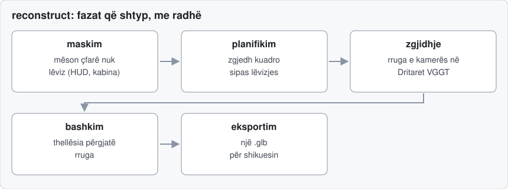

# Rindërtimi offline {#offline-reconstruction}

```bash
python -m heat3d_capture reconstruct lap.mp4 -o lap.glb [--solve-budget 260] [--fuse-interval 0.4]
```

Kodi: [`scan/offline.py`](https://github.com/Holdi601/3DHeat-GameCapture/blob/main/heat3d_capture/scan/offline.py),
[`pose/feedforward.py`](https://github.com/Holdi601/3DHeat-GameCapture/blob/main/heat3d_capture/pose/feedforward.py),
[`pose/vggt_model.py`](https://github.com/Holdi601/3DHeat-GameCapture/blob/main/heat3d_capture/pose/vggt_model.py),
[`pose/feedforward_source.py`](https://github.com/Holdi601/3DHeat-GameCapture/blob/main/heat3d_capture/pose/feedforward_source.py),
[`pose/solveprep.py`](https://github.com/Holdi601/3DHeat-GameCapture/blob/main/heat3d_capture/pose/solveprep.py).
Opsionet: [Referenca e komandave](commands.md#reconstruct).

## Pse një rrugë e dytë {#why-a-second-path}

Ndjekja shtesë pas shtese është e drejtpërdrejtë dhe e lirë dhe funksionon aty ku ka strukturë për t'u kapur: një
ambient i brendshëm, një rrugë, një hartë me mbulesë. Një **pistë garash është rasti i saj më i keq**: rruga është një
shirit i lëmuar me pak teksturë, horizonti zor se lëviz, dhe sapo disa poza zhvendosen asgjë më vonë
nuk i kthen mbrapa. Një xhiro del si një kurbë që endet në vend që të mbyllet.

Rruga offline u jep **dritare kuadrosh** një modeli që parashikon të gjitha kamerat e tyre së bashku,
kështu që çdo kuadër kufizon çdo tjetër drejtpërdrejt dhe jo përmes një zinxhiri. Ka nevojë për gjithë regjistrimin
para se të përgjigjet, prandaj nuk është e drejtpërdrejtë, dhe është e ngadaltë: minuta për çdo dritare në një GPU desktopi.
Gjithçka pas pozave - bashkimi, mbulimi, ngjyra, eksporti - është i njëjti kod si skanimi i drejtpërdrejtë:
pista e zgjidhur i jepet rindërtuesit si burim pozash, saktësisht aty ku shkon telemetria e Forza.

## Kërkesat {#requirements}

- **PyTorch** i përputhur me GPU-në tënde (nuk fiksohet nga ky projekt; instaloje para
  `requirements.txt`, shih [Runtime](runtime.md)).
- **`vggt`** - kodi i modelit VGGT (`from vggt.models.vggt import VGGT`), nga depoja
  GitHub e Meta; nuk është në indeksin e paketave.
- **`transformers`**, sepse rruga offline e ekzekuton thellësinë përmes `DepthEstimator` të PyTorch
  (Depth Anything V2 Small), jo përmes skedarit ONNX.
- Në praktikë një GPU CUDA; të dy modelet kalojnë në CPU, që nuk është praktike.

Asnjëri prej tyre nuk është në `requirements.txt`, sepse skaneri nuk i ka nevojë. Ata janë te
**`requirements-offline.txt`**, me varësitë e vetë VGGT (`einops`, `safetensors`,
`huggingface_hub`, `Pillow`):

```bash
.venv\Scripts\python -m pip install -r requirements-offline.txt
.venv\Scripts\python -m pip install --no-deps "vggt @ git+https://github.com/facebookresearch/vggt.git"
```

VGGT instalohet me `--no-deps` sepse metadatat e paketës së tij fiksojnë `numpy<2`, që pip do ta respektonte
duke ulur versionin e numpy që i duhet scipy këtu. `reconstruct` kontrollon për të gjitha këto
menjëherë pasi printon rreshtin e licencës (lista `OFFLINE` te
[`runtime/preflight.py`](https://github.com/Holdi601/3DHeat-GameCapture/blob/main/heat3d_capture/runtime/preflight.py)),
liston çfarë mungon me madhësi, dhe instalon vetëm pas një po - VGGT me `--no-deps`, si më sipër.
Nëse refuzohet, ose nuk ka terminal për të pyetur, del me kodin 1.

## Modeli dhe licenca e tij {#the-model-and-its-licence}

**VGGT**, `facebook/VGGT-1B`: **CC-BY-NC-4.0, vetëm jokomercial, dhe një rindërtim i bërë me të
e trashëgon këtë.** Komanda e printon këtë para se të nisë (`describe_licence`). Ekziston një
`facebook/VGGT-1B-Commercial` me licencë të veçantë, por është një depo me akses të kufizuar që jepet për çdo llogari nga
Meta, prandaj nuk mund të jetë e paracaktuara. `--model vggt-1b-commercial` zgjidh me të (dhe printon rreshtin e
licencës së tij në vend); pa akses të dhënë shkarkimi dështon. *Kodi* `vggt` është nën
"VGGT License" e vetë Meta, një marrëveshje materialesh kërkimore me një politikë përdorimi të pranueshëm (lexuar nga
`LICENSE.txt` i paketës). Shih [Modelet dhe licencat](models-and-licences.md).

## Ekzekutimi, fazë pas faze {#the-run-stage-by-stage}

Emrat e fazave janë ata që printon komanda.



### masking {#masking}

Një `FlowMask` mësohet nga **4 vozitje me 90 kuadro radhazi**, të qendërzuara në 1/8, 3/8, 5/8 dhe 7/8
të videos, në gri 960 x 540 (shih [FlowMask](reconstruction-capture.md#flowmask-what-never-travels)).
Shënimi i tij printohet dhe ruhet në përmbledhje. Një video më e shkurtër se 90 kuadro nuk merr maskë.

#### Maska e kamerës mësohet, nuk zbatohet {#the-camera-mask-is-learned-not-applied}

Maska **nuk** zbatohet te kuadrot që i jepen zgjidhësit. Maskimi i kabinës dukej i drejtë sipas
statistikave të tipareve (shumica e qosheve të zbuluara qëndrojnë në piksele të ngjitura te kamera) - por kjo është një
deklaratë për një detektor tiparesh, dhe zgjidhësi është një rrjet i stërvitur. Të matur sipas sa kthehet
rruga e rikuperuar mes hapave të njëpasnjëshëm (një makinë kthehet disa gradë; një ecje e rastësishme nëntëdhjetë),
kuadrot e papërpunuara dhanë kthesën më të vogël, kuadrot me kontrast të ngritur pak më shumë, kuadrot e maskuara qartësisht
më shumë, dhe të dyja së bashku më së shumti. Prandaj zgjidhësi merr kuadro të papërpunuara. Maska përdoret prapë për
të planifikuar hapësirën e kuadrove më poshtë, dhe ndjekësi shtesë e përdor në skanimin e drejtpërdrejtë.
(`solveprep.enhance`, që maskon dhe ngre kontrastin lokal me CLAHE, ekziston por nuk përdoret nga
kjo komandë.)

### planning: kuadro të ndara sipas lëvizjes {#planning-frames-spaced-by-motion}

`plan_by_motion` i zgjedh kuadrot e zgjidhësit sipas **sa lëvizi pamja**, jo sipas orës: një
interval i fiksuar u jep seksioneve të ngadalta kuadro që nuk i duhen dhe i la pa kuadro të shpejtat, ku
kuadrot e njëpasnjëshëm pushojnë së mbivendosuri mjaftueshëm për t'u lidhur.

- Zhvendosja e synuar: **5% e gjerësisë 960-pikselëshe** (48 px) zhvendosje mediane e tipareve ORB mes
  kuadrove të zgjedhur të njëpasnjëshëm, e matur në kuadro gri 960 x 540 me kontrast CLAHE, tipare vetëm në
  maskë.
- Fillon me një hapësirë 0.3 s; pas çdo hapi hapësira tjetër bëhet
  `gap x (0.5 + 0.5 x target / measured)`, e kufizuar në **0.15-2.0 s**, kështu që një matje e zhurmshme
  nuk e lëkund planin.
- Kur asgjë nuk përputhet, hapësira ngushtohet në 0.6 të vetes (të qenët shumë larg njëri-tjetrit është dështimi
  që shmanget).
- Ndalon në fund të videos ose te `--solve-budget` kuadro (e paracaktuara 260).

Më pak se 4 kuadro të planifikuar është gabim.

### solving: dritaret dhe qepja {#solving-windows-and-stitching}

Kuadrot e planifikuara dekodohen në 960 px gjerësi dhe zgjidhen në **dritare të mbivendosura me 16 kuadro,
6 të përbashkëta** me tjetrën (`plan_windows`; dritarja e fundit tërhiqet mbrapa që të mbarojë në kuadrin e fundit,
kështu që fundi i një kapjeje ka aq fqinjë sa mesi). Më shumë se **400** kuadro në një vozitje
refuzohen.

Çdo dritare: kuadrot ndryshohen në madhësi që ana e gjatë të jetë **518** dhe të dyja anët shumëfisha të **14**
(raporti mbahet - ngjeshja do ta gabonte fushëpamjen), shkallëzohen në 0..1, kalojnë nëpër VGGT
nën autocast bfloat16 (float16 mbaron eksponentin te koordinatat botërore të largëta). Ekstrinsikat e
kamerës konvertohen në rotacione bota-nga-kamera dhe qendra kamerash. Hartat e pikave nuk
mbahen si e paracaktuar.

Çdo dritare kthehet **në kornizën e vet arbitrare dhe shkallën e vet arbitrare**, prandaj dritaret
**qepen** në kornizën e të parës me një transformim ngjashmërie (rotacion, zhvendosje, një
shkallë) të përshtatur në kamerat që ndajnë me atë që është vendosur tashmë:

- **Rotacioni nga orientimet e kamerave**, jo nga pozicionet e tyre: kamerat e përbashkëta qëndrojnë përgjatë
  rrugës dhe janë pothuajse kolineare në një të drejtë, gjë që e lë një përshtatje vetëm me pozicione të pazonja
  të shohë rotacionin - çdo dritare kthehet dhe rezultati i qepur del i drejtë. Rotacioni është
  mesatarja e `target_R x source_R^T` e projektuar prapë mbi një rotacion të vërtetë (me një mbrojtje nga pasqyrimi).
- **Shkalla dhe zhvendosja nga pozicionet**, përgjatë burimit të rrotulluar.
- Kërkohen të paktën **4** kamera të përbashkëta; më pak është gabim.
- Mbivendosja është një e treta e dritares që shkalla të përcaktohet mirë; gabimi i shkallës që grumbullohet
  dritare pas dritareje është ajo që e bën një xhiro të spiralizohet.

Për çdo tegel regjistrohet mospërputhja më e keqe e kamerave të përbashkëta pas përshtatjes, në njësi të
hapësirës mesatare mes tyre (`seam_error`).

### fusing {#fusing}

Kuadrot çdo `--fuse-interval` sekonda (e paracaktuar 0.4) dekodohen në 960 px gjerësi, u jepet thellësi nga
Depth Anything V2 Small (PyTorch), dhe bashkohen me një pozë **të interpoluar** nga pista e zgjidhur në
vulën e tyre kohore (pozicion linear, rotacion sferik; `FeedForwardPoses`). Kuadrot jashtë
intervalit të zgjidhur kohor anashkalohen dhe nuk ekstrapolohen. Kamera përdor një fushëpamje horizontale **65 gradë**.
Pozat feed-forward mbajnë besueshmëri 0.85 në bashkim dhe mbulim.

### exporting {#exporting}

Rrjeta shkruhet si për një skanim të drejtpërdrejtë ([Dalja .glb](glb-output.md)), e emërtuar sipas videos.

## Përmbledhja {#the-summary}

```text
140 cameras solved over 182s
closure error 3.1% of path length
worst seam 0.42 frame spacings
<mask note>
wrote lap.glb
```

| Rreshti | Kuptimi |
|---|---|
| closure error | largësia nga kamera e parë te e fundit mbi gjatësinë e rrugës. Për një xhiro të vetme është masa e ndershme e zhvendosjes. Mbi 10%: "The lap does not close ... Treat the shape as unreliable." |
| worst seam | mospërputhja më e madhe e qepjes. Mbi 1.0: "Windows disagreed by up to N frame spacings at a seam, so part of the path is stitched on weak evidence." |
| no file | "Fusion produced no surface, so nothing was written." Kodi i daljes është atëherë 1. |

## Shkalla {#scale}

Rruga e qepur është në njësitë arbitrare të dritares së parë. Thellësia ankorohet duke triangularizuar
mes pozave të interpoluara (si për telemetrinë), kështu që gjeometria është në përputhje me rrugën -
por **rezultati nuk është në metra** përveç nëse rruga është. Asgjë në këtë komandë nuk fikson shkallën globale;
kalibrimi i tokës nuk zbatohet kur pozat vijnë nga një burim pozash.

## Gjendja e kësaj rruge {#state-of-this-path}

Me kuadro në interval të fiksuar, dritaret zgjidhen në një rrugë koherente në disa seksione të një xhiroje dhe
në një shkarravinë në të tjera; dështimet janë kthesat e ngushta, ku pamja lëkundet fort mes
kuadrove, dhe kampionimi më i dendur i atyre kthesave i rikuperon. Asnjë statistikë imazhi e provuar
(ndriçimi, detajet, numri i tipareve, raporti i inlier-ave, zhvendosja) nuk parashikoi paraprakisht cilat
seksione do të dështojnë. Pra hapësira nuk mund të planifikohet plotësisht
nga pamjet paraprakisht: duhet zgjedhur duke zgjidhur, duke matur rezultatin, dhe duke zgjidhur sërish
më dendur aty ku rruga nuk është një që mund ta kishte vozitur një makinë. Planifikimi sipas lëvizjes është ndërtuar; **rizgjidhja
adaptive nuk është**.
