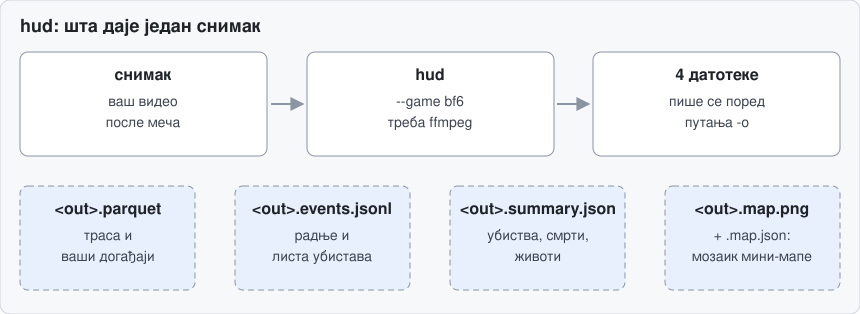

# Читање HUD-а из снимка {#reading-the-hud-from-a-recording}

`hud` чита HUD игре са екрана из **сопственог снимка** играча, после меча: **сопствене** радње
играча из искачућег прозорчића са поенима које игра показује испод нишана (убиства, асистенције,
оживљавања, снабдевања, заузимања...), смрти из екрана за пад и распоређивање, **сопствени**
траг са мини-мапе, и ток убистава поред тога, као временске догађаје. Све се пише као табела
за 3DHeat, са мозаиком мини-мапе као сликом мапе која се поставља испод ње.

Укратко: гледа ваш снимак меча и записује ваша убиства, смрти и где сте ходали.

```bash
.venv\Scripts\python -m heat3d_capture hud "<recording>.mp4" --game bf6 --player <name> -o out/match
```

Battlefield 6 је први профил игре.



## Шта ради, а шта не дира {#what-it-does-and-does-not-touch}

- Чита **видео фајл**: клип из ShadowPlay / Instant Replay, снимак из OBS-а, било шта што ffmpeg
  може да декодира. Никад не дира игру, њену меморију, њене фајлове или мрежу, и ради после
  завршетка меча. Видети [Правила](rules.md).
- Израчунава **само положај играча**, са сопствене мини-мапе играча. Маркери других играча на
  мини-мапи се прекривају и никад се не читају. Ток убистава се чува у целости, али само као оно
  што пише на екрану (ко, кога, чиме, када); ниједној особи осим играчу се не везује положај.
- OCR ради локално (RapidOCR са PaddleOCR моделима преко ONNX Runtime-а). Ниједан кадар ни исечак
  не напушта рачунар.
- Снимак приказује имена других играча, а мозаик је слика нивоа. Излази су за играчеву личну
  употребу; чувајте их локално.

## Захтеви {#requirements}

- **ffmpeg и ffprobe** у `PATH`-у. Ако постоји NVIDIA картица, за декодирање се користи она
  (`-hwaccel cuda`); иначе декодира процесор, неколико пута спорије.
- Пакети из `requirements.txt`, и OCR без сопствених зависности (тражи CPU верзију
  `onnxruntime`, која се сукобљава са DirectML верзијом коју пројекат користи):

```bash
.venv\Scripts\python -m pip install -r requirements.txt
.venv\Scripts\python -m pip install --no-deps rapidocr_onnxruntime==1.2.3
```

`rapidocr_onnxruntime` је читач текста (OCR) који са екрана чита имена и речи. `--no-deps` спречава
да замени DirectML `onnxruntime` пројекта.

Да бисте инсталирали ffmpeg на Windows-у: `winget install Gyan.FFmpeg`, па отворите нови терминал
и проверите са `ffmpeg -version`. Први пут у командној линији? Прочитајте [Пре почетка](before-you-start.md).

- Снимак **16:9** у било којој резолуцији (1080p, 1440p, 4K). Други облици слике (односи страница) се одбијају,
  јер би кутије профила пале на погрешне делове екрана.
- **Подразумевани распоред HUD-а** игре. Померен или скалиран HUD елемент се чита на погрешном месту.

## Опције {#options}

| Опција | Подразумевано | Значење |
|---|---|---|
| `video` | | Снимак. |
| `-o`, `--out` | име видеа, у тренутној фасцикли | Путања излаза **без** наставка; фајлови су `<out>.parquet`, `.events.jsonl`, `.summary.json`, `.map.png`, `.map.json`. |
| `--game` | `bf6` | Чији HUD да се чита. `bf6` (Battlefield 6) је за сада једини профил. |
| `--player` | нема | Име играча како га показује ток убистава. Пореди се без строгости (OCR меша `l`/`I`/`1`, `O`/`0`, `rn`/`m`). Без њега се име погађа (испод). |
| `--fps` | 5 | Узорци мини-мапе у секунди. Ток убистава се узоркује упола мање, искачући прозорчић са поенима и екрани смрти такође упола мање (четвртину док ниједан прозорчић није приказан), компас на сваке 3 s, листа одреда на сваких 15 s. |
| `--start` | 0 | Колико секунди у видео да се почне. |
| `--seconds` | све | Колико од видеа да се чита. |
| `--metres-per-pixel` | нема | Размера мини-мапе, ако је позната: метри по пикселу мини-мапе при уобичајеном зуму (мини-мапа је 296 пиксела широка на 1080p екрану). Без ње су позиције у тим пикселима; видети [Јединице](#north-and-units). |
| `--cpu` | искључено | Декодирај на процесору, и кад постоји NVIDIA картица. |

Напредак се исписује на сваких пет секунди; на крају играч, убиства, смрти, животи и написани
фајлови.

## Излази {#outputs}

### `<out>.parquet` - играчев траг и догађаји {#parquet---the-players-track-and-events}

Један ред за сваки узорак у коме је играч био у игри и мини-мапа је могла да се одреди, плус по
један за сваки његов догађај. Подножје садржи упутства за читање за прегледник (кључ `heat3d`,
`kind: heat3d-hud`), па прегледник мапира сваку колону без питања.

| Колона | Значење |
|---|---|
| `time` | Секунде од почетка видеа. |
| `event` | `position`; `start` (видео је почео усред живота), `spawn` (поново у игри после смрти или дугог прекида), `death`, `downed` и `revived` (са екрана смрти, испод), `end` (живот се завршио без објашњења); играчеве сопствене радње из искачућег прозорчића (`kill`, `assist`, `reviving`, `resupply`, `capture`... - [табела догађаја](#event-table)); и редови тока убистава о играчу, као `kill_feed`, `death_feed`, `teamkill_feed`, `suicide_feed`, `squadwipe_feed`. |
| `source` | Одакле је догађај реда: `points` (прозорчић), `screen` (екрани пада и распоређивања), `feed` (ток убистава); празно за редове позиције. |
| `text` | На `points` редовима: ознака како је исписана (`KILL`, `SQUAD DAMAGE ASSIST`...), или наслов (`DOUBLE KILL`, име ордења), или за непознату ознаку оно што је прочитано. |
| `points` | На `points` редовима: за колико се укупан збир прозорчића повећао у том тренутку. Кад је у истом узорку дошло више радњи (убиство и возило у којем је играч био), то је њихов збир, наведен уз сваку, а `shared` каже колико их дели. Празно кад збир није прочитан два пута, пре и после тренутка. |
| `subject`, `subject_side` | На `points` редовима: име које је прозорчић показао уз радњу (жртва убиства, саиграч којем је дата помоћ или снабдевање), и његова боја (`enemy`, `friendly`, `squad`). |
| `confirmed` | `feed` кад је ток убистава имао ред за исто убиство или смрт (у року од 3 s, иста жртва). |
| `x`, `y`, `z` | Положај на мозаику: `x` исток, `y` север, `z` 0 (подножје каже да је `z` горе). Север је прави север кад га је компас дозволио (видети `north_up` у сажетку). |
| `player` | Увек `me`. Само играчеви редови имају положаје. |
| `team` | `own`. |
| `session` | `<video name>#NN`, по један за сваки живот. Траке линија никад не прелазе преко сесије. |
| `heading` | Степени у смеру казаљке од севера (од горе мозаика кад север није познат): куда је поглед био окренут. |
| `dir_x`, `dir_y`, `dir_z` | Исто као вектор правца, за правац погледа у прегледнику. |
| `zoom` | Колико је мини-мапа била одзумирана у односу на свој уобичајени зум (изнад 1 у возилима). |
| `killer`, `victim`, `weapon`, `headshot`, `marker` | На редовима убиства и смрти који имају ред из тока: ред тока (испод). Убиство из прозорчића без реда из тока има име из прозорчића као `victim`; убиство из прозорчића приказано као HEADSHOT има `headshot` true. |

Сваки ред догађаја узима играчев положај у време догађаја (за смрт или пад, последњи положај пре
њега; за оживљавање, први после). Редови се уклапају директно у [топлоту линија](https://holdi601.github.io/3DHeat/line-heat.html)
у прегледнику: његов предлог бира `event`, почиње од `start`, `spawn` и `revived`, завршава на
`death`, `downed` и `end`, а `position` редови леже дуж руте. Остали догађаји су именовани тако да
предлог ниједан од њих не узме за почетак или крај: давање оживљавања је `reviving` (не `revive`),
држање тачке `defense`, саиграч који се појављује на играчу `teammate_arrived`, а редови тока
`kill_feed` и тако даље. `kill` није крај.

Снимак са два круга на две мапе даје два мозаика који се не могу повезати. Највећи је
`<out>.parquet`; сваки други са најмање 30 s трага пише се уз њега као `<out>.map2.parquet`,
`<out>.map2.map.png`, и тако даље.

### `<out>.events.jsonl` - играчеви догађаји и ток убистава {#eventsjsonl---the-players-events-and-the-kill-feed}

Један JSON објекат по реду, по редоследу времена, сваки са `source`:

- `points`: један за сваку радњу играча: `time`, `event`, `text`, `points`, `shared`,
  `subject`, `subject_side` (као у табели), `popup` (из ког прозорчића је дошла, нумерисано кроз
  цео пролаз), `seen` (колико очитавања су је показала), `confirmed`, и `x`, `y` где је играч
  био.
- `screen`: један за сваки пад и за свако оживљавање: `event` (`death`, `downed` или `revived`),
  `time` (кад је играч пао; за `revived`, кад су екрани нестали), `until` (последње виђање
  екрана), `screens` (`down` и/или `card`), `outcome` (`death`, `revived` или `unknown` кад снимак
  стане пре тога), `killer` (из реда тока, кад га има), `x`, `y`.
- `feed`: сваки ред који је ток показао, свачији:

| Поље | Значење |
|---|---|
| `time`, `last` | Први и последњи узорак у којима је ред очитан (секунде од почетка видеа). `time` је кад се убиство појавило, с тачношћу једног узорка тока (0,4 s при подразумеваној брзини). |
| `kind` | Са стране играча: `kill`, `death`, `teamkill`, `suicide`, `squadwipe`; за редове других играча `kill`, `squadwipe`, или `death` за ред без убице. |
| `killer`, `victim` | Имена, као најчешће очитано кроз све узорке који показују ред (дужа верзија побеђује кад је уобичајена њен почетак: име делимично скривено). `killer` је празно за ред који је показао само икону и жртву: смрт од света, или ред чија је убица већ нестала. |
| `killer_side`, `victim_side` | Из боје имена: `friendly` (играчев тим, плаво), `enemy` (наранџасто), `squad` (бледо зелена коју игра користи за играча и његов одред), `neutral` (ниједно од тога). |
| `weapon` | Класа иконе оружја у овом пролазу: `icon01`, `icon02`... Редови чије иконе личе једни на друге деле класу. Иконе нису именоване; нема списка по коме би се именовале. |
| `marker` | Мала икона између оружја и жртве: `skull`, `arrow`, `chevrons`, `crosses` или празно. |
| `headshot` | `marker == "skull"` - претпоставка, видети [Ограничења](#limits). |
| `seen` | Колико узорака тока је показало ред. |
| `me` | `killer`, `victim` или null. |
| `matched` | За играчеве сопствене редове: да ли је за њих нађена радња из прозорчића или екран смрти. |
| `x`, `y` (, `map`) | За играчеве сопствене редове: где је играч био. |

### `<out>.summary.json` {#summaryjson}

Играч (и како је нађен), одакле су дошли играчеви догађаји (`own_events_from`: прозорчић и
екрани, или сам ток убистава кад ниједно није очитано), убиства, смрти, K/D, хедшотови, асистенције,
дата оживљавања (`revives`) и примљена (`revived`), падови, заузимања, неутрализације, снабдевања,
лечења, поправке, уништена возила, резултат (збир укупних збирова прозорчића), сваки тип радње са
бројем (`actions`), број прозорчића, смрти које је показао само ток, бројач тока за убиства и
смрти и колико његових убистава се поклапа са убиствима из прозорчића, убиства у свом тиму,
самоубиства, уништени одреди, животи, секунде у игри, пређена даљина (у јединицама табеле),
редови тока, по мапи да ли је север горе и колико очитавања компаса се слажу, бројеви трага
(узорци, у игри, одређени, неодређени, острва), претпоставке које су направљене и време.

### `<out>.map.png` и `<out>.map.json` - мапа испод трага {#mappng-and-mapjson---the-map-under-the-track}

Мозаик сваке мини-мапе из пролаза, усредњен, без преклопа, окренут и размерен тачно као табела.
JSON пратилац садржи два сидра која тражи опција **Слика мапе** у прегледнику
([Слике мапа](https://holdi601.github.io/3DHeat/map-images.html) у документацији прегледника):
учитајте PNG са **Слика мапе...**, оставите **Окрени север/југ** укљученим, и унесите сидро 1 и
сидро 2 (`px`, `py`, `worldX`, `worldZ`) из пратиоца. Слика тада лежи тачно испод трага.

У слици су само делови нивоа које је играчева мини-мапа показала.

## Метод {#method}

### Декодирање {#decoding}

ffmpeg декодира на GPU-у, спушта на брзину узорковања док су кадрови још на картици, исече
регионе профила (мини-мапа, ток убистава, две траке компаса, листа одреда, искачући прозорчић са
поенима, речи на екрану пада, доњи десни угао), скалира сваки на фиксну величину и слаже их у
једну малу слику по узорку. Само та слика прелази у Python. Декодирање сваког кадра H.264 тока је
најмање време које пролаз може да траје.

Два радна ништа узимају узорке: један поклапа мини-мапе (OpenCV), други чита текст (ONNX Runtime).

### У игри или не {#in-play-or-not}

Квадрат са подсетником тастера (светао квадрат са тастером за мапу у њему, доле лево на мини-мапи)
исцртан је кад год је мини-мапа исцртана, а не на екранима смрти, убиства из перспективе
убице, распоређивања, менија или табле резултата. Његово присуство - светао, безбојан квадрат са
тамним словом у средини, јасно светлији од онога што га окружује - тражен у неколико пиксела око
свог места, је тест да ли је играч у игри. Један узорак који се не слаже ни са једним од два
суседна се занемарује.

Прекид у игри је смрт или промена круга (следећи део почиње са `spawn`) кад траје најмање 6 s, или
кад је смрт (из екрана, или реда тока који играча именује као жртву) дошла у 40 s пре њега; краћи
прекид без смрти (велика мапа је отворена) наставља живот. Мини-мапа остаје на екрану док је играч
оборен, па је оборен играч у игри.

### Траг {#the-track}

Мини-мапа се окреће са погледом и држи играча на фиксној тачки (измерено: средина, 49,7% доле).
Сваки узорак:

1. **Маскирање** онога што није ниво: јако обојени или скоро бели пиксели (маркери циљева, иконе
   одреда и возила, пингови, граница области игре, линије рута, текст), бледо жутозелена боја
   конуса погледа, диск око играчевог маркера, клин конуса изнад њега, квадрат са подсетником
   тастера и танка ивица.
2. **Особине**: SIFT тачке на сивој мини-мапи са изједначеним контрастом, унутар маске.
3. **Поклапање са мозаиком**, а не са претходним узорком: тачке се упоређују са особинама
   сачуваним до тада, у координатама мозаика, близу места где је играч последњи пут био; сличност
   (окрет, зум, помак) се уклапа помоћу RANSAC-а. Уклапање треба довољно унутрашњих тачака, зум
   у трећини последњег и помак мањи од трећине мини-мапе по узорку; уклапање тражено било где на
   мозаику (после смрти) треба двоструко више унутрашњих тачака.
4. **Ширење мозаика**: особине које мозаик још нема се додају (највише на сваких неколико
   десетина секунде кретања), а маскирана мини-мапа се усредњава у слику.
5. Играчева тачка коју пренесе уклапање је његов **положај**; горе мини-мапе које пренесе уклапање
   је његов **смер** на мозаику.

После тога, тачка која скочи више од 10 пиксела далеко од оба узорка пре и оба после (која се
слажу међусобно) се одбацује: мини-мапа понекад одговара на погрешан зум за један узорак. Сажетак
их broji (`dropped_as_jumps`).

Поклапање са мозаиком је оно што спречава да се грешке сабирају: повратак на место се поклапа са
особинама сачуваним први пут. Појављивање на месту које још није виђено покреће посебно **острво**;
сваки десети одређени узорак се пробава са другим острвима, и први добар погодак их спаја (мање се
премешта у веће, са својим трагом). Острва која се никад не споје (друга мапа, или земља која се
никад не дели) пишу се одвојено, као горе.

### Север и јединице {#north-and-units}

Трака компаса се чита на сваке 3 s: натписи се налазе по својој тинти (светлој, безбојној, груписаној
преко малих празнина, без ознака), сваки се чита појединачно, а два или више натписа одређују и
размеру траке и правац испод централне ознаке. Сваки очитани компас се упарује са горе мозаика
истог узорка; кружна медијана разлика, по очитавањима у 10 степени од ње, је окрет који ставља
север горе на мозаику. Примењује се кад се слажу најмање три очитавања и половина свих.

<a id="units"></a>Размера земље мини-мапе нигде није исписана на екрану, па су позиције у **пикселима
мини-мапе при уобичајеном зуму**: медијана зума пролаза је размерена на једну јединицу табеле по
пикселу мини-мапе од 296 пиксела (њена величина на 1080p екрану). Одзумирање у возилу се одузима
поклапањем, па је јединица иста пешке и у возилу. `--metres-per-pixel` све множи у метре кад је
размера позната (из познатог растојања на мапи, измереног једном).

### Ток убистава {#the-kill-feed}

Ток се чита на 2,5 узорка у секунди, али само кад су његови обојени пиксели приметно промењени
или је прошло 2 s. Редови текста се налазе детектором OCR-а; ред чија слика одговара једном очитаном
у претходном узорку (редови се померају, па се можда померио) узима тај текст уместо да се поново
чита. Редови премали за име, или са косом цртом (бројач fps-а у том углу), се одбацују.

Редови се групишу у врсте по висини; у врсти је најлевље име убица, а најдесније жртва. Суседни
делови исте боје се спајају (име са размаком). Један ред који је прешао преко иконе из једног имена
у друго се сече на најширем размаку кад се половине разликују по боји, а свака половина се чита
поново. Једно име у колони жртава са иконом одмах лево од њега је ред без убице. Два дела исте
боје без иконе између њих су једно име чији је убица нестао, а не убиство.

**Стране** долазе из боје. Имена су исцртана са извесном провидношћу, па се тест ради по томе
колико је текст далек од сопствене позадине: знак црвене минус плаве у тој разлици је наранџасто
(непријатељ) или плаво (пријатељ) на било којој позадини; ниједно од та два, са зеленим изнад друге
две, је боја одреда.

**Иконе**: између имена, пиксели у боји убице чине силуету оружја; мала одвојена икона непосредно
пре жртве је маркер, именована по облику (мрља са рупама за очи је лобања; мали троугао стрелица;
више делова је укрштене линије).

**Догађаји**: ред очитан поново, са оба имена иста (сличност 0,7 после свођења уобичајених OCR
замена, једна 0,8; пресечено очитавање се поклапа са почетком целог имена), је исти догађај, док
је догађај последњи пут очитан мање од 5 s раније и стар је мање од 14 s - ниједан ред не остаје
горе дуже, па исти пар касније значи ново убиство. Ред без убице се поклапа само по жртви. Време
догађаја је његово прво виђање; његова имена, стране и маркер су већина по виђањима; редови
очитани само једном се одбацују.

**Играч**: `--player`, па најсветлији (истакнути) ред листе одреда кад има најмање три очитавања и
60% се слаже, па име које је ток најчешће исцртао у боји одреда. Иначе сажетак каже да је играч
непознат, и ниједан ред тока се не приписује њему. (Прозорчић и екрани смрти су играчеви сопствени
било које да је његово име; не требају им име.)

### Искачући прозорчић са поенима {#the-points-popup}

Све што играч освоји, Battlefield 6 приказује у једном прозорчићу лево и испод нишана - на истом
месту пешке, у возилу и кроз нишан:

```
            [ RIBBON ] (icon)          наслов, понекад: ордење или вишеструко убиство
      (icon)(icon)(icon)  300          по једна икона за сваку радњу; текући збир прозорчића
                Some_Name              о коме је било, на тренутак: наранџасто непријатељ, плаво саиграч
    [ KILL x2 ] [ VEHICLE DESTROYED ]  по једна ознака у оквиру за врсту радње, са бројем
```

Прозорчић расте док играч наставља да осваја: ново убиство претвара `KILL` у `KILL x2`, додаје
икону и подиже збир; нова врста радње додаје ознаку. Ред ознака показује последње неколико врста
(старија клизи ван, и броји даље кад се врати). Око три секунде после последње радње прозорчић се
склапа у једну линију (`[KILL x2] 300`) и нестаје. Текст је светлосиве боје, ознаке у танким
оквирима, збир великим цифрама почев од x 760 на екрану 1920x1080, а ознаке поравнате desno до x 750.

Чита се 2,5 пута у секунди: детектор OCR-а налази редове текста, читају се само редови на једном
од редова прозорчића (натписи нишана у истом подручју се не читају), а ред чија слика одговара
једном прочитаном у претходном узорку узима тај текст. Ред који је пређен из иконе, имена или
склопљене ознаке у збир (`Name10`, `REVIVE185`) се сече тамо где збир почиње (x 755) и обе половине
се читају поново. Док ниједан прозорчић није приказан, сваки други узорак се задржава непрочитан;
кад следећи покаже прозорчић, задржани се прво чита, па се почетак прозорчића налази до узорка.

**Ознаке** се упоређују са [табелом догађаја](#event-table) после свођења уобичајених грешака
препознавача (Q прочитано као O, цифра између слова, I за L, слово изгубљено на ивици): очитавање
је ознака кад је најмање 80% слично једној (85% за ознаке до пет слова) и јасно ближе њој него
било којој другој. Ознаке које је препознавач спојио (`CAPTUREDORDERCOMPLETED`) се раздвајају
скидањем познатих ознака са почетка. Број је `x2`, `X3`, случајни знак и цифра, или цифра одмах
после ознаке. Светлосивен, великим словима исписан ред у реду ознака који се ни са чим не
поклапа се чува као радња `points` са својим текстом; ред који је део познате ознаке у истом
прозорчићу (`DESTROYED` поред `VEHICLE DESTROYED`) не. Наслови изнад збира (светла поља, таман
текст) су `multi_kills` (`DOUBLE KILL` ...) или `ribbon`. Име је обојени ред између збира и
ознака; његова страна долази из боје као у току.

**Прозорчићи и радње**: очитавања са мање од 0,9 s празнине између њих су један прозорчић. Прозорчић
који изгледа да се завршио и врати пре него што је могао да нестане (у року од 3,2 s од последњег
раста), са сваком ознаком на броју или већем и збиром не мањим, је исти прозорчић изгубљен на
тренутак (замућење, светла позадина) - ништа у њему се не броји два пута. У прозорчићу, коначни
број ознаке је највећи број очитан најмање два пута; њена k-та радња је датирана на прво очитавање
које показује број k или већи. Број очитан у само једном узорку није радња - осим убиства које
ток убистава потврђује (играчев ред у року од 3 s који ниједно друго убиство није узело): кратку
ознаку KILL препознавач најчешће чита само једном. Наслов се броји једном по прозорчићу, кад је
очитан два пута. `points` је колико је збир - рачунајући само збирове очитане два пута заредом -
порастао од узорка пре радње до узорка после ње.

Непозната линија се сматра ознаком само у реду познатих ознака у истом очитавању (или, без познате
ознаке, кад нема ни имена), па се име нацртано бојом коју тест стране не може одредити не узима
за једно.

### Смрти и оживљавања {#deaths-and-revives}

Кад играч падне, игра то каже испод центра екрана (MAN DOWN, REQUEST REVIVE, SKIP (HOLD), NEARBY
MEDICS; кад је оживљавање затражено, REVIVE REQUESTED, CANCEL REQUEST), а картица у доњем десном
углу именује ко га је оборио, са DAMAGE LOG или PLAYER CARD испод и редом "YOU n - n FOE" изнад.
Ако је убијен одмах (фаталним хедшотом), види се само картица. Затим или саиграч оживи играча - екрани
нестану и игра се наставља - или играч искрвари или одустане, па долази екран распоређивања, са
DEPLOY у доњем десном углу.

Ове речи се читају заједно са прозорчићем, у истом пролазу OCR-а (прозорчић, трака екрана пада и
доњи десни угао сложени у једну слику): 2,5 пута у секунди док је прозорчић приказан, 1,25 пута
иначе. Угао је укључен само кад је играч ван игре или је виђен као оборен у последње 3 s; у игри
садржи само број муниције.
Виђења на мање од 4 s једно од другог чине једну епизоду (најмање два виђења). Епизода је **смрт** кад
се екран распоређивања види у року од 12 s од њеног краја, или кад је играч ван игре 3 s после ње и
остаје тако најмање 6 s; то је **оживљавање** (`downed`, па `revived`) кад је играч још у игри 3 s
после нестанка екрана; `unknown` (записано као само `downed`) кад снимак стане пре тога. Време смрти
је кад је играч пао: ред тока који га именује као жртву, кад постоји у року од 3 s пре епизоде, иначе
прво виђање епизоде умањено за пола интервала очитавања. Положаји после смрти се изостављају из
руте до екрана распоређивања.

Смрт са тока коју ниједна епизода не објашњава (екрани су промашени) је и даље `death`, са `source`
`feed`, и суди се као и пре: ако играч остане у игри више од 40 s после ње, био је оживљен.

### Табела догађаја {#event-table}

Шта свака ознака, наслов и екран постаје. Неколико ознака може бити један догађај; `text` чува коју.

| Догађај | Из | Значење |
|---|---|---|
| `kill` | KILL; HEADSHOT | Играч је убио некога (име је жртва). Убиство у глави приказује HEADSHOT уместо KILL: `text` каже који, а `headshot` је true. |
| `assist` | ASSIST, KILL ASSIST, DAMAGE ASSIST, SQUAD DAMAGE ASSIST | Штета нанета некоме кога је саиграч убио. |
| `kill_assist` | ASSIST COUNTS AS KILL | Асистенција коју игра рачуна као убиство. |
| `suppression`, `suppression_assist` | ENEMY SUPPRESSION; SUPPRESSION ASSIST | Сузбијајућа ватра на непријатеља; на једног кога је саиграч после убио. |
| `smoke_assist` | SMOKE ASSIST, SQUAD SMOKE ASSIST | Дим који је прикрио саиграча. |
| `spot`, `spot_assist` | SPOT, SPOTTED, ENEMY DESIGNATION; SPOT ASSIST, SPOT BONUS | Откривање непријатеља; убиство онога кога је играч открио. |
| `driver_assist` | DRIVER ASSIST | Убиство од стране стрелца играчевог возила. |
| `reviving`, `reviving_bonus` | REVIVE, SQUAD REVIVE; CONCEALED REVIVE | Играч је оживео саиграча; бонус за то под заклоном. |
| `heal` | HEAL, SQUAD HEAL | Играч је излечио саиграча. |
| `resupply` | SUPPLY, RESUPPLY, SQUAD SUPPLY | Саиграч је узео муницију од играча. |
| `repair` | REPAIR, VEHICLE REPAIR, SQUAD REPAIR | Играч је поправио возило. |
| `capturing`, `capture` | CAPTURING, RECAPTURING; CAPTURED, OBJECTIVE CAPTURED | Тик заузимања; заузет циљ. |
| `neutralizing`, `neutralize` | NEUTRALIZING; NEUTRALIZED, OBJECTIVE NEUTRALIZED | Исто за свођење непријатељског циља на неутралан. |
| `defense` | DEFENDING, OBJECTIVE DEFENDED | Држање циља. |
| `offensive`, `defensive` | OFFENSIVE; DEFENSIVE | Бонус за радњу у близини напађеног циља; одбрањеног. |
| `order` | ORDER COMPLETED | Извршено наређење одреда. |
| `vehicle_damage`, `vehicle_disabled`, `vehicle_destroyed`, `vehicle_destroyed_assist` | VEHICLE DAMAGE; VEHICLE DISABLED; VEHICLE DESTROYED; VEHICLE DESTROYED SUPPORT | Штета непријатељском возилу, до уништења, или помоћ у уништењу. |
| `equipment_destroyed` | EQUIPMENT DESTROYED | Уништен непријатељски уређај. |
| `forced_bail` | FORCED BAIL | Непријатељ приморан да напусти возило. |
| `squad_wipe` | SQUAD WIPE | Убијен последњи члан непријатељског одреда. |
| `savior`, `avenger` | SAVIOR; AVENGER | Убиство непријатеља који је повређивао саиграча; онога који је управо убио једног. |
| `teammate_arrived` | SPAWNED ON, SPAWN ASSIST, VEHICLE SPAWN, SQUAD VEHICLE SPAWN | Саиграч се појавио на играчу или у његовом возилу. |
| `transport` | TEAM TRANSPORT | Превоз саиграча у возилу. |
| `fortify` | DEFENSE DEPLOYED | Одбрана коју је играч подигао. |
| `points` | било шта друго у реду ознака | Радња коју табела не познаје: `text` је оно што је прочитано. |
| `multi_kills` | DOUBLE KILL, TRIPLE KILL, QUAD KILL, MULTI KILL (наслов) | Убиства у брзом низу. |
| `ribbon` | било који други наслов | Ордење, по свом имену (BALLISTIC, TANK BUSTER, ENGINEER EXPERT, SPEARHEAD...). |
| `downed` | екран пада, па игра | Играч је пао и био је оживљен. |
| `revived` | нестанак екрана, игра се наставља | Саиграч је оживео играча. |
| `death` | екран пада или картица, па распоређивање или ван игре | Играч је погинуо. |

Текстови у табели су виђени у тест снимцима, осим ових, који су уобичајена имена серијала игре и
стоје у табели да би били именовани, а не сачувани као `points`: HEADSHOT KILL, ASSIST, KILL ASSIST,
ASSIST COUNTS AS KILL, SPOT, SPOTTED, SPOT ASSIST, SPOT BONUS, SQUAD REVIVE, HEAL, SQUAD HEAL, RESUPPLY,
SQUAD SUPPLY, REPAIR, VEHICLE REPAIR, SQUAD REPAIR, VEHICLE DISABLED, SQUAD WIPE, AVENGER, облици
OBJECTIVE ..., и наслови TRIPLE KILL, QUADRUPLE KILL и MULTI KILL. Игра на другом језику исписује
друге речи: њене ознаке се појављују као `points` са оним што је прочитано - не погрешно као
позната радња - са својим збировима и именима; а пошто се екрани смрти препознају по енглеским
речима, смрти тада долазе само из тока убистава, као редови `death` са `source` `feed`.

## Шта је проверено {#what-is-verified}

Проверено оком на тест снимцима (играчевим, нису део репозиторијума), цртањем узорака насумце и
упоређивањем сваког са кадровима око њега:

- **Играчеве сопствене радње.** Свака узоркована радња из прозорчића била је стварна радња те врсте,
  нађена у року једног очитавања (0,4 s) од свог времена; већина вредности и имена била је тачна
  (имена на неким писмима, као ћирилица, могу изаћи искривљена). Сваки узоркован екран смрти је нађен.
- **Ток убистава.** Велика већина редова тока нађена је са оба имена тачна; ситне OCR грешке (велико
  I прочитано као мало l) су дозвољене. Имена нацртана глифовима које сама игра приказује као
  квадрате могу бити пропуштена. Стране (боје) су погрешне за неколико процената имена.
- **У игри.** Тест квадрата са подсетником тастера слагао се са кадром у сваком узорканом тренутку.
- **Траг.** Нема истине о томе где је играч био, па се траг проверава према самом снимку: две
  мини-мапе се поклапају **директно једна са другом**, и тај помак се пореди са помаком између две
  табеларне позиције. Медијана неслагања је око 1-3 пиксела мини-мапе (испод 1% ширине мини-мапе),
  више на гужвеној, одзумираној мини-мапи. Очитавања компаса се слажу са мозаиком у 10 степени
  скоро увек.
- **Време извршавања.** Декодирање на око 5 пута брже од реалног времена је већина посла на
  десктоп GPU-у; читање искачућег прозорчића са поенима додаје око петину до половине.

Погледом се види: сваки мозаик има непрекидне путеве и зграде кроз животе који су га изградили, а
путање различитих живота по истом путу леже једна на другој. Део где се зум мини-мапе мења може
изаћи предугачак - видети [Ограничења](#limits).

Тестови (`tests/test_hud_*.py`) цртају све што читају: измишљен ниво путева, зграда и котура,
мини-мапе шетњи кроз њега са преклопима које има права мини-мапа, траке компаса, редове тока
убистава са измишљеним именима. Проверавају да се петља прати до два пиксела и да се затвара, да
стојећи играч остаје на месту док се поглед окреће, да се прате промене зума, да се споји
појављивање на другом месту кад се путање састану, да окрет севера и преокрет по y стављају траг тамо
где је заиста ишао, да сидра слике мапе поравнавају траг испод ње, и парсирање тока, стране, маркере
и уклањање дупликата. За играчеве сопствене радње цртају прозорчиће са поенима измишљеним именима и
ознакама и проверавају табелу ознака и толеранцију на грешке препознавача, ознаке спојене заједно,
редове прозорчића, сечење збира из имена, бројање док прозорчић расте, наставак после тренутка
без очитавања, клизање ознаке ван и назад, или крај; да се број очитан једном чува одвојено;
смрти, оживљавања и исходе из речи екрана; и, на измишљеном мечу, да се радње, смрти и оживљавања
нађу у табели тамо где је играч био, редови тока поред њих под својим именима, и да се рута
завршава на смрти, а не на оживљавању.

## Ограничења {#limits}

- **Јединице су пиксели мини-мапе**, не метри, осим ако није дато `--metres-per-pixel`. Ништа на
  екрану игре не наводи земљишну размеру мини-мапе.
- **Мапира се само оно што је мини-мапа показала.** Мозаик покрива тло у радијусу пола мини-мапе око
  места где је играч ишао; два мозаика који никад нису делила тло (два круга на две мапе, или два
  живота на далеко удаљеним ћошковима велике мапе) остају одвојени фајлови са неповезаним
  координатама.
- **Траг је мини-мапин, на 5 узорака у секунди**, и ништа га не глача. Мини-мапа одзумирана далеко
  (хеликоптер у тест снимцима је одзумирао на 2,3 пута) показује мање детаља по пикселу, а ван
  области игре скоро ништа, па је поклапање тамо грубље. Млазњаци, и играч као путник, нису били у
  тест снимцима.
- **Грешке поклапања су локалне и не сабирају се**, али мозаик изграђен док се истражује ново тло може
  носити мали савијање који се исправља тек кад се тло поново види. Где се зум мини-мапе мења
  непрекидно (возило које убрзава), уклопљени зум може да одлута, и виђен је један такав део чија је
  даљина била око двоструко већа од праве. Мозаик изграђен од гужвене, одзумиране мини-мапе пешака
  је најмање тачан (грешке око 3 пиксела типично, до 18).
- **Нема оптимизације графа положаја.** Петља се затвара поклапањем сачуваних особина, а не тиме што
  се исправка разлаже по петљи.
- **Класе оружја још не раде.** Силуета иконе узета је из провидне иконе преко покретне позадине, и
  превише варира од узорка до узорка: тест снимци су дали 220 до 340 класа за 550 до 670 редова, где
  се поклапа неколико десетина оружја. Сматрајте `weapon` експерименталним. Класе су у сваком
  случају по пролазу, и нису имена.
- **Значења маркера нису сва позната.** Стрелица (`▸`) се црта пре играчевог сопственог имена, у
  редовима о њима; није врста убиства. Лобања се узима да значи хедшот; то је претпоставка, а не
  нешто што игра каже. `chevrons` и `crosses` (уништени одреди) су забележени онако како су виђени.
- **Имена у писмима која нису латиница** (ћирилица, на пример) излазе као најсличнија латинична
  слова: препознавач чита латиницу и кинески. Исти играч се чита на исти начин сваки пут, па се и даље
  поклапа, али текст није његово име.
- **Преклопи у углу тока** (бројач fps-а) могу да сакрију крај жртве у горњем реду. Текст бројача се
  препознаје и одбацује, а име скраћено на ивици се поклапа са својим пуним очитавањима, али име које
  је виђено само скраћено остаје скраћено.
- **Смрт коју ни екрани ни ток нису показали** и даље завршава руту, као `end`, кад играч напусти игру
  на 6 s или дуже.
- **Оживљавања примљена** долазе са екрана пада. Само за смрт са тока коју су екрани промашили она се
  још закључују (у игри више од 40 s после ње), и брзо оживљавање се тада не разликује.
- **Радње из прозорчића се датирају по очитавању**: у року од 0,4 s од првог појављивања ознаке; ознака
  која се анимира може бити очитана један узорак касније или раније.
- **Имена у редовима прозорчића** се читају као имена из тока: писма која нису латиница долазе
  искривљена, а понекад се име саиграча које лебди у свету близу прозорчића прочита као име радње.
  Радње без имена (тик заузимања, наређење) немају ниједно.
- **`points`** недостаје где збир није очитан два пута са обе стране радње, и дели се међу радњама
  које су дошле у истом узорку. Збир `score` у сажетку сабира коначне збирове прозорчића, па прозорчић
  чији збир никад није очитан два пута није у њему.
- **Ред ознака је прозор**: са четири или више врста у једном прозорчићу, најстарија ознака клизи
  улево, преко ивице области која се чита. Бројала се док је била у виду; број који добије док је
  наполовину ван екрана може бити пропуштен.
- **Прозорчић изгубљен дуже него што је могао да траје** (преко око 4 s нечитљивих узорака док је још
  растао) се узима за два, па се ознака са бројем већим од једног броји поново. Није виђено у доле
  наведеним провери.
- **Друге језичке верзије интерфејса**: ознаке долазе као `points` са својим текстом, а смрти само из
  тока (екрани смрти се препознају по енглеским речима).
- **Догађаји на кратком острву**: живот чији је траг био прекратак да се запише као мапа (испод 30 s)
  задржава своје догађаје у `.events.jsonl` без `x`, `y`, и ни у једној табели.
- **Распоред HUD-а је подразумевани BF6 распоред на 16:9.** Измењена размера HUD-а, палета за
  daltoniste или друга величина мини-мапе захтевали би сопствени профил.
