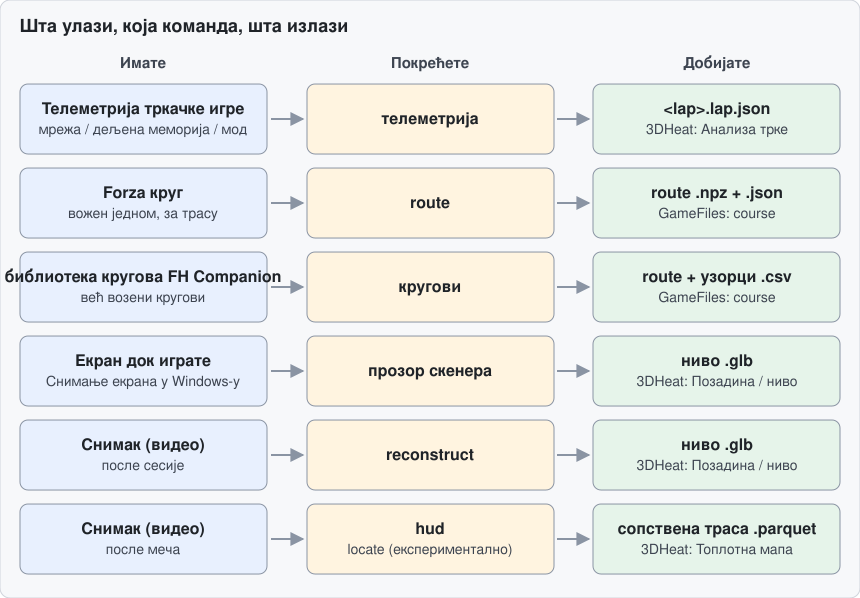

# 3DHeat GameCapture {#dheat-gamecapture}

**Шта је то?** Алат који бележи оно што вам тркачка игра каже о вашој вожњи, по једну
датотеку по кругу. Може и да реконструише грубу 3D мапу нивоа из снимка
ваше игре.

**Зашто бих га користио?** Да видите своје кругове у [3DHeat приказивачу](https://holdi601.github.io/3DHeat/):
где сте кочили, где сте били спори, како се два круга разликују. И да имате ниво испод
своје топлотне мапе кад нико нема његов 3D модел.

**Пример:** укључите Forza-ин Data Out, покрените једну команду, возите два круга. Две датотеке круга се појаве у
`laps\`. Превуците их на картицу Анализа трке приказивача.


Први пут у командној линији? Прво прочитајте [Пре почетка](before-you-start.md).

## Три посла {#the-three-jobs}

1. **Телеметрија круга.** Бележи сваки канал који тркачка игра објављује - Forza-ин Data Out,
   дељену меморију игара Assetto Corsa, мрежне токове ралли игара, BeamNG мод,
   Trackmania додатак - и пише по једну `heat3d-lap` датотеку по кругу или етапи, за
   картицу Анализа трке приказивача. iRacing не треба снимач: приказивач чита његове
   сопствене `.ibt` датотеке.
2. **Нивои из игре.** Претвара оно што је екран показао док сте ходали или возили кроз
   ниво у `.glb` 3D модел, који приказивач поставља испод топлотне мапе.
3. **Ваш меч, после њега.** `hud` чита HUD вашег сопственог снимка - ваше радње, смрти,
   трасу на мини-мапи и листу убистава. `locate` (експериментално: за сад поставља
   мало правих кадрова) утврђује где је сваки кадар снимљен, на 3D моделу нивоа.

Сва три прате једно правило: **ништа се не убризгава у игру и ништа се не куца**. Кадрови
долазе из јавног API-ја за снимање екрана, а телеметрија из интерфејса које игре
објављују за ту намену. Видите [Правила](../rules.md).



Код је Python (пакет `heat3d_capture`), лиценциран под MIT. Модели дубине и позе које
може да покрене имају своје лиценце - видите [Модели и лиценце](../models-and-licences.md).

## Брзи почетак {#quick-start}

### Снимај кругове {#record-laps}

Треба вам Python 3.10 или новији ([Пре почетка](before-you-start.md)). У PowerShell-у:

```powershell
git clone https://github.com/Holdi601/3DHeat-GameCapture
cd 3DHeat-GameCapture
python -m venv .venv
.venv\Scripts\python -m pip install -r requirements.txt

# Forza: Settings -> HUD and Gameplay -> Data Out = ON, IP 127.0.0.1, port 5300
.venv\Scripts\python -m heat3d_capture telemetry -o laps
```

**Требало би да видите** `listening on port 5300. Laps go to laps. Ctrl+C to stop.`, па по ред за сваки круг кад пређете линију, као
на слици изнад. Притисните Ctrl+C да зауставите. Превуците датотеке из `laps\` на картицу Анализа трке приказивача.
Свака друга игра је само једна `--game` опција даље:

```powershell
.venv\Scripts\python -m heat3d_capture telemetry --game acc -o laps
.venv\Scripts\python -m heat3d_capture telemetry --game dirtrally2 -o laps
```

Видите [Снимачи телеметрије](../telemetry.md) за сваку игру и опцију.

### Скенирај ниво {#scan-a-level}

Двоструко кликните **`scan.bat`** у фасцикли алата. Налази Python (и нуди да га инсталира
помоћу winget-а ако га нема), прави приватни `.venv`, и отвара прозор за скенирање.
Прозор каже шта недостаје, за шта служи сваки пакет и колико је велико преузимање, и
ништа не инсталира без вашег одобрења. Видите [Време рада и зависности](../runtime.md) и
[Прозор за скенирање](../reconstruction-scan-ui.md).

Ручно: `.venv\Scripts\python -m heat3d_capture.ui`.

Да реконструишете снимак ван мреже, с путањом камере решеном одједном (треба PyTorch,
пакет `vggt` и GPU - видите [Реконструкција ван мреже](../reconstruction-offline.md)):

```powershell
.venv\Scripts\python -m heat3d_capture reconstruct lap.mp4 -o lap.glb
```

## Мапа документације {#map-of-the-documentation}

| Страница | Шта обухвата |
|---|---|
| [Пре почетка](before-you-start.md) | Python, терминал, прва команда, уобичајене грешке |
| [Правила](../rules.md) | Без убризгавања, само објављени интерфејси, и шта то кошта |
| [Снимачи телеметрије](../telemetry.md) | Команда `telemetry` и преглед сваке игре |
| [Forza](../telemetry-forza.md) | Data Out, препознавање распореда, FH Companion релеј и његов `.tele.gz` |
| [Assetto Corsa игре](../telemetry-assetto-corsa.md) | AC, ACC, AC EVO, AC Rally из дељене меморије |
| [Ралли игре](../telemetry-rally.md) | EA SPORTS WRC, DiRT Rally 2.0 / 1 / DiRT 4, Richard Burns Rally |
| [BeamNG.drive](../telemetry-beamng.md) | `heat3d` мод протокола |
| [Trackmania](../telemetry-trackmania.md) | `Heat3dRecorder` Openplanet додатак |
| [iRacing](../telemetry-iracing.md) | Читање `.ibt` датотека у приказивачу |
| [Дељење круга и етапе](../lap-splitting.md) | `LapSplitter`, `CounterSplitter`, `LineSplitter`, `StageSplitter` |
| [Клизање, дрифт и изведени канали](../slip-and-drift.md) | Како се клизање скалира, и шта приказивач изводи |
| [Датотека heat3d-lap](../lap-format.md) | Формат датотеке круга, канали, јединице, `meta` |
| [Игре](../games.md) | По игри: како се снима, шта се шаље, које стазе се могу извести |
| [Команде](../commands.md) | `route`, `telemetry`, `laps`, `reconstruct`, `hud`, `locate`, корак по корак |
| [Референца команди](../cli-reference.md) | свака опција, генерисано из `--help` |
| [Читање HUD-а из снимка](../hud-video.md) | `hud`: ваше радње, смрти, траса на мини-мапи и листа убистава из снимка |
| [Налажење кадрова у нивоу](../locate.md) | `locate`: где је снимљен сваки кадар, према геометрији нивоа |
| [Реконструкција нивоа](../reconstruction.md) | Ток од кадрова до `.glb` |
| [Прозор за скенирање](../reconstruction-scan-ui.md) | Свака контрола, пречица и елемент прекривача |
| [Снимање, маске и квалитет кадра](../reconstruction-capture.md) | Windows Graphics Capture, кључни кадрови, HUD маске, савети о квалитету |
| [Дубина](../reconstruction-depth.md) | Depth Anything V2, ONNX Runtime, прављење модела |
| [Поза камере и размера](../reconstruction-pose.md) | Одометрија, поновна локализација, позе из телеметрије, размера тла, bundle adjustment |
| [Спајање, покривеност и боја](../reconstruction-fusion-and-texture.md) | Запреминска мрежа заузетости, мрежа покривености, слаба места, боја темена |
| [Излаз `.glb`](../glb-output.md) | Датотека коју приказивач учитава |
| [Реконструкција ван мреже](../reconstruction-offline.md) | `reconstruct`, VGGT прозори и спајање |
| [Модели и лиценце](../models-and-licences.md) | Величине Depth Anything V2, VGGT, пакети |
| [Време рада и зависности](../runtime.md) | Провера пред покретање, позадине, нивои перформанси |
| [Ограничења и провера](../limits.md) | Шта није урађено, и шта није проверено |
| [Ажурирања](../updates.md) | Провера издања и `python -m heat3d_update` |
| [Развој](../development.md) | Тестови, виртуелно окружење, распоред репозиторијума |
| [Одржавање ових страница](../maintaining.md) | Контролна листа издања за код и документацију |

## Део 3DHeat-а {#part-of-3dheat}

Датотеке које ово пише учитава **3DHeat приказивач** -
[извор](https://github.com/Holdi601/3DHeat), [документација](https://holdi601.github.io/3DHeat/).
Датотеке кругова иду на његову картицу Анализа трке, `.glb` нивои на његов панел Позадина / ниво,
табеле `hud` и `locate` на његову картицу Топлотна мапа; како приказивач чита табеле и датотеке мечева
описано је у [Једна датотека по мечу: `.3dheat`](https://holdi601.github.io/3DHeat/container.html) и
[Унос података](https://holdi601.github.io/3DHeat/getting-data-in.html).

| Алат | Шта ради | Документација |
|---|---|---|
| [3DHeat приказивач](https://github.com/Holdi601/3DHeat) | приказује топлотне мапе, трке и мечеве у 3D, у прегледачу | [документација](https://holdi601.github.io/3DHeat/) |
| [GameFiles](https://github.com/Holdi601/3DHeat-GameFiles) | стазе и нивои из датотека које игре испоручују, као 3D модели | [документација](https://holdi601.github.io/3DHeat-GameFiles/) |
| [GameCapture](https://github.com/Holdi601/3DHeat-GameCapture) | телеметрија кругова из тркачких игара; нивои реконструисани из снимка игре | [документација](https://holdi601.github.io/3DHeat-GameCapture/) |
| [Unreal Exporter](https://github.com/Holdi601/3DHeat-UnrealExporter) | додатак за Unreal Editor који извози ниво као 3D модел | [документација](https://holdi601.github.io/3DHeat-UnrealExporter/) |
| [CS2](https://github.com/Holdi601/3DHeat-CS2) | Counter-Strike 2 демои у датотеке меча; мапе у 3D моделе | [документација](https://holdi601.github.io/3DHeat-CS2/) |
| [Watcher](https://github.com/Holdi601/3DHeat-Watcher) | бележи вашу игру у позадини из онога што игре објављују | [документација](https://holdi601.github.io/3DHeat-Watcher/) |
| [Ext-WarThunder](https://github.com/Holdi601/3DHeat-Ext-WarThunder) | War Thunder репризе у датотеке меча | [документација](https://holdi601.github.io/3DHeat-Ext-WarThunder/) |
| [Ext-WoT](https://github.com/Holdi601/3DHeat-Ext-WoT) | World of Tanks репризе у датотеке меча | [документација](https://holdi601.github.io/3DHeat-Ext-WoT/) |
| [Ext-WoWs](https://github.com/Holdi601/3DHeat-Ext-WoWs) | World of Warships репризе у датотеке меча | [документација](https://holdi601.github.io/3DHeat-Ext-WoWs/) |
| [Ext-Squad](https://github.com/Holdi601/3DHeat-Ext-Squad) | Squad демои са сервера у датотеке меча | [документација](https://holdi601.github.io/3DHeat-Ext-Squad/) |
| [Ext-DCS](https://github.com/Holdi601/3DHeat-Ext-DCS) | DCS World мапе у 3D моделе | [документација](https://holdi601.github.io/3DHeat-Ext-DCS/) |
| [Ext-IL2](https://github.com/Holdi601/3DHeat-Ext-IL2) | мапе IL-2 Sturmovik у 3D моделе | [документација](https://holdi601.github.io/3DHeat-Ext-IL2/) |

Ко има отворен пројекат игре треба да користите Unreal извозник, који чита праву геометрију
и тачан је. Где се архиве саме игре могу читати, GameFiles извлачи тачну стазу. Реконструкција
из игре је за случај кад је доступан само екран.
