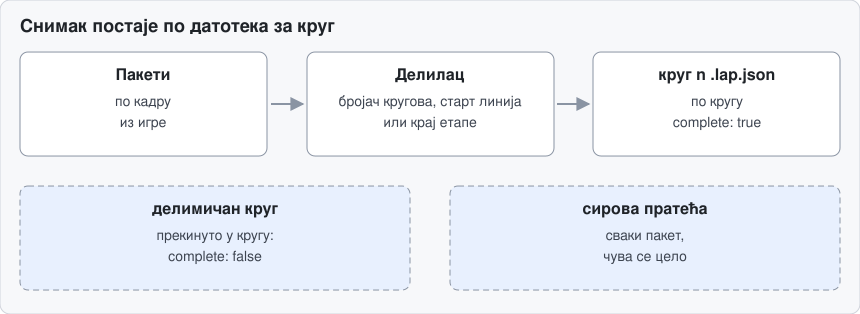

# Како се кругови и деонице деле {#how-laps-and-stages-are-split}

Снимач види један непрекидан ток узорака. Претварање тога у кругове ради један од четири делитеља, изабран према томе шта игра каже о круговима. Сви следе исту идеју: користе бројач саме игре где он постоји, а иначе круг налазе из положаја; никад не уписују одломак прекратак за поређење.

| Делитељ | Код | Користе га |
|---|---|---|
| `LapSplitter` | [`fulllap.py`](https://github.com/Holdi601/3DHeat-GameCapture/blob/main/heat3d_capture/telemetry/fulllap.py) | Forza |
| `CounterSplitter` | [`kunos.py`](https://github.com/Holdi601/3DHeat-GameCapture/blob/main/heat3d_capture/telemetry/kunos.py) | Assetto Corsa, ACC |
| `LineSplitter` | [`kunos.py`](https://github.com/Holdi601/3DHeat-GameCapture/blob/main/heat3d_capture/telemetry/kunos.py) | AC EVO, AC Rally, BeamNG |
| `StageSplitter` | [`rally.py`](https://github.com/Holdi601/3DHeat-GameCapture/blob/main/heat3d_capture/telemetry/rally.py) | EA SPORTS WRC, DiRT Rally 2.0, DiRT Rally, DiRT 4, Richard Burns Rally |

Trackmania дели вожње унутар свог додатка ([Trackmania](telemetry-trackmania.md)), а iRacing датотеке дели прегледач по бројачу кругова симулатора ([iRacing](telemetry-iracing.md)).

На **Ctrl+C** сваки снимач позива `flush()` свог делитеља, па се отворени круг или деоница упише ако прође исте минимуме као испод.

## LapSplitter (Forza) {#lapsplitter-forza}

Параметри: `minimum_metres = 400`, `gap_seconds = 2.0`.

За сваки декодирани пакет:

1. Ако је игров `timestampMs` скочио унапред за више од 2 секунде од последњег пакета, или се вратио уназад, отворени круг се прво празни.
2. Ако је `isRaceOn` 0 (игра није у трци), отворени круг се празни и пакет се одбацује.
3. Ако ниједан круг није отворен, отвара се један са `lapNumber` из пакета.
4. Ако се `lapNumber` разликује од отвореног круга, отворени круг се **затвара као завршен**; његово `seconds` је игров `lastLap` кад је позитиван. Круг затворен на овај начин се упише, ма колика му дужина била. Отвара се нови круг.
5. Пакет се додаје.

Снимач такође празни круг кад ниједан пакет не стигне 2 секунде по стенном сату (игра је паузирана, или је затворена усред круга).

**Пражњење** задржава отворени круг само ако има најмање 2 узорка и најмање 400 m `distanceTravelled`; уписује се као непотпун (`run`). Трка од тачке до тачке никад не броји други круг, па се увек тако завршава.

## CounterSplitter (AC, ACC) {#countersplitter-ac-acc}

Параметар: `minimum_metres = 300`. Сваки узорак добија `completedLaps` и време последњег круга са графичке странице.

- Први узорак отвара круг нумерисан тренутним `completedLaps`.
- Кад се `completedLaps` промени, отворени круг се затвара. Завршен је, са `seconds = време последњег круга у ms / 1000` (ако је позитивно), само ако је бројач порастао тачно за 1 - скок натраг на 0 (поновно покретање сесије) или за више од једног затвара га као непотпун.
- Затворени круг се упише само ако има узорке и најмање 300 m пређеног пута.
- Пражњење задржава отворени круг ако има више од једног узорка и најмање 300 m.

## LineSplitter (AC EVO, AC Rally, BeamNG) {#linesplitter-ac-evo-ac-rally-beamng}

Параметри: `radius = 15 m`, `minimum_metres = 300`, `stop_seconds = 8`.

Ове игре или немају бројач кругова на страници коју снимач чита, или возе деонице. **Линија је место где је снимање почело**:

1. Хоризонтални положај (`x`, `z`) првог узорка постаје линија.
2. Кад аутомобил пређе више од 5 m, правац од линије до аутомобила постаје правац круга.
3. **Заустављање** завршава вожњу: кад `speed` остане испод 1 m/s 8 секунди, отворени круг се празни (тако се завршава рели деоница: аутомобил стане на циљу).
4. **Прелазак линије**: после више од 300 m пута, узорци у радијусу од 15 m око линије се сакупљају. Кад аутомобил поново напусти тај радијус, најближи сакупљени узорак је прелазак. Ако је аутомобил тамо ишао истим смером као правац круга (тачкасти производ локалног правца и тог правца је позитиван), круг се затвара на том узорку; иначе се пролазак занемарује (аутомобил је прешао старт у супротном смеру).
5. `seconds` затвореног круга је време од његовог првог узорка до преласка. Круг је **завршен само ако је његов први узорак био бржи од 5 m/s**: круг који је почео из мировања је полазак, а не круг за поређење. Први круг снимања почетог са стартне решетке је зато увек непотпун; снимање почето на брзом кругу даје завршен први круг на следећем преласку.
6. Следећи круг почиње на узорку преласка (припада обојици кругова).

Кругови краћи од 300 m се одбацују. Пражњење (заустављање или Ctrl+C) задржава отворени круг ако има најмање 2 узорка и 300 m, као непотпун. BeamNG се празни на исти начин кад се возило ресетује (његов сат се враћа уназад), пре покретања новог делитеља, па се вожња пре ресетовања задржава.

Растојања су хоризонтална (`x`, `z`) за бројач пређеног пута и за тест линије, а пуна 3D за тест дужине од 300 m.

## StageSplitter (рели игре) {#stagesplitter-rally-games}

Параметар: `minimum_metres = 300`. Сваки узорак добија игров сат деонице, да ли игра каже да је аутомобил завршио, и по могућности игрово време за њу.

1. Ако је сат 0 или мање, или се вратио уназад за више од 0,5 s, отворена деоница се **напушта**: задржава се као делимична деоница ако није завршена, има више од 10 узорака и најмање 300 m. Сат 0 или мање такође одбацује узорак (аутомобил је на старту).
2. Ако ниједна деоница није отворена, отвара се нова (нумерисана 1, 2, ... за снимање).
3. Кад је деоница завршена, даљи узорци се занемарују док сат не оде уназад.
4. Сваки узорак се чува са `time` постављеним на игров сат.
5. Кад игра каже да је завршено, деоница је завршена; њено `seconds` је игрово време кад је дато и позитивно, иначе сат. Упише се ако је покрила најмање 300 m.

Шта значи "завршено" по игри:

| Игра | Завршено кад |
|---|---|
| EA SPORTS WRC | дужина деонице > 0 и пређено растојање на деоници >= дужина - 0,5 m |
| DiRT игре | број завршених кругова порастао изнад почетног броја деонице, или (догађај са једним кругом) растојање круга >= 99,9% дужине стазе |
| Richard Burns Rally | сат трке > 0 и растојање до краја <= 0 |

За RBR се вертикална оса и брзина фиксирају кад се деоница упише (видите [Рели игре](telemetry-rally.md#richard-burns-rally-rsf--ngp)).

## Време и растојање у датотеци круга {#time-and-distance-in-the-lap-file}

За сваки снимач осим Forza, `time` се поново постави тако да је први узорак круга 0, а `distance` је кумулативно 3D растојање између узастопних положаја. Forza користи сопствени тајмер круга игре и бројач растојања, поново постављене на исти начин.
