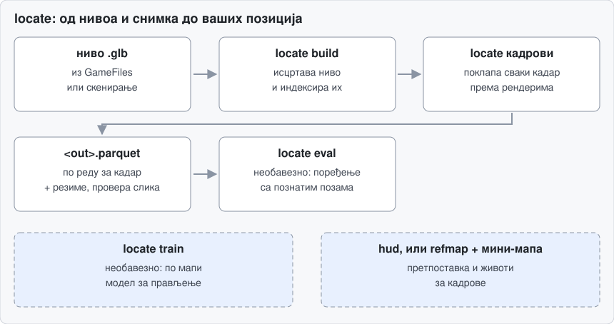

# Одређивање кадрова у нивоу {#locating-frames-in-a-level}

`locate` утврђује где је узет сваки кадар снимка игре - 3D положај камере и правац погледа - тако
што упоређује слику са рендерима геометрије нивоа. Намењен је играма које не чувају запис о томе
где је играч био: нема демо снимка, нема фајла реприза, нема телеметрије. Battlefield 6 је прва.

> **Експериментално.** На правим снимцима за сада одређује само мали део кадрова; видети
> [Прави кадрови: експериментално](#real-frames-experimental).

```bash
# Once per level: render it from every place a player can stand, and index the renders.
.venv\Scripts\python -m heat3d_capture locate build level.glb -o level.db

# Per recording: where was each frame taken?
.venv\Scripts\python -m heat3d_capture locate frames "<recording>.mp4" --db level.db -o out/match
```

Положај долази **из слике**, против целог нивоа, без претходне процене. Траг са мини-мапе из
[читача HUD-а](hud-video.md) је само резерва за кадрове које слика не може да одреди, а сваки ред
каже одакле је дошао од њих двоје.




## Шта ради, а шта не дира {#what-it-does-and-does-not-touch}

- Чита играчев **сопствени снимак** и фајл нивоа који је играч извезао из своје **сопствене копије**
  игре. Никад не дира игру, њену меморију, њене фајлове док ради, нити њену мрежу, и ради после
  меча. Видети [Правила](rules.md).
- Одређује **само сопствену камеру играча**: кадар је играчев сопствени поглед.
- Ниво, база направљена од њега и све што је исцртано из њега припадају издавачу игре. Чувајте их
  локално.

## Захтеви {#requirements}

- Оно што наводи `requirements.txt`, PyTorch (са pytorch.org, за GPU), и
  `requirements-locate.txt`:

```bash
.venv\Scripts\python -m pip install -r requirements-locate.txt
```

- GPU са OpenGL 3.3 (4.3 је брже) за рендере, и по могућству CUDA за моделе. На процесору ради, али
  споро.
- Модели се преузимају при првој употреби (око 450 MB): DINOv2 са Hugging Face-а, ALIKED и LightGlue
  преко kornia. Сви су лиценцирани за комерцијалну употребу; видети [Лиценце](#licences).
- **Ниво** као `.glb` (или `.gltf`) у прегледачевом систему, Y горе, **са основним текстурама боје**,
  онако како их пишу 3DHeat извозници (`ground:` / `structure:` делови; имена делова нису потребна).
  Једна јединица је један метар, осим ако највиши ниво фајла `extras.unit_metres` не каже другачије.
  GameCapture скен (`reconstruct`, прозор за скенирање) пише се у **центиметрима** и носи
  `extras.unit_metres: 0.01`, па се чита у правој величини. Нетекстуриран ниво ради знатно лошије;
  видети [Ограничења](#limits).

## Команде {#commands}

### `locate build <level> -o <db>` {#locate-build---o-}

Исцртава ниво са сваког места на коме играч може да стане и чува, за сваки рендер, његов положај и
један глобални дескриптор.

| Опција | Подразумевано | Значење |
|---|---|---|
| `level` | | `.glb` / `.gltf` нивоа. |
| `-o`, `--out` | | Фасцикла базе која се пише. |
| `--game` | `bf6` | Профил игре: висине очију, видно поље, HUD кутије, брзина (испод). `generic` за било који првоособни шутер. |
| `--eye` | профилов | Висине очију изнад пода у метрима, прво стојећа. По једен поглед базе за сваку висину. |
| `--fov` / `--vfov` | профилов | Хоризонтално видно поље снимка, или вертикално (Battlefield-ов клизач) за снимак 16:9. |
| `--spacing` | 2.5 | Метри између места са којих се узимају погледи. |
| `--yaw-step` | 30 | Степени између праваца погледа. |
| `--pitch` | 0 | Нагиби за рендеровање, у степенима нагоре. |
| `--positions` | нема | Табела (Parquet или CSV са `x`, `y`, `z` на стопалима, у систему нивоа) из које се узимају места, уместо са сваког пода: на пример излаз претходног пролаза. |
| `--shadows` | искључено | Бацај сунчеве сенке у рендерима (сунце нивоа, кад његов фајл именује `extras.sun`). |
| `--untextured` | искључено | Рендеруј само облик и светло. |
| `--box X0 Z0 X1 Z1` | цео фајл | Само места унутар ове кутије (јединице нивоа): област игре. |
| `--places` | `auto` | Одакле се узимају погледи: `nav` - играчи на висини очију изнад мреже навигације нивоа (`nav:` делови: тачно тамо где игра дозвољава ходање), камере возила на њиховој висини изнад `ground:` делова (терен и путеви) у радијусу од 50 m; `ground` - обоје изнад `ground:`; `floors` - изнад сваке површине окренуте нагоре (и кровова и сандука); `auto` - `nav` кад ниво има мрежу навигације, иначе `floors`. |
| `--head` | нема | Глава по мапи из `locate train`, за дескрипторе. |

Пише `<db>/db.json` (од чега и с чим је направљена) и `<db>/views.npz` (положаји, дескриптори).

### `locate frames <recording> --db <db>` {#locate-frames----db-}

| Опција | Подразумевано | Значење |
|---|---|---|
| `source` | | Видео, слика, или фасцикла слика (узете по редоследу имена, на размаку `--fps`). |
| `--db` | | База коју је записао `build`. Њен фајл нивоа мора још да буде тамо где је био (или `--level`). |
| `-o`, `--out` | `<source>.locate` | Путања излаза без наставка. |
| `--fps` | 2 | Кадрови одређени по секунди видеа. |
| `--start`, `--seconds` | све | Део видеа који се чита. |
| `--width` | 1280 | Ширина на којој се кадрови упоређују. |
| `--shortlist` | 8 | Погледи базе који се пробају по кадру близу претходне процене или одређивања. |
| `--search-shortlist` | 16 | Без претходне процене: погледи базе који се пробају по кадру ([претражују се заједно](#with-no-prior-frames-searched-together)). |
| `--no-search` | искључено | Без претходне процене: претражи сваки кадар сам и верује његовом одређивању без суседа. |
| `--accept-depth` | 0 (искључено) | Без претходне процене: веруј одређивању само ако је његово далеко растојање поклопљених тачака овај број пута веће од блиског. |
| `--accept-support` | 2 | Без претходне процене: суседи дуж живота који се слажу са одређивањем, потребни да му се верује. |
| `--checkpoint` | нема | Чува стање пролаза овде и наставља од њега ако постоји. |
| `--stop-file`, `--stop-process` | нема | Заустави се сам, са сачуваним стањем, излазним кодом 75, кад овај фајл постоји или кад процес чије име почиње овим радне (проверава се пре сваког кадра; може се поновити), да би дуг пролаз ослободио машину за игру. Иста команда наставља. |
| `--normalise` | нема | Лагана нормализација пре упоређивања: `clahe`, `gray`. |
| `--minimap` | нема | Табела команде `hud`: **резерва** за кадрове које слика не може да одреди. |
| `--prior-radius` | нема | **Необавезно убрзање**, искључено подразумевано: претражи само погледе базе на овом броју метара од положаја мини-мапе (треба `--minimap`). |
| `--minimap-anchor` | нема | JSON фајл који везује мини-мапу за ниво ([мини-мапа као претходна процена претраге](#the-minimap-as-a-search-prior)): мини-мапа сече претрагу од првог кадра; нађена одређивања тако су `visual+minimap-prior`. |
| `--no-level-search` | искључено | Са претходном проценом: кад ништа близу ње не одговара, не претражуј и цео ниво (брже). |
| `--lives` | табела `--minimap` | Табела команде `hud` чије смрти, распоређивања и оживљавања кажу кад је играч био у игри: положаји скачу само преко смрти ([животи из снимка](#lives-from-the-footage)). |
| `--no-sequence` | искључено | Одлучи о сваком кадру сам, а не дуж пролаза (испод). |
| `--fit-fov` | искључено | После пролаза, прилагоди видно поље најјачим одређивањима, по погледу, и исприши га. |
| `--check-every` | 0 | Такође сваки N-ти кадар, одређен или не, слика у `<out>.check`. |
| `--no-checks` | искључено | Не пиши слике провере визуелних одређивања (испод). |
| `--no-zoomed` | искључено | Не решавај зумиране погледе из одређивања суседа (испод). |
| `--no-grow` | искључено | Не тражи поново близу сваког одређивања кадрове око њега који још немају одређивање. |
| `--game`, `--eye`, `--fov`, `--vfov`, `--mask`, `--no-hud-mask`, `--max-speed` | профилове | Као горе; `--mask x,y,w,h` додаје кутију на екрану (на екрану 1920x1080) која није ниво. |
| `--vehicle-vfov` | профилов | Вертикално видно поље камера возила (Battlefield-ов клизач за возила). |
| `--settings` | најновији фајл подешавања | `bf6`: фајл подешавања игре из кога се читају видна поља (само за читање) кад није дато `--fov`/`--vfov`; подразумевано најновији `PROFSAVE*_profile` под `Documents/Battlefield 6/settings`. Садржи подешавања каква су сада, што можда није начин на који је старији снимак направљен. |

### `locate refmap <level> <deploy screen> -o <refmap>` {#locate-refmap----o-}

Поставља сопствену мапу игре на ниво: референцу према којој се мини-мапа чита
([мини-мапа, читана према нивоу](#the-minimap-read-against-the-level)). `<deploy screen>` је слика
екрана распоређивања која показује целу мапу, или снимак са `--at <seconds>` у таквом тренутку;
кутија мапе из профила се исече из ње (`--whole-picture` задржава све). Пише `<refmap>.png` (мапа
преузоркована на сопствени систем нивоа, `--mpp` метара по пикселу, подразумевано 0.5),
`<refmap>.valid.png` (где је то мапа, а не маркер или натпис) и `<refmap>.json` (систем и калибрација,
са тиме колико су плочице мапе биле удаљене од њега). `--topdown <prefix>` задржава ниво рендерован
одозго за следећи пролаз (`--topdown-mpp`, подразумевано 0.656 m; `--box` ограничава га).

### `locate minimap <recording> --refmap <refmap> -o <table>.parquet` {#locate-minimap----refmap---o-parquet}

Чита мини-мапу снимка према референтној мапи, кадар по кадар (`--fps`, подразумевано 2): положај,
смер и зум сваке мини-мапе која се поклапа, у систему нивоа, записан као табела мини-мапе са сидром
поред ње (`<table>.anchor.json`) коју `locate frames` узима као
`--minimap <table>.parquet --minimap-anchor <table>.anchor.json`. Са табелом команде `hud`
(`--hud`) његови животи се преносе; са сидром за ту табелу такође (`--hud-anchor`) прво претраживање
је око места где је онога што играча, а где се ниједна мини-мапа не поклапа, попуњава се трагом HUD-а
сам, пребачен на најближа одређивања са референтне мапе (`--hud-fill`, секунде, подразумевано 120;
0 га искључује). `source` табеле каже који је (`refmap`, `hud`).

### `locate eval <out>.parquet --truth <poses>` {#locate-eval-parquet---truth-}

Пореди резултат са познатим положајима камере: табела са `time`, `x`, `y`, `z` (око), `yaw`,
`pitch` у систему нивоа. `--offset` је помак сата (време истине = време видеа + offset); без њега се
помак тражи. `--unit-metres` претвара грешке у метре.

## Профили игре {#game-profiles}

| | `bf6` | `generic` |
|---|---|---|
| Висине очију | 1.6 m стојећи, 1.05 m чучећи (још није измерено у игри) | 1.65, 1.1 m |
| Видно поље | 55 степени вертикално, око 86 хоризонтално на 16:9: **прослеђите играчево** са `--vfov` | 90 хоризонтално |
| HUD маскиран | мини-мапа и листа одреда, ток убистава, компас, муниција, играчево оружје, прозорчићи, нишан | нишан |
| Најбрже пешке | 8 m/s | 8 m/s |
| Погледи се разликују | пешке, возило, зумирано (испод) | сваки кадар пешке |
| Камере возила | клизач возила (из фајла подешавања), возило маскирано, камера до 8 m изнад пода, 30 m/s | - |

Видно поље највише значи: кадар решен са погрешним има погрешну жижну даљину, и његов положај клизи
дуж погледа.

## Излази {#outputs}

### `<out>.parquet` {#parquet}

Један ред по одређеном кадру, у **систему нивоа** (Y горе, јединице нивоа), са упутствима за читање
у подножју (`kind: heat3d-locate`). Подножје именује сваку колону која нема своју улогу као додатну,
па је прегледач задржава све (његова картица за преглед их приказује).

| Колона | Значење |
|---|---|
| `time` | Секунде од почетка видеа. |
| `event` | `start` на првом реду једног живота, `position` на осталима. |
| `x`, `y`, `z` | Око, углађено унутар живота. Празно где ниједан извор није одредио кадар. |
| `yaw`, `pitch` | Степени: yaw око осе горе (0 дуж +X, расте ка -Z, што је игрин сопствени yaw у систему прегледача), pitch нагоре од хоризонтале. `pitch` је празно за редове мини-мапе. |
| `dir_x`, `dir_y`, `dir_z` | Вектор правца погледа. |
| `player`, `team`, `session` | `me`, `own`, и `<video>#NN`, по један за сваки живот. |
| `life` | Живот у коме је снимак показао кадар (из HUD смрти; 1 = први). Празно кад је ван игре (мртав, оборен, распоређује се) или кад животи нису очитани. `session` је живот трага, који се може делити и на скоку. |
| `source` | `visual` (из слике), `visual+minimap-prior` (из слике, претрага сечена на претходну процену мини-мапе), `minimap` (резерва), `minimap+nav-floor` (у затвореном: мини-мапа и под мреже навигације) или `none`. |
| `view` | `foot`, `vehicle`, `zoomed` или `screen` (испод). |
| `cam_x`, `cam_y`, `cam_z` | Камера која је видела кадар. Пешке и кроз нишан је око, па су `x`, `y`, `z` исти; у погледу треће особе из возила `x`, `y`, `z` су возило (модел помака испод), а камера јаше иза и изнад њега. |
| `hfov`, `zoom` | Хоризонтално видно поље којим је кадар решен, и за зумирани поглед његов зум према нормалном. |
| `confidence` | 0..1: колико треба веровати реду (испод). |
| `uncertainty` | Типична грешка реда, у јединицама нивоа: за визуелно одређивање из његових унутрашњих тачака и суседа, за ред мини-мапе из уклапања (испод). |
| `inliers`, `rmse` | Унутрашње тачке визуелног решења (PnP) и грешка пројекције (пиксели при радној ширини). |
| `x_raw` ... `pitch_raw` | Визуелно решење пре углађивања (и за одређивања која су гласањем избачена). |
| `kept` | Визуелно одређивање је преживело гласање о одступањима. |
| `note` | Зашто кадар није одређен или је избачен гласањем. |

### `<out>.summary.json` {#summaryjson}

Кадрови, визуелна одређивања, одступања, животи, редови по извору, уклапање мини-мапе (парови,
унутрашње тачке, остатак), време по кадру.

## Метод {#method}

### База {#the-database}

Места су тачке на сваком троуглу окренутом нагоре, распоређене равномерно (једна на сваких `--spacing`
на 3D мрежи, па спратови зграде добијају сваки своја). Свако се проверава из свог ока са шест малих
рендера дубине: камера унутар геометрије углавном види унутрашње стране, пузавац има нешто чврсто
изнад ока; оба се одбацују. Са сваког места ниво се рендерује на свакој висини очију, сваких
`--yaw-step` и сваког `--pitch`, а сваки рендер описује **DINOv2** (његови токени закрпа сажети
генерализованом средином, спојени са токеном класе).

Локалне особине и 3D тачке према којима се кадар на крају решава **не чувају се**: праве се поново
кад затребају, рендеровањем неколико погледа које је претрага изабрала, што траје милисекунде. Тако
база остаје на неколико стотина мегабајта, а не на десетинама гигабајта, и то омогућава доле
наведено прецизирање. Цена је што `frames` треба фајл нивоа и GPU, не само базу.

### Један кадар {#one-frame}

1. **Маскирање** онога што није ниво: HUD кутије профила и нишан, плус било који `--mask`.
2. **Претрага** по **целом нивоу**: дескриптор кадра против сваког погледа базе; најсличнијих
   неколико десетина, проређених да покривају различита места и правце, чине ужи избор.
3. **Упаривање**: сваки поглед из ужег избора се поново рендерује на величини и видном пољу кадра,
   са дубином. ALIKED тачке кадра и рендера се упаравају са LightGlue; упарени piksel рендера плус
   његова дубина је 3D тачка нивоа, па је свако упаривање 2D-3D кореспонденција; тачке на ивици
   дубине (чија дубина може припадати ономе што је иза њих) се одбацују.
4. **Положај**: PnP са RANSAC-ом (SQPnP), па робусно прецизирање које држи камеру усправно - први
   поглед се не окреће на страну - и минимизира грешку пројекције унутрашњих тачака.
5. **Да ли је могуће?** Положај мора бити на висини ока играча над подом и ван геометрије (рендер
   дубине право доле). Лажни текстурни поглед на другом месту - плочице пода упарене са зидом истог
   материјала - може дати стотине унутрашњих тачака на положају који ниједан играч не може да заузме;
   они се одвајају, колико год унутрашњих тачака имали.
6. **Рендер и поређење**: ниво се рендерује на решеном положају и поново упарује, што замењује
   поглед базе удаљен до неколико метара и десетак степени оним који се скоро поклапа са кадром.
   Понавља се док добија унутрашње тачке (највише два пута).
7. **Избор**: најјача три места (више од око 3 m једно од другог) се прецизирају један по један пре
   него што се један изабере. Лажни поглед може да води пре прецизирања; прави положај добија много
   више од њега.
8. **Пресуда**: `confidence` комбинује број унутрашњих тачака, најбољи други положај (`runner_up`) и
   грешку пројекције. Одређивање је `ok` са најмање 25 унутрашњих тачака, без другог положаја у 80%
   њихових, и поузданошћу најмање 0.85 - праг који мерења испод стављају на 97,5-99% тачних.

### Погледи {#views}

Кадар није увек очи играча. Профилов детектор чита из HUD-а који је то поглед, и кадар се решава
у складу с тим:

- **Пешке**: пешадијско видно поље и висине очију.
- **Возило** (Battlefield 6: дијаграм седишта, тастерске подсетнике `C CAMERA` и `E EXIT`, доле у
  средини): видно поље возила, само возило маскирано (доња средина екрана у његовом погледу треће
  особе), и камера до 8 m изнад пода. Одређивање је камере.
- **Екран** (тамне ивице око тамне средине: мапа распоређивања, мени, табла резултата): није поглед
  на ниво; прескаче се.
- **Зумирано** (нишан, оружје снајпера, први поглед возила: једна ивица екрана црна, обе тамне, око
  светле слике): не тражи се по нивоу - комадић нивоа кроз нишан не личи ни на један широк поглед
  базе - него се решава после пролаза из најближег одређивања у року од 6 s, испод. Искључује се са
  `--no-zoomed`.

### Зумирани погледи {#zoomed-views}

Уски поглед слабо одређује положај: корак назад са мало више зума изгледа скоро исто. Зато зумирани
кадар почиње од тога где му суседно одређивање каже да је нишан - пешке у оку тог одређивања, у возилу
2.5 m изнад тла испод средине возила (нишан тенка) - и од тога колико се можда померио од тада: 2 m, плус
4 m у секунди пешке или 8 у возилу, највише 12 m (`reach`).

1. **Смер и зум, положај задржан.** За сваки зум од 1, 1.2 (сопствени поглед возила, ужи од пешачког),
   1.5, 2, 3, 4, 6 и 8, ниво се рендерује са седишта у смеровима у року од 30 степени од суседовог (и,
   од 3x, са неколико нагиба). Тачке кадра упарене са рендером, са тачкама нивоа испод њих, су зраци
   из седишта; ротација се уклапа у њих по две (RANSAC) за жижне даљине од 0.75 до 1.3 пута од зумове,
   а тачка се слаже у углу који дозвољава да је седиште `reach` далеко на њеном растојању. Зум, смер и
   жижна даљина с којима се највише тачака слаже побеђују.
2. **Утврђено.** Те тачке затим уклапају положај, смер и жижну даљину заједно, по грешци пројекције,
   положај држан за седиште казном од два пиксела по `reach` померено; још једном рендеровано на
   одговору и поново уклопљено. Унутрашње тачке и грешка се броје у пикселима, а одређивање је `ok`
   по истој поузданости као било које друго.

Записани зум (`zoom`) је према видном пољу пешке из пролаза; `hfov` је решено. У возилу је записани
положај возила, 2.5 m испод нишана, као и за његов поглед треће особе.

### Возила: камера и возило {#vehicles-the-camera-and-the-vehicle}

У погледу треће особе из возила решени положај је камера праћења, која јаше иза и изнад возила и
окреће се око њега кад играч гледа около. Записани положај (`x`, `y`, `z`) је возила - тло испод
његове средине: камера плус профилов `vehicle_offset`, толико метара напред по хоризонталном правцу
погледа камере и толико доле. Камера остаје у `cam_x`, `cam_y`, `cam_z`. Претварање се врши пре
низа и трага, па се камера која се окреће око стојећег возила не узима за кретање. Подножје табеле
носи помак који је коришћен и да ли је измерен (`vehicleOffset`). Пешке и кроз нишан помака нема.

Како је измерен Battlefield 6 помак: на тачним одређивањима правих кадрова трећег лица тенка,
средина тенка је обележена на оку на кадру, а ниво рендерован на одређивању дао је тло на тој
тачки. Профил узима медијану: око 10 m испред камере и око 4 m испод ње. Обележавање је добро до
метра или тако нешто, и то је један тип возила: аутомобил или хеликоптер другачије јаше своју камеру.

### Без претходне процене: кадрови претражени заједно {#with-no-prior-frames-searched-together}

Глобални дескриптор једног кадра против целог нивоа је слаб сигнал, а унутрашње тачке једног кадра
не разликују право место од лажног. Зато се без претходне процене кадрови снимка прво описују и
претражују заједно (`search.py`), а одређивање се верује само уз кадрове око њега:

- **Ужи избор.** Сличности сваког погледа мере се према његовом сопственом просеку и растојању кроз
  снимак, да поглед који личи на сваки кадар престане да побеђује свуда. Сваки кадар оцењује ћелије
  мреже од 24 m према рангу њиховог најбољег погледа; најбоља путања кроз ћелије дуж сваког живота,
  у оквиру онога што играч може да пређе између кадрова, даје веровање по ћелији, а најбољи поглед
  сваке ћелије, најбоље веровани први, чини једну листу. Обична претрага је друга, и узимају се
  наизменично: мерење погледа према снимку кажњава место на коме играч једва да се помера, а ту
  обична претрага добро ради.
- **Веровање.** Кандидат се рачуна само ако његове унутрашње тачке покривају најмање 12% мреже 8 x 8
  преко кадра: лажни поглед је поновљени предмет, гомила контејнера, са стотинама унутрашњих тачака
  на неколико ћелија кадра. Одређивање се верује кад лежи на најбољој путањи кроз кандидате који се
  рачунају (испод) са најмање два суседа у року од 6 s која се слажу са њим. Кадар ван игре се уопште
  не претражује.
- **Ширење.** Расте се само из онога у шта се верује, и растуће одређивање мора покривати кадар на
  исти начин.

### Дуж пролаза {#along-the-run}

Сваки кадар задржава сваки физички могући положај који је нашао, по један за место (`candidates`),
а не само најјачи. Пролаз затим бира један по кадру - или ниједан - тако да изабрани положаји чине
путању коју би играч могао да пређе пешке или возилом, и да што више унутрашњих тачака лежи на њој:
скривени Марковљев модел, декодиран одједном (Viterbi). Лажни поглед који сам победи на једном кадру
губи од места са којим се слажу његови суседи; слаб кандидат кроз који пролази путања, са најмање
два сагласна суседа, постаје одређивање (`note`: chosen along the sequence); јако одређивање које
сви његови суседи оспоравају престаје да буде одређивање. Сусед се рачуна као сагласан само у року
од 6 s: даље раздвојено, растојање које би играч - а камоли возило - могао да пређе је толико велико
да слагање ништа не говори. Искључује се са `--no-sequence`.

### Времена кадрова {#frame-times}

Време реда `time` је сопствено време кадра у снимку, а не његов број по номиналној брзини кадрова.
Снимци одступају од своје номиналне брзине (за неколико десетина секунде унутар клипа, на онима који
су мерени), а све што кадар чита назад по његовом времену - слике провере, зумирани пролаз,
`locate train --real`, мини-мапа из команде `hud` - тражи по временској ознаци. Бројани кадрови би
слику провере померили за до толико од кадра који је одређен.

### Видно поље, из кадрова {#the-field-of-view-from-the-frames}

`--fit-fov` задржава најјача одређивања пролаза (по погледу) и прецизира положај и жижну даљину сваког
заједно, на његовим унутрашњим тачкама; медијана по њима је видно поље којим је снимак направљен,
исписано у сажетку (`hfov_fitted`) за `--fov` следећег пролаза. Блиске и далеке тачке се померају
другачије при промени жижне даљине него при промени положаја, а то је оно што га чврсто одређује; потребна
су одређивања са дубином у себи, а не равни зид.

### Модел по мапи {#a-per-map-model}

`locate train` обучава малу главу преко DINOv2 за један ниво, на рендерима тог нивоа, тако да глобални
дескриптор налази праве погледе за стварне кадрове, а не само за чисте рендере:

- **Глава**: сваки токен закрпе кроз двослојну пројекцију, сажет генерализованом средином преко закрпа
  које приказују ниво, спојен са пројектованим токеном класе. DINOv2 остаје замрзнут. Све ово је
  написано овде (MIT).
- **Парови**: место на ходљивом тлу и правац, рендеровани два пута из положаја до једног-два метра и
  десетак степени удаљених, при видним пољима до 10 степени једно од другог, под различитим светлом
  (сунце, сенке, амбијент), сваки кроз изглед сличан игри: грејдинг, магла по дубини, блум,
  вињета, дим, људи на путу, сопствено возило играча у погледима из возила, замућење покрета, шум, JPEG
  (`augment.py`). Маскирано као кадар. Места на неколико метара окренута на исту страну не броје се као
  негативи.
- **Прави кадрови**: кадрови са положајем који је сам пронашао цевовод (псеудо-ознаке: одређивања
  изабрана дуж пролаза) могу ући као парови - кадар и рендер на његовом положају - у другом кругу.
- **Губитак**: контрастан (InfoNCE) преко серије.

`locate build --head <head.pt>` прави базу са њом; `frames` је затим користи за кадрове.

| Опција `locate train` | Подразумевано | Значење |
|---|---|---|
| `-o`, `--out` | обавезно | Фајл главе који се пише (`.pt`). |
| `--steps` | 600 | Кораци обуке. |
| `--real TABLE VIDEO` | нема | Табела `locate frames` и њен снимак: њена поуздана одређивања улазе као прави парови. Може се поновити. |
| `--real-confidence` | 0.85 | Поузданост коју одређивање мора имати да уђе као прави пар. |
| `--spacing`, `--box`, `--places`, и опције профила | као код `build` | Где су места обуке, и профил игре. |

### Провера оком {#checking-by-eye}

Свако визуелно одређивање добија слику у `<out>.check` - `<time>s_<view>_visual.jpg`: кадар, и поред
њега ниво рендерован из камере одређивања са ивицама кадра нацртаним преко рендера. Где се поклапају,
одређивање је тачно. Пише се после што су пролаз и траг одлучили, па су слике тачно редови које табела
назива visual. Искључује се са `--no-checks`.

### Мини-мапа, читана према нивоу {#the-minimap-read-against-the-level}

Мини-мапа слепљена у један мозаик (из команде `hud`) није раван: њена размера клизи са зумом при којем
је свака мини-мапа поклопљена, место виђено два пута може бити нацртано два пута, а мозаик сваког клипа
је свој. Уклапање сличности одређене према неколико одређивања тада држи у близини њих, а на десетине
метара је далеко од њих. Зато се мини-мапа поставља помоћу самог нивоа, у два корака, и ништа се не
слепљује:

- **Референтна мапа** (`locate refmap`). Екран распоређивања црта целу мапу окренуту north-up, равну, у
  једној размери. Ниво рендерован право одозго показује исте ствари које стоје уздигнуте са тла
  (тенкове, зграде, зидове): на нивоу, њихова висина изнад тла у радијусу 15 m; на мапи, оно што је
  нацртано светлије од тла око њих. Мапа се поставља на ниво нормализованом унакрсном корелацијом
  њих двеју преко размере и малог окрета, прецизира се поклапањем плочица мапе једну по једну, и на
  крају свом мапом одједном око тог одговора (неколико десетина плочица оставља размеру отвореном за
  један процад, на крајевима мапе метре). Резултат је једна сличност, пиксел мапе према нивоу.
- **Мини-мапа, кадар по кадар** (`locate minimap`). Свака узоркована мини-мапа - исечак читача HUD-а и
  његова маска преклапања - упоређује се (SIFT) са референтном мапом у близини места где је играч
  последњи пут био, или било где кад се место не зна, и уклапа се сличност (окрет, зум, помак). Играчева
  тачка која кроз њу прође је положај, горе мини-мапе (конус погледа) је смер, а њена размера је зум -
  измерен, не претпостављен.
- **Где се не поклапа.** Екран распоређивања не црта ништа ван области игре; мини-мапа која показује
  углавном оно што лежи ван ње - играч на ивици мапе - нема шта да се упари. Тамо траг HUD-а сам
  замењује, пребачен за помак који су измерила најближа одређивања са референтне мапе (`--hud-fill`);
  колико је добар зависи од тога колико је мозаик добар близу тих одређивања.

На тест нивоу мини-мапа прочитана на овај начин била је на неколико метара (медијана) од поузданих
визуелних одређивања, једнако добра ван подручја на које је референтна мапа била уклопљена као и унутра.

### Мини-мапа као претходна процена претраге {#the-minimap-as-a-search-prior}

Трак мини-мапе из команде `hud` каже, за већину кадрова у игри, отприлике где је играч и на коју
страну гледа - у својим јединицама (пиксели мини-мапе, north up). Једном везан за ниво, сече претрагу
на мали део њега; сам положај и даље долази из слике, по истим правилима.

- **Сидро** (`--minimap-anchor <anchor.json>`): по једна сличност за мапу, од мини-мапе до нивоа -
  размера, окрет (са огледалом између north-up пиксела и оса нивоа), помак - уклопљена на поузданим
  визуелним одређивањима (поузданост 0.7 и више) неколико клипова. Мини-мапа сваког клипа је мозаик
  који је команда `hud` слепила сама, па сваки стоји на другом месту у јединицама мини-мапе; два мозаика
  исте мапе се разликују само помаком, нађеним упаривањем тачака између њих (помак који се највише
  слаже), а сваки мозаик је везан за једну референцу преко свих парова који се добро слажу. Фајл сидра
  носи сличност мапе, помак клипа (`clip_shift`) и грешку коју је сидро показало према одређивањима
  клипова изостављених из његовог уклапања (`median`, `p90`, метри).
- **Где и у ком правцу.** Смер мини-мапе је yaw камере: на мереним клиповима слагао се са решеним yaw-ом у
  2-5 степени. Зато се кадар прво упарује са рендерима направљеним тамо где мини-мапа ставља камеру - пешке
  око на тлу тамо, у возилу камера праћења иза и изнад њега (помак возила) - гледајући дуж смера:
  тачка и 4 m на сваку страну, на два нагиба (`seeds`). Тек кад ниједно од тога не да одређивање, пробавају
  се погледи базе унутар диска (30 m плус 90. перцентил грешке сидра).
- **Коригује се док пролаз тече.** Свако поуздано одређивање близу претходне процене каже колико је сидро
  ту промашено; медијана оних у року од 2 минута коригује процену, а њихов распон (најмање 5 m) замењује
  грешку сидра у радијусу диска - до 10 m: одређивања која се више не слажу говоре да је мини-мапа
  погрешна по месту, а не да би нешто 50 m даље било добро. Без одређивања у року од 2 минута процена се
  уопште не коригује (грешка на другом месту у клипу ништа не говори о овде).
- **Сидра са мрежом.** Сидро може носити и `grid`: x и z нивоа на правилној мрежи преко јединица мини-мапе
  клипа, читано билинеарно; унутар ње мрежа ставља тачку, ван ње сличност. Сидро табеле `locate minimap` је
  идентитет (њена табела је већ у систему нивоа).
- **Слаба уклапања.** Са претходном проценом, уклапање које је слабо (25 унутрашњих тачака или више, али не
  довољно поуздано само по себи) и лежи унутар диска се задржава - са нижом поузданошћу - за пролаз и
  траг да одлуче, а не одбацује се: дим, рушевине и срушени зидови остављају правим кадровима мање
  поклапања.
- **Извори.** `visual` - слика га је одредила, без претходне процене; `visual+minimap-prior` - слика га је
  одредила, претрага сечена на претходну процену; `minimap` - слика није, мини-мапа стоји уместо ње;
  `minimap+nav-floor` - у затвореном, доле.
- **У затвореном** мини-мапа води. Кадар који слика није одредила, пешке, где око на положају мини-мапе
  види ниво близу са свих страна (медијана растојања испод 8 m на четири стране) и без неба, је у затвореном:
  добија x и z мини-мапе и висину пода мреже навигације тамо - од неколико спратова, онај најближи последњем
  одређивању - са `source = minimap+nav-floor`, да буде јасно да га слика није одредила.

### Животи из снимка {#lives-from-the-footage}

Положај сме скочити само где је играч умро. Животи се не погађају из положаја - један погрешан
одређивање би отворио нови - него се читају из снимка: табела читача HUD-а бележи смрти које су показали
екрани пада и распоређивања (`death`), оборења које је саиграч оживео (`downed`, `revived`),
распоређивања (`spawn`) и где је игра почела и стала (`start`, `end`); `lives.py` их претвара у животе.
Смрт затвара живот, а први кадар игре после екрана распоређивања отвара следећи; оживљавање не сече живот
(играч је тамо где је пао), а кадрови док је оборен се не одређују; застој у менијима или учитавању дужи од
10 s га такође сече. Кадрови ван игре (мртав, распоређује се, оборен) се никад не одређују.

Унутар живота континуитет је строго правило: сваки корак највише брзина пута време између, плус 1.5 m.
Брзина је кадрова: пешке профилова, у возилу брзина коју је сопствени показивач возила исписао у року од
3 s (трећина више, и 2 m/s, за убрзавање) или, где не показује ниједну, граница његове класе. Дуж пролаза
(Viterbi) корак преко смрти је слободан на било којем растојању, сваки други корак ограничен; кадар који
би захтевао скок се изоставља - слабија страна контрадикције губи (мање унутрашњих тачака, мања подршка) -
и живот се никад не дели на њему. Где је изостављена страна сама јака (поузданост 0.9 и више, два или више
одређивања се међусобно слажу), пролаз не погађа: обе стране се задржавају и обележавају као
`jump without detected death` (пропуштена смрт, или стварна телепортација), и наводе се у сажетку. Резервни
положај мини-мапе прати исте животе.

Battlefield 6: погледи првог лица тенкова показују брзину (`<n> KPH`, десно од нишана; читано OCR-ом читача
HUD-а); поглед трећег лица не. Очитавања на тест клиповима била су спора, па копнена возила смеју 15 m/s
где се ништа не чита. Бродови, хеликоптери и млазњаци добијају широке границе (20, 90 и 280 m/s) које
нису мерене: ниједан клип не показује да је неко њима управљао или летео, а класификатор погледа не разликује
ваздух од копна - деоница бржа од копненог возила се појављује као скок, означена, а не поуздана.

### Уништавање {#destruction}

Фајлови нивоа су неоштећени ниво; у мечу се зидови, куће и стене разбијају, рушевине и дим висе, а све је
горе како меч одмиче.

- **Упаривање верује статичном нивоу.** Део који извозник означава као разрушив (његово име почиње са
  `destructible:`, или `extras.destructible` на његовом чвору, мрежи или примитиву) уцртава се у маску
  `destructible` рендера. Упаривања чија тачка нивоа лежи на њој се одбацују кад остане 40 или више
  упаривања на статичним деловима - терен, путеви, велике грађевине носе решење.
- **Обука види да је нестало.** Рендери обуке (`locate train`) замењују закрпе разрушивих делова шумом
  боје рушевина, и додају прашину ниско над тлом, на врх дима и остатка изгледа игре (`augment.py`), да
  модел по мапи не би научио да се ослања на њих.
- **Недостајућа геометрија није погрешно место**: са претходном проценом, слаба уклапања у њеном диску се
  задржавају (горе).

Док извозници не носе ознаке, ништа није означено као разрушиво, и ово не ради ништа.

### Траг {#the-track}

- **Одступања**: одређивање се пореди са одређивањима у 3 s пре њега и, посебно, у 3 s после њега;
  сагласно значи не даље једно од другог него што профил дозвољава, плус 1.5 m. Одређивање које се не
  слаже са већином суседа са **обе** стране се избацује гласањем (задржава се у `_raw` колонама, `kept`
  false). Захтевање обе стране чува први кадар после поновног појављивања.
- **Животи**: с животима из снимка (горе) траг их прати, а унутар живота одбацује слабију страну корака
  који крши брзину. Без њих се прекида где су два узастопна задржана одређивања даља једно од другог
  него што брзина дозвољава, где је празнина дужа од 8 s, и где табела мини-мапе почиње нови живот.
- **Углађивање**: унутар живота сваки одређивање се стапа са правом линијом кроз одређивања око њега
  (тежинска локална линеарна подешена, сигма 0.5 s), свако тежински по својој несигурности: јако
  одређивање - добро до сантиметара - остаје где јесте, слабо се вуче ка својим јаким суседима. Линија, а
  не просек, јер просек вуче трчећег играча за собом: просек је прво испробан и претворио је траг од 3 mm у
  онај од 0.3 m при 2 кадра у секунди. Углови погледа се не глађају; окрет погледа је стваран и брз.

### Резервни положај мини-мапе {#the-minimap-fallback}

Табела мини-мапе је у свом мозаику (пиксели, x исток, y север). Са нивоом је везана једном сличношћу -
окрет, размера, помак, и огледало ако боље пристаје - уклопљеном робусно на кадрима где обе имају положај.
Где слика није дала ништа, или је њено одређивање избачено гласањем, положај мини-мапе стоји уместо ње са
`source = minimap`, поузданошћу највише 0.5 и грешком од два пута остатка уклапања плус 1.5 m. Мини-мапа
нема висину: преноси се са најближег визуелног одређивања. Пролаз само са мини-мапом (без визуелних
одређивања) не може се везати за ниво и ништа не одређује.

`--prior-radius` користи исто уклапање обрнуто: кад је осам визуелних одређивања везало мини-мапу за ниво,
претрага гледа само погледе базе унутар тог радијуса око положаја мини-мапе, и пада на цео ниво кад то
ништа не нађе. Брже је; такође је само онолико тачно колико је мини-мапа, зато је искључено подразумевано.

## Тачност {#accuracy}

Мерено на **мерној поставци** где је истина тачна: тест ниво извезен са текстурама, и кадри рендеровани из
познатих положаја камере *да личе на игру, а не на базу* - сопствено сунце и сенке нивоа, оштрији контраст,
насумични грејдинг боја, вињета и блум, облици по величини играча и дим на путу, HUD нацртан у маскиране
кутије, замућење, шум и JPEG. Сваки кадар се одређује према **целом нивоу, без претходне процене**. Тачно
значи у оквиру 1 m и 5 степени. Ништа са мерне поставке (нивои, рендери) није део овог репозиторијума.

| Кадрови без претходне процене | Резултат |
|---|---|
| одређени тачно | око 4 од 5 |
| од `ok` одређивања (поузданост 0.85 и више), тачно | око 97-99% |
| грешка тачних одређивања | милиметри до центиметра; неколико стотинки степена |
| време по кадру | око 1 s на десктоп GPU-у |

Поузданост је употребљива мера поверења: скоро свако одређивање од 0.9 и више било је тачно, док су
одређивања испод 0.85 често била погрешна - отуда праг 0.85 за `ok`. Где не успева: нема одговарајућег
погледа, премало поклапања (зид корак даље, углавном небо, углавном заклон), или два места изгледају
исто.

**Траг.** Тест путања камере приказана као горе у видео од 30 fps, са табелом мини-мапе направљеном из исте
путање (њен сопствени окренут, размерен, огледаљен кадар, са шумом), прође кроз `locate frames` на 2 кадра у
секунди и оцени се са `locate eval`, који је такође морао да нађе помак сата: сваки кадар у игри је одређен,
скоро сви из слике; помак сата је нађен у стотинкама секунде; редови слике били су у оквиру неколико
центиметара, а редови мини-мапе у оквиру око метра.

**Шта прави разлику:**

- **Текстуре** су оно на чему се поклапање ослања. Без њих се одређује мали део кадрова; под сведен на
  једну равну боју кошта око трећине поузданих одређивања.
- **Право видно поље.** За 3 степена мимо, грешка тачних одређивања расте од милиметара до десетина
  центиметара и већина одређивања више није `ok`. Прослеђујте стварно FOV.
- **Сенке** у рендерима базе (`--shadows`): мали добитак.
- **Дужи ужи избор**: мали добитак, неколико пута спорије. Краћи: мање одређивања, већа прецизност.
- Нормализација светла (CLAHE) није дала добитак и није подразумевана.

Лажна места су главни извор поузданих грешака: положај тачно један модул зграде даље, дуж зида од
поновљених модула, решен исто преко неколико кадрова играча који стоји мирно. Прецизирање најјача три
места пре избора, и одбацивање немогућих положаја, уклонило је већину осталих.

### Прави кадрови: експериментално {#real-frames-experimental}

На правим снимцима `locate` **још не ради добро**: из слике одређује само мали део кадрова, углавном
кадрове возила (камера трећег лица види више нивоа са виших места), а скоро никакве пешке (играч гледа
зидове и тло из близине). Шта је научено на тест снимцима:

- **Налажење правог погледа је оно што не успева.** Игрино светло, ефекти и грубе извозне текстуре
  одмичу прави кадар даље од рендера него што је то учинила мерна имитација, па прави поглед рангира
  близу, али ван, ужег избора.
- **Модел по мапи помаже** (`locate train`): рангира прави поглед знатно више, а прави кадрови додати као
  парови за обуку помажу још више за кадрове око њих.
- **Кадрови који су близу једни другима помажу један другом**: на 2 кадра у секунди, део у возилу имао је
  око трећине својих кадрова одређених; на једном кадру на сваких 5 s скоро ниједан.
- **Прави кадрови показују грешку пројекције од 2-3 пиксела** наспрам 1 на рендерима; профил узима 3 као
  нормалу (`pixel_noise`).
- **Видно поље** нађено из кадрова (`--fit-fov`) може се разликовати од сачуваних подешавања: подешавање се
  могло променити откад је снимак направљен.
- **Слаба одређивања која су `ok` само захваљујући далеким суседима** била су погрешна; сада се суседи
  рачунају само у року од 6 s, и свако одређивање поузданости 0.7 и више било је тачно.
- **Фајл нивоа је битан**: нетекстурисано тло и лишће нацртано као црне картице шкоде. Рендерер поштује
  исечке (`alphaMode: MASK`): тексел испод `alphaCutoff` материјала (0.5 кад није дато) се одбацује, па
  позадина кроз њега провејава (`render.py`).

Шта је следеће потребно: много више правих псеудо-ознака из много клипова на којима се учи и на којима се
калибрише поузданост (`locate train --real <table> <video>`), нивои са текстурисаним тлом, и начин за
руковање зумираним погледима.

## Рендери наспрам кадрова {#renders-against-frames}

Рендери од којих се састоји база нису кадри игре. На мерној поставци јаз је имитиран (светло, сенке,
грејдинг, играчи, дим, HUD) и кошта око 10 поена тачних одређивања при кадровима рендерованим као база
(91% наспрам 80-89%); тачна одређивања остају на милиметрима. Помогло је: сопствено сунце и сенке нивоа у
рендерима упарени са кадровима (мало), дужи ужи избор (мало, споро). Није помогло: CLAHE нормализација
светла.

Што мерна поставка не може да имитира јесте остатак правог кадра: печено и одбијено светло, амбијентална
оклузија, магла, честице, лишће које се креће, сопствена пост-обрада игре. Да би се то измерило, снимите
репродукцију нечега чије су положаји камере тачни - демо или реприза игре - и упоредите са `locate eval`;
он сам налази помак сата између снимка и положаја, или га узима са `--offset`.

## Ограничења {#limits}

- **Прави кадрови се још једва одређују.** Са самим DINOv2 скоро ниједан прави кадар се не одређује
  без претходне процене; са моделом по мапи одређује се неколико процената, тачно кад се погледа (видети
  [Прави кадрови: експериментално](#real-frames-experimental)). Свака бројка тачности горе је на рендерима
  нивоа, направљеним да личе на игру (њено сунце, сенке, грејдинг, блум, шум, играчи, HUD), у односу на
  рендере истог нивоа. Прави кадар се разликује на начине које рендер не може да имитира: печено и
  одбијено светло, амбијентална оклузија, магла, честице, промењене налепнице, покретно лишће. Колико то
  кошта је отворено питање; видети [Рендери наспрам кадрова](#renders-against-frames) за то како се мери.
- **Ниво мора бити онај који је игран**, исте верзије, са својим текстурама, укључујући ону пода: видети
  [Шта фајл нивоа мора да носи](#accuracy).
- **Лажна места.** Ниво поново користи зграде, сандуци и плочасте материјале. Два места која изгледају
  исто дају два добра решења; друго се пријављује (`runner_up`), одређивање није `ok`, а траг или мини-мапа
  морају одлучити. Одређивање које је тачно, али обележено двосмислено, се губи, а није погрешно.
- **Кадрови са мало нивоа у себи**: зид корак даље, небо, димна граната, црни оквир нишана, екран смрти
  или менија. Не дају одређивање и кажу се да га не дају.
- **Зум.** Нишањење и снајперски нишани сужавају видно поље. Зумирани кадрови се решавају само из суседног
  одређивања (горе); дуга деоница кроз нишан без одређивања око ње није.
- **Возила и камере трећег лица.** Камера тада није на висини ока и није тамо где је возило; помак између
  њих (горе) мерен је за један тип возила, главни борбени тенк. Остала возила јашу своју камеру другачије, а
  њихови положаји су одмакнути за разлику - неколико метара. Само возило је маскирано (профилов
  `vehicle_hud`).
- **Шта ниво не садржи**: разарање, возила, играчи, врата која су се померила. Маскирано где је HUD;
  иначе RANSAC мора да види преко њих.
- **Брзина.** Кадар кошта око 0.5-1.5 s на десктоп GPU-у (више док други посао дели GPU): рендери ужег
  избора, упаривање, и рендер-и-поређење. Два кадра у секунди 20-минутног меча је 2.400 кадрова, од 20
  минута до сат. База се прави једном по нивоу: око 20-30 минута за ниво величине такмичарске мапе
  шутера на 2.5 m размака; област Battlefield величине треба `--box` и грубљи размак, или више кутија.
- **Велики нивои.** Фајл нивоа може садржати километре позадине: `--box` ограничава места на област игре.
  Сенке (`--shadows`) се бацају из једне мапе сенки преко целог фајла, која постаје груба на врло великима.

## Лиценце {#licences}

| Компонента | Лиценца |
|---|---|
| DINOv2 ViT-B/14 тежине (`facebook/dinov2-base`) | Apache-2.0 |
| ALIKED (`aliked-n16`) | BSD-3-Clause |
| LightGlue, ALIKED варијанта | Apache-2.0 |
| kornia, kornia-rs | Apache-2.0 |
| moderngl, glcontext | MIT |
| transformers, huggingface_hub, safetensors | Apache-2.0 |

Све то дозвољава комерцијалну употребу. Две честе алтернативе су изостављене јер би њихови услови прешли
на сваки резултат: SuperPoint-ове тежине (некомерцијалне) и код регресије координата сцене под
некомерцијалним лиценцама. Видети [Модели и лиценце](models-and-licences.md).

## Покретање на Battlefield 6 {#running-it-on-battlefield-6}

Шта је потребно, по реду:

1. **Ниво, са текстурама**, из играчеве сопствене инсталиране копије, као `.glb` у метрима, Y горе, у оном
   систему који користе табеле читача HUD-а и прегледача. `extras.unit_metres` (1 за метре; GameCapture скен
   пише 0.01, јер је у центиметрима) и, ако је познато, `extras.sun` (смер ка сунцу) у највишем нивоу
   `extras` фајла. Ниво без текстура се учитава и рендерује, али видети [Ограничења](#limits).
2. **Област игре** као кутија (`--box X0 Z0 X1 Z1`, метри): фајлови Battlefield нивоа носе позадину на
   километре око ње, а база свега тога су углавном погледи које нико не види.
3. **Видно поље играча**: Battlefield-ов клизач је вертикалан; прослеђујте га као `--vfov` (профилових 55
   степени је привремена вредност). Снимци 16:9.
4. **Висине очију** (`--eye`, прво стојећи па чучећи) - профилових 1.6 и 1.05 m нису мерени. Измерите их на
   првом добром пролазу: `y` одређивања играча који стоји мирно на равном тлу, минус висина пода тамо.
5. **HUD кутије** су провераване на 4K снимцима са подразумеваним распоредом (мини-мапа, листа одреда, ток
   убистава, компас и компас нишана, трака резултата и заставе циљева, ћаскање, муниција, подсетници, оружје).
   Померен или скалиран HUD треба `--mask`.
6. Направите, па одређујте са табелом читача HUD-а као резервом, и погледајте узорак одређивања:

```bash
.venv\Scripts\python -m heat3d_capture locate build level.glb -o level.db --game bf6 --box X0 Z0 X1 Z1 --shadows
.venv\Scripts\python -m heat3d_capture hud "<recording>.mp4" --game bf6 -o out/match
.venv\Scripts\python -m heat3d_capture locate frames "<recording>.mp4" --db level.db --game bf6 --vfov <yours> --minimap out/match.parquet -o out/match.locate --check-every 20
```

Свако визуелно одређивање добија слику провере (`<out>.check`; `--check-every 20` додаје сваки 20. кадар,
одређен или не): кадар поред нивоа рендерованог на његовом одређивању, са ивицама кадра нацртаним преко
рендера. Где се поклапају, одређивање је тачно. Нема истине са којом би се упоређивало у Battlefield-у,
па су та слика, удео кадрова одређених из слике (`summary.json`), и колико се уклапање мини-мапе слаже са
визуелним одређивањима (његов `residual`) провере.
