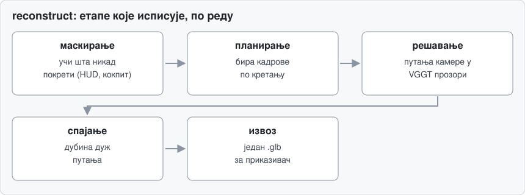

# Накнадна реконструкција {#offline-reconstruction}

```bash
python -m heat3d_capture reconstruct lap.mp4 -o lap.glb [--solve-budget 260] [--fuse-interval 0.4]
```

Код: [`scan/offline.py`](https://github.com/Holdi601/3DHeat-GameCapture/blob/main/heat3d_capture/scan/offline.py),
[`pose/feedforward.py`](https://github.com/Holdi601/3DHeat-GameCapture/blob/main/heat3d_capture/pose/feedforward.py),
[`pose/vggt_model.py`](https://github.com/Holdi601/3DHeat-GameCapture/blob/main/heat3d_capture/pose/vggt_model.py),
[`pose/feedforward_source.py`](https://github.com/Holdi601/3DHeat-GameCapture/blob/main/heat3d_capture/pose/feedforward_source.py),
[`pose/solveprep.py`](https://github.com/Holdi601/3DHeat-GameCapture/blob/main/heat3d_capture/pose/solveprep.py).
Опције: [Референца команди](commands.md#reconstruct).

## Зашто други пут {#why-a-second-path}

Инкрементално праћење је живо и јефтино и ради тамо где има структуре за шта се ухватити: унутрашњост, улица, мапа са покривачем. **Тркачка стаза је његов најгори случај**: пут је глатка трака са мало текстуре, хоризонт се једва помера, а кад се неколико положаја одмакне, ништа касније их не враћа. Круг испадне као крива која лута уместо да се затвори.

Офлајн путања даје **прозоре кадрова** моделу који предвиђа све њихове камере заједно, па сваки кадар ограничава сваки други директно, а не преко ланца. Потребан је цео снимак пре одговора, па није уживо и спор је: минути по прозору на десктоп GPU-у. Све после положаја - спајање, покривеност, боја, извоз - исти је код као у живом скенирању: решена стаза предаје се реконструктору као извор положаја, управо тамо где иде Forza телеметрија.

## Захтеви {#requirements}

- **PyTorch** усклађен са вашим GPU-ом (пројекат га не закључава; инсталира се пре `requirements.txt`, видите [Радно окружење](runtime.md)).
- **`vggt`** - код VGGT модела (`from vggt.models.vggt import VGGT`), из Meta-иног GitHub репозиторијума; није на индексу пакета.
- **`transformers`**, јер офлајн путања дубину пушта кроз PyTorch `DepthEstimator` (Depth Anything V2 Small), а не кроз ONNX датотеку.
- У пракси CUDA GPU; оба модела се враћају на CPU, што није практично.

Ништа од тога није у `requirements.txt`, јер скенер то не треба. Налазе се у **`requirements-offline.txt`**, са VGGT-овим зависностима (`einops`, `safetensors`, `huggingface_hub`, `Pillow`):

```bash
.venv\Scripts\python -m pip install -r requirements-offline.txt
.venv\Scripts\python -m pip install --no-deps "vggt @ git+https://github.com/facebookresearch/vggt.git"
```

VGGT се уводи са `--no-deps` јер његови метаподаци закључавају `numpy<2`, што би pip поштовао снижавањем numpy-а који scipy овде треба. `reconstruct` проверава све ово одмах после исписивања реда о лиценци (листа `OFFLINE` у [`runtime/preflight.py`](https://github.com/Holdi601/3DHeat-GameCapture/blob/main/heat3d_capture/runtime/preflight.py)), исписује шта недостаје са величинама, и инсталира само на да - VGGT са `--no-deps`, као горе. Одбијање, или нема терминала да се пита, излази са кодом 1.

## Модел и његова лиценца {#the-model-and-its-licence}

**VGGT**, `facebook/VGGT-1B`: **CC-BY-NC-4.0, само некомерцијално, а реконструкција направљена њиме то наслеђује.** Команда ово исписује пре почетка (`describe_licence`). Постоји и посебно лиценциран `facebook/VGGT-1B-Commercial`, али је то заштићено спремиште које Meta одобрава по налогу, па не може бити подразумевано. `--model vggt-1b-commercial` решава њиме (и уместо тога исписује његов ред о лиценци); без одобреног приступа преузимање не успева. *Код* `vggt` је под Meta-овом сопственом "VGGT License", споразумом о истраживачким материјалима са политиком прихватљиве употребе (чита се из `LICENSE.txt` пакета). Видите [Модели и лиценце](models-and-licences.md).

## Вожња, фаза по фаза {#the-run-stage-by-stage}

Називи фаза су оно што команда исписује.



### маскирање {#masking}

`FlowMask` се учи из **4 вожње по 90 узастопних кадрова**, центрираних на 1/8, 3/8, 5/8 и 7/8 видеа, на 960 x 540 у сивом (видите [FlowMask](reconstruction-capture.md#flowmask-what-never-travels)). Његова напомена се исписује и чува у сажетку. Видео краћи од 90 кадрова добија без маске.

#### Маска камере се учи, не примењује се {#the-camera-mask-is-learned-not-applied}

Маска се **не** примењује на кадрове дате решавачу. Маскирање кокпита је изгледало исправно по статистици обележја (већина откривених углова лежи на пикселима причвршћеним за камеру) - али то је исказ о детектору обележја, а решавач је обучена мрежа. Мерено по томе колико се пређена путања окреће између узастопних корака (аутомобил се окреће за неколико степени; случајна шетња за деведесет), сирови кадрови дају најмање окретање, кадрови са подигнутим контрастом мало више, маскирани кадрови јасно више, а оба заједно највише. Зато решавач добија сирове кадрове. Маска се и даље користи за планирање размака кадрова испод, а инкрементални трагач је користи у живом скенирању. (`solveprep.enhance`, који маскира и подиже локални контраст помоћу CLAHE, постоји али ову команду не користи.)

### планирање: кадрови размакнути кретањем {#planning-frames-spaced-by-motion}

`plan_by_motion` бира кадрове решавача према **колико се слика померила**, а не према сату: фиксни интервал даје споријим деоницама кадрове који им не требају, а брзе гладује, где се узастопни кадрови више не преклапају довољно да буду повезани.

- Циљни померај: **5% ширине од 960 пиксела** (48 px) медијаног померања ORB обележја између узастопно изабраних кадрова, мереног на 960 x 540 сивим кадровима са CLAHE контрастом, обележја само на маски.
- Почиње са размаком од 0,3 s; после сваког корака следећи размак постаје `gap x (0.5 + 0.5 x target / measured)`, ограничен на **0,15-2,0 s**, па једно бучно мерење не љуља план.
- Кад ништа није одговарало, размак се смањује на 0,6 себе (предалеко је грешка која се избегава).
- Staje на крају видеа или на `--solve-budget` кадрова (подразумевано 260).

Мање од 4 планирана кадра је грешка.

### решавање: прозори и спајање {#solving-windows-and-stitching}

Планирани кадрови се декодирају на ширину од 960 px и решавају у **преклапајућим прозорима од 16 кадрова, 6 заједничких** са следећим (`plan_windows`; последњи прозор се повлачи да се заврши на последњем кадру, па крај снимка има онолико суседа колико и средина). Више од **400** кадрова у једном покретању се одбија.

Сваки прозор: кадрови мењају величину тако да је дужа страна **518** а обе стране умножак **14** (однос страница се чува - гњечење би искривило угао гледања), скалирају на 0..1, пуштају кроз VGGT под bfloat16 autocast-ом (float16 нема експонента за далеке светске координате). Спољашњи параметри камере претварају се у ротације светско-из-камере и центре камере. Мапе тачака се подразумевано не чувају.

Сваки прозор долази у **свом сопственом произвољном кадру и својој произвољној размери**, па се прозори **споје** у кадар првог помоћу сличне трансформације (ротација, помак, једна размера), уклопљене на камере које деле са оним што је већ постављено:

- **Ротација из оријентација камера**, не из положаја: заједничке камере леже дуж путање и скоро су колинеарне на правој деоници, што оставља уклапање само по положају неспособним да види ротацију - сваки прозор се савија, а спојени резултат испадне раван. Ротација је средина `target_R x source_R^T` пројектована назад на праву ротацију (са заштитом од рефлексије).
- **Размера и помак из положаја**, дуж ротиране изворне.
- Потребне су најмање **4** заједничке камере; мање је грешка.
- Преклапање је трећина прозора, да би размера била добро одређена; грешка размере која се гомила прозор по прозор је оно због чега се круг спирално савија.

За сваки шав се бележи најгори неслагање заједничких камера после уклапања, у јединицама просечног размака између њих (`seam_error`).

### спајање {#fusing}

Кадрови на сваких `--fuse-interval` секунди (подразумевано 0,4) се декодирају на 960 px, добијају дубину од Depth Anything V2 Small (PyTorch) и спајају са положајем **интерполисаним** из решене путање у њиховом времену (линеарни положај, сферична ротација; `FeedForwardPoses`). Кадрови ван распона решене путање се прескачу, а не екстраполирају. Камера користи хоризонтално видно поље од **65 степени**. Положаји из feed-forward решавања имају поузданост 0,85 у спајању и покривености.

### извоз {#exporting}

Мрежа се пише као за живо скенирање ([Излаз .glb](glb-output.md)), именована по видеу.

## Сажетак {#the-summary}

```text
140 cameras solved over 182s
closure error 3.1% of path length
worst seam 0.42 frame spacings
<mask note>
wrote lap.glb
```

| Ред | Значење |
|---|---|
| closure error | растојање од прве до последње камере у односу на дужину путање. За један круг је то поштена мера одлутања. Изнад 10%: "The lap does not close ... Treat the shape as unreliable." |
| worst seam | највећи неслагање при спајању. Изнад 1,0: "Windows disagreed by up to N frame spacings at a seam, so part of the path is stitched on weak evidence." |
| нема датотеке | "Fusion produced no surface, so nothing was written." Излазни код је тада 1. |

## Размера {#scale}

Спојена путања је у произвољним јединицама првог прозора. Дубина се сидри триангулацијом између интерполисаних положаја (као код телеметрије), па је геометрија усаглашена са путањом - али **резултат није у метрима** осим ако путања то није. Ниједна ствар у овој команди не поправља глобалну размеру; калибрација тла се не примењује кад положаји долазе из извора положаја.

## Стање овог пута {#state-of-this-path}

Са кадровима на фиксном размаку, прозори се решавају у сагласну путању на неким деоницама круга, а у мрљу на другима; грешке су на оштрим кривинама, где поглед нагло скреће између кадрова, а узорковање тих кривина гушће их враћа. Ниједна статистика слике испробана (осветљеност, детаљ, број обележја, однос унутрашњих, померај) није унапред предвидела које ће деонице пропасти. Зато се размак не може у потпуности планирати из слика унапред: мора се изабрати решавањем, мерењем резултата и поновним решавањем гушће тамо где путања није она коју би ауто могао да вози. Планирање по кретању је направљено; **адаптивно поновно решавање није**.
