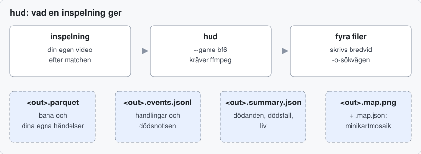

# Läsa HUD från en inspelning {#reading-the-hud-from-a-recording}

`hud` läser spelets skärm-HUD ur spelarens **egna inspelning**, efter matchen: spelarens **egna**
handlingar från poänguppkomsten som spelet visar under siktet (kills, assists, revives, resupplies,
captures...), spelarens dödsfall från nedslags- och utplaceringsskärmarna, spelarens **egna** spår
från minikartan, och dödsnotisen bredvid dem som tidsatta händelser. Resultatet skrivs som en
3DHeat-tabell, med minikartans mosaik som kartbild att lägga under den.

Kort sagt: det tittar på din matchvideo och skriver ner dina kills, dina dödsfall och var du gick.

```bash
.venv\Scripts\python -m heat3d_capture hud "<recording>.mp4" --game bf6 --player <name> -o out/match
```

Battlefield 6 är den första spelprofilen.



## Vad den gör och inte rör {#what-it-does-and-does-not-touch}

- Den läser en **videofil**: en ShadowPlay- / Instant Replay-klipp, en OBS-inspelning, allt som ffmpeg
  kan avkoda. Den rör aldrig spelet, dess minne, dess filer eller dess nätverk, och den körs efter att
  matchen är över. Se [Reglerna](rules.md).
- Den härleder **bara spelarens egen position**, från spelarens egen minikarta. Andra spelares markörer
  på minikartan maskeras bort och läses aldrig. Dödsnotisen sparas i sin helhet, men bara så som den
  säger på skärmen (vem, vem mot vem, med vad, när); ingen position kopplas till någon annan än
  spelaren.
- OCR:en körs lokalt (RapidOCR med PaddleOCR-modellerna via ONNX Runtime). Ingen bildruta eller
  beskärning lämnar datorn.
- En inspelning visar andra spelares namn, och mosaiken är en bild av banan. Utdata är för spelarens
  eget bruk; behåll den lokalt.

## Krav {#requirements}

- **ffmpeg och ffprobe** i `PATH`. Ett NVIDIA-kort används för avkodningen när det finns ett; annars
  avkodar processorn, flera gånger långsammare.
- Paketen i `requirements.txt`, och OCR:en utan egna beroenden (den vill ha processorns `onnxruntime`,
  som krockar med den DirectML-version projektet använder):

```bash
.venv\Scripts\python -m pip install -r requirements.txt
.venv\Scripts\python -m pip install --no-deps rapidocr_onnxruntime==1.2.3
```

`rapidocr_onnxruntime` är textläsaren (OCR) som läser namn och ord från skärmen.
`--no-deps` gör att den inte ersätter projektets DirectML-version av `onnxruntime`.

Så installerar du ffmpeg på Windows: `winget install Gyan.FFmpeg`, öppna sedan en ny terminal och
kontrollera med `ffmpeg -version`. Ny i kommandoraden? Läs [Innan du börjar](before-you-start.md).

- En inspelning i **16:9** i valfri upplösning (1080p, 1440p, 4K). Andra bildformat avvisas, eftersom
  profilens rutor skulle hamna på fel delar av skärmen.
- Spelets **standardlayout för HUD**. Ett flyttat eller skalat HUD-element läses på fel plats.

## Alternativ {#options}

| Alternativ | Standard | Betydelse |
|---|---|---|
| `video` | | Inspelningen. |
| `-o`, `--out` | videons namn, i aktuell mapp | Utdatasökväg **utan** ändelse; filerna blir `<out>.parquet`, `.events.jsonl`, `.summary.json`, `.map.png`, `.map.json`. |
| `--game` | `bf6` | Vars HUD som ska läsas. `bf6` (Battlefield 6) är hittills den enda profilen. |
| `--player` | ingen | Spelarens namn så som dödsnotisen visar det. Jämförs löst (OCR förväxlar `l`/`I`/`1`, `O`/`0`, `rn`/`m`). Utan det gissas namnet (nedan). |
| `--fps` | 5 | Minikartans sampel per sekund. Dödsnotisen samplas med hälften av det, poänguppkomsten och dödsskärmarna också med hälften (en fjärdedel när ingen uppkomst visas), kompassen var 3:e sekund, truppslistan var 15:e sekund. |
| `--start` | 0 | Sekunder in i videon där läsningen börjar. |
| `--seconds` | allt | Hur mycket av videon som ska läsas. |
| `--metres-per-pixel` | ingen | Minikartans skala, om den är känd: meter per minikartepixel vid vanlig zoom (minikartan är 296 pixlar bred på en 1080p-skärm). Utan den anges positionerna i de pixlarna; se [Enheter](#north-and-units). |
| `--cpu` | av | Avkoda på processorn även när ett NVIDIA-kort finns. |

Förloppet skrivs ut var femte sekund; i slutet skrivs spelaren, kills, deaths, liv och filerna som
skrevs.

## Utdata {#outputs}

### `<out>.parquet` - spelarens spår och händelser {#parquet---the-players-track-and-events}

En rad för varje sampel där spelaren var i spel och minikartan kunde placeras, plus en per händelse
för spelaren. Sidfoten bär visarens läsanvisningar (nyckel `heat3d`, `kind: heat3d-hud`), så att
visaren kan koppla varje kolumn utan att fråga.

| Kolumn | Betydelse |
|---|---|
| `time` | Sekunder från videons början. |
| `event` | `position`; `start` (videon började mitt i ett liv), `spawn` (tillbaka i spel efter ett dödsfall eller ett långt uppehåll), `death`, `downed` och `revived` (från nedslags- och dödsskärmarna, nedan), `end` (ett liv tog slut utan att det går att säga hur); spelarens egna handlingar från poänguppkomsten (`kill`, `assist`, `reviving`, `resupply`, `capture`... - [händelsetabellen](#event-table)); och dödsnotisens rader om spelaren som `kill_feed`, `death_feed`, `teamkill_feed`, `suicide_feed`, `squadwipe_feed`. |
| `source` | Var radens händelse kom ifrån: `points` (uppkomsten), `screen` (nedslags- och utplaceringsskärmarna), `feed` (dödsnotisen); tomt på positionsrader. |
| `text` | På `points`-rader: taggen som den skrivs ut (`KILL`, `SQUAD DAMAGE ASSIST`...), eller titeln (`DOUBLE KILL`, en ribbons namn), eller för en okänd tagg vad som lästes. |
| `points` | På `points`-rader: hur mycket uppkomstens totalsumma ökade i just det ögonblicket. När flera handlingar kom i samma sampel (en kill och fordonet den gjordes från) är det deras summa, angiven på var och en, och `shared` säger hur många som delade. Tomt när totalen inte lästes två gånger på båda sidor om ögonblicket. |
| `subject`, `subject_side` | På `points`-rader: namnet som uppkomsten visade med handlingen - offret för en kill, den lagkamrat som revivats eller resupplyats - och dess färg (`enemy`, `friendly`, `squad`). |
| `confirmed` | `feed` när dödsnotisen hade en rad för samma kill eller död (inom 3 s, samma offer). |
| `x`, `y`, `z` | Position på mosaiken: `x` öst, `y` nord, `z` 0 (sidfoten säger att `z` är upp). Norr är verklig norr när kompassen tillät det (se `north_up` i sammanfattningen). |
| `player` | Alltid `me`. Bara spelarens egna rader har positioner. |
| `team` | `own`. |
| `session` | `<video name>#NN`, en per liv. Linjevärmens rutter korsar aldrig en session. |
| `heading` | Grader medurs från norr (från mosaikens upp när norr är okänt): dit vyn pekade. |
| `dir_x`, `dir_y`, `dir_z` | Detsamma som en riktningsvektor, för visarens blickriktning. |
| `zoom` | Hur mycket minikartan var utzoomad jämfört med sin vanliga zoom (över 1 i fordon). |
| `killer`, `victim`, `weapon`, `headshot`, `marker` | På kill- och dödsrader som har en rad i dödsnotisen: notisraden (nedan). En kill från uppkomsten utan notisrad har uppkomstens namn som `victim`; en kill från uppkomsten som visades som HEADSHOT har `headshot` satt till true. |

Varje händelserad tar spelarens position vid händelsens tid (för ett dödsfall eller en nedslagning
den sista positionen före den; för en revive den första efter). Raderna passar direkt in i visarens
[linjevärme](https://holdi601.github.io/3DHeat/line-heat.html): dess förslag väljer `event`, startar på
`start`, `spawn` och `revived`, slutar på `death`, `downed` och `end`, och `position`-raderna ligger
längs rutten. De övriga händelserna är namngivna så att förslaget inte tar någon av dem som start
eller slut: att ge en revive heter `reviving` (inte `revive`), att hålla en punkt heter `defense`, en
lagkamrat som spawnar på spelaren heter `teammate_arrived`, notisens rader heter `kill_feed` och så
vidare; `kill` är inget slut.

Ett klipp med två ronder på två kartor ger två mosaiker som inte kan kopplas ihop. Den största är
`<out>.parquet`; var och en av de andra med minst 30 s spår skrivs bredvid den som
`<out>.map2.parquet`, `<out>.map2.map.png` och så vidare.

### `<out>.events.jsonl` - spelarens händelser och dödsnotisen {#eventsjsonl---the-players-events-and-the-kill-feed}

Ett JSON-objekt per rad, i tidsordning, var och en med en `source`:

- `points`: en per handling av spelaren: `time`, `event`, `text`, `points`, `shared`,
  `subject`, `subject_side` (som i tabellen), `popup` (vilken uppkomst den kom från, numrerad genom
  hela körningen), `seen` (hur många läsningar som visade den), `confirmed`, och `x`, `y` där spelaren
  var.
- `screen`: en per nedslagning och per revive: `event` (`death`, `downed` eller `revived`), `time` (när
  spelaren gick ner; för `revived` när skärmarna försvann), `until` (den sista gången skärmarna syntes),
  `screens` (`down` och/eller `card`), `outcome` (`death`, `revived` eller `unknown` när inspelningen
  tar slut först), `killer` (från notisraden, när det finns en), `x`, `y`.
- `feed`: varje rad dödsnotisen visade, allas:

| Fält | Betydelse |
|---|---|
| `time`, `last` | Första och sista sampel som raden lästes i (sekunder från videons början). `time` är när kill:en dök upp, med en noggrannhet på ett notissampel (0,4 s vid standardtakten). |
| `kind` | Från spelarens sida: `kill`, `death`, `teamkill`, `suicide`, `squadwipe`; för andra spelares rader `kill`, `squadwipe`, eller `death` för en rad utan mördare. |
| `killer`, `victim` | Namnen, som den vanligaste läsningen över alla sampel som visar raden (en längre läsning vinner när den vanliga är dess början: ett namn som är delvis dolt). `killer` är tomt för en rad som bara visade en ikon och ett offer - en död mot världen, eller en rad vars mördare redan hade tonat bort. |
| `killer_side`, `victim_side` | Från namnets färg: `friendly` (spelarens lag, blått), `enemy` (orange), `squad` (den bleka gröna som spelet använder för spelaren och dess trupp), `neutral` (ingen av dem). |
| `weapon` | Vapenikonens klass inom den här körningen: `icon01`, `icon02`... Rader vars ikoner ser lika ut delar klass. Ikonerna är inte namngivna; det finns ingen lista att namnge dem från. |
| `marker` | Den lilla ikonen mellan vapnet och offret: `skull`, `arrow`, `chevrons`, `crosses` eller tom. |
| `headshot` | `marker == "skull"` - ett antagande, se [Begränsningar](#limits). |
| `seen` | Hur många notissampel som visade raden. |
| `me` | `killer`, `victim` eller null. |
| `matched` | För spelarens egna rader: om en handling från uppkomsten eller en dödsskärm hittades för den. |
| `x`, `y` (, `map`) | För spelarens egna rader: var de var. |

### `<out>.summary.json` {#summaryjson}

Spelare (och hur den hittades), varifrån spelarens händelser kom (`own_events_from`: uppkomsten och
skärmarna, eller bara dödsnotisen när ingen av dem gick att läsa alls), kills, deaths, K/D,
headshots, assists, revives som gavs (`revives`) och togs emot (`revived`), downs, captures,
neutralizes, resupplies, heals, repairs, fordon förstörda, poängen (uppkomsternas totaler adderade),
varje handlingstyp med sitt antal (`actions`), antalet uppkomster, dödsfall som bara dödsnotisen visade,
dödsnotisens egna antal kills och deaths och hur många av dess kills som matchade en kill från uppkomsten,
teamkills, suicides, squad wipes, liv, sekunder i spel, tillryggalagd sträcka (i tabellens enheter),
notisrader, per karta om den är norr upp och hur många kompassläsningar som stämde, spårets antal
(sampel, i spel, placerade, inte placerade, öar), de antaganden som gjordes, och tidsåtgången.

### `<out>.map.png` och `<out>.map.json` - kartan under spåret {#mappng-and-mapjson---the-map-under-the-track}

Mosaiken av alla körningens minikartor, medelvärdesbildad, med överlägg borttagna, vriden och
skalad precis som tabellen. JSON-sidofilen innehåller de två ankare som visarens **Kartbild**-placering
kräver ([Kartbilder](https://holdi601.github.io/3DHeat/map-images.html) i visarens dokumentation): ladda
PNG-filen med **Kartbild...**, låt **Vänd nord/syd** vara på, och skriv in ankare 1 och ankare 2 (`px`,
`py`, `worldX`, `worldZ`) från sidofilen. Bilden ligger då exakt under spåret.

Bara de delar av banan som spelarens minikarta visade finns med i bilden.

## Metod {#method}

### Avkodning {#decoding}

ffmpeg avkodar på grafikkortet, sänker till samplingstakten medan bildrutorna fortfarande ligger på
kortet, klipper ut profilens områden (minikartan, dödsnotisen, två kompassremsor, truppslistan,
poänguppkomsten, nedslagsskärmens ord, det nedre högra hörnet), skalar varje till en fast storlek och
staplar dem till en liten bild per sampel. Bara den bilden går över röret in i Python. Att avkoda varje
bildruta i H.264-strömmen är golvet för körtiden.

Två arbetstrådar tar emot samplen: en registrerar minikartor (OpenCV), en läser text (ONNX Runtime).

### I spel eller inte {#in-play-or-not}

Minikartans nyckelrutan (den ljusa rutan med kartnyckeln i, nere till vänster på minikartan) ritas
alltid när minikartan gör det, och inte på dödsskärmar, kill-cam, utplacering, menyer eller
resultattavlan. Dess närvaro - en ljus, färglös ruta med en mörk bokstav i mitten, tydligt ljusare än
omgivningen - söks några pixlar runt dess plats, och är i-spel-testet. Ett enskilt sampel som
inte stämmer med båda grannarna ignoreras.

Ett uppehåll i spel är ett dödsfall eller en rundbyte (nästa sträcka börjar med `spawn`) när det varar
minst 6 s eller ett dödsfall (från skärmarna, eller en notisrad som pekar ut spelaren som offer) kom
inom 40 s före det; ett kortare uppehåll utan dödsfall (den stora kartan öppnades) fortsätter livet.
Minikartan är kvar uppe medan spelaren är nedslagen, så en nedslagen spelare är i spel.

### Spåret {#the-track}

Minikartan vrids med vyn och håller spelaren på en fast punkt (uppmätt: mitten, 49,7 % ner). Varje
sampel:

1. **Maskera** det som inte är banan: starkt färgade eller nästan vita pixlar (objektivmarkörer, trupp-
   och fordonsikoner, pingar, spelområdets gräns, rutter, text), det svagt gulgröna i vykäglan, en skiva
   runt spelarens markör, kilen ovanför den, nyckelrutan och en tunn kant.
2. **Egenskaper**: SIFT-punkter på den kontrastutjämnade gråskalebilden av minikartan, inom masken.
3. **Registrera mot mosaiken**, inte mot föregående sampel: punkterna matchas mot de egenskaper som
   lagrats hittills, i mosaikens koordinater, nära där spelaren senast var; en likformighetsavbildning
   (vridning, zoom, förskjutning) anpassas med RANSAC. En anpassning kräver tillräckligt många
   inliers, en zoom inom en tredjedel av den senaste och en förskjutning på mindre än en tredjedel av
   minikartan per sampel; en anpassning som söks var som helst på mosaiken (efter ett dödsfall) kräver
   dubbelt så många inliers.
4. **Växa mosaiken**: egenskaper som mosaiken ännu inte har läggs till (högst var några tiondels sekund
   av rörelse), och den maskerade minikartan medelvärdesbildas in i bilden.
5. Spelarens punkt, som följer med anpassningen, är dess **position**; minikartans upp, som följer med
   den, är dess **riktning** på mosaiken.

Efteråt tas en punkt som hoppar mer än 10 pixlar bort från både de två samplen före och de två efter
(som stämmer överens med varandra). En minikarta matchar då och då en fel zoom under ett enda sampel:
det räknas i sammanfattningen (`dropped_as_jumps`).

Att registrera mot mosaiken är det som hindrar felen från att ackumuleras: när man kommer tillbaka till
en plats matchar de egenskaper som lagrades första gången. En utplacering på en plats som inte setts
förut startar en separat **ö**; var tionde placerade sampel prövas mot de andra öarna, och första
bra matchen förenar dem (den mindre flyttar in i den större, med sitt spår). Öar som aldrig förenades
(en annan karta, eller mark som aldrig delades) skrivs var för sig, som ovan.

### Norr och enheter {#north-and-units}

<a id="north-and-units"></a>

Kompassremsan läses var 3:e sekund: dess etiketter hittas efter deras bläck (ljusa, färglösa,
grupperade över små luckor, streck borttagna), varje läses för sig, och två eller fler etiketter
fastställer både remsans skala och lagret under mittmärket - en enda etikett fastställer ingenting.
Varje kompassläsning paras med mosaikens riktning för samma sampel; den cirkulära medianen av
skillnaderna, över läsningarna inom 10 grader av den, är vridningen som gör mosaiken norr upp. Den
tillämpas när minst tre läsningar och hälften av alla stämmer överens.

<a id="units"></a>### Norr och enheter

Minikartans skala på marken står inte tryckt någonstans på skärmen, så positionerna
anges i **minikartepixlar vid vanlig zoom**: körningens mediana zoom skalas till en tabellenhet per
pixel på en 296 pixlar bred minikarta (dess storlek på en 1080p-skärm). Fordonets utzoomning tas bort
av registreringen, så en enhet är densamma till fots och i ett fordon. `--metres-per-pixel` multiplicerar
allt till meter när skalan är känd (från ett känt avstånd på kartan, uppmätt en gång).

### Dödsnotisen {#the-kill-feed}

Notisen läses med 2,5 sampel per sekund, men bara när dess färgade pixlar ändrats märkbart eller 2 s
har gått. Textrader hittas av OCR:ens detektor; en rad vars bild matchar en som lästes i föregående
sampel (raderna rullar, så de kan ha flyttat sig) får den texten i stället för att läsas om. Rader som
är för små för ett namn, eller har ett snedstreck (en fps-räknare i hörnet), tas bort.

Rader grupperas i rader efter höjd; i en rad är det vänstraste namnet mördaren och det högraste offret.
Angränsande bitar i samma färg slås ihop (ett namn med ett mellanslag). En enda rad som gick tvärs över
ikonen från ett namn till det andra klipps vid sin bredaste lucka när halvorna skiljer sig i färg, och
varje halva läses om. Ett enda namn i offerkolumnen med en ikon precis till vänster om sig är en rad
utan mördare. Två bitar i samma färg utan ikon emellan är ett namn vars mördare tonat bort, inte en kill.

**Sidorna** kommer från färgen. Namnen ritas med viss genomskinlighet, så provet görs på hur långt
texten är från sin egen bakgrund: tecknet på rött minus blått i den skillnaden är orange (fiende) eller
blå (vän) på vilken bakgrund som helst; ingen av dem, med grönt över de två andra, är truppfärgen.

**Ikoner**: mellan namnen bildar pixlarna i mördarens färg vapnets silhuett; en liten separat ikon precis
före offret är markören, namngiven efter sin form (en fläck med ögonhål är en skalle; en liten triangel
en pil; flera bitar kryss).

**Händelser**: en rad som läses om med båda namnen lika (likhet 0,7 efter att de vanliga OCR-förväxlingarna
slagits ihop, en av dem 0,8; en läsning som klippts av matchar början av hela namnet) är samma händelse,
så länge händelsen senast lästes mindre än 5 s tidigare och är yngre än 14 s - ingen rad stannar uppe
längre, så samma par senare är en ny kill. En rad utan mördare matchar bara på offret. En händelses tid
är dess första syn; dess namn, sidor och markör är majoriteten över synerna; rader som bara lästes en
gång tas bort.

**Spelaren**: `--player`, annars truppslistans markerade (ljusaste) rad när den har minst tre läsningar
och 60 % av dem stämmer överens, annars det namn notisen oftast ritade i truppfärgen. Annars säger
sammanfattningen att spelaren är okänd, och ingen notisrad tillskrivs dem. (Uppkomsten och
dödsskärmarna är spelarens egna oavsett namn; de behöver inget namn.)

### Poänguppkomsten {#the-points-popup}

Allt spelaren poängsätter visar Battlefield 6 i en uppkomst precis till vänster om och under siktet -
på samma plats till fots, i ett fordon och genom ett sikte:

```
            [ RIBBON ] (icon)          a title, now and then: a ribbon or a multi-kill
      (icon)(icon)(icon)  300          one icon per action; the popup's running total
                Some_Name              who it was about, for a moment: orange an enemy, blue a teammate
    [ KILL x2 ] [ VEHICLE DESTROYED ]  one boxed tag per kind of action, with a count
```

Uppkomsten växer medan spelaren fortsätter poängsätta: en ny kill gör `KILL` till `KILL x2`, lägger till
en ikon och höjer totalen; en ny sorts handling lägger till en tagg. Taggraden visar de senaste sorterna
(en äldre glider ut, och räknas vidare när den kommer tillbaka). Ungefär tre sekunder efter den sista
handlingen vecklas uppkomsten ihop till en rad (`[KILL x2] 300`) och försvinner. Texten är ljusgrå,
taggarna i tunna rutor, totalen i stora siffror som börjar vid x 760 på en 1920x1080-skärm, taggarna
högerjusterade mot x 750.

Den läses 2,5 gånger per sekund: OCR:ens detektor hittar textraderna, bara rader på en av uppkomstens
rader läses (siktets egna etiketter i samma område läses inte), och en rad vars bild matchar en som lästes
sampel innan får den texten. En rad som gått tvärs över från en ikon, ett namn eller en hopvikt tagg in i
totalen (`Name10`, `REVIVE185`) klipps där totalen börjar (x 755) och båda halvorna läses om. Medan ingen
uppkomst visas hålls varannat sampel olästa; när nästa visar en uppkomst läses det hållna först, så att
uppkomstens början hittas till samplet.

**Taggar** matchas mot [händelsetabellen](#event-table) efter att man räknat bort igenkännarens vanliga
misstag (Q läst som O, en siffra mellan bokstäver, I för L, en bokstav bortfallen vid en kant): en läsning
är en tagg när den är minst 80 % lik en (85 % för taggar med fem bokstäver eller färre) och tydligt närmre
den än någon annan. Taggar som igenkännaren slagit ihop (`CAPTUREDORDERCOMPLETED`) plockas isär genom att
kända taggar skalas av från början. Ett antal är `x2`, `X3`, ett löst tecken och en siffra, eller en
siffra direkt efter taggen. En ljusgrå versallinje i taggraden som inte matchar något behålls som en
handling `points` med sin text; en rad som är en del av en känd tagg i samma uppkomst (`DESTROYED` bredvid
`VEHICLE DESTROYED`) gör det inte. Titlar ovanför totalen (ljusa rutor, mörk text) är `multi_kills`
(`DOUBLE KILL` ...) eller `ribbon`. Namnet är den färgade raden mellan totalen och taggarna; dess sida
kommer från dess färg, som i notisen.

**Uppkomster och handlingar**: läsningar med mindre än 0,9 s tomt emellan är en uppkomst. En uppkomst
som verkar sluta och kommer tillbaka innan den hunnit vecklas ihop (inom 3,2 s efter att den senast
växte), med varje tagg på sitt antal eller mer och en total som inte är mindre, är samma uppkomst som
tillfälligt försvann (oskärpa, en ljus bakgrund) - ingenting i den räknas två gånger. I en uppkomst är
en taggs slutliga antal det högsta antal som lästes minst två gånger; dess k:e handling tidsätts vid den
första läsning som visar ett antal på k eller mer. Ett antal som lästes i bara ett sampel är inte en
handling - utom en kill som dödsnotisen bekräftar (en rad av spelarens inom 3 s som ingen annan kill tog):
den korta KILL-taggen är den igenkännaren oftast läser bara en gång. En titel räknas en gång per uppkomst,
när den lästs två gånger. `points` är hur mycket totalen - där bara totaler lästa två gånger i rad räknas -
ökade från före handlingens sampel till efter det.

En okänd rad räknas bara som tagg på raden för de kända taggarna i samma läsning (eller, utan någon känd
tagg, när det inte finns något namn heller), så att ett namn i en färg som sidtestet inte kan avgöra inte
tas för en tagg.

### Dödsfall och revives {#deaths-and-revives}

När spelaren går ner säger spelet det under skärmens mitt (MAN DOWN, REQUEST REVIVE, SKIP (HOLD), NEARBY
MEDICS; när en revive har begärts, REVIVE REQUESTED, CANCEL REQUEST), och ett kort nere till höger säger
vem som gjorde det, med DAMAGE LOG eller PLAYER CARD under, och en rad `YOU n - n FOE` ovanför. Dödad direkt
(ett dödligt huvudskott) visar bara kortet. Sedan antingen väcker en lagkamrat spelaren - skärmarna försvinner
och spelet fortsätter - eller spelaren blöder ut eller ger upp, och utplaceringsskärmen följer, med DEPLOY
nere till höger.

Dessa ord läses tillsammans med uppkomsten, i samma OCR-pass (uppkomsten, nedslagsskärmens band och det
nedre högra hörnet staplade till en bild): 2,5 gånger per sekund medan en uppkomst visas, 1,25 gånger annars.
Hörnet tas med bara när spelaren är utanför spel eller senast sågs nedslagen inom 3 s; i spel innehåller
det bara ammunitionsräkningen. Synerna mindre än 4 s från varandra blir ett avsnitt (minst två synar). Ett
avsnitt är ett **dödsfall** när utplaceringsskärmen visas inom 12 s efter dess slut, eller när spelaren är
utanför spel 3 s efter det och stannar ute i 6 s eller mer; det är en **revive** (`downed`, sedan `revived`)
när spelaren fortfarande är i spel 3 s efter att skärmarna försvann; `unknown` (skrivs som bara `downed`)
när inspelningen tar slut först. Dödsfallets tid är när spelaren gick ner: notisraden som pekar ut dem som
offer, när en sådan finns inom 3 s före avsnittet, annars avsnittets första syn minus en halv läsintervall.
Positioner efter ett dödsfall lämnas utanför rutten fram till utplaceringsskärmen.

Ett dödsfall i notisen som inget avsnitt förklarar (skärmarna missades) är ändå ett `death`, med `source`
`feed`, och bedöms som tidigare: om spelaren är i spel i över 40 s efter det, blev de återupplivade.

<a id="event-table"></a>

### Händelsetabellen {#event-table}

Vad varje tagg, titel och skärm blir. Flera taggar kan bli en och samma händelse; `text` behåller vilken.

| Händelse | Från | Betydelse |
|---|---|---|
| `kill` | KILL; HEADSHOT | Spelaren dödade någon (namnet är offret). En huvudskottskill visar HEADSHOT där KILL skulle stå: `text` säger vilken, och `headshot` är true. |
| `assist` | ASSIST, KILL ASSIST, DAMAGE ASSIST, SQUAD DAMAGE ASSIST | Skada på någon som en lagkamrat dödade. |
| `kill_assist` | ASSIST COUNTS AS KILL | En assist som spelet räknar som en kill. |
| `suppression`, `suppression_assist` | ENEMY SUPPRESSION; SUPPRESSION ASSIST | Undertryckande eld mot en fiende; mot en som en lagkamrat sedan dödade. |
| `smoke_assist` | SMOKE ASSIST, SQUAD SMOKE ASSIST | Rök som skyddade en lagkamrat. |
| `spot`, `spot_assist` | SPOT, SPOTTED, ENEMY DESIGNATION; SPOT ASSIST, SPOT BONUS | Att spana ut en fiende; en kill på en som spelaren spanat ut. |
| `driver_assist` | DRIVER ASSIST | En kill av fordonets skytt. |
| `reviving`, `reviving_bonus` | REVIVE, SQUAD REVIVE; CONCEALED REVIVE | Spelaren väckte en lagkamrat; bonusen för att göra det under täckning. |
| `heal` | HEAL, SQUAD HEAL | Spelaren läkte en lagkamrat. |
| `resupply` | SUPPLY, RESUPPLY, SQUAD SUPPLY | En lagkamrat tog ammunition från spelaren. |
| `repair` | REPAIR, VEHICLE REPAIR, SQUAD REPAIR | Spelaren reparerade ett fordon. |
| `capturing`, `capture` | CAPTURING, RECAPTURING; CAPTURED, OBJECTIVE CAPTURED | Ett erövringssteg; målet erövrat. |
| `neutralizing`, `neutralize` | NEUTRALIZING; NEUTRALIZED, OBJECTIVE NEUTRALIZED | Detsamma för att föra ett fientligt mål ner till neutralt. |
| `defense` | DEFENDING, OBJECTIVE DEFENDED | Att hålla ett mål. |
| `offensive`, `defensive` | OFFENSIVE; DEFENSIVE | Bonusen för en handling nära ett mål som anfalls; försvarat. |
| `order` | ORDER COMPLETED | En trupporder utförd. |
| `vehicle_damage`, `vehicle_disabled`, `vehicle_destroyed`, `vehicle_destroyed_assist` | VEHICLE DAMAGE; VEHICLE DISABLED; VEHICLE DESTROYED; VEHICLE DESTROYED SUPPORT | Skada på ett fientligt fordon, upp till att förstöra det, eller att hjälpa till med det. |
| `equipment_destroyed` | EQUIPMENT DESTROYED | En fientlig pryl förstörd. |
| `forced_bail` | FORCED BAIL | En fiende tvingad ut ur sitt fordon. |
| `squad_wipe` | SQUAD WIPE | Den sista i en fientlig trupp dödad. |
| `savior`, `avenger` | SAVIOR; AVENGER | En kill på en fiende som skadade en lagkamrat; vem som precis dödat en av ens egna. |
| `teammate_arrived` | SPAWNED ON, SPAWN ASSIST, VEHICLE SPAWN, SQUAD VEHICLE SPAWN | En lagkamrat spawnade på spelaren eller i dess fordon. |
| `transport` | TEAM TRANSPORT | Att frakta lagkamrater i ett fordon. |
| `fortify` | DEFENSE DEPLOYED | Ett försvar som spelaren byggde. |
| `points` | allt annat i taggraden | En handling tabellen inte känner: `text` är vad som lästes. |
| `multi_kills` | DOUBLE KILL, TRIPLE KILL, QUAD KILL, MULTI KILL (titel) | Kills i snabb följd. |
| `ribbon` | varje annan titel | En ribbon, efter dess namn (BALLISTIC, TANK BUSTER, ENGINEER EXPERT, SPEARHEAD...). |
| `downed` | nedslagsskärm, sedan spel | Spelaren gick ner och blev återupplivad. |
| `revived` | skärmarna försvinner, spelet fortsätter | Spelaren återupplivades av en lagkamrat. |
| `death` | nedslags- eller kortskärm, sedan utplacering eller utanför spel | Spelaren dog. |

Texterna i tabellen har setts i testinspelningarna, utom dessa, som är seriens vanliga namn och finns med
i tabellen för att de ska namnges i stället för att behållas som `points`: HEADSHOT KILL, ASSIST, KILL
ASSIST, ASSIST COUNTS AS KILL, SPOT, SPOTTED, SPOT ASSIST, SPOT BONUS, SQUAD REVIVE, HEAL, SQUAD HEAL,
RESUPPLY, SQUAD SUPPLY, REPAIR, VEHICLE REPAIR, SQUAD REPAIR, VEHICLE DISABLED, SQUAD WIPE, AVENGER,
formerna OBJECTIVE ..., och titlarna TRIPLE KILL, QUADRUPLE KILL och MULTI KILL. Spelet på ett annat språk
skriver andra ord: dess taggar kommer ut som `points` med vad som lästes - inte förväxlade med en känd
handling - med sina totaler och namn; och eftersom dödsskärmarna känns igen på sina engelska ord, kommer
dödsfallen då bara från dödsnotisen, som `death`-rader med `source` `feed`.

## Vad som är verifierat {#what-is-verified}

Kontrollerat för hand mot testinspelningar (spelarens egna, inte en del av förvaringen), genom att slumpmässigt
rita ut sampel och jämföra varje med bildrutorna runt den:

- **Spelarens egna händelser.** Varje uppkomsthandling som samplades var en verklig handling av den sorten,
  hittad inom en läsning (0,4 s) från sin tid; de flesta värden och namn var rätt (namn på vissa skriftsystem,
  såsom kyrilliska, kan komma ut förvrängda). Varje dödsskärm som samplades hittades.
- **Dödsnotisen.** Den stora majoriteten av notisraderna hittades med båda namnen rätt; små OCR-fel (ett
  versal-I läst som gemen l) är tillåtna. Namn i tecken som spelet själv visar som rutor kan missas. Sidorna
  (färgerna) är fel för några procent av namnen.
- **I spel.** Nyckelrutans test stämde med bildrutan vid varje samplat ögonblick.
- **Spåret.** Det finns ingen facit för var spelaren var, så spåret kontrolleras mot inspelningen själv: två
  minikartor registreras **direkt mot varandra**, och den förskjutningen jämförs med förskjutningen mellan de
  två tabellpositionerna. Den mediana skillnaden är ungefär 1-3 minikartepixlar (under 1 % av minikartans
  bredd), mer på en tät, utzoomad minikarta.
- **Kompassläsningarna** stämmer med mosaiken inom 10 grader nästan alltid.
- **Körtid.** Avkodning med ungefär fem gånger realtid är det mesta, på ett skrivbordsgrafikkort; att läsa
  poänguppkomsten lägger till ungefär en femtedel till en halv.

För ögat: varje mosaik har sammanhängande vägar och byggnader över de liv som byggde den, och rutter från
olika liv längs samma väg ligger ovanpå varandra. En sträcka där minikartans zoom ändras kan komma ut för
lång - se [Begränsningar](#limits).

Testerna (`tests/test_hud_*.py`) ritar allt de läser: en uppdiktad bana av vägar, byggnader och höjdkurvor,
minikartor av promenader genom den med de överlägg en verklig har, kompassremsor, notisrader med uppdiktade
namn. De kontrollerar att en slinga spåras inom två pixlar och sluter sig, att en stillastående spelare stannar
kvar medan vyn vrids, att zoomändringar följs, att en utplacering på annan plats fogas tillbaka när banorna
möts, att nordvridningen och y-vändningen lägger spåret där det verkligen gick, att kartbildens ankare
stämmer med spåret, och notisens tolkning, sidor, markörer och dubbelräkning. För spelarens egna händelser
ritar de poänguppkomster med uppdiktade namn och taggar och kontrollerar taggtabellen och dess tolerans
för igenkännarens misstag, taggar som slagits ihop, uppkomstens rader, totalen klippt från ett namn, räkning
när en uppkomst växer, fortsätter efter ett ögonblick oläst, glider ut och tillbaka igen, eller tar slut;
att ett antal som lästes en gång hålls isär; dödsfall, revives och utfall från skärmarnas ord; och, på en
uppdiktad match, att handlingarna, dödsfallen och revives hamnar i tabellen där spelaren var, notisens rader
bredvid dem under sina egna namn, och rutten slutar vid dödsfallet och inte vid revive.

<a id="limits"></a>

## Begränsningar {#limits}

- **Enheter är minikartepixlar**, inte meter, om inte `--metres-per-pixel` anges. Ingenting på spelets skärm
  anger minikartans skala på marken.
- **Bara det som minikartan visade kartläggs.** Mosaiken täcker marken inom en halv minikarta från var
  spelaren gick; två mosaiker som aldrig delade mark (två ronder på två kartor, eller två liv i långt skilda
  hörn av en stor karta) förblir separata filer med orelaterade koordinater.
- **Spåret är minikartans, med 5 sampel per sekund**, utjämnat av ingenting. En minikarta som är mycket
  utzoomad (en helikopter i testinspelningarna var utzoomad 2,3 gånger) visar mindre detalj per pixel, och
  utanför spelområdet visar den nästan ingen, så registreringen där är grövre. Jetplan, och spelaren som
  passagerare, fanns inte i testinspelningarna.
- **Registreringsfel är lokala och ackumuleras inte**, men en mosaik byggd medan ny mark utforskas kan bära
  en liten böj som bara rättas när marken ses igen. Där minikartans zoom ändras kontinuerligt (ett fordon som
  accelererar) kan den anpassade zoomen driva, och en sådan sträcka sågs med en sträcka ungefär dubbelt så
  lång som den verkliga. En mosaik byggd av en tät, utzoomad infanteriminikarta är minst träffsäker (fel
  runt 3 pixlar typiskt, upp till 18).
- **Ingen optimering av en postgraf.** En slinga sluts genom att lagrade egenskaper matchas, inte genom att
  korrigeringen sprids över slingan.
- **Vapenklasser fungerar ännu inte.** Ikonens silhuett tas från en genomskinlig ikon över en rörlig bakgrund,
  och den varierar för mycket från sampel till sampel: testinspelningarna gav 220 till 340 klasser för 550 till
  670 rader, där en matchning har ett fåtal dussin vapen. Behandla `weapon` som experimentell. Klasserna är ändå
  per körning, och är inte namn.
- **Markörernas betydelser är inte alla kända.** Pilen (`▸`) ritas före spelarens egna namn, i rader om dem; den
  är ingen sorts kill. Skallen tas för att betyda ett huvudskott; det är ett antagande, inget som spelet säger.
  `chevrons` och `crosses` (squad wipes) rapporteras som sedda.
- **Namn i andra skriftsystem än latinska** (kyrilliska, till exempel) kommer ut som de närmaste latinska
  look-alike-bokstäverna: igenkännaren läser latinska tecken och kinesiska. Samma spelare läses på samma sätt
  varje gång, så de matchar ändå, men texten är inte deras namn.
- **Överlägg i dödsnotisens hörn** (en fps-räknare) kan dölja slutet av översta radens offer. Räknartext känns
  igen och tas bort, och ett namn som klippts av matchas mot dess fullständiga läsningar, men ett namn som bara
  någonsin setts klippt förblir klippt.
- **Ett dödsfall som varken skärmarna eller notisen visade** avslutar ändå rutten, som `end`, när spelaren lämnar
  spel i 6 s eller mer.
- **Revives som tagits emot** kommer från nedslagsskärmarna. Bara för ett notis-dödsfall som skärmarna missade
  dras de fortfarande av (i spel i över 40 s efter det), och en snabb revive skiljs då inte från den.
- **Handlingar i uppkomsten tidsätts till en läsning**: inom 0,4 s från taggen först visas; en tagg som animeras in
  kan läsas ett sampel för sent eller för tidigt.
- **Namn på uppkomstrader** läses som notisens: skriftsystem som inte är latinska kommer ut förvrängda, och
  ibland läses en lagkamrats namnskylt som flyter i världen nära uppkomsten som handlingens namn. Handlingar utan
  namn (ett erövringssteg, en order) får inget.
- **`points`** saknas där totalen inte lästes två gånger på båda sidor om en handling, och delas mellan handlingar
  som kom i samma sampel. Sammanfattningens `score` adderar uppkomsternas slutliga totaler, så en uppkomst vars
  total aldrig lästes två gånger finns inte med i den.
- **Taggraden är ett fönster**: med fyra eller fler sorter i en uppkomst glider den äldsta taggen åt vänster, förbi
  kanten på det område som läses. Den räknades medan den syntes; ett antal den får medan den är halvt utanför
  skärmen kan missas.
- **En uppkomst som förlorats längre än den kunde ha varat** (över ungefär 4 s oläsbara sampel medan den ännu
  växte) tas för två, och en tagg med ett antal över ett räknas då en gång till. Inte sett i kontrollerna nedan.
- **Andra UI-språk**: taggar kommer ut som `points` med sin text, och dödsfall kommer bara från notisen (dödsskärmarna
  känns igen på sina engelska ord).
- **Händelser på en kort ö**: ett liv vars spår var för kort för att skrivas som en karta (under 30 s) behåller sina
  händelser i `.events.jsonl` utan `x`, `y`, och inte i någon tabell.
- **HUD-layouten är BF6:s standard i 16:9.** En ändrad HUD-skala, en färgblindpalett eller en annan minikartstorlek
  skulle kräva en egen profil.
