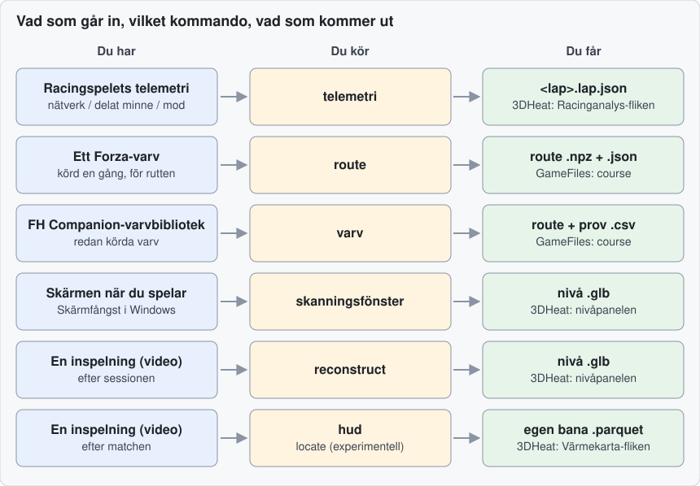

# 3DHeat GameCapture {#dheat-gamecapture}

**Vad är det?** Ett verktyg som skriver ner vad ett racingspel berättar om din körning, en fil
per varv. Det kan också bygga en grov 3D-modell av en nivå från en video av hur du spelar.

**Varför skulle jag använda det?** För att se dina varv i [3DHeat-visaren](https://holdi601.github.io/3DHeat/):
var du bromsade, var du var långsam, hur två varv skiljer sig. Och för att ha nivån under din
värmekarta när ingen har en 3D-modell av den.

**Exempel:** slå på Forzas Data Out, kör ett kommando, kör två varv. Två varvfiler dyker upp i
`laps\`. Släpp dem på visarens Racinganalys-flik.


Har du aldrig använt kommandoraden förut? Läs [Innan du börjar](before-you-start.md) först.

## De tre uppgifterna {#the-three-jobs}

1. **Varvtelemetri.** Den spelar in varje kanal ett racingspel publicerar - Forzas Data Out, Assetto Corsa-spelens delade minne, rallyspelens nätverksflöden, ett BeamNG-mod, ett Trackmania-plugin - och skriver en `heat3d-lap`-fil per varv eller etapp, för visarens Racinganalys-flik. iRacing behöver ingen inspelare: visaren läser sina egna `.ibt`-filer.
2. **Nivåer från spelande.** Den gör det skärmen visade när du gick eller körde genom en nivå till en 3D-modell i `.glb`, som visaren lägger under värmekartan.
3. **Din egen match, efteråt.** `hud` läser HUD:en i din egen inspelning - dina handlingar, dödsfall, minikartans spår och dödsnotisen. `locate` (experimentell: den placerar ännu få riktiga bilder) räknar ut var varje bild togs, på en nivås 3D-modell.

Alla tre följer en regel: **inget injiceras i ett spel och inget hookas**. Bilderna kommer från
det publika skärmfångstgränssnittet, telemetrin från gränssnitt som spelen publicerar för ändamålet. Se
[Reglerna](../rules.md).



Koden är Python (paketet `heat3d_capture`), MIT-licensierad. Djup- och positionsmodellerna den kan köra
har egna licenser - se [Modeller och licenser](../models-and-licences.md).

## Snabbstart {#quick-start}

### Spela in varv {#record-laps}

Du behöver Python 3.10 eller senare ([Innan du börjar](before-you-start.md)). I PowerShell:

```powershell
git clone https://github.com/Holdi601/3DHeat-GameCapture
cd 3DHeat-GameCapture
python -m venv .venv
.venv\Scripts\python -m pip install -r requirements.txt

# Forza: Inställningar -> HUD och spelande -> Data Out = PÅ, IP 127.0.0.1, port 5300
.venv\Scripts\python -m heat3d_capture telemetry -o laps
```

**Du bör se** `listening on port 5300. Laps go to laps. Ctrl+C to stop.`, sedan en rad per varv när du
passerar mållinjen, som på bilden ovan. Tryck på Ctrl+C för att sluta. Släpp filerna från `laps\` på
visarens Racinganalys-flik. Varje annat spel är ett `--game` bort:

```powershell
.venv\Scripts\python -m heat3d_capture telemetry --game acc -o laps
.venv\Scripts\python -m heat3d_capture telemetry --game dirtrally2 -o laps
```

Se [Telemetriinspelare](../telemetry.md) för varje spel och alternativ.

### Skanna en nivå {#scan-a-level}

Dubbelklicka på **`scan.bat`** i verktygets mapp. Den hittar Python (och erbjuder att installera det
med winget om det saknas), skapar en privat `.venv` och öppnar skanningsfönstret. Fönstret säger
vad som saknas, vad varje paket används till och hur stor nedladdningen är, och installerar
ingenting utan ett ja. Se [Körning och beroenden](../runtime.md) och
[Skanningsfönstret](../reconstruction-scan-ui.md).

För hand: `.venv\Scripts\python -m heat3d_capture.ui`.

För att bygga om en inspelning offline, med kamerabanan löst på en gång (kräver PyTorch, paketet `vggt`
och en GPU - se [Offline-rekonstruktion](../reconstruction-offline.md)):

```powershell
.venv\Scripts\python -m heat3d_capture reconstruct lap.mp4 -o lap.glb
```

## Dokumentationens karta {#map-of-the-documentation}

| Sida | Vad den täcker |
|---|---|
| [Innan du börjar](before-you-start.md) | Python, en terminal, det första kommandot, vanliga fel |
| [Reglerna](../rules.md) | Ingen injicering, bara publicerade gränssnitt, och vad det kostar |
| [Telemetriinspelare](../telemetry.md) | Kommandot `telemetry` och en översikt över varje spel |
| [Forza](../telemetry-forza.md) | Data Out, layoutigenkänning, FH Companion-reläet och dess `.tele.gz` |
| [Assetto Corsa-spelen](../telemetry-assetto-corsa.md) | AC, ACC, AC EVO, AC Rally från delat minne |
| [Rallyspelen](../telemetry-rally.md) | EA SPORTS WRC, DiRT Rally 2.0 / 1 / DiRT 4, Richard Burns Rally |
| [BeamNG.drive](../telemetry-beamng.md) | `heat3d`-protokollmodet |
| [Trackmania](../telemetry-trackmania.md) | Openplanet-pluginet `Heat3dRecorder` |
| [iRacing](../telemetry-iracing.md) | Läsa `.ibt`-filer i visaren |
| [Varv- och etappdelning](../lap-splitting.md) | `LapSplitter`, `CounterSplitter`, `LineSplitter`, `StageSplitter` |
| [Glidning, drift och härledda kanaler](../slip-and-drift.md) | Hur glidning skalas, och vad visaren härleder |
| [heat3d-lap-filen](../lap-format.md) | Varvfilens format, kanaler, enheter, `meta` |
| [Spel](../games.md) | Per spel: hur man spelar in, vad som skickas, vilka banor som kan exporteras |
| [Kommandon](../commands.md) | `route`, `telemetry`, `laps`, `reconstruct`, `hud`, `locate`, steg för steg |
| [Kommandoreferens](../cli-reference.md) | varje alternativ, genererat från `--help` |
| [Läsa HUD:en från en inspelning](../hud-video.md) | `hud`: egna handlingar, dödsfall, minikartans spår och dödsnotisen från en inspelning |
| [Lokalisera bilder i en nivå](../locate.md) | `locate`: var varje bild togs, mot nivåns geometri |
| [Nivårekonstruktion](../reconstruction.md) | Pipelinen från bilder till en `.glb` |
| [Skanningsfönstret](../reconstruction-scan-ui.md) | Varje kontroll, genväg och överlägg |
| [Fångst, masker och bildkvalitet](../reconstruction-capture.md) | Windows Graphics Capture, nyckelbilder, HUD-masker, kvalitetsråd |
| [Djup](../reconstruction-depth.md) | Depth Anything V2, ONNX Runtime, bygga modellen |
| [Kamerapose och skala](../reconstruction-pose.md) | Odometri, återlokalisering, telemetripositioner, markskala, bundle adjustment |
| [Sammanslagning, täckning och färg](../reconstruction-fusion-and-texture.md) | Ockupationsvolymen, täckningsnätet, svaga punkter, vertexfärg |
| [.glb-utdatan](../glb-output.md) | Filen visaren läser in |
| [Offline-rekonstruktion](../reconstruction-offline.md) | `reconstruct`, VGGT-fönster och hopsättning |
| [Modeller och licenser](../models-and-licences.md) | Depth Anything V2-storlekar, VGGT, paketen |
| [Körning och beroenden](../runtime.md) | Förkontroll, backends, prestandanivåer |
| [Begränsningar och verifiering](../limits.md) | Vad som inte är gjort, och vad som inte har kontrollerats |
| [Uppdateringar](../updates.md) | Kontrollen av utgåvor och `python -m heat3d_update` |
| [Utveckling](../development.md) | Tester, den virtuella miljön, förrådets layout |
| [Underhålla dokumentationen](../maintaining.md) | Utgivningschecklistan för kod och dokumentation |

## En del av 3DHeat {#part-of-3dheat}

Filerna det här skriver läses in av **3DHeat-visaren** -
[källkod](https://github.com/Holdi601/3DHeat), [dokumentation](https://holdi601.github.io/3DHeat/).
Varvfiler går till dess Racinganalys-flik, `.glb`-nivåer till dess nivåpanel, och `hud`- och `locate`-tabellerna till
dess Värmekarta-flik; hur visaren läser tabeller och matchfiler beskrivs i
[En fil per match (.3dheat)](https://holdi601.github.io/3DHeat/container.html) och
[Hämta data](https://holdi601.github.io/3DHeat/getting-data-in.html).

| Verktyg | Vad det gör | Dokumentation |
|---|---|---|
| [3DHeat-visaren](https://github.com/Holdi601/3DHeat) | visar värmekartor, lopp och matcher i 3D, i webbläsaren | [dokumentation](https://holdi601.github.io/3DHeat/) |
| [GameFiles](https://github.com/Holdi601/3DHeat-GameFiles) | banor och nivåer ur de filer spel levererar, som 3D-modeller | [dokumentation](https://holdi601.github.io/3DHeat-GameFiles/) |
| [GameCapture](https://github.com/Holdi601/3DHeat-GameCapture) | varvtelemetri från racingspel; nivåer återskapade från spelvideo | [dokumentation](https://holdi601.github.io/3DHeat-GameCapture/) |
| [Unreal Exporter](https://github.com/Holdi601/3DHeat-UnrealExporter) | ett Unreal Editor-tillägg som exporterar en nivå som en 3D-modell | [dokumentation](https://holdi601.github.io/3DHeat-UnrealExporter/) |
| [CS2](https://github.com/Holdi601/3DHeat-CS2) | Counter-Strike 2-demos till matchfiler; kartor till 3D-modeller | [dokumentation](https://holdi601.github.io/3DHeat-CS2/) |
| [Watcher](https://github.com/Holdi601/3DHeat-Watcher) | spelar in ditt spel i bakgrunden, från det spel publicerar | [dokumentation](https://holdi601.github.io/3DHeat-Watcher/) |
| [Ext-WarThunder](https://github.com/Holdi601/3DHeat-Ext-WarThunder) | War Thunder-repriser till tabeller och matchdokument | [dokumentation](https://holdi601.github.io/3DHeat-Ext-WarThunder/) |
| [Ext-WoT](https://github.com/Holdi601/3DHeat-Ext-WoT) | World of Tanks-repriser till tabeller och matchdokument | [dokumentation](https://holdi601.github.io/3DHeat-Ext-WoT/) |
| [Ext-WoWs](https://github.com/Holdi601/3DHeat-Ext-WoWs) | World of Warships-repriser till tabeller och matchdokument | [dokumentation](https://holdi601.github.io/3DHeat-Ext-WoWs/) |
| [Ext-Squad](https://github.com/Holdi601/3DHeat-Ext-Squad) | Squad-serverdemos till tabeller och matchdokument | [dokumentation](https://holdi601.github.io/3DHeat-Ext-Squad/) |
| [Ext-DCS](https://github.com/Holdi601/3DHeat-Ext-DCS) | DCS World-kartor till 3D-modeller | [dokumentation](https://holdi601.github.io/3DHeat-Ext-DCS/) |
| [Ext-IL2](https://github.com/Holdi601/3DHeat-Ext-IL2) | IL-2 Sturmovik-kartor till 3D-modeller | [dokumentation](https://holdi601.github.io/3DHeat-Ext-IL2/) |

En utvecklare med spelets projekt öppet bör använda Unreal-exportören, som läser den riktiga geometrin och är exakt.
Där ett spels egna arkiv går att läsa hämtar GameFiles den exakta banan. Rekonstruktion från spelande är för fallet
där bara skärmen finns tillgänglig.
