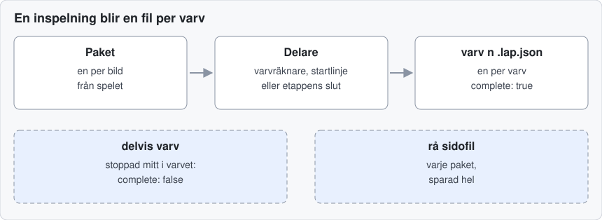

# Hur varv och etapper delas {#how-laps-and-stages-are-split}

En inspelare ser en kontinuerlig ström av sampel. Att göra den till varv görs av en av fyra delare, vald efter vad spelet säger om varv. De följer alla samma idé: använd spelets egen räkning där det finns en, och annars hitta varvet från positionerna; skriv aldrig ett fragment som är för kort för att jämföra.

| Delare | Kod | Används av |
|---|---|---|
| `LapSplitter` | [`fulllap.py`](https://github.com/Holdi601/3DHeat-GameCapture/blob/main/heat3d_capture/telemetry/fulllap.py) | Forza |
| `CounterSplitter` | [`kunos.py`](https://github.com/Holdi601/3DHeat-GameCapture/blob/main/heat3d_capture/telemetry/kunos.py) | Assetto Corsa, ACC |
| `LineSplitter` | [`kunos.py`](https://github.com/Holdi601/3DHeat-GameCapture/blob/main/heat3d_capture/telemetry/kunos.py) | AC EVO, AC Rally, BeamNG |
| `StageSplitter` | [`rally.py`](https://github.com/Holdi601/3DHeat-GameCapture/blob/main/heat3d_capture/telemetry/rally.py) | EA SPORTS WRC, DiRT Rally 2.0, DiRT Rally, DiRT 4, Richard Burns Rally |

Trackmania delar körningar inne i sitt plugin ([Trackmania](telemetry-trackmania.md)), och iRacing-filer delas av visaren efter simulatorns varvräknare ([iRacing](telemetry-iracing.md)).

Vid **Ctrl+C** anropar varje inspelare sin delares `flush()`, så ett öppet varv eller en öppen etapp skrivs om det klarar samma minimikrav som nedan.

## LapSplitter (Forza) {#lapsplitter-forza}

Parametrar: `minimum_metres = 400`, `gap_seconds = 2.0`.

För varje avkodat paket:

1. Om spelets `timestampMs` hoppat framåt med mer än 2 sekunder sedan förra paketet, eller gått bakåt, töms det öppna varvet först.
2. Om `isRaceOn` är 0 (spelet är inte i ett lopp) töms det öppna varvet och paketet släpps.
3. Om inget varv är öppet öppnas ett med paketets `lapNumber`.
4. Om `lapNumber` skiljer sig från det öppna varvets, **stängs det öppna varvet som komplett**; dess `seconds` är spelets `lastLap` när den är positiv. Ett varv som stängs så skrivs oavsett längd. Ett nytt varv öppnas.
5. Paketet läggs till.

Inspelaren töms också när inga paket har kommit på 2 sekunder verklig tid (spelet pausades eller stängdes mitt i ett varv).

**Tömning** behåller det öppna varvet bara om det har minst 2 sampel och minst 400 m `distanceTravelled`; det skrivs som ofullständigt (en `run`). Ett punkt-till-punkt-lopp räknar aldrig ett andra varv, så det slutar alltid så här.

## CounterSplitter (AC, ACC) {#countersplitter-ac-acc}

Parameter: `minimum_metres = 300`. Matas med varje sampel tillsammans med grafiksidans `completedLaps` och senaste varvtid.

- Första samplet öppnar ett varv numrerat med det aktuella `completedLaps`.
- När `completedLaps` ändras stängs det öppna varvet. Det är **komplett**, med `seconds = senaste varvtid i ms / 1000` (om positiv), bara om räknaren gick upp med exakt 1 - ett hopp tillbaka till 0 (en omstart av sessionen) eller med flera stänger det som ofullständigt.
- Ett stängt varv skrivs bara om det har sampel och minst 300 m körd väg.
- Tömning behåller det öppna varvet om det har fler än ett sampel och minst 300 m.

## LineSplitter (AC EVO, AC Rally, BeamNG) {#linesplitter-ac-evo-ac-rally-beamng}

Parametrar: `radius = 15 m`, `minimum_metres = 300`, `stop_seconds = 8`.

Dessa spel har antingen ingen varvräknare på en sida som inspelaren läser, eller kör etapper. **Linjen är där inspelningen började**:

1. Det första samplets horisontella position (`x`, `z`) blir linjen.
2. När bilen kört mer än 5 m blir riktningen från linjen till bilen varvets riktning.
3. **Stopp** avslutar en körning: när `speed` ligger under 1 m/s i 8 sekunder töms det öppna varvet (så slutar en rallyetapp: bilen stannar vid målet).
4. **Passage över linjen**: efter mer än 300 m körning samlas sampel inom 15 m från linjen. När bilen lämnar radien igen är det närmaste insamlade samplet passagen. Körde bilen då åt samma håll som varvets riktning (punktprodukten av den lokala färdriktningen och riktningen är positiv) stängs varvet vid det samplet; annars ignoreras passagen (bilen korsade startlinjen åt andra hållet).
5. Ett stängt varvs `seconds` är tiden från dess första sampel till passagen. Det är **komplett bara om dess första sampel var snabbare än 5 m/s**: ett varv som började från stillastående är en start, inte ett varv att jämföra. Första varvet i en inspelning som startade på startgriddet är alltså alltid ofullständigt; en inspelning som startade i ett flygande varv ger ett komplett första varv vid nästa passage.
6. Nästa varv startar vid passagesamplet (det tillhör båda varven).

Varv kortare än 300 m släpps. Tömning (ett stopp, eller Ctrl+C) behåller det öppna varvet om det har minst 2 sampel och 300 m, som ofullständigt. BeamNG tömmer på samma sätt när fordonet återställs (dess klocka går tillbaka), innan en ny delare startas, så körningen före återställningen behålls.

Avstånd är horisontella (`x`, `z`) för körräknaren och linjetestet, och full 3D för längdtestet på 300 m.

## StageSplitter (rallyspel) {#stagesplitter-rally-games}

Parameter: `minimum_metres = 300`. Matas med varje sampel tillsammans med spelets etappklocka, om spelet säger att bilen är klar, och valfritt spelets egen tid för den.

1. Om klockan är 0 eller mindre, eller har gått bakåt med mer än 0,5 s, **överges** den öppna etappen: den behålls som delvis etapp om den inte är komplett, har fler än 10 sampel och minst 300 m. En klocka på 0 eller mindre släpper också samplet (bilen står vid start).
2. Om ingen etapp är öppen öppnas en ny (numrerad 1, 2, ... för inspelningen).
3. När en etapp är komplett ignoreras fler sampel tills klockan går tillbaka.
4. Varje sampel lagras med `time` satt till etappklockan.
5. När spelet säger att den är klar, är etappen komplett; dess `seconds` är spelets tid när den anges och är positiv, annars klockan. Den skrivs om den täckte minst 300 m.

Vad "klar" betyder per spel:

| Spel | Klar när |
|---|---|
| EA SPORTS WRC | etappens längd > 0 och etappdistans >= längd - 0,5 m |
| DiRT-spelen | antalet avklarade varv steg över etappens startantal, eller (enkelvarvs-event) varvdistans >= 99,9 % av banans längd |
| Richard Burns Rally | loppklockan > 0 och avstånd till målet <= 0 |

För RBR fastställs upp-axeln och hastigheten när en etapp skrivs (se [Rallyspel](telemetry-rally.md#richard-burns-rally-rsf--ngp)).

## Tid och distans i varvfilen {#time-and-distance-in-the-lap-file}

För alla inspelare utom Forza omräknas `time` så att varvets första sampel är 0, och `distance` är den kumulativa 3D-distansen mellan på varandra följande positioner. Forza använder spelets egen varvtimer och distansräknare, omräknade på samma sätt.
