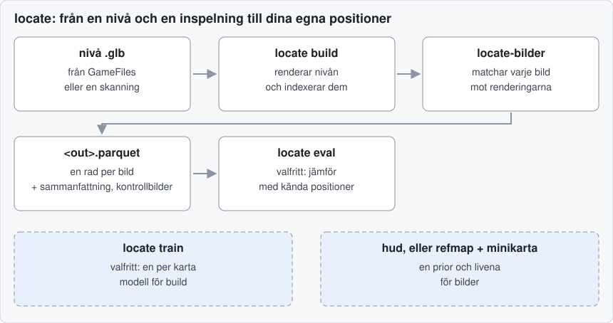

# Lokalisera bildrutor i en bana {#locating-frames-in-a-level}

`locate` tar reda på var varje bildruta i en spelinspelning togs - kamerans 3D-position och blickriktning -
genom att matcha bilden mot renderingar av banans egen geometri. Det är till för spel som inte för någon
logg över var spelaren var: ingen demo, ingen replay-fil, ingen telemetri. Battlefield 6 är det första.

> **Experimentellt.** På riktiga inspelningar placerar det hittills bara en liten andel av bildrutorna; se
> [Riktiga bildrutor: experimentellt](#real-frames-experimental).

```bash
# Once per level: render it from every place a player can stand, and index the renders.
.venv\Scripts\python -m heat3d_capture locate build level.glb -o level.db

# Per recording: where was each frame taken?
.venv\Scripts\python -m heat3d_capture locate frames "<recording>.mp4" --db level.db -o out/match
```

Positionen kommer **från bilden**, mot hela banan, utan något förhandsbesked. Minikartans spår från
[HUD-läsaren](hud-video.md) är bara en reserv för bildrutor som bilden inte kan placera, och varje rad
säger vilken av de två den kom från.




## Vad den gör och inte rör {#what-it-does-and-does-not-touch}

- Den läser spelarens **egen inspelning** och en nivåfil som spelaren exporterade från sin **egna kopia** av
  spelet. Den rör aldrig spelet, dess minne, dess filer medan den körs, eller dess nätverk, och den körs efter
  matchen. Se [Reglerna](rules.md).
- Den placerar **bara spelarens egen kamera**: bildrutan är spelarens egen vy.
- Banan, databasen som byggs av den och allt som renderas från den tillhör spelets utgivare. Behåll dem lokalt.

## Krav {#requirements}

- Det som `requirements.txt` listar, PyTorch (från pytorch.org, för GPU:n), och `requirements-locate.txt`:

```bash
.venv\Scripts\python -m pip install -r requirements-locate.txt
```

- Ett GPU med OpenGL 3.3 (4.3 är snabbare) för renderingarna, och helst CUDA för modellerna. På en processor
  fungerar det, långsamt.
- Modellerna hämtas första gången de används (ungefär 450 MB): DINOv2 från Hugging Face, ALIKED och LightGlue via
  kornia. Alla är licensierade för kommersiell användning; se [Licenser](#licences).
- **Banan** som en `.glb` (eller `.gltf`) i visarens koordinatsystem, Y upp, **med sina grundfärgstexturer**, så
  som 3DHeats exportörer skriver den (`ground:` / `structure:`-delar; delarnas namn behövs inte). En enhet är en
  meter, om inte filens toppnivå `extras.unit_metres` säger något annat. En GameCapture-skanning (`reconstruct`,
  skanningsfönstret) skrivs i **centimeter** och bär `extras.unit_metres: 0.01`, så den läses i sin sanna storlek.
  En bana utan texturer fungerar mycket sämre; se [Begränsningar](#limits).

## Kommandon {#commands}

### `locate build <level> -o <db>` {#locate-build---o-}

Renderar banan från varje plats en spelare kunde stå på och lagrar, för varje rendering, dess position och en
global deskriptor.

| Alternativ | Standard | Betydelse |
|---|---|---|
| `level` | | Banans `.glb` / `.gltf`. |
| `-o`, `--out` | | Databasmappen som ska skrivas. |
| `--game` | `bf6` | Spelprofilen: ögonhöjder, synfält, HUD-rutor, hastighet (nedan). `generic` för valfritt förstapersonsspel. |
| `--eye` | profilens | Ögonhöjder över golvet i meter, stående först. En databasvy per höjd. |
| `--fov` / `--vfov` | profilens | Inspelningens horisontella synfält, eller det vertikala (Battlefields skjutreglage) för en 16:9-inspelning. |
| `--spacing` | 2.5 | Meter mellan de platser vyerna tas från. |
| `--yaw-step` | 30 | Grader mellan vyernas riktningar. |
| `--pitch` | 0 | Lutningar att rendera vid, grader uppåt. |
| `--positions` | ingen | En tabell (Parquet eller CSV med `x`, `y`, `z` vid fötterna, i banans koordinatsystem) att ta platser ur i stället för varje golv: till exempel en tidigare körs utdata. |
| `--shadows` | av | Låt solens skuggor falla i renderingarna (bankens egen sol, när dess fil anger en i `extras.sun`). |
| `--untextured` | av | Rendera bara form och ljus. |
| `--box X0 Z0 X1 Z1` | hela filen | Bara platser inom den här rutan (banans enheter): spelområdet. |
| `--places` | `auto` | Varifrån vyerna tas: `nav` - spelare på ögonhöjd över banans navigeringsnät (`nav:`-delar: exakt där spelet låter dem gå), fordonskameror på sin höjd över `ground:`-delarna (terräng och vägar) inom 50 m från den; `ground` - båda över `ground:`; `floors` - över varje uppåtvänd yta (tak och lådor också); `auto` - `nav` när banan har ett navigeringsnät, annars `floors`. |
| `--head` | ingen | Ett karthuvud från `locate train`, för deskriptorerna. |

Skriver `<db>/db.json` (vad den byggdes av och med) och `<db>/views.npz` (poser, deskriptorer).

### `locate frames <recording> --db <db>` {#locate-frames----db-}

| Alternativ | Standard | Betydelse |
|---|---|---|
| `source` | | En video, en bild, eller en mapp med bilder (tagna i namnordning, `--fps` från varandra). |
| `--db` | | Databasen som `build` skrev. Dess nivåfil måste fortfarande finnas där den var (eller `--level`). |
| `-o`, `--out` | `<source>.locate` | Utdatasökväg utan ändelse. |
| `--fps` | 2 | Bildrutor som lokaliseras per sekund av video. |
| `--start`, `--seconds` | allt | Den del av videon som ska läsas. |
| `--width` | 1280 | Bredden bildrutorna matchas i. |
| `--shortlist` | 8 | Databasvyer som prövas per bildruta nära ett förhandsbesked eller en fix. |
| `--search-shortlist` | 16 | Utan förhandsbesked: databasvyer som prövas per bildruta ([söks tillsammans](#with-no-prior-frames-searched-together)). |
| `--no-search` | av | Utan förhandsbesked: sök varje bildruta för sig och tro på dess fix utan dess grannar. |
| `--accept-depth` | 0 (av) | Utan förhandsbesked: tro på en fix bara om dess matchningars långa avstånd är så många gånger deras korta. |
| `--accept-support` | 2 | Utan förhandsbesked: grannar längs livet som stämmer överens med en fix, för att den ska tros. |
| `--checkpoint` | ingen | Behåll körningens tillstånd här och fortsätt från det om det finns. |
| `--stop-file`, `--stop-process` | ingen | Stoppa av sig själv, tillståndet sparat, avslutningskod 75, när filen finns eller en process vars namn börjar med detta körs (kontrolleras före varje bildruta; kan upprepas), så att en lång körning frigör datorn för ett spel. Samma kommando fortsätter där det slutade. |
| `--normalise` | ingen | Lätt normalisering före matchning: `clahe`, `gray`. |
| `--minimap` | ingen | `hud`-kommandots tabell: **reserven** för bildrutor som bilden inte kan placera. |
| `--prior-radius` | ingen | **Valfri snabbare körning**, av som standard: sök bara i databasvyer så många meter från minikartans position (kräver `--minimap`). |
| `--minimap-anchor` | ingen | En JSON-fil som binder minikartan till banan ([minikartan som sökförhandsbesked](#the-minimap-as-a-search-prior)): minikartan begränsar sökningen från första bildrutan; fixar som hittas så är `visual+minimap-prior`. |
| `--no-level-search` | av | Med ett förhandsbesked: när inget nära det passar, sök inte hela banan också (snabbare). |
| `--lives` | `--minimap`-tabellen | `hud`-kommandots tabell vars dödsfall, utplaceringar och revives visar när spelaren var i spel: positioner hoppar bara över ett dödsfall ([liv ur filmen](#lives-from-the-footage)). |
| `--no-sequence` | av | Avgör varje bildruta för sig, inte längs körningen (nedan). |
| `--fit-fov` | av | Efter körningen: anpassa synfältet till de starkaste fixarna, per vy, och redovisa det. |
| `--check-every` | 0 | Även var N:e bildruta, placerad eller inte, en bild i `<out>.check`. |
| `--no-checks` | av | Skriv inte kontrollbilderna för de visuella fixarna (nedan). |
| `--no-zoomed` | av | Lös inte zoomade vyer utifrån grannarnas fixar (nedan). |
| `--no-grow` | av | Sök inte igen nära varje fix efter bildrutorna runt den som ännu saknar en. |
| `--game`, `--eye`, `--fov`, `--vfov`, `--mask`, `--no-hud-mask`, `--max-speed` | profilens | Som ovan; `--mask x,y,w,h` lägger till en skärmruta (på en 1920x1080-skärm) som inte är banan. |
| `--vehicle-vfov` | profilens | Fordonskamerornas vertikala synfält (Battlefields fordonsreglage). |
| `--settings` | den nyaste inställningsfilen | `bf6`: spelets inställningsfil, varifrån synfälten läses (bara läsning) när inget `--fov`/`--vfov` anges; som standard den nyaste `PROFSAVE*_profile` under `Documents/Battlefield 6/settings`. Den innehåller inställningarna så som de är nu, vilket kanske inte är hur en äldre inspelning gjordes. |

### `locate refmap <level> <deploy screen> -o <refmap>` {#locate-refmap----o-}

Placerar spelets egen karta på banan: referensen som minikartan läses mot
([minikartan, läst mot banan](#the-minimap-read-against-the-level)). `<deploy screen>` är en bild av
utplaceringsskärmen som visar hela kartan, eller en inspelning med `--at <seconds>` vid ett sådant ögonblick;
profilens kartruta klipps ut ur den (`--whole-picture` behåller allt). Skriver `<refmap>.png` (kartan omsampling
till bankens egen ram, `--mpp` meter per pixel, standard 0,5), `<refmap>.valid.png` (där det är kartan, inte en
markör eller text) och `<refmap>.json` (ramen och kalibreringen, med hur långt kartans plattor var från den).
`--topdown <prefix>` behåller banan renderad uppifrån för nästa körning (`--topdown-mpp`, standard 0,656 m;
`--box` begränsar den).

### `locate minimap <recording> --refmap <refmap> -o <table>.parquet` {#locate-minimap----refmap---o-parquet}

Läser inspelningens minikarta mot referenskartan, bildruta för bildruta (`--fps`, standard 2): position, riktning
och zoom för varje minikarta som matchar, i bankens koordinatsystem, skriven som en minikartetabell med ett ankare
bredvid (`<table>.anchor.json`) som `locate frames` tar som `--minimap <table>.parquet --minimap-anchor <table>.anchor.json`.
Med `hud`-kommandots tabell (`--hud`) överförs dess liv; med ett ankare för den tabellen också (`--hud-anchor`)
görs den första sökningen där den placerar spelaren, och där ingen minikarta matchar fylls HUD:ens egna spår i,
flyttat till de närmaste referenskarte-fixarna (`--hud-fill`, sekunder, standard 120; 0 stänger av det).
Tabellens `source` säger vilket (`refmap`, `hud`).

### `locate eval <out>.parquet --truth <poses>` {#locate-eval-parquet---truth-}

Jämför ett resultat med kända kameraposer: en tabell med `time`, `x`, `y`, `z` (ögat), `yaw`, `pitch` i banans
koordinatsystem. `--offset` är klockans förskjutning (facit-tid = videotid + offset); utan den söks den fram.
`--unit-metres` gör felen till meter.

## Spelprofiler {#game-profiles}

| | `bf6` | `generic` |
|---|---|---|
| Ögonhöjder | 1,6 m stående, 1,05 m hukande (ännu inte uppmätt i spelet) | 1,65, 1,1 m |
| Synfält | 55 grader vertikalt, ungefär 86 horisontellt i 16:9: **ange spelarens eget** med `--vfov` | 90 horisontellt |
| HUD maskerat | minikarta och truppslista, dödsnotis, kompass, ammunition, spelarens vapen, uppkomsterna, korshåret | korshåret |
| Snabbast till fots | 8 m/s | 8 m/s |
| Vyer som särskiljs | till fots, fordon, zoomad (nedan) | varje bildruta till fots |
| Fordonskameror | fordonsreglaget (från inställningsfilen), fordonet maskerat, kameran upp till 8 m över golvet, 30 m/s | - |

Synfältet betyder mest: en bildruta som löses med fel synfält löses med fel brännvidd, och dess position glider
längs vyn.

## Utdata {#outputs}

### `<out>.parquet` {#parquet}

En rad per lokaliserad bildruta, i **nivåns koordinatsystem** (Y upp, banans enheter), med visarens läsanvisningar
i sidfoten (`kind: heat3d-locate`). Sidfoten listar varje kolumn som inte har en egen roll som en extra, så att
visaren behåller alla (dess inspektionskort visar dem).

| Kolumn | Betydelse |
|---|---|
| `time` | Sekunder från videons början. |
| `event` | `start` på den första raden i ett liv, `position` på resten. |
| `x`, `y`, `z` | Ögat, utjämnat inom livet. Tomt där ingen av källorna placerade bildrutan. |
| `yaw`, `pitch` | Grader: yaw runt upp-axeln (0 längs +X, växande mot -Z, vilket är ett spels egen yaw i visarens koordinatsystem), pitch uppåt från horisonten. `pitch` är tom för minikartrader. |
| `dir_x`, `dir_y`, `dir_z` | Blickriktningen. |
| `player`, `team`, `session` | `me`, `own` och `<video>#NN`, en per liv. |
| `life` | Livet som filmen visade bildrutan i (från HUD:ens dödsfall; 1 = det första). Tomt när spelaren är utanför spel (död, nedslagen, utplacering) eller när livena inte lästes. `session` är spårets liv, som också kan delas vid ett hopp. |
| `source` | `visual` (från bilden), `visual+minimap-prior` (från bilden, sökningen begränsad av minikartans förhandsbesked), `minimap` (reserven), `minimap+nav-floor` (inomhus: minikartan och navigeringsnätets golv) eller `none`. |
| `view` | `foot`, `vehicle`, `zoomed` eller `screen` (nedan). |
| `cam_x`, `cam_y`, `cam_z` | Kameran som såg bildrutan. Till fots och genom ett sikte är det ögat, och `x`, `y`, `z` är desamma; i ett fordons tredjepersonsvy är `x`, `y`, `z` fordonet (förskjutningsmodellen nedan) och kameran åker bakom och ovanför det. |
| `hfov`, `zoom` | Det horisontella synfält bildrutan löstes med, och för en zoomad vy dess zoom mot den normala vyn. |
| `confidence` | 0..1: hur mycket raden kan lita på (nedan). |
| `uncertainty` | Radens typiska fel, banans enheter: för en visuell fix från dess inliers och grannar, för en minikartrad från anpassningen (nedan). |
| `inliers`, `rmse` | Den visuella lösningens PnP-inliers och repprojektionsfel (pixlar vid arbetsbredden). |
| `x_raw` ... `pitch_raw` | Den visuella lösningen före utjämning (även för uteslutna avvikare som röstades bort). |
| `kept` | Den visuella fixen klarade omröstningen om avvikare. |
| `note` | Varför en bildruta inte placerades, eller röstades bort. |

### `<out>.summary.json` {#summaryjson}

Bildrutor, visuella fixar, avvikare, liv, rader per källa, minikartans anpassning (par, inliers, residual), tid per
bildruta.

## Metod {#method}

### Databasen {#the-database}

Platserna är punkter på varje uppåtvänd triangel i banan, jämnt fördelade (en per `--spacing` i ett 3D-rutnät, så
att våningarna i en byggnad får var sin). Var och en kontrolleras från sitt öga med sex små djuprenderingar: en
kamera inne i geometri ser mest baksidor, ett kryputrymme har något fast över ögat; båda släpps. Från varje plats
renderas banan på varje ögonhöjd, för varje `--yaw-step` och varje `--pitch`, och varje rendering beskrivs av
**DINOv2** (dess patchtokens sammanslagna med generaliserat medelvärde, sammanfogade med klasstoken).

De lokala särdragen och 3D-punkterna som en bildruta slutligen löses mot **lagras inte**. De görs om vid behov genom
att rendera de få vyer som hämtningen valde, vilket tar millisekunder. Det håller en databas på några hundra megabyte
i stället för tiotals gigabyte, och det är vad som gör förfiningen nedan möjlig. Priset är att `frames` behöver
nivåfilen och ett GPU, inte bara databasen.

### En bildruta {#one-frame}

1. **Maskera** det som inte är banan: profilens HUD-rutor och korshåret, plus varje `--mask`.
2. **Hämtning** över **hela banan**: bildrutans deskriptor mot varje databasvy; de mest lika några dussin, gallrade
   så att de rymmer olika platser och riktningar, är kortlistan.
3. **Matchning**: varje vy i kortlistan renderas igen i bildrutans storlek och synfält, med sitt djup. ALIKED-punkter
   i bildrutan och renderingen matchas med LightGlue. En matchad renderingspixel plus dess djup är en 3D-punkt i
   banan, så varje matchning är en 2D-3D-korrespondens; punkter på en djupkant (vars djup kan tillhöra det som ligger
   bakom) släpps.
4. **Pose**: PnP med RANSAC (SQPnP), sedan en robust förfining som håller kameran plan - en förstapersonsvy rullar
   inte - och minimerar repprojektionsfelet för inliers.
5. **Är det möjligt?** En pose måste vara på en spelares ögonhöjd över ett golv och utanför geometri (en djuprendering
   rakt ner). En lookalike-textur någon annanstans - ett plattsatt golv matchat mot en vägg av samma material - kan ge
   hundratals inliers i en pose ingen spelare kunnat ha; de läggs åt sidan, hur många inliers de än har.
6. **Rendera och jämför**: banan renderas i den lösta posen och matchas igen, vilket byter ut en databasvy som ligger
   upp till några meter och tiotals grader bort mot en som nästan sammanfaller med bildrutan. Upprepas medan den får
   fler inliers (högst två gånger).
7. **Val**: de tre starkaste platserna (mer än ungefär 3 m från varandra) förfinas var för sig innan en väljs. En
   lookalike kan leda före förfiningen; den rätta platsen vinner mycket mer på den.
8. **Dom**: `confidence` kombinerar antalet inliers, den bästa andra platsen (`runner_up`) och repprojektionsfelet.
   En fix är `ok` med minst 25 inliers, ingen annan plats inom 80 % av dess inliers, och en confidence på minst 0,85 -
   den tröskel mätningarna nedan sätter på 97,5-99 % rätt.

### Vyer {#views}

En bildruta är inte alltid spelarens ögon. Profilens detektor läser av vilken vy det är från HUD:en, och bildrutan löses
i enlighet med det:

- **Till fots**: infanteriets synfält och ögonhöjder.
- **Fordon** (Battlefield 6: sätesdiagrammets tangenttips, `C CAMERA` och `E EXIT`, nederst i mitten): fordonets synfält,
  fordonet självt maskerat (nedre mitten av skärmen i dess tredjepersonsvy), och en kamera som får vara upp till 8 m över
  golvet. Fixen är kamerans.
- **Skärm** (mörka kanter runt en mörk mitt: utplaceringskartan, en meny, resultattavlan): inte en vy av banan; hoppas över.
- **Zoomad** (ett sikte, en skyttes sikte, ett fordons egen förstapersonsvy: en skärmkant svart, båda mörka, runt en ljus bild):
  inte sökt över banan - ett sikte's lilla bit av banan liknar ingen av databasens vidvinkelvyer - men löst efter körningen
  från den närmaste fixen inom 6 s, nedan. Av med `--no-zoomed`.

### Zoomade vyer {#zoomed-views}

En smal vy låser positionen dåligt: ett steg bakåt med lite mer zoom ser nästan likadant ut. Så en zoomad bildruta börjar
där dess granne säger att siktet är - till fots den fixens öga, i ett fordon 2,5 m över marken under fordonets mitt (ett
tornsikte) - och hur långt den kan ha flyttat sig sedan: 2 m, plus 4 m per sekund till fots eller 8 i ett fordon, högst 12 m
(`reach`).

1. **Riktning och zoom, positionen hållen.** För varje zoom av 1, 1,2 (ett fordons egen vy, smalare än till fots), 1,5, 2, 3,
   4, 6 och 8 renderas banan från sätet i riktningar inom 30 grader från grannens (och, från 3x, några lutningar). Bildrutans
   punkter, matchade mot en rendering, med banans punkter under sig, är strålar från sätet; en rotation anpassas till dem två
   i taget (RANSAC) för brännvidder från 0,75 till 1,3 gånger den zoomens, med en punkt som stämmer inom en vinkel som tar hänsyn
   till att sätet kan vara `reach` fel på sitt avstånd. Den zoom, riktning och brännvidd som flest punkter stämmer med vinner.
2. **Avgjord.** Punkterna anpassar sedan position, riktning och brännvidd tillsammans, efter deras repprojektionsfel, med
   positionen hållen till sätet av en kostnad på två pixlar per `reach` förflyttat; renderas en gång till vid svaret och
   anpassas igen. Inliers och fel räknas i pixlar, och fixen är `ok` enligt samma confidence som alla andra.

Den zoom som skrivs (`zoom`) mäts mot körningens synfält till fots; `hfov` är det lösta. I ett fordon är den skrivna
positionen fordonets, 2,5 m under siktet, som för dess tredjepersonsvy.

### Fordon: kameran och fordonet {#vehicles-the-camera-and-the-vehicle}

I ett fordons tredjepersonsvy är den lösta posen den jaktkamerans, som åker bakom och ovanför fordonet och svänger runt
det när spelaren ser sig omkring. Den skrivna positionen (`x`, `y`, `z`) är fordonets - marken under dess mitt: kamerans plus
profilens `vehicle_offset`, så många meter framåt längs kamerans horisontella blickriktning och så många neråt. Kameran stannar
i `cam_x`, `cam_y`, `cam_z`. Omvandlingen görs före sekvensen och spåret, så att en kamera som svänger runt ett stillastående
fordon inte tas för rörelse. Tabellens sidfot bär den förskjutning som användes och om den var uppmätt (`vehicleOffset`). Till
fots och genom ett sikte finns ingen förskjutning.

Så uppmättes Battlefield 6-förskjutningen: på rätt fixar av verkliga tredjepersonsbildrutor av en stridsvagn markerades
vagnens mitt för hand på bildrutan, och banan renderad vid fixen gav marken vid den pixeln. Profilen tar medianen: ungefär 10 m
framför kameran och ungefär 4 m under den. Markeringen är god till en meter eller så, och det är en fordonstyp: en bil eller
en helikopter rider sin kamera på ett annat sätt.

<a id="with-no-prior-frames-searched-together"></a>

### Utan förhandsbesked: bildrutor sökta tillsammans {#with-no-prior-frames-searched-together}

En bildrutas globala deskriptor mot en hel bana är en svag signal, och en bildrutas inliers säger inte om en rätt plats från
en lookalike. Så utan förhandsbesked beskrivs bildrutorna i en inspelning först och söks tillsammans (`search.py`), och en fix
tros bara med bildrutorna runt den:

- **Kortlista.** Varje vys likheter mäts mot sitt eget medelvärde och spridning över inspelningen, så att en vy som liknar
  varje bildruta slutar vinna överallt. Varje bildruta poängsätter cellerna i ett 24 m rutnät efter rangen för deras bästa vy; den
  bästa vägen genom cellerna längs varje liv, inom vad spelaren hinner täcka mellan bildrutorna, ger en tro per cell, och den bästa
  vyn i varje cell, mest tro först, är en lista. Vanlig hämtning är den andra, och de två tas om varandra: att mäta vyer mot inspelningen
  straffar en plats spelaren knappt lämnar, vilket är där vanlig hämtning klarar sig bra.
- **Att tro.** En kandidat räknas bara om dess inliers täcker minst 12 % av ett 8 x 8-rutnät över bildrutan: en lookalike är ett
  upprepat objekt, en stapel containrar, med hundratals inliers på några celler av bildrutan. En fix tros när den ligger på den bästa
  vägen genom de räknande kandidaterna (nedan) med minst två grannar inom 6 s som stämmer överens med den. En bildruta utanför spel
  söks inte alls.
- **Växa.** Bara det som tros växs från, och en vuxen fix måste täcka bildrutan på samma sätt.

### Längs körningen {#along-the-run}

Varje bildruta behåller varje fysiskt möjlig pose den hittade, en per plats (`candidates`), inte bara den starkaste. Körningen väljer
sedan en per bildruta - eller ingen - så att de valda poserna bildar en bana en spelare kunnat gå eller köra, och så många inliers
som möjligt ligger på den: en dold Markov-modell, avkodad på en gång (Viterbi). En lookalike som vinner en bildruta på egen hand förlorar
mot platsen dess grannar är överens om; en svag kandidat som banan går genom, med minst två överensstämmande grannar, blir en fix
(`note`: vald längs sekvensen); en säker fix som alla dess grannar motsäger slutar vara en. En granne räknas som överensstämmande bara
inom 6 s: längre bort är avståndet en spelare - än mindre ett fordon - kunnat tillryggalägga så stort att överensstämmelse inte säger något.
Av med `--no-sequence`.

### Bildrutetider {#frame-times}

En rads `time` är bildrutans egen tidsstämpel i inspelningen, inte dess räkning över den nominella bildfrekvensen. Inspelningar driver
från sin nominella frekvens (med några tiondels sekund inom ett klipp, på de som mättes), och allt som läser en bildruta tillbaka via dess
tid - kontrollbilderna, den zoomade körningen, `locate train --real`, minikartan från `hud`-kommandot - söker efter tidsstämpel. Räknade
bildrutor skulle sätta kontrollbildens bildruta upp till så långt bort från den som lokaliserades.

### Synfältet, ur bildrutorna {#the-field-of-view-from-the-frames}

`--fit-fov` behåller körningens starkaste fixar (per vy) och förfinar varje fix pose och brännvidd tillsammans på dess inliers; medianen
över dem är det synfält inspelningen gjordes med, redovisat i sammanfattningen (`hfov_fitted`) för nästa körs `--fov`. Nära och långt
borta punkter rör sig olika vid en ändring av brännvidd jämfört med en ändring av position, och det är det som låser fast den; det kräver
fixar med djup i sig, inte en platt vägg.

### En platsmodell per karta {#a-per-map-model}

`locate train` tränar en liten modell ovanpå DINOv2 för en nivå, på renderingar av den, så att den globala deskriptorn hittar rätt vyer för
verkliga bildrutor och inte bara för renderingar:

- **Huvud**: varje patchtoken genom en tvålagers projektion, sammanslagen med generaliserat medelvärde över de patchar som visar banan,
  sammanfogad med den projicerade klasstoken. DINOv2 är frusen. Allt detta skrivet här (MIT).
- **Par**: en plats på den gångbara marken och en riktning, renderade två gånger från poser upp till en eller två meter och ett dussin
  grader från varandra, med synfält upp till 10 grader från varandra, under olika ljus (sol, skuggor, omgivning), var och en genom ett
  spelliknande utseende: gradering, dis efter djup, bloom, vinjett, rök, folk i vägen, spelarens eget fordon i fordonsvyer, rörelseoskärpa,
  brus, JPEG (`augment.py`). Maskerade som en bildruta. Platser inom några meter som vetter åt samma håll räknas inte som negativa.
- **Riktiga bildrutor**: bildrutor med en pose som pipelinen hittade själv (pseudoetiketter: fixar valda längs en sekvens) kan gå med
  som par - bildrutan och en rendering vid dess pose - i en andra omgång.
- **Förlust**: kontrastiv (InfoNCE) över batchen.

`locate build --head <head.pt>` bygger databasen med den; `frames` använder den sedan för bildrutorna.

| `locate train`-alternativ | Standard | Betydelse |
|---|---|---|
| `-o`, `--out` | krävs | Huvudfilen som skrivs (`.pt`). |
| `--steps` | 600 | Träningssteg. |
| `--real TABLE VIDEO` | ingen | En `locate frames`-tabell och dess inspelning: dess säkra fixar går med som riktiga par. Kan upprepas. |
| `--real-confidence` | 0.85 | Den confidence en fix måste ha för att gå med som ett riktigt par. |
| `--spacing`, `--box`, `--places`, och profilalternativen | som `build` | Var träningsplatserna är, och spelprofilen. |

### Kontrollera för ögat {#checking-by-eye}

Varje visuell fix får en bild i `<out>.check` - `<time>s_<view>_visual.jpg`: bildrutan, och bredvid den banan renderad från fixens
kamera med bildrutans kanter ritade över renderingen. Där de stämmer överens är fixen rätt. Skrivs efter att sekvensen och spåret har
bestämt, så att bilderna är exakt de rader tabellen kallar visuella. Av med `--no-checks`.

<a id="the-minimap-read-against-the-level"></a>

### Minikartan, läst mot banan {#the-minimap-read-against-the-level}

En minikarta som sammanfogats till en mosaik (`hud`-kommandots) är inte platt: dess skala driver med den zoom varje minikarta registrerades
vid, en plats sedd två gånger kan ritas två gånger, och varje klipps mosaik är sin egen. En likformighetsavbildning anpassad till några få fixar
håller då nära dem och är tiotals meter fel en bit bort från dem. Så minikartan placeras av banan själv, i två steg, och ingenting sammanfogas:

- **Referenskartan** (`locate refmap`). Utplaceringsskärmen ritar hela kartan med norr upp, platt, i en skala. Banan renderad rakt uppifrån
  visar samma saker stående upp från marken (stridsvagnar, byggnader, murar): på banan, deras höjd över marken inom 15 m; på kartan, det som
  ritas ljusare än marken runt dem. Kartan läggs på banan genom normaliserad korskorrelation av de två över skala och en liten vridning,
  förfinad genom att matcha kartans plattor en och en, och sist av hela kartan på en gång runt svaret (några dussin plattor lämnar skalan lös
  med en procent, meter vid kartans ändar). Resultatet är en likformighetsavbildning, kartpixel till bana.
- **Minikartan, bildruta för bildruta** (`locate minimap`). Varje samplad minikarta - `hud`-läsarens beskärning och överläggsmask - matchas
  (SIFT) mot referenskartan där spelaren senast var, eller överallt när ingenting är känt, och en likformighetsavbildning (vridning, zoom,
  förskjutning) anpassas. Spelarens punkt, som bärs igenom den, är positionen; minikartans upp (synkeglen) är riktningen, dess skala är zoomen
  - uppmätt, inte antagen.
- **Där den inte matchar.** Utplaceringsskärmen ritar inget utanför spelområdet; en minikarta som mest visar det som ligger utanför - en spelare
  vid kartans kant - har inget att matcha. Där står HUD:ens egna spår in, flyttat med den förskjutning som de närmaste referenskarte-fixarna
  mätte (`--hud-fill`); det är lika bra som mosaiken är nära dessa fixar.

På testbanan låg minikartan, läst så, några meter (median) från säkra bildfixar, lika bra utanför området referenskartan anpassades i som inom det.

<a id="the-minimap-as-a-search-prior"></a>

### Minikartan som sökförhandsbesked {#the-minimap-as-a-search-prior}

`hud`-kommandots minikartespår säger, för de flesta bildrutor i spel, ungefär var spelaren är och åt vilket håll de tittar - i sina egna enheter
(minikartepixlar, norr upp). Bundet till banan en gång begränsar det sökningen till en liten del av den; själva posen kommer fortfarande från bilden,
enligt samma regler.

- **Ankaret** (`--minimap-anchor <anchor.json>`): en likformighetsavbildning per karta, från minikarta till bana - skala, vridning (med spegeln
  mellan norr-upp-pixlar och banans axlar) och förskjutning - anpassad på de säkra visuella fixarna (confidence 0,7 och uppåt) från flera klipp.
  Varje klipps minikarta är en mosaik som `hud`-läsaren sammanfogade på egen hand, så varje sitter någon annanstans i minikartenheter; två
  mosaiker av en karta skiljer sig bara med en förskjutning, funnen genom att matcha punkter mellan dem (den förskjutning de flesta matchningarna
  är överens om), och varje mosaik knyts till en referens genom alla par som stämmer väl. Ankarfilen bär kartans likformighet, klippets förskjutning
  (`clip_shift`), och felet ankaret visade mot fixar från klipp som lämnats utanför dess anpassning (`median`, `p90`, meter).
- **Var och åt vilket håll.** Minikartans riktning är kamerans yaw: på de uppmätta klippen stämde den med den lösta yaw inom 2-5 grader. Så en
  bildruta matchas först mot renderingar gjorda där minikartan placerar kameran - till fots ett öga över marken där, i ett fordon jaktkameran bakom och
  ovanför det (fordonsförskjutningen) - vända längs riktningen: punkten och 4 m åt vardera sidan, i två lutningar (`seeds`). Först när ingen av dem
  ger en fix prövas databasens egna vyer inom skivan (30 m plus ankarets 90:e percentilfel).
- **Korrigeras allteftersom körningen går.** Varje säker fix nära förhandsbeskedet säger hur långt ifrån ankaret den är där; medianen av dem inom
  2 minuter korrigerar förhandsbeskedet, och deras spridning (minst 5 m) ersätter ankarets fel i skivans radie - upp till 10 m: fixar som skiljer sig mer
  säger att minikartan är fel på plats, inte att något 50 m bort duger. Utan någon fix inom 2 minuter korrigeras förhandsbeskedet inte alls (felet på
  andra ställen i klippet säger ingenting om här).
- **Ankare med ett rutnät.** Ett ankare kan också bära `grid`: banans x och z på ett regelbundet rutnät över klippets minikartenheter, läst bilinjärt;
  inom det placerar rutnätet punkten, utanför det likformigheten. En `locate minimap`-tabells ankare är identiteten (dess tabell är redan i bankens
  koordinatsystem).
- **Svaga anpassningar.** Med ett förhandsbesked behålls en anpassning som är svag (25 inliers eller fler, men inte säker nog på egen hand) och ligger
  inom skivan - med sin lägre confidence - för sekvensen och spåret att döma, inte släpps: rök, bråte och förstörda väggar ger verkliga bildrutor färre
  matchningar.
- **Källor.** `visual` - bilden placerade den, utan förhandsbesked; `visual+minimap-prior` - bilden placerade den, sökningen begränsad till förhandsbeskedet;
  `minimap` - bilden gjorde det inte, minikartan står in; `minimap+nav-floor` - inomhus, nedan.
- **Inomhus** leder minikartan. En bildruta som bilden inte placerade, till fots, där ett öga vid minikartans position ser banan nära runt om (medianavstånd under
  8 m åt fyra håll) och ingen himmel, är inomhus: den får minikartans x och z och höjden på navigeringsnätets golv där - av flera våningar den närmaste till
  den senaste fixen - med `source = minimap+nav-floor`, så att det är tydligt att bilden inte fixade den.

<a id="lives-from-the-footage"></a>

### Liv ur filmen {#lives-from-the-footage}

En position får hoppa bara där spelaren dog. Livena gissas inte utifrån positionerna - en enda felaktig fix skulle öppna ett nytt liv - utan läses ur filmen:
`hud`-läsarens tabell registrerar de dödsfall som nedslags- och utplaceringsskärmarna visade (`death`), de nedslag som en lagkamrat väckte (`downed`, `revived`),
utplaceringarna (`spawn`) och var spel började och slutade (`start`, `end`); `lives.py` gör dem till liv. Ett dödsfall stänger ett liv, och den första bildrutan
i spel efter utplaceringsskärmen öppnar nästa; en revive stänger inte livet (spelaren är kvar där de gick ner), och bildrutorna medan de är nedslagna placeras inte;
ett uppehåll av meny eller laddning längre än 10 s klipper det också. Bildrutor utanför spel (döda, utplacerade, nedslagna) placeras aldrig.

Inom ett liv är kontinuitet en hård regel: varje steg högst hastigheten gånger tiden mellan, plus 1,5 m. Hastigheten är bildrutans: till fots profilens, i ett
fordon den hastighet fordonets egen visning visade inom 3 s (en tredjedel till, och 2 m/s, för acceleration) eller, där den inte visar någon, dess klass gräns.
Längs körningen (Viterbi) är ett steg över ett dödsfall fritt på vilket avstånd som helst, varje annat steg begränsat; en bildruta som skulle kräva ett hopp
lämnas bort - den svagare sidan av en motsägelse förlorar (färre inliers, mindre stöd) - och livet delas aldrig på den. Där den bortlämnade sidan i sig själv är
stark (confidence 0,9 och uppåt, två eller fler fixar som stämmer med varandra) gissar inte körningen: båda sidor behålls och märks `jump without detected death`
(ett missat dödsfall, eller en verklig teleportation), och listas i sammanfattningen. Minikartans reserv följer samma liv.

Battlefield 6: stridsvagnarnas förstapersonsvy visar hastigheten (`<n> KPH`, till höger om siktet; läst med HUD-läsarens OCR); tredjepersonsvyn gör inte det.
Avläsningarna på testklippen var låga, så markfordon tillåts 15 m/s där ingen avläsning finns. Båtar, helikoptrar och jetplan får generösa gränser (20, 90 och 280 m/s)
som inte är uppmätta: inget klipp visar någon som kör eller flyger en, och vyklassificeraren skiljer inte luft från mark - en sträcka snabbare än ett markfordon
syns som ett hopp, flaggad, och inte litad på.

### Förstörelse {#destruction}

Nivåfilerna är den intakta banan; i en match skjuts väggar, hus och stenar sönder, bråte och rök hänger kvar, och det blir värre ju längre matchen går.

- **Matchningen litar på den statiska banan.** En del som exporten märker som förstörbar (dess namn börjar med `destructible:`, eller `extras.destructible` på
  dess nod, mesh eller primitiv) ritas in i renderingens `destructible`-mask. Matchningar vars banpunkt ligger på den släpps när 40 eller fler matchningar på
  statiska delar återstår - terräng, vägar, de stora konstruktionerna bär lösningen.
- **Träningen ser att den är borta.** Träningsrenderingarna (`locate train`) ersätter delar av de förstörbara delarna med brusmönster i bråtets färg, och lägger
  till damm lågt över marken, ovanpå röken och resten av spelets utseende (`augment.py`), så att den per-karta-modellen lär sig att inte luta sig mot dem.
- **Saknad geometri är inte fel plats**: med ett förhandsbesked behålls svaga fixar inom dess skiva (ovan).

Tills exporterna bär märkningen är ingenting märkt som förstörbart, och dessa gör ingenting.

### Spåret {#the-track}

- **Avvikare**: en fix jämförs med fixarna under de 3 s före den och, för sig, de 3 s efter den; överensstämmande betyder inte längre från varandra
  än profilens hastighet tillåter, plus 1,5 m. En fix som inte stämmer med de flesta av sina grannar på **båda** sidor röstas bort (sparas i `_raw`-kolumnerna,
  `kept` falskt). Att kräva båda sidor behåller den första fixen efter en återuppståndelse.
- **Liv**: med livena från filmen (ovan) följer spåret dem, och inom ett liv släpper det den svagare sidan av ett steg som bryter hastigheten. Utan dem bryts
  det där två i följd behållna fixar ligger längre från varandra än hastigheten tillåter, där det är ett uppehåll på mer än 8 s, och där minikartetabellen börjar ett nytt liv.
- **Utjämning**: inom ett liv sammanfogas varje fix med en rät linje genom fixarna runt den (en viktad lokal linjär anpassning, sigma 0,5 s), där varje vägs efter sin
  osäkerhet: en stark fix - god till centimeter - står kvar, en svag dras mot sina starka grannar. En linje och inte ett medelvärde, eftersom ett medelvärde drar en
  springande spelare bakåt: medelvärdesbildning prövades först och gjorde ett 3 mm spår till ett 0,3 m spår vid 2 bildrutor per sekund. Vyvinklarna utjämnas inte;
  en vridning av vyn är verklig, och snabb.

### Minikartans reserv {#the-minimap-fallback}

Minikartetabellen ligger i sin egen mosaiks ram (pixlar, x öst, y norr). Den är bunden till banan av en likformighetsavbildning - vridning, skala, förskjutning, och en
spegel om det passar bättre - anpassad robust på de bildrutor där båda har en position. Där bilden gav något, eller dess fix röstades bort, står minikartans position in
med `source = minimap`, en confidence på högst 0,5 och en osäkerhet på dubbla anpassningens residual plus 1,5 m. Minikartan har ingen höjd: den bärs över från den närmaste
visuella fixen. En körning med bara minikarta (inga visuella fixar) kan inte bindas till banan och placerar ingenting.

`--prior-radius` använder samma anpassning åt andra hållet: när åtta visuella fixar har bundit minikartan till banan, tittar hämtningen bara på databasvyer inom den
radien från minikartans position, och faller tillbaka på hela banan när det inte hittar något. Det är snabbare; det är också bara så rätt som minikartan, vilket är varför
det är avstängt som standard.

<a id="accuracy"></a>

## Noggrannhet {#accuracy}

Mätt på en **bänk** där facit är exakt: en testnivå exporterad med sina texturer, och bildrutor renderade från kända kameraposer *för att se ut som ett spel, inte som databasen* - banans egen sol och skuggor, hårdare kontrast, en slumpmässig färggradering, vinjett och bloom, spelarstora former och rök i vägen, HUD ritat i de maskerade rutorna, oskärpa, brus och JPEG. Varje bildruta lokaliseras mot **hela banan, utan förhandsbesked**. Rätt betyder inom 1 m och 5 grader. Inget från bänken (nivåer, renderingar) ingår i det här förrådet.

| Bildrutor utan förhandsbesked | Resultat |
|---|---|
| placerade rätt | ungefär 4 av 5 |
| av `ok`-fixarna (confidence 0,85 och uppåt), rätt | ungefär 97-99 % |
| fel på de rätta fixarna | millimeter till en centimeter; några hundradels grader |
| tid per bildruta | ungefär 1 s på ett skrivbordsgrafikkort |

Confidence är ett användbart mått på förtroende: nästan varje fix på 0,9 och uppåt var rätt, medan fixar under 0,85 ofta var fel - därav tröskeln 0,85 för `ok`. Där det misslyckas: ingen matchande vy hittas, för få matchningar (en vägg ett steg bort, mest himmel, mest en skymmare), eller två platser ser likadana ut.

**Ett spår.** En testkamerabana renderad enligt ovan till en 30 fps-video, med en minikartetabell gjord av samma bana (dess egna vridna, skalade, speglade ram, med brus), körd genom `locate frames` med 2 bildrutor per sekund och poängsatt med `locate eval`, som dessutom fick hitta klockans förskjutning: varje bildruta i spel placerades, nästan alla från bilden; klockans förskjutning hittades inom hundradelar av en sekund; bildrutehjälpeleraderna låg inom några centimeter, minikarteraderna inom ungefär en meter.

**Vad som gör skillnad:**

- **Texturer** är det matchningen bygger på. Utan dem placeras bara en liten andel av bildrutorna; ett golv reducerat till en enda platt färg kostar ungefär en tredjedel av de säkra fixarna.
- **Rätt synfält.** 3 grader fel, och felet på de rätta fixarna växer från millimeter till tiotals centimeter och de flesta fixar är inte längre `ok`. Ange det verkliga synfältet.
- **Skuggor** i databasrenderingarna (`--shadows`): en liten vinst.
- **En längre kortlista**: en liten vinst, flera gånger långsammare. En kortare: färre fixar, högre precision.
- Ljusnormalisering (CLAHE) gav ingen vinst och är inte standard.

Lookalike-platser är den största källan till säkra misstag: en pose exakt en byggnadsmodul bort, längs en vägg av upprepade moduler, löst på samma sätt över flera bildrutor
av en spelare som står still. Att förfina de tre starkaste platserna före valet, och att lägga omöjliga poser åt sidan, tog bort de flesta av de övriga.

<a id="real-frames-experimental"></a>

### Riktiga bildrutor: experimentellt {#real-frames-experimental}

På riktiga inspelningar **fungerar `locate` ännu inte väl**: det placerar bara en liten andel av bildrutorna från bilden, mest fordonsbildrutor (tredjepersonskameran ser mer av banan från högre upp), och nästan inga bildrutor till fots (spelaren tittar på väggar och marken från nära håll). Det som lärts på testinspelningarna:

- **Att hitta rätt vy är det som misslyckas.** Spelets ljus, effekter och grova exporttexturer för en verklig bildruta längre från renderingarna än bänkens imitation gjorde, så den rätta vyn rankas nära, men utanför, kortlistan.
- **En per-karta-modell hjälper** (`locate train`): den rankar den rätta vyn mycket högre, och riktiga bildrutor som träningspar hjälper mer på bildrutorna runt dem.
- **Bildrutor nära varandra hjälper varandra**: vid 2 bildrutor per sekund hade ett stycke i ett fordon ungefär en tredjedel av sina bildrutor placerade; med en bildruta var 5:e s nästan ingen.
- **Verkliga bildrutor visar 2-3 pixlars repprojektionsfel** mot 1 på renderingar; profilen tar 3 som normalt (`pixel_noise`).
- **Synfältet** anpassat från bildrutorna (`--fit-fov`) kan skilja sig från de sparade inställningarna: inställningen kan ha ändrats sedan inspelningen.
- **Svaga fixar som bara fick `ok` av avlägsna grannar** var de felaktiga; grannar räknas nu bara inom 6 s, och varje fix med confidence 0,7 och uppåt var rätt.
- **Nivåfilen spelar roll**: otexturerad mark och lövverk ritat som svarta kort skadar. Renderaren respekterar utklipp (`alphaMode: MASK`): en texel under materialets `alphaCutoff` (0,5 när den inte anges) kasseras, så bakgrunden syns igenom (`render.py`).

Det som behövs härnäst: många fler riktiga pseudoetiketter från många klipp att träna på och kalibrera confidence mot (`locate train --real <table> <video>`), nivåer med texturerad mark, och ett sätt att hantera zoomade vyer.

<a id="renders-against-frames"></a>

## Renderingar mot bildrutor {#renders-against-frames}

Renderingarna som databasen byggs av är inte spelets bildrutor. På bänken imiterades gapet (ljus, skuggor, gradering, spelare, rök, HUD) och kostar ungefär 10 procentenheter av de rätta fixarna mot bildrutor renderade som databasen (91 % mot 80-89 %); de rätta fixarna står kvar på millimeter. Det som hjälpte: banans egen sol och skuggor i renderingarna som matchas mot (liten), en längre kortlista (liten, långsam). Det som inte hjälpte: CLAHE-ljusnormalisering.

Det bänken inte kan imitera är resten av en verklig bildruta: inbakat och studsat ljus, ambient ocklusion, dimma, partiklar, lövverk som rör sig, spelets egen efterbehandling. För att mäta det, spela in uppspelningen av något vars kameraposer är exakta - ett spels demo eller replay - och jämför med `locate eval`; det hittar klockans förskjutning mellan inspelningen och posera själv, eller tar den med `--offset`.

<a id="limits"></a>

## Begränsningar {#limits}

- **Riktiga bildrutor placeras knappt ännu.** Med DINOv2 ensam placeras nästan ingen verklig bildruta utan förhandsbesked; med en per-karta-modell placeras några procent, rätt när de granskas (se [Riktiga bildrutor: experimentellt](#real-frames-experimental)). Varje noggrannhetssiffra ovan gäller renderingar av banan, gjorda för att se ut som spelet (dess sol, skuggor, gradering, bloom, brus, spelare, HUD), mot renderingar av samma bana. En verklig bildruta skiljer sig på sätt en rendering inte kan imitera: inbakat och studsat ljus, ambient ocklusion, dimma, partiklar, ändrade dekaler, animerat lövverk. Hur mycket det kostar är den öppna frågan; se [Renderingar mot bildrutor](#renderings-against-frames) för hur man mäter det.
- **Banan måste vara den som spelades**, i samma version, med sina texturer, inklusive golvets: se [Vad nivåfilen måste bära](#accuracy).
- **Lookalike-platser.** Banor återanvänder byggnader, rekvisita och surfade material. Två platser som ser likadana ut ger två bra lösningar; den andra rapporteras (`runner_up`), fixen är inte `ok`, och spåret eller minikartan måste avgöra. En fix som är rätt men markerad tvetydig förloras, den blir inte fel.
- **Bildrutor med lite bana i sig**: en vägg ett steg bort, himmeln, en rökgranat, ett sikte's svarta kant, en död- eller menyskärm. De ger ingen fix och sägs ge ingen.
- **Zoom.** Att sikta med siktet och skyttesikten smalnar synfältet. Zoomade bildrutor löses bara från en grannfix (ovan); ett långt stycke genom ett sikte utan fix runt sig löses inte.
- **Fordon och tredjepersonskameror.** Kameran är då varken på ögonhöjd eller där fordonet är; förskjutningen mellan dem (ovan) mättes för en fordonstyp, en stridsvagn. Andra fordon rider sin kamera på ett annat sätt, och deras positioner är fel med skillnaden - några meter. Fordonet självt maskeras (profilens `vehicle_hud`).
- **Vad nivån inte innehåller**: förstörelse, fordon, spelare, dörrar som flyttats. Maskeras där det är HUD; annars måste RANSAC se förbi det.
- **Hastighet.** En bildruta kostar ungefär 0,5-1,5 s på ett skrivbordsgrafikkort (mer när annat arbete delar det): renderingarna av en kortlista, matchningen, och renderingen och jämförelsen. Två bildrutor per sekund av en 20 minuter lång match är 2 400 bildrutor, 20 minuter till en timme. Databasen byggs en gång per nivå: ungefär 20-30 minuter för en bana i storleken av en tävlingsskjutbana med 2,5 m mellanrum; en Battlefield-stor spelyta behöver `--box` och ett grövre mellanrum, eller flera rutor.
- **Stora nivåer.** En nivåfil kan innehålla kilometer av kulisser: `--box` begränsar platserna till spelområdet. Skuggor (`--shadows`) kastas från en skuggkarta över hela filen, vilket blir grovt på mycket stora.

<a id="licences"></a>

## Licenser {#licences}

| Komponent | Licens |
|---|---|
| DINOv2 ViT-B/14-vikterna (`facebook/dinov2-base`) | Apache-2.0 |
| ALIKED (`aliked-n16`) | BSD-3-Clause |
| LightGlue, ALIKED-varianten | Apache-2.0 |
| kornia, kornia-rs | Apache-2.0 |
| moderngl, glcontext | MIT |
| transformers, huggingface_hub, safetensors | Apache-2.0 |

Alla tillåter kommersiell användning. Två vanliga alternativ lämnades utanför eftersom deras villkor skulle följa med till varje resultat: SuperPoints vikter (ickekommersiella) och kodkod för scenkoordinatregression under ickekommersiella licenser. Se [Modeller och licenser](models-and-licences.md).

## Köra det på Battlefield 6 {#running-it-on-battlefield-6}

Det som behövs, i ordning:

1. **Banan, texturerad**, från spelarens egen installerade kopia, som en `.glb` i meter, Y upp, i den ram som `hud`-läsarens och visarens tabeller använder. `extras.unit_metres` (1 för meter; en GameCapture-skanning skriver 0,01, eftersom den är i centimeter) och, om den är känd, `extras.sun` (riktningen mot solen) i filens toppnivå `extras`. En bana utan texturer laddas och renderas, men se [Begränsningar](#limits).
2. **Spelområdet** som en ruta (`--box X0 Z0 X1 Z1`, meter): Battlefield-nivåfiler bär kulisserna kilometer runt om, och en databas över allt är mest vyer ingen ser.
3. **Spelarens FOV**: Battlefields reglage är vertikalt; ange det som `--vfov` (profilens 55 grader är en platshållare). Inspelningar i 16:9.
4. **Ögonhöjderna** (`--eye`, stående sedan hukande) - profilens 1,6 och 1,05 m är inte uppmätta. Mät dem på den första bra körningen: `y` för fixarna av en spelare som står still på plan mark, minus golvets höjd där.
5. **HUD-rutorna** kontrollerades på 4K-inspelningar med standardlayouten (minikarta, truppslista, dödsnotis, kompass och siktkompass, poängrad och målflaggor, chatt, ammunition, uppmaningar, vapnet). Ett flyttat eller skalat HUD behöver `--mask`.
6. Bygg, och lokalisera sedan med `hud`-läsarens tabell som reserv, och titta på ett urval av fixarna:

```bash
.venv\Scripts\python -m heat3d_capture locate build level.glb -o level.db --game bf6 --box X0 Z0 X1 Z1 --shadows
.venv\Scripts\python -m heat3d_capture hud "<recording>.mp4" --game bf6 -o out/match
.venv\Scripts\python -m heat3d_capture locate frames "<recording>.mp4" --db level.db --game bf6 --vfov <yours> --minimap out/match.parquet -o out/match.locate --check-every 20
```

Varje visuell fix får en kontrollbild (`<out>.check`; `--check-every 20` lägger till varje 20:e bildruta, placerad eller inte): bildrutan bredvid banan renderad vid dess fix, med bildrutans kanter ritade över renderingen. Där de stämmer överens är fixen rätt. Det finns ingen facit att jämföra med i Battlefield, så den bilden, andelen bildrutor som placerats från bilden (`summary.json`), och hur väl minikartans anpassning stämmer med de visuella fixarna (dess `residual`) är kontrollerna.
