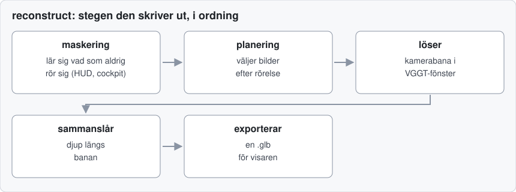

# Offline-rekonstruktion {#offline-reconstruction}

```bash
python -m heat3d_capture reconstruct lap.mp4 -o lap.glb [--solve-budget 260] [--fuse-interval 0.4]
```

Kod: [`scan/offline.py`](https://github.com/Holdi601/3DHeat-GameCapture/blob/main/heat3d_capture/scan/offline.py),
[`pose/feedforward.py`](https://github.com/Holdi601/3DHeat-GameCapture/blob/main/heat3d_capture/pose/feedforward.py),
[`pose/vggt_model.py`](https://github.com/Holdi601/3DHeat-GameCapture/blob/main/heat3d_capture/pose/vggt_model.py),
[`pose/feedforward_source.py`](https://github.com/Holdi601/3DHeat-GameCapture/blob/main/heat3d_capture/pose/feedforward_source.py),
[`pose/solveprep.py`](https://github.com/Holdi601/3DHeat-GameCapture/blob/main/heat3d_capture/pose/solveprep.py).
Alternativ: [Kommandoreferensen](commands.md#reconstruct).

## Varför en andra väg {#why-a-second-path}

Inkrementell spårning är live och billig och fungerar där det finns struktur att hålla fast vid: ett interiör, en gata, en karta med skydd. En **racerbana är dess sämsta fall**: vägen är ett slätt band med lite textur, horisonten rör sig knappt, och när några poser driver finns inget senare som drar tillbaka dem. Ett varv kommer ut som en kurva som vandrar i stället för att sluta sig.

Den offline-vägen ger **fönster av bildrutor** till en modell som förutsäger alla deras kameror tillsammans, så att varje bildruta begränsar varje annan direkt i stället för genom en kedja. Den behöver hela inspelningen innan den kan svara, så den är inte live, och den är långsam: minuter per fönster på en stationär GPU. Allt efter posen (fusion, täckning, färg, export) är samma kod som den live-skanningen. Den lösta banan lämnas till rekonstruktören som en posekälla, precis där Forza-telemetri går in.

## Krav {#requirements}

- **PyTorch** matchad mot din GPU (inte fastlagd av projektet; installera den före `requirements.txt`, se [Körmiljö](runtime.md)).
- **`vggt`**: VGGT-modellkoden (`from vggt.models.vggt import VGGT`), från Metas GitHub-repo. Den finns inte i paketindexet.
- **`transformers`**, eftersom den offline-vägen kör djup genom PyTorch-`DepthEstimator` (Depth Anything V2 Small), inte genom ONNX-filen.
- En CUDA-GPU i praktiken; båda modellerna faller tillbaka på CPU, vilket inte är praktiskt.

Ingen av dessa finns i `requirements.txt`, eftersom skannern inte behöver dem. De finns i **`requirements-offline.txt`**, med VGGT:s egna beroenden (`einops`, `safetensors`, `huggingface_hub`, `Pillow`):

```bash
.venv\Scripts\python -m pip install -r requirements-offline.txt
.venv\Scripts\python -m pip install --no-deps "vggt @ git+https://github.com/facebookresearch/vggt.git"
```

VGGT installeras med `--no-deps` eftersom dess paketmetadata låser `numpy<2`, vilket pip skulle respektera genom att nedgradera den numpy som scipy behöver här. `reconstruct` kontrollerar alla dessa direkt efter att licensraden skrivits ut (listan `OFFLINE` i [`runtime/preflight.py`](https://github.com/Holdi601/3DHeat-GameCapture/blob/main/heat3d_capture/runtime/preflight.py)), listar vad som saknas med storlekar, och installerar bara vid ett ja: VGGT med `--no-deps`, som ovan. Nej, eller om det inte finns någon terminal att fråga i, avslutas med kod 1.

## Modellen och licensen {#the-model-and-its-licence}

**VGGT**, `facebook/VGGT-1B`: **CC-BY-NC-4.0, endast icke-kommersiell, och en rekonstruktion gjord med den ärver det.** Kommandot skriver ut det innan det startar (`describe_licence`). En separat licensierad `facebook/VGGT-1B-Commercial` finns, men den är ett spärrat arkiv som Meta ger per konto, så den kan inte vara standard. `--model vggt-1b-commercial` löser med den (och skriver ut dess licensrad i stället); utan beviljad åtkomst misslyckas nedladdningen. `vggt`-*koden* ligger under Metas egen "VGGT License", ett forskningsmaterialavtal med en policy för godtagbart bruk (läst från paketets `LICENSE.txt`). Se [Modeller och licenser](models-and-licences.md).

## Körningen, steg för steg {#the-run-stage-by-stage}

Stegnamnen är vad kommandot skriver ut.



### masking {#masking}

En `FlowMask` lärs in från **4 körningar om 90 på varandra följande bildrutor**, centrerade vid 1/8, 3/8, 5/8 och 7/8 av videon, vid 960 x 540 gråskala (se [FlowMask](reconstruction-capture.md#flowmask-what-never-travels)). Dess notis skrivs ut och sparas i sammanfattningen. En video kortare än 90 bildrutor får ingen mask.

#### Kameramasken lärs in, den tillämpas inte {#the-camera-mask-is-learned-not-applied}

Masken tillämpas **inte** på bildrutorna som ges till lösaren. Att maskera förarhytten såg rätt ut enligt särdragsstatistik (de flesta upptäckta hörn sitter på kamerafästa pixlar), men det är ett påstående om en särdragsdetektor, och lösaren är ett tränat nätverk. Mätt på hur mycket den återskapade vägen svänger mellan på varandra följande steg (en bil svänger några grader; en slumpvandring nittio) gav råa bildrutor den minsta svängningen, kontrastlyfta bildrutor lite mer, maskerade bildrutor tydligt mer, och båda tillsammans mest. Så lösaren får råa bildrutor. Masken används ändå för att planera bildrutornas avstånd nedan, och den inkrementella spåraren använder den i live-skanningen. (`solveprep.enhance`, som maskerar och lyfter lokal kontrast med CLAHE, finns men används inte av det här kommandot.)

### planering: bildrutor utspridda efter rörelse {#planning-frames-spaced-by-motion}

`plan_by_motion` väljer lösarens bildrutor efter **hur mycket bilden har rört sig**, inte efter klockan. Ett fast intervall ger långsamma sektioner bildrutor de inte behöver och svälter snabba, där på varandra följande bildrutor slutar överlappa tillräckligt för att höra ihop.

- Målförskjutning: **5 % av en 960-pixelbredd** (48 px) median-ORB-särdragsförskjutning mellan på varandra följande valda bildrutor, mätt på 960 x 540 gråskalebildrutor med CLAHE-kontrast, särdrag bara på masken.
- Börjar vid ett 0,3 s-avstånd. Efter varje steg blir nästa avstånd `gap x (0,5 + 0,5 x target / measured)`, begränsat till **0,15-2,0 s**, så att en brusig mätning inte svänger planen.
- När inget matchade krymper avståndet till 0,6 av sig självt (för långt isär är felet som undviks).
- Stoppar vid videons slut eller vid `--solve-budget` bildrutor (standard 260).

Färre än 4 planerade bildrutor är ett fel.

### lösning: fönster och sömmar {#solving-windows-and-stitching}

De planerade bildrutorna avkodas i 960 px bredd och löses i överlappande fönster om **16 bildrutor, 6 delade** med nästa (`plan_windows`). Det sista fönstret dras tillbaka så att det slutar på den sista bildrutan, så att slutet av en inspelning har lika många grannar som mitten. Mer än **400** bildrutor i en körning avvisas.

Varje fönster: bildrutor skalas så att långsidan är **518** och båda sidor är multipler av **14** (bildförhållandet bevaras, eftersom en ihopklämning skulle ange synfältet fel), skalas till 0..1 och körs genom VGGT under bfloat16-autocast (float16 tar slut på exponent vid långt bortliggande världskoordinater). Kameraextrinsikerna omvandlas till världsfrån-kamera-rotationer och kameracentra. Punktkartor behålls inte som standard.

Varje fönster kommer tillbaka i **sitt eget godtyckliga koordinatsystem och sin egen godtyckliga skala**, så fönster **sys ihop** in i det första fönstrets koordinatsystem med en likformighetstransform (rotation, translation, en skala). Den anpassas efter de kameror som fönstret delar med det som redan är placerat:

- **Rotation från kamerornas orientering**, inte deras positioner. De delade kamerorna sitter längs vägen och är nästan kolinjära på en rak, vilket lämnar en positionsbaserad anpassning blind för rotationen: varje fönster kröks och det sammanfogade resultatet blir rakt. Rotationen är medelvärdet av `target_R x source_R^T` projicerat tillbaka till en riktig rotation (med ett spegelvändningsskydd).
- **Skala och förskjutning från positionerna**, längs den roterade källan.
- Minst **4** delade kameror krävs; färre är ett fel.
- Överlappningen är en tredjedel av fönstret, så att skalan blir väl bestämd. Skalfel som ackumuleras fönster för fönster är det som får ett varv att spiralera.

För varje söm registreras den värsta oenigheten mellan de delade kamerorna efter anpassningen, i enheter av medelavståndet mellan dem (`seam_error`).

### fusion {#fusing}

Bildrutor var `--fuse-interval` sekund (standard 0,4) avkodas i 960 px bredd, får djup av Depth Anything V2 Small (PyTorch) och fusioneras med en pose **interpolerad** från den lösta banan vid deras tidsstämpel (linjär position, sfärisk rotation; `FeedForwardPoses`). Bildrutor utanför den lösta tidsspannet hoppas över i stället för att extrapoleras. Kameran använder ett **65 graders** horisontellt synfält. Feed-forward-poser har säkerhet 0,85 i fusion och täckning.

### export {#exporting}

Nätet skrivs som för en live-skanning ([.glb-utdata](glb-output.md)), namngivet efter videon.

## Sammanfattningen {#the-summary}

```text
140 cameras solved over 182s
closure error 3.1% of path length
worst seam 0.42 frame spacings
<mask note>
wrote lap.glb
```

| Rad | Betydelse |
|---|---|
| closure error | avstånd från första till sista kamera över vägens längd. För ett enskilt varv det ärliga måttet på drift. Över 10 %: "The lap does not close ... Treat the shape as unreliable." |
| worst seam | den största oenigheten vid sammansyningen. Över 1,0: "Windows disagreed by up to N frame spacings at a seam, so part of the path is stitched on weak evidence." |
| no file | "Fusion produced no surface, so nothing was written." Avslutningskoden är då 1. |

## Skala {#scale}

Den sammanfogade vägen är i det första fönstrets godtyckliga enheter. Djup ankras genom att triangulera mellan de interpolerade poserna (som för telemetri), så geometrin stämmer med vägen. Men **resultatet är inte i meter** om inte vägen är det. Inget i det här kommandot fastställer den globala skalan; markkalibreringen tillämpas inte när poser kommer från en posekälla.

## Läget för den här vägen {#state-of-this-path}

Med bildrutor i fast intervall löses fönster till en sammanhängande väg på vissa sektioner av ett varv och till en kladd på andra. Felen finns i de tajta kurvorna, där vyn svänger hårt mellan bildrutor, och att samplea de kurvorna tätare återställer dem. Ingen bildstatistik som prövats (ljusstyrka, detaljrikedom, antal särdrag, inlier-andel, förflyttning) förutsade i förväg vilka sektioner som skulle misslyckas. Så avståndet kan inte planeras helt utifrån bilderna i förväg: det måste väljas genom att lösa, mäta resultatet och lösa om tätare där vägen inte är en som en bil kunnat köra. Rörelsebaserad planering är byggd; **den adaptiva omlösningen är inte det**.
