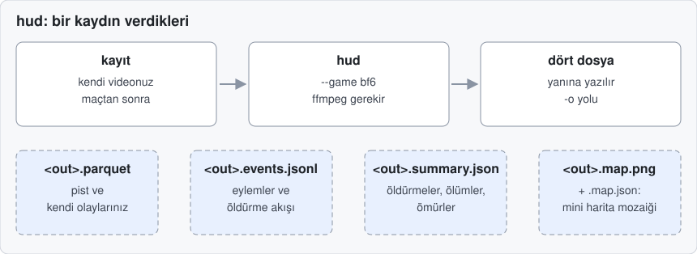

# Kayıttan HUD okumak {#reading-the-hud-from-a-recording}

`hud`, bir oyunun ekrandaki HUD'unu oyuncunun **kendi kaydından**, maçtan sonra okur: oyuncunun nişangâhın altında
gösterilen puan açılır penceresinden **kendi** eylemleri (öldürmeler, yardımlar, dirilmeler, ikmaller, ele geçirmeler...),
aşağı ve konuşlanma ekranlarından ölümleri, mini haritadan **kendi** izi ve yanındaki öldürme akışı zamanlı olaylar
olarak - hepsi bir 3DHeat tablosu olarak, altına serilecek bir harita görüntüsü olarak da mini haritanın mozaiğiyle
yazılır.

Kısaca: maç videonuzu izler ve öldürmelerinizi, ölümlerinizi ve nerede yürüdüğünüzü yazar.

```bash
.venv\Scripts\python -m heat3d_capture hud "<recording>.mp4" --game bf6 --player <name> -o out/match
```

Battlefield 6 ilk oyun profilidir.



## Neye dokunur, neye dokunmaz {#what-it-does-and-does-not-touch}

- **Bir video dosyasını** okur: bir ShadowPlay / Anlık Tekrar klibi, bir OBS kaydı, ffmpeg'in çözebildiği her şey.
  Oyuna, belleğine, dosyalarına ya da ağına hiçbir zaman dokunmaz ve maç bittikten sonra çalışır. Bkz. [Kurallar](rules.md).
- Yalnızca **oyuncunun kendi konumunu** türetir; bunu oyuncunun kendi mini haritasından alır. Mini haritadaki
  diğer oyuncuların işaretçileri maskelenir ve hiç okunmaz. Öldürme akışı tam olarak tutulur, ama yalnızca ekranda
  yazanlar olarak (kim, kimi, neyle, ne zaman); oyuncudan başka hiç kimseye konum eklenmez.
- OCR yerel olarak çalışır (PaddleOCR modelleriyle RapidOCR, ONNX Runtime üzerinden). Hiçbir kare ya da kırpma
  makineden çıkmaz.
- Bir kayıtta diğer oyuncuların adları görünür ve mozaik seviyenin bir resmidir. Çıktılar oyuncunun kendi kullanımı
  içindir; yerel tutun.

## Gereksinimler {#requirements}

- **ffmpeg ve ffprobe**, `PATH` üzerinde. Bir NVIDIA kartı varsa kod çözme için kullanılır (`-hwaccel cuda`);
  yoksa kod çözmeyi CPU yapar ve birkaç kat yavaştır.
- `requirements.txt` içindeki paketler ve OCR'ın kendi bağımlılıkları olmadan (CPU `onnxruntime` ister; bu, projenin
  kullandığı DirectML sürümüyle çakışır):

```bash
.venv\Scripts\python -m pip install -r requirements.txt
.venv\Scripts\python -m pip install --no-deps rapidocr_onnxruntime==1.2.3
```

`rapidocr_onnxruntime`, ekrandaki adları ve kelimeleri okuyan metin okuyucusudur (OCR). `--no-deps`, projenin
DirectML `onnxruntime` paketinin yerine geçmesini engeller.

Windows'ta ffmpeg kurmak için: `winget install Gyan.FFmpeg`, sonra yeni bir terminal açın ve `ffmpeg -version` ile
kontrol edin. Komut satırına yeni misiniz? [Başlamadan önce](before-you-start.md) sayfasını okuyun.

- Her çözünürlükte (1080p, 1440p, 4K) bir **16:9** kayıt. Diğer en-boy oranları reddedilir, çünkü profilin kutuları
  ekranın yanlış yerlerine düşer.
- Oyunun **varsayılan HUD düzeni**. Taşınmış ya da ölçeklenmiş bir HUD öğesi yanlış yerden okunur.

## Seçenekler {#options}

| Seçenek | Varsayılan | Anlamı |
|---|---|---|
| `video` | | Kayıt. |
| `-o`, `--out` | videonun adı, geçerli klasörde | Uzantısı **olmadan** çıktı yolu; dosyalar `<out>.parquet`, `.events.jsonl`, `.summary.json`, `.map.png`, `.map.json` olur. |
| `--game` | `bf6` | Hangi oyunun HUD'u okunacak. `bf6` (Battlefield 6) şimdilik tek profildir. |
| `--player` | yok | Öldürme akışının gösterdiği biçimde oyuncunun adı. Esnek karşılaştırılır (OCR `l`/`I`/`1`, `O`/`0`, `rn`/`m` karıştırır). Verilmezse ad aşağıda anlatıldığı gibi tahmin edilir. |
| `--fps` | 5 | Saniyedeki mini harita örneği. Öldürme akışı bunun yarısında, puan açılır penceresi ve ölüm ekranları da yine yarısında örneklenir (açılır pencere yokken çeyrek), pusula her 3 saniyede, takım listesi her 15 saniyede. |
| `--start` | 0 | Videonun kaç saniyesinde başlanacak. |
| `--seconds` | hepsi | Videonun ne kadarı okunacak. |
| `--metres-per-pixel` | yok | Biliniyorsa mini haritanın ölçeği: olağan yakınlaştırmada mini harita pikseli başına metre (mini harita 1080p ekranda 296 piksel genişliktedir). Verilmezse konumlar bu piksellerdedir; bkz. [Birimler](#north-and-units). |
| `--cpu` | kapalı | NVIDIA kartı olsa bile CPU'da kod çöz. |

İlerleme her beş saniyede bir yazdırılır; sonunda oyuncu, öldürmeler, ölümler, canlar ve yazılan dosyalar gösterilir.

## Çıktılar {#outputs}

### `<out>.parquet` - oyuncunun izi ve olayları {#parquet---the-players-track-and-events}

Oyuncunun oyunda olduğu ve mini haritanın yerleştirilebildiği her örnek için bir satır, artı oyuncunun her olayı için
bir satır. Dosyanın altbilgisi görüntüleyicinin okuma talimatlarını taşır (`heat3d` anahtarı, `kind: heat3d-hud`), böylece
görüntüleyici her sütunu sormadan eşler.

| Sütun | Anlamı |
|---|---|
| `time` | Videonun başından itibaren saniye. |
| `event` | `position`; `start` (video bir yaşam ortasında başladı), `spawn` (bir ölümden ya da uzun bir aradan sonra yeniden oyunda), `death`, `downed` ve `revived` (ölüm ekranlarından, aşağıda), `end` (bir yaşam bir şey söylenmeden bitti); oyuncunun puan açılır penceresinden kendi eylemleri (`kill`, `assist`, `reviving`, `resupply`, `capture`... - [olay tablosu](#event-table)); ve öldürme akışının oyuncuyla ilgili satırları `kill_feed`, `death_feed`, `teamkill_feed`, `suicide_feed`, `squadwipe_feed`. |
| `source` | Satırın olayının geldiği yer: `points` (açılır pencere), `screen` (aşağı ve konuşlanma ekranları), `feed` (öldürme akışı); konum satırlarında boş. |
| `text` | `points` satırlarında: ekranda yazıldığı gibi etiket (`KILL`, `SQUAD DAMAGE ASSIST`...), ya da başlık (`DOUBLE KILL`, bir rozetin adı), ya da bilinmeyen bir etiket için okunan metin. |
| `points` | `points` satırlarında: o anda açılır pencerenin toplamının ne kadar arttığı. Aynı örnekte birkaç eylem geldiyse (bir öldürme ve içinde olunan araç) bunların toplamıdır, her birinde yazılır ve `shared` kaç tanesinin paylaştığını söyler. Toplam, o anın iki yanında da iki kez okunamadıysa boştur. |
| `subject`, `subject_side` | `points` satırlarında: eylemle birlikte açılır pencerin gösterdiği ad - bir öldürmenin kurbanı, dirilen ya da ikmal edilen takım arkadaşı - ve rengi (`enemy`, `friendly`, `squad`). |
| `confirmed` | Öldürme akışında aynı öldürme ya da ölüm için bir satır varsa (3 saniye içinde, aynı kurban) `feed`. |
| `x`, `y`, `z` | Mozaik üzerindeki konum: `x` doğu, `y` kuzey, `z` 0 (altbilgi `z`'nin yukarı olduğunu söyler). Pusula izin verdiğinde kuzey gerçek kuzeydir (özetteki `north_up` değerine bakın). |
| `player` | Her zaman `me`. Yalnızca oyuncunun kendi satırlarının konumu vardır. |
| `team` | `own`. |
| `session` | `<video name>#NN`, her yaşam için bir tane. Çizgi ısı rotaları hiçbir zaman bir oturumu geçmez. |
| `heading` | Kuzeyden saat yönünde derece (kuzey bilinmiyorsa mozaiğin yukarısından): görüşün baktığı yer. |
| `dir_x`, `dir_y`, `dir_z` | Aynısı bir yön vektörü olarak, görüntüleyicinin bakış yönü için. |
| `zoom` | Mini harita, olağan yakınlaştırmasına göre ne kadar uzaklaştırılmıştı (araçlarda 1'in üstünde). |
| `killer`, `victim`, `weapon`, `headshot`, `marker` | Öldürme akışı satırı olan öldürme ve ölüm satırlarında: akış satırı (aşağıda). Akış satırı olmayan bir puan öldürmesinde `victim`, açılır pencerenin adıdır; HEADSHOT olarak gösterilen bir puan öldürmesinde `headshot` true olur. |

Her olay satırı, olayın zamanındaki oyuncunun konumunu alır (bir ölüm ya da aşağı düşme için, ondan önceki son konum;
bir diriltme için, sonraki ilk konum). Satırlar görüntüleyicinin [çizgi ısısına](https://holdi601.github.io/3DHeat/line-heat.html)
doğrudan uyar: önerisi `event` sütununu seçer, `start`, `spawn` ve `revived` ile başlar, `death`, `downed` ve `end` ile
biter, ve `position` satırları rota boyunca uzanır. Diğer olaylar, önerinin hiçbirini başlangıç ya da bitiş olarak
almayacağı şekilde adlandırılmıştır: bir diriltme vermek `reviving` (`revive` değil), bir noktayı tutmak `defense`, bir
takım arkadaşının oyuncunun üstünde doğması `teammate_arrived`, akışın satırları `kill_feed` ve benzeri; `kill` bir
bitiş değildir.

Iki haritada iki turu olan bir klip, birbiriyle ilişkilendirilemeyen iki mozaik verir. En büyüğü `<out>.parquet`
dosyasıdır; en az 30 saniye izi olan her diğeri onun yanına `<out>.map2.parquet`, `<out>.map2.map.png` ve benzeri
olarak yazılır.

### `<out>.events.jsonl` - oyuncunun olayları ve öldürme akışı {#eventsjsonl---the-players-events-and-the-kill-feed}

Zamana göre sıralı, satır başına bir JSON nesnesi, her biri bir `source` ile:

- `points`: oyuncunun her eylemi için bir: `time`, `event`, `text`, `points`, `shared`, `subject`, `subject_side`
  (tablodaki gibi), `popup` (hangi açılır pencereden geldiği, çalışma boyunca numaralandırılmış), `seen` (kaç okuma
  gösterdiği), `confirmed`, ve oyuncunun bulunduğu `x`, `y`.
- `screen`: aşağı düşülen ve dirilen her an için bir: `event` (`death`, `downed` veya `revived`), `time` (oyuncunun
  aşağı düştüğü an; `revived` için, ekranların gittiği an), `until` (ekranların son görüldüğü an), `screens` (`down`
  ve/veya `card`), `outcome` (`death`, `revived` ya da video önce biterse `unknown`), `killer` (bir akış satırı varsa
  oradan), `x`, `y`.
- `feed`: öldürme akışının gösterdiği her satır, herkesinki:

| Alan | Anlamı |
|---|---|
| `time`, `last` | Satırın okunduğu ilk ve son örnek (videonun başından itibaren saniye). `time`, öldürmenin göründüğü andır, bir akış örneği içinde (varsayılan hızda 0,4 sn). |
| `kind` | Oyuncunun tarafından: `kill`, `death`, `teamkill`, `suicide`, `squadwipe`; diğer oyuncuların satırları için `kill`, `squadwipe`, ya da öldüren olmayan bir satır için `death`. |
| `killer`, `victim` | Adlar, satırı gösteren bütün örneklerdeki en sık okunan olarak (ortak okuma, başlangıcı olduğunda daha uzun okuma kazanır: kısmen gizli bir ad). `killer`, yalnızca bir simge ve bir kurban gösteren satır için boştur - dünyanın öldürmesi, ya da katili zaten solmuş bir satır. |
| `killer_side`, `victim_side` | Adın renginden: `friendly` (oyuncunun takımı, mavi), `enemy` (turuncu), `squad` (oyunun oyuncu ve takımı için kullandığı soluk yeşil), `neutral` (bunlardan hiçbiri). |
| `weapon` | Silah simgesinin bu çalışma içindeki sınıfı: `icon01`, `icon02`... Birbirine benzeyen simgeler aynı sınıfı paylaşır. Simgeler adlandırılmamıştır; onları adlandıracak bir liste yoktur. |
| `marker` | Silah ile kurban arasındaki küçük simge: `skull`, `arrow`, `chevrons`, `crosses` ya da boş. |
| `headshot` | `marker == "skull"` - bir varsayım, bkz. [Sınırlar](#limits). |
| `seen` | Satırı gösteren öldürme akışı örneklerinin sayısı. |
| `me` | `killer`, `victim` ya da null. |
| `matched` | Oyuncunun kendi satırları için: bunun için bir açılır pencere eylemi ya da ölüm ekranı bulunup bulunmadığı. |
| `x`, `y` (, `map`) | Oyuncunun kendi satırları için: oyuncunun nerede olduğu. |

### `<out>.summary.json` {#summaryjson}

Oyuncu (ve nasıl bulunduğu), oyuncunun olaylarının nereden geldiği (`own_events_from`: açılır pencere ve ekranlar,
ya da ikisi de okunmadıysa yalnızca öldürme akışı), öldürmeler, ölümler, K/D, kafadan vuruşlar, yardımlar, verilen
(`revives`) ve alınan (`revived`) diriltmeler, aşağı düşmeler, ele geçirmeler, tarafsızlaştırmalar, ikmaller, iyileştirmeler,
onarımlar, yok edilen araçlar, skor (açılır pencerelerin toplamları), her eylem türü ve sayısı (`actions`), açılır
pencere sayısı, yalnızca öldürme akışının gördüğü ölümler, öldürme akışının kendi öldürme ve ölüm sayısı ve bunların
kaçının bir açılır pencere öldürmesiyle eşleştiği, takım öldürmeleri, intiharlar, takım yok etmeleri, canlar, oyunda
geçirilen saniyeler, kat edilen mesafe (tablonun birimlerinde), akış satırları, harita başına yukarısının kuzey olup
olmadığı ve kaç pusula okumasının uyuştuğu, izin sayıları (örnek, oyunda, yerleştirilmiş, yerleştirilmemiş, adalar),
yapılan varsayımlar ve zamanlama.

### `<out>.map.png` ve `<out>.map.json` - izin altındaki harita {#mappng-and-mapjson---the-map-under-the-track}

Çalışmanın her mini haritasının mozaiği, ortalaması alınmış, üstündeki katmanlar temizlenmiş, tablo ile birebir aynı
şekilde döndürülmüş ve ölçeklenmiş. JSON yan dosyası, görüntüleyicinin **Harita görüntüsü** yerleşiminin istediği iki
çapayı taşır ([Harita görüntüleri](https://holdi601.github.io/3DHeat/map-images.html), görüntüleyicinin belgelerinde):
PNG'yi **Harita görüntüsü...** ile yükleyin, **Kuzey/güneyi çevir** açık kalsın ve yan dosyadaki çapa 1 ve çapa 2'yi
(`px`, `py`, `worldX`, `worldZ`) yazın. Görüntü o zaman izin tam altına oturur.

Yalnızca oyuncunun mini haritasında görünen bölümün parçaları resimde bulunur.

## Yöntem {#method}

### Kod çözme {#decoding}

ffmpeg, kodu GPU'da çözer; kareler kartta hâlâ iken örnekleme hızına düşürür; profilin bölgelerini kırpar (mini
harita, öldürme akışı, iki pusula şeridi, takım listesi, puan açılır penceresi, aşağı ekranın kelimeleri, sağ alt köşe),
her birini sabit bir boyuta ölçekler ve her örnek için tek bir küçük resimde üst üste dizer. Boru hattından Python'a
yalnızca bu resim geçer. H.264 akışının her karesinin çözülmesi, çalışma süresinin alt sınırıdır.

Iki çalışan iş parçacığı örnekleri alır: biri mini haritaları kaydeder (OpenCV), biri metni okur (ONNX Runtime).

### Oyunda olup olmadığı {#in-play-or-not}

Mini haritanın tuş ipucu karesi (mini haritanın sol altındaki, içinde harita tuşu olan açık renkli kare), mini harita
göründüğünde her zaman çizilir ve ölüm, öldürme kamerası, konuşlanma, menü ya da skor tablosu ekranlarında çizilmez.
Varlığı - renksiz, açık bir kare, ortasında koyu bir harf, yakındaki çevresinden belirgin biçimde açık - yerinin birkaç
piksel çevresinde aranır ve oyunda olmanın testidir. İki komşusuyla çelişen tek bir örnek yok sayılır.

Oyundaki bir boşluk, en az 6 sn sürerse ya da son 40 saniye içinde bir ölüm (ekranlardan ya da oyuncuyu kurban olarak
gösteren bir akış satırından) geldiyse bir ölüm ya da tur değişikliğidir (bir sonraki parça `spawn` ile başlar); daha
kısa bir ölümsüz boşluk (büyük harita açıldığında) yaşamı sürdürür. Oyuncu aşağıdayken mini harita açık kalır, bu yüzden
aşağıdaki oyuncu oyundadır.

### İz {#the-track}

Mini harita görüşle döner ve oyuncuyu sabit bir noktada tutar (ölçülmüş: ortada, %49,7 aşağıda). Her örnek için:

1. **Maskele**: bölüm olmayan her şeyi (hedef işaretleri, takım ve araç simgeleri, işaretler, bölgenin sınırı, rota
   çizgileri, metin), görüş konisinin soluk sarı-yeşili, oyuncunun işaretçisi etrafındaki bir disk, koninin üstündeki
   kama, tuş ipucu ve ince bir kenar pikselleri.
2. **Özellikler**: kontrastı eşitlenmiş gri mini haritada SIFT anahtar noktaları, maskenin içinde.
3. **Mozaiğe hizala**, bir önceki örneğe değil: anahtar noktaları, şimdiye kadar saklanmış özelliklerle, mozaik
   koordinatlarında, oyuncunun son olduğu yere yakın eşleştirilir; bir benzerlik dönüşümü (dönüş, yakınlaştırma,
   kayma) RANSAC ile uydurulur. Bir uydurma için yeterli içte kalan (inlier) gerekir, son yakınlaştırmanın üçte
   biri içinde bir yakınlaştırma ve örnek başına mini haritanın üçte birinden az bir kayma; mozaikte her yerde aranan
   bir uydurma (bir ölümden sonra) iki kat içte kalan gerektirir.
4. **Mozaiği büyüt**: mozaikte henüz olmayan özellikler eklenir (en fazla her birkaç onda bir saniye hareket için)
   ve maskelenmiş mini harita resmin içine ortalama olarak eklenir.
5. Uydurmadan geçen oyuncu noktası oyuncunun **konumudur**; uydurmadan geçen mini harita yukarısı, mozaikteki
   **yönüdür**.

Sonradan, iki önceki ve iki sonraki örneğin ikisinden de 10 pikselden fazla uzaklaşan bir nokta düşürülür (bu
örnekler kendi aralarında uyuşur); bir mini harita arada bir tek örnek için yanlış bir yakınlaştırmayla eşleşir.
Özet bunları sayar (`dropped_as_jumps`).

Mozaiğe hizalamak, hataların birikmesini önler: daha önce görülmüş bir yere geri dönmek, ilk seferde saklanan özelliklerle
eşleşir. Henüz görülmemiş bir yerde doğmak ayrı bir **ada** başlatır; her onuncu yerleştirilmiş örnek diğer adalara
denenir ve ilk iyi eşleşme onları birleştirir (küçük olan, iziyle birlikte büyüğe girer). Hiç birleşmeyen adalar
(başka bir harita ya da hiç paylaşılmamış zemin) yukarıdaki gibi ayrı yazılır.

### Kuzey ve birimler {#north-and-units}

Pusula şeridi her 3 saniyede okunur: etiketleri mürekkeplerine göre bulunur (parlak, renksiz, küçük boşluklarla
gruplanmış, işaretler atılmış), her biri tek tek okunur ve iki ya da daha fazla etiket hem şeridin ölçeğini hem de
merkez işaretinin altındaki yönü belirler - tek bir etiket hiçbir şeyi belirlemez. Her pusula okuması, aynı örneğin
mozaik yönüyle eşleştirilir; farkların dairesel medyanı, ona 10 derece içindeki okumalar üzerinden, mozaiğin kuzeyini
yukarı çeviren dönüştür. Yeterli: en az üç okuma ve tümünün yarısı uyuştuğunda uygulanır.

<a id="units"></a>Mini haritanın yer ölçeği ekranda hiçbir yerde yazmaz, bu yüzden konumlar **olağan yakınlaştırmada
mini harita pikselleri** cinsindendir: çalışmanın medyan yakınlaştırması, 296 piksel genişliğindeki bir mini haritanın
(1080p ekranda boyutu) her pikseli için bir tablo birimine ölçeklenir. Araç yakınlaştırmasının uzaklaştırılması
hizalama tarafından çıkarılır, böylece bir birim yayan da araçtaki de aynıdır. `--metres-per-pixel` bilindiğinde
(haritada bilinen bir mesafeden bir kez ölçülerek) her şeyi metreye çevirir.

### Öldürme akışı {#the-kill-feed}

Akış saniyede 2,5 örnekte okunur, ama yalnızca renkli pikselleri belirgin biçimde değiştiğinde ya da 2 sn geçtiğinde.
Metin satırları OCR'ın dedektörüyle bulunur; önceki örnekte okunan bir metinle resmi eşleşen bir satır (satırlar kaydığı
için yer değiştirmiş olabilir) yeniden okunmak yerine o metni alır. Bir ad için çok küçük satırlar ya da eğik çizgi
içerenler (o köşedeki bir fps sayacı) atılır.

Satırlar yüksekliğe göre sıralara gruplanır; bir sırada en soldaki ad katil, en sağdaki kurbandır. Aynı renkteki komşu
parçalar birleşir (boşluklu bir ad). Simgeden bir adı diğerine geçen tek bir satır, iki yarısının rengi farklıysa en geniş
boşlukta kesilir ve her yarı yeniden okunur. Kurbanlar sütunundaki, hemen solunda bir simge olan tek bir ad, katili olmayan
bir satırdır. Aralarında simge olmayan, aynı renkte iki parça, bir öldürme değil, katili solmuş tek bir addır.

**Taraflar** renkten gelir. Adlar biraz saydamlıkla çizilir, bu yüzden test metnin kendi arka planına uzaklığına bakar:
kırmızı eksi mavinin bu farkındaki işareti, her arka planda turuncu (düşman) ya da mavi (dost) olur; ikisi de değilse
ve yeşil diğer ikisinin üstündeyse takım rengidir.

**Simgeler**: adların arasında, katilin renginde olan pikseller silahın siluetini oluşturur; kurbanın hemen solunda
ayrı küçük bir simge işaretçidir ve şekline göre adlandırılır (göz delikli bir leke bir kafatasıdır; küçük bir üçgen
bir oktur; birkaç parça çarpılardır).

**Olaylar**: aynı iki adla yeniden okunan bir satır (ortak OCR karışıklıkları katlandıktan sonra 0,7 benzerlik, biri
0,8; yarım kesilmiş bir okuma tam adın başıyla eşleşir), olayın en son 5 sn'den az önce ve 14 sn'den daha yeni okunduğu
sürece aynı olaydır - hiçbir satır daha uzun durmaz, bu yüzden aynı çift daha sonra yeni bir öldürmedir. Katilsiz bir satır
yalnızca kurbana göre eşleşir. Bir olayın zamanı ilk görülmesidir; adları, tarafları ve işaretçisi görmelerin çoğunluğudur;
bir kez okunan satırlar atılır.

**Oyuncu**: `--player`, yoksa takım listesinin vurgulanmış (en parlak) satırı, en az üç okuma ve bunların %60'ı uyuşursa,
yoksa öldürme akışının takım rengiyle en sık çizdiği ad. Aksi halde özet oyuncunun bilinmediğini söyler ve hiçbir akış
satırı ona atfedilmez. (Puan açılır penceresi ve ölüm ekranları, adları ne olursa olsun oyuncunun kendisidir; bir ada
ihtiyaç duymazlar.)

### Puan açılır penceresi {#the-points-popup}

Oyuncunun kazandığı her şey, Battlefield 6 tek bir açılır pencerede gösterir: nişangâhın hemen solunda ve altında -
yürürken, bir araçta ve bir dürbünden bakarken aynı yerde:

```
            [ RIBBON ] (icon)          a title, now and then: a ribbon or a multi-kill
      (icon)(icon)(icon)  300          one icon per action; the popup's running total
                Some_Name              who it was about, for a moment: orange an enemy, blue a teammate
    [ KILL x2 ] [ VEHICLE DESTROYED ]  one boxed tag per kind of action, with a count
```

Oyuncu puan kazandıkça açılır pencere büyür: yeni bir öldürme `KILL`i `KILL x2` yapar, bir simge ekler ve toplamı
yükseltir; yeni bir eylem türü bir etiket ekler. Etiket satırı son birkaç türü gösterir (eski bir tanesi kayarak çıkar
ve geri geldiğinde yeniden sayılır). Son eylemden yaklaşık üç saniye sonra açılır pencere tek bir satıra katlanır
(`[KILL x2] 300`) ve kaybolur. Metin açık gridir, etiketler ince kutularda, toplam 1920x1080 ekranda x 760'tan başlayan
büyük rakamlarla, etiketler x 750'ye sağa hizalı.

Saniyede 2,5 kez okunur: OCR'ın dedektörü metin satırlarını bulur, yalnızca açılır pencerenin satırlarından birinde olan
satırlar okunur (aynı alandaki tank nişangâhının kendi etiketleri değil), ve bir önceki örnekte okunan bir satırla resmi
eşleşen bir satır o metni alır. Bir simgeden, bir adtan ya da katlanmış bir etiketten toplama taşan satır (`Name10`,
`REVIVE185`) toplamın başladığı yerde (x 755) kesilir ve iki yarısı yeniden okunur. Hiçbir açılır pencere yokken her diğer
örnek okunmadan tutulur; bir sonrakinde bir açılır pencere göründüğünde tutulan önce okunur, böylece bir açılır pencerenin
başlangıcı örneğe kadar bulunur.

**Etiketler** [olay tablosuyla](#event-table) eşleştirilir, tanıyıcının olağan hatalarından sonra (Q'nun O okunması, harfler
arasında bir rakam, L yerine I, bir kenarda kaybolan bir harf): bir okuma, bir etiketle en az %80 benzerse (beş harf ya da daha
kısa etiketler için %85) ve başka herhangi birine göre belirgin biçimde ona daha yakınsa bir etikettir. Tanıyıcının birbirine
karıştırdığı etiketler (`CAPTUREDORDERCOMPLETED`) öncekileri önden soyularak ayrılır. Bir sayı `x2`, `X3`, bir başıboş işaret
ve bir rakam ya da etiketin hemen arkasında bir rakamdır. Etiket satırında, hiçbir şeyle eşleşmeyen, açık gri ve büyük harfli
bir satır, metniyle birlikte bir `points` eylemi olarak tutulur; aynı açılır pencerede bilinen bir etiketin parçası olan bir satır
(`VEHICLE DESTROYED` yanındaki `DESTROYED`) ise tutulmaz. Toplamın üstündeki başlıklar (açık kutular, koyu metin) `multi_kills`
(`DOUBLE KILL` ...) ya da `ribbon` olur. Ad, toplam ile etiketler arasındaki renkli satırdır; tarafı akıştaki gibi renginden gelir.

**Açılır pencereler ve eylemler**: arasında 0,9 sn'den az bir boşluk olan okumalar tek bir açılır penceredir. Gibi görünen
ve katlanmadan önce (son büyümesinden 3,2 sn içinde) geri gelen, her etiketi sayısında ya da daha fazlasında olan ve toplamı
daha küçük olmayan bir açılır pencere, bir anlığına kaybolmuş aynı açılır penceredir (bulanıklık, parlak bir arka plan) -
içindeki hiçbir şey iki kez sayılmaz. Bir açılır pencerede bir etiketin son sayısı, en az iki kez okunan en yüksek sayıdır;
k'inci eylemi, k ya da daha fazla sayısını gösteren ilk okumada zamanlanır. Yalnızca bir örnekte okunan bir sayı bir eylem
değildir - oyuncunun ve öldürme akışının 3 sn içinde doğruladığı, başka hiçbir öldürmenin almadığı bir öldürme hariç: kısa
KILL etiketi, tanıyıcının en sık yalnızca bir kez okuduğu etikettir. Bir başlık, bir açılır pencerede iki kez okunduğunda bir kez
sayılır. `points`, toplamın - yalnızca arka arkaya iki kez okunan toplamları sayarak - eylemin örneğinden önce ve sonra arasında
ne kadar arttığıdır.

Bilinmeyen bir satır, yalnızca aynı okumadaki bilinen etiketlerin satırında (ya da hiç bilinen etiket yoksa, hiç ad da yoksa)
bir etiket sayılır; böylece yan taraf testinin anlayamadığı bir renkle çizilmiş bir ad etiket sanılmaz.

### Ölümler ve diriltmeler {#deaths-and-revives}

Oyuncu aşağı düştüğünde oyun bunu ekranın ortasının altında söyler (MAN DOWN, REQUEST REVIVE, SKIP (HOLD), NEARBY MEDICS;
bir diriltme istendiğinde REVIVE REQUESTED, CANCEL REQUEST), ve sağ alt köşedeki bir kart kimin yaptığını adlandırır, altında
DAMAGE LOG ya da PLAYER CARD ve üstünde bir "YOU n - n FOE" satırı ile. Doğrudan öldürülmüşse (ölümcül bir kafadan vuruş) yalnızca
kart görünür. Sonra ya bir takım arkadaşı oyuncuyu diriltir - ekranlar gider ve oyun devam eder - ya da oyuncu kanar ya da pes eder
ve sağ altta DEPLOY yazan konuşlanma ekranı gelir.

Bu kelimeler açılır pencereyle birlikte, OCR'ın aynı geçişinde okunur (açılır pencere, aşağı ekranın bandı ve sağ alt köşe tek bir
resimde üst üste): bir açılır pencere varken saniyede 2,5 kez, yoksa 1,25 kez. Köşe yalnızca oyuncu oyun dışıysa ya da son 3 sn içinde
aşağıda görüldüyse dahil edilir; oyundayken yalnızca mühimmat sayısını tutar. 4 sn'den az aralıklı görmeler tek bir bölüm (en az iki
görme) oluşturur. Bir bölüm, konuşlanma ekranı bitişinden 12 sn içinde göründüğünde ya da oyuncu 3 sn sonra oyun dışındaysa ve 6 sn
veya daha uzun dışarıda kalırsa bir **ölüm**dür; ekranlar gittikten 3 sn sonra oyuncu hâlâ oyundaysa bir **diriltmedir** (`downed`,
ardından `revived`); video önce bitiyorsa `unknown` (yalnızca `downed` olarak yazılır). Ölümün zamanı oyuncunun aşağı düştüğü andır:
bölümden önceki 3 sn içinde, oyuncuyu kurban olarak gösteren bir akış satırı varsa o; yoksa bölümün ilk görmesinden yarım okuma
aralığı çıkarılmış hali.

Ekranlar kaçırıldığında hiçbir bölümün açıklamadığı bir akış ölümü yine bir `death` olur, `source` `feed` ile ve daha önce olduğu gibi
yargılanır: oyuncu ondan sonra 40 sn'den uzun oyundaysa diriltilmiştir. Ölümlerden sonra konumlar, konuşlanma ekranına kadar rotadan çıkarılır.

### Olay tablosu {#event-table}

Her etiket, başlık ve ekranın neye dönüştüğü. Birkaç etiket bir olay olabilir; `text` hangisi olduğunu tutar.

| Olay | Kaynak | Anlamı |
|---|---|---|
| `kill` | KILL; HEADSHOT | Oyuncu birini öldürdü (ad kurbandır). Kafadan vuruş öldürmesi, KILL yerine HEADSHOT gösterir: `text` hangisi olduğunu söyler ve `headshot` true olur. |
| `assist` | ASSIST, KILL ASSIST, DAMAGE ASSIST, SQUAD DAMAGE ASSIST | Bir takım arkadaşının öldürdüğü birine hasar. |
| `kill_assist` | ASSIST COUNTS AS KILL | Oyunun öldürme saydığı bir yardım. |
| `suppression`, `suppression_assist` | ENEMY SUPPRESSION; SUPPRESSION ASSIST | Bir düşmana bastırıcı ateş; bir takım arkadaşının sonra öldürdüğü birine. |
| `smoke_assist` | SMOKE ASSIST, SQUAD SMOKE ASSIST | Bir takım arkadaşını örten duman. |
| `spot`, `spot_assist` | SPOT, SPOTTED, ENEMY DESIGNATION; SPOT ASSIST, SPOT BONUS | Bir düşmanı görmek; oyuncunun gördüğü birini öldürmek. |
| `driver_assist` | DRIVER ASSIST | Oyuncunun aracının nişancısının yaptığı bir öldürme. |
| `reviving`, `reviving_bonus` | REVIVE, SQUAD REVIVE; CONCEALED REVIVE | Oyuncu bir takım arkadaşını diriltti; bunu siper altında yaptığı için bonus. |
| `heal` | HEAL, SQUAD HEAL | Oyuncu bir takım arkadaşını iyileştirdi. |
| `resupply` | SUPPLY, RESUPPLY, SQUAD SUPPLY | Bir takım arkadaşı oyuncudan mühimmat aldı. |
| `repair` | REPAIR, VEHICLE REPAIR, SQUAD REPAIR | Oyuncu bir aracı onardı. |
| `capturing`, `capture` | CAPTURING, RECAPTURING; CAPTURED, OBJECTIVE CAPTURED | Bir ele geçirme tıkı; ele geçirilen hedef. |
| `neutralizing`, `neutralize` | NEUTRALIZING; NEUTRALIZED, OBJECTIVE NEUTRALIZED | Bir düşman hedefini tarafsız hale getirmek için aynısı. |
| `defense` | DEFENDING, OBJECTIVE DEFENDED | Bir hedefi tutmak. |
| `offensive`, `defensive` | OFFENSIVE; DEFENSIVE | Saldırılan bir hedefin yakınındaki bir eylemdeki bonus; savunulan. |
| `order` | ORDER COMPLETED | Yerine getirilen bir takım emri. |
| `vehicle_damage`, `vehicle_disabled`, `vehicle_destroyed`, `vehicle_destroyed_assist` | VEHICLE DAMAGE; VEHICLE DISABLED; VEHICLE DESTROYED; VEHICLE DESTROYED SUPPORT | Bir düşman aracına hasar, onu yok etmeye kadar ya da buna yardım. |
| `equipment_destroyed` | EQUIPMENT DESTROYED | Yok edilen bir düşman gadget'ı. |
| `forced_bail` | FORCED BAIL | Aracından zorla atlatılan bir düşman. |
| `squad_wipe` | SQUAD WIPE | Bir düşman takımının son üyesi öldürüldü. |
| `savior`, `avenger` | SAVIOR; AVENGER | Bir takım arkadaşına zarar veren bir düşmanın öldürülmesi; az önce birini öldürmüş olan. |
| `teammate_arrived` | SPAWNED ON, SPAWN ASSIST, VEHICLE SPAWN, SQUAD VEHICLE SPAWN | Bir takım arkadaşı oyuncunun üstünde ya da aracında doğdu. |
| `transport` | TEAM TRANSPORT | Bir araçta takım arkadaşlarını taşımak. |
| `fortify` | DEFENSE DEPLOYED | Oyuncunun kurduğu bir savunma. |
| `points` | etiket satırındaki diğer her şey | Tablonun bilmediği bir eylem: `text` okunan metindir. |
| `multi_kills` | DOUBLE KILL, TRIPLE KILL, QUAD KILL, MULTI KILL (başlık) | Kısa aralıklarla öldürmeler. |
| `ribbon` | diğer her başlık | Adıyla bir rozet (BALLISTIC, TANK BUSTER, ENGINEER EXPERT, SPEARHEAD...). |
| `downed` | aşağı düşme ekranı, sonra oyun | Oyuncu aşağı düştü ve diriltildi. |
| `revived` | ekranların gitmesi, oyun devam ederken | Oyuncu bir takım arkadaşı tarafından diriltildi. |
| `death` | aşağı ya da kart ekranı, sonra konuşlanma ya da oyun dışı | Oyuncu öldü. |

Tablodaki metinler test kayıtlarında görüldü, bunların dışında - bunlar oyun serisinin olağan adlarıdır ve tabloda
adlandırılmış olsunlar diye `points` olarak tutulmasınlar diye oradadır: HEADSHOT KILL, ASSIST, KILL ASSIST, ASSIST COUNTS AS KILL,
SPOT, SPOTTED, SPOT ASSIST, SPOT BONUS, SQUAD REVIVE, HEAL, SQUAD HEAL, RESUPPLY, SQUAD SUPPLY, REPAIR, VEHICLE REPAIR, SQUAD REPAIR,
VEHICLE DISABLED, SQUAD WIPE, AVENGER, OBJECTIVE ... biçimleri ve TRIPLE KILL, QUADRUPLE KILL ve MULTI KILL başlıkları. Oyun
başka bir dilde başka kelimeler basar: etiketleri bilinen bir eylemle karıştırılmadan, okunduğu haliyle, toplamları ve adlarıyla
`points` olarak çıkar; ve ölüm ekranları İngilizce kelimeleriyle tanındığından, ölümler yalnızca öldürme akışından gelir, `source`
`feed` olan `death` satırları olarak.

## Doğrulananlar {#what-is-verified}

Test kayıtlarına (oyuncunun kendi kayıtları, depoya dahil değil) karşı göz ile kontrol edildi: rastgele örnekler çizilip her
biri çevresindeki karelerle karşılaştırılarak.

- **Oyuncunun kendi olayları.** Örneklenen her açılır pencere eylemi, o türden gerçek bir eylemdi ve zamanına bir okuma (0,4 sn)
  içinde bulundu; değerlerin ve adların çoğu doğruydu (Kiril gibi bazı alfabelerdeki adlar bozuk çıkabilir). Örneklenen her ölüm
  ekranı bulundu.
- **Öldürme akışı.** Akış satırlarının büyük çoğunluğu iki adı da doğru bulundu; küçük OCR hataları (büyük bir I'nın küçük bir l
  okunması) kabul edildi. Oyunun kendisinin kutu olarak gösterdiği glifler ile yazılmış adlar kaçırılabilir. Taraflar (renkler)
  adların yüzde birkaçında yanlış.
- **Oyunda olma.** Tuş ipucu testi, örneklenen her anda kareyle uyuştu.
- **İz.** Oyuncunun nerede olduğuna dair bir gerçek veri yok, bu yüzden iz kaydın kendisine karşı kontrol edildi: iki mini harita
  **doğrudan birbirine** hizalandı ve bu kaydırma, iki tablo konumu arasındaki kaydırmayla karşılaştırıldı. Medyan uyuşmazlık yaklaşık
  1-3 mini harita pikseli (mini haritanın genişliğinin %1'inden az), kalabalık, uzaklaştırılmış bir mini haritada daha fazla. Pusula
  okumaları mozaikle neredeyse her zaman 10 derece içinde uyuşur.
- **Çalışma süresi.** Masaüstü bir GPU'da yaklaşık 5 kat gerçek zamanda kod çözme çoğunu oluşturur; puan açılır penceresini okumak beşte
  bir ile yarım arasında ekler.

Gözle bakıldığında: her mozaikte, onu oluşturan yaşamlar boyunca sürekli yollar ve binalar vardır; aynı yol boyunca farklı yaşamların
rotaları üst üste iner. Mini haritanın yakınlaştırmasının değiştiği bir bölüm çok uzun çıkabilir - [Sınırlar](#limits) sayfasına bakın.

Testler (`tests/test_hud_*.py`) okudukları her şeyi çizer: uydurma bir bölge - yollar, binalar ve kontur çizgileri -, gerçek bir
mini haritanın sahip olduğu katmanlarla bu bölgede yürüyüşlerin mini haritaları, pusula şeritleri, uydurma adlarla öldürme akışı
satırları. Bir döngünün iki piksel içinde izlendiğini ve kapandığını, durağan bir oyuncunun görüş dönerken yerinde kaldığını, yakınlaştırma
değişikliklerinin takip edildiğini, yolları buluştuklarında başka bir yerden doğan bir doğuşun geri bağlandığını, kuzey dönüşü ve y
çevirmesinin izi gerçekte gittiği yere koyduğunu, harita görüntüsünün çapalarının onu izin altına hizaladığını, ve akışın ayrıştırılmasını,
taraflarını, işaretçilerini ve tekilleştirmesini kontrol eder. Oyuncunun kendi olayları için, uydurma adlar ve etiketlerle puan açılır
pencereleri çizer ve etiket tablosunu ve tanıyıcının hatalarına toleransını, birbirine karışan etiketleri, açılır pencere satırlarını,
bir addan kesilen toplamı, bir açılır pencere büyürken saymayı, okunmadan bir an sonra devam etmeyi, bir etiketi kaydırıp geri getirmeyi
ya da bitmeyi kontrol eder; bir kez okunan bir sayının ayrı tutulduğunu; ekranların sözcüklerinden ölümleri, diriltmeleri ve sonuçları;
ve uydurma bir maçta, eylemlerin, ölümlerin ve diriltmelerin oyuncunun olduğu yerde tabloya düştüğünü, akışın yan satırlarının kendi
adlarıyla yanlarında olduğunu, rotanın bir diriltmede değil ölümde bittiğini kontrol eder.

## Sınırlar {#limits}

- **Birimler mini harita pikselleridir**, metre değil, `--metres-per-pixel` verilmedikçe. Oyunun ekranında hiçbir şey mini haritanın
  yer ölçeğini belirtmez.
- **Yalnızca mini haritanın gösterdiği şey haritalanır.** Mozaik, oyuncunun gittiği yerin yarım mini harita kadar çevresini kapsar; hiç
  zemin paylaşmamış iki mozaik (iki haritada iki tur ya da büyük bir haritanın uzak köşelerinde iki yaşam) ilişkisiz koordinatlarla ayrı
  dosyalar olarak kalır.
- **İz, mini haritanın izidir, saniyede 5 örnekle**, hiçbir şeyle yumuşatılmamış. Çok uzaklaştırılmış bir mini harita (test kayıtlarında bir
  helikopter onu 2,3 kat uzaklaştırmıştı) piksel başına daha az ayrıntı gösterir ve oyun alanının dışında neredeyse hiç göstermez, bu yüzden
  orada hizalama daha kabaca olur. Jetler ve yolcu olarak oyuncu test kayıtlarında yoktu.
- **Hizalama hataları yereldir ve birikmez**, ama yeni zemin keşfederken oluşturulan bir mozaik, zemin yeniden görülene kadar düzeltilmeyen
  küçük bir eğrilik taşıyabilir. Mini haritanın yakınlaştırmasının sürekli değiştiği yerlerde (hızlanan bir araç), uydurulan yakınlaştırma
  kayabilir ve böyle bir bölüm, mesafesi gerçeğinin yaklaşık iki katı çıkmıştı. Kalabalık, uzaklaştırılmış bir piyade mini haritasından
  oluşturulan bir mozaik en az doğru olanıdır (tipik olarak 3 piksel civarı hata, en fazla 18).
- **Poz grafiği optimizasyonu yoktur.** Bir döngü, düzeltmeyi döngüye yaymakla değil, depolanmış özellikleri eşleştirmekle kapanır.
- **Silah sınıfları henüz çalışmıyor.** Simgenin siluetı, hareketli bir arka plan üzerindeki yarı saydam bir simgeden alınır ve örnekten
  örneğe çok değişir: test kayıtları, bir eşleşmenin birkaç düzine silahı olduğu yerde 550 ila 670 satır için 220 ila 340 sınıf çıkardı.
  `weapon`'ı deneysel sayın. Sınıflar zaten çalışma başınadır ve adlar değildir.
- **İşaretçilerin anlamlarının hepsi bilinmiyor.** Ok (`▸`), oyuncunun kendi adından önce, onlarla ilgili satırlarda çizilir; bu bir öldürme
  türü değildir. Kafatasının bir kafadan vuruş anlamına geldiği varsayılır; bu bir varsayımdır, oyunun söylediği bir şey değildir.
  `chevrons` ve `crosses` (takım yok etmeleri) gördüğü gibi bildirilir.
- **Latin dışı alfabelerdeki adlar** (örneğin Kiril), en yakın Latin benzeri harflerle çıkar: tanıyıcı Latin ve Çince okur. Aynı oyuncu her
  seferinde aynı biçimde okunur, bu yüzden hâlâ eşleşirler, ama metin onların adı değildir.
- **Öldürme akışının köşesindeki bindirmeler** (bir fps sayacı), en üst satırın kurbanının sonunu gizleyebilir. Sayaç metni tanınır ve
  atılır, ve kısa kesilen bir ad tam okumalarıyla eşleştirilir, ama yalnızca kısa kesilmiş görülmüş bir ad kısa kalır.
- **Ne ekranların ne de akışın gösterdiği bir ölüm**, oyuncu 6 sn ya da daha uzun oyundan çıktığında yine rotayı `end` ile bitirir.
- **Alınan diriltmeler** aşağı ekranlardan gelir. Ekranları kaçırılmış bir akış ölümü için yalnızca çıkarılır (ondan sonra 40 sn'den uzun oyunda),
  ve bu durumda hızlı bir diriltme ayırt edilmez.
- **Puan açılır penceresi eylemleri bir okumaya göre zamanlanır**: etiketin ilk görünmesinden 0,4 sn içinde; canlanarak gelen bir etiket bir
  örnek geç ya da erken okunabilir.
- **Açılır pencere satırlarındaki adlar** akışın adları gibi okunur: Latin dışı alfabeler bozuk çıkar ve ara sıra açılır pencerenin yakınında
  dünyada yüzen bir takım arkadaşının ad etiketi, eylemin adı sanılarak okunabilir. Adı olmayan eylemler (bir ele geçirme tıkı, bir emir) hiç ad taşımaz.
- **`points`** eksiktir, bir eylemin iki yanında toplam iki kez okunamadığında ve aynı örnekte gelen eylemler arasında paylaşıldığında. Özetteki
  `score`, açılır pencerelerin son toplamlarını toplar; bu yüzden toplamı hiç iki kez okunmamış bir açılır pencere ona dahil değildir.
- **Etiket satırı bir penceredir**: bir açılır pencerede dört ya da daha fazla tür olduğunda, en eski etiket, okunan bölgenin kenarının
  ötesine, sola kayar. Görüş içindeyken sayıldı; yarı ekran dışındayken kazandığı bir sayı kaçırılabilir.
- **Okunamayan örneklerle çok uzun süre kaybolan bir açılır pencere** (hâlâ büyürken yaklaşık 4 sn'den fazla), olabileceğinden daha uzun
  sürdüğü için iki sayılır ve 1'den büyük sayısı olan bir etiket yeniden sayılır. Aşağıdaki kontrollerde görülmedi.
- **Diğer arayüz dilleri**: etiketler metinleriyle birlikte `points` olarak çıkar ve ölümler yalnızca akıştan gelir (ölüm ekranları İngilizce
  kelimeleriyle eşleştirilir).
- **Kısa bir adadaki olaylar**: harita olarak yazılamayacak kadar kısa bir iz (30 sn'den az) taşıyan bir yaşam, olaylarını `.events.jsonl`
  dosyasında `x`, `y` olmadan tutar ve hiçbir tabloda yer almaz.
- **HUD düzeni 16:9'da BF6'nın varsayılanıdır.** HUD ölçeğinin değiştirilmesi, renk körü paleti ya da farklı bir mini harita boyutu kendi profilini gerektirir.
