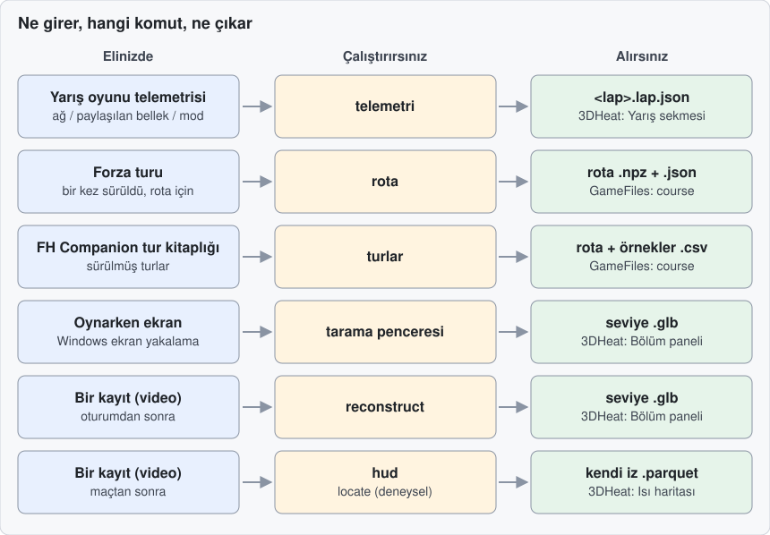

# 3DHeat GameCapture {#dheat-gamecapture}

**Nedir?** Bir yarış oyununun sürüşünüz hakkında söylediğini, tur başına bir dosya olarak yazan bir araç. Oynadığınız bir videodan bir seviyenin kaba bir 3B modelini de yeniden kurabilir.

**Neden kullanmalıyım?** Turlarınızı [3DHeat görüntüleyicisinde](https://holdi601.github.io/3DHeat/) görmek için: nerede fren yaptığınızı, nerede yavaş olduğunuzu, iki turun nasıl farklı olduğunu. Ayrıca kimsenin 3B modeli olmadığında, seviyeyi ısı haritanızın altında görmek için.

**Örnek:** Forza'nın Data Out özelliğini açın, tek bir komut çalıştırın, iki tur sürün. `laps\` klasöründe iki tur dosyası belirir. Bunları görüntüleyicinin Yarış analizi sekmesine bırakın.


Komut satırında yeni misiniz? Önce [Başlamadan önce](before-you-start.md) sayfasını okuyun.

## Üç iş {#the-three-jobs}

1. **Tur telemetrisi.** Bir yarış oyununun yayımladığı her kanalı kaydeder (Forza'nın Data Out'u, Assetto Corsa oyunlarının paylaşılan belleği, rally oyunlarının ağ akışları, bir BeamNG modu, bir Trackmania eklentisi) ve tur ya da etap başına bir `heat3d-lap` dosyası yazar; görüntüleyicinin Yarış analizi sekmesi için. iRacing'in bir kayıt aracına ihtiyacı yoktur: görüntüleyici kendi `.ibt` dosyalarını okur.
2. **Oynanıştan seviyeler.** Bir seviyede yürürken ya da sürerken ekranın gösterdiklerini bir `.glb` 3B modeline çevirir; görüntüleyici bunu ısı haritasının altına yerleştirir.
3. **Maçınız, sonrasında.** `hud` kendi kaydınızın HUD'unu okur: eylemleriniz, ölümleriniz, mini harita izi ve öldürme akışı. `locate` (deneysel: şimdiye kadar birkaç gerçek kareyi yerleştirir), her karenin bir seviyenin 3B modeli üzerinde nerede çekildiğini bulur.

Üç iş de tek bir kurala uyar: **hiçbir şey bir oyuna enjekte edilmez ve hiçbir şey kancalanmaz.** Kareler genel ekran yakalama API'sinden, telemetri ise oyunların bunun için yayımladığı arayüzlerden gelir. Bkz. [Kurallar](../rules.md).



Kod Python'dur (paket `heat3d_capture`), MIT lisanslıdır. Çalıştırabileceği derinlik ve poz modellerinin kendi lisansları vardır: bkz. [Modeller ve lisanslar](../models-and-licences.md).

## Hızlı başlangıç {#quick-start}

### Tur kaydedin {#record-laps}

Python 3.10 veya daha yeni gerekir ([Başlamadan önce](before-you-start.md)). PowerShell'de:

```powershell
git clone https://github.com/Holdi601/3DHeat-GameCapture
cd 3DHeat-GameCapture
python -m venv .venv
.venv\Scripts\python -m pip install -r requirements.txt

# Forza: Settings -> HUD and Gameplay -> Data Out = ON, IP 127.0.0.1, port 5300
.venv\Scripts\python -m heat3d_capture telemetry -o laps
```

**Şunu görmelisiniz:** `listening on port 5300. Laps go to laps. Ctrl+C to stop.` ve ardından her turu çizgiden geçtiğinizde bir satır; yukarıdaki resimde olduğu gibi. Durdurmak için Ctrl+C'ye basın. `laps\` klasöründeki dosyaları görüntüleyicinin Yarış analizi sekmesine bırakın. Diğer her oyunda yalnızca `--game` değişir:

```powershell
.venv\Scripts\python -m heat3d_capture telemetry --game acc -o laps
.venv\Scripts\python -m heat3d_capture telemetry --game dirtrally2 -o laps
```

Her oyun ve seçenek için [Telemetri kaydediciler](../telemetry.md) sayfasına bakın.

### Bir seviyeyi tarayın {#scan-a-level}

Aracın klasöründeki **`scan.bat`** dosyasına çift tıklayın. Python'u bulur (yoksa winget ile kurmayı önerir), özel bir `.venv` oluşturur ve tarama penceresini açar. Pencere neyin eksik olduğunu, her paketin ne işe yaradığını ve indirmenin ne kadar büyük olduğunu gösterir; onay vermeden hiçbir şey kurmaz. Bkz. [Çalışma zamanı ve bağımlılıklar](../runtime.md) ve [Tarama penceresi](../reconstruction-scan-ui.md).

Elle: `.venv\Scripts\python -m heat3d_capture.ui`.

Bir kaydı çevrim dışı yeniden kurmak için, kamera yolu bir kerede çözülerek (PyTorch, `vggt` paketi ve bir GPU gerekir; bkz. [Çevrim dışı yeniden kurma](../reconstruction-offline.md)):

```powershell
.venv\Scripts\python -m heat3d_capture reconstruct lap.mp4 -o lap.glb
```

## Dokümantasyon haritası {#map-of-the-documentation}

| Sayfa | Neyi anlatır |
|---|---|
| [Başlamadan önce](before-you-start.md) | Python, bir terminal, ilk komut, sık görülen hatalar |
| [Kurallar](../rules.md) | Enjeksiyon yok, yalnızca yayımlanmış arayüzler ve bunun bedeli |
| [Telemetri kaydediciler](../telemetry.md) | `telemetry` komutu ve her oyuna genel bakış |
| [Forza](../telemetry-forza.md) | Data Out, düzen algılama, FH Companion aktarıcısı ve `.tele.gz` |
| [Assetto Corsa oyunları](../telemetry-assetto-corsa.md) | AC, ACC, AC EVO, AC Rally: paylaşılan bellekten |
| [Rally oyunları](../telemetry-rally.md) | EA SPORTS WRC, DiRT Rally 2.0 / 1 / DiRT 4, Richard Burns Rally |
| [BeamNG.drive](../telemetry-beamng.md) | `heat3d` protokol modu |
| [Trackmania](../telemetry-trackmania.md) | `Heat3dRecorder` Openplanet eklentisi |
| [iRacing](../telemetry-iracing.md) | Görüntüleyicide `.ibt` dosyalarını okuma |
| [Tur ve etap bölme](../lap-splitting.md) | `LapSplitter`, `CounterSplitter`, `LineSplitter`, `StageSplitter` |
| [Kayma, sürüklenme ve türetilmiş kanallar](../slip-and-drift.md) | Kayma nasıl ölçeklenir ve görüntüleyici neyi türetir |
| [heat3d-lap dosyası](../lap-format.md) | Tur dosyası biçimi, kanallar, birimler, `meta` |
| [Oyunlar](../games.md) | Oyun başına: nasıl kaydedilir, ne gönderilir, hangi pistler dışa aktarılabilir |
| [Komutlar](../commands.md) | `route`, `telemetry`, `laps`, `reconstruct`, `hud`, `locate`, adım adım |
| [Komut başvurusu](../cli-reference.md) | her seçenek, `--help`'ten üretilmiş |
| [Bir kayıttan HUD okumak](../hud-video.md) | `hud`: kayıttan kendi eylemleriniz, ölümleriniz, mini harita izi ve öldürme akışı |
| [Bir seviyede kareleri bulmak](../locate.md) | `locate`: her karenin çekildiği yer, seviyenin geometrisine karşı |
| [Seviye yeniden kurma](../reconstruction.md) | Karelerden `.glb`'ye giden hat |
| [Tarama penceresi](../reconstruction-scan-ui.md) | Her denetim, kısayol ve ekran öğesi |
| [Yakalama, maskeler ve kare kalitesi](../reconstruction-capture.md) | Windows Graphics Capture, anahtar kareler, HUD maskeleri, kalite önerileri |
| [Derinlik](../reconstruction-depth.md) | Depth Anything V2, ONNX Runtime, modeli oluşturma |
| [Kamera pozu ve ölçek](../reconstruction-pose.md) | Odometri, yeniden konumlandırma, telemetri pozları, zemin ölçeği, demet ayarı |
| [Füzyon, kapsama ve renk](../reconstruction-fusion-and-texture.md) | Doluluk hacmi, kapsama ızgarası, zayıf noktalar, köşe rengi |
| [.glb çıktısı](../glb-output.md) | Görüntüleyicinin yüklediği dosya |
| [Çevrim dışı yeniden kurma](../reconstruction-offline.md) | `reconstruct`, VGGT pencereleri ve birleştirme |
| [Modeller ve lisanslar](../models-and-licences.md) | Depth Anything V2 boyutları, VGGT, paketler |
| [Çalışma zamanı ve bağımlılıklar](../runtime.md) | Ön kontrol, arka uçlar, performans kademeleri |
| [Sınırlar ve doğrulama](../limits.md) | Yapılmayanlar ve denetlenmemiş olanlar |
| [Güncellemeler](../updates.md) | Sürüm denetimi ve `python -m heat3d_update` |
| [Geliştirme](../development.md) | Testler, sanal ortam, depo yapısı |
| [Bu belgelerin bakımı](../maintaining.md) | Kod ve belgeler için sürüm kontrol listesi |

## 3DHeat'in parçası {#part-of-3dheat}

GameCapture'ın yazdığı dosyaları **3DHeat görüntüleyicisi** yükler: [kaynak](https://github.com/Holdi601/3DHeat), [belgeler](https://holdi601.github.io/3DHeat/). Tur dosyaları Yarış analizi sekmesine, `.glb` seviyeleri Arka plan / bölüm paneline, `hud` ve `locate` tabloları Isı haritası sekmesine gider. Görüntüleyicinin tabloları ve maç dosyalarını nasıl okuduğu [Maç başına tek dosya (.3dheat)](https://holdi601.github.io/3DHeat/container.html) ve [Veri ekleme](https://holdi601.github.io/3DHeat/getting-data-in.html) sayfalarında anlatılır.

| Araç | Ne yapar | Belgeler |
|---|---|---|
| [3DHeat görüntüleyici](https://github.com/Holdi601/3DHeat) | tarayıcıda 3B ısı haritalarını, yarışları ve maçları gösterir | [belgeler](https://holdi601.github.io/3DHeat/) |
| [GameFiles](https://github.com/Holdi601/3DHeat-GameFiles) | oyunların gönderdiği dosyalardan kurslar ve seviyeler, 3B modeller olarak | [belgeler](https://holdi601.github.io/3DHeat-GameFiles/) |
| [GameCapture](https://github.com/Holdi601/3DHeat-GameCapture) | yarış oyunlarından tur telemetrisi; oynanış videosundan yeniden kurulan seviyeler | [belgeler](https://holdi601.github.io/3DHeat-GameCapture/) |
| [Unreal Exporter](https://github.com/Holdi601/3DHeat-UnrealExporter) | bir seviyeyi 3B model olarak dışa aktaran bir Unreal Editor eklentisi | [belgeler](https://holdi601.github.io/3DHeat-UnrealExporter/) |
| [CS2](https://github.com/Holdi601/3DHeat-CS2) | Counter-Strike 2 demolarını maç dosyalarına; haritaları 3B modellere | [belgeler](https://holdi601.github.io/3DHeat-CS2/) |
| [Watcher](https://github.com/Holdi601/3DHeat-Watcher) | oyunların yayımladığı şeylerden oynamanızı arka planda kaydeder | [belgeler](https://holdi601.github.io/3DHeat-Watcher/) |
| [Ext-WarThunder](https://github.com/Holdi601/3DHeat-Ext-WarThunder) | War Thunder tekrarlarını maç dosyalarına | [belgeler](https://holdi601.github.io/3DHeat-Ext-WarThunder/) |
| [Ext-WoT](https://github.com/Holdi601/3DHeat-Ext-WoT) | World of Tanks tekrarlarını maç dosyalarına | [belgeler](https://holdi601.github.io/3DHeat-Ext-WoT/) |
| [Ext-WoWs](https://github.com/Holdi601/3DHeat-Ext-WoWs) | World of Warships tekrarlarını maç dosyalarına | [belgeler](https://holdi601.github.io/3DHeat-Ext-WoWs/) |
| [Ext-Squad](https://github.com/Holdi601/3DHeat-Ext-Squad) | Squad sunucu demolarını maç dosyalarına | [belgeler](https://holdi601.github.io/3DHeat-Ext-Squad/) |
| [Ext-DCS](https://github.com/Holdi601/3DHeat-Ext-DCS) | DCS World haritalarını 3B modellere | [belgeler](https://holdi601.github.io/3DHeat-Ext-DCS/) |
| [Ext-IL2](https://github.com/Holdi601/3DHeat-Ext-IL2) | IL-2 Sturmovik haritalarını 3B modellere | [belgeler](https://holdi601.github.io/3DHeat-Ext-IL2/) |

Geliştirici projesini açık tutan biri Unreal dışa aktarıcısını kullanmalıdır; bu gerçek geometriyi okur ve kesindir. Bir oyunun kendi arşivleri okunabiliyorsa GameFiles tam kursu çıkarır. Oynanıştan yeniden kurma, yalnızca ekranın elde olduğu durum içindir.
