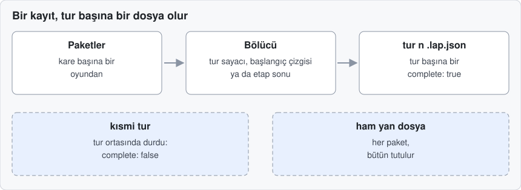

# Turlar ve etaplar nasıl bölünür {#how-laps-and-stages-are-split}

Bir kaydedici tek, kesintisiz bir örnek akışı görür. Bunu turlara çevirmek, oyunun turlar hakkında söylediğine bağlı olarak seçilen dört bölücüden biriyle yapılır. Hepsi aynı fikri izler: varsa oyunun kendi sayımını kullanır, yoksa turu konumlardan bulur; karşılaştırılamayacak kadar kısa bir parça asla yazılmaz.

| Bölücü | Kod | Kullanan |
|---|---|---|
| `LapSplitter` | [`fulllap.py`](https://github.com/Holdi601/3DHeat-GameCapture/blob/main/heat3d_capture/telemetry/fulllap.py) | Forza |
| `CounterSplitter` | [`kunos.py`](https://github.com/Holdi601/3DHeat-GameCapture/blob/main/heat3d_capture/telemetry/kunos.py) | Assetto Corsa, ACC |
| `LineSplitter` | [`kunos.py`](https://github.com/Holdi601/3DHeat-GameCapture/blob/main/heat3d_capture/telemetry/kunos.py) | AC EVO, AC Rally, BeamNG |
| `StageSplitter` | [`rally.py`](https://github.com/Holdi601/3DHeat-GameCapture/blob/main/heat3d_capture/telemetry/rally.py) | EA SPORTS WRC, DiRT Rally 2.0, DiRT Rally, DiRT 4, Richard Burns Rally |

Trackmania koşularını kendi eklentisinin içinde böler ([Trackmania](telemetry-trackmania.md)); iRacing dosyalarını ise görüntüleyici, simülasyonun tur sayacına göre böler ([iRacing](telemetry-iracing.md)).

**Ctrl+C** tuşuna basıldığında her kaydedici, bölücüsünün `flush()` fonksiyonunu çağırır; böylece açık olan bir tur ya da etap, aşağıdaki aynı asgari koşulları geçiyorsa yazılır.

## LapSplitter (Forza) {#lapsplitter-forza}

Parametreler: `minimum_metres = 400`, `gap_seconds = 2.0`.

Her çözülmüş paket için:

1. Oyunun `timestampMs` değeri son paketten beri 2 saniyeden fazla ileri atladıysa ya da geri gittiyse, açık tur önce boşaltılır.
2. `isRaceOn` 0 ise (oyun bir yarışta değil), açık tur boşaltılır ve paket atılır.
3. Açık tur yoksa, paketin `lapNumber` değeriyle biri açılır.
4. `lapNumber`, açık turunkinden farklıysa, açık tur **tamamlanmış olarak kapatılır**; `seconds` değeri, pozitifse oyunun `lastLap` değeridir. Bu şekilde kapatılan bir tur, uzunluğu ne olursa olsun yazılır. Yeni bir tur açılır.
5. Paket eklenir.

Kaydedici ayrıca 2 saniye boyunca paket gelmediğinde de boşaltır (oyun duraklatıldıysa ya da tur ortasında kapandıysa).

**Boşaltmada** açık tur yalnızca en az 2 örneği ve `distanceTravelled` değerinde en az 400 m'si varsa tutulur; tamamlanmamış (bir `run`) olarak yazılır. Noktadan noktaya bir yarışta ikinci tur hiç sayılmaz; bu yüzden her zaman bu şekilde biter.

## CounterSplitter (AC, ACC) {#countersplitter-ac-acc}

Parametre: `minimum_metres = 300`. Her örneğe grafik sayfasının `completedLaps` ve son tur süresi verilir.

- İlk örnek, mevcut `completedLaps` ile numaralanan bir tur açar.
- `completedLaps` değiştiğinde açık tur kapanır. Yalnızca sayaç tam olarak 1 arttıysa **tamamlanmış** olur, `seconds = son tur ms / 1000` (pozitifse) ile. Sayaç 0'a dönerse (bir oturum yeniden başlatması) ya da birden fazla artarsa, tamamlanmamış olarak kapatılır.
- Kapatılan bir tur yalnızca örnekleri varsa ve en az 300 m sürülmüş yol varsa yazılır.
- Boşaltmada açık tur, birden fazla örneği ve en az 300 m varsa tutulur.

## LineSplitter (AC EVO, AC Rally, BeamNG) {#linesplitter-ac-evo-ac-rally-beamng}

Parametreler: `radius = 15 m`, `minimum_metres = 300`, `stop_seconds = 8`.

Bu oyunların ya kaydedicinin okuduğu bir sayfada tur sayacı yoktur ya da etap sürerler. **Çizgi, kaydın başladığı yerdir**:

1. İlk örneğin yatay konumu (`x`, `z`) çizgi olur.
2. Araç 5 m'den fazla yol aldıktan sonra, çizgiden araca doğru olan yön turun yönü olur.
3. **Durmak** bir koşuyu bitirir: `speed` 8 saniye boyunca 1 m/s'nin altında kalırsa açık tur boşaltılır (bir ralli etabı böyle biter: araç bitişte durur).
4. **Çizgiyi geçmek**: 300 m'den fazla yol aldıktan sonra, çizgiye 15 m yakınlıktaki örnekler toplanır. Araç o yarıçapı yeniden terk ettiğinde, toplananların en yakını geçiştir. Araç orada turun yönüyle aynı yöne gidiyorduysa (yerel yönelimin o yönle nokta çarpımı pozitifse), tur o örnekte kapanır; aksi halde geçiş yok sayılır (araç başlangıcı ters yönde geçmiştir).
5. Kapanan bir turun `seconds` değeri, ilk örnekten geçiş noktasına kadar olan süredir. Yalnızca ilk örneği 5 m/s'den hızlıysa **tamamlanmış** sayılır: duruştan başlayan bir tur bir başlangıç hareketidir, karşılaştırılacak bir tur değildir. Bir kaydın ilk turu grid'de başlatıldıysa her zaman tamamlanmamış olur; kayıt uçuş halinde bir turda başladıysa, ilk tur bir sonraki geçişte tamamlanmış olur.
6. Sonraki tur, geçiş örneğinde başlar (iki tura da aittir).

5 m'den kısa turlar atılır. Boşaltma (bir durma ya da Ctrl+C) açık turu, en az 2 örneği ve 300 m'si varsa tamamlanmamış olarak tutar. BeamNG, araç sıfırlandığında (saati geriye gittiğinde), yeni bir bölücü başlatmadan önce aynı şekilde boşaltır; böylece sıfırlamadan önce sürülen koşu kaybolmaz.

Mesafeler, yol sayacı ve çizgi testi için yataydır (`x`, `z`); 300 m uzunluk testi için tam 3B'dir.

## StageSplitter (ralli oyunları) {#stagesplitter-rally-games}

Parametre: `minimum_metres = 300`. Her örneğe oyunun etap saati, oyunun aracın bitirdiğini söyleyip söylemediği ve isteğe bağlı olarak oyunun kendi süresi verilir.

1. Saat 0 ya da daha azsa, ya da 0,5 saniyeden fazla geri gittiyse, açık etap **terk edilir**: tamamlanmamışsa, 10 örnekten fazlası ve en az 300 m'si varsa kısmi etap olarak tutulur. 0 ya da daha küçük bir saat, örneği de atar (araç başlangıçtadır).
2. Açık etap yoksa yeni biri açılır (kayıt için 1, 2, ... diye numaralanır).
3. Bir etap tamamlandıktan sonra, saat geriye gidene kadar sonraki örnekler yok sayılır.
4. Her örnek, `time` değeri etap saatine ayarlanarak saklanır.
5. Oyun bitirildiğini söylediğinde etap tamamlanmış olur; `seconds`, verildiyse ve pozitifse oyunun süresidir, değilse saattir. En az 300 m kapsadıysa yazılır.

Oyuna göre "bitti" anlamı:

| Oyun | Bittiği an |
|---|---|
| EA SPORTS WRC | etap uzunluğu > 0 ve etap mesafesi >= uzunluk - 0,5 m |
| DiRT oyunları | tamamlanan tur sayısı, etabın başlangıç sayısının üstüne çıktığında ya da (tek turluk bir etkinlikse) tur mesafesi pist uzunluğunun %99,9'una ulaştığında |
| Richard Burns Rally | yarış saati > 0 ve bitişe olan mesafe <= 0 |

RBR için yukarı ekseni ve hız, bir etap yazıldığında sabitlenir (bkz. [Ralli oyunları](telemetry-rally.md#richard-burns-rally-rsf--ngp)).

## Turdaki zaman ve mesafe {#time-and-distance-in-the-lap-file}

Forza dışındaki her kaydedici için `time` değeri, turun ilk örneği 0 olacak şekilde kaydırılır ve `distance`, ardışık konumlar arasındaki birikmiş 3B mesafedir. Forza, oyunun kendi tur sayacını ve mesafe sayacını kullanır ve aynı şekilde kaydırılır.
