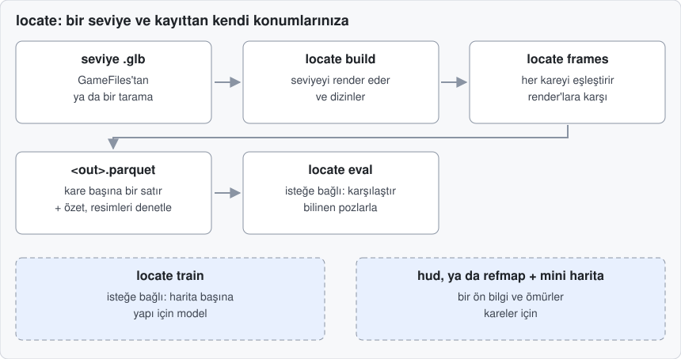

# Kareleri bir bölümde bulmak {#locating-frames-in-a-level}

`locate`, bir oynanış kaydının her karesinin nereden çekildiğini - kameranın 3B konumunu ve bakış yönünü - resmi
bölümün kendi geometrisinin render'larıyla eşleştirerek bulur. Oyuncunun nerede olduğunu kaydetmeyen oyunlar içindir:
demo yok, tekrar dosyası yok, telemetri yok. Battlefield 6 ilk oyundur.

> **Deneysel.** Gerçek kayıtlarda şimdilik karelerin yalnızca küçük bir kısmını yerleştirir; bkz.
> [Gerçek kareler: deneysel](#real-frames-experimental).

```bash
# Once per level: render it from every place a player can stand, and index the renders.
.venv\Scripts\python -m heat3d_capture locate build level.glb -o level.db

# Per recording: where was each frame taken?
.venv\Scripts\python -m heat3d_capture locate frames "<recording>.mp4" --db level.db -o out/match
```

Konum **resimden**, bütün bölgeye karşı, herhangi bir öncül olmadan gelir. [HUD okuyucusunun](hud-video.md) mini harita
izi yalnızca resmin yerleştiremediği kareler için bir yedektir ve her satır iki kaynaktan hangisinden geldiğini söyler.




## Neye dokunur, neye dokunmaz {#what-it-does-and-does-not-touch}

- Oyuncunun **kendi kaydını** ve oyuncunun **kendi kopyasındaki** oyundan dışa aktardığı bir bölüm dosyasını okur. Oyuna,
  belleğine, çalışırken dosyalarına ya da ağına hiç dokunmaz ve maçtan sonra çalışır. Bkz. [Kurallar](rules.md).
- **Yalnızca oyuncunun kendi kamerasını** yerleştirir: kare oyuncunun kendi görüşüdür.
- Bölüm, ondan oluşturulan veritabanı ve ondan render edilen her şey oyunun yayıncısına aittir. Yerel tutun.

## Gereksinimler {#requirements}

- `requirements.txt`'in listelediği şeyler, PyTorch (GPU için pytorch.org'dan) ve `requirements-locate.txt`:

```bash
.venv\Scripts\python -m pip install -r requirements-locate.txt
```

- Render'lar için OpenGL 3.3 (4.3 daha hızlı) destekleyen bir GPU ve modeller için tercihen CUDA. Bir CPU'da da çalışır,
  ama yavaştır.
- Modeller ilk kullanımda indirilir (yaklaşık 450 MB): DINOv2 Hugging Face'den, ALIKED ve LightGlue kornia üzerinden. Hepsi
  ticari kullanım için lisanslıdır; bkz. [Lisanslar](#licences).
- Bölüm, bir `.glb` (ya da `.gltf`) olarak, görüntüleyicinin çerçevesinde, Y yukarı, **taban renk dokularıyla birlikte**,
  3DHeat'in dışa aktarıcılarının yazdığı gibi (`ground:` / `structure:` parçaları; parça adları gerekmez). Dosyanın üst
  düzeyindeki `extras.unit_metres` aksini söylemedikçe bir birim bir metredir. GameCapture taraması (`reconstruct`, tarama
  penceresi) **santimetre** cinsinden yazılır ve `extras.unit_metres: 0.01` taşır, bu yüzden gerçek boyutunda okunur.
  Dokusuz bir bölüm çok daha kötü çalışır; bkz. [Sınırlar](#limits).

## Komutlar {#commands}

### `locate build <level> -o <db>` {#locate-build---o-}

Bölümü, bir oyuncunun durabileceği her yerden render eder ve render başına pozunu ve bir global tanımlayıcısını saklar.

| Seçenek | Varsayılan | Anlamı |
|---|---|---|
| `level` | | Bölümün `.glb` / `.gltf` dosyası. |
| `-o`, `--out` | | Yazılacak veritabanı klasörü. |
| `--game` | `bf6` | Oyun profili: göz yükseklikleri, görüş alanı, HUD kutuları, hız (aşağıda). Herhangi bir birinci şahıs oyunu için `generic`. |
| `--eye` | profilin | Metre cinsinden zeminden göz yükseklikleri, ayakta olan önce. Her yükseklik için bir veritabanı görünümü. |
| `--fov` / `--vfov` | profilin | Kaydın yatay görüş alanı ya da dikey olanı (Battlefield'ın kaydırıcısı), 16:9 kayıt için. |
| `--spacing` | 2,5 | Görünümlerin alındığı yerler arasındaki metre. |
| `--yaw-step` | 30 | Görünümlerin yönleri arasındaki derece. |
| `--pitch` | 0 | Render edilecek yukarı eğim dereceleri. |
| `--positions` | yok | Her zemin yerine yerler buradan alınsın diye bir tablo (Parquet ya da CSV, `x`, `y`, `z` ayakta, bölümün çerçevesinde); örneğin önceki bir çalıştırmanın çıktısı. |
| `--shadows` | kapalı | Render'larda güneşin gölgelerini düşür (bölümün kendi güneşi, dosyası `extras.sun` içinde bir tane adlandırıyorsa). |
| `--untextured` | kapalı | Yalnızca şekil ve ışığı render et. |
| `--box X0 Z0 X1 Z1` | bütün dosya | Yalnızca bu kutunun içindeki yerler (bölüm birimleriyle): oyun alanı. |
| `--places` | `auto` | Görünümlerin nereden alınacağı: `nav` - göz yüksekliğindeki oyuncular bölümün gezinme ağının üstünde (`nav:` parçaları: oyunun tam olarak yürümelerine izin verdiği yer), araç kameraları `ground:` parçalarının (arazi ve yollar) 50 m içinde kendi yüksekliklerinde; `ground` - ikisi de `ground:` üstünde; `floors` - her yukarı bakan yüzün üstünde (çatılar ve sandıklar da); `auto` - bölümün bir gezinme ağı varsa `nav`, yoksa `floors`. |
| `--head` | yok | Tanımlayıcılar için `locate train`'den bir harita başı. |

`<db>/db.json` (neyden ve neyle yapıldığını) ve `<db>/views.npz` (pozlar, tanımlayıcılar) yazar.

### `locate frames <recording> --db <db>` {#locate-frames----db-}

| Seçenek | Varsayılan | Anlamı |
|---|---|---|
| `source` | | Bir video, bir resim ya da bir resim klasörü (ada göre sırayla, aralarında `--fps`). |
| `--db` | | `build`'in yazdığı veritabanı. Bölüm dosyası hâlâ olduğu yerde olmalı (ya da `--level`). |
| `-o`, `--out` | `<source>.locate` | Uzantısız çıktı yolu. |
| `--fps` | 2 | Videonun saniyesi başına bulunan kare. |
| `--start`, `--seconds` | hepsi | Okunacak video bölümü. |
| `--width` | 1280 | Karelerin eşleştirildiği genişlik. |
| `--shortlist` | 8 | Bir öncül ya da düzeltme yakınında kare başına denenen veritabanı görünümü. |
| `--search-shortlist` | 16 | Öncül yokken: kare başına denenen veritabanı görünümü ([birlikte aranır](#with-no-prior-frames-searched-together)). |
| `--no-search` | kapalı | Öncül yokken: her kareyi tek başına ara ve komşuları olmadan bulduğu düzeltmeye güven. |
| `--accept-depth` | 0 (kapalı) | Öncül yokken: bir düzeltmeye, eşleşmelerinin uzak mesafesi yakın mesafesinin bu kadar katıysa güven. |
| `--accept-support` | 2 | Öncül yokken: bir düzeltmeye güvenilmesi için yaşam boyunca mutabık komşu sayısı. |
| `--checkpoint` | yok | Çalışmanın durumunu burada tut ve oradaysa oradan devam et. |
| `--stop-file`, `--stop-process` | yok | Bu dosya var olduğunda ya da adı bununla başlayan bir süreç çalıştığında kendi kendine dur, durum kaydedilir, çıkış kodu 75 (her kareden önce kontrol edilir; birden çok kez verilebilir), böylece uzun bir çalıştırma bir oyun için makineyi boşaltır. Aynı komut kaldığı yerden devam eder. |
| `--normalise` | yok | Eşleştirmeden önce hafif normalleştirme: `clahe`, `gray`. |
| `--minimap` | yok | `hud` komutunun tablosu: resmin yerleştiremediği kareler için **yedek**. |
| `--prior-radius` | yok | **İsteğe bağlı hızlandırma**, varsayılan olarak kapalı: yalnızca mini haritanın konumundan bu kadar metre uzaktaki veritabanı görünümlerini ara (`--minimap` gerekir). |
| `--minimap-anchor` | yok | Mini haritayı bölüme bağlayan bir JSON dosyası ([mini harita bir arama önceli olarak](#the-minimap-as-a-search-prior)): mini harita aramayı ilk kareden kısaltır; böyle bulunan düzeltmeler `visual+minimap-prior` olur. |
| `--no-level-search` | kapalı | Bir öncülle: yakınındaki hiçbir şey uymadığında bütün bölümü de arama (daha hızlı). |
| `--lives` | `--minimap` tablosu | Ölümleri, konuşlanmaları ve diriltmeleri oyuncunun oyunda olduğu zamanı söyleyen `hud` komutunun tablosu: konumlar yalnızca bir ölümde sıçrar ([görüntüden yaşamlar](#lives-from-the-footage)). |
| `--no-sequence` | kapalı | Her kareyi tek başına karar ver, çalıştırma boyunca değil (aşağıda). |
| `--fit-fov` | kapalı | Çalıştırmadan sonra, görüş alanını en güçlü düzeltmelere, görünüm başına uydur ve raporla. |
| `--check-every` | 0 | Her N karede bir de, yerleştirilmiş ya da değil, `<out>.check` içine bir resim. |
| `--no-checks` | kapalı | Görsel düzeltmelerin kontrol resimlerini yazma (aşağıda). |
| `--no-zoomed` | kapalı | Yakınlaştırılmış görünümleri komşularının düzeltmelerinden çözme (aşağıda). |
| `--no-grow` | kapalı | Her düzeltmenin çevresindeki hâlâ düzeltmesi olmayan kareler için yeniden arama yapma. |
| `--game`, `--eye`, `--fov`, `--vfov`, `--mask`, `--no-hud-mask`, `--max-speed` | profilin | Yukarıdaki gibi; `--mask x,y,w,h` bölüm olmayan bir ekran kutusu ekler (1920x1080 ekranda). |
| `--vehicle-vfov` | profilin | Araç kameralarının dikey görüş alanı (Battlefield'ın araç kaydırıcısı). |
| `--settings` | en yeni ayar dosyası | `bf6`: verilmiş bir `--fov`/`--vfov` yoksa görüş alanlarının okunduğu oyunun ayar dosyası (yalnızca okunur); varsayılan olarak `Documents/Battlefield 6/settings` altındaki en yeni `PROFSAVE*_profile`. Ayarları şu anki hâlleriyle tutar; eski bir kaydın nasıl yapıldığı bu olmayabilir. |

### `locate refmap <level> <deploy screen> -o <refmap>` {#locate-refmap----o-}

Oyunun kendi haritasını bölüme yerleştirir: mini haritanın karşısında okunduğu referans ([mini harita, bölüme karşı okunur](#the-minimap-read-against-the-level)).
`<deploy screen>`, bütün haritayı gösteren konuşlanma ekranının bir resmi ya da böyle bir ana denk gelen `--at <seconds>` ile bir kayıttır;
profilin harita kutusu ondan kesilir (`--whole-picture` hepsini tutar). `<refmap>.png` (haritanın bölümün kendi çerçevesine yeniden örneklenmiş hâli,
`--mpp` metre piksel başına, varsayılan 0,5), `<refmap>.valid.png` (haritanın olduğu yer, bir işaretçi ya da etiket değil) ve `<refmap>.json`
(çerçeve ve kalibrasyon, haritanın karolarının ondan ne kadar uzak olduğuyla birlikte) yazar. `--topdown <prefix>`, bölümü bir sonraki çalıştırma için
yukarıdan render edilmiş tutar (`--topdown-mpp`, varsayılan 0,656 m; `--box` sınırlar).

### `locate minimap <recording> --refmap <refmap> -o <table>.parquet` {#locate-minimap----refmap---o-parquet}

Kaydın mini haritasını referans haritanın karşısında kare kare okur (`--fps`, varsayılan 2): eşleşen her mini haritanın konumu,
yönü ve yakınlaştırması, bölümün çerçevesinde, yanında bir çapayla (`<table>.anchor.json`) yazılmış bir mini harita tablosu olarak;
`locate frames` bunu `--minimap <table>.parquet --minimap-anchor <table>.anchor.json` olarak alır. `hud` komutunun tablosuyla (`--hud`) yaşamları
taşınır; o tablo için de bir çapa ile (`--hud-anchor`) ilk arama, oyuncuyu yerleştirdiği yerin etrafında yapılır ve hiçbir mini haritanın
eşleşmediği yerde HUD'un kendi izi doldurulur, en yakın referans harita düzeltmelerine taşınarak (`--hud-fill`, saniye, varsayılan 120; 0 kapatır).
Tablonun `source`'u hangisinin olduğunu söyler (`refmap`, `hud`).

### `locate eval <out>.parquet --truth <poses>` {#locate-eval-parquet---truth-}

Bir sonucu bilinen kamera pozlarıyla karşılaştırır: bölümün çerçevesinde `time`, `x`, `y`, `z` (göz), `yaw`, `pitch` içeren bir tablo.
`--offset` saat kaymasıdır (gerçek zaman = video zamanı + offset); verilmezse aranır. `--unit-metres` hataları metreye çevirir.

## Oyun profilleri {#game-profiles}

| | `bf6` | `generic` |
|---|---|---|
| Göz yükseklikleri | ayakta 1,6 m, çömelmiş 1,05 m (oyunda henüz ölçülmedi) | 1,65, 1,1 m |
| Görüş alanı | dikey 55 derece, 16:9'da yaklaşık 86 yatay: **oyuncunun kendisininkini** `--vfov` ile verin | yatay 90 |
| HUD maskelenir | mini harita ve takım listesi, öldürme akışı, pusula, mühimmat, oyuncunun silahı, açılır pencereler, nişangâh | nişangâh |
| Yürüyerek en hızlı | 8 m/s | 8 m/s |
| Ayırt edilen görünümler | yürürken, araçta, yakınlaştırılmış (aşağıda) | yürürken her kare |
| Araç kameraları | araç kaydırıcısı (ayar dosyasından), araç maskelenir, kamera zeminin 8 m üstüne kadar, 30 m/s | - |

Görüş alanı en çok şeyi belirler: yanlış olanla çözülen bir kare yanlış odak uzaklığıyla çözülür ve görüş boyunca kayar.

## Çıktılar {#outputs}

### `<out>.parquet` {#parquet}

Bulunan kare başına bir satır, **bölümün çerçevesinde** (Y yukarı, bölümün birimleri), altbilgisinde görüntüleyicinin okuma talimatlarıyla
(`kind: heat3d-locate`). Altbilgi, kendi rolü olmayan her sütunu bir ek olarak adlandırır, böylece görüntüleyici hepsini tutar (inceleme kartında gösterir).

| Sütun | Anlamı |
|---|---|
| `time` | Videonun başından itibaren saniye. |
| `event` | Bir yaşamın ilk satırında `start`, geri kalanlarda `position`. |
| `x`, `y`, `z` | Göz, yaşam içinde yumuşatılmış. Hiçbir kaynağın kareyi yerleştirmediği yerlerde boş. |
| `yaw`, `pitch` | Derece: yukarı eksen etrafında yaw (0 +X yönünde, -Z'ye doğru artar, görüntüleyicinin çerçevesinde bir oyunun kendi yaw'ı), yatayın yukarısında pitch. `pitch`, mini harita satırlarında boştur. |
| `dir_x`, `dir_y`, `dir_z` | Bakış yönü. |
| `player`, `team`, `session` | `me`, `own` ve `<video>#NN`, her yaşam için bir tane. |
| `life` | Görüntünün karenin gösterildiği yaşam (HUD'un ölümlerinden; 1 = ilki). Oyunda olmadığında (ölü, aşağıda, konuşlanıyor) ya da yaşamlar okunmadığında boş. `session`, izin yaşamıdır ve bir sıçramada da bölünebilir. |
| `source` | `visual` (resimden), `visual+minimap-prior` (resimden, arama mini harita önceline kısaltıldı), `minimap` (yedek), `minimap+nav-floor` (kapalı alanda: mini harita ve gezinme ağının zemini) ya da `none`. |
| `view` | `foot`, `vehicle`, `zoomed` ya da `screen` (aşağıda). |
| `cam_x`, `cam_y`, `cam_z` | Kareyi gören kamera. Yürürken ve bir nişangâhtan bakarken göz, ve `x`, `y`, `z` aynıdır; bir aracın üçüncü şahıs görünümünde `x`, `y`, `z` araçtır (aşağıdaki ofset modeli) ve kamera onun arkasında ve üstünde gider. |
| `hfov`, `zoom` | Karenin çözüldüğü yatay görüş alanı ve yakınlaştırılmış bir görünüm için normal görünüme karşı yakınlaştırması. |
| `confidence` | 0..1: satıra ne kadar güvenileceği (aşağıda). |
| `uncertainty` | Satırın tipik hatası, bölüm birimleriyle: görsel bir düzeltme için içte kalanlarından ve komşularından, mini harita satırı için uydurmadan (aşağıda). |
| `inliers`, `rmse` | Görsel çözümün PnP içte kalanları ve yeniden projeksiyon hatası (çalışma genişliğinde piksel). |
| `x_raw` ... `pitch_raw` | Yumuşatmadan önceki görsel çözüm (oy ile dışlananlar için de). |
| `kept` | Görsel düzeltme aykırı oylamasını geçti. |
| `note` | Bir karenin neden yerleştirilmediği ya da oy ile dışlandığı. |

### `<out>.summary.json` {#summaryjson}

Kareler, görsel düzeltmeler, aykırı değerler, yaşamlar, kaynak başına satırlar, mini harita uydurması (çiftler, içte kalanlar,
artık), kare başına süre.

## Yöntem {#method}

### Veritabanı {#the-database}

Yerler, bölümün her yukarı bakan üçgeni üzerindeki noktalardır, eşit aralıklarla (her `--spacing` için 3B bir ızgarada bir tane, bu yüzden
bir binanın her katı kendisininkini alır). Her biri gözünden altı küçük derinlik render'ıyla kontrol edilir: geometrinin içindeki bir kamera
çoğunlukla arka yüzler görür, bir sürünme alanının gözünün üstünde bir şey katıdır; ikisi de atılır. Her yerden bölüm her göz yüksekliğinde,
her `--yaw-step` ve her `--pitch` için render edilir ve her render **DINOv2** ile tanımlanır (yama belirteçleri genelleştirilmiş ortalamayla
havuzlanır ve sınıf belirteciyle birleştirilir).

Bir karenin sonunda karşı çözüldüğü yerel özellikler ve 3B noktalar **saklanmaz**: ihtiyaç duyulduğunda, geri getirmenin seçtiği birkaç görünümün
render edilmesiyle yeniden yapılırlar, bu milisaniyeler sürer. Bu, bir veritabanını on gigabaytlar yerine birkaç yüz megabayt tutar ve aşağıdaki
iyileştirmeyi mümkün kılar. Bedeli: `frames`, yalnızca veritabanına değil, bölüm dosyasına ve bir GPU'ya ihtiyaç duyar.

### Bir kare {#one-frame}

1. **Maskele**: bölüm olmayan her şeyi: profilin HUD kutuları ve nişangâh, artı herhangi bir `--mask`.
2. **Geri getirme** bütün **bölgede**: karenin tanımlayıcısı her veritabanı görünümüne karşı; en benzer birkaç düzine, farklı yerleri ve yönleri
   tutacak şekilde inceltilmiş, aday listesini oluşturur.
3. **Eşleştirme**: her aday görünüm, karenin boyutunda ve görüş alanında, derinliğiyle birlikte yeniden render edilir. Karenin ve render'ın ALIKED
   anahtar noktaları LightGlue ile eşleştirilir. Eşleşen bir render pikseli artı derinliği bölümün bir 3B noktasıdır, böylece her eşleşme bir 2B-3B
   karşılıklılıktır; bir derinlik kenarındaki anahtar noktalar (derinliği arkasındakine ait olabilir) atılır.
4. **Poz**: RANSAC ile PnP (SQPnP), sonra kamerayı düz tutan - birinci şahıs bir görünüm yuvarlanmaz - ve içte kalanların yeniden projeksiyon hatasını
   en aza indiren sağlam bir iyileştirme.
5. **Mümkün mü?** Bir poz, bir zeminin üstündeki oyuncu göz yüksekliğinde ve geometrinin dışında olmalıdır (doğrudan aşağı bir derinlik render'ı).
   Başka bir yerdeki bir benzer doku - bir duvarla aynı malzemeden eşleşen döşeli bir zemin - yüzlerce içte kalan verebilir, hangi oyuncunun olamayacağı
   bir pozda; bunlar, kaç içte kalana sahip olursa olsun bir kenara konur.
6. **Render ve karşılaştır**: bölüm çözülen pozda render edilir ve yeniden eşleştirilir; bu, birkaç metre ve onlarca derece uzakta bir veritabanı
   görünümünü neredeyse karenin kendisiyle örtüşen biriyle değiştirir. İçte kalan kazandıkça tekrarlanır (en fazla iki kez).
7. **Seçmek**: en güçlü üç yer (yaklaşık 3 m'den fazla aralıklı) seçilmeden önce her biri iyileştirilir. Bir benzer, iyileştirmeden önce öne geçebilir;
   doğru yer ondan çok daha fazla kazanır.
8. **Karar**: `confidence`, içte kalan sayısını, en iyi diğer yeri (`runner_up`) ve yeniden projeksiyon hatasını birleştirir. Bir düzeltme,
   en az 25 içte kalanla, diğer hiçbir yerin içte kalanlarının %80'i içinde olmadığında ve en az 0,85 güvenle `ok`dur - aşağıdaki ölçümlerin
   %97,5-99 doğru bulduğu eşik.

### Görünümler {#views}

Bir kare her zaman oyuncunun gözleri değildir. Profilin dedektörü HUD'dan hangi görünümde olunduğunu okur ve kare buna göre çözülür:

- **Yürürken**: piyade görüş alanı ve göz yükseklikleri.
- **Araç** (Battlefield 6: koltuk diyagramının tuş istemleri, `C CAMERA` ve `E EXIT`, altta ortada): araç görüş alanı, araç kendisi maskelenir
  (üçüncü şahıs görünümünde ekranın alt ortası) ve kamera zeminin 8 m üstüne kadar izin verilir. Düzeltme kameranındır.
- **Ekran** (koyu bir ortanın etrafındaki koyu kenarlar: konuşlanma haritası, bir menü, skor tablosu): bölümün bir görünümü değil; atlanır.
- **Yakınlaştırılmış** (bir dürbün, bir topçunun nişangâhı, bir aracın kendi birinci şahıs görünümü: bir ekran kenarı siyah, ikisi de koyu, parlak bir
  resmin etrafında): bölüm üzerinde aranmaz - bir dürbünün bölümden küçük bir dilimi, geniş veritabanı görünümlerinden hiçbirine benzemez - ama
  çalıştırmadan sonra 6 sn içindeki en yakın düzeltmeden çözülür, aşağıda. `--no-zoomed` ile kapalı.

### Yakınlaştırılmış görünümler {#zoomed-views}

Dar bir görünüm konumu zayıf sabitler: biraz daha yakınlaştırılmış bir adım geri neredeyse aynı görünür. Bu yüzden yakınlaştırılmış bir kare, komşusunun
nişangâhın nerede olduğunu söylediği yerden başlar - yürürken o düzeltmenin gözü, bir araçta zeminin 2,5 m üstünde, aracın ortasının altında (bir
topçunun nişangâhı) - ve o noktadan ne kadar hareket etmiş olabileceğinden: 2 m, artı yürürken saniyede 4 m ya da bir araçta 8, en fazla 12 m (`reach`).

1. **Yön ve yakınlaştırma, konum tutulur.** Her 1, 1,2 (bir aracın kendi görünümü, yürürken olduğundan daha dar), 1,5, 2, 3, 4, 6 ve 8 yakınlaştırma için,
   bölüm koltukta, komşununkine 30 derece içindeki yönlerde render edilir (ve 3x'ten itibaren birkaç eğim). Karenin, bir render'a eşleşen anahtar
   noktaları, altlarındaki bölüm noktalarıyla birlikte koltuktan ışınlardır; bunlara iki iki RANSAC ile bir dönüş uydurulur, o yakınlaştırmanın
   odak uzaklığının 0,75 ile 1,3 katı arasında, bir noktanın, koltuğun mesafesinde `reach` kadar kaydığına izin veren bir açı içinde uyuşması
   şartıyla. Çoğu noktanın uyuştuğu yakınlaştırma, yön ve odak uzaklığı kazanır.
2. **Yerleşti.** Bu noktalar, konum, yön ve odak uzaklığını birlikte, yeniden projeksiyon hatalarıyla uydurur; konum, taşınan `reach` başına iki piksel
   maliyetle koltukta tutulur; cevapta bir kez daha render edilir ve yeniden uydurulur. İçte kalanlar ve hata pikselle sayılır ve düzeltme, herhangi
   başka biri gibi aynı güvenle `ok`dur.

Yazılan `zoom`, yürürken çalıştırmanın görüş alanına göredir; `hfov` çözülendir. Bir araçta yazılan konum araçtır, nişangâhın 2,5 m altında, üçüncü şahıs
görünümündeki gibi.

### Araçlar: kamera ve araç {#vehicles-the-camera-and-the-vehicle}

Bir aracın üçüncü şahıs görünümünde çözülen poz takip kamerasınındır; bu, aracın arkasında ve üstünde gider ve oyuncu etrafa bakarken onun etrafında döner.
Yazılan konum (`x`, `y`, `z`) aracın konumudur - ortasının altındaki zemin: kameranın artı profilin `vehicle_offset`'i, kameranın yatay görüş yönünde
bu kadar metre ileride ve bu kadar metre aşağıda. Kamera `cam_x`, `cam_y`, `cam_z` içinde kalır. Dönüşüm sıradan ve izden önce yapılır, böylece
duran bir aracın etrafında dönen bir kamera hareket sanılmaz. Tablonun altbilgisi kullanılan ofseti ve ölçülüp ölçülmediğini (`vehicleOffset`) taşır.
Yürürken ve bir nişangâhtan bakarken ofset yoktur.

Battlefield 6 ofseti nasıl ölçüldü: bir tankın üçüncü şahıs karelerindeki doğru düzeltmelerde, tankın ortası karede gözle işaretlenmiş ve düzeltmede
render edilen bölüm o pikseldeki zemini vermiştir. Profil medyanı alır: kameranın yaklaşık 10 m önü ve yaklaşık 4 m altı. İşaretleme bir metre kadar
doğrudur ve tek bir araç tipine aittir: bir araba ya da bir helikopter kamerasını farklı biner.

### Öncül yokken: kareler birlikte aranır {#with-no-prior-frames-searched-together}

Bütün bir bölümde tek bir karenin global tanımlayıcısı zayıf bir sinyaldir ve tek bir karenin içte kalanları doğru yeri bir benzerden ayırmaz. Bu yüzden
öncül yokken bir kaydın kareleri önce tanımlanır ve birlikte aranır (`search.py`) ve bir düzeltme yalnızca etrafındaki karelerle birlikte kabul edilir:

- **Aday listesi.** Her görünümün benzerlikleri, kaydın kendi ortalamasına ve yayılımına göre ölçülür, böylece her kareye benzeyen bir görünüm her yerde
  kazanmaz. Her kare, 24 m'lik bir ızgaranın hücrelerini, en iyi görünümlerinin sırasına göre puanlar; her yaşam boyunca hücreler arasındaki en iyi yol,
  kareler arasında oyuncunun kapsayabileceği içinde, hücre başına bir inanç verir ve her hücrenin en iyi görünümü, en önce inanılan, tek bir listedir.
  Düz geri getirme diğeridir ve ikisi sırayla alınır: görünümleri kayda karşı ölçmek, oyuncunun neredeyse hiç ayrılmadığı bir yeri cezalandırır; düz
  geri getirmenin iyi yaptığı yer burasıdır.
- **İnanma.** Bir aday yalnızca içte kalanları karenin 8 x 8 ızgarasının en az %12'sini kapsıyorsa sayılır: bir benzer, tekrarlanan bir nesnedir, bir konteyner
  yığını, karenin birkaç hücresinde yüzlerce içte kalanla. Bir düzeltme, sayan adaylar arasındaki en iyi yol üzerindeyse (aşağıda) ve 6 sn içinde onunla
  uyuşan en az iki komşusu varsa inanılır. Oyun dışındaki bir kare hiç aranmaz.
- **Büyütme.** Yalnızca inanılan şey büyütülür ve büyütülen bir düzeltme karenin aynı şekilde kapsanmasını sağlamalıdır.

### Çalıştırma boyunca {#along-the-run}

Her kare, bulduğu her fiziksel olarak mümkün pozu tutar, yer başına bir tane (`candidates`), yalnızca en güçlüsünü değil. Çalıştırma sonra kare başına bir
tane seçer - ya da hiç - öyle ki seçilen pozlar bir oyuncunun yürüyebileceği ya da sürebileceği bir yol oluşturur ve mümkün olduğunca çok içte kalan o yol
üzerinde yatar: bir gizli Markov modeli, bir kerede çözülür (Viterbi). Kendi başına bir karede kazanan bir benzer, komşularının uyuştuğu yere kaybeder; yolun
içinden geçen zayıf bir aday, en az iki uyuşan komşuyla, bir düzeltme olur (`note`: sıra boyunca seçildi); komşularının hepsinin çeliştiği güvenli bir düzeltme
artık bir düzeltme olmaz. Bir komşu yalnızca 6 sn içinde uyuşmuş sayılır: daha uzakta, bir oyuncunun - bir aracın hele hele - kat edebileceği mesafe o kadar
büyük ki uyuşmanın bir anlamı yoktur. `--no-sequence` ile kapalı.

### Kare zamanları {#frame-times}

Bir satırın `time`'ı, nominal kare hızı üzerinden sayılmış değil, karenin kendi kayıt üzerindeki zaman damgasıdır. Kayıtlar nominal hızlarından sapar
(bir klip içinde birkaç ondalık saniye, ölçülenlerde) ve zamanla kareyi geri okuyan her şey - kontrol resimleri, yakınlaştırılmış geçiş, `locate train --real`,
`hud` komutundan mini harita - zaman damgasıyla arar. Sayılan kareler, kontrol resminin karesini bulunan kareden bu kadar uzağa koyardı.

### Görüş alanı, karelerden {#the-field-of-view-from-the-frames}

`--fit-fov` bir çalıştırmanın en güçlü düzeltmelerini (görünüm başına) tutar ve her birinin pozunu ve odak uzaklığını içte kalanlarında birlikte iyileştirir;
bunların medyanı kaydın kaydedildiği görüş alanıdır ve bir sonraki çalıştırmanın `--fov`'u için özetin içinde (`hfov_fitted`) raporlanır. Yakın ve uzak
noktalar, odak uzaklığındaki bir değişiklik altında konum değişikliğinden farklı hareket eder; bu, onu sabitleyen şeydir ve derinliği olan düzeltmeler
gerektirir, düz bir duvar değil.

### Bölüm başına bir model {#a-per-map-model}

`locate train`, bir bölüm için DINOv2'nin üstüne küçük bir başlık eğitir, bölümün render'ları üzerinde, böylece global tanımlayıcı yalnızca render'larla değil
gerçek karelerle doğru görünümleri bulur:

- **Başlık**: her yama belirteci iki katmanlı bir projeksiyondan geçer, bölümü gösteren yamalar üzerinden genelleştirilmiş ortalamayla havuzlanır ve projekte
  edilmiş sınıf belirtecine eklenir. DINOv2 donmuş kalır. Bunların hepsi burada yazılmıştır (MIT).
- **Çiftler**: yürünebilir zeminde bir yer ve bir yön, birbirinden bir ya da iki metre ve on kadar derece uzaktaki pozlardan iki kez render edilir, birbirinden
  on dereceye kadar farklı görüş alanlarında, farklı ışık altında (güneş, gölgeler, ortam), bir oyun gibi görünen bir işlemden geçerek: renk düzenlemesi,
  derinliğe göre sis, parlama, vinyet, duman, yoldaki insanlar, araç görünümlerinde oyuncunun kendi aracı, hareket bulanıklığı, gürültü, JPEG (`augment.py`).
  Bir kare gibi maskelenir. Aynı yöne bakan birkaç metre içindeki yerler negatif sayılmaz.
- **Gerçek kareler**: kendi bulduğu bir pozla (sahte etiketler: bir sıra boyunca seçilen düzeltmeler) gerçek kareler, ikinci bir turda çift olarak katılabilir -
  kare ve onun pozundaki bir render.
- **Kayıp**: InfoNCE (grup üzerinde karşıtsal).

`locate build --head <head.pt>` veritabanını onunla oluşturur; `frames` daha sonra kareler için onu kullanır.

| `locate train` seçeneği | Varsayılan | Anlamı |
|---|---|---|
| `-o`, `--out` | zorunlu | Yazılacak başlık dosyası (`.pt`). |
| `--steps` | 600 | Eğitim adımları. |
| `--real TABLE VIDEO` | yok | Bir `locate frames` tablosu ve kaydı: güvenilir düzeltmeleri gerçek çiftler olarak katılır. Tekrarlanabilir. |
| `--real-confidence` | 0.85 | Gerçek bir çift olarak katılmak için bir düzeltmenin gereken güven. |
| `--spacing`, `--box`, `--places` ve profil seçenekleri | `build` gibi | Eğitim yerlerinin nerede olduğu ve oyunun profili. |

### Gözle kontrol {#checking-by-eye}

Her görsel düzeltme `<out>.check` içinde bir resim alır - `<time>s_<view>_visual.jpg`: kare, ve yanında düzeltmenin kamerasında render edilmiş bölüm,
karenin kenarları render'ın üstüne çizilmiş. Hizalandıklarında düzeltme doğrudur. Sıra ve izin karar vermesinden sonra yazılır, böylece resimler tam olarak
tablonun görsel dediği satırlardır. `--no-checks` ile kapalı.

### Mini harita, bölüme karşı okunur {#the-minimap-read-against-the-level}

`hud` komutunun tek bir mozaiğe dikilmiş mini haritası düz değildir: ölçeği, her mini haritanın kaydedildiği yakınlaştırmayla kayar, aynı yere iki kez bakılan
bir yer iki kez çizilebilir ve her klibin mozaiği kendinedir. Birkaç düzeltmeye uydurulmuş bir benzerlik onların yakınında tutar ve oradan onlarca metre uzakta
yanlış olur. Bu yüzden mini harita bölümün kendisi tarafından, iki adımda yerleştirilir ve hiçbir şey dikilmez:

- **Referans harita** (`locate refmap`). Konuşlanma ekranı bütün haritayı kuzey yukarı, düz, tek bir ölçekte çizer. Doğrudan yukarıdan render edilmiş bölüm,
  aynı şeyleri zeminden dik olarak gösterir (tanklar, binalar, duvarlar): bölümde, 15 m çevresindeki zeminin üstündeki yükseklikleri; haritada, çevresindeki
  zeminden daha açık çizilmiş olanlar. Harita, ikisinin normalleştirilmiş çapraz korelasyonuyla bölüme yerleştirilir, ölçek ve küçük bir dönüş üzerinden,
  tek tek karolarını eşleştirerek iyileştirilir, ve en sonunda cevabın etrafında bütün haritayla (birkaç düzine karo ölçeği yüzde birle serbest bırakır,
  haritanın uçlarında metrelerce) bir kez daha. Sonuç tek bir benzerliktir: harita pikseli, bölüme.
- **Mini harita, kare kare** (`locate minimap`). Örneklenen her mini harita - HUD okuyucusunun kırpması ve üst üste bindirme maskesi - referans haritaya,
  oyuncunun son olduğu yerin yakınında (ya da hiçbir yerin bilinmediği durumda her yerde) eşleştirilir (SIFT) ve bir benzerlik (dönüş, yakınlaştırma, kayma)
  uydurulur. Üzerinden geçen oyuncu noktası konumdur, görüş konisi olan mini harita yukarısı yöndür, ölçeği yakınlaştırmadır - ölçülmüş, varsayılmamış.
- **Eşleşmediği yer.** Konuşlanma ekranı oyun alanının dışında hiçbir şey çizmez; çoğunlukla dışarıda kalan bir şeyi gösteren bir mini harita - haritanın
  kenarındaki bir oyuncu - eşleştirecek bir şeye sahip değildir. Orada HUD'un kendi izi yerine geçer, en yakın referans harita düzeltmelerinin ölçtüğü
  kaymayla taşınarak (`--hud-fill`); o düzeltmelerin yakınındaki mozaik kadar iyidir.

Test bölümünde bu şekilde okunan mini harita, bağlı resim düzeltmelerinden medyan birkaç metre uzaktaydı; referans haritanın uydurulduğu alanın içinde olduğu
kadar dışında da iyiydi.

### Mini harita bir arama önceli olarak {#the-minimap-as-a-search-prior}

`hud` komutunun mini harita izi, oyunda olunan karelerin çoğu için oyuncunun kabaca nerede olduğunu ve nereye baktığını söyler - kendi birimlerinde (mini harita
pikselleri, kuzey yukarı). Bölüme bir kez bağlandığında, aramayı bölümün küçük bir kısmına indirir; poz yine resimden, aynı kurallarla gelir.

- **Çapa** (`--minimap-anchor <anchor.json>`): harita başına bir benzerlik, mini haritadan bölüme - ölçek, dönüş (kuzey yukarı pikseller ile bölümün eksenleri
  arasındaki ayna ile), kayma - birkaç klibin güvenli görsel düzeltmelerine (güven 0,7 ve üstü) uydurulmuş. Her klibin mini haritası, HUD okuyucusunun kendi
  başına dikmiş bir mozaiktir, bu yüzden her biri mini harita birimlerinde başka bir yere oturur; aynı haritanın iki mozaiği yalnızca bir kaymayla farklıdır,
  bunlar aralarındaki anahtar noktaların eşleştirilmesiyle bulunur (eşleşmelerin en çok anlaştığı kayma), ve her mozaik, iyi uyuşan bütün çiftler üzerinden
  tek bir referansa bağlanır. Çapa dosyası haritanın benzerliğini, klibin kaymasını (`clip_shift`) ve çapanın, uydurmadan dışarıda bırakılmış kliplerin düzeltmelerine
  karşı gösterdiği hatayı (`median`, `p90`, metre) taşır.
- **Nerede ve hangi yöne.** Mini haritanın yönü kameranın yaw'ıdır: ölçülen kliplerde çözülmüş yaw ile 2-5 derece içinde uyuştu. Bu yüzden bir kare önce, mini
  haritanın kamerayı koyduğu yerde - yürürken orada zeminin üstünde bir göz, bir araçta arkasında ve üstünde takip kamerası (araç ofseti) - yapılmış render'lara,
  yönü boyunca bakarak eşleştirilir: nokta ve her iki yanda 4 m, iki eğimde (`seeds`). Bunların hiçbiri bir düzeltme vermediğinde, disk içindeki veritabanının
  kendi görünümleri denenir (30 m artı çapanın 90. yüzdelik hatası).
- **Çalışırken düzeltilir.** Önceki her güvenli düzeltme, orada çapanın ne kadar uzakta olduğunu söyler; 2 dakika içindekilerin medyanı öncülü düzeltir ve
  yayılımları (en az 5 m) diskin yarıçapında çapanın hatasının yerini alır - 10 m'ye kadar: daha fazla uyuşmayan düzeltmeler, mini haritanın yerle ilgili
  yanlış olduğunu söyler, 50 m uzaktaki herhangi bir şeyin uyacağını değil. 2 dakika içinde hiç düzeltme yoksa öncül hiç düzeltilmez (klibin başka yerindeki
  hata buradaki hakkında bir şey söylemez).
- **Bir ızgaralı çapalar.** Bir çapa ayrıca `grid` taşıyabilir: mini harita birimleri üzerinde düzenli bir ızgara üzerinde bölüm x ve z, çift doğrusal okunmuş; içinde
  ızgara noktayı yerleştirir, dışında benzerlik. `locate minimap` tablosunun çapası birimdir (tablosu zaten bölümün çerçevesindedir).
- **Zayıf uydurmalar.** Bir öncül varken, zayıf olan (25 veya daha fazla içte kalan, ama tek başına yeterince güvenilir olmayan) ve diskin içinde kalan bir uydurma,
  düşürülmek yerine - daha düşük güveniyle - sıra ve iz tarafından değerlendirilmek üzere tutulur: duman, moloz ve yıkılmış duvarlar gerçek karelerde daha az eşleşme bırakır.
- **Kaynaklar.** `visual` - resim yerleştirdi, öncül yok; `visual+minimap-prior` - resim yerleştirdi, arama öncüle kısaltıldı; `minimap` - resim yerleştirmedi,
  mini harita yerine geçti; `minimap+nav-floor` - kapalı alanda, aşağıda.
- **Kapalı alanlarda** mini harita önderlik eder. Resmin yerleştirmediği, yürürken, bir mini haritanın konumundaki bir gözün zeminin yakınını dört yönde de gördüğü
  (dört yönde medyan mesafe 8 m'nin altında) ve gökyüzü olmayan bir kare kapalı alandadır: mini haritanın x ve z'sini ve gezinme ağının oradaki zemin yüksekliğini
  alır - birkaç kattan, son düzeltmeye en yakın olanı - `source = minimap+nav-floor` ile, resmin onu düzeltmediği açık olsun diye.

### Görüntüden yaşamlar {#lives-from-the-footage}

Bir konum yalnızca oyuncunun öldüğü yerde sıçrayabilir. Yaşamlar konumlardan tahmin edilmez - tek bir yanlış düzeltme yeni bir tane açardı - ama görüntüden okunur:
HUD okuyucusunun tablosu aşağı ve konuşlanma ekranlarının gösterdiği ölümleri (`death`), bir takım arkadaşının diriltiği düşüşleri (`downed`, `revived`), konuşlanmaları
(`spawn`) ve oyunun nerede başladığını ve durduğunu (`start`, `end`) kaydeder; `lives.py` bunları yaşamlara çevirir. Bir ölüm bir yaşamı kapatır, konuşlanma ekranından
sonraki oyundaki ilk kare bir sonrakini açar; bir diriltme yaşamı bölmez (oyuncu düştüğü yerdedir) ve aşağıdayken kareler yerleştirilmez; 10 sn'den uzun bir menü ya da
yükleme aralığı da böler. Oyun dışındaki kareler (ölü, konuşlanan, aşağıda) asla yerleştirilmez.

Bir yaşam içinde süreklilik katı bir kuraldır: her adım en fazla hız çarpı aradaki zaman, artı 1,5 m. Hız karenin hızıdır: yürürken profilin, bir araçta aracın
kendi göstergesinin 3 sn içinde gösterdiği hız (hızlanma için üçte bir fazlası ve 2 m/s), ya da hiç gösterilmiyorsa sınıfının sınırı. Çalıştırma boyunca (Viterbi)
bir ölümü geçen bir adım her mesafede serbesttir, diğer her adım sınırlıdır; bir sıçrama gerektiren bir kare dışarıda bırakılır - bir çelişkinin zayıf tarafı kaybeder
(daha az içte kalan, daha az destek) - ve yaşam ona göre asla bölünmez. Dışarıda bırakılan taraf kendisi güçlüyse (güven 0,9 ve üstü, birbirini doğrulayan iki veya daha
fazla düzeltme), çalışma tahmin etmez: iki taraf da tutulur ve `jump without detected death` (kaçırılmış bir ölüm ya da gerçek bir ışınlanma) olarak işaretlenir ve
özette listelenir. Mini harita yedeği aynı yaşamları izler.

Battlefield 6: tankların birinci şahıs görünümü hızı gösterir (`<n> KPH`, nişangâhın sağında; HUD okuyucusunun OCR'ıyla okunur); üçüncü şahıs görünümü göstermez. Test
kliplerindeki okumalar yavaştı, bu yüzden okunmadığında kara araçlarına 15 m/s'ye izin verilir. Botlar, helikopterler ve jetler ölçülmemiş ama cömert sınırlar
(sırasıyla 20, 90 ve 280 m/s) alır: hiçbir klip birinin sürüldüğünü ya da uçurulduğunu göstermez ve görünüm sınıflandırıcısı havayı karadan ayırt etmez - bir kara
aracından daha hızlı bir aralık sıçrama olarak görünür, işaretlenir, güvenilmez.

### Yıkım {#destruction}

Bölüm dosyaları sağlam bölgedir; bir maçta duvarlar, evler ve kayalar vurularak parçalanır, moloz ve duman asılı kalır ve maç ilerledikçe kötüleşir.

- **Eşleştirme statik bölgeye güvenir.** Yıkılabilir olarak işaretlenmiş bir parça (adı `destructible:` ile başlar, ya da düğümünde, ağında ya da ilkelinde
  `extras.destructible`) render'ın `destructible` maskesine çizilir. Hedefi bu üzerinde olan eşleşmeler, statik parçalardaki 40 ya da daha fazla eşleşme kaldığında
  atılır - arazi, yollar, büyük yapılar çözümü taşır.
- **Eğitim onun gittiğini görür.** Eğitim render'ları (`locate train`) yıkılabilir parçaların yamalarını moloz renginde gürültüyle değiştirir ve yerde alçakta toz ekler,
  oyunun geri kalan görünümünün (`augment.py`) üstüne, böylece model onlara yaslanmamayı öğrenir.
- **Eksik geometri yanlış bir yer değildir**: bir öncülle, diskin içindeki zayıf uydurmalar tutulur (yukarıda).

Dışa aktarımlar etiketleri taşıyana kadar hiçbir şey yıkılabilir olarak işaretlenmez ve bunların hiçbiri bir şey yapmaz.

### İz {#the-track}

- **Aykırı değerler**: bir düzeltme, önceki 3 saniyesindeki düzeltmelerle ve ayrıca sonraki 3 saniyesindekilerle karşılaştırılır; tutarlı, profilin hızının izin verdiğinden
  fazla uzak olmayan, artı 1,5 m demektir. **Her iki** tarafta da komşularının çoğuyla uyuşmayan bir düzeltme oy ile dışlanır (`_raw` sütunlarında tutulur, `kept` false).
  İki tarafta da gerekmesi, bir yeniden doğuşun ilk düzeltmesini korur.
- **Yaşamlar**: oyunun yaşamlarıyla (yukarıda) iz onları izler ve bir yaşam içinde hızı kıran bir adımda zayıf tarafı düşürür. Onlar olmadan, ardışık iki tutulan
  düzeltme hızın izin verdiğinden daha uzak olduğunda, 8 sn'den uzun bir boşlukta ve mini harita tablosu yeni bir yaşam başlattığında kırılır.
- **Yumuşatma**: bir yaşam içinde her düzeltme, etrafındaki düzeltmelerden geçen düz bir çizgiyle (ağırlıklı yerel doğrusal uydurma, sigma 0,5 sn) birleştirilir, her biri
  belirsizliğiyle ağırlıklandırılır: güçlü bir düzeltme - santimetreye kadar iyi - yerinde kalır, zayıf olan güçlü komşularına çekilir. Ortalama değil çizgi, çünkü bir
  ortalama koşan bir oyuncuyu geride bırakır: ortalama önce denendi ve saniyede 2 karede 3 mm'lik bir izi 0,3 m'ye çevirdi. Görüş açıları yumuşatılmaz; görüşün dönüşü
  gerçektir ve hızlıdır.

### Mini harita yedeği {#the-minimap-fallback}

Mini harita tablosu kendi mozaiğinin çerçevesindedir (piksel, x doğu, y kuzey). Bir benzerlikle bölüme bağlanır - dönüş, ölçek, kayma ve daha iyi uyuyorsa bir ayna -,
her ikisinin de bir konumu olan karelerde sağlam olarak uydurulur. Resmin bir şey vermediği ya da düzeltmesinin oy ile dışlandığı yerde, mini harita konumu
yerine geçer: `source = minimap` ile, en fazla 0,5 güvenle ve uydurmanın artığının iki katı artı 1,5 m belirsizlikle. Mini haritanın bir yüksekliği yoktur: en yakın
görsel düzeltmeden taşınır. Yalnızca mini harita çalıştırması (görsel düzeltme yok) bölüme bağlanamaz ve hiçbir yer bulmaz.

`--prior-radius` aynı uydurmayı tersine kullanır: mini harita bölüme sekiz görsel düzeltmeyle bağlandığında, geri getirme yalnızca mini haritanın konumundan o
yarıçaptaki veritabanı görünümlerine bakar ve orada hiçbir şey bulunamazsa bütün bölüme döner. Daha hızlıdır; ama yalnızca mini harita kadar doğrudur, bu yüzden
varsayılan olarak kapalıdır.

## Doğruluk {#accuracy}

**Bir karşılaştırma tezgâhında** ölçülmüştür, orada doğru bilinen: dokularıyla dışa aktarılmış bir test bölümü ve bilinen kamera pozlarından render edilmiş kareler -
veritabanına değil, bir oyuna **benzeyen** şekilde: bölümün kendi güneşi ve gölgeleri, daha sert kontrast, rastgele bir renk düzenlemesi, vinyet ve parlama,
yolda oyuncu boyutunda şekiller ve duman, maskelenmiş kutulara çizilmiş HUD, bulanıklık, gürültü ve JPEG. Her kare **bütün bölgeye, öncül olmadan** karşı
bulunur. Doğru, 1 m ve 5 derece içinde demektir. Tezgâhın hiçbir şeyi (bölümler, render'lar) bu deponun bir parçası değildir.

| Öncülsüz kareler | Sonuç |
|---|---|
| doğru yerleştirildi | yaklaşık 5 kareden 4'ü |
| `ok` düzeltmelerinin (güven 0,85 ve üstü), doğru | yaklaşık %97-99 |
| doğru düzeltmelerin hatası | milimetreden santimetreye; birkaç yüzde derece |
| kare başına süre | masaüstü bir GPU'da yaklaşık 1 sn |

Güven, güvenin kullanışlı bir ölçüsüdür: 0,9 ve üstündeki neredeyse her düzeltme doğruydu, oysa 0,85'in altındaki düzeltmeler sıklıkla yanlıştı - `ok` için 0,85
eşiğinin nedeni budur. Nerede başarısız olur: eşleşen hiçbir görünüm bulunmadığında, çok az eşleşme olduğunda (bir adım uzaktaki bir duvar, çoğunlukla gökyüzü,
çoğunlukla bir engel), ya da iki yer aynı göründüğünde.

**Bir iz.** Yukarıdaki gibi 30 fps bir videoya render edilmiş bir test kamera yolu, aynı yoldan yapılmış bir mini harita tablosuyla (kendi döndürülmüş, ölçeklenmiş,
aynalanmış çerçevesi, gürültüyle), saniyede 2 kare ile `locate frames` ile çalıştırıldı ve `locate eval` ile puanlandı, bu da saat kaymasını da bulmak zorunda kaldı:
oynanan her kare yerleştirildi, neredeyse hepsi resimden; saat kayması yüzde saniyelerde bulundu; resim satırları birkaç santimetre içinde, mini harita satırları
yaklaşık bir metre içinde.

**Fark yaratanlar:**

- **Dokular** eşleştirmenin dayandığı şeydir. Dokular olmadan yalnızca küçük bir kısım kare yerleştirilir; tek bir düz renge indirilmiş bir zemin, güvenli düzeltmelerin
  yaklaşık üçte birini kaybettirir.
- **Doğru görüş alanı.** 3 derece kaymış, doğru düzeltmelerin hatası milimetrelerden onlarca santimetreye çıkar ve çoğu düzeltme artık `ok` değildir. Gerçek FOV'u verin.
- **Gölgeler** veritabanı render'larında (`--shadows`): küçük bir kazanç.
- **Daha uzun bir aday listesi**: küçük bir kazanç, birkaç kat yavaş. Daha kısa olan: daha az düzeltme, daha yüksek kesinlik.
- Işık normalleştirmesi (CLAHE) bir kazanç vermedi ve varsayılan değil.

Benzer yerler, güvenli yanlışların başlıca kaynağıdır: tam bir bina modülü yan tarafta, tekrarlanan modüllerden oluşan bir duvar boyunca bir poz, hareketsiz duran bir
oyuncunun birkaç karesinde aynı şekilde çözüldü. En güçlü üç yerin seçilmeden önce iyileştirilmesi ve imkânsız pozların bir kenara konması çoğunu kaldırdı.

### Gerçek kareler: deneysel {#real-frames-experimental}

Gerçek kayıtlarda `locate` **henüz iyi çalışmaz**: resimden yalnızca küçük bir kısmı yerleştirir, çoğunlukla araç kareleri (üçüncü şahıs kamera bölümü daha yukarıdan
görür) ve yürürken neredeyse hiç kare yok (oyuncu yakından duvarlara ve zemine bakar). Test kayıtlarında öğrenilenler:

- **Doğru görünümü bulmak başarısız olan şeydir.** Oyunun ışığı, efektleri ve kaba dışa aktarım dokuları, gerçek bir kareyi render'lardan bankonun taklit ettiğinden
  daha uzağa iter, bu yüzden doğru görünüm aday listesinin hemen dışında sıralanır.
- **Bölüm başına bir model yardımcı olur** (`locate train`): doğru görünümü çok daha yukarıda sıralar ve gerçek kareler eğitim çifti olarak eklendiğinde,
  çevrelerindeki karelerde daha da yardımcı olur.
- **Birbirine yakın kareler birbirine yardımcı olur**: saniyede 2 karede bir araç bölümünün kabaca üçte biri yerleştirildi; 5 saniyede bir kare neredeyse hiçbiri.
- **Gerçek kareler 2-3 piksel yeniden projeksiyon hatası gösterir**, render'larda 1'e karşılık; profil 3'ü normal kabul eder (`pixel_noise`).
- **Kareler üzerinden uydurulan görüş alanı** (`--fit-fov`) kaydedilmiş ayarlardan farklı olabilir: kayıttan bu yana ayar değişmiş olabilir.
- **Yalnızca uzak komşularla `ok` yapılan zayıf düzeltmeler** yanlış olanlardı; komşular artık yalnızca 6 sn içinde sayılır ve 0,7 ve üstü güvendeki her düzeltme doğruydu.
- **Bölüm dosyası önemlidir**: dokusuz zemin ve siyah kartlar olarak çizilen yapraklar zarar verir. Render edici kesikleri (`alphaMode: MASK`) onurlandırır: malzemenin
  `alphaCutoff`'undan (verilmemişse 0,5) düşük bir texel atılır, böylece arka plan görünür (`render.py`).

Sırada ne lazım: birçok klipten çok daha fazla gerçek sahte etiket - eğitmek ve güveni kalibre etmek için (`locate train --real <table> <video>`), dokulu zemine sahip
bölümler ve yakınlaştırılmış görünümleri ele almanın bir yolu.

## Render'lar ve kareler {#renders-against-frames}

Veritabanını oluşturan render'lar, oyunun kareleri değildir. Tezgâhta bu fark taklit edildi (ışık, gölgeler, düzenleme, oyuncular, duman, HUD) ve veritabanına benzer
oluşturulmuş karelere karşı doğru düzeltmelerin yaklaşık 10 puanına mal oldu (%91 ile %80-89 arası); doğru düzeltmeler milimetrelerde kalır. Yardımcı olanlar: eşleştirilen render'larda
haritanın kendi güneşi ve gölgeleri (küçük), daha uzun bir aday listesi (küçük, yavaş). Yardımcı olmayan: CLAHE ışık normalleştirmesi.

Tezgâhın taklit edemediği gerçek bir karenin geri kalanıdır: pişirilmiş ve sıçrayan ışık, ortam tıkanıklığı, sis, parçacıklar, hareket eden yapraklar, oyunun kendi
işlem sonrası görüntüsü. Bunu ölçmek için, kamera pozları kesin olan bir şeyin - bir oyunun demosu ya da tekrarının - oynatılmasını kaydedin ve `locate eval` ile karşılaştırın;
kayıt ile pozlar arasındaki saat kaymasını kendisi bulur ya da `--offset` ile alır.

## Sınırlar {#limits}

- **Gerçek kareler henüz neredeyse yerleştirilmez.** DINOv2 tek başına, bir öncül olmadan neredeyse hiçbir gerçek kare yerleştirmez; bölüm başına bir modelle birkaç
  yüzdesi yerleşir ve baktığında doğrudur (bkz. [Gerçek kareler: deneysel](#real-frames-experimental)). Yukarıdaki her doğruluk sayısı, bölümün, oyuna benzemesi için
  yapılmış render'ları üzerinedir (güneşi, gölgeleri, renk düzenlemesi, parlaması, gürültüsü, oyuncuları, HUD'u), aynı bölümün render'larına karşı. Gerçek bir kare,
  bir render'ın taklit edemeyeceği şekillerde farklıdır: pişmiş ve sıçrayan ışık, ortam tıkanıklığı, sis, parçacıklar, değişen çıkartmalar, hareket eden yapraklar.
  Bunun ne kadara mal olduğu açık sorudur; nasıl ölçüleceği için bkz. [Render'lar ve kareler](#renders-against-frames).
- **Bölüm oynanan bölüm olmalı**, aynı sürümde, dokularıyla birlikte, zeminin dokusu dahil: bkz. [Bölüm dosyasının taşıması gerekenler](#accuracy).
- **Benzer yerler.** Bölümler binaları, eşyaları ve döşeli malzemeleri yeniden kullanır. Birbirine benzeyen iki yer iki iyi çözüm verir; ikincisi bildirilir (`runner_up`),
  düzeltme `ok` değildir ve iz ya da mini harita karar vermek zorundadır. Doğru ama belirsiz işaretlenmiş bir düzeltme kaybolur, yanlış olmaz.
- **İçinde çok az bölüm olan kareler**: bir adım uzaktaki bir duvar, gökyüzü, bir duman bombası, bir dürbünün siyah çevresi, bir ölüm ya da menü ekranı. Hiç düzeltme
  vermezler ve hiç vermediklerini söylenirler.
- **Yakınlaştırma.** Nişan alma ve dürbünler görüş alanını daraltır. Yakınlaştırılmış kareler yalnızca komşu bir düzeltmeden çözülür (yukarıda); bir dürbün içinden
  geçen, çevresinde hiç düzeltme olmayan uzun bir aralık çözülmez.
- **Araçlar ve üçüncü şahıs kameralar.** Kamera o zaman göz yüksekliğinde değildir ve aracın olduğu yerde değildir; aralarındaki ofset (yukarıda) bir araç tipi için,
  bir ana muharebe tankı için ölçüldü. Diğer araçlar kameralarını farklı biner ve konumları farkla kayar - birkaç metre. Araç kendisi maskelenir (profilin `vehicle_hud`'ı).
- **Bölümün tutmadığı şeyler**: yıkım, araçlar, oyuncular, hareket etmiş kapılar. HUD olduğu yerde maskelenir; aksi halde RANSAC onun ötesini görmek zorundadır.
- **Hız.** Bir kare masaüstü bir GPU'da yaklaşık 0,5-1,5 sn (diğer iş aynı GPU'yu paylaştığında daha fazla): bir adayın render'ları, eşleştirme ve render-ve-karşılaştır.
  20 dakikalık bir maçın saniyede iki karesi 2.400 karedir, 20 dakika ile bir saat. Veritabanı bölüm başına bir kez yapılır: 2,5 m aralıkla rekabetçi bir nişancı haritası
  büyüklüğündeki bir bölüm için yaklaşık 20-30 dakika; Battlefield boyutundaki bir oyun alanı `--box` ve daha kaba bir aralık ya da birkaç kutu gerektirir.
- **Büyük bölümler.** Bir bölüm dosyası kilometrelerce arka plan tutabilir: `--box` yerleri oyun alanıyla sınırlar. Gölgeler (`--shadows`) bütün dosya üzerinde tek bir gölge
  haritasından atılır, bu çok büyüklerde kabalaşır.

## Lisanslar {#licences}

| Bileşen | Lisans |
|---|---|
| DINOv2 ViT-B/14 ağırlıkları (`facebook/dinov2-base`) | Apache-2.0 |
| ALIKED (`aliked-n16`) | BSD-3-Clause |
| LightGlue, ALIKED varyantı | Apache-2.0 |
| kornia, kornia-rs | Apache-2.0 |
| moderngl, glcontext | MIT |
| transformers, huggingface_hub, safetensors | Apache-2.0 |

Hepsi ticari kullanıma izin verir. Sonuçların hepsine şartlarını yayacak iki yaygın alternatif dışarıda bırakıldı: SuperPoint'in ağırlıkları (ticari olmayan) ve ticari
olmayan lisanslar altındaki sahne koordinatı regresyon kodu. Bkz. [Modeller ve lisanslar](models-and-licences.md).

## Battlefield 6 üzerinde çalıştırmak {#running-it-on-battlefield-6}

Gerekenler, sırayla:

1. **Bölüm, dokulu**, oyuncunun kendi kurulu kopyasından, metre cinsinden, Y yukarı bir `.glb` olarak, HUD okuyucusunun ve görüntüleyicinin tablolarının kullandığı
   çerçevede. `extras.unit_metres` (metre için 1; bir GameCapture taraması 0,01 yazar, çünkü santimetre cinsindedir) ve biliniyorsa, dosyanın üst düzeyindeki `extras`
   içinde `extras.sun` (güneşe doğru yön). Dokusuz bir bölüm yüklenir ve render edilir, ama [Sınırlar](#limits) bölümüne bakın.
2. **Oyun alanı**, bir kutu olarak (`--box X0 Z0 X1 Z1`, metre): Battlefield bölüm dosyaları onun çevresindeki kilometrelerce arka planı taşır ve bütününün bir
   veritabanı çoğunlukla hiç kimsenin görmediği görünümlerdir.
3. **Oyuncunun FOV'u**: Battlefield'ın kaydırıcısı dikeydir; `--vfov` olarak verin (profilin 55 derecesi bir yer tutucudur). 16:9 kayıtlar.
4. **Göz yükseklikleri** (`--eye`, önce ayakta, sonra çömelmiş) - profilin 1,6 ve 1,05 m'si ölçülmemiş. İlk iyi çalıştırmada ölçün: düz bir zeminde hareketsiz duran bir
   oyuncunun düzeltmelerinin `y`'si, eksi oradaki zeminin yüksekliği.
5. **HUD kutuları** varsayılan düzende 4K kayıtlarda kontrol edildi (mini harita, takım listesi, öldürme akışı, pusula ve nişangâh pusulası, skor çubuğu ve hedef bayrakları,
   sohbet, mühimmat, istemler, silah). Taşınmış ya da ölçeklenmiş bir HUD `--mask` gerektirir.
6. Oluşturun, sonra HUD okuyucusunun tablosunu yedek olarak kullanarak bulun ve düzeltmelerin bir örneğine bakın:

```bash
.venv\Scripts\python -m heat3d_capture locate build level.glb -o level.db --game bf6 --box X0 Z0 X1 Z1 --shadows
.venv\Scripts\python -m heat3d_capture hud "<recording>.mp4" --game bf6 -o out/match
.venv\Scripts\python -m heat3d_capture locate frames "<recording>.mp4" --db level.db --game bf6 --vfov <yours> --minimap out/match.parquet -o out/match.locate --check-every 20
```

Her görsel düzeltmenin bir kontrol resmi vardır (`<out>.check`; `--check-every 20` her 20. kareyi ekler, yerleştirilmiş ya da değil): kare, düzeltmesinde render edilmiş
bölümün yanında, karenin kenarları render'ın üstüne çizilmiş. Hizalandıklarında düzeltme doğrudur. Battlefield'da karşılaştırılacak bir gerçek yoktur, bu yüzden o resim,
resimden yerleştirilen karelerin payı (`summary.json`) ve mini harita uydurmasının görsel düzeltmelerle ne kadar uyuştuğu (artığı, `residual`) kontroller olur.
