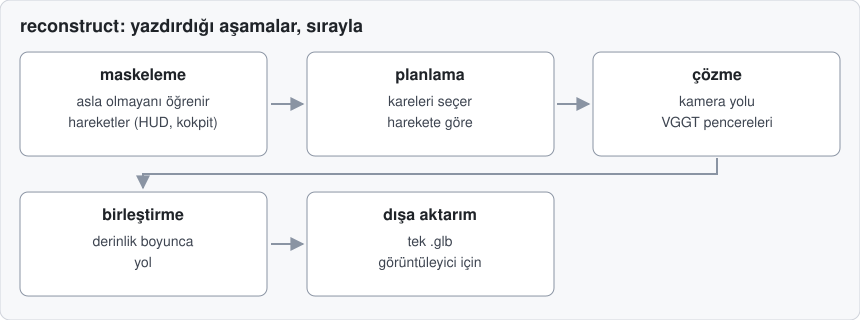

# Çevrimdışı yeniden oluşturma {#offline-reconstruction}

```bash
python -m heat3d_capture reconstruct lap.mp4 -o lap.glb [--solve-budget 260] [--fuse-interval 0.4]
```

Kod: [`scan/offline.py`](https://github.com/Holdi601/3DHeat-GameCapture/blob/main/heat3d_capture/scan/offline.py),
[`pose/feedforward.py`](https://github.com/Holdi601/3DHeat-GameCapture/blob/main/heat3d_capture/pose/feedforward.py),
[`pose/vggt_model.py`](https://github.com/Holdi601/3DHeat-GameCapture/blob/main/heat3d_capture/pose/vggt_model.py),
[`pose/feedforward_source.py`](https://github.com/Holdi601/3DHeat-GameCapture/blob/main/heat3d_capture/pose/feedforward_source.py),
[`pose/solveprep.py`](https://github.com/Holdi601/3DHeat-GameCapture/blob/main/heat3d_capture/pose/solveprep.py).
Seçenekler: [Komut başvurusu](commands.md#reconstruct).

## Neden ikinci bir yol {#why-a-second-path}

Artımlı izleme canlıdır ve ucuzdur; tutunacak bir yapı olan yerlerde çalışır: bir iç mekân, bir sokak, siper olan bir harita. Bir **yarış pisti en kötü durumudur**: yol az dokulu, pürüzsüz bir şerittir, ufuk neredeyse hiç hareket etmez ve birkaç poz sapmaya başladığında, sonrasında hiçbir şey onları geri çekmez. Bir tur, kapanmak yerine dolaşan bir eğri olarak çıkar.

Çevrimdışı yol, **kare pencerelerini** tüm kameralarını birlikte tahmin eden bir modele verir; böylece her kare diğerlerini zincir üzerinden dolaylı olarak değil, doğrudan kısıtlar. Yanıt verebilmesi için tüm kaydın bitmesi gerekir, bu yüzden canlı değildir ve yavaştır: bir masaüstü GPU'da pencere başına dakikalar. Konumlardan sonraki her şey - birleştirme, kapsam, renk, dışa aktarma - canlı taramayla aynı koddur: çözülmüş iz, telemetrinin girdiği yere, bir poz kaynağı olarak verilir.

## Gereksinimler {#requirements}

- Bu GPU'nuza uygun **PyTorch** (bu proje sabitlemez; `requirements.txt`'den önce kurun, bkz. [Çalışma zamanı](runtime.md)).
- **`vggt`** - VGGT model kodu (`from vggt.models.vggt import VGGT`), Meta'nın GitHub deposundan; paket dizininde yoktur.
- **`transformers`**, çünkü çevrimdışı yol derinliği PyTorch `DepthEstimator` (Depth Anything V2 Small) ile çalıştırır, ONNX dosyasıyla değil.
- Pratikte bir CUDA GPU; iki model de CPU'ya düşer, ama bu pratik değildir.

Bunların hiçbiri `requirements.txt` içinde değildir, çünkü tarayıcının bunlara ihtiyacı yoktur. Bunlar **`requirements-offline.txt`** içindedir, VGGT'nin kendi bağımlılıklarıyla (`einops`, `safetensors`, `huggingface_hub`, `Pillow`):

```bash
.venv\Scripts\python -m pip install -r requirements-offline.txt
.venv\Scripts\python -m pip install --no-deps "vggt @ git+https://github.com/facebookresearch/vggt.git"
```

VGGT `--no-deps` ile kurulur, çünkü paket meta verisi `numpy<2` sabitler; pip bunu onurlandırıp scipy'nin ihtiyaç duyduğu numpy'yi düşürürdü. `reconstruct`, lisans satırını yazdırdıktan hemen sonra bunların hepsini denetler (bkz. [`runtime/preflight.py`](https://github.com/Holdi601/3DHeat-GameCapture/blob/main/heat3d_capture/runtime/preflight.py) içindeki `OFFLINE` listesi), eksik olanları boyutlarıyla listeler ve yalnızca bir evet ile kurar - VGGT `--no-deps` ile, yukarıdaki gibi. Reddetmek ya da soru soracak bir terminal olmaması, çıkış kodu 1 ile sonuçlanır.

## Model ve lisansı {#the-model-and-its-licence}

**VGGT**, `facebook/VGGT-1B`: **CC-BY-NC-4.0, yalnızca ticari olmayan, ve onunla yapılan bir yeniden oluşturma bunu miras alır.** Komut başlamadan önce bunu yazdırır (`describe_licence`). Ayrı lisanslı bir `facebook/VGGT-1B-Commercial` vardır, ama bu, Meta tarafından hesap başına verilen kapılı bir depodur; bu yüzden varsayılan olamaz. `--model vggt-1b-commercial` onunla çözer (ve bunun yerine lisans satırını yazdırır); erişim verilmemişse indirme başarısız olur. `vggt` *kodu*, Meta'nın kendi "VGGT License"ı altındadır: kabul edilebilir kullanım politikası içeren bir araştırma-malzemesi anlaşması (paketin `LICENSE.txt` dosyasından okunur). Bkz. [Modeller ve lisanslar](models-and-licences.md).

## Çalışma, aşama aşama {#the-run-stage-by-stage}

Aşama adları, komutun yazdırdığı adlardır.



### maskeleme {#masking}

Bir `FlowMask`, videonun 1/8, 3/8, 5/8 ve 7/8 noktalarında merkezlenmiş, **4 çalıştırma x 90 ardışık kare**den, 960 x 540 gri olarak öğrenilir (bkz. [FlowMask](reconstruction-capture.md#flowmask-what-never-travels)). Notu yazdırılır ve özette tutulur. 90 karenin altındaki bir video maske almaz.

#### Kamera maskesi öğrenilir, uygulanmaz {#the-camera-mask-is-learned-not-applied}

Maske, çözücüye verilen karelere **uygulanmaz**. Kokpiti maskelemek özellik istatistiklerine göre doğru görünüyordu (tespit edilen köşelerin çoğu kameraya bağlı piksellerde oturuyor) - ama bu bir özellik dedektörü hakkında bir ifadedir, ve çözücü eğitilmiş bir ağdır. Kurtarılan yolun ardışık adımlar arasında ne kadar döndüğüne göre ölçüldüğünde (bir araba birkaç derece döner; bir rastgele yürüyüş doksan), ham kareler en küçük dönüşü verdi, kontrast yükseltilmiş kareler biraz daha fazla, maskelenmiş kareler belirgin biçimde daha fazla, ikisi birden en fazla. Bu yüzden çözücü ham kareleri alır. Maske yine de aşağıdaki kare aralığını planlamak için kullanılır ve artımlı izleyici canlı taramada kullanır.
(`solveprep.enhance`, maskeleyen ve CLAHE ile yerel kontrastı yükselten, var ama bu komut tarafından kullanılmaz.)

### planlama: hareketle aralanmış kareler {#planning-frames-spaced-by-motion}

`plan_by_motion`, çözücünün karelerini saate göre değil, **resmin ne kadar hareket ettiğine** göre seçer: sabit bir aralık, yavaş bölümlere ihtiyaç duymadıkları kareleri verir ve hızlı olanları aç bırakır; orada ardışık kareler birbirini yeterince örtüşmez hale gelir.

- Hedef yer değiştirme: 960 piksel genişliğin **%5'i** (48 px) medyan ORB özellik yer değiştirmesi, seçilen ardışık kareler arasında, CLAHE kontrastlı 960 x 540 gri karelerde ölçülür, özellikler yalnızca maskede.
- 0,3 s aralıkla başlar; her adımdan sonra sonraki aralık `gap x (0.5 + 0.5 x target / measured)` olur, **0,15-2,0 s** arasında kırpılır; böylece tek bir gürültülü ölçüm planı sallamaz.
- Hiçbir şey eşleşmediğinde aralık kendisinin 0,6'sına iner (çok uzak aralıklar, önlenmeye çalışılan hatadır).
- Videonun sonunda ya da `--solve-budget` karesinde (varsayılan 260) durur.

4'ten az planlanmış kare bir hatadır.

### çözme: pencereler ve dikiş {#solving-windows-and-stitching}

Planlanmış kareler 960 px genişlikte çözülür ve **16 karelik, 6'sı sonrakiyle paylaşılan örtüşen pencerelerde** çözülür (`plan_windows`; son pencere, son karede bitmesi için geriye çekilir; böylece bir kaydın sonu, ortadakiyle aynı sayıda komşuya sahip olur). Bir çalıştırmada 400'den fazla kare reddedilir.

Her pencere: kareler, uzun kenar **518** olacak ve iki kenar da **14'ün** katı olacak şekilde boyutlandırılır (en boy oranı korunur - ezmek görüş alanını yanlış gösterirdi), 0..1 aralığına ölçeklenir ve bfloat16 otomatik karışımı altında VGGT'den geçirilir (float16, uzak dünya koordinatlarında üssünü tüketir). Kamera dış parametreleri, dünyadan-kameraya dönüşlere ve kamera merkezlerine çevrilir. Nokta haritaları varsayılan olarak tutulmaz.

Her pencere **kendi keyfi çerçevesinde ve kendi keyfi ölçeğinde** döner; bu yüzden pencereler, paylaştıkları kameralar üzerinden zaten yerleştirilmiş olanla, ilkinin çerçevesine bir benzerlik dönüşümüyle (dönüş, öteleme, tek bir ölçek) **dikilir**:

- **Dönüş, konumlardan değil kameraların yönelimlerinden**: paylaşılan kameralar yol boyunca dizilir ve düz bir yolda neredeyse doğrusaldır; bu da yalnızca konumlara bakan bir uydurmanın dönüşü göremeyeceği anlamına gelir - her pencere eğilir ve dikilmiş sonuç düz çıkar. Dönüş, `target_R x source_R^T`'nin ortalamasıdır, gerçek bir dönüşe geri yansıtılmış (yansıma korumalı).
- **Ölçek ve öteleme konumlardan**, döndürülmüş kaynak boyunca.
- En az **4** paylaşılan kamera gerekir; daha azı bir hatadır.
- Örtüşme, pencerenin üçte biridir, böylece ölçek iyi belirlenir; pencereden pencereye birikerek ilerleyen ölçek hatası, bir turu sarmal yaptıran şeydir.

Her dikiş için, uydurmadan sonra paylaşılan kameraların en kötü uyuşmazlığı, aralarındaki ortalama aralığın birimleriyle kaydedilir (`seam_error`).

### birleştirme {#fusing}

Her `--fuse-interval` saniyede (varsayılan 0,4) kareler 960 px genişlikte çözülür, Depth Anything V2 Small (PyTorch) ile derinlik alır ve zaman damgalarında çözülmüş izden **enterpole edilmiş** bir pozla birleştirilir (doğrusal konum, küresel dönüş; `FeedForwardPoses`). Çözülmüş zaman aralığının dışındaki kareler, ekstrapole edilmek yerine atlanır. Kamera **65 derecelik** yatay görüş alanı kullanır. İleri beslemeli pozlar, birleştirme ve kapsamda 0,85 güveni taşır.

### dışa aktarma {#exporting}

Mesh, canlı tarama için olduğu gibi yazılır ([.glb çıktısı](glb-output.md)), videonun adından adlandırılır.

## Özet {#the-summary}

```text
140 cameras solved over 182s
closure error 3.1% of path length
worst seam 0.42 frame spacings
<mask note>
wrote lap.glb
```

| Satır | Anlamı |
|---|---|
| closure error | ilk ile son kamera arasındaki mesafenin yol uzunluğuna oranı. Tek bir tur için sapmanın dürüst ölçüsü. %10'un üstünde: "The lap does not close ... Treat the shape as unreliable." |
| worst seam | en büyük dikiş uyuşmazlığı. 1,0'ın üstünde: "Windows disagreed by up to N frame spacings at a seam, so part of the path is stitched on weak evidence." |
| no file | "Fusion produced no surface, so nothing was written." Çıkış kodu o zaman 1 olur. |

## Ölçek {#scale}

Dikilmiş yol, ilk pencerenin keyfi birimlerindedir. Derinlik, enterpole edilmiş pozlar arasında üçgenlenerek çapalanır (telemetri için olduğu gibi), böylece geometri yolla tutarlıdır - ama **yol metre cinsinden değilse sonuç metre cinsinden değildir**. Bu komutta hiçbir şey genel ölçeği düzeltmez; zemin kalibrasyonu, pozlar bir poz kaynağından geldiğinde uygulanmaz.

## Bu yolun durumu {#state-of-this-path}

Sabit aralıklı karelerle, pencereler bir turun bazı bölümlerinde tutarlı bir yol olarak çözülür, bazılarında ise karalama olarak; başarısızlıklar sıkı virajlarda olur, orada görünüm kareler arasında sert biçimde döner ve o virajları daha yoğun örneklemek onları kurtarır. Denenen hiçbir görüntü istatistiği (parlaklık, detay, özellik sayısı, iç nokta oranı, yer değiştirme), hangi bölümlerin başarısız olacağını önceden kestirmedi. Bu yüzden aralık, resimlerden tam olarak planlanamaz: çözülerek seçilmeli, sonuç ölçülmeli ve bir araba gibi sürülemeyecek yerlerde daha yoğun olarak yeniden çözülmelidir. Hareket tabanlı planlama yapıldı; **uyarlanabilir yeniden çözme yapılmadı**.
