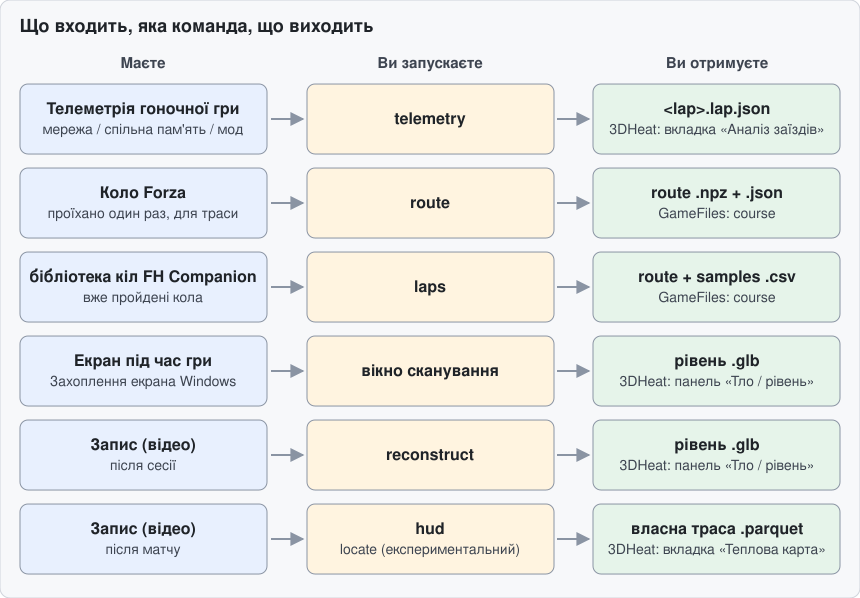

# 3DHeat GameCapture {#dheat-gamecapture}

**Що це?** Інструмент, який записує, що гоночна гра повідомляє про вашу їзду, — по
одному файлу на коло. Він також може відтворити грубу 3D-модель рівня з відео того, як ви
граєте.

**Навіщо це потрібно?** Щоб бачити свої кола в [переглядачі 3DHeat](https://holdi601.github.io/3DHeat/):
де ви гальмували, де їхали повільно, чим відрізняються два кола. І щоб мати рівень під
своєю тепловою картою, коли ні в кого немає його 3D-моделі.

**Приклад:** увімкніть Data Out у Forza, виконайте одну команду і проїдьте два кола. У
`laps\` з'являться два файли кіл. Перетягніть їх на вкладку «Аналіз заїздів» переглядача.


Ви лише починаєте працювати з командним рядком? Спершу прочитайте [Перш ніж почати](before-you-start.md).

## Три завдання {#the-three-jobs}

1. **Телеметрія кола.** Він записує кожен канал, який публікує гоночна гра, — Data Out від
   Forza, спільну пам'ять ігор Assetto Corsa, мережеві потоки ралі-ігор, мод BeamNG, плагін
   Trackmania — і записує один файл `heat3d-lap` на коло або етап для вкладки «Аналіз заїздів»
   переглядача. iRacing не потребує записувача: переглядач читає власні файли `.ibt`.
2. **Рівні з ігрового процесу.** Він перетворює те, що показував екран, поки ви ходили або
   їхали через рівень, у 3D-модель `.glb`, яку переглядач розміщує під тепловою картою.
3. **Ваш власний матч, після нього.** `hud` читає HUD вашого власного запису — ваші дії,
   смерті, слід на мінікарті та стрічку вбивств. `locate` (експериментальний: поки що
   розміщує мало справжніх кадрів) визначає, де був знятий кожен кадр, на 3D-моделі рівня.

Усі три дотримуються одного правила: **ніщо не впроваджується в гру і ніщо не
перехоплюється**. Кадри походять із публічного API захоплення екрана, телеметрія — з
інтерфейсів, які гри публікують для цього. Див. [Правила](../rules.md).



Код написано на Python (пакет `heat3d_capture`), ліцензія MIT. Моделі глибини і пози, які
він може запускати, мають власні ліцензії — див. [Моделі і ліцензії](../models-and-licences.md).

## Швидкий старт {#quick-start}

### Записати кола {#record-laps}

Вам потрібен Python 3.10 або новіший ([Перш ніж почати](before-you-start.md)). У PowerShell:

```powershell
git clone https://github.com/Holdi601/3DHeat-GameCapture
cd 3DHeat-GameCapture
python -m venv .venv
.venv\Scripts\python -m pip install -r requirements.txt

# Forza: Settings -> HUD and Gameplay -> Data Out = ON, IP 127.0.0.1, port 5300
.venv\Scripts\python -m heat3d_capture telemetry -o laps
```

**Ви маєте побачити** `listening on port 5300. Laps go to laps. Ctrl+C to stop.`, потім рядок
на кожне коло, щойно ви перетинаєте лінію, як на малюнку вище. Натисніть Ctrl+C, щоб
зупинити. Перетягніть файли з `laps\` на вкладку «Аналіз заїздів» переглядача. Кожна інша гра — це один
параметр `--game` далі:

```powershell
.venv\Scripts\python -m heat3d_capture telemetry --game acc -o laps
.venv\Scripts\python -m heat3d_capture telemetry --game dirtrally2 -o laps
```

Див. [Записувачі телеметрії](../telemetry.md) для кожної гри і параметра.

### Сканувати рівень {#scan-a-level}

Двічі клацніть **`scan.bat`** у папці інструмента. Він знаходить Python (і пропонує
встановити його через winget, якщо його немає), створює приватне `.venv` і відкриває
вікно сканування. Вікно показує, чого бракує, для чого потрібен кожен пакет і який
розмір завантаження, і нічого не встановлює без вашої згоди. Див. [Середовище виконання і
залежності](../runtime.md) і [Вікно сканування](../reconstruction-scan-ui.md).

Вручну: `.venv\Scripts\python -m heat3d_capture.ui`.

Щоб відтворити запис офлайн, із шляхом камери, розв'язаним одразу (потрібні PyTorch, пакет
`vggt` і GPU — див. [Офлайн-реконструкція](../reconstruction-offline.md)):

```powershell
.venv\Scripts\python -m heat3d_capture reconstruct lap.mp4 -o lap.glb
```

## Карта документації {#map-of-the-documentation}

| Сторінка | Що в ній |
|---|---|
| [Перш ніж почати](before-you-start.md) | Python, термінал, перша команда, поширені помилки |
| [Правила](../rules.md) | Без впровадження, лише опубліковані інтерфейси, і що це коштує |
| [Записувачі телеметрії](../telemetry.md) | Команда `telemetry` і огляд кожної гри |
| [Forza](../telemetry-forza.md) | Data Out, визначення макета, ретрансляція FH Companion і її `.tele.gz` |
| [Ігри Assetto Corsa](../telemetry-assetto-corsa.md) | AC, ACC, AC EVO, AC Rally зі спільної пам'яті |
| [Ралі-ігри](../telemetry-rally.md) | EA SPORTS WRC, DiRT Rally 2.0 / 1 / DiRT 4, Richard Burns Rally |
| [BeamNG.drive](../telemetry-beamng.md) | Мод-протокол `heat3d` |
| [Trackmania](../telemetry-trackmania.md) | Плагін Openplanet `Heat3dRecorder` |
| [iRacing](../telemetry-iracing.md) | Читання файлів `.ibt` у переглядачі |
| [Поділ на кола і етапи](../lap-splitting.md) | `LapSplitter`, `CounterSplitter`, `LineSplitter`, `StageSplitter` |
| [Ковзання, занос і похідні канали](../slip-and-drift.md) | Як масштабується ковзання і що виводить переглядач |
| [Файл heat3d-lap](../lap-format.md) | Формат файлу кола, канали, одиниці, `meta` |
| [Ігри](../games.md) | Для кожної гри: як записувати, що надсилається, які траси можна експортувати |
| [Команди](../commands.md) | `route`, `telemetry`, `laps`, `reconstruct`, `hud`, `locate`, крок за кроком |
| [Довідка з команд](../cli-reference.md) | кожен параметр, створений з `--help` |
| [Читання HUD із запису](../hud-video.md) | `hud`: власні дії, смерті, слід мінікарти і стрічка вбивств із запису |
| [Визначення кадрів на рівні](../locate.md) | `locate`: де був знятий кожен кадр, відносно геометрії рівня |
| [Реконструкція рівня](../reconstruction.md) | Конвеєр від кадрів до `.glb` |
| [Вікно сканування](../reconstruction-scan-ui.md) | Кожен елемент керування, гарячі клавіші і накладка |
| [Захоплення, маски і якість кадрів](../reconstruction-capture.md) | Windows Graphics Capture, ключові кадри, маски HUD, поради щодо якості |
| [Глибина](../reconstruction-depth.md) | Depth Anything V2, ONNX Runtime, побудова моделі |
| [Пози камери і масштаб](../reconstruction-pose.md) | Одометрія, релокалізація, пози з телеметрії, масштаб землі, bundle adjustment |
| [Злиття, покриття і колір](../reconstruction-fusion-and-texture.md) | Об'ємна сітка зайнятості, сітка покриття, слабкі місця, колір вершин |
| [Вихід .glb](../glb-output.md) | Файл, який завантажує переглядач |
| [Офлайн-реконструкція](../reconstruction-offline.md) | `reconstruct`, вікна VGGT і зшивання |
| [Моделі і ліцензії](../models-and-licences.md) | Розміри Depth Anything V2, VGGT, пакети |
| [Середовище виконання і залежності](../runtime.md) | Попередня перевірка, бекенди, рівні продуктивності |
| [Обмеження і перевірка](../limits.md) | Що не зроблено і що не перевірено |
| [Оновлення](../updates.md) | Перевірка випуску і `python -m heat3d_update` |
| [Розробка](../development.md) | Тести, віртуальне середовище, структура репозиторію |
| [Підтримка цих документів](../maintaining.md) | Контрольний список випуску коду і документації |

## Частина 3DHeat {#part-of-3dheat}

Файли, які це записує, завантажує **переглядач 3DHeat** —
[джерело](https://github.com/Holdi601/3DHeat), [документація](https://holdi601.github.io/3DHeat/).
Файли кіл надходять на вкладку «Аналіз заїздів», `.glb`-рівні — в панель «Тло / рівень», таблиці `hud` і `locate` —
на вкладку «Теплова карта»; як переглядач читає таблиці та файли матчів, описано в
[Один файл на матч: `.3dheat`](https://holdi601.github.io/3DHeat/container.html) і
[Завантаження даних](https://holdi601.github.io/3DHeat/getting-data-in.html).

| Інструмент | Що робить | Документація |
|---|---|---|
| [переглядач 3DHeat](https://github.com/Holdi601/3DHeat) | показує теплові карти, гонки і матчі у 3D, у браузері | [документація](https://holdi601.github.io/3DHeat/) |
| [GameFiles](https://github.com/Holdi601/3DHeat-GameFiles) | траси і рівні з файлів, які постачають ігри, як 3D-моделі | [документація](https://holdi601.github.io/3DHeat-GameFiles/) |
| [GameCapture](https://github.com/Holdi601/3DHeat-GameCapture) | телеметрія кіл з гоночних ігор; рівні, відтворені з відео ігрового процесу | [документація](https://holdi601.github.io/3DHeat-GameCapture/) |
| [Unreal Exporter](https://github.com/Holdi601/3DHeat-UnrealExporter) | плагін для Unreal Editor, який експортує рівень як 3D-модель | [документація](https://holdi601.github.io/3DHeat-UnrealExporter/) |
| [CS2](https://github.com/Holdi601/3DHeat-CS2) | демо Counter-Strike 2 у файли матчів; карти в 3D-моделі | [документація](https://holdi601.github.io/3DHeat-CS2/) |
| [Watcher](https://github.com/Holdi601/3DHeat-Watcher) | записує вашу гру у фоновому режимі з того, що публікують ігри | [документація](https://holdi601.github.io/3DHeat-Watcher/) |
| [Ext-WarThunder](https://github.com/Holdi601/3DHeat-Ext-WarThunder) | повтори War Thunder у файли матчів | [документація](https://holdi601.github.io/3DHeat-Ext-WarThunder/) |
| [Ext-WoT](https://github.com/Holdi601/3DHeat-Ext-WoT) | повтори World of Tanks у файли матчів | [документація](https://holdi601.github.io/3DHeat-Ext-WoT/) |
| [Ext-WoWs](https://github.com/Holdi601/3DHeat-Ext-WoWs) | повтори World of Warships у файли матчів | [документація](https://holdi601.github.io/3DHeat-Ext-WoWs/) |
| [Ext-Squad](https://github.com/Holdi601/3DHeat-Ext-Squad) | демо серверів Squad у файли матчів | [документація](https://holdi601.github.io/3DHeat-Ext-Squad/) |
| [Ext-DCS](https://github.com/Holdi601/3DHeat-Ext-DCS) | карти DCS World у 3D-моделі | [документація](https://holdi601.github.io/3DHeat-Ext-DCS/) |
| [Ext-IL2](https://github.com/Holdi601/3DHeat-Ext-IL2) | карти IL-2 Sturmovik у 3D-моделі | [документація](https://holdi601.github.io/3DHeat-Ext-IL2/) |

Розробник, у якого відкрито проєкт гри, має використовувати експортер Unreal, який читає
справжню геометрію і дає точний результат. Там, де можна прочитати власні архіви гри,
GameFiles видобуває точну трасу. Реконструкція з ігрового процесу потрібна лише тоді, коли
доступний лише екран.
