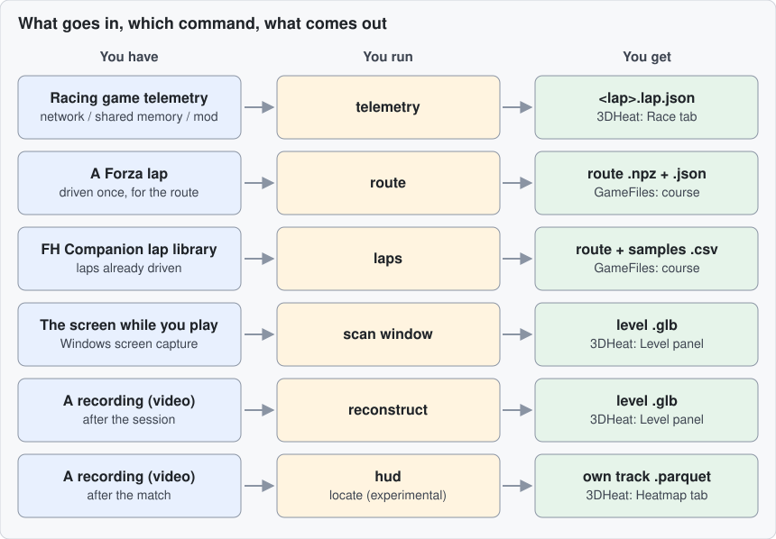

# 3DHeat GameCapture

**What is it?** A tool that writes down what a racing game tells it about your driving, one file
per lap. It can also rebuild a rough 3D model of a level from a video of you playing.

**Why would I use it?** To see your laps in the [3DHeat viewer](https://holdi601.github.io/3DHeat/):
where you braked, where you were slow, how two laps differ. And to have the level under your
heatmap when nobody has a 3D model of it.

**Example:** turn on Forza's Data Out, run one command, drive two laps. Two lap files appear in
`laps\`. Drop them on the viewer's Race analysis tab.


New to the command line? Read [Before you start](before-you-start) first.

## The three jobs

1. **Lap telemetry.** It records every channel a racing game publishes - Forza's Data Out, the
   Assetto Corsa games' shared memory, the rally games' network feeds, a BeamNG mod, a
   Trackmania plugin - and writes one `heat3d-lap` file per lap or stage, for the viewer's Race
   tab. iRacing needs no recorder: the viewer reads its own `.ibt` files.
2. **Levels from gameplay.** It turns what the screen showed while you walked or drove through a
   level into a `.glb` 3D model, which the viewer lays under the heatmap.
3. **Your own match, after it.** `hud` reads the HUD of your own recording - your actions, deaths,
   minimap track and kill feed. `locate` (experimental: it places few real frames so far) works
   out where each frame was taken, on a level's 3D model.

All three follow one rule: **nothing is injected into a game and nothing is hooked**. Frames come
from the public screen-capture API, telemetry from interfaces the games publish for it. See
[The rules](rules).



The code is Python (package `heat3d_capture`), MIT licensed. The depth and pose models it can
run have their own licences - see [Models and licences](models-and-licences).

## Quick start

### Record laps

You need Python 3.10 or later ([Before you start](before-you-start)). In PowerShell:

```powershell
git clone https://github.com/Holdi601/3DHeat-GameCapture
cd 3DHeat-GameCapture
python -m venv .venv
.venv\Scripts\python -m pip install -r requirements.txt

# Forza: Settings -> HUD and Gameplay -> Data Out = ON, IP 127.0.0.1, port 5300
.venv\Scripts\python -m heat3d_capture telemetry -o laps
```

**You should see** `listening on port 5300. Laps go to laps. Ctrl+C to stop.`, then a line per lap as you cross the line, as
in the picture above. Press Ctrl+C to stop. Drop the files from `laps\` on the viewer's Race analysis tab.
Every other game is one `--game` away:

```powershell
.venv\Scripts\python -m heat3d_capture telemetry --game acc -o laps
.venv\Scripts\python -m heat3d_capture telemetry --game dirtrally2 -o laps
```

See [Telemetry recorders](telemetry) for every game and option.

### Scan a level

Double-click **`scan.bat`** in the tool's folder. It finds Python (and offers to install it with
winget if there is none), makes a private `.venv`, and opens the scan window. The window says
what is missing, what each package is for and how big the download is, and installs nothing
without a yes. See [Runtime and dependencies](runtime) and
[The scan window](reconstruction-scan-ui).

By hand: `.venv\Scripts\python -m heat3d_capture.ui`.

To rebuild a recording offline, with the camera path solved all at once (needs PyTorch, the
`vggt` package and a GPU - see [Offline reconstruction](reconstruction-offline)):

```powershell
.venv\Scripts\python -m heat3d_capture reconstruct lap.mp4 -o lap.glb
```

## Map of the documentation

| Page | What it covers |
|---|---|
| [Before you start](before-you-start) | Python, a terminal, the first command, common errors |
| [The rules](rules) | No injection, published interfaces only, and what that costs |
| [Telemetry recorders](telemetry) | The `telemetry` command and an overview of every game |
| [Forza](telemetry-forza) | Data Out, layout detection, the FH Companion relay and its `.tele.gz` |
| [Assetto Corsa games](telemetry-assetto-corsa) | AC, ACC, AC EVO, AC Rally from shared memory |
| [Rally games](telemetry-rally) | EA SPORTS WRC, DiRT Rally 2.0 / 1 / DiRT 4, Richard Burns Rally |
| [BeamNG.drive](telemetry-beamng) | The `heat3d` protocol mod |
| [Trackmania](telemetry-trackmania) | The `Heat3dRecorder` Openplanet plugin |
| [iRacing](telemetry-iracing) | Reading `.ibt` files in the viewer |
| [Lap and stage splitting](lap-splitting) | `LapSplitter`, `CounterSplitter`, `LineSplitter`, `StageSplitter` |
| [Slip, drift and derived channels](slip-and-drift) | How slip is scaled, and what the viewer derives |
| [The heat3d-lap file](lap-format) | The lap file format, channels, units, `meta` |
| [Games](games) | Per game: how to record, what is sent, which courses can be exported |
| [Commands](commands) | `route`, `telemetry`, `laps`, `reconstruct`, `hud`, `locate`, step by step |
| [Command reference](cli-reference) | every option, generated from `--help` |
| [Reading the HUD from a recording](hud-video) | `hud`: own actions, deaths, minimap track and kill feed from a recording |
| [Locating frames in a level](locate) | `locate`: where each frame was taken, against the level's geometry |
| [Level reconstruction](reconstruction) | The pipeline from frames to a `.glb` |
| [The scan window](reconstruction-scan-ui) | Every control, hotkey and overlay element |
| [Capture, masks and frame quality](reconstruction-capture) | Windows Graphics Capture, keyframes, HUD masks, quality advice |
| [Depth](reconstruction-depth) | Depth Anything V2, ONNX Runtime, building the model |
| [Camera pose and scale](reconstruction-pose) | Odometry, relocalisation, telemetry poses, ground scale, bundle adjustment |
| [Fusion, coverage and colour](reconstruction-fusion-and-texture) | The occupancy volume, the coverage grid, weak spots, vertex colour |
| [The .glb output](glb-output) | The file the viewer loads |
| [Offline reconstruction](reconstruction-offline) | `reconstruct`, VGGT windows and stitching |
| [Models and licences](models-and-licences) | Depth Anything V2 sizes, VGGT, the packages |
| [Runtime and dependencies](runtime) | Preflight, backends, performance tiers |
| [Limits and verification](limits) | What is not done, and what has not been checked |
| [Updates](updates) | The release check and `python -m heat3d_update` |
| [Development](development) | Tests, the virtual environment, repository layout |
| [Maintaining these docs](maintaining) | The release checklist for code and documentation |

## Part of 3DHeat

The files this writes are loaded by the **3DHeat viewer** -
[source](https://github.com/Holdi601/3DHeat), [documentation](https://holdi601.github.io/3DHeat/).
Lap files go to its Race analysis tab, `.glb` levels to its Background / level panel, the `hud` and `locate` tables to
its Heatmap tab; how the viewer reads tables and match files is in
[One file a match (.3dheat)](https://holdi601.github.io/3DHeat/container.html) and
[Getting data in](https://holdi601.github.io/3DHeat/getting-data-in.html).

| Tool | What it does | Docs |
|---|---|---|
| [3DHeat viewer](https://github.com/Holdi601/3DHeat) | shows heatmaps, races and matches in 3D, in the browser | [docs](https://holdi601.github.io/3DHeat/) |
| [GameFiles](https://github.com/Holdi601/3DHeat-GameFiles) | courses and levels out of the files games ship, as 3D models | [docs](https://holdi601.github.io/3DHeat-GameFiles/) |
| [GameCapture](https://github.com/Holdi601/3DHeat-GameCapture) | lap telemetry from racing games; levels rebuilt from gameplay video | [docs](https://holdi601.github.io/3DHeat-GameCapture/) |
| [Unreal Exporter](https://github.com/Holdi601/3DHeat-UnrealExporter) | an Unreal Editor plugin that exports a level as a 3D model | [docs](https://holdi601.github.io/3DHeat-UnrealExporter/) |
| [CS2](https://github.com/Holdi601/3DHeat-CS2) | Counter-Strike 2 demos into match files; maps into 3D models | [docs](https://holdi601.github.io/3DHeat-CS2/) |
| [Watcher](https://github.com/Holdi601/3DHeat-Watcher) | records your play in the background from what games publish | [docs](https://holdi601.github.io/3DHeat-Watcher/) |
| [Ext-WarThunder](https://github.com/Holdi601/3DHeat-Ext-WarThunder) | War Thunder replays into match files | [docs](https://holdi601.github.io/3DHeat-Ext-WarThunder/) |
| [Ext-WoT](https://github.com/Holdi601/3DHeat-Ext-WoT) | World of Tanks replays into match files | [docs](https://holdi601.github.io/3DHeat-Ext-WoT/) |
| [Ext-WoWs](https://github.com/Holdi601/3DHeat-Ext-WoWs) | World of Warships replays into match files | [docs](https://holdi601.github.io/3DHeat-Ext-WoWs/) |
| [Ext-Squad](https://github.com/Holdi601/3DHeat-Ext-Squad) | Squad server demos into match files | [docs](https://holdi601.github.io/3DHeat-Ext-Squad/) |
| [Ext-DCS](https://github.com/Holdi601/3DHeat-Ext-DCS) | DCS World maps into 3D models | [docs](https://holdi601.github.io/3DHeat-Ext-DCS/) |
| [Ext-IL2](https://github.com/Holdi601/3DHeat-Ext-IL2) | IL-2 Sturmovik maps into 3D models | [docs](https://holdi601.github.io/3DHeat-Ext-IL2/) |

A developer with the game's project open should use the Unreal exporter, which reads the real
geometry and is exact. Where a game's own archives can be read, GameFiles extracts the exact
course. Reconstruction from gameplay is for the case where only the screen is available.
