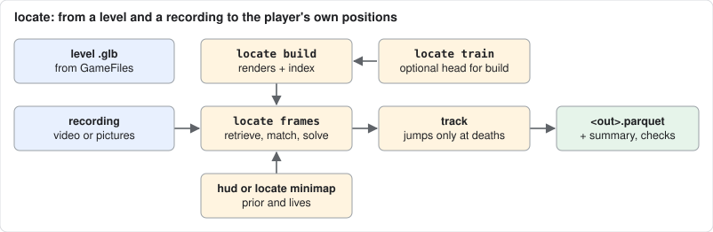

# Locating frames in a level

`locate` works out where each frame of a gameplay recording was taken - the camera's 3D position
and view direction - by matching the picture against renders of the level's own geometry. It is
for games that keep no record of where the player was: no demo, no replay file, no telemetry.
Battlefield 6 is the first.

> **Experimental.** On real recordings it places only a small share of frames so far; see
> [Real frames: experimental](#real-frames-experimental).

```bash
# Once per level: render it from every place a player can stand, and index the renders.
.venv\Scripts\python -m heat3d_capture locate build level.glb -o level.db

# Per recording: where was each frame taken?
.venv\Scripts\python -m heat3d_capture locate frames "<recording>.mp4" --db level.db -o out/match
```

The position comes **from the picture**, against the whole level, with no prior. The minimap track
of the [HUD reader](hud-video) is only a fallback for frames the picture cannot place, and every
row says which of the two it came from.




## What it does and does not touch

- It reads the player's **own recording** and a level file the player exported from their **own
  copy** of the game. It never touches the game, its memory, its files while it runs, or its
  network, and it runs after the match. See [The rules](rules).
- It places **only the player's own camera**: the frame is the player's own view.
- The level, the database built from it and everything rendered from it belong to the game's
  publisher. Keep them local.

## Requirements

- What `requirements.txt` lists, PyTorch (from pytorch.org, for the GPU), and
  `requirements-locate.txt`:

```bash
.venv\Scripts\python -m pip install -r requirements-locate.txt
```

- A GPU with OpenGL 3.3 (4.3 is faster) for the renders, and preferably CUDA for the models. On a
  CPU it works, slowly.
- The models are fetched on first use (about 450 MB): DINOv2 from Hugging Face, ALIKED and
  LightGlue through kornia. All are licensed for commercial use; see [Licences](#licences).
- The **level** as a `.glb` (or `.gltf`) in the viewer's frame, Y up, **with its base colour
  textures**, as the 3DHeat exporters write it (`ground:` / `structure:` parts; the part names are
  not needed). One unit is one metre unless the file's top-level `extras.unit_metres` says
  otherwise. A GameCapture scan (`reconstruct`, the scan window) is written in **centimetres** and
  carries `extras.unit_metres: 0.01`, so it is read at its true size. An untextured level works
  much less well; see [Limits](#limits).

## Commands

### `locate build <level> -o <db>`

Renders the level from every place a player could stand and stores, per render, its pose and one
global descriptor.

| Option | Default | Meaning |
|---|---|---|
| `level` | | The level's `.glb` / `.gltf`. |
| `-o`, `--out` | | The database folder to write. |
| `--game` | `bf6` | The game profile: eye heights, field of view, HUD boxes, speed (below). `generic` for any first-person game. |
| `--eye` | the profile's | Eye heights above the floor in metres, standing first. One database view per height. |
| `--fov` / `--vfov` | the profile's | The recording's horizontal field of view, or the vertical one (Battlefield's slider) for a 16:9 recording. |
| `--spacing` | 2.5 | Metres between the places views are taken from. |
| `--yaw-step` | 30 | Degrees between the views' directions. |
| `--pitch` | 0 | Pitches to render at, degrees up. |
| `--positions` | none | A table (Parquet or CSV with `x`, `y`, `z` at the feet, in the level's frame) to take places from instead of every floor: a previous run's output, say. |
| `--shadows` | off | Cast the sun's shadows in the renders (the level's own sun when its file names one in `extras.sun`). |
| `--untextured` | off | Render shape and light only. |
| `--box X0 Z0 X1 Z1` | the whole file | Only places inside this box (level units): the play area. |
| `--places` | `auto` | Where views are taken from: `nav` - players at eye height over the level's navigation mesh (`nav:` parts: exactly where the game lets them walk), vehicle cameras at their height over the `ground:` parts (terrain and roads) within 50 m of it; `ground` - both over `ground:`; `floors` - over every upward face (roofs and crates too); `auto` - `nav` when the level has a navigation mesh, else `floors`. |
| `--head` | none | A per-map head from `locate train` for the descriptors. |

Writes `<db>/db.json` (what it was built from and with) and `<db>/views.npz` (poses, descriptors).

### `locate frames <recording> --db <db>`

| Option | Default | Meaning |
|---|---|---|
| `source` | | A video, a picture, or a folder of pictures (taken in name order, `--fps` apart). |
| `--db` | | The database `build` wrote. Its level file must still be where it was (or `--level`). |
| `-o`, `--out` | `<source>.locate` | Output path without extension. |
| `--fps` | 2 | Frames located per second of video. |
| `--start`, `--seconds` | all | The part of the video to read. |
| `--width` | 1280 | The width frames are matched at. |
| `--shortlist` | 8 | Database views tried per frame near a prior or a fix. |
| `--search-shortlist` | 16 | With no prior: database views tried per frame ([searched together](#with-no-prior-frames-searched-together)). |
| `--no-search` | off | With no prior: search each frame on its own and believe its fix without its neighbours. |
| `--accept-depth` | 0 (off) | With no prior: believe a fix only if its matches' far distance is this many times their near one. |
| `--accept-support` | 2 | With no prior: agreeing neighbours along the life a fix needs to be believed. |
| `--checkpoint` | none | Keep the run's state here and carry on from it if it is there. |
| `--stop-file`, `--stop-process` | none | Stop by itself, state saved, exit code 75, when this file exists or a process runs whose name starts with this (checked before every frame; may be repeated), so that a long run frees the machine for a game. The same command carries on. |
| `--normalise` | none | Light normalisation before matching: `clahe`, `gray`. |
| `--minimap` | none | The `hud` verb's table: the **fallback** for frames the picture cannot place. |
| `--prior-radius` | none | **Optional speed-up**, off by default: search only database views this many metres from the minimap's position (needs `--minimap`). |
| `--minimap-anchor` | none | A JSON file tying the minimap to the level ([the minimap as a search prior](#the-minimap-as-a-search-prior)): the minimap cuts the search from the first frame; fixes found so are `visual+minimap-prior`. |
| `--no-level-search` | off | With a prior: when nothing near it fits, do not search the whole level as well (faster). |
| `--lives` | the `--minimap` table | The `hud` verb's table whose deaths, deploys and revives say when the player was in play: positions jump only across a death ([lives from the footage](#lives-from-the-footage)). |
| `--no-sequence` | off | Decide every frame on its own, not along the run (below). |
| `--fit-fov` | off | After the run, fit the field of view to the strongest fixes, per view, and report it. |
| `--check-every` | 0 | Also every N frames, placed or not, a picture into `<out>.check`. |
| `--no-checks` | off | Do not write the check pictures of the visual fixes (below). |
| `--no-zoomed` | off | Do not solve zoomed views from their neighbours' fixes (below). |
| `--no-grow` | off | Do not search again near each fix for the frames round it still without one. |
| `--game`, `--eye`, `--fov`, `--vfov`, `--mask`, `--no-hud-mask`, `--max-speed` | the profile's | As above; `--mask x,y,w,h` adds a screen box (on a 1920x1080 screen) that is not the level. |
| `--vehicle-vfov` | the profile's | The vertical field of view of vehicle cameras (Battlefield's vehicle slider). |
| `--settings` | the newest settings file | `bf6`: the game's settings file the fields of view are read from (read only) when no `--fov`/`--vfov` is given; by default the newest `PROFSAVE*_profile` under `Documents/Battlefield 6/settings`. It holds the settings as they are now, which may not be how an older recording was made. |

### `locate refmap <level> <deploy screen> -o <refmap>`

Places the game's own map on the level: the reference the minimap is read against
([the minimap, read against the level](#the-minimap-read-against-the-level)). `<deploy screen>` is
a picture of the deploy screen showing the whole map, or a recording with `--at <seconds>` at such
a moment; the profile's map box is cut out of it (`--whole-picture` keeps all of it). Writes
`<refmap>.png` (the map resampled onto the level's own frame, `--mpp` metres a pixel, default 0.5),
`<refmap>.valid.png` (where it is the map, not a marker or label) and `<refmap>.json` (the frame and
the calibration, with how far the map's tiles were from it). `--topdown <prefix>` keeps the level
rendered from above for the next run (`--topdown-mpp`, default 0.656 m; `--box` limits it).

### `locate minimap <recording> --refmap <refmap> -o <table>.parquet`

Reads the recording's minimap against the reference map, frame by frame (`--fps`, default 2):
position, heading and zoom of every minimap that matches, in the level's frame, written as a
minimap table with an anchor beside it (`<table>.anchor.json`) that `locate frames` takes as
`--minimap <table>.parquet --minimap-anchor <table>.anchor.json`. With the `hud` verb's table
(`--hud`) its lives are carried over; with an anchor for that table too (`--hud-anchor`) the first
search is round where it puts the player, and where no minimap matches the HUD's own track fills
in, moved onto the nearest reference-map fixes (`--hud-fill`, seconds, default 120; 0 turns it off).
The table's `source` says which (`refmap`, `hud`).

### `locate eval <out>.parquet --truth <poses>`

Compares a result with known camera poses: a table of `time`, `x`, `y`, `z` (the eye), `yaw`,
`pitch` in the level's frame. `--offset` is the clock offset (truth time = video time + offset);
without it the offset is searched for. `--unit-metres` turns the errors into metres.

## Game profiles

| | `bf6` | `generic` |
|---|---|---|
| Eye heights | 1.6 m standing, 1.05 m crouched (not yet measured in the game) | 1.65, 1.1 m |
| Field of view | 55 degrees vertical, about 86 horizontal at 16:9: **pass the player's own** with `--vfov` | 90 horizontal |
| HUD masked | minimap and squad list, kill feed, compass, ammunition, the player's weapon, the pop-ups, the crosshair | the crosshair |
| Fastest on foot | 8 m/s | 8 m/s |
| Views told apart | on foot, vehicle, zoomed (below) | every frame on foot |
| Vehicle cameras | the vehicle slider (from the settings file), the vehicle masked, the camera up to 8 m over the floor, 30 m/s | - |

The field of view matters most: a frame solved with the wrong one is solved with the wrong focal
length, and its position slides along the view.

## Outputs

### `<out>.parquet`

One row per located frame, in the **level's frame** (Y up, the level's units), with the viewer's
reading instructions in the footer (`kind: heat3d-locate`). The footer names every column that has
no role of its own as an extra, so the viewer keeps them all (its inspect card shows them).

| Column | Meaning |
|---|---|
| `time` | Seconds from the start of the video. |
| `event` | `start` on the first row of a life, `position` on the rest. |
| `x`, `y`, `z` | The eye, smoothed within the life. Empty where neither source placed the frame. |
| `yaw`, `pitch` | Degrees: yaw about the up axis (0 along +X, growing towards -Z, which is a game's own yaw in the viewer's frame), pitch up from the horizontal. `pitch` is empty for minimap rows. |
| `dir_x`, `dir_y`, `dir_z` | The view direction. |
| `player`, `team`, `session` | `me`, `own`, and `<video>#NN`, one per life. |
| `life` | The life the footage showed the frame in (from the HUD's deaths; 1 = the first). Empty when out of play (dead, down, deploying) or when the lives were not read. `session` is the track's life, which can also split at a jump. |
| `source` | `visual` (from the picture), `visual+minimap-prior` (from the picture, the search cut to the minimap prior), `minimap` (the fallback), `minimap+nav-floor` (indoors: the minimap and the navigation mesh's floor) or `none`. |
| `view` | `foot`, `vehicle`, `zoomed` or `screen` (below). |
| `cam_x`, `cam_y`, `cam_z` | The camera that saw the frame. On foot and through a sight it is the eye, and `x`, `y`, `z` are the same; in a vehicle's third-person view `x`, `y`, `z` are the vehicle (the offset model below) and the camera rides behind and above it. |
| `hfov`, `zoom` | The horizontal field of view the frame was solved with, and for a zoomed view its zoom against the normal view. |
| `confidence` | 0..1: how far to trust the row (below). |
| `uncertainty` | The row's typical error, level units: for a visual fix from its inliers and its neighbours, for a minimap row from the fit (below). |
| `inliers`, `rmse` | The visual solve's PnP inliers and reprojection error (pixels at the working width). |
| `x_raw` ... `pitch_raw` | The visual solve before smoothing (also for outliers that were voted out). |
| `kept` | The visual fix survived the outlier vote. |
| `note` | Why a frame was not placed, or was voted out. |

### `<out>.summary.json`

Frames, visual fixes, outliers, lives, rows per source, the minimap fit (pairs, inliers, residual),
time per frame.

## Method

### The database

Places are points on every upward-facing triangle of the level, spread evenly (one per `--spacing`
on a 3D grid, so the floors of a building each get theirs). Each is checked from its eye with six
small depth renders: a camera inside geometry sees mostly back faces, a crawl space has something
solid over the eye; both are dropped. From each place the level is rendered at every eye height,
every `--yaw-step` and every `--pitch`, and each render is described by **DINOv2** (its patch tokens
pooled by generalised mean, joined with the class token).

The local features and 3D points that a frame is finally solved against are **not stored**: they are
made again when needed by rendering the few views retrieval picked, which takes milliseconds. That
keeps a database at a few hundred megabytes rather than tens of gigabytes, and it is what allows the
refinement below. The cost is that `frames` needs the level file and a GPU, not only the database.

### One frame

1. **Mask** what is not the level: the profile's HUD boxes and the crosshair, plus any `--mask`.
2. **Retrieval** over the **whole level**: the frame's descriptor against every database view; the
   most similar few dozen, thinned so they hold different places and directions, are the shortlist.
3. **Matching**: each shortlisted view is rendered again at the frame's size and field of view, with
   its depth. ALIKED keypoints of frame and render are matched with LightGlue. A matched render
   pixel plus its depth is a 3D point of the level, so each match is a 2D-3D correspondence;
   keypoints on a depth edge (whose depth may belong to what is behind them) are dropped.
4. **Pose**: PnP with RANSAC (SQPnP), then a robust refinement that keeps the camera level - a
   first-person view does not roll - and minimises the reprojection error of the inliers.
5. **Is it possible?** A pose must be at a player's eye height over a floor and outside geometry
   (a depth render straight down). A look-alike texture elsewhere - a tiled floor matched to a wall
   of the same material - can give hundreds of inliers at a pose no player could have; those are set
   aside, however many inliers they have.
6. **Render and compare**: the level is rendered at the solved pose and matched again, which
   replaces a database view up to a few metres and tens of degrees away with one that nearly
   coincides with the frame. Repeated while it gains inliers (at most twice).
7. **Choosing**: the strongest three places (more than about 3 m apart) are each refined before one
   is chosen. A look-alike can lead before refinement; the right place gains far more from it.
8. **Verdict**: `confidence` combines the inlier count, the best other place (`runner_up`) and the
   reprojection error. A fix is `ok` with at least 25 inliers, no other place within 80% of its
   inliers, and a confidence of at least 0.85 - the threshold the measurements below put at 97.5-99%
   right.

### Views

A frame is not always the player's eyes. The profile's detector reads which view it is from the
HUD, and the frame is solved accordingly:

- **On foot**: the infantry field of view and eye heights.
- **Vehicle** (Battlefield 6: the seat diagram's key prompts, `C CAMERA` and `E EXIT`, at the bottom
  centre): the vehicle field of view, the vehicle itself masked (the lower middle of the screen in
  its third-person view), and a camera allowed up to 8 m over the floor. The fix is the camera's.
- **Screen** (dark edges round a dark middle: the deploy map, a menu, the scoreboard): not a view
  of the level; skipped.
- **Zoomed** (a scope, a gunner's sight, a vehicle's own first-person view: one screen edge black,
  both dark, round a bright picture): not searched for over the level - a scope's sliver of the
  level resembles none of the database's wide views - but solved after the run from the nearest fix
  within 6 s, below. Off with `--no-zoomed`.

### Zoomed views

A narrow view pins its position poorly: a step back with a little more zoom looks almost the same.
So a zoomed frame starts from where its neighbour says the sight is - on foot that fix's eye, in a
vehicle 2.5 m over the ground under the vehicle's middle (a turret's sight) - and how far it may
have moved since: 2 m, plus 4 m a second on foot or 8 in a vehicle, at most 12 m (`reach`).

1. **Direction and zoom, the position held.** For each zoom of 1, 1.2 (a vehicle's own view,
   narrower than on foot), 1.5, 2, 3, 4, 6 and 8, the level is rendered at the seat in directions
   within 30 degrees of the neighbour's (and, from 3x, a few pitches). The frame's keypoints matched
   to a render, with the level points under them, are rays from the seat; a rotation is fitted to
   them two at a time (RANSAC) for focal lengths from 0.75 to 1.3 times that zoom's, a point
   agreeing within an angle that allows for the seat being `reach` off at its distance. The zoom,
   direction and focal length most points agree with win.
2. **Settled.** Those points then fit position, direction and focal length together, by their
   reprojection error, the position held to the seat by a cost of two pixels per `reach` moved;
   rendered once more at the answer and fitted again. Inliers and error are counted in pixels, and
   the fix is `ok` by the same confidence as any other.

The zoom written (`zoom`) is against the run's field of view on foot; `hfov` is the solved one. In
a vehicle the position written is the vehicle's, 2.5 m below the sight, as for its third-person
view.

### Vehicles: the camera and the vehicle

In a vehicle's third-person view the solved pose is the chase camera's, which rides behind and
above the vehicle and swings round it as the player looks about. The position written (`x`, `y`,
`z`) is the vehicle's - the ground under its middle: the camera's plus the profile's
`vehicle_offset`, so many metres ahead along the camera's horizontal view direction and so many
down. The camera stays in `cam_x`, `cam_y`, `cam_z`. The conversion is made before the sequence and
the track, so a camera swinging round a standing vehicle is not taken for movement. The table's
footer carries the offset used and whether it was measured (`vehicleOffset`). On foot and through
a sight there is no offset.

How the Battlefield 6 offset was measured: on right fixes of real third-person frames of a tank,
the middle of the tank was marked by eye on the frame, and the level rendered at the fix gave the
ground at that pixel. The profile takes the median: about 10 m ahead of the camera and about 4 m
below it. The marking is good to a metre or so, and it is one vehicle type: a car or a helicopter
rides its camera differently.

### With no prior: frames searched together

One frame's global descriptor against a whole level is a weak signal, and one frame's inliers do
not tell a right place from a look-alike. So with no prior the frames of a recording are described
first and searched together (`search.py`), and a fix is believed only with the frames around it:

- **Shortlist.** Each view's similarities are measured against its own mean and spread over the
  recording, so that a view resembling every frame stops winning everywhere. Each frame scores the
  cells of a 24 m grid by the rank of their best view; the best path through the cells along each
  life, within what the player can cover between frames, gives a belief per cell, and the best view
  of each cell, best believed first, is one list. Plain retrieval is the other, and the two are
  taken in turn: measuring views against the recording punishes a place the player hardly leaves,
  which is where plain retrieval does well.
- **Believing.** A candidate counts only if its inliers cover at least 12% of an 8 x 8 grid over the
  frame: a look-alike is a repeated object, a stack of containers, with hundreds of inliers on a
  few cells of the frame. A fix is believed when it lies on the best path through the counting
  candidates (below) with at least two neighbours within 6 s that agree with it. A frame out of
  play is not searched at all.
- **Growing.** Only what is believed is grown from, and a grown fix must cover the frame in the same way.

### Along the run

Each frame keeps every physically possible pose it found, one per place (`candidates`), not just
the strongest. The run then picks one per frame - or none - so that the chosen poses form a path a
player could have walked or driven, and as many inliers as possible lie on it: a hidden Markov
model, decoded at once (Viterbi). A look-alike that wins one frame on its own loses to the place
its neighbours agree with; a weak candidate the path runs through, with at least two agreeing
neighbours, becomes a fix (`note`: chosen along the sequence); a confident fix its neighbours all
contradict stops being one. A neighbour counts as agreeing only within 6 s: further apart, the
distance a player - let alone a vehicle - could have covered is so large that agreeing says
nothing. Off with `--no-sequence`.

### Frame times

A row's `time` is the frame's own timestamp in the recording, not its count over the nominal frame
rate. Recordings drift from their nominal rate (by a few tenths of a second within a clip, on the ones
measured), and everything that reads a frame back by its time -
the check pictures, the zoomed pass, `locate train --real`, the minimap from the `hud` verb - seeks
by timestamp. Counted frames would put the check picture's frame up to that far away from the one
located.

### The field of view, from the frames

`--fit-fov` keeps the strongest fixes of a run (per view) and refines each one's pose and focal
length together on its inliers; the median over them is the field of view the recording was made
with, reported in the summary (`hfov_fitted`) for the next run's `--fov`. Near and far points move
differently under a change of focal length than under a change of position, which is what pins
it down; it needs fixes with depth in them, not a flat wall.

### A per-map model

`locate train` trains a small head on top of DINOv2 for one level, on renders of it, so that the
global descriptor finds the right views of real frames rather than of renders alone:

- **Head**: each patch token through a two-layer projection, pooled by generalised mean over the
  patches that show the level, joined with the projected class token. DINOv2 stays frozen. All of
  it written here (MIT).
- **Pairs**: a place on the walkable ground and a direction, rendered twice from poses up to a
  metre or two and a dozen degrees apart, at fields of view up to 10 degrees apart, under
  different light (sun, shadows, ambient), each through a game-like look: grading, haze by depth,
  bloom, vignette, smoke, people in the way, the player's own vehicle in vehicle views, motion
  blur, noise, JPEG (`augment.py`). Masked like a frame. Places within a few metres facing the same
  way are not counted as negatives.
- **Real frames**: frames with a pose the pipeline found itself (pseudo-labels: fixes chosen along
  a sequence) can join as pairs - the frame and a render at its pose - in a second round.
- **Loss**: contrastive (InfoNCE) over the batch.

`locate build --head <head.pt>` builds the database with it; `frames` then uses it for the frames.

| `locate train` option | Default | Meaning |
|---|---|---|
| `-o`, `--out` | required | The head file to write (`.pt`). |
| `--steps` | 600 | Training steps. |
| `--real TABLE VIDEO` | none | A `locate frames` table and its recording: its confident fixes join as real pairs. Repeatable. |
| `--real-confidence` | 0.85 | The confidence a fix needs to join as a real pair. |
| `--spacing`, `--box`, `--places`, and the profile options | as `build` | Where the training places are, and the game's profile. |

### Checking by eye

Every visual fix gets a picture in `<out>.check` - `<time>s_<view>_visual.jpg`: the frame, and
beside it the level rendered at the fix's camera with the frame's edges drawn over the render.
Where they line up, the fix is right. Written after the sequence and the track have decided, so
the pictures are exactly the rows the table calls visual. Off with `--no-checks`.

### The minimap, read against the level

A minimap stitched into one mosaic (the `hud` verb's) is not flat: its scale drifts with the zoom
each minimap was registered at, a place seen twice can be drawn twice, and each clip's mosaic is
its own. A similarity fitted to a few fixes then holds near them and is tens of metres off away
from them. So the minimap is placed by the level itself, in two steps, and nothing is stitched:

- **The reference map** (`locate refmap`). The deploy screen draws the whole map north up, flat, at
  one scale. The level rendered from straight above shows the same things standing up from the
  ground (tanks, buildings, walls): on the level, their height over the ground 15 m round; on the
  map, what is drawn lighter than the ground round it. The map is laid on the level by normalised
  cross-correlation of the two over scale and a small turn, refined by matching tiles of it one by
  one, and last by all of the map at once round that answer (a few dozen tiles leave the scale
  loose by a percent, metres at the map's ends). The result is one similarity, map pixel to level.
- **The minimap, frame by frame** (`locate minimap`). Each sampled minimap - the HUD reader's crop
  and overlay mask - is matched (SIFT) to the reference map round where the player last was, or
  anywhere when nowhere is known, and a similarity (turn, zoom, shift) is fitted. The player's point
  carried through it is the position, the minimap's up (the view cone) the heading, its scale the
  zoom - measured, not assumed.
- **Where it does not match.** The deploy screen draws nothing outside the play area; a minimap
  that shows mostly what lies outside it - a player at the edge of the map - has nothing to match.
  There the HUD's own track stands in, moved by the offset the nearest reference-map fixes measured
  (`--hud-fill`); it is as good as the mosaic is near those fixes.

On the test level the minimap read this way was a few metres (median) from confident picture
fixes, as good outside the area the reference map was fitted in as inside it.

### The minimap as a search prior

The `hud` verb's minimap track says, for most frames of play, roughly where the player is and which
way they look - in its own units (minimap pixels, north up). Tied to the level once, it cuts the
search to a small part of it; the pose itself still comes from the picture, by the same rules.

- **The anchor** (`--minimap-anchor <anchor.json>`): one similarity per map, minimap to level -
  scale, turn (with the mirror between north-up pixels and the level's axes), shift - fitted on the
  confident visual fixes (confidence 0.7 and up) of several clips. Each clip's minimap is a mosaic
  the HUD reader stitched on its own, so each sits somewhere else in minimap units; two mosaics of
  one map differ only by a shift, found by matching keypoints between them (the shift most matches
  agree on), and every mosaic is tied to one reference through all the pairs that agree well. The
  anchor file carries the map's similarity, the clip's shift (`clip_shift`), and the error the
  anchor showed against fixes of clips left out of its fit (`median`, `p90`, metres).
- **Where and which way.** The minimap's heading is the camera's yaw: on the clips measured it
  agreed with the solved yaw within 2-5 degrees. So a frame is first matched against renders made
  where the minimap puts the camera - on foot an eye over the ground there, in a vehicle the chase
  camera behind and above it (the vehicle offset) - looking along the heading: the point and 4 m to
  each side, at two pitches (`seeds`). Only when none of those gives a fix are the database's own
  views within the disc tried (30 m plus the anchor's 90th-percentile error).
- **Corrected as the run goes.** Every confident fix near the prior says how far off the anchor is
  there; the median of those within 2 minutes corrects the prior, and their spread (at least 5 m)
  replaces the anchor's error in the disc's radius - up to 10 m: fixes that disagree more say the
  minimap is off with place, not that anything 50 m away will do. With no fix within 2 minutes the
  prior is not corrected at all (the error elsewhere in the clip says nothing about here).
- **Anchors with a grid.** An anchor may also carry `grid`: level x and z on a regular grid over
  the clip's minimap units, read bilinearly; inside it the grid places the point, outside it the
  similarity. A `locate minimap` table's anchor is the identity (its table is in the level's frame
  already).
- **Weak fits.** With a prior, a fit that is weak (25 inliers or more, but not confident enough on
  its own) and lies within the disc is kept - with its lower confidence - for the sequence and the
  track to judge, not dropped: smoke, rubble and destroyed walls leave real frames fewer matches.
- **Sources.** `visual` - the picture placed it, no prior; `visual+minimap-prior` - the picture
  placed it, the search cut to the prior; `minimap` - the picture did not, the minimap stands in;
  `minimap+nav-floor` - indoors, below.
- **Indoors** the minimap leads. A frame the picture did not place, on foot, where an eye at the
  minimap's position sees the level close all round (median distance under 8 m four ways) and no
  sky, is indoors: it gets the minimap's x and z and the height of the navigation mesh's floor
  there - of several floors, the one nearest the last fix - with `source = minimap+nav-floor`, so
  that it is clear the picture did not fix it.

### Lives from the footage

A position may jump only where the player died. The lives are not guessed from the positions - a
single wrong fix would open a new one - but read from the footage: the HUD reader's table records
the deaths the down and deploy screens showed (`death`), the downs a teammate revived (`downed`,
`revived`), the deploys (`spawn`) and where play started and stopped (`start`, `end`); `lives.py`
turns them into lives. A death closes a life, the first frame of play after the deploy screen
opens the next; a revive does not cut it (the player is where they went down), and the frames
while down are not placed; a stretch of menus or loading longer than 10 s cuts it too. Frames out
of play (dead, deploying, down) are never placed.

Within a life continuity is a hard rule: each step at most the speed times the time between, plus
1.5 m. The speed is the frame's: on foot the profile's, in a vehicle the speed the vehicle's own
readout showed within 3 s (a third again, and 2 m/s, for speeding up) or, where it shows none, its
class's limit. Along the run (Viterbi) a step across a death is free at any distance, every other
step bounded; a frame that would need a jump is left out - the weaker side of a contradiction
loses (fewer inliers, less support) - and the life is never split on it. Where the left-out side
is itself strong (confidence 0.9 and up, two or more fixes agreeing with each other), the run does
not guess: both sides are kept and marked `jump without detected death` (a missed death, or a real
teleport), and listed in the summary. The minimap fallback follows the same lives.

Battlefield 6: the tanks' first-person view shows the speed (`<n> KPH`, right of the sight; read
with the HUD reader's OCR); the third-person view does not. The readings on the test clips were
slow, so ground vehicles are allowed 15 m/s where nothing is read. Boats, helicopters and jets
get generous limits (20, 90 and 280 m/s) that are not measured: no clip shows one being driven or
flown, and the view classifier does not tell air from ground - a stretch faster than a ground
vehicle shows up as a jump, flagged, not trusted.

### Destruction

The level files are the intact level; in a match walls, houses and rocks are shot away, rubble
and smoke hang about, and it gets worse as the match goes on.

- **Matching trusts the static level.** A part the export tags as destructible (its name starts
  `destructible:`, or `extras.destructible` on its node, mesh or primitive) is drawn into the
  render's `destructible` mask. Matches whose level point lies on it are dropped when 40 or more
  matches on static parts remain - terrain, roads, the large structures carry the solve.
- **Training sees it gone.** The training renders (`locate train`) replace patches of the
  destructible parts by rubble-coloured noise, and add dust low over the ground, on top of the
  smoke and the rest of the game look (`augment.py`), so the per-map model learns not to lean on
  them.
- **Missing geometry is not a wrong place**: with a prior, weak fits within its disc are kept (above).

Until the exports carry the tags, nothing is marked destructible, and these do nothing.

### The track

- **Outliers**: a fix is compared with the fixes in the 3 s before it and, separately, the 3 s after
  it; consistent means no further apart than the profile's speed allows, plus 1.5 m. A fix that
  disagrees with most of its neighbours on **both** sides is voted out (kept in the `_raw` columns,
  `kept` false). Requiring both sides keeps the first fix after a respawn.
- **Lives**: with the footage's lives (above) the track follows them, and within a life drops the
  weaker side of a step that breaks the speed. Without them it breaks where two consecutive kept
  fixes are further apart than the speed allows, where there is a gap of more than 8 s, and where
  the minimap table starts a new life.
- **Smoothing**: inside a life, each fix is fused with a straight line through the fixes round it
  (a weighted local linear fit, sigma 0.5 s), each weighted by its uncertainty: a strong fix - good
  to centimetres - stays where it is, a weak one is pulled towards its strong neighbours. A line
  rather than an average, because an average drags a running player behind: averaging was tried
  first and turned a 3 mm track into a 0.3 m one at 2 frames a second. The view angles are not
  smoothed; a turn of the view is real, and fast.

### The minimap fallback

The minimap table is in its own mosaic's frame (pixels, x east, y north). It is tied to the level by
one similarity - turn, scale, shift, and a mirror if that fits better - fitted robustly on the
frames where both have a position. Where the picture gave nothing, or its fix was voted out, the
minimap's position stands in with `source = minimap`, a confidence of at most 0.5 and an uncertainty
of twice the fit's residual plus 1.5 m. The minimap has no height: it is carried over from the
nearest visual fix. A minimap-only run (no visual fixes) cannot be tied to the level and places
nothing.

`--prior-radius` uses the same fit the other way round: once eight visual fixes have tied the
minimap to the level, retrieval looks only at database views within that radius of the minimap's
position, and falls back to the whole level when that finds nothing. It is faster; it is also only
as right as the minimap, which is why it is off by default.

## Accuracy

Measured on a **bench** where the truth is exact: a test level exported with its textures, and
frames rendered from known camera poses *to look like a game, not like the database* - the level's
own sun and shadows, harder contrast, a random colour grade, vignette and bloom, player-sized shapes
and smoke in the way, the HUD drawn into the masked boxes, blur, noise and JPEG. Each frame is
located against the **whole level, with no prior**. Right means within 1 m and 5 degrees. Nothing
of the bench (levels, renders) is part of this repository.

| Frames with no prior | Result |
|---|---|
| placed right | about 4 in 5 |
| of the `ok` fixes (confidence 0.85 and up), right | about 97-99% |
| error of the right fixes | millimetres to a centimetre; a few hundredths of a degree |
| time per frame | about 1 s on a desktop GPU |

Confidence is a usable measure of trust: almost every fix of 0.9 and up was right, while fixes
below 0.85 were often wrong - hence the 0.85 threshold for `ok`. Where it fails: no matching view
is found, too few matches (a wall a step away, mostly sky, mostly an occluder), or two places look
the same.

**A track.** A test camera path rendered as above into a 30 fps video, with a minimap table made
from the same path (its own turned, scaled, mirrored frame, with noise), run through
`locate frames` at 2 frames a second and scored with `locate eval`, which also had to find the
clock offset: every frame in play was placed, nearly all from the picture; the clock offset was
found within hundredths of a second; the picture rows were within a few centimetres, the minimap
rows within about a metre.

**What makes a difference:**

- **Textures** are what the matching lives on. Without them only a small share of frames is placed;
  a floor reduced to one flat colour costs about a third of the confident fixes.
- **The right field of view.** 3 degrees off, the error of right fixes grows from millimetres to
  tens of centimetres and most fixes are no longer `ok`. Pass the real FOV.
- **Shadows** in the database renders (`--shadows`): a small gain.
- **A longer shortlist**: a small gain, several times slower. A shorter one: fewer fixes, higher
  precision.
- Light normalisation (CLAHE) gave no gain and is not the default.

Look-alike places are the main source of confident mistakes: a pose exactly one building module
over, along a wall of repeated modules, solved the same way over several frames of a player
standing still. Refining the strongest three places before choosing, and setting impossible poses
aside, removed most of the others.

### Real frames: experimental

On real recordings `locate` **does not work well yet**: it places only a small share of frames
from the picture, mostly vehicle frames (the third-person camera sees more of the level from
higher up), and almost no frames on foot (the player looks at walls and the ground from close by).
What was learned on test recordings:

- **Finding the right view is what fails.** The game's light, effects and coarse export textures
  move a real frame further from the renders than the bench's imitation did, so the right view
  ranks close to, but outside, the shortlist.
- **A per-map model helps** (`locate train`): it ranks the right view much higher, and real frames
  added as training pairs help more on the frames round them.
- **Frames close together help each other**: at 2 frames a second a stretch in a vehicle had about
  a third of its frames placed; at one frame every 5 s almost none.
- **Real frames show 2-3 pixels of reprojection error** against 1 on renders; the profile takes 3
  as normal (`pixel_noise`).
- **The field of view** fitted from the frames (`--fit-fov`) can differ from the saved settings:
  the setting may have changed since the recording.
- **Weak fixes made `ok` only by distant neighbours** were the wrong ones; neighbours now count only
  within 6 s, and every fix of confidence 0.7 and up was right.
- **The level file matters**: untextured ground and foliage drawn as black cards hurt. The renderer
  honours cut-outs (`alphaMode: MASK`): a texel below the material's `alphaCutoff` (0.5 when not
  given) is discarded, so the background shows through (`render.py`).

What it needs next: many more real pseudo-labels from many clips to train on and calibrate the
confidence on (`locate train --real <table> <video>`), levels with textured ground, and a way to
handle zoomed views.

## Renders against frames

The renders the database is made of are not the game's frames. On the bench the gap was imitated
(light, shadows, grade, players, smoke, HUD) and costs about 10 points of right fixes against
frames rendered like the database (91% to 80-89%); the right fixes stay at millimetres. What helped:
the map's own sun and shadows in the renders matched against (small), a longer shortlist (small,
slow). What did not: CLAHE light normalisation.

What the bench cannot imitate is the rest of a real frame: baked and bounced light, ambient
occlusion, fog, particles, foliage that moves, the game's own post-processing. To measure it,
record the playback of something whose camera poses are exact - a game's demo or replay - and
compare with `locate eval`; it finds the clock offset between the recording and the poses itself,
or takes it with `--offset`.

## Limits

- **Real frames are barely placed yet.** With DINOv2 alone almost no real frame is placed
  without a prior; with a per-map model a few percent are, right when looked at (see
  [Real frames: experimental](#real-frames-experimental)). Every
  accuracy number above is on renders of the level, made to look like the game (its sun, shadows,
  grading, bloom, noise, players, HUD), against renders of the same level. A real frame differs in ways a render cannot imitate: baked and bounced light,
  ambient occlusion, fog, particles, decals that change, animated foliage. How much that costs is
  the open question; see [Renders against frames](#renders-against-frames) for how to measure it.
- **The level must be the one that was played**, at the same version, with its textures,
  including the floor's: see [What the level file has to carry](#accuracy).
- **Look-alike places.** Levels reuse buildings, props and tiled materials. Two places that look
  the same give two good solves; the second is reported (`runner_up`), the fix is not `ok`, and the
  track or the minimap has to decide. A fix that is right but marked ambiguous is lost, not
  wrong.
- **Frames with little level in them**: a wall a step away, the sky, a smoke grenade, a scope's
  black surround, a death or menu screen. They give no fix and are said to give none.
- **Zoom.** Aiming down sights and scopes narrow the field of view. Zoomed frames are solved only
  from a neighbouring fix (above); a long stretch through a scope with no fix round it is not.
- **Vehicles and third-person cameras.** The camera is then not at eye height and not where the
  vehicle is; the offset between them (above) was measured for one vehicle type, a main battle
  tank. Other vehicles ride their camera differently, and their positions are off by the
  difference - a few metres. The vehicle itself is masked (the profile's `vehicle_hud`).
- **What the level does not hold**: destruction, vehicles, players, doors that moved. Masked where
  it is the HUD; otherwise RANSAC has to see past it.
- **Speed.** A frame costs about 0.5-1.5 s on a desktop GPU (more while other work shares it): the
  renders of a shortlist, the matching, and the render-and-compare. Two frames a second of a
  20-minute match is 2,400 frames, 20 minutes to an hour. The database is built once per level:
  about 20-30 minutes for a level the size of a competitive shooter map at 2.5 m spacing; a
  Battlefield-sized play area needs `--box` and a coarser spacing, or several boxes.
- **Large levels.** A level file can hold kilometres of backdrop: `--box` limits the places to the
  play area. Shadows (`--shadows`) are cast from one shadow map over the whole file, which gets
  coarse on very large ones.

## Licences

| Component | Licence |
|---|---|
| DINOv2 ViT-B/14 weights (`facebook/dinov2-base`) | Apache-2.0 |
| ALIKED (`aliked-n16`) | BSD-3-Clause |
| LightGlue, ALIKED variant | Apache-2.0 |
| kornia, kornia-rs | Apache-2.0 |
| moderngl, glcontext | MIT |
| transformers, huggingface_hub, safetensors | Apache-2.0 |

All permit commercial use. Two common alternatives were left out because their terms would pass
on to every result: SuperPoint's weights (non-commercial) and scene-coordinate-regression code under
non-commercial licences. See [Models and licences](models-and-licences).

## Running it on Battlefield 6

What is needed, in order:

1. **The level, textured**, from the player's own installed copy, as a `.glb` in metres, Y up, in
   the frame the HUD reader's and the viewer's tables use. `extras.unit_metres` (1 for metres; a
   GameCapture scan writes 0.01, because it is in centimetres) and, if known,
   `extras.sun` (the direction towards the sun) in the file's top-level `extras`. A level without
   textures loads and renders, but see [Limits](#limits).
2. **The play area** as a box (`--box X0 Z0 X1 Z1`, metres): Battlefield level files carry the
   backdrop for kilometres round it, and a database of all of it is mostly views nobody sees.
3. **The player's FOV**: Battlefield's slider is vertical; pass it as `--vfov` (the profile's 55
   degrees is a placeholder). Recordings at 16:9.
4. **The eye heights** (`--eye`, standing then crouched) - the profile's 1.6 and 1.05 m are not
   measured. Measure them on the first good run: `y` of the fixes of a player standing still on
   flat ground, minus the floor's height there.
5. **The HUD boxes** were checked on 4K recordings with the default layout (minimap, squad list,
   kill feed, compass and sight compass, score bar and objective flags, chat, ammunition, prompts,
   the weapon). A moved or scaled HUD needs `--mask`.
6. Build, then locate with the HUD reader's table as the fallback, and look at a sample of the fixes:

```bash
.venv\Scripts\python -m heat3d_capture locate build level.glb -o level.db --game bf6 --box X0 Z0 X1 Z1 --shadows
.venv\Scripts\python -m heat3d_capture hud "<recording>.mp4" --game bf6 -o out/match
.venv\Scripts\python -m heat3d_capture locate frames "<recording>.mp4" --db level.db --game bf6 --vfov <yours> --minimap out/match.parquet -o out/match.locate --check-every 20
```

Every visual fix gets a check picture (`<out>.check`; `--check-every 20` adds every 20th frame,
placed or not): the frame next to the level rendered at its fix, with the frame's edges drawn over
the render. Where they line up, the fix is right. There is no truth to compare
with in Battlefield, so that picture, the share of frames placed from the picture
(`summary.json`), and how well the minimap's fit agrees with the visual fixes (its `residual`)
are the checks.
