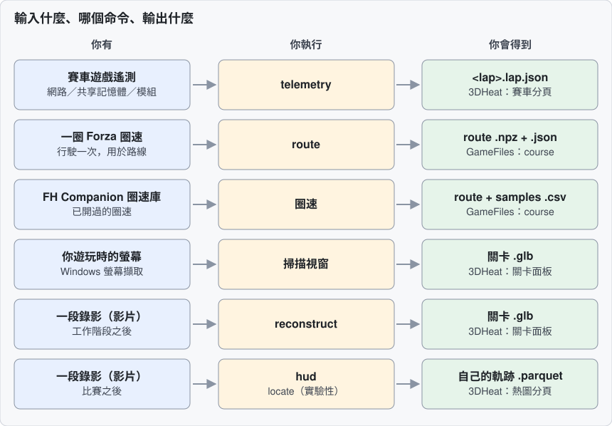

# 3DHeat GameCapture {#dheat-gamecapture}

**這是什麼？** 一個工具，會記錄賽車遊戲告訴它的你的駕駛資料，每一圈存成一個檔案。它也能從你遊玩的影片中，重建關卡的粗略 3D 模型。

**為什麼要用它？** 為了在 [3DHeat 檢視器](https://holdi601.github.io/3DHeat/)中檢視你的圈速：你在哪裡煞車、哪裡開得慢、兩圈有什麼不同。並且在沒有人有關卡的 3D 模型時，把關卡放在你的熱圖之下。

**範例：** 開啟 Forza 的 Data Out，執行一個指令，然後開兩圈。兩個圈速檔會出現在 `laps\` 中。把它們拖到檢視器的賽車分析分頁上。


第一次使用命令列？請先閱讀[開始之前](before-you-start.md)。

## 三項工作 {#the-three-jobs}

1. **圈速遙測。** 它會記錄賽車遊戲所發布的每一個頻道——Forza 的 Data Out、Assetto Corsa 系列遊戲的共享記憶體、拉力賽遊戲的網路資料流、BeamNG 模組、Trackmania 外掛——並為每一圈或每個賽段寫出一個 `heat3d-lap` 檔案，供檢視器的賽車分析分頁使用。iRacing 不需要錄製器：檢視器會直接讀取它自己的 `.ibt` 檔案。
2. **從遊玩中建立關卡。** 它會把你在關卡中步行或駕駛時螢幕所呈現的畫面，轉換成 `.glb` 3D 模型，檢視器會把它鋪在熱圖之下。
3. **比賽結束後的你自己的對戰。** `hud` 會讀取你自己錄影中的 HUD——你的動作、死亡、小地圖軌跡與擊殺訊息。`locate`（實驗性功能：目前只能放置少量真實畫面）會在關卡的 3D 模型上，判斷每一個畫面是在哪裡拍攝的。

三者都遵循同一項規則：**不向遊戲注入任何東西，也不掛鉤任何東西。** 畫面來自公開的螢幕擷取 API，遙測則來自遊戲為此發布的介面。請見[規則](../rules.md)。



本程式以 Python 撰寫（套件名稱 `heat3d_capture`），採 MIT 授權。它可以執行的深度與姿態模型，各有其自己的授權——請見[模型與授權](../models-and-licences.md)。

## 快速開始 {#quick-start}

### 錄製圈速 {#record-laps}

你需要 Python 3.10 或更新版本（[開始之前](before-you-start.md)）。在 PowerShell 中：

```powershell
git clone https://github.com/Holdi601/3DHeat-GameCapture
cd 3DHeat-GameCapture
python -m venv .venv
.venv\Scripts\python -m pip install -r requirements.txt

# Forza: Settings -> HUD and Gameplay -> Data Out = ON, IP 127.0.0.1, port 5300
.venv\Scripts\python -m heat3d_capture telemetry -o laps
```

**你應該會看到** `listening on port 5300. Laps go to laps. Ctrl+C to stop.`，然後每當你越過終點線，就會出現一行一圈的紀錄，如上方的圖片所示。按 Ctrl+C 即可停止。將 `laps\` 中的檔案拖到檢視器的賽車分析分頁上。
其他遊戲只需一個 `--game` 選項：

```powershell
.venv\Scripts\python -m heat3d_capture telemetry --game acc -o laps
.venv\Scripts\python -m heat3d_capture telemetry --game dirtrally2 -o laps
```

每個遊戲與選項的說明，請見[遙測錄製器](../telemetry.md)。

### 掃描關卡 {#scan-a-level}

在工具的資料夾中按兩下 **`scan.bat`**。它會找到 Python（若沒有，會提議用 winget 安裝），建立一個私人的 `.venv`，並開啟掃描視窗。視窗會說明缺少什麼、每個套件的用途，以及下載的大小，且未經同意不會安裝任何東西。請見[執行環境與相依套件](../runtime.md)與[掃描視窗](../reconstruction-scan-ui.md)。

手動方式：`.venv\Scripts\python -m heat3d_capture.ui`。

若要離線重建一段錄製，並一次求解攝影機路徑（需要 PyTorch、`vggt` 套件與 GPU——請見[離線重建](../reconstruction-offline.md)）：

```powershell
.venv\Scripts\python -m heat3d_capture reconstruct lap.mp4 -o lap.glb
```

## 文件地圖 {#map-of-the-documentation}

| 頁面 | 內容 |
|---|---|
| [開始之前](before-you-start.md) | Python、終端機、第一個指令、常見錯誤 |
| [規則](../rules.md) | 不注入、只使用已發布的介面，以及這樣做的代價 |
| [遙測錄製器](../telemetry.md) | `telemetry` 指令，以及每個遊戲的概覽 |
| [Forza](../telemetry-forza.md) | Data Out、版面偵測、FH Companion 轉送及其 `.tele.gz` |
| [Assetto Corsa 系列遊戲](../telemetry-assetto-corsa.md) | AC、ACC、AC EVO、AC Rally 的共享記憶體 |
| [拉力賽遊戲](../telemetry-rally.md) | EA SPORTS WRC、DiRT Rally 2.0 / 1 / DiRT 4、Richard Burns Rally |
| [BeamNG.drive](../telemetry-beamng.md) | `heat3d` 協定模組 |
| [Trackmania](../telemetry-trackmania.md) | `Heat3dRecorder` Openplanet 外掛 |
| [iRacing](../telemetry-iracing.md) | 在檢視器中讀取 `.ibt` 檔案 |
| [圈與賽段分割](../lap-splitting.md) | `LapSplitter`、`CounterSplitter`、`LineSplitter`、`StageSplitter` |
| [滑移、漂移與衍生頻道](../slip-and-drift.md) | 滑移如何縮放，以及檢視器衍生出什麼 |
| [heat3d-lap 檔案](../lap-format.md) | 圈速檔格式、頻道、單位、`meta` |
| [遊戲](../games.md) | 每個遊戲：如何錄製、傳送什麼、可以匯出哪些賽道 |
| [指令](../commands.md) | `route`、`telemetry`、`laps`、`reconstruct`、`hud`、`locate`，逐步說明 |
| [指令參考](../cli-reference.md) | 每個選項，由 `--help` 產生 |
| [從錄影讀取 HUD](../hud-video.md) | `hud`：從錄製中取得你自己的動作、死亡、小地圖軌跡與擊殺訊息 |
| [在關卡中定位畫面](../locate.md) | `locate`：每個畫面是在哪裡拍攝的，對照關卡幾何 |
| [關卡重建](../reconstruction.md) | 從畫面到 `.glb` 的流程 |
| [掃描視窗](../reconstruction-scan-ui.md) | 每個控制項、快速鍵與覆蓋元素 |
| [擷取、遮罩與畫面品質](../reconstruction-capture.md) | Windows Graphics Capture、關鍵影格、HUD 遮罩、品質建議 |
| [深度](../reconstruction-depth.md) | Depth Anything V2、ONNX Runtime、建立模型 |
| [攝影機姿態與比例](../reconstruction-pose.md) | 里程計、重定位、遙測姿態、地面比例、束調整 |
| [融合、覆蓋與顏色](../reconstruction-fusion-and-texture.md) | 佔用體積、覆蓋網格、弱點、頂點顏色 |
| [.glb 輸出](../glb-output.md) | 檢視器載入的檔案 |
| [離線重建](../reconstruction-offline.md) | `reconstruct`、VGGT 視窗與拼接 |
| [模型與授權](../models-and-licences.md) | Depth Anything V2 的大小、VGGT、各套件 |
| [執行環境與相依套件](../runtime.md) | 預檢、後端、效能等級 |
| [限制與驗證](../limits.md) | 尚未完成的部分，以及尚未檢查的部分 |
| [更新](../updates.md) | 發行版本檢查與 `python -m heat3d_update` |
| [開發](../development.md) | 測試、虛擬環境、儲存庫結構 |
| [維護這些文件](../maintaining.md) | 程式碼與文件的發行檢查清單 |

## 屬於 3DHeat 的一部分 {#part-of-3dheat}

本工具寫出的檔案，由 **3DHeat 檢視器**載入——
[原始碼](https://github.com/Holdi601/3DHeat)、[說明文件](https://holdi601.github.io/3DHeat/)。
圈速檔送到它的賽車分析分頁，`.glb` 關卡送到它的背景／關卡面板，`hud` 與 `locate` 的表格送到它的熱圖分頁；檢視器如何讀取表格與對戰檔，見
[每場對戰一個檔案（.3dheat）](https://holdi601.github.io/3DHeat/container.html)與
[載入資料](https://holdi601.github.io/3DHeat/getting-data-in.html)。

| 工具 | 功能 | 文件 |
|---|---|---|
| [3DHeat 檢視器](https://github.com/Holdi601/3DHeat) | 在瀏覽器中以 3D 顯示熱圖、賽程與對戰 | [說明文件](https://holdi601.github.io/3DHeat/) |
| [GameFiles](https://github.com/Holdi601/3DHeat-GameFiles) | 從遊戲所出貨的檔案中取得賽道與關卡，輸出為 3D 模型 | [說明文件](https://holdi601.github.io/3DHeat-GameFiles/) |
| [GameCapture](https://github.com/Holdi601/3DHeat-GameCapture) | 賽車遊戲的圈速遙測；從遊戲影片重建關卡 | [說明文件](https://holdi601.github.io/3DHeat-GameCapture/) |
| [Unreal Exporter](https://github.com/Holdi601/3DHeat-UnrealExporter) | Unreal Editor 外掛，將關卡匯出為 3D 模型 | [說明文件](https://holdi601.github.io/3DHeat-UnrealExporter/) |
| [CS2](https://github.com/Holdi601/3DHeat-CS2) | 將 Counter-Strike 2 對戰轉為對戰檔；將地圖轉為 3D 模型 | [說明文件](https://holdi601.github.io/3DHeat-CS2/) |
| [Watcher](https://github.com/Holdi601/3DHeat-Watcher) | 在背景中，依遊戲所發布的內容記錄你的遊玩 | [說明文件](https://holdi601.github.io/3DHeat-Watcher/) |
| [Ext-WarThunder](https://github.com/Holdi601/3DHeat-Ext-WarThunder) | 將 War Thunder 錄影轉為對戰檔 | [說明文件](https://holdi601.github.io/3DHeat-Ext-WarThunder/) |
| [Ext-WoT](https://github.com/Holdi601/3DHeat-Ext-WoT) | 將 World of Tanks 錄影轉為對戰檔 | [說明文件](https://holdi601.github.io/3DHeat-Ext-WoT/) |
| [Ext-WoWs](https://github.com/Holdi601/3DHeat-Ext-WoWs) | 將 World of Warships 錄影轉為對戰檔 | [說明文件](https://holdi601.github.io/3DHeat-Ext-WoWs/) |
| [Ext-Squad](https://github.com/Holdi601/3DHeat-Ext-Squad) | 將 Squad 伺服器對戰轉為對戰檔 | [說明文件](https://holdi601.github.io/3DHeat-Ext-Squad/) |
| [Ext-DCS](https://github.com/Holdi601/3DHeat-Ext-DCS) | 將 DCS World 地圖轉為 3D 模型 | [說明文件](https://holdi601.github.io/3DHeat-Ext-DCS/) |
| [Ext-IL2](https://github.com/Holdi601/3DHeat-Ext-IL2) | 將 IL-2 Sturmovik 地圖轉為 3D 模型 | [說明文件](https://holdi601.github.io/3DHeat-Ext-IL2/) |

有遊戲專案開啟的開發者，應使用 Unreal 匯出器，它讀取真實的幾何，而且是精確的。若能讀取遊戲自身的封存檔，GameFiles 可以取出精確的賽道。從遊玩中重建，則適用於只能取得螢幕畫面的情況。
