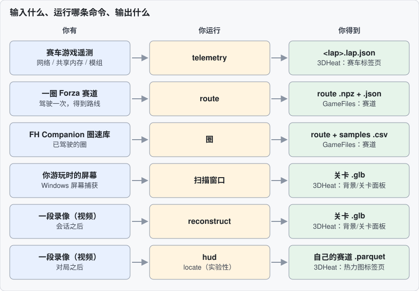

# 3DHeat GameCapture {#dheat-gamecapture}

**这是什么？** 一个工具，把赛车游戏告诉它的关于你驾驶的数据记录下来，每圈一个文件。它也可以根据你游玩时的一段视频，重建一个粗略的关卡 3D 模型。

**我为什么要用它？** 在 [3DHeat 查看器](https://holdi601.github.io/3DHeat/) 中查看你的圈速：你在哪里刹车、哪里开得慢、两圈有何不同。当没有人有某个关卡的 3D 模型时，也可以把关卡放在你的热力图下方。

**示例：** 在 Forza 中打开 Data Out，运行一条命令，然后开两圈。`laps\` 文件夹中会出现两个圈文件。把它们拖到查看器的赛车分析中即可。


第一次使用命令行？请先阅读 [开始之前](before-you-start.md)。

## 三项工作 {#the-three-jobs}

1. **圈速遥测。** 它记录赛车游戏发布的每一个通道：Forza 的 Data Out、Assetto Corsa 系列游戏的共享内存、拉力赛游戏的网络数据流、一个 BeamNG 模组、一个 Trackmania 插件，并为查看器的赛车分析每圈或每个赛段写出一个 `heat3d-lap` 文件。iRacing 无需记录器：查看器直接读取它自己的 `.ibt` 文件。
2. **从游戏过程中得到关卡。** 它把你在关卡中行走或驾驶时屏幕上显示的内容，转换成一个 `.glb` 3D 模型，查看器会把它铺在热力图下方。
3. **对局结束后，你自己的对局。** `hud` 读取你自己录像的 HUD：你的操作、死亡、小地图轨迹和击杀信息。`locate`（实验性功能：目前只能定位少量真实帧）会在关卡的 3D 模型上，算出每一帧是在哪里拍摄的。

三项工作都遵循同一条规则：**不向游戏注入任何东西，也不挂钩任何东西。** 画面来自公开的屏幕捕获 API，遥测数据来自游戏为此公开的接口。参见 [规则](../rules.md)。



本代码使用 Python 编写（包名 `heat3d_capture`），采用 MIT 许可证。它可以运行的深度模型和位姿模型各有其自己的许可证，参见 [模型与许可证](../models-and-licences.md)。

## 快速开始 {#quick-start}

### 记录圈速 {#record-laps}

你需要 Python 3.10 或更高版本（[开始之前](before-you-start.md)）。在 PowerShell 中：

```powershell
git clone https://github.com/Holdi601/3DHeat-GameCapture
cd 3DHeat-GameCapture
python -m venv .venv
.venv\Scripts\python -m pip install -r requirements.txt

# Forza：设置 -> HUD 与游戏玩法 -> Data Out = 开启，IP 127.0.0.1，端口 5300
.venv\Scripts\python -m heat3d_capture telemetry -o laps
```

**你应该看到** `listening on port 5300. Laps go to laps. Ctrl+C to stop.`，之后每当你经过终点线，就会出现一行信息，与上图相同。按 Ctrl+C 停止。将 `laps\` 中的文件拖到查看器的赛车分析中。
其他每款游戏只需使用一个 `--game` 参数即可：

```powershell
.venv\Scripts\python -m heat3d_capture telemetry --game acc -o laps
.venv\Scripts\python -m heat3d_capture telemetry --game dirtrally2 -o laps
```

每款游戏和每个选项，参见 [遥测记录器](../telemetry.md)。

### 扫描关卡 {#scan-a-level}

在工具的文件夹中双击 **`scan.bat`**。它会查找 Python（如果没有，会提议通过 winget 安装）、创建一个私有的 `.venv`，并打开扫描窗口。该窗口会说明缺少什么、每个软件包的用途，以及下载大小，未经你同意不会安装任何东西。参见 [运行环境与依赖](../runtime.md) 和 [扫描窗口](../reconstruction-scan-ui.md)。

手动运行：`.venv\Scripts\python -m heat3d_capture.ui`。

要离线重建一段录像，并一次性求解摄像机路径（需要 PyTorch、`vggt` 包和一块 GPU，参见 [离线重建](../reconstruction-offline.md)）：

```powershell
.venv\Scripts\python -m heat3d_capture reconstruct lap.mp4 -o lap.glb
```

## 文档地图 {#map-of-the-documentation}

| 页面 | 内容 |
|---|---|
| [开始之前](before-you-start.md) | Python、终端、第一条命令、常见错误 |
| [规则](../rules.md) | 不注入、只使用已公开的接口，以及这样做的代价 |
| [遥测记录器](../telemetry.md) | `telemetry` 命令及每款游戏的概览 |
| [Forza](../telemetry-forza.md) | Data Out、布局检测、FH Companion 中继及其 `.tele.gz` |
| [Assetto Corsa 系列游戏](../telemetry-assetto-corsa.md) | AC、ACC、AC EVO、AC Rally 的共享内存 |
| [拉力赛游戏](../telemetry-rally.md) | EA SPORTS WRC、DiRT Rally 2.0 / 1 / DiRT 4、Richard Burns Rally |
| [BeamNG.drive](../telemetry-beamng.md) | `heat3d` 协议模组 |
| [Trackmania](../telemetry-trackmania.md) | `Heat3dRecorder` Openplanet 插件 |
| [iRacing](../telemetry-iracing.md) | 在查看器中读取 `.ibt` 文件 |
| [圈与赛段划分](../lap-splitting.md) | `LapSplitter`、`CounterSplitter`、`LineSplitter`、`StageSplitter` |
| [打滑、漂移与派生通道](../slip-and-drift.md) | 打滑如何缩放，以及查看器推导出什么 |
| [heat3d-lap 文件](../lap-format.md) | 圈文件格式、通道、单位、`meta` |
| [游戏](../games.md) | 每款游戏：如何记录、发送什么内容、可以导出哪些赛道 |
| [命令](../commands.md) | `route`、`telemetry`、`laps`、`reconstruct`、`hud`、`locate`，逐步说明 |
| [命令参考](../cli-reference.md) | 每个选项，由 `--help` 生成 |
| [从录像读取 HUD](../hud-video.md) | `hud`：从录像中读取你自己的操作、死亡、小地图轨迹和击杀信息 |
| [在关卡中定位帧](../locate.md) | `locate`：每一帧是在哪里拍摄的，对照关卡的几何数据 |
| [关卡重建](../reconstruction.md) | 从帧到 `.glb` 的流程 |
| [扫描窗口](../reconstruction-scan-ui.md) | 每个控件、快捷键和叠加元素 |
| [截取、蒙版与帧质量](../reconstruction-capture.md) | Windows Graphics Capture、关键帧、HUD 蒙版、质量建议 |
| [深度](../reconstruction-depth.md) | Depth Anything V2、ONNX Runtime、构建模型 |
| [摄像机位姿与尺度](../reconstruction-pose.md) | 里程计、重定位、遥测位姿、地面尺度、束调整 |
| [融合、覆盖与颜色](../reconstruction-fusion-and-texture.md) | 占据体积、覆盖网格、薄弱点、顶点颜色 |
| [.glb 输出](../glb-output.md) | 查看器加载的文件 |
| [离线重建](../reconstruction-offline.md) | `reconstruct`、VGGT 窗口与拼接 |
| [模型与许可证](../models-and-licences.md) | Depth Anything V2 的尺寸、VGGT、各软件包 |
| [运行环境与依赖](../runtime.md) | 预检、后端、性能等级 |
| [限制与验证](../limits.md) | 未做的事，以及未经核实的内容 |
| [更新](../updates.md) | 发布检查与 `python -m heat3d_update` |
| [开发](../development.md) | 测试、虚拟环境、代码仓库结构 |
| [维护这些文档](../maintaining.md) | 代码与文档的发布检查清单 |

## 属于 3DHeat 的一部分 {#part-of-3dheat}

本工具写出的文件由 **3DHeat 查看器** 加载：[源代码](https://github.com/Holdi601/3DHeat)，[文档](https://holdi601.github.io/3DHeat/)。
圈文件进入它的赛车分析，`.glb` 关卡进入它的背景/关卡面板，`hud` 和 `locate` 的表格进入它的热力图标签页；查看器如何读取表格和对局文件，参见
[一场对局一个文件：`.3dheat`](https://holdi601.github.io/3DHeat/container.html) 和
[导入数据](https://holdi601.github.io/3DHeat/getting-data-in.html)。

| 工具 | 作用 | 文档 |
|---|---|---|
| [3DHeat 查看器](https://github.com/Holdi601/3DHeat) | 在浏览器中以 3D 显示热力图、赛车和对局 | [文档](https://holdi601.github.io/3DHeat/) |
| [GameFiles](https://github.com/Holdi601/3DHeat-GameFiles) | 从游戏附带的文件中提取赛道和关卡，输出为 3D 模型 | [文档](https://holdi601.github.io/3DHeat-GameFiles/) |
| [GameCapture](https://github.com/Holdi601/3DHeat-GameCapture) | 赛车游戏的圈速遥测；从游戏视频重建的关卡 | [文档](https://holdi601.github.io/3DHeat-GameCapture/) |
| [Unreal Exporter](https://github.com/Holdi601/3DHeat-UnrealExporter) | 一个 Unreal 编辑器插件，将关卡导出为一个 3D 模型 | [文档](https://holdi601.github.io/3DHeat-UnrealExporter/) |
| [CS2](https://github.com/Holdi601/3DHeat-CS2) | 将反恐精英 2 录像转为表格和对局文档；将地图转为 3D 模型 | [文档](https://holdi601.github.io/3DHeat-CS2/) |
| [Watcher](https://github.com/Holdi601/3DHeat-Watcher) | 在后台根据游戏公开的数据记录你的游戏过程 | [文档](https://holdi601.github.io/3DHeat-Watcher/) |
| [Ext-WarThunder](https://github.com/Holdi601/3DHeat-Ext-WarThunder) | 将战争雷霆的录像转为表格和对局文档 | [文档](https://holdi601.github.io/3DHeat-Ext-WarThunder/) |
| [Ext-WoT](https://github.com/Holdi601/3DHeat-Ext-WoT) | 将坦克世界的录像转为表格和对局文档 | [文档](https://holdi601.github.io/3DHeat-Ext-WoT/) |
| [Ext-WoWs](https://github.com/Holdi601/3DHeat-Ext-WoWs) | 将战舰世界的录像转为表格和对局文档 | [文档](https://holdi601.github.io/3DHeat-Ext-WoWs/) |
| [Ext-Squad](https://github.com/Holdi601/3DHeat-Ext-Squad) | 将 Squad 服务器录像转为表格和对局文档 | [文档](https://holdi601.github.io/3DHeat-Ext-Squad/) |
| [Ext-DCS](https://github.com/Holdi601/3DHeat-Ext-DCS) | 将 DCS World 地图转为 3D 模型 | [文档](https://holdi601.github.io/3DHeat-Ext-DCS/) |
| [Ext-IL2](https://github.com/Holdi601/3DHeat-Ext-IL2) | 将 IL-2 Sturmovik 地图转为 3D 模型 | [文档](https://holdi601.github.io/3DHeat-Ext-IL2/) |

开发者如果打开了游戏的项目，应使用 Unreal 导出器，它读取真实的几何数据，且是精确的。当游戏自身的归档可以读取时，GameFiles 会提取精确的赛道。从游戏过程重建，适用于只能获得屏幕画面的情况。
